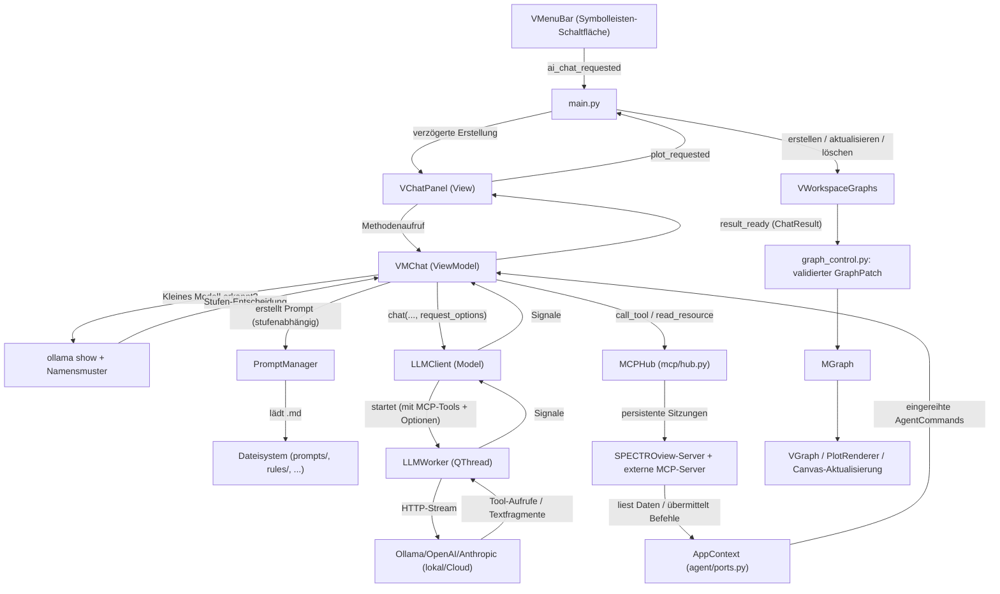
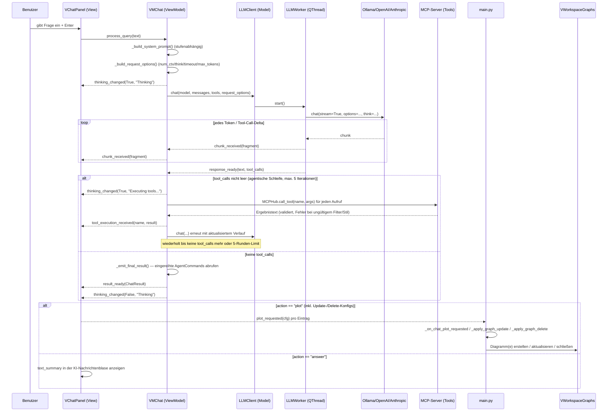

# **AI Data Chat** { #ai-data-chat }

Der `AI Data Chat` ist ein optionaler, anbieterübergreifender KI-Chatbot, mit dem Benutzer ihre Daten in natürlicher Sprache abfragen, filtern, plotten und bearbeiten können. Er unterstützt lokale Inferenz über **Ollama**, Cloud-Anbieter über das **OpenAI**-SDK (OpenAI, DeepSeek, Gemini sowie jeden OpenAI-kompatiblen Endpunkt) und **Anthropic**-Claude-Modelle. Der Agent kommuniziert mit dem `Graphs`-Arbeitsbereich, um Plots in Echtzeit zu erstellen, zu aktualisieren und zu löschen.

> Die Nutzung des KI-Moduls ist **optional** — läuft Ollama nicht und ist kein Cloud-API-Schlüssel konfiguriert, zeigt das Chat-Panel einen roten Status „not connected“ an, während der Rest von SPECTROview völlig unbeeinträchtigt bleibt. Die zugrunde liegenden Python-Pakete (`ollama`, `openai`, `anthropic`, `mcp`) sind jedoch unbedingte Installationsabhängigkeiten des Projekts (siehe [Verwaltung optionaler Abhängigkeiten](#optional-dependency-management)).

Auch eine zweite, eigene Dimension von „optional“ spielt hier eine wichtige Rolle: **kleine lokale Modelle erhalten einen anderen, vereinfachten Prompt und eine eigene Anfragekonfiguration als große bzw. Cloud-Modelle** — dies ist die größte architektonische Erweiterung seit der MCP-Migration und wird weiter unten in einem eigenen Abschnitt behandelt ([Unterstützung kleiner Modelle](#small-model-support)).

---

## **Voraussetzungen für Benutzer** { #prerequisites-for-users }

### **Option 1: macOS** { #option-1-macos }

1. **Ollama installieren**
   Mit Homebrew (empfohlen):
   ```bash
   brew install ollama
   ```
   *(Alternativ können Sie die macOS-Anwendung direkt von der [offiziellen Ollama-Website](https://ollama.com/download/mac) herunterladen.)*

2. **Den Ollama-Dienst starten**
   Falls Sie Homebrew verwendet haben, starten Sie Ollama als Hintergrunddienst:
   ```bash
   brew services start ollama
   ```
   *(Falls Sie die Mac-App installiert haben, öffnen Sie einfach die Anwendung Ollama aus Ihrem Programme-Ordner. Das Symbol erscheint anschließend in Ihrer Menüleiste.)*

### **Option 2: Windows** { #option-2-windows }

1. **Ollama installieren**
   Laden Sie das Windows-Installationsprogramm von der [offiziellen Ollama-Website](https://ollama.com/download/windows) herunter und führen Sie es aus.

2. **Den Ollama-Dienst starten**
   Ollama startet nach der Installation in der Regel automatisch. Falls nicht, suchen Sie im Startmenü nach „Ollama“ und öffnen Sie die Anwendung. Das Ollama-Symbol sollte im Infobereich der Taskleiste (unten rechts) erscheinen.

---

### **Gemeinsame Schritte (beide Plattformen)** { #common-steps-both-platforms }

3. **Ein KI-Modell herunterladen**
   SPECTROview verwendet standardmäßig `qwen2.5-coder:7b`. Öffnen Sie Ihr Terminal (bzw. Eingabeaufforderung / PowerShell unter Windows) und laden Sie das Modell herunter:
   ```bash
   ollama pull qwen2.5-coder:7b
   ```
   Jedes Ollama-Modell mit Unterstützung für Tool-/Function-Calling funktioniert — unter [Unterstützung kleiner Modelle](#small-model-support) erfahren Sie, wie SPECTROview sein Verhalten an das gewählte Modell anpasst.

4. **SPECTROview installieren**
   `ollama`, `openai`, `anthropic` und `mcp` sind Kernabhängigkeiten des Pakets (keine separate Extras-Gruppe), sodass eine reguläre Installation bereits alles enthält, was die KI-Funktion benötigt:
   ```bash
   pip install -e .
   ```

5. **SPECTROview starten**
   Starten Sie die Anwendung:
   ```bash
   python -m spectroview.main
   ```
   Klicken Sie auf die Schaltfläche **AI Data Chat** in der oberen Symbolleiste. Das Chat-Panel öffnet sich, und in der Statusleiste sollte **🟢 Ollama connected** angezeigt werden.

---

## **Architekturübersicht** { #architecture-overview }

Die KI-Funktion folgt demselben strikten **MVVM**-Muster wie der Rest der Anwendung. Der gesamte KI-bezogene Code befindet sich im Paket `spectroview/ai_agent/`, isoliert von den Hauptarbeitsbereichen.



### **Die AppContext-Grenze** { #the-appcontext-boundary }

Der MCP-Server importiert `VMChat` **nicht**. Er erhält einen `AppContext`
(`agent/ports.py`) — ein Protokoll mit fünf Methoden: DataFrames auflisten, einen DataFrame abrufen, den
aktiven Namen abfragen, Diagramme auflisten und einen Befehl einreichen. `VMChat` stellt einen `VMChatContext`-Adapter bereit; Tests liefern `RecordingContext`.

Genau dadurch lässt sich die Tool-Schicht unabhängig testen (ohne Qt, ohne LLM, ohne
Anwendung), und derselbe Server könnte auch außerhalb des Prozesses laufen. Tools mutieren niemals
das ViewModel; sie übermitteln typisierte Befehle (`agent/commands.py`:
`CreatePlot`, `UpdatePlot`, `DeletePlots`). Eingaben für Plots und Aktualisierungen werden vor dem
Einreihen über den gemeinsamen Vertrag `spectroview.model.graphs.graph_control` validiert,
und der Arbeitsbereich Diagramme wendet genau denselben Vertrag an der Mutationsgrenze erneut an.

SPECTROview verfügt außerdem über ein vollständiges externes Desktop-MCP-Profil. Es nutzt dasselbe
FastMCP-Modul, arbeitet jedoch auf `SpectroviewApplicationAPI`, einer Live-Sitzungsfassade,
die durch einen gequeueten Qt-Hauptthread-Dispatcher geschützt ist. Der interne Chat behält
das hier dokumentierte Fünf-Tool-Profil zugunsten der Zuverlässigkeit kleiner Modelle bei. Siehe
[Lokaler MCP-Server](mcp_server.md) für den Endpunkt, den vollständigen Tool-Katalog und den
Erweiterungs-Workflow.

### **Vollständiger Vertrag zur Diagrammanpassung** { #complete-graph-customization-contract }

Die MCP-Tools behalten zugunsten der Zuverlässigkeit kleiner Modelle einige wenige gängige Top-Level-Parameter bei und stellen für den vollständigen Umfang `other_properties: GraphPatch` bereit.
`GraphPatch` wird aus jedem veränderlichen Dataclass-Feld von `MGraph` mit
`extra="forbid"` generiert; verschachtelte Datensätze für Filter, Serienstile, Rahmenlinien (Spines), Achsenbrüche und Anmerkungen sind ebenfalls typisiert. So wird verhindert, dass eine manuell gepflegte Positivliste (Allowlist) hinter der GUI zurückbleibt, und ein einziger kohärenter Aufruf kann logarithmische Skalierung, Schriftarten, Legendenplatzierung, Linienstärken, Anmerkungen, Nebenachsen, Einsatzfenster-Geometrie und jeden weiteren Diagrammzustand gemeinsam aktualisieren.

Weglassen bedeutet Beibehalten. Ein explizites `null` wird nur für nullbare Felder akzeptiert.
Der Server validiert Filter gegen den Ziel-DataFrame und prüft
`graph_id="all"` gegen jedes geöffnete Diagramm, bevor ein einzelner atomarer Befehl eingereiht wird.
Das Tool-Ergebnis meldet bewusst „validated and queued“, da ausschließlich der GUI-Thread das endgültige Rendering verlässlich bestätigen kann.

### **MCPHub — eine Schleife, viele Server** { #mcphub-one-loop-many-servers }

`MCPHub` (`mcp/hub.py`) besitzt eine einzige `asyncio`-Ereignisschleife in einem Hintergrund-Thread
und hält für jeden in `config/servers.yaml` aufgeführten Server (`in-process`, `stdio` oder `http`) eine initialisierte Sitzung offen. Aufrufer im Qt-Thread verwenden
einfache synchrone Methoden; der Hub leitet jeden Aufruf auf seine Ereignisschleife um.

Zuvor rief das ViewModel `asyncio.run()` direkt im GUI-Thread auf und
baute die Server-Sitzung für jeden Tool-Batch neu auf — was die Benutzeroberfläche blockierte und nur funktionierte, weil der einzige Server in-process lief.

Tool-Namen bleiben unqualifiziert, solange sie serverübergreifend eindeutig sind (sodass `plot_graph` überall dort weiter funktioniert, wo es dokumentiert ist); ein Name, der von zwei Servern angeboten wird, wird für beide zu `<server_id>__<tool>`. Eine serverbezogene Positivliste `tools:` hält die
angebotene Menge klein — Tool-Schemas sind bei jedem Zug Prompt-Tokens, und kleine lokale Modelle bauen ab etwa einem Dutzend Tools schnell ab.

### **Push- vs. Pull-Kontext** { #pushed-vs-pulled-context }

Der System-Prompt enthält stets die Namen und Dimensionen der DataFrames, jeden Spaltennamen
samt seinem `dtype` sowie eine kompakte Zusammenfassung jedes geöffneten Diagramms. Beispielwerte, Zeilenvorschauen und die tatsächlichen vollständigen `MGraph.save()`-Konfigurationen sind umfangreich und
selten ausschlaggebend; daher liegen sie hinter MCP-**Ressourcen**
(`spectroview://dataframes/detail`, `spectroview://graphs/detail`).

Keine LLM-API kennt nativ das Konzept einer Ressource, weshalb der Hub das Auslesen als
synthetisches Tool `get_context(uri)` bereitstellt, dessen `uri`-Enum genau die aktuell verfügbaren Ressourcen auflistet — was zudem grammatikgesteuerte lokale Modelle auf eine reale URI einschränkt. Ressourcen, die von einem beliebigen Server hinzugefügt werden, erscheinen dort ohne Client-Änderung.

---

## **Modulstruktur** { #module-structure }

```
spectroview/ai_agent/
├── __init__.py              # Docstring only — keeps the module optional
├── config/                  # YAML configuration (model.yaml, settings.yaml, servers.yaml)
├── examples/                # Few-shot conversation examples (Markdown)
│   ├── plotting_examples.md #   Full-tier: 13 examples, tool-call style
│   └── examples_small.md    #   Simplified-tier: ~8 tight examples covering all 5 tools
├── knowledge/                # Static domain facts (Markdown; full tier only)
├── prompts/                  # Core identity + per-topic instructions (Markdown)
│   ├── system.md, chat.md, plotting.md   # Full tier (default; also used by cloud providers)
│   └── system_small.md      #   Simplified tier — single consolidated file for detected small models
├── rules/                   # Behavioural constraints (Markdown)
├── agent/                   # Qt-free core
│   ├── commands.py          #   CreatePlot / UpdatePlot / DeletePlots dataclasses
│   └── ports.py             #   AppContext protocol + RecordingContext (the test fake)
├── utils/
│   ├── plot_utils.py        # normalize_plot_config / expand_comma_styles — type coercion for plot configs
│   ├── safe_eval.py         # evaluate_pandas_expression() — df.query() first, sandboxed eval() fallback
│   └── df_summary.py        # compact_dataframe_schema() for the prompt; summarize_dataframe_columns() for the resource
├── m_llm_client.py          # Model layer: LLM connections + QThread workers
│                            #   - LLMWorker (Ollama)
│                            #   - APIWorker (OpenAI-compatible)
│                            #   - AnthropicWorker (Anthropic SDK)
│                            #   - anthropic_tools()/anthropic_messages() — protocol translation
│                            #   - LLMClient (unified facade)
│                            #   - get_ollama_model_info() — `ollama show` wrapper for size detection
├── m_conversation.py        # Data model: single conversation (messages, save/load JSON)
├── m_conversation_store.py  # Conversation store: scan/list/load saved conversations
├── mcp/
│   ├── server.py            # SPECTROview's FastMCP server: 5 tools + 2 resources
│   ├── hub.py               # MCP client: one loop thread, one session per server
│   └── config.py            # servers.yaml -> validated ServerSpec list
├── m_prompt_manager.py      # Prompt caching and assembly: loads and merges the Markdown fragments
├── vm_chat.py               # ViewModel: prompt-tier selection, small-model detection, request tuning, agentic loop
├── v_chat_panel.py          # View: embedded chat panel (QWidget) beside workspace tabs
└── v_history_dialog.py      # View: history browser dialog (QDialog) with timestamps, pinning, search, and batch delete
```

### **Rolle der Dateien** { #file-roles }

| Datei | Schicht | Zuständigkeit |
|-------|---------|---------------|
| `m_prompt_manager.py` | **Model** | Lädt Markdown-Dateien, hält sie im Cache und setzt sie für gegebene Listen `prompts=`/`rules=`/`knowledge=`/`examples=` zu einem System-Prompt zusammen. Parst außerdem `config/model.yaml`/`config/settings.yaml` (`.model_config`). |
| `m_llm_client.py` | **Model** | Kapselt Ollama, das OpenAI-SDK und das Anthropic-SDK. Prüft die Verfügbarkeit, listet Modelle auf, ermittelt die Parameteranzahl eines Modells (`get_ollama_model_info`), übersetzt den OpenAI-Tool-Dialekt in den von Anthropic und startet je nach gewähltem Anbieter einen von drei `QThread`-Workern im Hintergrund. |
| `m_conversation.py` | **Model** | Repräsentiert eine einzelne Unterhaltung: Nachrichten hinzufügen (einschließlich `tool_calls`/`tool_call_id`), automatische Titelvergabe, Speichern/Laden als JSON, Begrenzung auf die letzten N Nachrichten, **ohne einen Tool-Aufruf von seinem Ergebnis zu trennen**. Überspringt das Speichern leerer Unterhaltungen. |
| `m_conversation_store.py` | **Model** | Durchsucht den Verlaufsordner, listet gespeicherte Unterhaltungen als schlanke Zusammenfassungen auf und lädt Unterhaltungen anhand ihrer ID. |
| `agent/ports.py` | **Model** | `AppContext` — das Einzige, was die MCP-Tools über die Anwendung wissen. `RecordingContext` ist die In-Memory-Implementierung, die in jedem Tool-Test verwendet wird. |
| `agent/commands.py` | **Model** | `CreatePlot`/`UpdatePlot`/`DeletePlots` — das, worum ein Tool die Anwendung bittet, anstelle roher Dictionaries mit Schlüsseln `_graph_update`/`_graph_delete`. |
| `mcp/server.py` | **Model** | FastMCP-Server, der die 5 Tools und 2 Ressourcen von SPECTROview mit anfragezeitiger Validierung von Filtern und Plot-Typen bereitstellt. Hängt ausschließlich von `AppContext` ab. |
| `mcp/hub.py` | **Model** | MCP-Client: Hintergrund-Ereignisschleife, eine persistente Sitzung pro konfiguriertem Server, Qualifizierung von Tool-Namen, Positivlisten (Allowlists) und das synthetische Ressourcen-Tool `get_context`. |
| `mcp/config.py` | **Model** | Parst und validiert `config/servers.yaml`; überspringt (mit Warnung) jeden Eintrag, der fehlerhaft, deaktiviert oder eine doppelte ID ist. |
| `utils/safe_eval.py` | **Model** | Gemeinsamer, in einer Sandbox laufender Evaluator für pandas-Ausdrücke, der sowohl von `query_dataframe` als auch vom Filter-Validierungsschritt in `plot_graph`/`update_graph` genutzt wird. |
| `utils/df_summary.py` | **Model** | `compact_dataframe_schema()` erstellt den stets übergebenen Block aus Namen und dtypes; `summarize_dataframe_columns()` erstellt die detaillierte Auflistung für die Ressource `dataframes/detail` und fasst oberhalb von `column_detail_threshold` Spalten nach Präfix zusammen, ohne jemals einen Spaltennamen zu verbergen. |
| `utils/plot_utils.py` | **Model** | `normalize_plot_config()`/`expand_comma_styles()` — bereitet akkumulierte Plot-Konfigurationen nach (Typumwandlung, Expansion kommagetrennter Mehrfach-Stile), bevor sie den Arbeitsbereich Diagramme erreichen. |
| `vm_chat.py` | **ViewModel** | Erkennt die Modellstufe (klein vs. voll), erstellt den stufengerechten System-Prompt, stellt Ollama-/Timeout-/Max-Token-Anfrageoptionen zusammen, verwaltet den Unterhaltungsverlauf und führt die agentische Tool-Calling-Schleife aus (bis zu 5 Züge). |
| `v_chat_panel.py` | **View** | Eingebettetes `QWidget`-Panel mit Chat-Blasen, Anbieter-/Modellauswahl, Zeitstempelanzeige, kompakter 42-px-Kopfzeile und mehrzeiliger Eingabekarte. Sendet `plot_requested(dict)`, wenn die KI ein Diagramm erstellt/aktualisiert/löscht. Die Modellauswahl ist eine **editierbare** `QComboBox` (ein Modellname kann direkt eingetippt werden); für den Anbieter **Benutzerdefiniert** (Custom) wird ihre Liste über `_custom_model_names()` aus der kommagetrennten Einstellung `custom_models` (**Einstellungen** (Settings) ▸ AI) befüllt, sodass auch Endpunkte ohne Modellauflistungs-API nutzbar bleiben. |
| `v_history_dialog.py` | **View** | Durchsuchbare Liste gespeicherter Unterhaltungen, sortiert nach den neuesten zuerst. Unterstützt Öffnen, Umbenennen, Duplizieren und Löschen. |

---

## **Unterstützung kleiner Modelle** { #small-model-support }

Kleine lokale Modelle (grob gesagt alles unter ~10 Mrd. Parametern) erhalten einen spürbar anderen Prompt, ein anderes Kontextbudget und eine andere Anfragekonfiguration als große bzw. Cloud-Modelle — nicht bloß eine kürzere Fassung desselben Inhalts. Der Grund ist, dass ein großer, informationsdichter Prompt mit einem nicht gesetzten Kontextfenster für sich genommen ausreicht, um ein ansonsten fähiges kleines Modell beim Tool-Calling scheitern zu lassen (siehe die Fallstudie am Ende dieses Abschnitts).

### Erkennung { #detection }

`VMChat._auto_detect_small_model()` entscheidet in folgender Reihenfolge:

1. **Manuelle Überschreibung** — `VMChat.set_small_model_mode(True | False | None)`. `None` (der Standardwert) bedeutet „automatische Erkennung beibehalten“ und wird über `MSettings` persistiert.
2. **Prüfung der Parameteranzahl** (nur Ollama) — `get_ollama_model_info(model)` ruft `ollama show <model>` auf, parst `details.parameter_size` (z. B. `"8.2B"`) über `_parse_param_size_to_billions()` und vergleicht den Wert mit `small_model_param_threshold_b` aus `config/model.yaml` (Standard **10.0**). Wird für die Lebensdauer der `VMChat`-Instanz pro Modellname im Cache gespeichert.
3. **Fallback über Namensmuster** — lässt sich die Parameteranzahl nicht bestimmen (Cloud-Modell oder `ollama show` schlägt fehl), wird der Modellname gegen `VMChat._SMALL_MODEL_PATTERNS` abgeglichen, eine Liste bekannter Tags kleiner Modelle (`qwen3:8b`, `gemma3:4b`, `phi3:mini`, `deepseek-r1:8b` usw.).
4. **Standard: vollständige Stufe.** Greift keine Regel, wird das Modell als groß behandelt. Einem unerkannten Modell den vollständigen Prompt zu geben, ist der sicherere Fehlerfall, als ein unerkanntes *großes* Modell unnötig einzuschränken.

Die Erkennung ist für die Schritte 2–3 fest auf `provider == "Ollama"` begrenzt — Cloud-Anbieter erhalten immer die vollständige Stufe, sofern keine manuelle Überschreibung etwas anderes erzwingt. Die Erkennung läuft bei `set_model()`/`set_provider()` erneut, niemals in `__init__` (ein Netzwerkaufruf an `ollama show` darf nicht mit der Objektkonstruktion in ein Wettlaufproblem geraten).

### **Persistierte Einstellungen** { #persisted-settings }

Alles, was der Agent speichert — Anbieter, gewähltes Modell pro Anbieter, Prompt-Stufe und Chatverlaufs-Ordner — liegt unter dem Präfix `ai_chat/` des zentralen Anwendungsspeichers, auf den über `MSettings.get_ai_value()` / `set_ai_value()` zugegriffen wird. Das KI-Modul importiert kein eigenes `QSettings`.

Früher wurde ein zweites `QSettings("SPECTROview", "AIChat")`-Paar geführt. Dadurch war die Konfiguration des Agenten für den Rest der App unsichtbar und schlüpfte, schlimmer noch, an der Test-Fixture `_isolate_qsettings` vorbei — sodass jeder Test, der ein `VMChat` instanziierte, die echten Einstellungen der Entwickler las und Chatverläufe in deren echten Verlaufsordner schrieb. `MSettings._migrate_legacy_ai_settings()` kopiert die alten Werte einmalig herüber (abgesichert durch einen Markierungsschlüssel, ohne jemals einen neueren Wert zu überschreiben) und belässt den Alt-Speicher an Ort und Stelle, damit ältere Builds weiterhin laufen.

> **Geheimnisse (`spectroview/settings/secrets.py`)**: API-Schlüssel (`OpenAI`, `Anthropic`, `Mistral`, `Gemini`, `DeepSeek`, `Custom`) werden über `SecretStore` im benutzerspezifischen Konfigurationsspeicher des Betriebssystems abgelegt (`QSettings("CEA-Leti", "SPECTROview")` unter dem verschleierten Namensraum `_credentials/`) und strikt aus exportierten `config.json`-Dateien ausgeschlossen, damit Zugangsdaten nicht geleakt oder versehentlich eingecheckt werden können. `config/servers.yaml` *ist* versioniert: tragen Sie dort niemals ein Token ein, sondern verwenden Sie stattdessen `${VAR}` (wird von `mcp/config.py` expandiert).

### Was sich im vereinfachten Modus ändert { #what-changes-in-simplified-mode }

Alle vier folgenden Aspekte werden in `vm_chat.py` berechnet und aus `config/model.yaml` gelesen:

| Aspekt | Vollständige Stufe | Vereinfachte Stufe | Konfigurationsschlüssel |
|---|---|---|---|
| System-Prompt | `system.md`+`chat.md`+`plotting.md` + `rules/general,plotting,spectroview` + `knowledge/features` + `examples/plotting_examples` (~27K Zeichen) | `system_small.md` + `rules/general` + `examples/examples_small` (~9K Zeichen) | k. A. (fest codierte Listen in `_build_system_prompt()`) |
| Unterhaltungsverlauf | unbegrenzt | letzte 6 Nachrichten | `max_context_messages` / `max_context_messages_small` |
| Ollama `num_ctx` | 16384 | 8192 | `ollama_num_ctx_full` / `ollama_num_ctx_small` |
| Max. Ausgabetokens | 81920 | 4096 | `max_tokens` / `max_tokens_small` |
| Ollama `think` | nicht gesetzt (Modell-/Ollama-Standard) | `false` | `ollama_think` |

`rules/general.md` wird von beiden Stufen gemeinsam genutzt (die Datei ist klein und universell gültig); `rules/plotting.md`, `rules/spectroview.md` und `knowledge/features.md` sind ausschließlich der vollständigen Stufe vorbehalten — ihre wesentlichen Inhalte (Quotierung von Filtern, Achsenabbildung für räumliche Plots) sind stattdessen direkt in `system_small.md` integriert.

`num_ctx` und `think` gelten ausschließlich für Ollama-`options`: Das `request_options`-Dictionary von `LLMClient.chat()` wird pro Anbieter übersetzt, und diese beiden Schlüssel werden niemals an `APIWorker`/`AnthropicWorker` weitergereicht — es ist strukturell ausgeschlossen, dass sie DeepSeek/OpenAI/Anthropic/Gemini beeinflussen, unabhängig davon, welche Stufe aktiv ist.

### Anpassungen auf Schemaebene (helfen jedem Modell, nicht nur kleinen) { #schema-level-accommodations-help-every-model-not-just-small-ones }

Zwei Änderungen in `mcp/server.py` reduzieren Mehrdeutigkeiten für *jedes* Modell, unabhängig von der Prompt-Stufe:

- `plot_style` ist ein `Literal[...]` (erzeugt ein echtes JSON-Schema-`enum` der 9 gültigen Plot-Typen) anstelle eines reinen `str`.
- Die gebräuchlichsten `other_properties`-Schlüssel (`grid`, `plot_title`, `xlabel`, `ylabel`, `zlabel`, Achsengrenzen, `color_palette`, Log-Skala-Flags usw.) sind explizite, typisierte, benannte Parameter von `plot_graph`/`update_graph`, zusätzlich zum Sammel-Dictionary `other_properties`. Ein Modell, das `grid=true` auf der obersten Ebene des Aufrufs übergibt (statt korrekt verschachtelt in `other_properties`), verliert diesen Wert nicht mehr — beide Formen werden in der endgültigen Konfiguration zusammengeführt, wobei im Konfliktfall der benannte Parameter Vorrang hat.

### Fallstudie: qwen3:8b { #case-study-qwen38b }

Bei derselben Anfrage nach 3 Plots war ein großes Cloud-Modell (DeepSeek) in einem einzigen Zug erfolgreich; `qwen3:8b` scheiterte vor Einführung dieses Systems bei zwei Versuchen auf zwei verschiedene Arten:

- **Versuch A**: gab null Tool-Aufrufe aus — stattdessen 2.237 Zeichen Prosa, die einen Plan in als ```python formatiertem Pseudocode beschrieb, der nie tatsächlich ausgeführt wurde.
- **Versuch B**: gab gültige Tool-Aufrufe aus, setzte aber `grid: true` als Top-Level-Argument (die einzige Stelle, an der die echte Signatur es akzeptierte, war verschachtelt in `other_properties`) — von MCP/Pydantic stillschweigend verworfen, kein Fehler, kein erneuter Versuch.

Nach den obigen Korrekturen: **3/3 Wiederholungsläufe waren erfolgreich**, wobei jeder genau 3 korrekt aufgebaute `plot_graph`-Aufrufe (mit sauber erhaltenem `grid`) und eine abschließende Zusammenfassung lieferte — in durchschnittlich ~19 s gesamt gegenüber den ursprünglichen 42–100 s *pro einzelnem fehlgeschlagenen Zug*.

---

## **Wichtige Klassen** { #key-classes }

### **`LLMWorker` / `APIWorker` / `AnthropicWorker` — Hintergrund-Threads** { #llmworker-apiworker-anthropicworker-background-threads }

**Datei**: `spectroview/ai_agent/m_llm_client.py`

Drei `QThread`-Unterklassen, eine pro Backend. Jede führt eine einzelne Streaming-Chat-Anfrage aus (bzw. bei Anthropic mit Tools eine nicht-streamende Anfrage).

| Klasse | Backend | Benötigtes Paket | Zusätzliche Konstruktorparameter |
|--------|---------|------------------|----------------------------------|
| `LLMWorker` | Ollama (lokal) | `ollama` | `options` (dict: `num_ctx`, `num_predict`), `think` (`bool`\|`"low"`\|`"medium"`\|`"high"`\|`None`), `timeout` |
| `APIWorker` | OpenAI, DeepSeek, Gemini, Custom | `openai` | `timeout`, `max_tokens` |
| `AnthropicWorker` | Anthropic Claude | `anthropic` | `timeout`, `max_tokens` |

`LLMWorker` erzeugt nur dann ein `ollama.Client(timeout=...)`, wenn tatsächlich ein Timeout gesetzt ist; andernfalls nutzt er direkt die Hilfsfunktion `ollama.chat()` auf Modulebene. Von Ollama zurückgegebene Tool-Aufrufe treffen als Pydantic-Modellobjekte (`ollama._types.Message.ToolCall`) ein, nicht als einfache Dictionaries — `LLMWorker.run()` normalisiert jedes Objekt vor dem Emittieren über `.model_dump()`, sodass `MConversation.save()` (reines `json.dump`) nicht an einem nicht serialisierbaren Objekt scheitert.

| Signal | Nutzlast (Payload) | Zweck |
|--------|--------------------|-------|
| `chunk_received` | `str` | Jedes gestreamte Token-Fragment |
| `response_ready` | `(str, list)` | Vollständig zusammengesetzter Antworttext + akkumulierte Tool-Aufrufe |
| `error_occurred` | `str` | Fehlermeldung, falls das Backend nicht erreichbar ist |

> **Fehlermeldungen legen die eigentliche Ursache offen.** Alle drei Worker leiten abgefangene Ausnahmen durch `_format_exception()`, das die `__cause__`/`__context__`-Kette durchläuft. Die SDKs von `openai`/`anthropic` fassen Low-Level-TLS-/Socket-Fehler zu einem knappen `APIConnectionError("Connection error.")` zusammen; ohne diesen Durchlauf würden ein Unternehmens-CA-`CERTIFICATE_VERIFY_FAILED`, ein DNS-`getaddrinfo failed` oder eine abgewiesene Verbindung alle identisch und nicht diagnostizierbar dargestellt.

> **Unternehmens- / interne CA-TLS-Zertifikate.** `openai`/`anthropic` verifizieren TLS über httpx gegen das certifi-Bündel, dem private Unternehmens-CAs fehlen — ein On-Premises-Endpunkt scheitert dann mit dem undurchsichtigen „Connection error.“ von oben. `m_llm_client` handhabt dies bereits beim Import: Benennt `SSL_CERT_FILE`/`REQUESTS_CA_BUNDLE` eine PEM-Datei, wird diese als httpx-`verify` übergeben (`_make_http_client()`, das über `http_client=` an jeden SDK-Client durchgereicht wird); andernfalls leitet `truststore.inject_into_ssl()` die Verifizierung über den Zertifikatsspeicher des Betriebssystems (z. B. den Windows-Zertifikatsspeicher), wo solche CAs in der Regel bereits hinterlegt sind. `truststore` ist eine Kernabhängigkeit; der Import ist dennoch geschützt, sodass ein Fehlen in einer Umgebung lediglich certifi als Standard belässt.

> Das Ollama-Feld `message["thinking"]` (der verborgene Notizblock von Hybrid-Reasoning-Modellen, wenn `think` aktiviert ist) wird absichtlich **niemals** an `chunk_received` bzw. den Antworttext angehängt — genau durch das Zusammenführen eines verborgenen Reasoning-Kanals in die sichtbare Antwort entsteht der oben gezeigte qwen3-Fehler „Versuch A“. Ein UI-Umschalter „Show model reasoning“ (ein Opt-in-Override `think=True` sowie ein einklappbarer Reasoning-Bereich unter jeder Nachrichtenblase) existierte zeitweise und wurde inzwischen **vollständig entfernt** — die App fordert `think=True` nie mehr explizit an, sodass `think` einfach beim Standard der jeweiligen Stufe bleibt (nicht gesetzt für die vollständige Stufe, `false` für die kleine Stufe; siehe Tabelle unter [Unterstützung kleiner Modelle](#small-model-support)). Die Kanaltrennung selbst bleibt unabhängig von dieser Entfernung erhalten: Selbst wenn ein Modell unaufgefordert `thinking`-Inhalte ausgibt, hält das Signal `thinking_chunk_received` von `LLMWorker` (und `VMChat._on_thinking_chunk`, das das Fragment nun einfach verwirft statt es anzuzeigen) diese aus dem Antwortkanal heraus.

### **`LLMClient` — Verbindungsfassade** { #llmclient-connection-facade }

**Datei**: `spectroview/ai_agent/m_llm_client.py`

Eine schlanke, Qt-freie Fassade, welche die Anbieterauswahl, die Speicherung von API-Schlüsseln und den Worker-Lebenszyklus verwaltet.

**Bekannte Anbieter** (definiert im Dictionary `API_PROVIDERS`):

- `Ollama` → `LLMWorker`
- `OpenAI`, `DeepSeek`, `Gemini`, `Custom` → `APIWorker`
- `Anthropic` → `AnthropicWorker`

| Methode | Zweck |
|---------|-------|
| `is_available()` | `True`, wenn das Paket des aktiven Anbieters installiert ist und (Ollama) der Daemon antwortet bzw. (Cloud) ein API-Schlüssel gesetzt ist |
| `get_models()` | Sortierte Liste der verfügbaren Modellnamen für den aktiven Anbieter |
| `chat(model, messages, on_chunk, on_done, on_error, tools=None, parent=None, request_options=None)` | Startet den passenden Hintergrund-Worker für den aktiven Anbieter; bricht zuvor jede laufende Anfrage ab. `request_options` (`num_ctx`/`think`/`timeout`/`max_tokens`) wird pro Anbieter übersetzt — siehe [Unterstützung kleiner Modelle](#small-model-support) zur anbieterübergreifenden Isolationsgarantie. |
| `cancel()` | Beendet den aktuellen Worker-Thread |
| `is_busy()` | `True`, solange ein Worker läuft |

**Hilfsfunktion auf Modulebene**: `get_ollama_model_info(model) -> Optional[ollama.ShowResponse]` — Best-Effort-Aufruf von `ollama.show()`, gibt bei jedem Fehler `None` zurück und löst niemals eine Ausnahme aus. Wird von der Kleines-Modell-Erkennung in `VMChat` genutzt.

**Standardmodell**: `qwen2.5-coder:7b` (konfigurierbar über die UI-Auswahlliste; `LLMClient.DEFAULT_MODEL`).

### **`PromptManager` — Prompt-Zusammenstellung** { #promptmanager-prompt-assembly }

**Datei**: `spectroview/ai_agent/m_prompt_manager.py`

Ein cachender Manager, der Markdown-Abschnitte von der Festplatte liest und sie für die jeweils übergebenen Listen `prompts=`/`rules=`/`knowledge=`/`examples=` zu einem System-Prompt verknüpft.

| Methode | Zweck |
|---------|-------|
| `load_prompt(name)` / `load_rule(name)` / `load_knowledge(name)` / `load_example(name)` | Lädt eine Markdown-Datei anhand ihres Dateistamms und speichert sie im Arbeitsspeicher zwischen (automatische Invalidierung bei mtime-Änderung, falls `auto_reload: true`) |
| `build_prompt(prompts, rules, knowledge, examples)` | Setzt einen vollständigen System-Prompt aus den genannten Fragmenten zusammen. Fehlende Dateien werden mit einer Warnung übersprungen, statt eine Ausnahme auszulösen. |
| `.model_config` | Geparste `config/model.yaml` als Dictionary |

> **Welche Fragmente geladen werden, wird im Code entschieden**, und zwar durch `VMChat._build_system_prompt()` — eine Liste für die vollständige Stufe, eine für die vereinfachte Stufe (siehe [Unterstützung kleiner Modelle](#small-model-support)). Es gibt keinen Intent-Router. Ein früherer schlüsselwortbasierter Router (`_detect_intent()`, `_INTENT_DEFAULTS`, `enable_intent_detection`) war wirkungslos — die expliziten Listen haben ihn stets umgangen — und wurde zusammen mit den fünf Prompt-Fragmenten entfernt, die nur er hätte laden können (`prompts/fitting.md`, `prompts/coding.md`, `rules/fitting.md`, `rules/python.md`, `examples/filtering_examples.md`). Sie lassen sich bei Bedarf aus der Git-Historie wiederherstellen, falls jemals echtes Intent-Routing gebaut wird.

### **`VMChat` — ViewModel** { #vmchat-viewmodel }

**Datei**: `spectroview/ai_agent/vm_chat.py`

Verwaltet eine mit den geladenen DataFrames verknüpfte Chat-Sitzung. Folgt dem MVVM-Vertrag: Der View ruft öffentliche Methoden auf; das ViewModel antwortet ausschließlich über Signale.

| Signal | Nutzlast (Payload) | Zweck |
|--------|--------------------|-------|
| `thinking_changed` | `(bool, str)` | `True`, während die LLM-/Tool-Schleife arbeitet, mit einer Statusbezeichnung (`"Thinking"` / `"Executing tools..."`) |
| `chunk_received` | `str` | Gestreamte Token-Fragmente für die Tipp-Animation |
| `result_ready` | `ChatResult` | Endergebnis, sobald die agentische Schleife keine Tool-Aufrufe mehr absetzt |
| `error_occurred` | `str` | Benutzerfreundliche Fehlermeldung |
| `tool_execution_received` | `(str, str)` | Tool-Name + dessen Ergebnistext; wird für jeden Tool-Aufruf in der Schleife emittiert (auch für Zwischenschritte). Der View nutzt dies ausschließlich zur Aktualisierung des vorübergehenden „Thinking“-Status — Zwischenschritte von Tools werden nicht mehr als Chips in der Unterhaltung gerendert |
| `conversation_changed` | `str` | Titel der neuen bzw. geladenen Unterhaltung |

#### **Öffentliche API** { #public-api }

| Methode | Zweck |
|---------|-------|
| `set_dataframes(dfs, active_name)` | Verfügbare DataFrames aktualisieren |
| `update_active_df_name(name)` | Aktiven DataFrame wechseln, ohne den Verlauf zu löschen |
| `set_graphs(graphs)` | Bekannte offene Diagramme aktualisieren (werden als Kontext in den System-Prompt aufgenommen) |
| `set_model(model)` | Modell wechseln; startet die Kleines-Modell-Autoerkennung erneut |
| `set_provider(provider, api_key, base_url, model)` | Backend wechseln; startet Autoerkennung erneut; beginnt eine neue Unterhaltung |
| `set_small_model_mode(enabled)` | `True`/`False` erzwingt eine Stufe, `None` aktiviert die automatische Erkennung wieder |
| `is_small_model_mode()` | `True`, wenn derzeit die vereinfachte Stufe aktiv ist |
| `process_query(user_text)` | Eine Benutzerfrage an das LLM senden |
| `cancel()` | Laufende Anfrage abbrechen |
| `clear_history()` | Unterhaltungsverlauf zurücksetzen (entspricht **+ Neuer Chat** (+ New Chat)) |

#### **Die agentische Tool-Calling-Schleife** { #the-agentic-tool-calling-loop }

`process_query()` → `LLMClient.chat()` → `_on_done(full_text, tool_calls)`:

- Wenn `tool_calls` nicht leer ist: die `arguments` jedes Aufrufs (geparst, falls sie als JSON-Zeichenkette ankamen; ein Parse-Fehler erzeugt eine handlungsleitende Tool-Ergebnis-Nachricht „please retry with valid JSON“, anstatt stillschweigend `{}` einzusetzen) werden über `MCPHub.call_tool(name, args)` weitergeleitet, wodurch der Aufruf an den jeweiligen Server geroutet wird, dem dieses Tool gehört. Jedes Tool-Ergebnis — Erfolg, ein Validierungsfehler oder eine Meldung über ein unbekanntes Tool — wird als `role="tool"`-Nachricht an den Unterhaltungsverlauf angehängt, und `_on_done` ruft `LLMClient.chat()` erneut mit dem aktualisierten Verlauf auf. Begrenzt durch `VMChat.MAX_AGENT_TURNS` (**5**).
- Wenn `tool_calls` leer ist: der Zug endet über `_emit_final_result()`.

`_emit_final_result()` leert die während des Zugs am Kontext eingereihten Befehle, überführt sie in Konfigurationen (einmalig normalisiert in `_commands_to_configs`) und emittiert `ChatResult(action="plot", plot_config=[...])` — oder `ChatResult(action="answer", text_summary=...)`, wenn nichts eingereiht wurde.

Diese Methode läuft auf **jedem** Beendigungspfad, einschließlich des Zug-Limits und einer Ausnahme bei der Tool-Ausführung. Zuvor brachen diese beiden Pfade vorzeitig ab, sodass ein Modell, das drei Plots eingereiht hatte und dann bis zum Limit weiter Tools aufrief, den Benutzer nach der Meldung, die Diagramme seien erstellt worden, mit einem Fehler und ohne Diagramme zurückließ.

**`ChatResult.action` ist ausschließlich `"plot"` oder `"answer"`.** Die Vor-MCP-Werte des JSON-Protokolls (`"filter"`/`"statistics"`/`"update"`/`"delete"`/`"query"`) besitzen keinen Codepfad mehr; Ergebnisse von `query_dataframe`/`get_statistics` erreichen den Benutzer als abschließender Prosatext des Modells und nicht als separates strukturiertes Ergebnis. Die alten Restfelder `dataframe`/`raw_response`/`query`/`target_dataframe` sowie das Widget `_DataFramePreview`, das nur für sie gerendert wurde, wurden entfernt.

#### **Anfrageoptionen** { #request-options }

`_build_request_options()` liest `config/model.yaml` und gibt das Dictionary `num_ctx`/`think`/`timeout`/`max_tokens` zurück, das bei jedem `LLMClient.chat()`-Aufruf als `request_options=` übergeben wird — die vollständige Tabelle mit den Werten für die vollständige und vereinfachte Stufe finden Sie unter [Unterstützung kleiner Modelle](#small-model-support).

#### **Unterhaltungsverlauf und Persistenz** { #conversation-history-persistence }

Unterhaltungen werden automatisch als JSON-Dateien in dem vom Benutzer konfigurierten Verlaufsordner gespeichert (**Einstellungen** → Tab **KI-Einstellungen** (AI Settings)). `MConversation`:

- Sammelt Nachrichten (einschließlich `tool_calls`/`tool_call_id` für Tool-Calling-Züge) mit ISO-Zeitstempeln.
- Vergibt automatisch einen Titel aus der ersten Benutzernachricht (bis zu 60 Zeichen).
- Speichert nach jedem Assistenten-Zug und nach jedem Batch von Tool-Ergebnissen dauerhaft auf die Festplatte.
- Wird **nicht gelöscht**, wenn der Benutzer eine neue Arbeitsbereichsdatei lädt oder DataFrames wechselt — nur **+ Neuer Chat** setzt ihn zurück.

Der tatsächlich an das LLM gesendete Kontext wird über `max_context_messages` begrenzt — unbegrenzt für die vollständige Stufe, die letzten 6 Nachrichten für die vereinfachte Stufe (siehe [Unterstützung kleiner Modelle](#small-model-support); dies ersetzt eine frühere Klassenkonstante `MAX_HISTORY_PAIRS = 6`, die zwar existierte, aber nie verdrahtet war).

`to_llm_messages()` **erweitert** dieses Fenster, statt blind abzuschneiden: Eine Nachricht mit `role="tool"` ist nur unmittelbar nach der Assistenten-Nachricht gültig, die ihre `tool_calls` trägt; würde die Begrenzung genau dazwischen fallen, wird das Fenster rückwärts erweitert, bis das Paar vollständig ist. Ein Schnitt zwischen beiden führte dazu, dass Anbieter die Anfrage ablehnten — und da das Limit nur im vereinfachten Modus aktiv ist, traf es genau jene kleinen lokalen Modelle, die sich von einem API-Fehler am schlechtesten erholen können.

### **`ChatResult` — Analysierte Antwort** { #chatresult-parsed-response }

**Datei**: `spectroview/ai_agent/vm_chat.py`

```python
class ChatResult:
    __slots__ = ("action", "explanation", "text_summary", "plot_config")
```

| Feld | Typ | Zweck |
|------|-----|-------|
| `action` | `str` | `"plot"` oder `"answer"` — die einzigen beiden Werte (siehe oben) |
| `explanation` | `str` | Text, der auf der Nachrichtenkarte angezeigt wird, wenn Diagrammbefehle ausgeführt wurden |
| `text_summary` | `str` | Der abschließende Text des LLM in natürlicher Sprache |
| `plot_config` | `list[dict]` \| `None` | Akkumulierte Konfigurationsliste zum Erstellen/Aktualisieren/Löschen für den Arbeitsbereich Diagramme |

### **`VChatPanel` — Eingebettetes Chat-Panel** { #vchatpanel-embedded-chat-panel }

**Datei**: `spectroview/ai_agent/v_chat_panel.py`

Ein eingebettetes `QWidget`-Panel ganz rechts im `Main.workspace_splitter`, gestaltet in einer modernen Kartenoptik nach dem Vorbild von KI-Eingabefeldern.

**Kopfzeile (`chatHeader`)**: Kompaktes einzeiliges Layout (feste Höhe 42 px):

- **Unterhaltungstitel (`edit_title`)**: Editierbares `QLineEdit`, das sich über die verfügbare Breite der Kopfzeile erstreckt.
- **Aktionsschaltflächen**: 30×30-Symbolschaltflächen für **Chatverlauf** (Chat History) (`btn_history`), **Neuer Chat** (`btn_new_chat`), **Chat leeren** (Clear Chat) (`btn_clear`) und Close Panel (`btn_close`). (Die internen Attribute `lbl_status` und `lbl_no_data` bleiben aus Signalkompatibilitätsgründen erhalten, ohne die Kopfzeilen-UI zu überladen.)

**Eingabebereich (`chatComposerFrame`)**:

- Eingefasste Karte mit abgerundeten Ecken (8 px) und feinem Rahmen am unteren Rand des Panels.
- **Oben**: Automatisch mitwachsende mehrzeilige Texteingabe (`_ChatLineEdit`), rahmenlos mit transparentem Hintergrund.
- **Eingebettete Symbolleiste**: Unten innerhalb der Eingabekarte platziert:
  - Auswahlliste für KI-Anbieter (`cbb_provider`)
  - Auswahlliste für Modell (`cbb_model`, editierbar)
  - Schaltfläche zum Aktualisieren von Verbindung/Modellen (`btn_refresh_models`)
  - Stretch-Abstand
  - Mikrofon-Schaltfläche für Sprachdiktat (`btn_mic`)
  - Moderne Aktionsschaltfläche (`btn_send`): wechselt zwischen einem blauen Zustand **Senden** (Send) und einem roten Zustand **Stopp** (Stop), mit dynamischem Hover-/Aktiv-Styling.

Die frühere manuelle Auswahlliste für die Prompt-Stufe (`cbb_prompt_tier`: Auto / Full / Small) wurde entfernt; die Erkennung kleiner Modelle arbeitet automatisch auf Basis der Parameteranzahl des Modells.

Hilfs-Widgets:

- **`_MessageCard`**: gestaltete Nachrichtenblase; `_add_card(text, role, timestamp)` rückt sie passend zum jeweiligen Sprecher seitlich ein
- **`_ChatLineEdit`** / Eingabebereich: emittiert `send_requested` beim Drücken der Eingabetaste

---

## **System-Prompt und LLM-Vertrag** { #system-prompt-llm-contract }

Der System-Prompt ist modular aufgebaut und wird von `PromptManager` verwaltet; abhängig vom aktiven Modell wird er aus zwei Stufen feingranularer Markdown-Dateien zusammengesetzt (siehe [Unterstützung kleiner Modelle](#small-model-support)):

**Vollständige Stufe** (Standard; wird auch für alle Cloud-Anbieter verwendet):

1. **Kern-Prompt** (`prompts/system.md`, `chat.md`, `plotting.md`): Identität, Tool-Nutzungsvertrag, Plot-Anweisungen.
2. **Dynamischer Kontext** (injiziert durch `VMChat`): DataFrame-Schemas/Beispielwerte (oberhalb von `column_detail_threshold` Spalten über `utils/df_summary.py` verdichtet), Name des aktiven DataFrames, Zusammenfassung offener Diagramme.
3. **Regeln** (`rules/general.md`, `plotting.md`, `spectroview.md`): Verhaltensvorgaben.
4. **Wissen** (`knowledge/features.md`): statische Fakten über die Software.
5. **Beispiele** (`examples/plotting_examples.md`): 13 Few-Shot-Tool-Call-Beispiele.

**Vereinfachte Stufe**: `prompts/system_small.md` (eigenständig: Identität, kritische Regeln, Platzhalter für dynamischen Kontext, Tool-Liste, gängige `plot_graph`-Optionen, Abbildung räumlicher Plots, Hinweise für mehrstufige Züge — alles in einer Datei) + `rules/general.md` + `examples/examples_small.md` (~8 Beispiele, die alle 5 Tools abdecken).

Der Agent nutzt **natives Tool-/Function-Calling** über das **Model Context Protocol (MCP)** — ganz ohne JSON-Text-Parsing. Das LLM erhält für jedes Tool ein striktes, typisiertes Schema (`mcp/server.py`, erstellt mit `FastMCP`):

```python
query_dataframe(query: str, df_name: str = "") -> str
get_statistics(columns: list[str], df_name: str = "") -> str
plot_graph(x: str, y: str | list[str], plot_style: Literal[9 styles], z=None,
           filters: list[str] | None = None, df_name: str = "",
           grid=None, plot_title=None, xlabel=None, ylabel=None, zlabel=None,
           xmin=None, xmax=None, ymin=None, ymax=None, zmin=None, zmax=None,
           color_palette=None, xlogscale=None, ylogscale=None,
           scatter_size=None, hist_bins=None, trendline_order=None,
           other_properties: dict | None = None) -> str
update_graph(graph_id: str, ...)   # same optional fields as plot_graph, all Optional
delete_graph(delete_all: bool = False, graph_ids: list[int] | None = None) -> str
```

Die benannten optionalen Parameter von `plot_graph`/`update_graph` (`grid`, `plot_title`, Achsengrenzen usw.) wirken additiv zu `other_properties` — beide Formen funktionieren, und ein über den benannten Parameter übergebener Wert gewinnt, falls derselbe Schlüssel auch in `other_properties` vorkommt. Dies ist die direkte Lösung für die obige qwen3-Fallstudie: Ein Modell muss nicht länger eine undokumentierte Verschachtelungsregel korrekt erraten, damit gängige Eigenschaften wie `grid` angewendet werden.

`LLMClient` fängt Tool-Aufrufe ab und leitet sie an eine In-Process-MCP-Client-Sitzung weiter; Ergebnisse (einschließlich Validierungsfehler) fließen in den Unterhaltungsverlauf zurück, sodass das Modell darauf reagieren kann.

### **Sicherheit und Validierung** { #safety-validation }

- **Filter-/Abfrageausdrücke** werden durch `utils/safe_eval.py::evaluate_pandas_expression()` ausgewertet: Die Funktion versucht zuerst `DataFrame.query()` (die eigene eingeschränkte Grammatik von pandas, die die reine Spaltensyntax aus jedem Prompt sicher verarbeitet — z. B. `"FWHM_Si > 5"`) und fällt für Ausdrücke, die `.query()` nicht darstellen kann, wie etwa `"df.groupby('Slot')['x'].mean().idxmax()"`, auf ein namensraumbeschränktes `eval()` (`{"__builtins__": {}}`, gebunden nur an `df`/`pd`/`np`/einzelne Spalten) zurück. Dies ist eine echte Obermenge des vorherigen reinen `eval()`-Verhaltens — nichts, was zuvor funktionierte, hört auf zu funktionieren, und es wird keine neue Angriffsfläche eingeführt.
- **`plot_graph`/`update_graph` führen für jeden Filter einen Trockenlauf** gegen den echten Ziel-DataFrame durch, *bevor* der Plot akzeptiert wird. Ein ungültiger Filter (am häufigsten: ein nicht in Anführungszeichen gesetzter Zeichenkettenwert) liefert einen handlungsleitenden Fehler — der Plot wird **nicht** erstellt — anstatt dass das Tool unabhängig von der Korrektheit stets pauschal Erfolg meldet.
- **`plot_style` wird schemavalidiert** (Enum) und zusätzlich in Python im Sinne einer Defense-in-Depth für Anbieter geprüft, die Tool-Argumente nicht grammatikalisch einschränken.
- **Fehlerhafte JSON-Tool-Call-Argumente** (selten; hauptsächlich relevant bei OpenAI-kompatiblen Anbietern, bei denen `arguments` als zu parsender String gestreamt wird) erzeugen eine Fehlermeldung, die zu einem erneuten Versuch auffordert, anstatt stillschweigend durch `{}` ersetzt zu werden.

---

## **End-to-End-Datenfluss** { #data-flow-end-to-end }



---

## **Integration in den Arbeitsbereich Diagramme** { #integration-with-graphs-workspace }

### **Verzögerte Initialisierung (Lazy Initialization)** { #lazy-initialization }

Sowohl der **Import** als auch das **Widget** werden bis zu `Main.open_ai_chat()` aufgeschoben. Der Import der Anbieter-SDKs kostet ~4,5 s, weshalb `main.py` beim Start lediglich prüft, ob das Modul vorhanden ist (`importlib.util.find_spec`, ohne Ausführung), und den eigentlichen Import erst durchführt, wenn der Benutzer das Panel zum ersten Mal öffnet.

```python
# main.py — module level: probe only, nothing is executed
LLM_AVAILABLE = importlib.util.find_spec("spectroview.ai_agent.v_chat_panel") is not None

# main.py — inside open_ai_chat()
from spectroview.ai_agent.v_chat_panel import VChatPanel
if self._chat_panel is None:
    self._chat_panel = VChatPanel(self)
    self._chat_panel.plot_requested.connect(self._on_chat_plot_requested)
```

Dasselbe Prinzip gilt eine Ebene tiefer: `mcp` wird in `MCPHub._open_session()` importiert statt auf Modulebene von `hub.py`.

### **DataFrame-Synchronisierung** { #dataframe-synchronization }

Das Chat-Panel bleibt über drei in `main.py` eingerichtete Signalverbindungen mit dem Arbeitsbereich Diagramme synchron:

| Signal | Handler | Auslöser |
|--------|---------|----------|
| `vm.dataframes_changed` | `sync_chat_dfs_full` | DataFrames hinzugefügt/entfernt — aktualisiert alle DFs und Diagramminformationen |
| `vm.dataframe_columns_changed` | `sync_chat_active` | Auswahl des aktiven DataFrames geändert — behält den Chatverlauf bei |
| `vm.graphs_changed` | `sync_chat_graphs` | Diagramme erstellt/aktualisiert/gelöscht — aktualisiert Diagramm-IDs im System-Prompt |

Jedes Mal, wenn das Panel eingeblendet wird, wird eine Synchronisierung erzwungen, um sicherzustellen, dass aktuelle Daten vorliegen.

### **Normalisierung der Plot-Konfiguration** { #plot-config-normalization }

Eingereihte Befehle werden **einmalig** in `VMChat._commands_to_configs()` normalisiert, bevor sie an `main.py` emittiert werden. (Früher normalisierten sowohl `VMChat` als auch `main.py` dasselbe Dictionary; der Durchlauf in `main.py` wurde entfernt.)

| Feld | Normalisierung |
|------|----------------|
| `y` | `str` → `[str]`, `None` → `[]` |
| Grenzfelder (`xmin`, `ymin`, ...) | `str`/`int`/`"null"` → `float` oder `None` |
| Ganzzahlfelder (`x_rot`, `scatter_size`, ...) | Umwandlung in `int`, bei Fehlschlag entfernen |
| `filters` | `["expr1", "expr2"]` → `[{"expression": "expr1", "state": True}, ...]` |
| `plot_style` | Kommagetrennt (`"box, scatter"`) → eine Konfiguration pro Stil |

`utils/plot_utils.py` bezieht seine gültigen Plot-Typen und Farbpaletten aus `spectroview.PLOT_STYLES`/`PALETTE`, ebenso wie der Validator von `mcp/server.py`. Das `Literal` des Tool-Schemas muss statisch analysierbar bleiben und wird daher ausgeschrieben — `test_ai_agent_schema.py::TestPlotStyleSingleSourceOfTruth` schlägt fehl, falls die Listen jemals auseinanderlaufen.

### **Ablauf beim Aktualisieren und Löschen von Diagrammen** { #graph-update-delete-flow }

`UpdatePlot`/`DeletePlots`-Befehle werden für das bestehende `plot_requested`-Signal in Einträge der Form `{"_graph_update": {...}}` / `{"_graph_delete": {...}}` überführt, und `main.py`:

1. Ruft die bestehenden `MGraph`-Modelle anhand der ID ab (oder löst `"all"` auf).
2. Ruft `vm.update_graph(...)` auf oder schließt die entsprechenden `QMdiSubWindow`s.

---

## **Einstiegspunkt in der Symbolleiste** { #toolbar-entry-point }

Die Umschalt-Aktion für den KI-Chat wird der Hauptsymbolleiste in `VMenuBar` rechts unmittelbar vor der Schaltfläche zur Update-Prüfung hinzugefügt:

```python
# v_menubar.py
self.actionAIChat = self.addAction(Icons.sparkles(size=22), "SPECTROview AI Agent")
self.actionAIChat.setShortcut("Ctrl+Shift+A")
self.actionAIChat.triggered.connect(self.ai_chat_requested.emit)
```

Das Signal `ai_chat_requested` ist in `setup_connections()` mit `Main.open_ai_chat()` verbunden, wodurch die Sichtbarkeit von `VChatPanel` umgeschaltet wird, das direkt in `Main.workspace_splitter` ganz rechts neben den Haupt-Arbeitsbereichs-Tabs eingebettet ist.

---

## **Verwaltung optionaler Abhängigkeiten** { #optional-dependency-management }

`ollama`, `openai`, `anthropic` und `mcp` sind **unbedingte Kernabhängigkeiten** in `pyproject.toml` — es gibt keine separate Extras-Gruppe `[ai]`; eine reguläre Installation via `pip install -e .` bringt bereits alles mit, was die KI-Funktion benötigt. Optional ist lediglich die tatsächliche *Nutzung* der Funktion zur Laufzeit:

### **Import-Guard-Muster** { #import-guard-pattern }

Die Verfügbarkeit wird geprüft, **ohne zu importieren** — `find_spec` sucht das Paket lediglich, führt es aber niemals aus — und der echte Import findet bei der ersten Verwendung statt und wird global im Modul zwischengespeichert:

```python
# m_llm_client.py — each SDK is probed and loaded independently
OLLAMA_AVAILABLE = importlib.util.find_spec("ollama") is not None
_ollama = None

def _load_ollama():
    """Return the `ollama` module (imported on first use), or None."""
    global _ollama
    if _ollama is None and OLLAMA_AVAILABLE:
        import ollama as _mod
        _ollama = _mod
    return _ollama
# ... same pattern for openai (_load_openai), anthropic (_load_anthropic)
```

Da der Loader die globale Modulvariable zurückgibt, sobald sie gesetzt ist, können Tests über `patch.object(m_llm_client, "_ollama", fake)` weiterhin ein Fake-Objekt einsetzen.

Falls ein Paket tatsächlich fehlt (z. B. in einer abgespeckten Umgebung) oder Ollama nicht läuft bzw. kein API-Schlüssel gesetzt ist:

- Der betroffene Anbieter meldet über `LLMClient.is_available()`, dass er nicht verfügbar ist, was als rote Statusmeldung mit konkreten Installationshinweisen angezeigt wird.
- Beim Start wird kein Fehler ausgelöst; der Rest der Anwendung bleibt unberührt.

---

## **Antwortauswertung und Fehlerbehandlung** { #response-parsing-error-handling }

Mit **MCP Tool Calling** gibt es bei der Antwortauswertung überhaupt kein Freitext-JSON mehr zu parsen:

1. **Tool-Ausführung**: Das LLM gibt strukturierte Tool-Aufrufe über das native Function-Calling-Protokoll des Anbieters aus.
2. **Validierung an der Tool-Grenze**: `mcp/server.py` validiert `plot_style` (Schema-Enum) und führt für jeden Filter einen Trockenlauf durch (`utils/safe_eval.py`), bevor ein Plot/Update akzeptiert wird — ungültige Eingaben führen zu einer handlungsleitenden Fehlermeldung an das Modell, anstatt stillschweigend erfolgreich zu erscheinen oder verworfen zu werden.
3. **Fehlerhafte Argumente**: Eine `arguments`-Nutzlast als JSON-String, die nicht geparst werden kann (oder nicht zu einem Objekt parst), erzeugt eine Tool-Ergebnis-Nachricht mit Aufforderung zum erneuten Versuch, statt stillschweigend durch `{}` ersetzt zu werden.
4. **Nur-Text-Fallback**: Antwortet das LLM mit reinem Text ohne Tool-Aufruf, wird dieser Text zu `ChatResult(action="answer", text_summary=...)` — so erhält der Benutzer immer etwas Nützliches zu sehen, selbst wenn keine Datenoperation stattfand.
5. **Fehlender Ziel-DataFrame**: MCP-Tools lösen ein leeres `df_name` zum aktuell aktiven DataFrame auf.
6. **Nicht serialisierbare Tool-Call-Objekte**: Ollama gibt `tool_calls` als Pydantic-Modellobjekte zurück; `LLMWorker.run()` normalisiert jedes davon in ein einfaches Dictionary (`.model_dump()`), bevor es zum Unterhaltungsverlauf hinzugefügt wird, sodass `json.dump()` in `MConversation.save()` nicht fehlschlägt.

---

## **Aktuelle Funktionen (Arbeitsbereich Diagramme)** { #current-features-graph-workspace }

| Funktion | Beschreibung |
|----------|--------------|
| **Ploterstellung in natürlicher Sprache** | Beliebige der 9 unterstützten Plot-Typen (point, scatter, box, bar, line, trendline, histogram, wafer, 2Dmap) samt Spalten-, Filter- und Stiloptionen anfordern |
| **Erstellung mehrerer Plots** | Eine einzelne Anfrage kann mehrere Plots gleichzeitig erzeugen (parallele Tool-Aufrufe oder mehrere Züge der agentischen Schleife) |
| **Datenfilterung** | DataFrames in natürlicher Sprache filtern (übersetzt in einen validierten pandas-Ausdruck, siehe [Sicherheit und Validierung](#safety-validation)) |
| **Deskriptive Statistiken** | `describe()`-Statistiken für bestimmte Spalten anfordern |
| **Diagrammänderung** | Bestehende Diagrammeigenschaften (Achsengrenzen, Titel, Stil, Filter, Palette) anhand der Diagramm-ID aktualisieren |
| **Diagrammlöschung** | Bestimmte Diagramme oder alle Diagramme per Anweisung in natürlicher Sprache löschen |
| **Unterstützung mehrerer DataFrames** | Zwischen mehreren geladenen DataFrames wechseln; die KI weiß, welcher aktiv ist |
| **Anpassung an kleine Modelle** | Erkennt kleine lokale Modelle automatisch (anhand der Parameteranzahl oder des Namens) und wechselt zu einem kürzeren Prompt, begrenztem Verlauf und abgestimmten Ollama-Anfrageoptionen (`VMChat.set_small_model_mode()`). Siehe [Unterstützung kleiner Modelle](#small-model-support). |
| **Selbstkorrigierende Tool-Aufrufe** | Ungültige Filter oder Plot-Typen werden vor der Anwendung mit einem handlungsleitenden Fehler abgewiesen, sodass das Modell im selben Zug bzw. in derselben Schleife nachbessern kann |
| **Unterhaltungsgedächtnis** | Mehrstufige Unterhaltungen; vollständiger Verlauf für große/Cloud-Modelle, die letzten 6 Nachrichten für erkannte kleine Modelle |
| **Persistenz von Unterhaltungen** | Unterhaltungen überstehen das Laden von Dateien sowie Tab-Wechsel. Nur **+ Neuer Chat** setzt den Verlauf zurück |
| **Verlaufsbrowser** | Vergangene Unterhaltungen über den Verlaufsdialog einsehen, durchsuchen, öffnen, umbenennen, duplizieren und löschen |
| **Streaming-Antworten** | Token-für-Token-Anzeige mit Live-Tippanimation bei jedem Anbieter, einschließlich Anthropic mit Tools |
| **Modell- und Anbieterauswahl** | Direkt in der Eingabe-Symbolleiste zwischen lokal heruntergeladenen Ollama-Modellen oder Cloud-Anbietern wechseln |
| **Kontextbezogene Prompts** | Der System-Prompt enthält DataFrame-Namen, Dimensionen und jede Spalte mit ihrem `dtype`; Beispielwerte, Zeilenvorschauen und vollständige Diagrammkonfigurationen werden bei Bedarf über `get_context` abgerufen |
| **Externe MCP-Server** | Jeder in `config/servers.yaml` aufgeführte `stdio`- oder `http`-MCP-Server wird beim Start verbunden und seine Tools werden dem Modell mit optionaler serverbezogener Positivliste (Allowlist) angeboten |

---

## **Einen weiteren MCP-Server anbinden** { #connecting-another-mcp-server }

Fügen Sie einen Block in `spectroview/ai_agent/config/servers.yaml` hinzu und starten Sie neu:

```yaml
servers:
  - id: spectroview          # SPECTROview's own tools — keep this one
    transport: in-process
    factory: spectroview.ai_agent.mcp.server:create_mcp_server
    enabled: true

  - id: filesystem
    transport: stdio
    command: [npx, -y, "@modelcontextprotocol/server-filesystem", "~/data"]
    enabled: true
    tools: [read_file, list_directory]     # optional allowlist
```

`${VARS}` und `~` werden in `command`, `env` und `url` expandiert. Ein Server, der nicht startet, wird protokolliert und übersprungen — der Chat arbeitet mit dem weiter, was verbunden wurde.

Zwei Dinge sollten Sie dabei im Hinterkopf behalten:

- **Die Anzahl der Tools hat ihren Preis.** Das Schema jedes Tools steht bei jedem Zug im Prompt,
  und kleine lokale Modelle verlieren ab etwa einem Dutzend Tools schnell an Genauigkeit. Nutzen Sie
  `tools:`, um nur das bereitzustellen, was Sie wirklich benötigen.
- **Die Tool-Beschreibungen eines externen Servers sind nicht vertrauenswürdiger Text**, der von
  jemand anderem verfasst wurde und dem Modell wortwörtlich übergeben wird. Aktivieren Sie nur Server, denen Sie vertrauen,
  und bevorzugen Sie eine Positivliste (Allowlist) für alles, was schreibend zugreifen kann.
