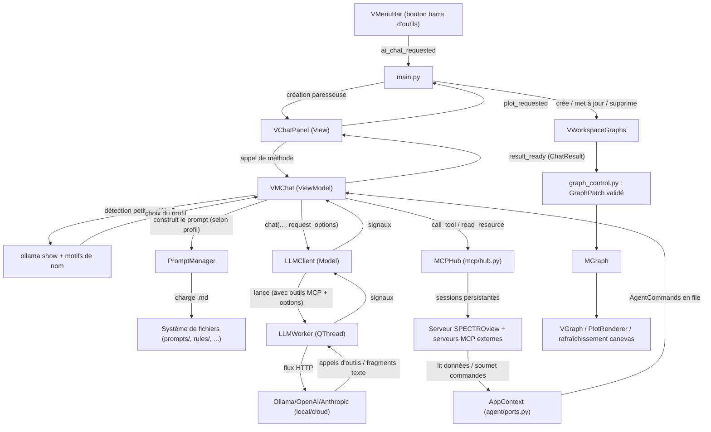
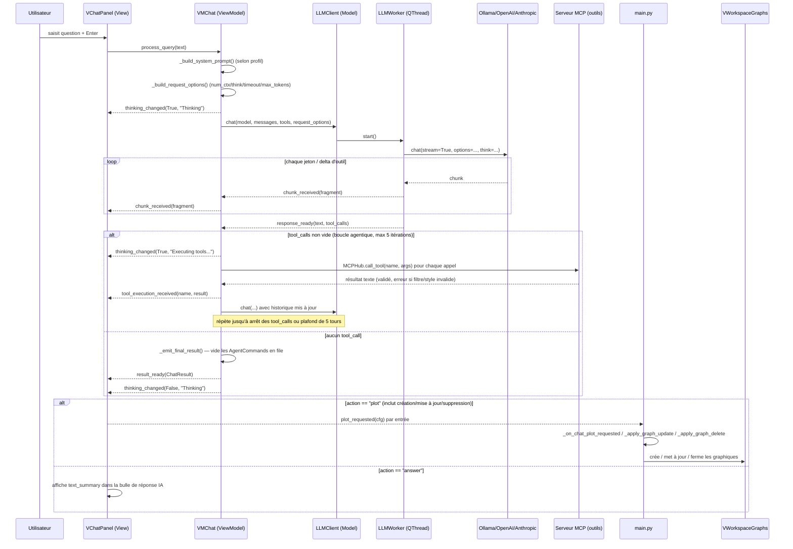

# **AI Data Chat**

`AI Data Chat` est un assistant conversationnel IA optionnel et multi-fournisseurs qui permet aux utilisateurs d'interroger, filtrer, tracer et modifier leurs données en langage naturel. Il prend en charge l'inférence locale via **Ollama**, les fournisseurs cloud via le SDK **OpenAI** (OpenAI, DeepSeek, Gemini et tout point d'accès compatible OpenAI), ainsi que les modèles **Anthropic** Claude. L'agent communique avec l'espace `Graphs` pour créer, mettre à jour et supprimer des graphiques en temps réel.

> Le module IA est **facultatif à l'usage** — si Ollama ne tourne pas et qu'aucune clé API cloud n'est renseignée, le panneau affiche un état rouge « not connected » et le reste de SPECTROview fonctionne sans aucune incidence. Les paquets Python dont il dépend (`ollama`, `openai`, `anthropic`, `mcp`) restent toutefois des dépendances d'installation inconditionnelles du projet (voir [Gestion des dépendances optionnelles](#gestion-des-dépendances-optionnelles)).

Un second axe distinct mérite d'être souligné : **les petits modèles locaux reçoivent un prompt simplifié et une configuration de requête différente des grands modèles cloud** — il s'agit de l'ajout architectural majeur depuis la migration MCP, détaillé dans la section dédiée ci-après ([Prise en charge des petits modèles](#prise-en-charge-des-petits-modèles)).

---

## **Prérequis pour les utilisateurs**

### **Option 1 : macOS**

1. **Installer Ollama**
   Avec Homebrew (recommandé) :
   ```bash
   brew install ollama
   ```
   *(Vous pouvez aussi télécharger l'application macOS directement depuis le [site officiel d'Ollama](https://ollama.com/download/mac).)*

2. **Démarrer le service Ollama**
   Avec Homebrew, démarrez Ollama en service d'arrière-plan :
   ```bash
   brew services start ollama
   ```
   *(Si vous avez installé l'application Mac, ouvrez simplement Ollama depuis votre dossier Applications ; son icône apparaît dans la barre des menus.)*

### **Option 2 : Windows**

1. **Installer Ollama**
   Téléchargez l'installateur Windows sur le [site officiel d'Ollama](https://ollama.com/download/windows) et lancez-le.

2. **Démarrer le service Ollama**
   Ollama démarre généralement automatiquement après l'installation. Sinon, recherchez « Ollama » dans le menu Démarrer et ouvrez-le ; son icône apparaît dans la zone de notification (en bas à droite).

---

### **Étapes communes (toutes plateformes)**

3. **Télécharger un modèle IA**
   SPECTROview utilise `qwen2.5-coder:7b` par défaut. Ouvrez un terminal (ou Invite de commandes / PowerShell sous Windows) et téléchargez-le :
   ```bash
   ollama pull qwen2.5-coder:7b
   ```
   Tout modèle Ollama prenant en charge l'appel d'outils (*tool/function calling*) fonctionne — voir [Prise en charge des petits modèles](#prise-en-charge-des-petits-modèles) pour la façon dont SPECTROview adapte son comportement au modèle choisi.

4. **Installer SPECTROview**
   `ollama`, `openai`, `anthropic` et `mcp` font partie des dépendances principales du paquet (sans groupe d'extras séparé) ; une installation normale inclut donc tout le nécessaire :
   ```bash
   pip install -e .
   ```

5. **Lancer SPECTROview**
   Démarrez l'application :
   ```bash
   python -m spectroview.main
   ```
   Cliquez sur le bouton **AI Data Chat** dans la barre d'outils supérieure. Le panneau s'ouvre et sa barre d'état doit afficher **🟢 Ollama connected**.

---

## **Vue d'ensemble de l'architecture**

La fonctionnalité IA suit le même patron **MVVM** strict que le reste de l'application. Tout le code lié à l'IA vit dans le paquet `spectroview/ai_agent/`, isolé des espaces principaux.


### **La frontière `AppContext`**

Le serveur MCP n'**importe pas** `VMChat`. Il reçoit un `AppContext` (`agent/ports.py`) — un protocole à cinq méthodes : lister les DataFrames, en lire un, obtenir le nom actif, lister les graphiques et soumettre une commande. `VMChat` fournit l'adaptateur `VMChatContext` ; les tests fournissent `RecordingContext`.

C'est ce découplage qui rend la couche d'outils testable isolément (sans Qt, sans LLM, sans fenêtre) et permettrait au même serveur de tourner hors processus. Les outils ne mutent jamais le ViewModel ; ils soumettent des commandes typées (`agent/commands.py` : `CreatePlot`, `UpdatePlot`, `DeletePlots`). Les entrées sont validées avant mise en file via le contrat partagé `spectroview.model.graphs.graph_control`, puis l'espace Graphs applique de nouveau ce même contrat à la frontière de mutation.

SPECTROview dispose également d'un profil MCP bureau complet externe. Il réutilise le même module FastMCP mais agit sur `SpectroviewApplicationAPI`, une façade de session protégée par un répartiteur en file vers le thread principal Qt. Le chat interne conserve le profil compact à cinq outils documenté ici pour fiabiliser les petits modèles. Voir [Serveur MCP local](mcp_server.md) pour le point d'accès, le catalogue complet d'outils et la procédure d'extension.

### **Contrat complet de personnalisation graphique**

Les outils MCP conservent quelques paramètres de premier niveau courants pour fiabiliser les petits modèles, et exposent `other_properties: GraphPatch` pour l'ensemble exhaustif. `GraphPatch` est généré à partir de chaque champ mutable de `MGraph` avec `extra="forbid"` ; les enregistrements imbriqués de filtres, styles par série, bordures, coupures d'axes et annotations sont également typés. Cela évite la dérive d'une liste blanche manuelle et permet en un appel cohérent de mettre à jour échelle log, polices, légende, épaisseurs, annotations, axes secondaires et incrustations.

L'omission préserve la valeur courante ; un `null` explicite n'est accepté que pour les champs nullables. Le serveur valide les filtres sur le DataFrame cible et valide `graph_id="all"` sur tous les graphiques ouverts avant de mettre en file une commande atomique unique. Le résultat indique volontairement « validated and queued » car seul le thread GUI peut confirmer le rendu final.

### **`MCPHub` — une boucle d'événements, plusieurs serveurs**

`MCPHub` (`mcp/hub.py`) détient une unique boucle `asyncio` sur un thread d'arrière-plan et maintient une session initialisée ouverte pour chaque serveur déclaré dans `config/servers.yaml` (`in-process`, `stdio` ou `http`). Les appelants sur le thread Qt utilisent des méthodes synchrones simples ; le hub achemine chaque appel sur sa boucle.

Auparavant, le ViewModel appelait `asyncio.run()` directement sur le thread GUI en recréant la session serveur à chaque lot d'outils — ce qui bloquait l'interface et ne fonctionnait qu'avec un serveur unique in-process.

Les noms d'outils restent non préfixés tant qu'ils sont uniques entre serveurs (pour préserver `plot_graph` partout où il est documenté) ; un nom proposé par deux serveurs devient `<server_id>__<tool>` pour les deux. Une liste blanche par serveur (`tools:`) maintient réduit le jeu d'outils exposés — les schémas d'outils consommant des jetons à chaque tour et les petits modèles se dégradant vite au-delà d'une douzaine d'outils.

### **Contexte poussé vs contexte tiré à la demande**

Le prompt système transporte toujours les noms des DataFrames, leurs dimensions, le nom et le dtype de chaque colonne ainsi qu'un résumé compact de chaque graphique ouvert. Les échantillons de valeurs, aperçus de lignes et configurations complètes `MGraph.save()` sont volumineux et rarement décisifs ; ils résident donc derrière des **ressources** MCP (`spectroview://dataframes/detail`, `spectroview://graphs/detail`).

Aucune API LLM ne gérant nativement les ressources MCP, le hub expose leur lecture via un outil synthétique `get_context(uri)` dont l'énumération `uri` liste exactement les ressources disponibles — contraignant du même coup les modèles locaux guidés par grammaire à une URI valide.

---

## **Structure du module**

```
spectroview/ai_agent/
├── __init__.py              # Docstring uniquement — garde le module optionnel
├── config/                  # Configuration YAML (model.yaml, settings.yaml, servers.yaml)
├── examples/                # Exemples de conversations few-shot (Markdown)
│   ├── plotting_examples.md #   Profil complet : 13 exemples avec appels d'outils
│   └── examples_small.md    #   Profil simplifié : ~8 exemples concis couvrant les 5 outils
├── knowledge/               # Connaissances domaine statiques (Markdown ; profil complet uniquement)
├── prompts/                 # Identité centrale et instructions thématiques (Markdown)
│   ├── system.md, chat.md, plotting.md   # Profil complet (défaut ; aussi utilisé par le cloud)
│   └── system_small.md      #   Profil simplifié — fichier unique consolidé pour petits modèles
├── rules/                   # Contraintes comportementales (Markdown)
├── agent/                   # Cœur sans Qt
│   ├── commands.py          #   Dataclasses CreatePlot / UpdatePlot / DeletePlots
│   └── ports.py             #   Protocole AppContext + RecordingContext (doublure de test)
├── utils/
│   ├── plot_utils.py        # normalize_plot_config / expand_comma_styles — coercition de types
│   ├── safe_eval.py         # evaluate_pandas_expression() — df.query() d'abord, eval() restreint en repli
│   └── df_summary.py        # compact_dataframe_schema() pour prompt ; summarize_dataframe_columns() pour ressource
├── m_llm_client.py          # Couche Model : connexions LLM + workers QThread
│                            #   - LLMWorker (Ollama)
│                            #   - APIWorker (compatible OpenAI)
│                            #   - AnthropicWorker (SDK Anthropic)
│                            #   - anthropic_tools()/anthropic_messages() — traduction de protocole
│                            #   - LLMClient (façade unifiée)
│                            #   - get_ollama_model_info() — appel `ollama show` pour détection de taille
├── m_conversation.py        # Modèle de données : conversation unique (messages, sauvegarde/chargement JSON)
├── m_conversation_store.py  # Magasin : parcours/liste/chargement des conversations sauvegardées
├── mcp/
│   ├── server.py            # Serveur FastMCP de SPECTROview : 5 outils + 2 ressources
│   ├── hub.py               # Client MCP : une boucle en thread, une session par serveur
│   └── config.py            # servers.yaml -> liste ServerSpec validée
├── m_prompt_manager.py      # Cache et assemblage des fragments Markdown de prompt
├── vm_chat.py               # ViewModel : choix du profil de prompt, détection petit modèle, boucle agentique
├── v_chat_panel.py          # View : panneau de discussion intégré (QWidget) à côté des onglets
└── v_history_dialog.py      # View : navigateur d'historique (QDialog) avec horodatage, épinglage, recherche
```

### **Rôle des fichiers**

| Fichier | Couche | Responsabilité |
|---------|--------|----------------|
| `m_prompt_manager.py` | **Model** | Charge, met en cache et assemble les fichiers Markdown en prompt système selon les listes `prompts=`/`rules=`/`knowledge=`/`examples=`. Lit également `config/model.yaml`/`config/settings.yaml` (`.model_config`). |
| `m_llm_client.py` | **Model** | Encapsule Ollama, le SDK OpenAI et le SDK Anthropic. Vérifie la disponibilité, liste les modèles, lit le nombre de paramètres (`get_ollama_model_info`), traduit le dialecte d'outils OpenAI vers Anthropic et lance l'un des trois workers `QThread`. |
| `m_conversation.py` | **Model** | Représente une conversation : ajout de messages (`tool_calls`/`tool_call_id` inclus), titre automatique, sauvegarde/chargement JSON, troncature aux N derniers messages **sans jamais séparer un appel d'outil de son résultat**. |
| `m_conversation_store.py` | **Model** | Scanne le dossier d'historique, liste les résumés légers et charge les conversations par ID. |
| `agent/ports.py` | **Model** | `AppContext` — seul contrat connu des outils MCP. `RecordingContext` sert de doublure en mémoire pour tous les tests. |
| `agent/commands.py` | **Model** | `CreatePlot`/`UpdatePlot`/`DeletePlots` — intentions typées émises par les outils plutôt que des dictionnaires bruts. |
| `mcp/server.py` | **Model** | Serveur FastMCP exposant les 5 outils et 2 ressources, avec validation des filtres et styles à l'appel. Dépend uniquement de `AppContext`. |
| `mcp/hub.py` | **Model** | Client MCP : boucle asynchrone dédiée, sessions persistantes, qualification des noms d'outils, listes blanches et outil synthétique `get_context`. |
| `mcp/config.py` | **Model** | Analyse et valide `config/servers.yaml` ; ignore avec avertissement les entrées invalides, désactivées ou dupliquées. |
| `utils/safe_eval.py` | **Model** | Évaluateur d'expressions pandas isolé partagé par `query_dataframe` et la validation de filtres de `plot_graph`/`update_graph`. |
| `utils/df_summary.py` | **Model** | `compact_dataframe_schema()` construit le bloc noms+dtypes toujours envoyé ; `summarize_dataframe_columns()` alimente la ressource `dataframes/detail` en regroupant par préfixe au-delà de `column_detail_threshold` sans jamais masquer un nom de colonne. |
| `utils/plot_utils.py` | **Model** | `normalize_plot_config()`/`expand_comma_styles()` — normalise les configurations accumulées avant leur envoi à l'espace Graphs. |
| `vm_chat.py` | **ViewModel** | Détecte le profil petit vs grand modèle, assemble le prompt adapté, construit les options de requête Ollama/timeout/max-tokens, gère l'historique et pilote la boucle agentique (jusqu'à 5 tours). |
| `v_chat_panel.py` | **View** | Panneau `QWidget` intégré avec bulles de messages, sélecteur fournisseur/modèle, horodatage, en-tête compact de 42 px et carte de saisie multi-lignes. Le sélecteur de modèle est **éditable** ; pour **Custom**, la liste est alimentée depuis `custom_models` (Settings ▸ AI) via `_custom_model_names()`. |
| `v_history_dialog.py` | **View** | Liste des conversations triées de la plus récente à la plus ancienne (ouvrir, renommer, dupliquer, supprimer). |

---

## **Prise en charge des petits modèles**

Les petits modèles locaux (généralement en dessous de ~10 milliards de paramètres) reçoivent un prompt, un budget de contexte et des paramètres de requête sensiblement différents des grands modèles cloud — et non une simple version raccourcie. Un prompt dense et volumineux associé à une fenêtre de contexte non bornée suffit à faire échouer l'appel d'outils sur un petit modèle pourtant capable (voir l'étude de cas ci-dessous).

### Détection

`VMChat._auto_detect_small_model()` résout le profil dans l'ordre suivant :

1. **Forçage manuel** — `VMChat.set_small_model_mode(True | False | None)`. `None` (défaut) maintient la détection automatique, persistée via `MSettings`.
2. **Vérification du nombre de paramètres** (Ollama uniquement) — `get_ollama_model_info(model)` exécute `ollama show <model>`, extrait `details.parameter_size` (ex. `"8.2B"`) via `_parse_param_size_to_billions()` et le compare à `small_model_param_threshold_b` de `config/model.yaml` (**10.0** par défaut). Résultat mis en cache par nom de modèle pour la durée de l'instance `VMChat`.
3. **Repli par motif de nom** — si la taille ne peut être déterminée, le nom est confronté à `VMChat._SMALL_MODEL_PATTERNS` (`qwen3:8b`, `gemma3:4b`, `phi3:mini`, `deepseek-r1:8b`, etc.).
4. **Défaut : profil complet.** Par sécurité, tout modèle non reconnu reçoit le profil complet plutôt que de brider un grand modèle.

La détection est restreinte à `provider == "Ollama"` pour les étapes 2–3 — les fournisseurs cloud utilisent toujours le profil complet sauf forçage manuel. Elle est ré-exécutée sur `set_model()`/`set_provider()`, jamais dans `__init__`.

### **Paramètres persistants**

Tout ce que stocke l'agent (fournisseur, modèle sélectionné par fournisseur, profil de prompt, dossier d'historique) vit sous le préfixe `ai_chat/` du magasin unique de l'application via `MSettings.get_ai_value()` / `set_ai_value()`. Le module IA n'importe aucun `QSettings` propre.

Un ancien magasin séparé `QSettings("SPECTROview", "AIChat")` contournait autrefois la fixture de test `_isolate_qsettings`. `MSettings._migrate_legacy_ai_settings()` migre ces anciennes valeurs une seule fois (protégé par une clé marqueur).

> **Secrets (`spectroview/settings/secrets.py`)** : Les clés API (`OpenAI`, `Anthropic`, `Mistral`, `Gemini`, `DeepSeek`, `Custom`) sont stockées dans le magasin OS par utilisateur via `SecretStore` (`QSettings("CEA-Leti", "SPECTROview")` sous l'espace obfusqué `_credentials/`) et strictement exclues des fichiers `config.json` exportés. `config/servers.yaml` *est* versionné : n'y placez jamais de jeton en dur, utilisez `${VAR}` (développé par `mcp/config.py`).

### Ce qui change en mode simplifié

Les quatre paramètres suivants sont calculés dans `vm_chat.py` et lus depuis `config/model.yaml` :

| Aspect | Profil complet | Profil simplifié | Clés de config |
|---|---|---|---|
| Prompt système | `system.md`+`chat.md`+`plotting.md` + `rules/general,plotting,spectroview` + `knowledge/features` + `examples/plotting_examples` (~27 Ko) | `system_small.md` + `rules/general` + `examples/examples_small` (~9 Ko) | n/a (listes codées dans `_build_system_prompt()`) |
| Historique conversationnel | illimité | 6 derniers messages | `max_context_messages` / `max_context_messages_small` |
| `num_ctx` Ollama | 16384 | 8192 | `ollama_num_ctx_full` / `ollama_num_ctx_small` |
| Jetons de sortie max | 81920 | 4096 | `max_tokens` / `max_tokens_small` |
| `think` Ollama | non défini (défaut modèle/Ollama) | `false` | `ollama_think` |

`rules/general.md` est partagé ; `rules/plotting.md`, `rules/spectroview.md` et `knowledge/features.md` sont réservés au profil complet (leurs règles essentielles sont condensées dans `system_small.md`).

`num_ctx` et `think` s'appliquent exclusivement aux options Ollama et ne sont jamais transmis à `APIWorker`/`AnthropicWorker`.

### Aménagements de schéma (profitant à tous les modèles)

Deux choix dans `mcp/server.py` réduisent l'ambiguïté quel que soit le modèle :

- `plot_style` est un `Literal[...]` (générant une véritable énumération JSON Schema des 9 styles) plutôt qu'un `str` libre.
- Les clés les plus courantes de `other_properties` (`grid`, `plot_title`, `xlabel`, `ylabel`, `zlabel`, limites d'axes, `color_palette`, échelles log, etc.) sont exposées comme paramètres nommés explicites sur `plot_graph`/`update_graph` en plus de `other_properties`. Un modèle plaçant `grid=true` au premier niveau ne perd plus ce paramètre — les deux formes sont fusionnées, avec priorité au paramètre nommé en cas de conflit.

### Étude de cas : qwen3:8b

Sur une demande identique de 3 graphiques, DeepSeek réussissait en un tour là où `qwen3:8b` échouait auparavant de deux manières :

- **Essai A** : aucun appel d'outil — 2 237 caractères de prose décrivant un plan en pseudo-code Python jamais exécuté.
- **Essai B** : appels d'outils valides, mais avec `grid: true` en argument de premier niveau alors que le schéma ne l'acceptait que dans `other_properties` — silencieusement ignoré.

Après ces améliorations : **3/3 exécutions ont réussi**, produisant chacune exactement 3 appels `plot_graph` bien formés en ~19 s en moyenne au lieu de 42–100 s par tour raté.

---

## **Classes principales**

### **`LLMWorker` / `APIWorker` / `AnthropicWorker` — Threads d'arrière-plan**

**Fichier** : `spectroview/ai_agent/m_llm_client.py`

Trois sous-classes de `QThread`, une par moteur. Chacune exécute une requête de discussion en streaming (ou non-streaming avec outils pour Anthropic).

| Classe | Moteur | Paquet requis | Paramètres constructeurs supplémentaires |
|--------|--------|---------------|------------------------------------------|
| `LLMWorker` | Ollama (local) | `ollama` | `options` (dict : `num_ctx`, `num_predict`), `think` (`bool`\|`"low"`\|`"medium"`\|`"high"`\|`None`), `timeout` |
| `APIWorker` | OpenAI, DeepSeek, Gemini, Custom | `openai` | `timeout`, `max_tokens` |
| `AnthropicWorker` | Anthropic Claude | `anthropic` | `timeout`, `max_tokens` |

`LLMWorker` n'instancie `ollama.Client(timeout=...)` que lorsqu'un délai d'expiration est fixé ; sinon il appelle directement `ollama.chat()`. Les appels d'outils Ollama arrivant sous forme d'objets Pydantic (`ollama._types.Message.ToolCall`) sont convertis par `.model_dump()` avant émission pour préserver la sérialisation `json.dump()` de `MConversation.save()`.

| Signal | Charge utile | Rôle |
|--------|--------------|------|
| `chunk_received` | `str` | Chaque fragment de jeton reçu en streaming |
| `response_ready` | `(str, list)` | Texte complet assemblé + appels d'outils accumulés |
| `error_occurred` | `str` | Message d'erreur si le serveur est injoignable |

> **Les messages d'erreur remontent la cause racine.** Les trois workers passent les exceptions attrapées dans `_format_exception()`, qui parcourt la chaîne `__cause__`/`__context__` afin de révéler les causes réseau/TLS masquées sous `APIConnectionError("Connection error.")` (ex. `CERTIFICATE_VERIFY_FAILED`, `getaddrinfo failed`).

> **TLS d'entreprise / autorité interne.** `m_llm_client` utilise `SSL_CERT_FILE`/`REQUESTS_CA_BUNDLE` si défini, ou `truststore.inject_into_ssl()` pour s'appuyer sur le magasin de certificats de l'OS (import protégé avec repli sur `certifi`).

> Le champ `message["thinking"]` d'Ollama n'est jamais fusionné dans `chunk_received` ni affiché dans la bulle de réponse — il est écarté dans `VMChat._on_thinking_chunk` pour préserver une séparation stricte des canaux.

### **`LLMClient` — Façade de connexion**

**Fichier** : `spectroview/ai_agent/m_llm_client.py`

Façade légère sans dépendance Qt gérant le fournisseur actif, les clés API et le cycle de vie des workers.

**Fournisseurs connus** (définis dans `API_PROVIDERS`) :

- `Ollama` → `LLMWorker`
- `OpenAI`, `DeepSeek`, `Gemini`, `Custom` → `APIWorker`
- `Anthropic` → `AnthropicWorker`

| Méthode | Rôle |
|---------|------|
| `is_available()` | `True` si le paquet du fournisseur actif est installé et que (Ollama) le démon répond ou (cloud) une clé API est configurée |
| `get_models()` | Liste triée des noms de modèles disponibles |
| `chat(model, messages, on_chunk, on_done, on_error, tools=None, parent=None, request_options=None)` | Lance le worker adapté ; annule toute requête en cours. Traduit `request_options` par fournisseur. |
| `cancel()` | Interrompt le thread worker en cours |
| `is_busy()` | `True` pendant l'exécution d'un worker |

**Utilitaire module** : `get_ollama_model_info(model) -> Optional[ollama.ShowResponse]` — appel tolérant à `ollama.show()`, renvoie `None` en cas d'échec sans jamais lever d'exception.

**Modèle par défaut** : `qwen2.5-coder:7b` (`LLMClient.DEFAULT_MODEL`).

### **`PromptManager` — Assemblage des prompts**

**Fichier** : `spectroview/ai_agent/m_prompt_manager.py`

Gestionnaire avec mise en cache lisant les sections Markdown sur disque et les concaténant selon les listes fournies.

| Méthode | Rôle |
|---------|------|
| `load_prompt(name)` / `load_rule(name)` / `load_knowledge(name)` / `load_example(name)` | Charge un fichier Markdown par nom sans extension, mis en cache (invalidé sur mtime si `auto_reload: true`) |
| `build_prompt(prompts, rules, knowledge, examples)` | Assemble le prompt système complet ; ignore les fichiers absents avec avertissement |
| `.model_config` | Contenu analysé de `config/model.yaml` |

> **Le choix des fragments est codé en dur** dans `VMChat._build_system_prompt()` — une liste pour le profil complet, une pour le profil simplifié (voir [Prise en charge des petits modèles](#prise-en-charge-des-petits-modèles)).

### **`VMChat` — ViewModel**

**Fichier** : `spectroview/ai_agent/vm_chat.py`

Gère une session de discussion reliée aux DataFrames chargés, strictement via signaux Qt :

| Signal | Charge utile | Rôle |
|--------|--------------|------|
| `thinking_changed` | `(bool, str)` | `True` pendant la boucle LLM/outils, avec libellé (`"Thinking"` / `"Executing tools..."`) |
| `chunk_received` | `str` | Fragments en streaming pour animation de saisie |
| `result_ready` | `ChatResult` | Résultat final à l'issue de la boucle agentique |
| `error_occurred` | `str` | Message d'erreur lisible |
| `tool_execution_received` | `(str, str)` | Nom de l'outil + résultat ; sert uniquement à actualiser l'état transitoire « thinking » |
| `conversation_changed` | `str` | Titre de la conversation ouverte/nouvelle |

#### **API publique**

| Méthode | Rôle |
|---------|------|
| `set_dataframes(dfs, active_name)` | Met à jour les DataFrames disponibles |
| `update_active_df_name(name)` | Change de DataFrame actif sans effacer l'historique |
| `set_graphs(graphs)` | Met à jour la liste des graphiques ouverts dans le prompt système |
| `set_model(model)` | Change de modèle ; relance la détection petit modèle |
| `set_provider(provider, api_key, base_url, model)` | Change de fournisseur ; relance la détection ; ouvre une nouvelle conversation |
| `set_small_model_mode(enabled)` | `True`/`False` force un profil, `None` réactive la détection automatique |
| `is_small_model_mode()` | `True` si le profil simplifié est actif |
| `process_query(user_text)` | Envoie une question au LLM |
| `cancel()` | Interrompt la requête en cours |
| `clear_history()` | Réinitialise l'historique (identique à **+ New Chat**) |

#### **La boucle agentique d'appels d'outils**

`process_query()` → `LLMClient.chat()` → `_on_done(full_text, tool_calls)` :

- Si `tool_calls` n'est pas vide : chaque appel est acheminé via `MCPHub.call_tool(name, args)`. Chaque résultat (succès, erreur de validation ou JSON mal formé) est ajouté à l'historique en tant que message `role="tool"`, puis `_on_done` relance `LLMClient.chat()` avec l'historique mis à jour, dans la limite de `VMChat.MAX_AGENT_TURNS` (**5**).
- Si `tool_calls` est vide : le tour s'achève par `_emit_final_result()`, qui vide les commandes mises en file durant le tour, les normalise une fois via `_commands_to_configs()` et émet `ChatResult(action="plot", ...)` ou `ChatResult(action="answer", ...)`.

`_emit_final_result()` s'exécute sur **tous** les chemins de sortie, y compris l'atteinte du plafond de tours ou une exception d'outil, évitant ainsi de perdre les graphiques déjà mis en file.

**`ChatResult.action` ne prend que les valeurs `"plot"` ou `"answer"`.**

#### **Options de requête**

`_build_request_options()` lit `config/model.yaml` et retourne le dictionnaire `num_ctx`/`think`/`timeout`/`max_tokens` passé à `LLMClient.chat()`.

#### **Historique et persistance des conversations**

Les conversations sont enregistrées automatiquement au format JSON dans le dossier configuré (**Settings → AI Settings**). `MConversation` :

- Accumule les messages (`tool_calls`/`tool_call_id` compris) avec horodatage ISO.
- Génère automatiquement un titre à partir du premier message utilisateur (jusqu'à 60 caractères).
- Persiste sur disque après chaque tour assistant et chaque lot de résultats d'outils.
- N'est **pas** effacée lors du chargement de nouveaux fichiers ou changement de DataFrame — seul **+ New Chat** la réinitialise.

`to_llm_messages()` applique `max_context_messages` tout en élargissant la fenêtre vers l'arrière si une coupure tombait entre un appel assistant (`tool_calls`) et ses réponses `role="tool"`.

### **`ChatResult` — Réponse analysée**

**Fichier** : `spectroview/ai_agent/vm_chat.py`

```python
class ChatResult:
    __slots__ = ("action", "explanation", "text_summary", "plot_config")
```

| Champ | Type | Rôle |
|-------|------|------|
| `action` | `str` | `"plot"` ou `"answer"` |
| `explanation` | `str` | Texte affiché sur la carte lors de l'exécution de commandes graphiques |
| `text_summary` | `str` | Texte final en langage naturel du LLM |
| `plot_config` | `list[dict]` \| `None` | Configurations de création/mise à jour/suppression pour l'espace Graphs |

### **`VChatPanel` — Panneau de discussion intégré**

**Fichier** : `spectroview/ai_agent/v_chat_panel.py`

Panneau `QWidget` placé tout à droite de `Main.workspace_splitter`.

**En-tête (`chatHeader`)** : rangée compacte (42 px de hauteur fixe) avec titre éditable (`edit_title`) et boutons 30×30 px (`btn_history`, `btn_new_chat`, `btn_clear`, `btn_close`).

**Éditeur (`chatComposerFrame`)** : carte arrondie (8 px) regroupant la zone multi-lignes auto-extensible (`_ChatLineEdit`) et la barre inférieure (`cbb_provider`, `cbb_model`, `btn_refresh_models`, `btn_mic`, `btn_send`).

Widgets auxiliaires : `_MessageCard` (bulle alignée selon l'interlocuteur) et `_ChatLineEdit` (`send_requested` sur `Enter`).

---

## **Prompt système et contrat LLM**

Le prompt système est assemblé par `PromptManager` selon deux profils (voir [Prise en charge des petits modèles](#prise-en-charge-des-petits-modèles)) :

**Profil complet** (par défaut et fournisseurs cloud) :

1. **Prompt central** (`prompts/system.md`, `chat.md`, `plotting.md`).
2. **Contexte dynamique** (injecté par `VMChat`) : schémas/échantillons de DataFrames, DataFrame actif, résumé des graphiques ouverts.
3. **Règles** (`rules/general.md`, `plotting.md`, `spectroview.md`).
4. **Connaissances** (`knowledge/features.md`).
5. **Exemples** (`examples/plotting_examples.md`).

**Profil simplifié** : `prompts/system_small.md` + `rules/general.md` + `examples/examples_small.md`.

L'agent utilise les **appels d'outils natifs via MCP** (`mcp/server.py`, `FastMCP`) :

```python
query_dataframe(query: str, df_name: str = "") -> str
get_statistics(columns: list[str], df_name: str = "") -> str
plot_graph(x: str, y: str | list[str], plot_style: Literal[9 styles], z=None,
           filters: list[str] | None = None, df_name: str = "",
           grid=None, plot_title=None, xlabel=None, ylabel=None, zlabel=None,
           xmin=None, xmax=None, ymin=None, ymax=None, zmin=None, zmax=None,
           color_palette=None, xlogscale=None, ylogscale=None,
           scatter_size=None, hist_bins=None, trendline_order=None,
           other_properties: dict | None = None) -> str
update_graph(graph_id: str, ...)   # mêmes champs optionnels que plot_graph, tous Optional
delete_graph(delete_all: bool = False, graph_ids: list[int] | None = None) -> str
```

### **Sécurité et validation**

- **Expressions de filtres/requêtes** : évaluées par `utils/safe_eval.py::evaluate_pandas_expression()`, tentant `DataFrame.query()` puis un `eval()` à espace de noms restreint (`{"__builtins__": {}}`, lié uniquement à `df`/`pd`/`np` et colonnes).
- **`plot_graph`/`update_graph` testent à blanc chaque filtre** sur le DataFrame cible avant d'accepter le tracé — un filtre invalide renvoie une erreur exploitable et le graphique n'est **pas** créé.
- **`plot_style` est validé par schéma** (`enum`) et revérifié en Python.
- **Arguments JSON mal formés** : renvoient un message d'erreur invitant à réessayer au lieu de substituer silencieusement `{}`.

---

## **Flux de données bout en bout**



---

## **Intégration avec l'espace Graphs**

### **Initialisation paresseuse**

L'**importation** et l'**instanciation du widget** sont toutes deux différées jusqu'à `Main.open_ai_chat()`. Les SDK fournisseurs coûtant ~4,5 s à l'importation, `main.py` ne sonde le module qu'au démarrage (`importlib.util.find_spec`) sans l'exécuter :

```python
# main.py — niveau module : sonde uniquement, aucune exécution
LLM_AVAILABLE = importlib.util.find_spec("spectroview.ai_agent.v_chat_panel") is not None

# main.py — dans open_ai_chat()
from spectroview.ai_agent.v_chat_panel import VChatPanel
if self._chat_panel is None:
    self._chat_panel = VChatPanel(self)
    self._chat_panel.plot_requested.connect(self._on_chat_plot_requested)
```

Le même principe s'applique au niveau inférieur : `mcp` est importé dans `MCPHub._open_session()` plutôt qu'en tête de `hub.py`.

### **Synchronisation des DataFrames**

| Signal | Gestionnaire | Déclencheur |
|--------|--------------|-------------|
| `vm.dataframes_changed` | `sync_chat_dfs_full` | Ajout/suppression de DataFrame — actualise tous les DF et graphiques |
| `vm.dataframe_columns_changed` | `sync_chat_active` | Changement de DataFrame actif — conserve l'historique |
| `vm.graphs_changed` | `sync_chat_graphs` | Création/mise à jour/suppression de graphique — actualise les IDs dans le prompt |

À chaque affichage du panneau, une synchronisation forcée garantit la fraîcheur des données.

### **Normalisation des configurations de tracé**

Les commandes en file sont normalisées **une seule fois** dans `VMChat._commands_to_configs()` avant émission vers `main.py` :

| Champ | Normalisation |
|-------|---------------|
| `y` | `str` → `[str]`, `None` → `[]` |
| Bornes (`xmin`, `ymin`, ...) | `str`/`int`/`"null"` → `float` ou `None` |
| Entiers (`x_rot`, `scatter_size`, ...) | Transtypage `int`, suppression en cas d'échec |
| `filters` | `["expr1", "expr2"]` → `[{"expression": "expr1", "state": True}, ...]` |
| `plot_style` | Séparé par virgules (`"box, scatter"`) → une configuration par style |

`utils/plot_utils.py` et `mcp/server.py` dérivent leurs styles et palettes de `spectroview.PLOT_STYLES`/`PALETTE` (vérifié par `test_ai_agent_schema.py::TestPlotStyleSingleSourceOfTruth`).

### **Flux de mise à jour et suppression de graphiques**

Les commandes `UpdatePlot`/`DeletePlots` produisent des entrées `{"_graph_update": {...}}` / `{"_graph_delete": {...}}` sur le signal `plot_requested`, puis `main.py` récupère les `MGraph` existants et appelle `vm.update_graph(...)` ou ferme les `QMdiSubWindow` ciblées.

---

## **Point d'entrée dans la barre d'outils**

```python
# v_menubar.py
self.actionAIChat = self.addAction(Icons.sparkles(size=22), "SPECTROview AI Agent")
self.actionAIChat.setShortcut("Ctrl+Shift+A")
self.actionAIChat.triggered.connect(self.ai_chat_requested.emit)
```

Le signal `ai_chat_requested` est connecté à `Main.open_ai_chat()` dans `setup_connections()`, basculant la visibilité de `VChatPanel` dans `Main.workspace_splitter`.

---

## **Gestion des dépendances optionnelles**

`ollama`, `openai`, `anthropic` et `mcp` sont des **dépendances principales inconditionnelles** dans `pyproject.toml` ; ce qui reste optionnel est uniquement l'*utilisation* de la fonctionnalité à l'exécution.

### **Patron de garde d'importation**

La disponibilité est sondée sans importer via `find_spec`, puis chargée paresseusement et mise en cache au premier appel :

```python
# m_llm_client.py — chaque SDK est sondé et chargé indépendamment
OLLAMA_AVAILABLE = importlib.util.find_spec("ollama") is not None
_ollama = None

def _load_ollama():
    """Retourne le module `ollama` (importé à la première utilisation), ou None."""
    global _ollama
    if _ollama is None and OLLAMA_AVAILABLE:
        import ollama as _mod
        _ollama = _mod
    return _ollama
# ... même schéma pour openai (_load_openai) et anthropic (_load_anthropic)
```

---

## **Analyse des réponses et gestion des erreurs**

Avec **MCP Tool Calling**, aucun JSON libre n'est extrait du texte brut :

1. **Exécution d'outils** : le LLM émet des appels structurés via le protocole natif du fournisseur.
2. **Validation à la frontière** : `mcp/server.py` valide `plot_style` et teste chaque filtre (`utils/safe_eval.py`) avant d'accepter le graphique.
3. **Arguments mal formés** : produisent un message d'erreur invitant à réessayer plutôt qu'un `{}` silencieux.
4. **Repli texte seul** : si le modèle répond sans appel d'outil, le texte devient `ChatResult(action="answer", text_summary=...)`.
5. **DataFrame cible omis** : les outils MCP résolvent une chaîne `df_name` vide vers le DataFrame actif.
6. **Objets d'appels d'outils non sérialisables** : `LLMWorker.run()` normalise chaque objet Pydantic Ollama via `.model_dump()`.

---

## **Fonctionnalités actuelles (Espace Graphs)**

| Fonctionnalité | Description |
|----------------|-------------|
| **Création de tracés en langage naturel** | Demander l'un des 9 styles pris en charge (`point`, `scatter`, `box`, `bar`, `line`, `trendline`, `histogram`, `wafer`, `2Dmap`) avec colonnes, filtres et options de style |
| **Génération multi-graphiques** | Une seule requête peut créer plusieurs graphiques simultanément (appels parallèles ou plusieurs tours de boucle) |
| **Filtrage des données** | Filtrer les DataFrames en langage naturel (traduit en expression pandas validée, voir [Sécurité et validation](#sécurité-et-validation)) |
| **Statistiques descriptives** | Obtenir les statistiques `describe()` sur des colonnes données |
| **Modification de graphiques** | Mettre à jour les propriétés existantes (limites d'axes, titre, style, filtres, palette) par ID |
| **Suppression de graphiques** | Supprimer des graphiques spécifiques ou tous les graphiques |
| **Support multi-DataFrames** | Basculer entre plusieurs DataFrames chargés ; l'IA connaît le jeu actif |
| **Adaptation aux petits modèles** | Détecte automatiquement les petits modèles locaux et bascule vers le prompt court et les options Ollama adaptées (`VMChat.set_small_model_mode()`) |
| **Appels d'outils autocorrecteurs** | Les filtres ou styles invalides sont rejetés avant application avec une erreur exploitable permettant au modèle de se corriger |
| **Mémoire conversationnelle** | Conversations multi-tours ; historique complet pour grands modèles, 6 derniers messages pour petits modèles |
| **Persistance des conversations** | Survit aux chargements de fichiers et changements d'onglets ; seul **+ New Chat** réinitialise |
| **Navigateur d'historique** | Parcourir, rechercher, rouvrir, renommer, dupliquer et supprimer d'anciennes conversations |
| **Réponses en streaming** | Affichage jeton par jeton en direct sur tous les fournisseurs, y compris Anthropic avec outils |
| **Choix de modèle et fournisseur** | Basculer entre modèles locaux Ollama et fournisseurs cloud directement depuis la barre de saisie |
| **Prompts sensibles au contexte** | Schéma complet des DataFrames dans le prompt ; détails et configurations complètes tirés à la demande via `get_context` |
| **Serveurs MCP externes** | Tout serveur `stdio` ou `http` déclaré dans `config/servers.yaml` est connecté au démarrage avec liste blanche optionnelle |

---

## **Connecter un autre serveur MCP**

Ajoutez un bloc dans `spectroview/ai_agent/config/servers.yaml` puis redémarrez :

```yaml
servers:
  - id: spectroview          # Outils propres à SPECTROview — à conserver
    transport: in-process
    factory: spectroview.ai_agent.mcp.server:create_mcp_server
    enabled: true

  - id: filesystem
    transport: stdio
    command: [npx, -y, "@modelcontextprotocol/server-filesystem", "~/data"]
    enabled: true
    tools: [read_file, list_directory]     # liste blanche optionnelle
```

`${VARS}` et `~` sont développés dans `command`, `env` et `url`. Un serveur qui échoue au démarrage est consigné dans les logs et ignoré.

Deux points importants à garder à l'esprit :

- **Chaque outil a un coût en contexte.** Le schéma de chaque outil est envoyé à chaque tour, et les petits modèles locaux perdent rapidement en précision au-delà d'une douzaine d'outils. Utilisez `tools:` pour n'exposer que le nécessaire.
- **Les descriptions d'un serveur externe sont du texte non fiable** transmis tel quel au modèle. N'activez que des serveurs de confiance et privilégiez une liste blanche pour tout outil capable d'écrire.
