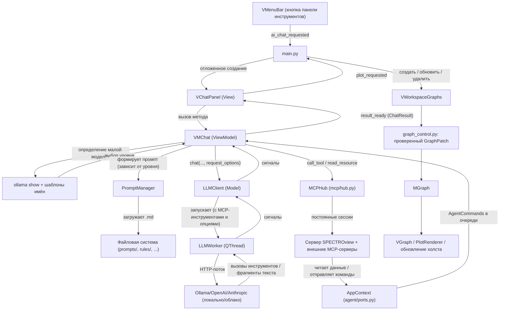
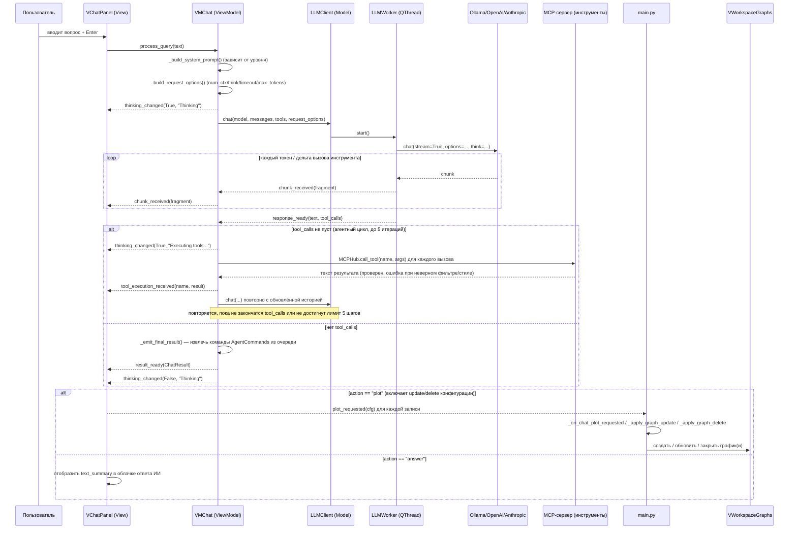

# **AI Data Chat** { #ai-data-chat }

`AI Data Chat` — это необязательный мультипровайдерный ИИ-чат-бот, позволяющий пользователям делать запросы, фильтровать, строить графики и изменять свои данные на естественном языке. Он поддерживает локальный инференс через **Ollama**, облачных провайдеров через SDK **OpenAI** (OpenAI, DeepSeek, Gemini и любой OpenAI-совместимый эндпоинт), а также модели **Anthropic** Claude. Агент взаимодействует с рабочей областью `Graphs` для создания, обновления и удаления графиков в реальном времени.

> Использование ИИ-модуля **необязательно** — если Ollama не запущен и не настроен ни один облачный API-ключ, панель чата отображает красный статус «not connected», а остальная часть SPECTROview работает без каких-либо ограничений. Тем не менее Python-пакеты, от которых он зависит (`ollama`, `openai`, `anthropic`, `mcp`), являются безусловными зависимостями проекта на этапе установки (см. раздел [Управление необязательными зависимостями](#optional-dependency-management)).

Здесь важна и вторая, отдельная грань «опциональности»: **малые локальные модели получают иной, упрощённый промпт и другую конфигурацию запроса по сравнению с крупными и облачными моделями** — это крупнейшее архитектурное дополнение со времени миграции на MCP, которое подробно рассмотрено ниже в отдельном разделе ([Поддержка малых моделей](#small-model-support)).

---

## **Предварительные требования для пользователей** { #prerequisites-for-users }

### **Вариант 1: macOS** { #option-1-macos }

1. **Установите Ollama**
   С помощью Homebrew (рекомендуется):

   ```bash
   brew install ollama
   ```

   *(Либо скачайте приложение для macOS напрямую с [официального сайта Ollama](https://ollama.com/download/mac).)*

2. **Запустите службу Ollama**
   Если вы использовали Homebrew, запустите Ollama как фоновую службу:

   ```bash
   brew services start ollama
   ```

   *(Если вы установили приложение для Mac, просто откройте Ollama из папки «Программы». Значок сервиса появится в строке меню.)*

### **Вариант 2: Windows** { #option-2-windows }

1. **Установите Ollama**
   Скачайте установщик для Windows с [официального сайта Ollama](https://ollama.com/download/windows) и запустите его.

2. **Запустите службу Ollama**
   Обычно Ollama запускается автоматически после установки. Если этого не произошло, найдите «Ollama» в меню «Пуск» и откройте приложение. Значок Ollama должен появиться в области уведомлений (в правом нижнем углу экрана).

---

### **Общие шаги (обе платформы)** { #common-steps-both-platforms }

3. **Загрузите ИИ-модель**
   По умолчанию SPECTROview использует `qwen2.5-coder:7b`. Откройте терминал (или Командную строку / PowerShell в Windows) и загрузите модель:

   ```bash
   ollama pull qwen2.5-coder:7b
   ```

   Подойдёт любая модель Ollama с поддержкой вызова инструментов/функций (*tool/function calling*) — подробнее о том, как SPECTROview адаптирует своё поведение под выбранную модель, см. в разделе [Поддержка малых моделей](#small-model-support).

4. **Установите SPECTROview**
   Пакеты `ollama`, `openai`, `anthropic` и `mcp` входят в число базовых зависимостей (без отдельной группы extras), поэтому обычная установка сразу включает всё необходимое для работы ИИ-функций:

   ```bash
   pip install -e .
   ```

5. **Запустите SPECTROview**
   Запустите приложение:

   ```bash
   python -m spectroview.main
   ```

   Нажмите кнопку **AI Data Chat** на верхней панели инструментов. Откроется панель чата, и в строке состояния должно отобразиться **🟢 Ollama connected**.

---

## **Обзор архитектуры** { #architecture-overview }

ИИ-модуль следует тому же строгому шаблону **MVVM**, что и остальная часть приложения. Весь код, связанный с ИИ, сосредоточен в пакете `spectroview/ai_agent/` и изолирован от основных рабочих областей.



### **Граница AppContext** { #the-appcontext-boundary }

MCP-сервер **не** импортирует `VMChat`. Ему передаётся `AppContext` (`agent/ports.py`) — протокол из пяти методов: получить список DataFrame, получить один DataFrame, узнать имя активного, получить список графиков и отправить команду. `VMChat` предоставляет адаптер `VMChatContext`, а тесты передают `RecordingContext`.

Именно это делает слой инструментов независимо тестируемым (без Qt, без LLM и без самого приложения) и позволяет при необходимости запускать тот же сервер вне основного процесса. Инструменты никогда не изменяют ViewModel; они отправляют типизированные команды (`agent/commands.py`: `CreatePlot`, `UpdatePlot`, `DeletePlots`). Входные параметры создания и обновления графиков проверяются перед постановкой в очередь через общий контракт `spectroview.model.graphs.graph_control`, а рабочая область графиков повторно применяет этот же контракт на границе модификации состояния.

У SPECTROview также есть полноценный внешний профиль настольного MCP-сервера. Он использует тот же модуль FastMCP, но работает поверх `SpectroviewApplicationAPI` — фасада живой сессии, защищённого диспетчером с очередью в главный поток Qt. Внутренний чат сохраняет описанный здесь компактный профиль из пяти инструментов ради надёжности малых моделей. Конечную точку, полный каталог инструментов и порядок расширения см. в разделе [Локальный MCP-сервер](mcp_server.md).

### **Полный контракт настройки графиков** { #complete-graph-customization-contract }

Инструменты MCP сохраняют несколько часто используемых параметров верхнего уровня для надёжности малых моделей и предоставляют `other_properties: GraphPatch` для исчерпывающего набора настроек. `GraphPatch` генерируется из каждого изменяемого поля dataclass `MGraph` с `extra="forbid"`; вложенные структуры для фильтров, стилей серий, рамок осей (spines), разрывов осей и аннотаций также типизированы. Это исключает расхождение поддерживаемого вручную белого списка с графическим интерфейсом и позволяет одним согласованным вызовом обновить логарифмический масштаб, шрифты, расположение легенды, толщину линий, аннотации, дополнительные оси, геометрию врезки и любое другое состояние графика.

Пропуск поля означает сохранение текущего значения. Явное значение `null` допускается только для полей, поддерживающих `null`. Сервер проверяет фильтры на целевом DataFrame и валидирует `graph_id="all"` для каждого открытого графика перед постановкой одной атомарной команды в очередь. Результат инструмента намеренно сообщает «validated and queued», поскольку только поток GUI может достоверно подтвердить итоговую отрисовку.

### **MCPHub — один цикл событий, несколько серверов** { #mcphub-one-loop-many-servers }

`MCPHub` (`mcp/hub.py`) владеет единым циклом событий `asyncio` в фоновом потоке и поддерживает открытую инициализированную сессию для каждого сервера, указанного в `config/servers.yaml` (`in-process`, `stdio` или `http`). Вызывающий код в потоке Qt использует обычные синхронные методы, а хаб маршалирует каждый вызов в свой цикл событий.

Ранее ViewModel вызывал `asyncio.run()` непосредственно в потоке GUI и пересоздавал серверную сессию для каждого пакета инструментов — это блокировало интерфейс и работало лишь потому, что единственный сервер был внутрипроцессным.

Имена инструментов остаются неквалифицированными, пока они уникальны среди всех серверов (поэтому `plot_graph` продолжает работать везде, как задокументировано); имя, предлагаемое двумя серверами одновременно, превращается в `<server_id>__<tool>` для обоих. Посерверный белый список `tools:` удерживает предлагаемый набор компактным — схемы инструментов расходуют токены промпта на каждом шаге, а малые локальные модели быстро теряют точность, когда инструментов становится больше дюжины.

### **Передаваемый заранее и запрашиваемый контекст** { #pushed-vs-pulled-context }

Системный промпт всегда содержит имена DataFrame, их размерности, имена и `dtype` всех столбцов, а также компактную сводку по каждому открытому графику. Примеры значений, фрагменты строк и полные конфигурации `MGraph.save()` слишком громоздки и редко являются решающими, поэтому они размещены за **ресурсами** MCP (`spectroview://dataframes/detail`, `spectroview://graphs/detail`).

Ни один LLM API не имеет встроенного понятия ресурса, поэтому хаб предоставляет чтение ресурса в виде синтетического инструмента `get_context(uri)`, перечисление `uri` которого содержит ровно те ресурсы, которые доступны в данный момент — это также ограничивает локальные модели с грамматическим контролем генерации только реально существующими URI. Ресурсы, добавляемые любым сервером, появляются там автоматически без изменений клиентской части.

---

## **Структура модуля** { #module-structure }

```
spectroview/ai_agent/
├── __init__.py              # Docstring only — keeps the module optional
├── config/                  # YAML configuration (model.yaml, settings.yaml, servers.yaml)
├── examples/                # Few-shot conversation examples (Markdown)
│   ├── plotting_examples.md #   Full-tier: 13 examples, tool-call style
│   └── examples_small.md    #   Simplified-tier: ~8 tight examples covering all 5 tools
├── knowledge/                # Static domain facts (Markdown; full tier only)
├── prompts/                  # Core identity + per-topic instructions (Markdown)
│   ├── system.md, chat.md, plotting.md   # Full tier (default; also used by cloud providers)
│   └── system_small.md      #   Simplified tier — single consolidated file for detected small models
├── rules/                   # Behavioural constraints (Markdown)
├── agent/                   # Qt-free core
│   ├── commands.py          #   CreatePlot / UpdatePlot / DeletePlots dataclasses
│   └── ports.py             #   AppContext protocol + RecordingContext (the test fake)
├── utils/
│   ├── plot_utils.py        # normalize_plot_config / expand_comma_styles — type coercion for plot configs
│   ├── safe_eval.py         # evaluate_pandas_expression() — df.query() first, sandboxed eval() fallback
│   └── df_summary.py        # compact_dataframe_schema() for the prompt; summarize_dataframe_columns() for the resource
├── m_llm_client.py          # Model layer: LLM connections + QThread workers
│                            #   - LLMWorker (Ollama)
│                            #   - APIWorker (OpenAI-compatible)
│                            #   - AnthropicWorker (Anthropic SDK)
│                            #   - anthropic_tools()/anthropic_messages() — protocol translation
│                            #   - LLMClient (unified facade)
│                            #   - get_ollama_model_info() — `ollama show` wrapper for size detection
├── m_conversation.py        # Data model: single conversation (messages, save/load JSON)
├── m_conversation_store.py  # Conversation store: scan/list/load saved conversations
├── mcp/
│   ├── server.py            # SPECTROview's FastMCP server: 5 tools + 2 resources
│   ├── hub.py               # MCP client: one loop thread, one session per server
│   └── config.py            # servers.yaml -> validated ServerSpec list
├── m_prompt_manager.py      # Prompt caching and assembly: loads and merges the Markdown fragments
├── vm_chat.py               # ViewModel: prompt-tier selection, small-model detection, request tuning, agentic loop
├── v_chat_panel.py          # View: embedded chat panel (QWidget) beside workspace tabs
└── v_history_dialog.py      # View: history browser dialog (QDialog) with timestamps, pinning, search, and batch delete
```

### **Назначение файлов** { #file-roles }

| Файл | Слой | Назначение |
|------|------|------------|
| `m_prompt_manager.py` | **Model** | Загружает, кеширует и собирает Markdown-файлы в системный промпт для заданных списков `prompts=`/`rules=`/`knowledge=`/`examples=`. Также разбирает `config/model.yaml`/`config/settings.yaml` (`.model_config`). |
| `m_llm_client.py` | **Model** | Инкапсулирует Ollama, SDK OpenAI и SDK Anthropic. Проверяет доступность, получает списки моделей, запрашивает число параметров модели (`get_ollama_model_info`), переводит диалект инструментов OpenAI в формат Anthropic и запускает один из трёх фоновых воркеров `QThread` в зависимости от выбранного провайдера. |
| `m_conversation.py` | **Model** | Представляет один диалог: добавление сообщений (включая `tool_calls`/`tool_call_id`), автозаголовок, сохранение и загрузку в JSON, ограничение до последних N сообщений **без разрыва пары между вызовом инструмента и его результатом**. Пропускает сохранение пустых диалогов. |
| `m_conversation_store.py` | **Model** | Сканирует папку истории, возвращает список сохранённых диалогов в виде лёгких сводок, загружает диалоги по ID. |
| `agent/ports.py` | **Model** | `AppContext` — единственное, что инструменты MCP знают о приложении. `RecordingContext` — реализация в памяти, используемая во всех тестах инструментов. |
| `agent/commands.py` | **Model** | `CreatePlot`/`UpdatePlot`/`DeletePlots` — то, что инструмент запрашивает у приложения, вместо сырых словарей с ключами `_graph_update`/`_graph_delete`. |
| `mcp/server.py` | **Model** | FastMCP-сервер, предоставляющий 5 инструментов и 2 ресурса SPECTROview с валидацией фильтров и стилей графиков во время запроса. Зависит только от `AppContext`. |
| `mcp/hub.py` | **Model** | Клиент MCP: фоновый цикл событий, одна постоянная сессия на каждый настроенный сервер, квалификация имён инструментов, белые списки и синтетический ресурсный инструмент `get_context`. |
| `mcp/config.py` | **Model** | Разбирает и валидирует `config/servers.yaml`; пропускает (с предупреждением) любую некорректную, отключённую или дублирующую по ID запись. |
| `utils/safe_eval.py` | **Model** | Общий изолированный вычислитель pandas-выражений, используемый как в `query_dataframe`, так и на этапе валидации фильтров в `plot_graph`/`update_graph`. |
| `utils/df_summary.py` | **Model** | `compact_dataframe_schema()` формирует всегда передаваемый блок имён и `dtype`; `summarize_dataframe_columns()` формирует подробный список для ресурса `dataframes/detail`, группируя столбцы по префиксу при превышении `column_detail_threshold` и никогда не скрывая имя столбца. |
| `utils/plot_utils.py` | **Model** | `normalize_plot_config()`/`expand_comma_styles()` — выполняет постобработку накопленных конфигураций графиков (приведение типов, разворачивание нескольких стилей через запятую) перед их передачей в рабочую область **Графики** (Graphs). |
| `vm_chat.py` | **ViewModel** | Определяет уровень модели (малая vs полная), собирает соответствующий уровню системный промпт, формирует параметры запроса Ollama/таймаут/макс. токенов, управляет историей диалогов и выполняет агентный цикл вызова инструментов (до 5 шагов). |
| `v_chat_panel.py` | **View** | Встроенная панель `QWidget` с облачками сообщений, селектором провайдера/модели, отображением временных меток, компактным заголовком высотой 42 px и многострочной карточкой ввода. Испускает `plot_requested(dict)`, когда ИИ создаёт, обновляет или удаляет график. Селектор модели представляет собой **редактируемый** `QComboBox` (имя модели можно ввести напрямую); для провайдера **Пользовательский** (Custom) его список заполняется через `_custom_model_names()` из параметра `custom_models` со значениями через запятую (**Настройки** (Settings) ▸ AI), благодаря чему можно использовать даже эндпоинты без API для получения списка моделей. |
| `v_history_dialog.py` | **View** | Просматриваемый список сохранённых диалогов, отсортированный от самых новых к старым. Поддерживает открытие, переименование, дублирование и удаление. |

---

## **Поддержка малых моделей** { #small-model-support }

Малые локальные модели (ориентировочно всё, что имеет менее ~10 млрд параметров) получают ощутимо иной промпт, бюджет контекста и параметры запроса по сравнению с крупными и облачными моделями — а не просто укороченную версию того же самого. Это необходимо потому, что крупного, насыщенного информацией промпта без заданного контекстного окна самого по себе достаточно, чтобы вполне способная малая модель не справилась с вызовом инструментов (см. разбор примера в конце этого раздела).

### Определение { #detection }

`VMChat._auto_detect_small_model()` определяет режим в следующем порядке:

1. **Ручное переопределение** — `VMChat.set_small_model_mode(True | False | None)`. Значение `None` (по умолчанию) означает «продолжать автоопределение» и сохраняется через `MSettings`.
2. **Проверка числа параметров** (только Ollama) — `get_ollama_model_info(model)` вызывает `ollama show <model>`, разбирает `details.parameter_size` (например, `"8.2B"`) через `_parse_param_size_to_billions()` и сравнивает полученное значение с параметром `small_model_param_threshold_b` из `config/model.yaml` (по умолчанию **10.0**). Результат кешируется по имени модели на время жизни экземпляра `VMChat`.
3. **Резервное определение по шаблону имени** — если число параметров определить не удаётся (облачная модель или сбой `ollama show`), имя модели сопоставляется с `VMChat._SMALL_MODEL_PATTERNS` — списком известных тегов малых моделей (`qwen3:8b`, `gemma3:4b`, `phi3:mini`, `deepseek-r1:8b` и т. д.).
4. **По умолчанию: полный уровень.** Если ни одно условие не сработало, модель считается крупной. Передать нераспознанной модели полный промпт — более безопасный режим отказа, чем без необходимости ограничивать нераспознанную *крупную* модель.

Для шагов 2–3 автоопределение жёстко ограничено условием `provider == "Ollama"` — облачные провайдеры всегда используют полный уровень, если только ручное переопределение не задаёт иное. Проверка запускается повторно при вызове `set_model()`/`set_provider()`, но никогда в `__init__` (сетевой вызов `ollama show` не должен конкурировать с конструированием объекта).

### **Сохраняемые настройки** { #persisted-settings }

Всё, что сохраняет агент — провайдер, выбранная модель для каждого провайдера, уровень промпта и папка истории диалогов — хранится под префиксом `ai_chat/` единого хранилища приложения, доступного через `MSettings.get_ai_value()` / `set_ai_value()`. ИИ-модуль не импортирует собственный экземпляр `QSettings`.

Раньше использовалась отдельная пара `QSettings("SPECTROview", "AIChat")`. Из-за этого настройки агента оставались невидимыми для остальной части приложения и, что ещё хуже, обходили тестовую фикстуру `_isolate_qsettings` — в результате любой тест, создающий `VMChat`, считывал реальные настройки разработчика и записывал историю диалогов в его реальную папку истории. Метод `MSettings._migrate_legacy_ai_settings()` однократно переносит старые значения (под защитой маркерного ключа, никогда не перезаписывая более новые значения) и оставляет прежнее хранилище на месте, чтобы старые сборки продолжали работать.

> **Секреты (`spectroview/settings/secrets.py`)**: API-ключи (`OpenAI`, `Anthropic`, `Mistral`, `Gemini`, `DeepSeek`, `Custom`) хранятся в пользовательском хранилище конфигурации ОС через `SecretStore` (`QSettings("CEA-Leti", "SPECTROview")` в обфусцированном пространстве имён `_credentials/`) и строго исключаются из экспортируемых файлов `config.json`, чтобы исключить утечку или случайный коммит учётных данных. Файл `config/servers.yaml` *находится* под контролем версий: никогда не записывайте в него токены — используйте вместо этого `${VAR}` (подставляется модулем `mcp/config.py`).

### Что меняется в упрощённом режиме { #what-changes-in-simplified-mode }

Все перечисленные ниже параметры вычисляются в `vm_chat.py` и считываются из `config/model.yaml`:

| Аспект | Полный уровень | Упрощённый уровень | Ключи конфигурации |
|---|---|---|---|
| Системный промпт | `system.md`+`chat.md`+`plotting.md` + `rules/general,plotting,spectroview` + `knowledge/features` + `examples/plotting_examples` (~27K симв.) | `system_small.md` + `rules/general` + `examples/examples_small` (~9K симв.) | н/д (списки жёстко заданы в `_build_system_prompt()`) |
| История диалога | без ограничений | последние 6 сообщений | `max_context_messages` / `max_context_messages_small` |
| Ollama `num_ctx` | 16384 | 8192 | `ollama_num_ctx_full` / `ollama_num_ctx_small` |
| Макс. токенов вывода | 81920 | 4096 | `max_tokens` / `max_tokens_small` |
| Ollama `think` | не задано (по умолчанию модели/Ollama) | `false` | `ollama_think` |

Файл `rules/general.md` используется обоими уровнями (он небольшой и универсально корректный); файлы `rules/plotting.md`, `rules/spectroview.md` и `knowledge/features.md` предназначены только для полного уровня — вместо этого их ключевое содержание (заключение значений фильтров в кавычки, сопоставление осей для пространственных графиков) встроено напрямую в `system_small.md`.

Параметры `num_ctx` и `think` относятся исключительно к `options` Ollama: словарь `request_options` в `LLMClient.chat()` преобразуется индивидуально для каждого провайдера, и эти два ключа никогда не передаются в `APIWorker`/`AnthropicWorker` — они структурно не могут повлиять на DeepSeek/OpenAI/Anthropic/Gemini независимо от того, какой уровень активен.

### Адаптации на уровне схемы (полезные для всех моделей, а не только малых) { #schema-level-accommodations-help-every-model-not-just-small-ones }

Два изменения в `mcp/server.py` снижают неоднозначность для *любой* модели независимо от уровня промпта:

- `plot_style` задаётся как `Literal[...]` (формирует настоящее перечисление `enum` в JSON-схеме из 9 допустимых стилей) вместо обычного `str`.
- Наиболее частые ключи `other_properties` (`grid`, `plot_title`, `xlabel`, `ylabel`, `zlabel`, пределы осей, `color_palette`, флаги логарифмического масштаба и т. д.) объявлены как явные типизированные именованные параметры в `plot_graph`/`update_graph` в дополнение к универсальному словарю `other_properties`. Модель, передавшая `grid=true` на верхнем уровне вызова (вместо корректного вложения внутрь `other_properties`), больше не теряет это значение — обе формы объединяются в итоговую конфигурацию, причём при конфликте приоритет имеет именованный параметр.

### Разбор примера: qwen3:8b { #case-study-qwen38b }

На одинаковом запросе о построении 3 графиков крупная облачная модель (DeepSeek) справлялась за один шаг; до появления описанной системы модель `qwen3:8b` в двух попытках потерпела неудачу двумя разными способами:

- **Попытка A**: выдала ноль вызовов инструментов — вместо этого 2 237 символов текста с описанием плана в псевдокоде с блоком ```python, который так и не был выполнен.
- **Попытка B**: сформировала корректные вызовы инструментов, но передала `grid: true` как аргумент верхнего уровня (тогда как реальная сигнатура принимала его только внутри `other_properties`) — аргумент был молча отброшен на уровне MCP/Pydantic без ошибки и без повторной попытки.

После внесённых исправлений: **успешно завершились 3 из 3 повторных запусков**, каждый из которых сформировал ровно 3 корректно оформленных вызова `plot_graph` (с сохранённым параметром `grid`) и итоговую сводку, заняв в среднем ~19 с суммарно против исходных 42–100 с *на один неудачный шаг*.

---

## **Ключевые классы** { #key-classes }

### **`LLMWorker` / `APIWorker` / `AnthropicWorker` — фоновые потоки** { #llmworker-apiworker-anthropicworker-background-threads }

**Файл**: `spectroview/ai_agent/m_llm_client.py`

Три подкласса `QThread`, по одному на каждый бэкенд. Каждый выполняет один потоковый (или, для Anthropic с инструментами, непотоковый) запрос к чату.

| Класс | Бэкенд | Требуемый пакет | Дополнительные параметры конструктора |
|-------|--------|-----------------|---------------------------------------|
| `LLMWorker` | Ollama (локально) | `ollama` | `options` (dict: `num_ctx`, `num_predict`), `think` (`bool`\|`"low"`\|`"medium"`\|`"high"`\|`None`), `timeout` |
| `APIWorker` | OpenAI, DeepSeek, Gemini, Пользовательский | `openai` | `timeout`, `max_tokens` |
| `AnthropicWorker` | Anthropic Claude | `anthropic` | `timeout`, `max_tokens` |

`LLMWorker` создаёт `ollama.Client(timeout=...)` только тогда, когда действительно задан таймаут; в противном случае он напрямую вызывает удобную функцию уровня модуля `ollama.chat()`. Вызовы инструментов, возвращаемые Ollama, приходят в виде объектов Pydantic-моделей (`ollama._types.Message.ToolCall`), а не обычных словарей — `LLMWorker.run()` нормализует каждый из них через `.model_dump()` перед испусканием сигнала, чтобы `MConversation.save()` (обычный `json.dump`) не падал на несериализуемом объекте.

| Сигнал | Полезная нагрузка | Назначение |
|--------|-------------------|------------|
| `chunk_received` | `str` | Каждый потоковый фрагмент токена |
| `response_ready` | `(str, list)` | Полностью собранный текст ответа + накопленные вызовы инструментов |
| `error_occurred` | `str` | Сообщение об ошибке, если бэкенд недоступен |

> **Сообщения об ошибках раскрывают первопричину.** Все три воркера передают перехваченные исключения через `_format_exception()`, который обходит цепочку `__cause__`/`__context__`. SDK `openai`/`anthropic` сворачивают низкоуровневые сбои TLS и сокетов в лаконичное `APIConnectionError("Connection error.")`; без такого обхода ошибка корпоративного центра сертификации `CERTIFICATE_VERIFY_FAILED`, ошибка DNS `getaddrinfo failed` и отказ в соединении выглядели бы абсолютно одинаково и не поддавались диагностике.

> **Корпоративные и внутренние корневые сертификаты (CA) для TLS.** Библиотеки `openai`/`anthropic` проверяют TLS через `httpx` по комплекту сертификатов `certifi`, в котором отсутствуют частные корпоративные ЦС — из-за этого локальный (on-prem) эндпоинт падает с описанной выше неинформативной ошибкой «Connection error.». Модуль `m_llm_client` решает эту проблему уже при импорте: если переменная `SSL_CERT_FILE`/`REQUESTS_CA_BUNDLE` указывает на PEM-файл, он передаётся в параметр `verify` библиотеки `httpx` (`_make_http_client()`, пробрасываемый в каждый клиент SDK как `http_client=`); в противном случае `truststore.inject_into_ssl()` направляет проверку через системное хранилище доверенных сертификатов ОС (например, хранилище сертификатов Windows), где такие корпоративные ЦС обычно уже установлены. Пакет `truststore` является базовой зависимостью, но его импорт всё равно защищён, поэтому в окружении, где он отсутствует, проверкой по умолчанию просто остаётся `certifi`.

> Поле `message["thinking"]` в Ollama (скрытый черновик рассуждений гибридных моделей, когда включён параметр `think`) намеренно **никогда** не добавляется в `chunk_received` и итоговый текст ответа — смешивание скрытого канала рассуждений с видимым ответом как раз и приводит к описанному выше сбою «Попытка A» на `qwen3`. Некоторое время в интерфейсе существовал переключатель «Show model reasoning» (явное включение `think=True` и сворачиваемая секция рассуждений под каждым облачком сообщения), однако затем он был **полностью удалён** — приложение больше никогда не запрашивает `think=True` явно, поэтому `think` просто остаётся равным значению по умолчанию для текущего уровня (не задан для полного уровня, `false` для малого уровня; см. таблицу в разделе [Поддержка малых моделей](#small-model-support)). Тем не менее разделение каналов сохранено независимо от удаления этого элемента UI: даже если модель спонтанно выдаст содержимое `thinking` без запроса, сигнал `thinking_chunk_received` класса `LLMWorker` (и `VMChat._on_thinking_chunk`, который теперь просто отбрасывает фрагмент, не выводя его пользователю) удерживает эти данные вне канала основного ответа.

### **`LLMClient` — фасад подключения** { #llmclient-connection-facade }

**Файл**: `spectroview/ai_agent/m_llm_client.py`

Лёгкий фасад без зависимостей от Qt, управляющий выбором провайдера, хранением API-ключей и жизненным циклом воркеров.

**Известные провайдеры** (определены в словаре `API_PROVIDERS`):

- `Ollama` → `LLMWorker`
- `OpenAI`, `DeepSeek`, `Gemini`, `Custom` → `APIWorker`
- `Anthropic` → `AnthropicWorker`

| Метод | Назначение |
|-------|------------|
| `is_available()` | `True`, если пакет активного провайдера установлен и (для Ollama) демон отвечает либо (для облачного провайдера) задан API-ключ |
| `get_models()` | Отсортированный список доступных имён моделей для активного провайдера |
| `chat(model, messages, on_chunk, on_done, on_error, tools=None, parent=None, request_options=None)` | Запускает подходящий фоновый воркер для активного провайдера; предварительно отменяет любой выполняющийся запрос. Словарь `request_options` (`num_ctx`/`think`/`timeout`/`max_tokens`) преобразуется индивидуально для каждого провайдера — см. раздел [Поддержка малых моделей](#small-model-support) относительно гарантии изоляции между провайдерами. |
| `cancel()` | Завершает текущий рабочий поток |
| `is_busy()` | `True`, пока воркер выполняется |

**Вспомогательная функция уровня модуля**: `get_ollama_model_info(model) -> Optional[ollama.ShowResponse]` — best-effort обёртка над `ollama.show()`, при любом сбое возвращает `None` и никогда не выбрасывает исключений. Используется в механизме определения малых моделей класса `VMChat`.

**Модель по умолчанию**: `qwen2.5-coder:7b` (настраивается через выпадающий список в интерфейсе; `LLMClient.DEFAULT_MODEL`).

### **`PromptManager` — сборка промптов** { #promptmanager-prompt-assembly }

**Файл**: `spectroview/ai_agent/m_prompt_manager.py`

Менеджер с кешированием, который считывает разделы Markdown с диска и объединяет их в системный промпт для переданных списков `prompts=`/`rules=`/`knowledge=`/`examples=`.

| Метод | Назначение |
|-------|------------|
| `load_prompt(name)` / `load_rule(name)` / `load_knowledge(name)` / `load_example(name)` | Загружает один Markdown-файл по имени без расширения и кеширует его в памяти (кеш автоматически сбрасывается при изменении `mtime`, если `auto_reload: true`) |
| `build_prompt(prompts, rules, knowledge, examples)` | Собирает полный системный промпт из указанных фрагментов. Отсутствующие файлы пропускаются с предупреждением без выбрасывания исключения. |
| `.model_config` | Разобранный файл `config/model.yaml` в виде словаря |

> **Выбор загружаемых фрагментов определяется в коде** методом `VMChat._build_system_prompt()` — один список для полного уровня, другой для упрощённого (см. [Поддержка малых моделей](#small-model-support)). Маршрутизатора намерений (intent router) нет. Прежний маршрутизатор на основе ключевых слов (`_detect_intent()`, `_INTENT_DEFAULTS`, `enable_intent_detection`) был фактически нерабочим — явные списки всегда обходили его — и был удалён вместе с пятью фрагментами промптов, которые мог загружать только он (`prompts/fitting.md`, `prompts/coding.md`, `rules/fitting.md`, `rules/python.md`, `examples/filtering_examples.md`). При необходимости настоящей маршрутизации по намерениям их можно восстановить из истории Git.

### **`VMChat` — ViewModel** { #vmchat-viewmodel }

**Файл**: `spectroview/ai_agent/vm_chat.py`

Управляет одной сессией чата, связанной с загруженными DataFrame. Строго соблюдает контракт MVVM: View вызывает публичные методы; ViewModel отвечает исключительно через сигналы.

| Сигнал | Полезная нагрузка | Назначение |
|--------|-------------------|------------|
| `thinking_changed` | `(bool, str)` | `True`, пока работает цикл LLM/инструментов, вместе со строкой статуса (`"Thinking"` / `"Executing tools..."`) |
| `chunk_received` | `str` | Потоковые фрагменты токенов для анимации набора текста |
| `result_ready` | `ChatResult` | Итоговый результат после того, как агентный цикл прекращает вызывать инструменты |
| `error_occurred` | `str` | Человекочитаемое сообщение об ошибке |
| `tool_execution_received` | `(str, str)` | Имя инструмента + его текстовый результат; испускается для каждого вызова инструмента в цикле (включая промежуточные). View использует его только для обновления временного статуса «размышления» — промежуточные шаги инструментов больше не отображаются в диалоге в виде отдельных плашек (chips) |
| `conversation_changed` | `str` | Заголовок нового или загруженного диалога |

#### **Публичный API** { #public-api }

| Метод | Назначение |
|-------|------------|
| `set_dataframes(dfs, active_name)` | Обновить доступные DataFrame |
| `update_active_df_name(name)` | Переключить активный DataFrame без очистки истории |
| `set_graphs(graphs)` | Обновить список известных открытых графиков (включаются в системный промпт как контекст) |
| `set_model(model)` | Переключить модель; повторно запускает автоопределение малой модели |
| `set_provider(provider, api_key, base_url, model)` | Переключить бэкенд; повторно запускает автоопределение; начинает новый диалог |
| `set_small_model_mode(enabled)` | `True`/`False` принудительно задают уровень, `None` возвращает автоопределение |
| `is_small_model_mode()` | `True`, если в данный момент активен упрощённый уровень |
| `process_query(user_text)` | Отправить пользовательский запрос в LLM |
| `cancel()` | Прервать текущий запрос |
| `clear_history()` | Сбросить историю диалога (то же самое, что **+ Новый чат** (+ New Chat)) |

#### **Агентный цикл вызова инструментов** { #the-agentic-tool-calling-loop }

`process_query()` → `LLMClient.chat()` → `_on_done(full_text, tool_calls)`:

- Если `tool_calls` не пуст: `arguments` каждого вызова (разобранные, если они пришли в виде JSON-строки; ошибка разбора порождает информативное сообщение результата инструмента «please retry with valid JSON» вместо молчаливой подстановки `{}`) отправляются через `MCPHub.call_tool(name, args)`, который маршрутизирует вызов к тому серверу, которому принадлежит инструмент. Каждый результат инструмента — успех, ошибка валидации или сообщение о неизвестном инструменте — добавляется в историю диалога как сообщение с `role="tool"`, после чего `_on_done` снова вызывает `LLMClient.chat()` с обновлённой историей. Число шагов ограничено `VMChat.MAX_AGENT_TURNS` (**5**).
- Если `tool_calls` пуст: ход завершается вызовом `_emit_final_result()`.

`_emit_final_result()` извлекает команды, поставленные в очередь контекста за время хода, преобразует их в конфигурации (с однократной нормализацией в `_commands_to_configs`) и испускает `ChatResult(action="plot", plot_config=[...])` — либо `ChatResult(action="answer", text_summary=...)`, если в очередь ничего не было добавлено.

Этот метод выполняется на **каждой** завершающей ветви, включая достижение предела шагов и исключение при выполнении инструмента. Ранее эти две ветви завершались досрочно, поэтому модель, которая поставила в очередь три графика, а затем продолжала вызывать инструменты до исчерпания лимита, оставляла пользователя с ошибкой и без графиков — несмотря на то, что уже получила ответ об их успешном создании.

**`ChatResult.action` может принимать только значения `"plot"` или `"answer"`.** Устаревшие значения JSON-протокола до перехода на MCP (`"filter"`/`"statistics"`/`"update"`/`"delete"`/`"query"`) больше не имеют ветвей выполнения; результаты `query_dataframe`/`get_statistics` доходят до пользователя в итоговом текстовом ответе модели, а не как отдельный структурированный результат. Рудиментарные поля `dataframe`/`raw_response`/`query`/`target_dataframe` и виджет `_DataFramePreview`, который отрисовывался только для них, были удалены.

#### **Параметры запроса** { #request-options }

`_build_request_options()` считывает `config/model.yaml` и возвращает словарь с `num_ctx`/`think`/`timeout`/`max_tokens`, передаваемый как `request_options=` при каждом вызове `LLMClient.chat()` — полную таблицу значений для полного и упрощённого уровней см. в разделе [Поддержка малых моделей](#small-model-support).

#### **История диалогов и сохранение состояния** { #conversation-history-persistence }

Диалоги автоматически сохраняются в виде JSON-файлов в настроенной пользователем папке истории (**Настройки** → вкладка **Настройки ИИ** (AI Settings)). `MConversation`:

- Накапливает сообщения (включая `tool_calls`/`tool_call_id` для шагов с вызовом инструментов) с временными метками в формате ISO.
- Автоматически формирует заголовок из первого сообщения пользователя (до 60 символов).
- Сохраняется на диск после каждого ответа ассистента и после каждого пакета результатов инструментов.
- **Не очищается**, когда пользователь загружает новый файл рабочей области или переключает DataFrame — её сбрасывает только **+ Новый чат**.

Контекст, фактически отправляемый в LLM, ограничивается параметром `max_context_messages` — без ограничений для полного уровня и последними 6 сообщениями для упрощённого уровня (см. [Поддержка малых моделей](#small-model-support); это заменило прежнюю константу класса `MAX_HISTORY_PAIRS = 6`, которая существовала, но ни к чему не была подключена).

`to_llm_messages()` **расширяет** это окно вместо слепого обрезания: сообщение с `role="tool"` допустимо только непосредственно после сообщения ассистента, содержащего соответствующие `tool_calls`, поэтому если граница отсечения попадает между ними, окно расширяется назад до тех пор, пока пара не станет целой. Обрезка между ними приводила к тому, что провайдеры отклоняли запрос — а поскольку ограничение действует только в упрощённом режиме, это ударяло именно по тем малым локальным моделям, которые хуже всего способны восстановиться после ошибки API.

### **`ChatResult` — разобранный ответ** { #chatresult-parsed-response }

**Файл**: `spectroview/ai_agent/vm_chat.py`

```python
class ChatResult:
    __slots__ = ("action", "explanation", "text_summary", "plot_config")
```

| Поле | Тип | Назначение |
|------|-----|------------|
| `action` | `str` | `"plot"` или `"answer"` — единственные два значения (см. выше) |
| `explanation` | `str` | Текст, отображаемый в карточке сообщения при выполнении команд построения графиков |
| `text_summary` | `str` | Итоговый текст ответа LLM на естественном языке |
| `plot_config` | `list[dict]` \| `None` | Накопленные конфигурации создания, обновления и удаления для рабочей области **Графики** |

### **`VChatPanel` — встроенная панель чата** { #vchatpanel-embedded-chat-panel }

**Файл**: `spectroview/ai_agent/v_chat_panel.py`

Встроенная панель `QWidget`, расположенная у правого края `Main.workspace_splitter` и оформленная в современном стиле карточек, вдохновлённом интерфейсами ввода ИИ-ассистентов.

**Заголовок (`chatHeader`)**: компактная однострочная панель (фиксированная высота 42 px):

- **Заголовок диалога (`edit_title`)**: редактируемое поле `QLineEdit`, растягивающееся на всю доступную ширину заголовка.
- **Кнопки действий**: кнопки-значки размером 30×30 для действий **История диалогов** (Chat History) (`btn_history`), **Новый чат** (`btn_new_chat`), **Очистить чат** (Clear Chat) (`btn_clear`) и Close Panel (`btn_close`). (Внутренние атрибуты `lbl_status` и `lbl_no_data` сохранены для совместимости сигналов, не загромождая интерфейс заголовка.)

**Область ввода (`chatComposerFrame`)**:

- Карточка в рамке со скруглёнными углами (8 px) и тонким контуром в нижней части панели.
- **Верхняя часть**: автоматически расширяющееся многострочное поле ввода текста (`_ChatLineEdit`), без рамки и с прозрачным фоном.
- **Встроенная панель инструментов**: расположена в нижней части карточки ввода:
  - Выпадающий список выбора ИИ-провайдера (`cbb_provider`)
  - Выпадающий список выбора модели (`cbb_model`, редактируемый)
  - Кнопка обновления подключения и списка моделей (`btn_refresh_models`)
  - Растягивающийся разделитель (Stretch)
  - Кнопка микрофона для голосового ввода (`btn_mic`)
  - Современная кнопка действия (`btn_send`): переключается между синим состоянием **Отправить** (Send) и красным состоянием **Стоп** (Stop) с динамическим оформлением при наведении и нажатии.

Прежний ручной выпадающий список выбора уровня промпта (`cbb_prompt_tier`: Auto / Full / Small) был удалён; определение малой модели работает автоматически на основе числа параметров модели.

Вспомогательные виджеты:

- **`_MessageCard`**: стилизованное облачко сообщения; `_add_card(text, role, timestamp)` выравнивает его с отступом со стороны, соответствующей автору реплики
- **`_ChatLineEdit`** / область ввода: испускает `send_requested` при нажатии Enter

---

## **Системный промпт и контракт LLM** { #system-prompt-llm-contract }

Системный промпт имеет модульную структуру и управляется классом `PromptManager`, собираясь из двух уровней детализированных Markdown-файлов в зависимости от активной модели (см. [Поддержка малых моделей](#small-model-support)):

**Полный уровень** (по умолчанию; также используется для всех облачных провайдеров):

1. **Базовый промпт** (`prompts/system.md`, `chat.md`, `plotting.md`): идентичность агента, контракт использования инструментов, инструкции по построению графиков.
2. **Динамический контекст** (внедряется через `VMChat`): схемы и примеры значений DataFrame (сжатые сверх `column_detail_threshold` столбцов через `utils/df_summary.py`), имя активного DataFrame, сводка открытых графиков.
3. **Правила** (`rules/general.md`, `plotting.md`, `spectroview.md`): поведенческие ограничения.
4. **База знаний** (`knowledge/features.md`): статические сведения о программном обеспечении.
5. **Примеры** (`examples/plotting_examples.md`): 13 few-shot примеров вызова инструментов.

**Упрощённый уровень**: `prompts/system_small.md` (самодостаточный файл: идентичность, критические правила, заполнители динамического контекста, список инструментов, частые параметры `plot_graph`, сопоставление осей для пространственных графиков, рекомендации по многошаговой работе — всё в одном файле) + `rules/general.md` + `examples/examples_small.md` (~8 примеров, охватывающих все 5 инструментов).

Агент использует **нативный вызов инструментов/функций (Tool/Function Calling)** через протокол **Model Context Protocol (MCP)** — без разбора JSON из обычного текста. LLM получает строгую типизированную схему для каждого инструмента (`mcp/server.py`, построен на `FastMCP`):

```python
query_dataframe(query: str, df_name: str = "") -> str
get_statistics(columns: list[str], df_name: str = "") -> str
plot_graph(x: str, y: str | list[str], plot_style: Literal[9 styles], z=None,
           filters: list[str] | None = None, df_name: str = "",
           grid=None, plot_title=None, xlabel=None, ylabel=None, zlabel=None,
           xmin=None, xmax=None, ymin=None, ymax=None, zmin=None, zmax=None,
           color_palette=None, xlogscale=None, ylogscale=None,
           scatter_size=None, hist_bins=None, trendline_order=None,
           other_properties: dict | None = None) -> str
update_graph(graph_id: str, ...)   # same optional fields as plot_graph, all Optional
delete_graph(delete_all: bool = False, graph_ids: list[int] | None = None) -> str
```

Именованные необязательные параметры `plot_graph`/`update_graph` (`grid`, `plot_title`, пределы осей и т. д.) дополняют `other_properties` — работают обе формы, а при наличии одного и того же ключа в обоих местах приоритет имеет значение, переданное через именованный параметр. Это прямое решение проблемы из рассмотренного выше примера с `qwen3`: модели больше не нужно угадывать недокументированное правило вложенности, чтобы применить базовые свойства вроде `grid`.

`LLMClient` перехватывает вызовы инструментов и отправляет их во внутрипроцессную клиентскую сессию MCP; результаты (включая ошибки валидации) возвращаются в историю диалога, чтобы модель могла на них отреагировать.

### **Безопасность и валидация** { #safety-validation }

- **Выражения фильтров и запросов** вычисляются функцией `utils/safe_eval.py::evaluate_pandas_expression()`: сначала выполняется попытка через `DataFrame.query()` (собственная ограниченная грамматика pandas, безопасно обрабатывающая синтаксис прямых имён столбцов, которому обучают все промпты — например `"FWHM_Si > 5"`), а для выражений, которые `.query()` выразить не может (например, `"df.groupby('Slot')['x'].mean().idxmax()"`), используется резервный вызов `eval()` с ограниченным пространством имён (`{"__builtins__": {}}`, привязанным только к `df`/`pd`/`np` и отдельным столбцам). Это строгое расширение прежнего поведения только с `eval()` — всё, что работало раньше, продолжает работать, и при этом не создаётся новая поверхность выполнения кода.
- **`plot_graph`/`update_graph` выполняют пробную проверку каждого фильтра** на реальном целевом DataFrame *до* принятия графика. Некорректный фильтр (чаще всего — строковое значение без кавычек) возвращает информативную ошибку — при этом график **не** создаётся — вместо того, чтобы инструмент всегда возвращал общий успех независимо от корректности фильтра.
- **`plot_style` валидируется по схеме** (перечисление `enum`) и дополнительно проверяется в Python в рамках эшелонированной защиты для провайдеров, которые не ограничивают аргументы инструментов грамматикой.
- **Некорректно сформированные JSON-аргументы вызова инструмента** (редкий случай; актуально в основном для OpenAI-совместимых провайдеров, где `arguments` передаётся потоком в виде строки для последующего разбора) порождают сообщение об ошибке с предложением повторить попытку вместо молчаливой подстановки `{}`.

---

## **Сквозной поток данных** { #data-flow-end-to-end }



---

## **Интеграция с рабочей областью «Графики»** { #integration-with-graphs-workspace }

### **Отложенная инициализация** { #lazy-initialization }

Как **импорт**, так и создание **виджета** отложены до вызова `Main.open_ai_chat()`. Импорт SDK провайдеров занимает ~4,5 с, поэтому `main.py` при запуске только проверяет наличие модуля (`importlib.util.find_spec`, без выполнения кода) и выполняет реальный импорт при первом открытии панели пользователем.

```python
# main.py — module level: probe only, nothing is executed
LLM_AVAILABLE = importlib.util.find_spec("spectroview.ai_agent.v_chat_panel") is not None

# main.py — inside open_ai_chat()
from spectroview.ai_agent.v_chat_panel import VChatPanel
if self._chat_panel is None:
    self._chat_panel = VChatPanel(self)
    self._chat_panel.plot_requested.connect(self._on_chat_plot_requested)
```

Тот же принцип применяется уровнем ниже: `mcp` импортируется внутри `MCPHub._open_session()`, а не на уровне модуля `hub.py`.

### **Синхронизация DataFrame** { #dataframe-synchronization }

Панель чата поддерживается в синхронизированном состоянии с рабочей областью **Графики** с помощью трёх соединений сигналов, настроенных в `main.py`:

| Сигнал | Обработчик | Триггер |
|--------|------------|---------|
| `vm.dataframes_changed` | `sync_chat_dfs_full` | Добавление/удаление DataFrame — обновляет все DF и информацию о графиках |
| `vm.dataframe_columns_changed` | `sync_chat_active` | Смена выбранного активного DataFrame — сохраняет историю чата |
| `vm.graphs_changed` | `sync_chat_graphs` | Создание/обновление/удаление графиков — обновляет идентификаторы графиков в системном промпте |

При каждом отображении панели выполняется принудительная синхронизация, чтобы гарантировать актуальность доступных данных.

### **Нормализация конфигурации графиков** { #plot-config-normalization }

Поставленные в очередь команды нормализуются **один раз** в `VMChat._commands_to_configs()` перед отправкой в `main.py`. (Ранее один и тот же словарь нормализовали и `VMChat`, и `main.py`; проход в `main.py` был удалён.)

| Поле | Нормализация |
|------|--------------|
| `y` | `str` → `[str]`, `None` → `[]` |
| Поля пределов (`xmin`, `ymin`, ...) | `str`/`int`/`"null"` → `float` или `None` |
| Целочисленные поля (`x_rot`, `scatter_size`, ...) | Приведение к `int`, удаление при неудаче |
| `filters` | `["expr1", "expr2"]` → `[{"expression": "expr1", "state": True}, ...]` |
| `plot_style` | Перечисление через запятую (`"box, scatter"`) → по одной конфигурации на каждый стиль |

`utils/plot_utils.py` получает допустимые стили графиков и палитры из `spectroview.PLOT_STYLES`/`PALETTE`, как и валидатор в `mcp/server.py`. Параметр `Literal` в схеме инструмента должен оставаться пригодным для статического анализа, поэтому он выписывается явно — тест `test_ai_agent_schema.py::TestPlotStyleSingleSourceOfTruth` завершится ошибкой, если списки когда-либо разойдутся.

### **Поток обновления и удаления графиков** { #graph-update-delete-flow }

Команды `UpdatePlot`/`DeletePlots` преобразуются в записи вида `{"_graph_update": {...}}` / `{"_graph_delete": {...}}` для существующего сигнала `plot_requested`, а `main.py`:

1. Получает существующие модели `MGraph` по ID (или раскрывает `"all"`).
2. Вызывает `vm.update_graph(...)` или закрывает соответствующие окна `QMdiSubWindow`.

---

## **Точка входа на панели инструментов** { #toolbar-entry-point }

Действие переключения ИИ-чата добавляется на главную панель инструментов в `VMenuBar` с правой стороны непосредственно перед кнопкой проверки обновлений:

```python
# v_menubar.py
self.actionAIChat = self.addAction(Icons.sparkles(size=22), "SPECTROview AI Agent")
self.actionAIChat.setShortcut("Ctrl+Shift+A")
self.actionAIChat.triggered.connect(self.ai_chat_requested.emit)
```

Сигнал `ai_chat_requested` в `setup_connections()` подключается к `Main.open_ai_chat()`, что переключает видимость `VChatPanel`, встроенной непосредственно в `Main.workspace_splitter` у самого правого края от вкладок основных рабочих областей.

---

## **Управление необязательными зависимостями** { #optional-dependency-management }

`ollama`, `openai`, `anthropic` и `mcp` являются **безусловными базовыми зависимостями** в `pyproject.toml` — отдельной группы дополнительных зависимостей `[ai]` нет; обычная команда `pip install -e .` сразу устанавливает всё, что требуется ИИ-модулю. Необязательным остаётся именно *использование* этой возможности во время выполнения:

### **Шаблон защищённого импорта (Import Guard)** { #import-guard-pattern }

Наличие пакета проверяется **без выполнения импорта** — `find_spec` только находит пакет, но никогда не исполняет его — а реальный импорт происходит при первом обращении и кешируется в глобальной переменной модуля:

```python
# m_llm_client.py — each SDK is probed and loaded independently
OLLAMA_AVAILABLE = importlib.util.find_spec("ollama") is not None
_ollama = None

def _load_ollama():
    """Return the `ollama` module (imported on first use), or None."""
    global _ollama
    if _ollama is None and OLLAMA_AVAILABLE:
        import ollama as _mod
        _ollama = _mod
    return _ollama
# ... same pattern for openai (_load_openai), anthropic (_load_anthropic)
```

Поскольку загрузчик возвращает глобальную переменную модуля, если она уже установлена, тесты по-прежнему могут подменить её заглушкой через `patch.object(m_llm_client, "_ollama", fake)`.

Если пакет действительно отсутствует (например, в урезанном окружении) либо Ollama не запущен или не задан API-ключ:

- Соответствующий провайдер через `LLMClient.is_available()` сообщает о своей недоступности, что отображается в виде красного статусного сообщения с конкретными инструкциями по установке.
- При запуске приложения ошибка не возникает; вся остальная работа приложения не затрагивается.

---

## **Разбор ответов и обработка ошибок** { #response-parsing-error-handling }

При использовании **MCP Tool Calling** на этапе разбора ответов вообще не приходится извлекать JSON из произвольного текста:

1. **Выполнение инструментов**: LLM формирует структурированные вызовы инструментов через нативный протокол вызова функций провайдера.
2. **Валидация на границе инструментов**: `mcp/server.py` проверяет `plot_style` (enum схемы) и выполняет пробный запуск каждого фильтра (`utils/safe_eval.py`) перед принятием создания или обновления графика — при некорректных входных данных модели возвращается информативная ошибка, а не молчаливый успех или игнорирование.
3. **Некорректные аргументы**: строковая полезная нагрузка `arguments` в формате JSON, которую не удаётся разобрать (или которая разбирается не в объект), порождает сообщение результата инструмента с требованием повторить вызов, вместо того чтобы молча подставляться как `{}`.
4. **Текстовый резервный вариант**: если LLM отвечает обычным текстом без вызова инструмента, этот текст становится `ChatResult(action="answer", text_summary=...)` — пользователь всегда видит осмысленный ответ, даже если никаких операций с данными не выполнялось.
5. **Отсутствующий целевой DataFrame**: инструменты MCP сопоставляют пустую строку `df_name` с текущим активным DataFrame.
6. **Несериализуемые объекты вызова инструментов**: Ollama возвращает `tool_calls` как объекты Pydantic-моделей; `LLMWorker.run()` нормализует каждый из них в обычный словарь (`.model_dump()`) до добавления в историю диалога, чтобы обычный вызов `json.dump()` в `MConversation.save()` не завершался сбоем.

---

## **Текущие возможности (рабочая область «Графики»)** { #current-features-graph-workspace }

| Возможность | Описание |
|-------------|----------|
| **Создание графиков на естественном языке** | Запрос любого из 9 поддерживаемых типов графиков (point, scatter, box, bar, line, trendline, histogram, wafer, 2Dmap) с указанием столбцов, фильтров и параметров стиля |
| **Генерация нескольких графиков** | Один запрос может одновременно создать несколько графиков (параллельные вызовы инструментов или несколько шагов агентного цикла) |
| **Фильтрация данных** | Фильтрация DataFrame на естественном языке (преобразуется в проверенное pandas-выражение, см. [Безопасность и валидация](#safety-validation)) |
| **Описательная статистика** | Запрос статистики `describe()` для выбранных столбцов |
| **Изменение графиков** | Обновление свойств существующих графиков (пределов осей, заголовка, стиля, фильтров, палитры) по идентификатору графика |
| **Удаление графиков** | Удаление указанных графиков или всех графиков по инструкции на естественном языке |
| **Поддержка нескольких DataFrame** | Переключение между несколькими загруженными DataFrame; ИИ знает, какой из них активен |
| **Адаптация под малые модели** | Автоматически определяет малые локальные модели (по числу параметров или имени) и переключается на более короткий промпт, ограниченную историю и адаптированные параметры запроса Ollama (`VMChat.set_small_model_mode()`). См. [Поддержка малых моделей](#small-model-support). |
| **Самокорректирующиеся вызовы инструментов** | Некорректные фильтры или типы графиков отклоняются до применения с информативной ошибкой, что даёт модели возможность исправиться в том же шаге или цикле |
| **Память диалога** | Многошаговые диалоги; полная история для крупных и облачных моделей, последние 6 сообщений для обнаруженных малых моделей |
| **Сохранение диалогов** | Диалоги сохраняются при загрузке файлов и переключении вкладок. Историю сбрасывает только **+ Новый чат** |
| **Просмотр истории диалогов** | Просмотр, поиск, открытие, переименование, дублирование и удаление прошлых диалогов через окно истории |
| **Потоковые ответы** | Отображение токен за токеном с анимацией набора в реальном времени у каждого провайдера, включая Anthropic с инструментами |
| **Выбор модели и провайдера** | Переключение между локально загруженными моделями Ollama и облачными провайдерами прямо из панели инструментов области ввода |
| **Контекстно-зависимые промпты** | Системный промпт содержит имена DataFrame, их размерности и каждый столбец с его `dtype`; примеры значений, предпросмотр строк и полные конфигурации графиков запрашиваются по требованию через `get_context` |
| **Внешние MCP-серверы** | Любой `stdio`- или `http`-сервер MCP, перечисленный в `config/servers.yaml`, подключается при запуске, а его инструменты предлагаются модели с необязательным посерверным белым списком |

---

## **Подключение другого MCP-сервера** { #connecting-another-mcp-server }

Добавьте блок в `spectroview/ai_agent/config/servers.yaml` и перезапустите приложение:

```yaml
servers:
  - id: spectroview          # SPECTROview's own tools — keep this one
    transport: in-process
    factory: spectroview.ai_agent.mcp.server:create_mcp_server
    enabled: true

  - id: filesystem
    transport: stdio
    command: [npx, -y, "@modelcontextprotocol/server-filesystem", "~/data"]
    enabled: true
    tools: [read_file, list_directory]     # optional allowlist
```

`${VARS}` и `~` раскрываются в полях `command`, `env` и `url`. Сервер, который не удалось запустить, записывается в журнал и пропускается — чат продолжает работать с теми серверами, которые подключились.

Стоит учитывать два момента:

- **Количество инструментов имеет свою цену.** Схема каждого инструмента присутствует в промпте на каждом шаге, и малые локальные модели быстро теряют точность, когда число инструментов превышает примерно дюжину. Используйте `tools:`, чтобы открывать только то, что действительно необходимо.
- **Описания инструментов внешнего сервера — это недоверенный текст**, написанный кем-то другим и передаваемый модели дословно. Включайте только те серверы, которым доверяете, и по возможности задавайте белый список для всего, что способно выполнять запись.
