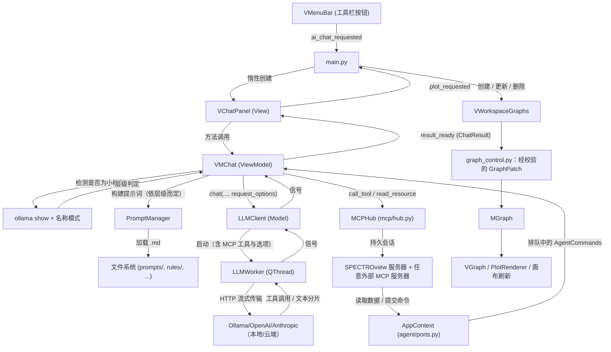
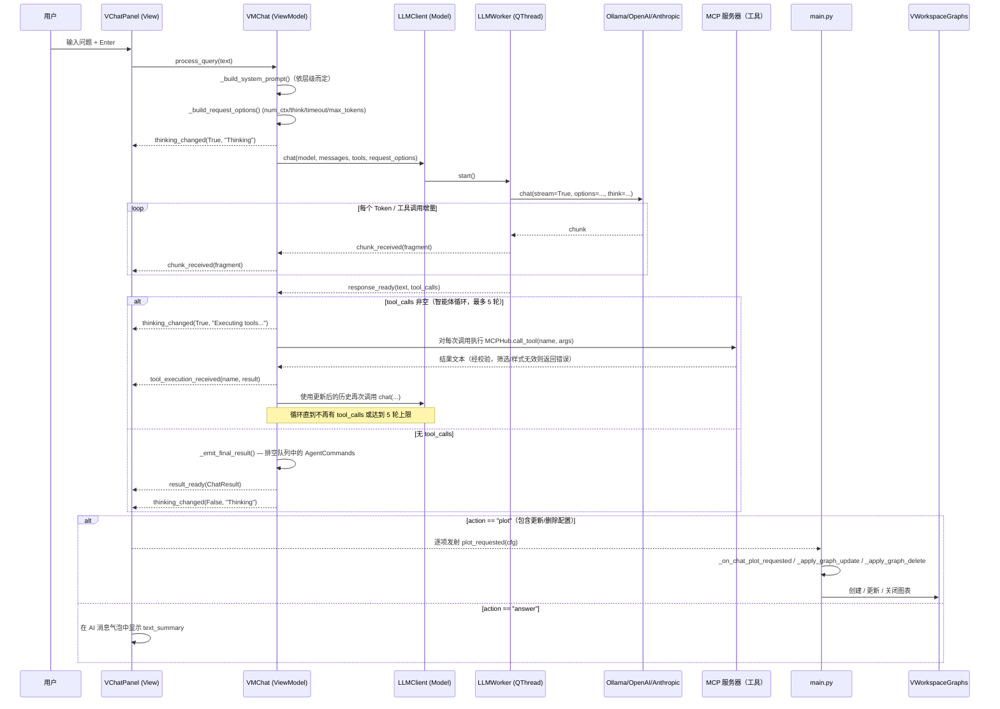

# **AI 数据对话** { #ai-data-chat }

`AI Data Chat` 是一个可选的多服务商 AI 对话助手，支持用户通过自然语言查询、筛选、绘制并修改数据。它支持通过 **Ollama** 进行本地推理、通过 **OpenAI** SDK 接入云端服务商（OpenAI、DeepSeek、Gemini 及任何兼容 OpenAI 的服务端点），以及 **Anthropic** Claude 模型。该智能体可与 `Graphs` 工作区通信，实现图表的实时创建、更新与删除。

> AI 模块在**使用上是可选的**——如果 Ollama 未运行且未配置任何云端 API 密钥，对话面板会显示红色的 "not connected" 状态提示，而 SPECTROview 的其余功能完全不受影响。不过，它所依赖的 Python 包（`ollama`、`openai`、`anthropic`、`mcp`）属于本项目的无条件安装依赖（参见[可选依赖管理](#optional-dependency-management)）。

这里还有另一个独立维度上的“可选性”同样重要：**本地小模型所获得的提示词和请求配置，与大型模型/云端模型相比有所不同且更为精简**——这是自 MCP 迁移以来最大的一项架构新增特性，下文专门设有一节进行说明（[小模型支持](#small-model-support)）。

---

## **用户前置准备** { #prerequisites-for-users }

### **方案 1：macOS** { #option-1-macos }

1. **安装 Ollama**
   使用 Homebrew（推荐）：

   ```bash
   brew install ollama
   ```

   *(或者，也可以直接从 [Ollama 官方网站](https://ollama.com/download/mac)下载 macOS 应用程序。)*

2. **启动 Ollama 服务**
   如果通过 Homebrew 安装，可将 Ollama 作为后台服务启动：

   ```bash
   brew services start ollama
   ```

   *(如果您安装的是 Mac 桌面应用，只需从“应用程序”文件夹中打开 Ollama 即可，随后可在菜单栏中看到其图标。)*

### **方案 2：Windows** { #option-2-windows }

1. **安装 Ollama**
   从 [Ollama 官方网站](https://ollama.com/download/windows)下载 Windows 安装程序并运行。

2. **启动 Ollama 服务**
   安装完成后 Ollama 通常会自动启动。如果没有自动启动，请在“开始”菜单中搜索“Ollama”并打开它，随后在系统托盘（右下角）中即可看到 Ollama 图标。

---

### **通用步骤（双平台适用）** { #common-steps-both-platforms }

3. **下载 AI 模型**
   SPECTROview 默认使用 `qwen2.5-coder:7b`。打开终端（Windows 上为命令提示符或 PowerShell）并拉取该模型：

   ```bash
   ollama pull qwen2.5-coder:7b
   ```

   任何支持工具/函数调用的 Ollama 模型均可使用——关于 SPECTROview 如何根据所选模型自适应调整行为，请参阅[小模型支持](#small-model-support)。

4. **安装 SPECTROview**
   `ollama`、`openai`、`anthropic` 和 `mcp` 均为软件包的必选核心依赖（并非单独的 extras 分组），因此常规安装已包含 AI 功能所需的全部依赖：

   ```bash
   pip install -e .
   ```

5. **运行 SPECTROview**
   启动应用程序：

   ```bash
   python -m spectroview.main
   ```

   点击顶部工具栏中的 **AI Data Chat** 按钮。对话面板随即打开，状态栏应显示 **🟢 Ollama connected**。

---

## **架构概览** { #architecture-overview }

AI 功能与应用程序其余部分一样遵循严格的 **MVVM** 模式。所有 AI 相关代码均位于 `spectroview/ai_agent/` 包中，与核心工作区保持隔离。



### **AppContext 边界** { #the-appcontext-boundary }

MCP 服务器**不会**导入 `VMChat`。它接收一个 `AppContext`（`agent/ports.py`）——这是一个包含五个方法的协议：列出 DataFrame、获取单个 DataFrame、获取当前活动名称、列出图表以及提交命令。`VMChat` 提供了 `VMChatContext` 适配器；测试则提供 `RecordingContext`。

正是这种设计使工具层可以独立测试（无需 Qt、无需 LLM、无需完整应用），同时也让同一个服务器能够以独立进程方式运行。工具从不直接修改 ViewModel；它们提交带类型的命令（`agent/commands.py`：`CreatePlot`、`UpdatePlot`、`DeletePlots`）。绘图与更新输入在入队前会通过共享契约 `spectroview.model.graphs.graph_control` 进行校验，而图表工作区在真正执行状态变更的边界处还会再次应用同一契约。

SPECTROview 还提供了一套完整的外部桌面端 MCP 配置文件。它复用了同一个 FastMCP 模块，但作用于 `SpectroviewApplicationAPI`——一个由排队式 Qt 主线程调度器保护的实时会话门面。内置对话助手则保留本文档介绍的五工具精简配置文件，以确保小模型的可靠性。有关端点地址、完整工具目录及扩展流程，请参阅[本地 MCP 服务器](mcp_server.md)。

### **完整的图表自定义契约** { #complete-graph-customization-contract }

为了保证小模型的调用可靠性，MCP 工具保留了少数几个常用的顶层参数，同时通过 `other_properties: GraphPatch` 开放了完备的配置集合。`GraphPatch` 由 `MGraph` 数据类的每一个可变字段自动生成，并设置了 `extra="forbid"`；其中嵌套的筛选器、系列样式、坐标轴边框线、断轴以及标注记录也均具有强类型约束。这避免了手动维护的白名单随 GUI 演进产生漂移，并使单次连贯调用即可同步更新对数刻度、字体、图例位置、线宽、标注、副坐标轴、局部放大插图及其他任何图表状态。

省略字段即表示保持原值。显式传入 `null` 仅适用于可空字段。服务器会在将单个原子命令入队之前，先针对目标 DataFrame 校验筛选条件，并在使用 `graph_id="all"` 时针对所有已打开图表逐一校验。工具返回结果刻意表述为 `"validated and queued"`（已校验并入队），因为只有 GUI 线程才能如实确认最终渲染是否成功。

### **MCPHub —— 单循环管理多服务器** { #mcphub-one-loop-many-servers }

`MCPHub`（`mcp/hub.py`）在后台线程中持有唯一的 `asyncio` 事件循环，并为 `config/servers.yaml` 中列出的每一个服务器（支持 `in-process`、`stdio` 或 `http`）维持一个已初始化的持久会话。Qt 线程中的调用方只需使用普通的同步方法；hub 会将每次调用调度到其事件循环中执行。

此前，ViewModel 直接在 GUI 线程上调用 `asyncio.run()`，并在每次工具调用批次时重新构建服务器会话——这不仅会阻塞界面，而且仅在单服务器且为进程内（in-process）运行时才勉强可行。

只要工具名称在各服务器之间不冲突，就保持无前缀的原名（从而保证 `plot_graph` 在所有文档示例中都能直接使用）；若两个服务器提供了同名工具，则两者的名称都会变为 `<server_id>__<tool>`。每个服务器的 `tools:` 白名单可将暴露的工具集合控制在较小规模——因为工具 Schema 在每一轮对话中都会消耗提示词 Token，而本地小模型在工具数量超过大约十几个后性能便会迅速下降。

### **推送上下文 vs 按需拉取上下文** { #pushed-vs-pulled-context }

系统提示词始终包含所有 DataFrame 的名称、形状、每一列的名称及其 dtype，以及每个已打开图表的紧凑摘要。样本数值、行预览以及完整实际的 `MGraph.save()` 配置体积较大且很少具有决定性作用，因此它们被放在 MCP **资源（resources）**背后（`spectroview://dataframes/detail`、`spectroview://graphs/detail`）。

由于目前没有任何 LLM API 原生支持 MCP 资源概念，hub 将读取资源暴露为一个合成工具 `get_context(uri)`，其 `uri` 枚举精确列出当前可用的所有资源——这也同时将受语法约束引导的本地模型限定在真实有效的 URI 范围内。任何服务器新增的资源都会自动出现在这里，无需修改客户端代码。

---

## **模块结构** { #module-structure }

```
spectroview/ai_agent/
├── __init__.py              # Docstring only — keeps the module optional
├── config/                  # YAML configuration (model.yaml, settings.yaml, servers.yaml)
├── examples/                # Few-shot conversation examples (Markdown)
│   ├── plotting_examples.md #   Full-tier: 13 examples, tool-call style
│   └── examples_small.md    #   Simplified-tier: ~8 tight examples covering all 5 tools
├── knowledge/                # Static domain facts (Markdown; full tier only)
├── prompts/                  # Core identity + per-topic instructions (Markdown)
│   ├── system.md, chat.md, plotting.md   # Full tier (default; also used by cloud providers)
│   └── system_small.md      #   Simplified tier — single consolidated file for detected small models
├── rules/                   # Behavioural constraints (Markdown)
├── agent/                   # Qt-free core
│   ├── commands.py          #   CreatePlot / UpdatePlot / DeletePlots dataclasses
│   └── ports.py             #   AppContext protocol + RecordingContext (the test fake)
├── utils/
│   ├── plot_utils.py        # normalize_plot_config / expand_comma_styles — type coercion for plot configs
│   ├── safe_eval.py         # evaluate_pandas_expression() — df.query() first, sandboxed eval() fallback
│   └── df_summary.py        # compact_dataframe_schema() for the prompt; summarize_dataframe_columns() for the resource
├── m_llm_client.py          # Model layer: LLM connections + QThread workers
│                            #   - LLMWorker (Ollama)
│                            #   - APIWorker (OpenAI-compatible)
│                            #   - AnthropicWorker (Anthropic SDK)
│                            #   - anthropic_tools()/anthropic_messages() — protocol translation
│                            #   - LLMClient (unified facade)
│                            #   - get_ollama_model_info() — `ollama show` wrapper for size detection
├── m_conversation.py        # Data model: single conversation (messages, save/load JSON)
├── m_conversation_store.py  # Conversation store: scan/list/load saved conversations
├── mcp/
│   ├── server.py            # SPECTROview's FastMCP server: 5 tools + 2 resources
│   ├── hub.py               # MCP client: one loop thread, one session per server
│   └── config.py            # servers.yaml -> validated ServerSpec list
├── m_prompt_manager.py      # Prompt caching and assembly: loads and merges the Markdown fragments
├── vm_chat.py               # ViewModel: prompt-tier selection, small-model detection, request tuning, agentic loop
├── v_chat_panel.py          # View: embedded chat panel (QWidget) beside workspace tabs
└── v_history_dialog.py      # View: history browser dialog (QDialog) with timestamps, pinning, search, and batch delete
```

### **文件职责** { #file-roles }

| 文件 | 层级 | 职责 |
|------|------|------|
| `m_prompt_manager.py` | **Model** | 根据传入的 `prompts=`/`rules=`/`knowledge=`/`examples=` 列表加载、缓存 Markdown 文件并组装为系统提示词。同时负责解析 `config/model.yaml`/`config/settings.yaml`（`.model_config`）。 |
| `m_llm_client.py` | **Model** | 封装 Ollama、OpenAI SDK 与 Anthropic SDK。检查服务可用性、列出模型、查询模型参数量（`get_ollama_model_info`）、将 OpenAI 工具调用格式转换为 Anthropic 格式，并根据所选服务商启动三种后台 `QThread` 工作线程之一。 |
| `m_conversation.py` | **Model** | 表示单个对话：添加消息（含 `tool_calls`/`tool_call_id`）、自动生成标题、JSON 保存/加载，并在截断保留最近 N 条消息时**绝不拆分工具调用与其返回结果**。空对话会跳过保存。 |
| `m_conversation_store.py` | **Model** | 扫描历史目录，将已保存对话以轻量摘要形式列出，并按 ID 加载完整对话。 |
| `agent/ports.py` | **Model** | `AppContext` —— MCP 工具了解应用程序的唯一接口。`RecordingContext` 是所有工具测试使用的内存实现。 |
| `agent/commands.py` | **Model** | `CreatePlot`/`UpdatePlot`/`DeletePlots` —— 工具向应用程序发起的带类型命令，取代过去以 `_graph_update`/`_graph_delete` 为键的原始字典。 |
| `mcp/server.py` | **Model** | FastMCP 服务器，对外暴露 SPECTROview 的 5 个工具和 2 个资源，并在请求时执行筛选条件与图表样式校验。仅依赖于 `AppContext`。 |
| `mcp/hub.py` | **Model** | MCP 客户端：后台事件循环、每个已配置服务器一个持久会话、工具名称限定前缀处理、白名单过滤以及合成的 `get_context` 资源访问工具。 |
| `mcp/config.py` | **Model** | 解析并校验 `config/servers.yaml`；遇到格式错误、已禁用或 ID 重复的条目时跳过（并记录警告）。 |
| `utils/safe_eval.py` | **Model** | 共享的沙箱化 pandas 表达式求值器，同时供 `query_dataframe` 以及 `plot_graph`/`update_graph` 中的筛选条件校验步骤使用。 |
| `utils/df_summary.py` | **Model** | `compact_dataframe_schema()` 构建始终推送的名称+数据类型块；`summarize_dataframe_columns()` 生成由 `dataframes/detail` 资源提供的详细列清单，在列数超过 `column_detail_threshold` 时按前缀折叠分组，同时绝不隐藏任何列名。 |
| `utils/plot_utils.py` | **Model** | `normalize_plot_config()`/`expand_comma_styles()` —— 在累计的绘图配置送入**图表** (Graphs) 工作区之前执行后处理（类型强制转换、逗号分隔多样式展开）。 |
| `vm_chat.py` | **ViewModel** | 检测小模型与完整模型层级、构建对应层级的系统提示词、组装 Ollama/超时/最大 Token 请求选项、管理对话历史，并运行工具调用智能体循环（最多 5 轮）。 |
| `v_chat_panel.py` | **View** | 嵌入式 `QWidget` 面板，包含对话气泡、服务商/模型选择器、时间戳显示、紧凑的 42px 标题栏以及多行输入卡片。当 AI 创建/更新/删除图表时发射 `plot_requested(dict)`。模型选择器是一个**可编辑**的 `QComboBox`（可直接输入模型名称）；对于**自定义** (Custom) 服务商，其列表通过 `_custom_model_names()` 从逗号分隔的 `custom_models` 设置（**设置** (Settings) ▸ AI）填充，从而使不提供模型列表 API 的端点也能够正常使用。 |
| `v_history_dialog.py` | **View** | 可浏览的已保存对话列表，按最近时间倒序排列。支持打开、重命名、复制副本及删除。 |

---

## **小模型支持** { #small-model-support }

参数量较小的本地模型（大致在 100 亿参数以下）所获得的提示词、上下文预算和请求配置，与大型模型/云端模型有着本质区别——而不仅仅是把原版简短化。这是因为信息过于密集的大型提示词加上未加限制的上下文窗口，本身就足以让原本具备能力的模型在工具调用上彻底失败（参见本节末尾的案例研究）。

### 检测机制 { #detection }

`VMChat._auto_detect_small_model()` 按以下顺序确定层级：

1. **手动覆盖** —— `VMChat.set_small_model_mode(True | False | None)`。`None`（默认值）表示“继续自动检测”，并通过 `MSettings` 持久化。
2. **参数量检查**（仅限 Ollama）—— `get_ollama_model_info(model)` 调用 `ollama show <model>`，通过 `_parse_param_size_to_billions()` 解析 `details.parameter_size`（例如 `"8.2B"`），并将其与 `config/model.yaml` 中的 `small_model_param_threshold_b`（默认 **10.0**）进行比较。结果会按模型名称缓存，并在当前 `VMChat` 实例生命周期内有效。
3. **名称模式回退** —— 如果无法确定参数量（例如云端模型或 `ollama show` 失败），则将模型名称与 `VMChat._SMALL_MODEL_PATTERNS` 匹配，其中包含已知小模型标签列表（`qwen3:8b`、`gemma3:4b`、`phi3:mini`、`deepseek-r1:8b` 等）。
4. **默认：完整层级（Full tier）。** 如果以上均未匹配，则按大模型处理。让未识别的模型获取完整提示词，比错误地限制一个未识别的*大型*模型更安全。

第 2–3 步的检测严格限定于 `provider == "Ollama"` —— 除非手动覆盖，否则云端服务商始终解析为完整层级。检测会在 `set_model()`/`set_provider()` 时重新运行，绝不会在 `__init__` 中执行（避免对象构造时发生 `ollama show` 网络调用竞态）。

### **持久化设置** { #persisted-settings }

智能体存储的所有状态——服务商、各服务商下所选模型、提示词层级以及对话历史目录——均保存在单一应用程序配置存储的 `ai_chat/` 前缀下，通过 `MSettings.get_ai_value()` / `set_ai_value()` 访问。AI 模块自身不会单独导入任何 `QSettings`。

过去曾使用过独立的 `QSettings("SPECTROview", "AIChat")` 存储对。这不仅使智能体配置对应用其余部分不可见，更糟糕的是会绕过测试夹具 `_isolate_qsettings` —— 导致任何构造 `VMChat` 的测试都会读取开发者本机的真实配置，并将测试对话历史写入真实历史目录。`MSettings._migrate_legacy_ai_settings()` 会在标记键的保护下一次性迁移旧值（绝不覆盖较新值），并保留旧存储以兼容旧版本运行。

> **密钥管理（`spectroview/settings/secrets.py`）**：API 密钥（`OpenAI`、`Anthropic`、`Mistral`、`Gemini`、`DeepSeek`、`Custom`）通过 `SecretStore` 存储在按操作系统用户隔离的配置存储中（位于 `QSettings("CEA-Leti", "SPECTROview")` 经过混淆的 `_credentials/` 命名空间下），并严格排除在导出的 `config.json` 文件之外，以防凭据泄露或误提交。`config/servers.yaml` **会**提交到版本库：切勿在其中写入明文令牌，请改用 `${VAR}`（由 `mcp/config.py` 展开）。

### 简化模式下的变更内容 { #what-changes-in-simplified-mode }

以下各项均在 `vm_chat.py` 中计算并从 `config/model.yaml` 读取：

| 方面 | 完整层级 | 简化层级 | 配置键 |
|---|---|---|---|
| 系统提示词 | `system.md`+`chat.md`+`plotting.md` + `rules/general,plotting,spectroview` + `knowledge/features` + `examples/plotting_examples`（约 27K 字符） | `system_small.md` + `rules/general` + `examples/examples_small`（约 9K 字符） | 不适用（在 `_build_system_prompt()` 中硬编码的列表） |
| 对话历史 | 无限制 | 最近 6 条消息 | `max_context_messages` / `max_context_messages_small` |
| Ollama `num_ctx` | 16384 | 8192 | `ollama_num_ctx_full` / `ollama_num_ctx_small` |
| 最大输出 Token 数 | 81920 | 4096 | `max_tokens` / `max_tokens_small` |
| Ollama `think` | 未设置（遵循模型/Ollama 默认值） | `false` | `ollama_think` |

`rules/general.md` 由两个层级共享（体积小且具有普适正确性）；`rules/plotting.md`、`rules/spectroview.md` 和 `knowledge/features.md` 仅用于完整层级——它们的核心要点（如筛选表达式加引号、空间图坐标轴映射）已直接整合进 `system_small.md`。

`num_ctx` 和 `think` 仅属于 Ollama 的 `options` 参数：`LLMClient.chat()` 的 `request_options` 字典会按服务商转换，这两个键绝不会转发给 `APIWorker`/`AnthropicWorker` —— 无论当前处于哪个层级，从结构上都不可能影响 DeepSeek/OpenAI/Anthropic/Gemini。

### Schema 级适配（惠及所有模型，而非仅限小模型） { #schema-level-accommodations-help-every-model-not-just-small-ones }

`mcp/server.py` 中的两项改动降低了*所有*模型的歧义性，且与提示词层级无关：

- `plot_style` 使用 `Literal[...]`（为 9 种有效样式生成真正的 JSON-Schema `enum`），而非裸 `str`。
- 最常用的 `other_properties` 键（`grid`、`plot_title`、`xlabel`、`ylabel`、`zlabel`、坐标轴范围、`color_palette`、对数刻度标志等）除了保留在 `other_properties` 兜底字典中之外，还作为显式的、强类型的命名参数直接暴露在 `plot_graph`/`update_graph` 上。即便模型将 `grid=true` 放在调用的顶层参数（而不是正确嵌套在 `other_properties` 内），该值也不会再丢失——两种形式会合并到最终配置中，且发生冲突时以命名参数优先。

### 案例研究：qwen3:8b { #case-study-qwen38b }

面对完全相同的 3 图表绘制请求，大型云端模型（DeepSeek）一轮即可成功；而在本机制实现之前，`qwen3:8b` 在两次尝试中以两种不同方式失败：

- **尝试 A**：未发出任何工具调用——反而输出了 2,237 个字符的散文式说明，用 ```python 代码块描述了一个从未真正执行的伪代码计划。
- **尝试 B**：发出了合法的工具调用，但把 `grid: true` 作为顶层参数传入（而当时真实签名仅在 `other_properties` 内部识别该参数）——导致其被 MCP/Pydantic 静默丢弃，既无报错也未重试。

经过上述修复后：**3 次回放测试全部成功（3/3）**，每次都准确生成了 3 个格式正确的 `plot_graph` 调用（且 `grid` 被正确保留）并附带结束摘要；总耗时平均约 19 秒，而此前*单次失败轮次*就需要 42–100 秒。

---

## **核心类** { #key-classes }

### **`LLMWorker` / `APIWorker` / `AnthropicWorker` —— 后台线程** { #llmworker-apiworker-anthropicworker-background-threads }

**文件**：`spectroview/ai_agent/m_llm_client.py`

三个 `QThread` 子类，分别对应一种后端。每个子类负责执行单次流式（或者对于带工具调用的 Anthropic，则为非流式）对话请求。

| 类 | 后端 | 所需软件包 | 额外构造参数 |
|-------|---------|------------------|---------------------------|
| `LLMWorker` | Ollama（本地） | `ollama` | `options`（字典：`num_ctx`、`num_predict`）、`think`（`bool`\|`"low"`\|`"medium"`\|`"high"`\|`None`）、`timeout` |
| `APIWorker` | OpenAI、DeepSeek、Gemini、Custom | `openai` | `timeout`、`max_tokens` |
| `AnthropicWorker` | Anthropic Claude | `anthropic` | `timeout`、`max_tokens` |

`LLMWorker` 仅在确实设置了超时时间时才构造 `ollama.Client(timeout=...)`；否则直接调用模块级的便捷函数 `ollama.chat()`。Ollama 返回的工具调用是 Pydantic 模型对象（`ollama._types.Message.ToolCall`）而非普通字典——`LLMWorker.run()` 会在发射信号前通过 `.model_dump()` 对每个对象进行归一化，从而避免 `MConversation.save()`（普通的 `json.dump`）因遇到不可序列化对象而报错。

| 信号 | 载荷 | 用途 |
|--------|---------|---------|
| `chunk_received` | `str` | 每个流式接收到的 Token 片段 |
| `response_ready` | `(str, list)` | 完整组装的响应文本 + 累计的工具调用列表 |
| `error_occurred` | `str` | 当后端不可达时的错误消息 |

> **错误消息会揭示根本原因。** 三个工作线程都会将捕获的异常传给 `_format_exception()`，沿着 `__cause__`/`__context__` 链向下遍历。`openai`/`anthropic` SDK 会将底层的 TLS/Socket 故障折叠成一句简短的 `APIConnectionError("Connection error.")`；若不沿异常链向下追踪，企业自签 CA 导致的 `CERTIFICATE_VERIFY_FAILED`、DNS 解析失败 `getaddrinfo failed` 或连接被拒绝都会呈现完全相同且无法排查的报错。

> **企业 / 内部 CA 的 TLS 校验。** `openai`/`anthropic` 通过 `httpx` 对照 `certifi` 证书束验证 TLS，而该证书束不包含私有企业 CA —— 因此本地部署的服务端点会因上述不透明的 "Connection error." 而失败。`m_llm_client` 在导入时处理了这一问题：若环境变量 `SSL_CERT_FILE`/`REQUESTS_CA_BUNDLE` 指定了 PEM 文件，则将其作为 `httpx` 的 `verify` 参数传入（由 `_make_http_client()` 构造，并作为 `http_client=` 传入每个 SDK 客户端）；否则调用 `truststore.inject_into_ssl()`，将校验路由至操作系统信任存储（如 Windows 证书存储区），这类 CA 通常已安装在那里。`truststore` 是核心依赖，但导入仍受保护，因此在缺失该包的任何环境中只会静默回退到默认的 `certifi`。

> Ollama 的 `message["thinking"]` 字段（启用 `think` 时混合推理模型的隐藏草稿通道）被刻意**绝不**追加到 `chunk_received` 或响应文本中——将隐藏推理通道混入可见回答正是导致前文 qwen3 “尝试 A” 失败的原因。UI 中曾存在一个“Show model reasoning”开关（可选地强制覆盖 `think=True` 并在每条消息气泡下增加可折叠的推理区块），现已**完全移除**——应用不再显式请求 `think=True`，因此 `think` 仅保持各层级的默认值（完整层级不设置，小模型层级为 `false`；参见[小模型支持](#small-model-support)表格）。即便移除该开关，通道分离机制依然保留：即使模型在未经请求的情况下自发输出 `thinking` 内容，`LLMWorker` 的 `thinking_chunk_received` 信号（以及如今仅丢弃片段而不予展示的 `VMChat._on_thinking_chunk`）也会将其隔离在回答通道之外。

### **`LLMClient` —— 连接门面** { #llmclient-connection-facade }

**文件**：`spectroview/ai_agent/m_llm_client.py`

一个轻量的、不依赖 Qt 的门面类，负责管理服务商选择、API 密钥存储以及工作线程生命周期。

**已知服务商**（定义在 `API_PROVIDERS` 字典中）：

- `Ollama` → `LLMWorker`
- `OpenAI`、`DeepSeek`、`Gemini`、`Custom` → `APIWorker`
- `Anthropic` → `AnthropicWorker`

| 方法 | 用途 |
|--------|---------|
| `is_available()` | 若当前服务商对应软件包已安装，且（对于 Ollama）守护进程有响应或（对于云端）已设置 API 密钥，则返回 `True` |
| `get_models()` | 返回当前服务商可用模型名称的已排序列表 |
| `chat(model, messages, on_chunk, on_done, on_error, tools=None, parent=None, request_options=None)` | 为当前服务商启动相应的后台工作线程；会先取消任何正在进行的请求。`request_options`（`num_ctx`/`think`/`timeout`/`max_tokens`）会按服务商转换——跨服务商隔离保证详见[小模型支持](#small-model-support)。 |
| `cancel()` | 终止当前正在运行的工作线程 |
| `is_busy()` | 当工作线程正在运行时返回 `True` |

**模块级辅助函数**：`get_ollama_model_info(model) -> Optional[ollama.ShowResponse]` —— 尽力而为地调用 `ollama.show()`，任何失败均返回 `None`；绝不抛出异常。供 `VMChat` 的小模型检测使用。

**默认模型**：`qwen2.5-coder:7b`（可通过 UI 下拉框配置；`LLMClient.DEFAULT_MODEL`）。

### **`PromptManager` —— 提示词组装** { #promptmanager-prompt-assembly }

**文件**：`spectroview/ai_agent/m_prompt_manager.py`

一个带缓存的管理器，从磁盘读取 Markdown 片段并按给定的 `prompts=`/`rules=`/`knowledge=`/`examples=` 列表拼接为系统提示词。

| 方法 | 用途 |
|--------|---------|
| `load_prompt(name)` / `load_rule(name)` / `load_knowledge(name)` / `load_example(name)` | 按文件主干名加载单个 Markdown 文件并缓存在内存中（若 `auto_reload: true`，在 mtime 变化时自动失效） |
| `build_prompt(prompts, rules, knowledge, examples)` | 从指定片段组装完整的系统提示词。缺失文件会记录警告并跳过，不会抛出异常。 |
| `.model_config` | 已解析为字典的 `config/model.yaml` |

> **加载哪些片段是在代码中决定的**，具体由 `VMChat._build_system_prompt()` 控制——完整层级对应一套列表，简化层级对应另一套列表（参见[小模型支持](#small-model-support)）。目前不存在意图路由器。早期曾有一个基于关键词的路由器（`_detect_intent()`、`_INTENT_DEFAULTS`、`enable_intent_detection`），但实际上一直处于休眠状态——显式列表总是将其短路——因此该路由器连同仅由其加载的五个提示词片段（`prompts/fitting.md`、`prompts/coding.md`、`rules/fitting.md`、`rules/python.md`、`examples/filtering_examples.md`）已一并移除。如果日后要真正构建意图路由，可从 git 历史中恢复它们。

### **`VMChat` —— ViewModel** { #vmchat-viewmodel }

**文件**：`spectroview/ai_agent/vm_chat.py`

管理与已加载 DataFrame 关联的单个对话会话。遵循 MVVM 契约：View 调用公共方法；ViewModel 完全通过信号进行响应。

| 信号 | 载荷 | 用途 |
|--------|---------|---------|
| `thinking_changed` | `(bool, str)` | 在 LLM/工具循环处理期间为 `True`，并附带状态标签（`"Thinking"` / `"Executing tools..."`） |
| `chunk_received` | `str` | 用于打字动画的流式 Token 片段 |
| `result_ready` | `ChatResult` | 智能体循环停止发起工具调用后的最终结果 |
| `error_occurred` | `str` | 人类可读的错误消息 |
| `tool_execution_received` | `(str, str)` | 工具名称 + 其结果文本，在循环中的每次工具调用（包括中间步骤）时发射。View 仅用它来更新短暂的“思考中”状态——中间工具步骤不再作为标签气泡渲染在对话中 |
| `conversation_changed` | `str` | 新建或加载的对话标题 |

#### **公共 API** { #public-api }

| 方法 | 用途 |
|--------|---------|
| `set_dataframes(dfs, active_name)` | 更新可用的 DataFrame |
| `update_active_df_name(name)` | 在不清空历史的情况下切换当前活动 DataFrame |
| `set_graphs(graphs)` | 更新已知的已打开图表列表（会包含在系统提示词中以提供上下文） |
| `set_model(model)` | 切换模型；重新运行小模型自动检测 |
| `set_provider(provider, api_key, base_url, model)` | 切换后端；重新运行自动检测；开启新对话 |
| `set_small_model_mode(enabled)` | 传入 `True`/`False` 强制指定层级，传入 `None` 恢复自动检测 |
| `is_small_model_mode()` | 若当前处于简化层级则返回 `True` |
| `process_query(user_text)` | 向 LLM 发送用户提问 |
| `cancel()` | 中止正在进行的请求 |
| `clear_history()` | 重置对话历史（与 **+ 新建对话** (+ New Chat) 相同） |

#### **智能体工具调用循环** { #the-agentic-tool-calling-loop }

`process_query()` → `LLMClient.chat()` → `_on_done(full_text, tool_calls)`：

- 若 `tool_calls` 非空：每个调用的 `arguments`（若以 JSON 字符串形式到达则先解析；解析失败时会生成一条可操作的“please retry with valid JSON”工具结果消息，而不是静默替换为 `{}`）都会通过 `MCPHub.call_tool(name, args)` 分发，并路由到拥有该工具的服务器。每一条工具结果——无论是成功、校验错误还是未知工具提示——都会作为 `role="tool"` 消息追加到对话历史中，随后 `_on_done` 使用更新后的历史再次调用 `LLMClient.chat()`。循环次数上限为 `VMChat.MAX_AGENT_TURNS`（**5**）。
- 若 `tool_calls` 为空：本轮通过 `_emit_final_result()` 结束。

`_emit_final_result()` 会排空本轮期间在上下文中入队的命令，将其渲染为配置（在 `_commands_to_configs` 中统一归一化一次），然后发射 `ChatResult(action="plot", plot_config=[...])`——或者在未入队任何命令时发射 `ChatResult(action="answer", text_summary=...)`。

它会在**每一条**终止路径上执行，包括达到轮次上限和工具执行异常。此前这两条路径会提前返回，导致当某个模型先入队三个图表、接着持续调用工具直到触发轮次上限时，用户在被告知图表已创建之后，最终却只收到一个错误而没有任何图表。

**`ChatResult.action` 永远只会取 `"plot"` 或 `"answer"`。** MCP 之前的 JSON 协议值（`"filter"`/`"statistics"`/`"update"`/`"delete"`/`"query"`）已不存在代码路径；`query_dataframe`/`get_statistics` 的结果会作为模型最终的自然语言文本回复呈现给用户，而非单独的结构化结果。遗留的 `dataframe`/`raw_response`/`query`/`target_dataframe` 字段以及专为其渲染的 `_DataFramePreview` 控件均已被移除。

#### **请求选项** { #request-options }

`_build_request_options()` 读取 `config/model.yaml`，并返回作为 `request_options=` 传给每次 `LLMClient.chat()` 调用的 `num_ctx`/`think`/`timeout`/`max_tokens` 字典——完整层级与简化层级的完整参数对比表参见[小模型支持](#small-model-support)。

#### **对话历史与持久化** { #conversation-history-persistence }

对话会自动以 JSON 文件形式保存在用户配置的历史目录中（**设置** → **AI 设置** (AI Settings) 标签页）。`MConversation` 的行为如下：

- 累计保存带 ISO 时间戳的消息（包括工具调用轮次的 `tool_calls`/`tool_call_id`）。
- 根据第一条用户消息自动生成标题（最多 60 个字符）。
- 在每次助手回复轮次以及每批工具结果之后持久化到磁盘。
- 当用户加载新的工作区文件或切换 DataFrame 时**不会清空**——仅点击 **+ 新建对话**才会重置它。

实际发送给 LLM 的上下文会通过 `max_context_messages` 限制长度——完整层级不限制，简化层级仅保留最近 6 条消息（参见[小模型支持](#small-model-support)；这取代了过去存在但从未实际接入任何逻辑的 `MAX_HISTORY_PAIRS = 6` 类常量）。

`to_llm_messages()` 在窗口边界处会**向前扩展**而非盲目截断：因为 `role="tool"` 消息只有紧跟在携带对应 `tool_calls` 的助手消息之后才合法，所以如果截断线恰好落在这两者之间，窗口就会向后（更早期方向）扩展，直到整对消息完整保留。在两者之间直接切片会导致服务商拒绝请求——而且由于该限制仅在简化模式下启用，这恰好会击中最难以从 API 错误中恢复的本地小模型。

### **`ChatResult` —— 解析后的响应** { #chatresult-parsed-response }

**文件**：`spectroview/ai_agent/vm_chat.py`

```python
class ChatResult:
    __slots__ = ("action", "explanation", "text_summary", "plot_config")
```

| 字段 | 类型 | 用途 |
|-------|------|---------|
| `action` | `str` | `"plot"` 或 `"answer"` —— 仅有的两个取值（见上文） |
| `explanation` | `str` | 当运行了图表命令时显示在消息卡片上的说明文本 |
| `text_summary` | `str` | LLM 最终生成的自然语言文本 |
| `plot_config` | `list[dict]` \| `None` | 为图表工作区累计生成的创建/更新/删除配置列表 |

### **`VChatPanel` —— 嵌入式对话面板** { #vchatpanel-embedded-chat-panel }

**文件**：`spectroview/ai_agent/v_chat_panel.py`

一个嵌入式 `QWidget` 面板，位于 `Main.workspace_splitter` 最右侧，采用受现代 AI 输入器启发的卡片化界面风格。

**标题栏（`chatHeader`）**：紧凑的单行布局（固定高度 42px）：

- **对话标题（`edit_title`）**：可编辑的 `QLineEdit`，横向占满标题栏可用宽度。
- **操作按钮**：30×30 的图标按钮，分别对应**对话历史** (Chat History)（`btn_history`）、**新建对话**（`btn_new_chat`）、**清空对话** (Clear Chat)（`btn_clear`）以及 Close Panel（`btn_close`）。（内部的 `lbl_status` 和 `lbl_no_data` 属性仍被保留，以便兼容信号连接而不使标题栏界面显得杂乱。）

**输入器（`chatComposerFrame`）**：

- 位于面板底部的带细边框圆角（8px）卡片容器。
- **顶部**：可自动调整高度的多行文本输入框（`_ChatLineEdit`），无边框且背景透明。
- **嵌入式工具栏**：位于输入器卡片底部的内嵌栏：
  - AI 服务商下拉选择框（`cbb_provider`）
  - 模型下拉选择框（`cbb_model`，可编辑）
  - 连接/模型列表刷新按钮（`btn_refresh_models`）
  - 弹性占位空白（Stretch）
  - 语音听写麦克风按钮（`btn_mic`）
  - 现代风格的操作按钮（`btn_send`）：在蓝色的**发送** (Send) 与红色的**停止** (Stop) 状态之间切换，并带有动态悬停/激活样式。

此前用于手动选择提示词层级的下拉框（`cbb_prompt_tier`：**自动** (Auto) / Full / Small）已被移除；小模型检测现已完全基于模型参数量自动运行。

辅助控件：

- **`_MessageCard`**：带样式的消息气泡；`_add_card(text, role, timestamp)` 会根据发言角色将其缩进对齐至对应一侧。
- **`_ChatLineEdit`** / 输入区域：按下 Enter 键时发射 `send_requested`。

---

## **系统提示词与 LLM 契约** { #system-prompt-llm-contract }

系统提示词采用模块化设计并由 `PromptManager` 管理，根据当前活动模型由两套不同粒度的 Markdown 文件组装而成（参见[小模型支持](#small-model-support)）：

**完整层级**（默认；也用于所有云端服务商）：

1. **核心提示词**（`prompts/system.md`、`chat.md`、`plotting.md`）：身份定位、工具使用契约与绘图指令。
2. **动态上下文**（由 `VMChat` 注入）：DataFrame Schema 与样本值（当列数超过 `column_detail_threshold` 时通过 `utils/df_summary.py` 压缩）、当前活动 DataFrame 名称、已打开图表摘要。
3. **规则约束**（`rules/general.md`、`plotting.md`、`spectroview.md`）：行为约束条件。
4. **领域知识**（`knowledge/features.md`）：关于软件特性的静态事实知识。
5. **示例**（`examples/plotting_examples.md`）：13 个少样本（few-shot）工具调用示例。

**简化层级**：`prompts/system_small.md`（自包含单文件：身份定位、关键规则、动态上下文占位符、工具列表、常用 `plot_graph` 选项、空间图轴映射、多轮引导——全部集成于一个文件中） + `rules/general.md` + `examples/examples_small.md`（约 8 个覆盖全部 5 个工具的示例）。

智能体通过 **Model Context Protocol (MCP)** 使用**原生工具/函数调用（Tool/Function Calling）**——完全不需要解析自由文本 JSON。LLM 会获得每个工具严格且带类型的 Schema（位于 `mcp/server.py`，基于 `FastMCP` 构建）：

```python
query_dataframe(query: str, df_name: str = "") -> str
get_statistics(columns: list[str], df_name: str = "") -> str
plot_graph(x: str, y: str | list[str], plot_style: Literal[9 styles], z=None,
           filters: list[str] | None = None, df_name: str = "",
           grid=None, plot_title=None, xlabel=None, ylabel=None, zlabel=None,
           xmin=None, xmax=None, ymin=None, ymax=None, zmin=None, zmax=None,
           color_palette=None, xlogscale=None, ylogscale=None,
           scatter_size=None, hist_bins=None, trendline_order=None,
           other_properties: dict | None = None) -> str
update_graph(graph_id: str, ...)   # same optional fields as plot_graph, all Optional
delete_graph(delete_all: bool = False, graph_ids: list[int] | None = None) -> str
```

`plot_graph`/`update_graph` 的命名可选参数（`grid`、`plot_title`、坐标轴范围等）与 `other_properties` 属于叠加互补关系——两种传参形式都有效，如果同一个键同时出现在 `other_properties` 中，则命名参数优先。这正是针对前文 qwen3 案例研究的直接解决方案：模型不再需要去猜测未明写的嵌套规则，也能让 `grid` 等常用属性生效。

`LLMClient` 会拦截工具调用并将其分发至进程内 MCP 客户端会话；执行结果（包括校验错误信息）会回传至对话历史中，供模型继续决策。

### **安全性与校验** { #safety-validation }

- **筛选/查询表达式**由 `utils/safe_eval.py::evaluate_pandas_expression()` 求值：优先尝试 `DataFrame.query()`（pandas 自带的受限语法，能够安全处理各类提示词中教授的裸列名语法，例如 `"FWHM_Si > 5"`），对于 `.query()` 无法表达的语法（例如 `"df.groupby('Slot')['x'].mean().idxmax()"`），则回退至命名空间受限的 `eval()`（`{"__builtins__": {}}`，仅绑定 `df`/`pd`/`np` 与各列）。这是原有纯 `eval()` 行为的严格超集——此前能正常工作的表达式全部保持可用，同时没有引入任何新的代码执行面。
- **`plot_graph`/`update_graph` 会先对每个筛选条件执行试运行（dry-run）**，对照真实的目标 DataFrame 校验通过后*才*接受该图表请求。无效的筛选条件（最常见的是字符串值未加引号）会返回可操作的错误——图表**不会**被创建——而不是无论是否正确都一律返回笼统的成功提示。
- **`plot_style` 通过 Schema 校验**（`enum`），并在 Python 侧进行二次检查，作为纵深防御以应对不对工具参数做语法约束的服务商。
- **格式错误的 JSON 工具调用参数**（较为罕见；主要出现在 OpenAI 兼容服务商中，其 `arguments` 以待解析字符串形式流式返回）会生成一条触发重试的错误消息，而不是静默替换为 `{}`。

---

## **端到端数据流** { #data-flow-end-to-end }



---

## **与图表工作区的集成** { #integration-with-graphs-workspace }

### **延迟初始化** { #lazy-initialization }

**模块导入**与 **Widget 实例化**均被推迟到 `Main.open_ai_chat()` 时才执行。各服务商 SDK 的导入耗时约 4.5 秒，因此 `main.py` 在启动时仅探测模块是否存在（通过 `importlib.util.find_spec`，不执行任何模块代码），直到用户首次打开对话面板时才执行真正的导入。

```python
# main.py — module level: probe only, nothing is executed
LLM_AVAILABLE = importlib.util.find_spec("spectroview.ai_agent.v_chat_panel") is not None

# main.py — inside open_ai_chat()
from spectroview.ai_agent.v_chat_panel import VChatPanel
if self._chat_panel is None:
    self._chat_panel = VChatPanel(self)
    self._chat_panel.plot_requested.connect(self._on_chat_plot_requested)
```

下一层级也遵循相同原则：`mcp` 是在 `MCPHub._open_session()` 内部导入，而不是在 `hub.py` 模块顶层导入。

### **DataFrame 同步** { #dataframe-synchronization }

对话面板通过在 `main.py` 中建立的三个信号连接，与图表工作区保持实时同步：

| 信号 | 处理函数 | 触发时机 |
|--------|---------|---------|
| `vm.dataframes_changed` | `sync_chat_dfs_full` | 添加/移除 DataFrame —— 刷新所有 DataFrame 与图表信息 |
| `vm.dataframe_columns_changed` | `sync_chat_active` | 切换当前活动 DataFrame —— 保留对话历史 |
| `vm.graphs_changed` | `sync_chat_graphs` | 创建/更新/删除图表 —— 刷新系统提示词中的图表 ID |

每次显示对话面板时，还会强制执行一次同步，以确保当前可用数据处于最新状态。

### **绘图配置归一化** { #plot-config-normalization }

队列中的命令在发射到 `main.py` 之前，会在 `VMChat._commands_to_configs()` 中统一归一化**一次**。（此前 `VMChat` 和 `main.py` 曾对同一字典重复归一化；`main.py` 中的那一步已被移除。）

| 字段 | 归一化规则 |
|-------|--------------|
| `y` | `str` → `[str]`，`None` → `[]` |
| 范围字段（`xmin`、`ymin` 等） | `str`/`int`/`"null"` → `float` 或 `None` |
| 整数字段（`x_rot`、`scatter_size` 等） | 强制转换为 `int`，转换失败则移除 |
| `filters` | `["expr1", "expr2"]` → `[{"expression": "expr1", "state": True}, ...]` |
| `plot_style` | 逗号分隔值（`"box, scatter"`）→ 按每种样式拆分为单独配置 |

`utils/plot_utils.py` 从 `spectroview.PLOT_STYLES`/`PALETTE` 派生其有效图表样式与调色板，`mcp/server.py` 的校验器亦然。工具 Schema 的 `Literal` 必须保持可静态分析，因此显式拼写列出——如果这些列表日后发生漂移，`test_ai_agent_schema.py::TestPlotStyleSingleSourceOfTruth` 将会捕获失败。

### **图表更新与删除流程** { #graph-update-delete-flow }

`UpdatePlot`/`DeletePlots` 命令会渲染为 `{"_graph_update": {...}}` / `{"_graph_delete": {...}}` 条目，并通过现有的 `plot_requested` 信号发送，随后 `main.py` 会：

1. 按 ID 获取现有的 `MGraph` 模型（或解析 `"all"`）。
2. 调用 `vm.update_graph(...)` 或关闭对应的 `QMdiSubWindow` 子窗口。

---

## **工具栏入口** { #toolbar-entry-point }

AI 对话切换动作被添加到 `VMenuBar` 主工具栏的右侧，紧邻检查更新按钮之前：

```python
# v_menubar.py
self.actionAIChat = self.addAction(Icons.sparkles(size=22), "SPECTROview AI Agent")
self.actionAIChat.setShortcut("Ctrl+Shift+A")
self.actionAIChat.triggered.connect(self.ai_chat_requested.emit)
```

`ai_chat_requested` 信号在 `setup_connections()` 中连接到 `Main.open_ai_chat()`，用于切换直接嵌入在主工作区标签栏最右侧 `Main.workspace_splitter` 中的 `VChatPanel` 的可见性。

---

## **可选依赖管理** { #optional-dependency-management }

`ollama`、`openai`、`anthropic` 和 `mcp` 在 `pyproject.toml` 中属于**无条件核心依赖**——并没有单独的 `[ai]` 可选附加分组；常规执行 `pip install -e .` 便已安装好 AI 功能所需的全部软件包。真正“可选”的是在运行时是否*使用*该功能：

### **导入保护模式** { #import-guard-pattern }

可用性探测**不会真正执行导入**——`find_spec` 仅定位软件包而不执行其代码——真正的导入发生在首次使用时，并缓存到模块全局变量中：

```python
# m_llm_client.py — each SDK is probed and loaded independently
OLLAMA_AVAILABLE = importlib.util.find_spec("ollama") is not None
_ollama = None

def _load_ollama():
    """Return the `ollama` module (imported on first use), or None."""
    global _ollama
    if _ollama is None and OLLAMA_AVAILABLE:
        import ollama as _mod
        _ollama = _mod
    return _ollama
# ... same pattern for openai (_load_openai), anthropic (_load_anthropic)
```

由于加载器在模块全局变量已存在时会直接返回它，测试代码依然可以通过 `patch.object(m_llm_client, "_ollama", fake)` 注入替身对象。

如果某个软件包确实缺失（例如精简环境中）或 Ollama 未运行 / 未配置 API 密钥：

- 对应服务商通过 `LLMClient.is_available()` 报告不可用，并在界面上显示红色状态消息及可操作的安装指引。
- 应用启动时不会抛出任何错误；其余功能完全不受影响。

---

## **响应解析与错误处理** { #response-parsing-error-handling }

采用 **MCP 工具调用（MCP Tool Calling）** 后，响应解析过程完全不再需要解析自由文本 JSON：

1. **工具执行**：LLM 通过各服务商原生的函数调用协议输出结构化工具调用。
2. **工具边界校验**：`mcp/server.py` 在接受绘图/更新请求前，会校验 `plot_style`（Schema 枚举）并对每个筛选条件执行试运行（`utils/safe_eval.py`）——无效输入会生成一条可操作的错误信息反馈给模型，而不是静默假装成功或被直接丢弃。
3. **参数格式错误**：无法解析（或解析结果不是对象）的 JSON 字符串 `arguments` 载荷会生成一条促使模型重试的工具结果消息，而非静默替换为 `{}`。
4. **纯文本回退**：如果 LLM 仅回复纯文本而未发起工具调用，该文本会成为 `ChatResult(action="answer", text_summary=...)`——即使没有执行数据操作，用户也总能看到有价值的回复。
5. **未指定目标 DataFrame**：当 `df_name` 为空时，MCP 工具会自动将其解析为当前活动 DataFrame。
6. **不可序列化的工具调用对象**：Ollama 返回的 `tool_calls` 是 Pydantic 模型对象；`LLMWorker.run()` 会在将其加入对话历史前通过 `.model_dump()` 统一转为普通字典，从而确保 `MConversation.save()` 中的标准 `json.dump()` 不会失败。

---

## **当前功能（图表工作区）** { #current-features-graph-workspace }

| 功能 | 说明 |
|---------|-------------|
| **自然语言创建图表** | 支持通过自然语言请求绘制全部 9 种受支持的图表样式（point、scatter、box、bar、line、trendline、histogram、wafer、2Dmap），并指定数据列、筛选条件与样式选项 |
| **多图表批量生成** | 单次请求可同时生成多个图表（通过并行工具调用或多轮智能体循环） |
| **数据筛选** | 使用自然语言筛选 DataFrame（自动转换为经过校验的 pandas 表达式，参见[安全性与校验](#safety-validation)） |
| **描述性统计** | 请求计算指定列的 `describe()` 统计指标 |
| **图表修改** | 按图表 ID 更新已有图表的属性（坐标轴范围、标题、样式、筛选条件、调色板） |
| **图表删除** | 通过自然语言指令删除指定图表或全部图表 |
| **多 DataFrame 支持** | 在多个已加载的 DataFrame 之间自由切换；AI 始终感知当前活动数据集 |
| **小模型自适应** | 自动检测本地小模型（按参数量或名称模式），自动切换至精简提示词、截断历史以及经过调优的 Ollama 请求选项（`VMChat.set_small_model_mode()`）。参见[小模型支持](#small-model-support)。 |
| **自纠错工具调用** | 无效的筛选条件或图表样式会在生效*前*被拒绝并返回可操作的错误，使模型有机会在同一轮次/循环内自行修正并重试 |
| **对话记忆** | 支持多轮连续对话；大模型/云端模型保留完整历史，检测为小模型时保留最近 6 条消息 |
| **对话状态保持** | 在加载新文件或切换工作区标签页时对话不会丢失。只有点击 **+ 新建对话** 才会重置历史 |
| **对话历史浏览器** | 通过对话历史对话框浏览、搜索、打开、重命名、复制副本及删除过往对话 |
| **流式响应输出** | 所有服务商均支持逐 Token 实时打字动画显示（包括带工具调用的 Anthropic） |
| **模型与服务商切换** | 直接在输入器工具栏中切换本地已下载的 Ollama 模型或云端服务商 |
| **上下文感知提示词** | 系统提示词始终携带 DataFrame 名称、形状及全部列名与 dtype；样本值、行预览及完整图表配置则通过 `get_context` 按需拉取 |
| **外部 MCP 服务器** | 在 `config/servers.yaml` 中列出的任何 `stdio` 或 `http` MCP 服务器均会在启动时自动连接，并将其工具提供给模型调用，同时支持按服务器配置工具白名单 |

---

## **接入其他 MCP 服务器** { #connecting-another-mcp-server }

只需在 `spectroview/ai_agent/config/servers.yaml` 中添加一段配置并重启应用即可：

```yaml
servers:
  - id: spectroview          # SPECTROview's own tools — keep this one
    transport: in-process
    factory: spectroview.ai_agent.mcp.server:create_mcp_server
    enabled: true

  - id: filesystem
    transport: stdio
    command: [npx, -y, "@modelcontextprotocol/server-filesystem", "~/data"]
    enabled: true
    tools: [read_file, list_directory]     # optional allowlist
```

`command`、`env` 和 `url` 中的 `${VARS}` 与 `~` 会自动展开。如果某个服务器启动失败，系统会记录日志并跳过它——其余已连接的服务器与对话功能仍可正常工作。

需要注意以下两点：

- **工具数量会消耗上下文预算。** 每个工具的 Schema 在每一轮对话中都会被放入提示词，而本地小模型在工具总数超过大约十几个之后准确率会迅速下降。请使用 `tools:` 仅暴露真正需要的工具。
- **外部服务器的工具描述属于不可信文本**，它们由第三方编写并会被原封不动地传入模型上下文。请仅启用您信任的服务器，并对任何具有写操作能力的工具优先配置白名单。
