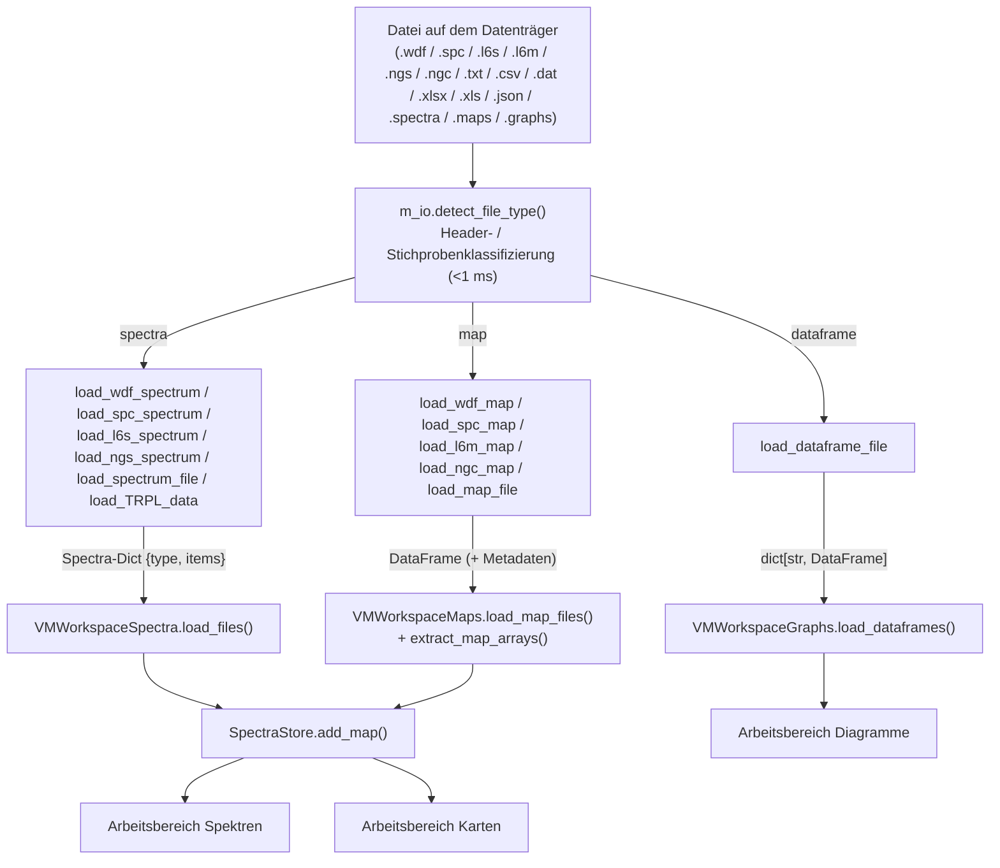

# **Pipeline zum Laden von Dateien (`m_io.py`)** { #file-loading-pipeline-m_iopy }

`m_io.py` ist der **universelle Dateileser** für SPECTROview. Er bildet den Einstiegspunkt für jede Datenaufnahme — Rohdateien auf dem Datenträger durchlaufen ihn, bevor ein anderer Teil der Anwendung jemals auf die Daten zugreift.

**Quelldatei**: [`m_io.py`](https://github.com/CEA-MetroCarac/SPECTROview/blob/main/spectroview/model/io/m_io.py)

---

## Überblick { #overview }

`m_io.py` verarbeitet **alle unterstützten Dateiformate** für drei verschiedene Datenkategorien:

| Kategorie | Beschreibung | Ziel |
|-----------|--------------|------|
| **Diskrete Spektren** | 1D- oder Multispektrum-Dateien (Einzelpunktmessungen, Zeitreihen) | → `SpectraStore` → Arbeitsbereich Spektren |
| **Hyperspektrale Karten** | Zweidimensionale räumliche Spektrengitter | → `SpectraStore` → Arbeitsbereich Karten |
| **Datentabellen** | Allgemeine tabellarische Daten (Fit-Ergebnisse, externe Datensätze) | → direkt in den Arbeitsbereich Diagramme |



---

## Unterstützte Formate & Einstiegspunkte { #supported-formats-entry-points }

| Format / Rolle | Dateiendung | Funktion | Rückgabewert |
|----------------|-------------|----------|--------------|
| Schneller Dateiklassifizierer | alle unterstützten | `detect_file_type()` | `'spectra'` \| `'map'` \| `'dataframe'` \| `'fit_model'` \| `'spectra_workspace'` \| `'maps_workspace'` \| `'graphs_workspace'` |
| WDF-Header-Vorprüfung | `.wdf` | `peek_wdf_measurement_type()` / `WdfReader.peek_header()` | `'spectra'` \| `'map'` / `dict` (liest den 512-Byte-`WDF1`-Header) |
| SPC-Header-Vorprüfung | `.spc` | `SpcReader.peek_header()` | `dict` (liest den 512-Byte-Galactic-SPC-Header) |
| LabSpec-6-Header-Vorprüfung | `.l6s`, `.l6m` | `L6sReader.peek_header()` | `dict` (validiert unkomprimierten oder komprimierten `"LabSpec6\x00"`-Container-Header) |
| LabSpec-5-Header-Vorprüfung | `.ngs`, `.ngc` | `NgsReader.peek_header()` | `dict` (validiert `"NGSNextGen"`-v1/v3-Header und prüft den `DataMatrix`-Untertyp) |
| Renishaw-WiRE-Spektrum / -Serie | `.wdf` | `load_wdf_spectrum()` (`m_wdf.WdfReader`) | `spectra dict` |
| Renishaw-WiRE-Karte / -Linienprofil | `.wdf` | `load_wdf_map()` (`m_wdf.WdfReader`) | `(DataFrame, metadata dict)` |
| Galactic-SPC-Spektrum | `.spc` | `load_spc_spectrum()` (`m_spc.SpcReader`) | `spectra dict` |
| Galactic-SPC-Karte | `.spc` | `load_spc_map()` (`m_spc.SpcReader`) | `(DataFrame, metadata dict)` |
| HORIBA-LabSpec-6-Spektrum | `.l6s` | `load_l6s_spectrum()` (`m_l6s.L6sReader`) | `spectra dict` |
| HORIBA-LabSpec-6-Karte | `.l6m` | `load_l6m_map()` (`m_l6s.L6sReader`) | `(DataFrame, metadata dict)` |
| HORIBA-LabSpec-5-Spektrum | `.ngs`, `.ngc` | `load_ngs_spectrum()` (`m_ngs.NgsReader`) | `spectra dict` |
| HORIBA-LabSpec-5-Karte | `.ngc`, `.ngs` | `load_ngc_map()` (`m_ngs.NgsReader`) | `(DataFrame, metadata dict)` |
| Text- / CSV-Spektrum | `.txt`, `.csv` | `load_spectrum_file()` | `spectra dict` |
| Text- / CSV-Karte | `.txt`, `.csv` | `load_map_file()` | `DataFrame` |
| TRPL (zeitaufgelöste PL) | `.dat` | `load_TRPL_data()` | `spectra dict` |
| Excel- / CSV-Datentabelle | `.xlsx`, `.xls`, `.csv` | `load_dataframe_file()` | `dict[str, DataFrame]` |
| Karten-Tensor-Extraktor | DataFrame | `extract_map_arrays()` | `(x0, Y0, coords, fnames)` |
| Renishaw-Langformat-Konverter | `.txt` | `convert_action()` | schreibt `.txt` im Breitmatrixformat |

---

## Rückgabeformate { #return-formats }

### Spectra-Dict — Diskrete Spektren { #spectra-dict-discrete-spectra }

Alle Spektren-Loader (`load_wdf_spectrum`, `load_spc_spectrum`, `load_l6s_spectrum`, `load_ngs_spectrum`, `load_spectrum_file`, `load_TRPL_data`) geben ein einheitliches **Spectra-Dict** zurück:

```python
{
    "type": "spectra",
    "items": [
        {
            "name": "my_sample",       # str — unique identifier (file stem or stem + index)
            "x0":   np.ndarray,        # float64[M] — wavenumber axis
            "y0":   np.ndarray,        # float64[M] — raw intensity values
            "metadata": {              # dict — acquisition parameters
                "File Format": "Renishaw WDF",
                "Laser Wavelength (nm)": "532.00",
                "Exposure Time (s)": "1.0",
                # ...
            }
        },
        # Additional items for multi-spectrum files (e.g., temporal series from WDF)
        {
            "name": "my_sample_1",
            "x0":   np.ndarray,
            "y0":   np.ndarray,
            "metadata": {"Time (s)": 1.5, "...": "..."}
        },
    ]
}
```

> [!IMPORTANT]
> **Warum eine Liste?** Eine einzelne als Zeitreihe konfigurierte `.wdf`-Datei (z. B. 100 Messungen über 10 Minuten) enthält N Spektren statt nur 1. Die Liste `items` behandelt Einzelspektren (N=1) und Multispektrum-Dateien einheitlich, ohne Verzweigungslogik beim Aufrufer zu erfordern.

### Karten-DataFrame — Hyperspektrale Karten { #map-dataframe-hyperspectral-maps }

Alle Karten-Loader (`load_wdf_map`, `load_spc_map`, `load_l6m_map`, `load_ngc_map`, `load_map_file`) geben einen **pandas DataFrame** zurück (und bei Binärformaten optional ein Metadaten-Dictionary):

```python
# Return type for WDF/SPC/L6M/NGC: tuple[pd.DataFrame, dict]
# Return type for TXT/CSV: pd.DataFrame

df, metadata = load_wdf_map(path)

#  df layout:
#   Columns:  ['X', 'Y', '100.5', '101.0', '101.5', ...]
#             |     |     |
#             |     |     +-- wavenumber values as strings (cm-1)
#             +-----+-------- spatial stage coordinates (µm)
#
#   Shape: (N_spectra, 2 + M_wavenumbers)
```

| Spaltentyp | Inhalt | dtype |
|------------|--------|-------|
| `X` | X-Position des Probentischs (µm) | `float64` |
| `Y` | Y-Position des Probentischs (µm) | `float64` |
| `'100.5'`, `'101.0'`, ... | Spektrale Intensitäten bei dieser Wellenzahl | `float64` |

### Datentabellen-Dict — Tabellarische Daten { #datasheet-dict-tabular-data }

`load_dataframe_file()` gibt ein Dictionary zurück, das Namensschlüssel auf DataFrames abbildet. Bei CSV-Dateien oder Excel-Dateien mit einem einzigen Tabellenblatt entspricht der Schlüssel dem Dateinamen ohne Erweiterung:

```python
# Single-sheet Excel or CSV:
result = load_dataframe_file(path)
# -> {"my_results": pd.DataFrame}

# Multi-sheet Excel:
result = load_dataframe_file(path)
# -> {"my_results_Sheet1": pd.DataFrame, "my_results_Sheet2": pd.DataFrame}
```

---

## Wie die GUI die I/O-Ausgabe in SpectraStore überführt { #how-the-gui-transforms-io-output-into-spectrastore }

Die Rohausgabe von `m_io` ist bewusst als einfache Python-Struktur (dict / DataFrame) gehalten. Die Umwandlung in den tensorzentrierten `SpectraStore` übernimmt die ViewModel-Schicht.

### Arbeitsbereich Spektren: `VMWorkspaceSpectra.load_files()` { #spectra-workspace-vmworkspacespectraload_files }

```python
# In viewmodel/spectra/vm_workspace_spectra.py — simplified for clarity

data_dict = load_wdf_spectrum(path)   # -> {"type": "spectra", "items": [...]}

for item in data_dict["items"]:
    fname    = item["name"]           # unique map key
    x0       = item["x0"]            # float64[M]
    y0       = item["y0"]            # float64[M]
    metadata = item["metadata"]      # dict

    # Each spectrum becomes its own MapData in SpectraStore:
    # N=1 (single row), M = len(x0)
    self.store.add_map(
        name   = fname,
        x0     = x0.copy(),
        Y0     = np.asarray(y0, dtype=np.float32).reshape(1, -1),   # shape (1, M)
        coords = np.array([[0.0, 0.0]], dtype=np.float64),           # no spatial position
        fnames = [fname],
    )
    self.store.get_map_data(fname).map_metadata = metadata
```

> [!NOTE]
> **Jedes Spektrum bildet einen eigenen `MapData`-Block** (N=1). Dies entspricht exakt derselben Struktur, die auch für Kartenspektren (N=Tausende) verwendet wird. Durch dieses einheitliche Modell kann `VMWorkspaceMaps` die Klasse `VMWorkspaceSpectra` ohne Codeduplizierung erweitern.

### Arbeitsbereich Karten: `VMWorkspaceMaps.load_map_files()` & `extract_map_arrays()` { #maps-workspace-vmworkspacemapsload_map_files-extract_map_arrays }

```python
# In viewmodel/maps/vm_workspace_maps.py (and spectroview/api/workspace.py)

df, metadata = load_wdf_map(path)                    # -> (DataFrame, dict)
x0, Y0, coords, fnames = extract_map_arrays(path.stem, df)
# x0:     float64[M]    — all valid numeric wavenumber channels (ascending)
# Y0:     float32[N, M] — contiguous spectral matrix
# coords: float64[N, 2] — stage (X, Y) positions
# fnames: list[str]     — "{map_name}_({x}, {y})" (disambiguated with _{k} on time-resolved duplicate sites)

self.store.add_map(
    name   = path.stem,
    x0     = x0,
    Y0     = Y0,
    coords = coords,
    fnames = fnames,
)
```

### Arbeitsbereich Diagramme: Direkte Übernahme von DataFrames { #graphs-workspace-direct-dataframe-ingestion }

Datentabellen umgehen `SpectraStore` vollständig — sie gelangen direkt von `m_io` in das ViewModel des Arbeitsbereichs Diagramme:

```python
# In viewmodel/graphs/vm_workspace_graphs.py

dataframes = load_dataframe_file(path)   # -> dict[str, DataFrame]

for name, df in dataframes.items():
    self.dataframes[name] = df           # stored in VM directly, no SpectraStore
```

---

## Design- & Performance-Hinweise { #design-performance-notes }

### Nutzdatenfreie Header-Klassifizierung (`detect_file_type`) { #zero-payload-header-classification-detect_file_type }

Beim Öffnen oder Ziehen von Dateien in `Main._load_files_by_paths()` klassifiziert `detect_file_type()` Dateien in `< 0.1 ms`, ohne vollständige Datensätze zu parsen:

- **`.wdf`**: `peek_wdf_measurement_type()` liest lediglich die ersten 144 Bytes des `WDF1`-Headers (`measurement_type` bei Offset `132`), anstatt mehrere Megabyte große Spektralwürfel zweimal zu dekodieren.
- **`.spc`**: `SpcReader.peek_header()` (`header_only=True`) liest ausschließlich den 512 Byte großen Galactic-SPC-Header (Anzahl der Subfiles `fnsub`) und überspringt das Lesen der Subfiles sowie des Log-Blocks.
- **`.l6s` / `.l6m`**: `L6sReader.peek_header()` validiert den `"LabSpec6\x00"`-Container-Header sowie die Flags (`0x01` komprimiert, `0x04` 4-Ebenen-Byte-Shuffling), ohne die vollständigen Spektralarrays zu lesen — dabei werden kleine Header (`<= 256 KiB`) zur Prüfung des Wurzeldeskriptors dekomprimiert und bei großen komprimierten Karten das `lzhuf`-Stream-Präfix in `< 1 ms` validiert.
- **`.ngs` / `.ngc`**: `NgsReader.peek_header()` validiert den binären `"NGSNextGen"`-v1/v3-Header und prüft die ersten 96 Bytes des Block-Streams (`DataMatrix`-Untertyp `"Spectrum"` vs. `"SpIm"` und `n_dims`) in ~1 ms, ohne die gesamten spektralen Nutzdaten zu dekomprimieren.
- **`.txt` / `.csv`**: Prüft bis zu 12 nicht-leere Zeilen in reinem Python, ohne während der Dateizuordnung `pandas`-Lesevorgänge mit Regex-Engine zu starten.

### Konsolidierte Karten-DataFrames & vektorisiertes Parsing { #consolidated-map-dataframes-vectorized-parsing }

- **Einblock-DataFrames**: Binäre (`WDF`, `SPC`, `L6M`, `NGC`) sowie konvertierte Karten werden über `_build_map_dataframe()` zusammengesetzt, wodurch die zusammenhängende 2D-Spektralmatrix direkt gekapselt wird, anstatt Tausende von 1D-Spalten-Slices zu erzeugen.
- **Schnellpfade für CSV/TXT mit C-Engine**: `load_map_file()` nutzt `pd.read_csv(..., engine="c")` mit `usecols` (wodurch abschließende Semikolons bereits beim Parsen entfernt werden), `skiprows`-Callables für zeilenweise alternierende Wafer-CSV-Exporte sowie eine positionelle `iloc`-Permutation beim Sortieren absteigender Wellenzahlen, um eine Duplizierung großer Spektralmatrizen im Arbeitsspeicher zu vermeiden.
- **Vektorisierte Binär-Reader für WDF, SPC, LabSpec 6 & LabSpec 5**:
  - `WdfReader` (`spectroview/model/io/m_wdf.py`) parst Renishaw-`.wdf`-Blöcke (`WDF1`, `DATA`, `XLST`, `YLST`, `ORGN`, `WMAP`) nativ in einem einzigen Lesevorgang über `struct.unpack_from` und `np.frombuffer` ohne externe Abhängigkeiten zu `renishawWiRE` oder `PIL`. Dadurch entfallen punktweise Python-Schleifen für `ORGN`-Koordinaten sowie redundante `WHTL`-JPEG-Dekodierungen.
  - `SpcReader` (`spectroview/model/io/m_spc.py`) liest einheitliche `.spc`-Karten mit mehreren Subfiles in einem einzigen gepufferten I/O-Aufruf über strukturierte NumPy-`np.frombuffer`-Datentypen (mit Unterstützung für IEEE-`float32`, `TSPREC`-`int16` und Festkomma-Skalierung in `int32`) und greift nur bei `TXYXYS`-Dateien variabler Länge auf sequenzielles Parsing zurück.
  - `L6sReader` (`spectroview/model/io/m_l6s.py`) dekodiert binäre HORIBA-LabSpec-6-Knotenbäume für `.l6s` (1D-Spektrum) und `.l6m` (2D-Spektralbild `SpIm`) mit der Magic-Signatur `"LabSpec6\x00"` — sowohl unkomprimierte 76-Byte-Header als auch komprimierte Container mit `lzhuf` + Byte-Delta + 4-Ebenen-Byte-Shuffling über `_decompress_ngc()`, 24-Byte-DFS-Datensätze, über `0x8000` / Zeiger-ID deduplizierte gemeinsame Blöcke sowie `b'temx'`-Laufzeit-Unterbäume. Dabei werden Spektralwürfel (`float32`), räumliche `(X, Y)`-Probentischgitter, kalibrierte Laserwellenlängen (`Laser.pos` oder `Laser (nm).pos`), `S/N` sowie sämtliche Mess-, Beschreibungs- und Verlaufs-Metadatentabellen extrahiert (`_reorder_metadata()` stellt die kanonischen `_METADATA_ORDERED_KEYS` voran und hängt weitere Geräteparameter am Ende an).
  - `NgsReader` (`spectroview/model/io/m_ngs.py`) dekodiert HORIBA-LabSpec-5-Container für `.ngs` (v1 unkomprimiert) und `.ngc` (v3 mit Haruhiko Okumuras `lzhuf`-Kompression über adaptives Huffman + LZSS sowie byteweiser Delta-Kodierung über `np.cumsum`) mit der Magic-Signatur `"NGSNextGen"` und parst spektrale/räumliche `DataMatrix`-Tensoren sowie `Table`-Blöcke (`Param`, `Acq`, `Extra`, `Hist`) unter Beibehaltung der kanonischen Reihenfolge `_METADATA_ORDERED_KEYS` und vollständiger Erhaltung aller zusätzlichen Geräteparameter.

### Headerlose Spektren, aufsteigende Achsen & doppelte Koordinaten { #headerless-spectra-ascending-axes-duplicate-coordinates }

- **Headerlose 1D-Dateien**: `load_spectrum_file()` untersucht die ersten Zeilen noch vor dem Aufruf von `pd.read_csv`, sodass Zeile `0` bei headerlosen `.txt`/`.csv`-Spektren erhalten bleibt, während `#`-Kommentare, einfache Header oder dreizeilige Legacy-Header übersprungen werden.
- **Invariante aufsteigender X-Achsen**: Alle Spektren- und Karten-Loader (`WDF`, `SPC`, `L6S`, `L6M`, `NGS`, `NGC`, `TXT`, `CSV`) normieren die Spektralachsen in streng aufsteigender Reihenfolge, sodass sich nachgelagerte Schritte wie Basislinienkorrektur, ROI-Zuschnitt und VBF-Fitting auf ein monotones `x0` verlassen können.
- **Zeitaufgelöste Karten an festen Messpunkten**: Enthält eine Karte wiederholte `(X, Y)`-Koordinaten (z. B. zeitaufgelöste Multi-Scan-Wafer-CSVs), hängt `extract_map_arrays()` Suffixe der Form `_{k}` an (`map_(x, y)_2`, ...), sodass jede Messung einen eindeutigen `SpectraStore`-Schlüssel behält, während `parse_coords_from_fname()` weiterhin die exakten `(X, Y)`-Koordinaten rekonstruiert.

### Reine Modellschicht-Metadaten (`parse_wdf_metadata`) { #pure-model-layer-metadata-parse_wdf_metadata }

`parse_wdf_metadata()` befindet sich in `spectroview/model/io/m_io.py` (und wird aus Gründen der Abwärtskompatibilität in `viewmodel/utils.py` re-exportiert), wodurch `spectroview/model/` zu 100 % frei von Qt- und ViewModel-Importen bleibt. Die Funktion parst die binären Blöcke `WXIS`, `WXCS`, `WXDM` und `WDF1` `FILETIME`, um Objektiv, Gitter, Laserleistung, Spalteinstellungen, Belichtungszeit und Zeitstempel zu extrahieren.

---

## Verwandte Seiten { #related-pages }

- **[Datenarchitektur: SpectraStore](spectra_store.md)** — wie die geladenen Daten gespeichert, indiziert und abgerufen werden.
- **[Arbeitsbereich Spektren](spectra.md)** — `VMWorkspaceSpectra.load_files()` und der vollständige Lebenszyklus eines Spektrums.
- **[Arbeitsbereich Karten](maps.md)** — `VMWorkspaceMaps.load_map_files()` und der vollständige Lebenszyklus einer Karte.
