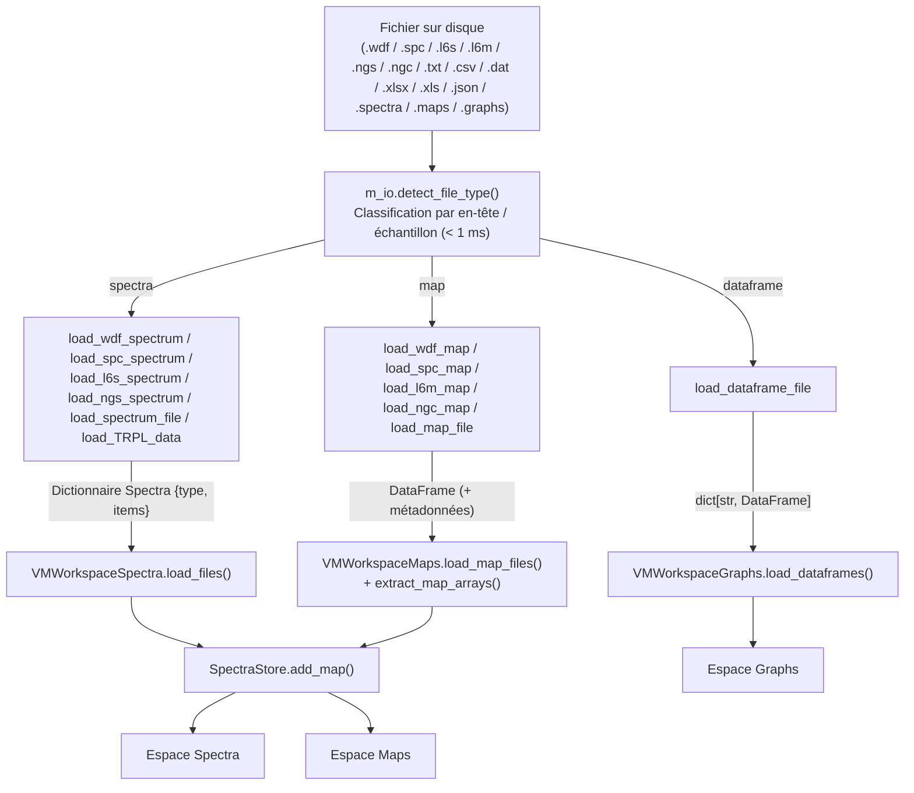

# **Pipeline de chargement des fichiers (`m_io.py`)**

`m_io.py` est le **lecteur universel de fichiers** de SPECTROview. Il constitue le point d'entrée de toute ingestion de données — les fichiers bruts sur disque le traversent avant qu'aucune autre partie de l'application ne manipule les données.

**Fichier source** : [`m_io.py`](https://github.com/CEA-MetroCarac/SPECTROview/blob/main/spectroview/model/io/m_io.py)

---

## Vue d'ensemble

`m_io.py` prend en charge **tous les formats de fichiers supportés** pour trois catégories de données distinctes :

| Catégorie | Description | Destination |
|-----------|-------------|-------------|
| **Spectres discrets** | Fichiers 1D ou multi-spectres (acquisitions ponctuelles, séries temporelles) | → `SpectraStore` → Espace Spectra |
| **Cartes hyperspectrales** | Grilles spatiales 2D de spectres | → `SpectraStore` → Espace Maps |
| **Tableaux de données** | Données tabulaires génériques (résultats d'ajustement, jeux externes) | → directement vers l'espace Graphs |



---

## Formats pris en charge et points d'entrée

| Format / Rôle | Extension | Fonction | Valeur de retour |
|---------------|-----------|----------|------------------|
| Classificateur rapide | tous pris en charge | `detect_file_type()` | `'spectra'` \| `'map'` \| `'dataframe'` \| `'fit_model'` \| `'spectra_workspace'` \| `'maps_workspace'` \| `'graphs_workspace'` |
| Lecture rapide en-tête WDF | `.wdf` | `peek_wdf_measurement_type()` / `WdfReader.peek_header()` | `'spectra'` \| `'map'` / `dict` (lit les 512 octets d'en-tête `WDF1`) |
| Lecture rapide en-tête SPC | `.spc` | `SpcReader.peek_header()` | `dict` (lit les 512 octets d'en-tête Galactic SPC) |
| Lecture rapide en-tête LabSpec 6 | `.l6s`, `.l6m` | `L6sReader.peek_header()` | `dict` (valide l'en-tête conteneur `"LabSpec6\x00"` compressé ou non) |
| Lecture rapide en-tête LabSpec 5 | `.ngs`, `.ngc` | `NgsReader.peek_header()` | `dict` (valide l'en-tête `"NGSNextGen"` v1/v3 et inspecte le sous-type `DataMatrix`) |
| Spectre / série Renishaw WiRE | `.wdf` | `load_wdf_spectrum()` (`m_wdf.WdfReader`) | `spectra dict` |
| Carte / profil Renishaw WiRE | `.wdf` | `load_wdf_map()` (`m_wdf.WdfReader`) | `(DataFrame, metadata dict)` |
| Spectre Galactic SPC | `.spc` | `load_spc_spectrum()` (`m_spc.SpcReader`) | `spectra dict` |
| Carte Galactic SPC | `.spc` | `load_spc_map()` (`m_spc.SpcReader`) | `(DataFrame, metadata dict)` |
| Spectre HORIBA LabSpec 6 | `.l6s` | `load_l6s_spectrum()` (`m_l6s.L6sReader`) | `spectra dict` |
| Carte HORIBA LabSpec 6 | `.l6m` | `load_l6m_map()` (`m_l6s.L6sReader`) | `(DataFrame, metadata dict)` |
| Spectre HORIBA LabSpec 5 | `.ngs`, `.ngc` | `load_ngs_spectrum()` (`m_ngs.NgsReader`) | `spectra dict` |
| Carte HORIBA LabSpec 5 | `.ngc`, `.ngs` | `load_ngc_map()` (`m_ngs.NgsReader`) | `(DataFrame, metadata dict)` |
| Spectre texte / CSV | `.txt`, `.csv` | `load_spectrum_file()` | `spectra dict` |
| Carte texte / CSV | `.txt`, `.csv` | `load_map_file()` | `DataFrame` |
| PL résolue en temps TRPL | `.dat` | `load_TRPL_data()` | `spectra dict` |
| Feuille Excel / CSV | `.xlsx`, `.xls`, `.csv` | `load_dataframe_file()` | `dict[str, DataFrame]` |
| Extracteur de tenseur de carte | DataFrame | `extract_map_arrays()` | `(x0, Y0, coords, fnames)` |
| Convertisseur format long Renishaw | `.txt` | `convert_action()` | écrit un fichier `.txt` matriciel large |

---

## Formats de retour

### Dictionnaire Spectra — Spectres discrets

Tous les chargeurs de spectres (`load_wdf_spectrum`, `load_spc_spectrum`, `load_l6s_spectrum`, `load_ngs_spectrum`, `load_spectrum_file`, `load_TRPL_data`) renvoient un **dictionnaire spectra** unifié :

```python
{
    "type": "spectra",
    "items": [
        {
            "name": "my_sample",       # str — identifiant unique (nom sans extension ou nom + indice)
            "x0":   np.ndarray,        # float64[M] — axe des nombres d'onde
            "y0":   np.ndarray,        # float64[M] — valeurs brutes d'intensité
            "metadata": {              # dict — paramètres d'acquisition
                "File Format": "Renishaw WDF",
                "Laser Wavelength (nm)": "532.00",
                "Exposure Time (s)": "1.0",
                # ...
            }
        },
        # Éléments supplémentaires pour les fichiers multi-spectres (ex. séries temporelles WDF)
        {
            "name": "my_sample_1",
            "x0":   np.ndarray,
            "y0":   np.ndarray,
            "metadata": {"Time (s)": 1.5, "...": "..."}
        },
    ]
}
```

> [!IMPORTANT]
> **Pourquoi une liste ?** Un seul fichier `.wdf` configuré en série temporelle (par exemple 100 acquisitions sur 10 minutes) renferme N spectres, et non 1. La liste `items` traite uniformément les spectres uniques (N=1) et les fichiers multi-spectres sans branchement conditionnel chez l'appelant.

### DataFrame de carte — Cartes hyperspectrales

Tous les chargeurs de cartes (`load_wdf_map`, `load_spc_map`, `load_l6m_map`, `load_ngc_map`, `load_map_file`) renvoient un **DataFrame pandas** (et éventuellement un dictionnaire de métadonnées pour les formats binaires) :

```python
# Type de retour pour WDF/SPC/L6M/NGC : tuple[pd.DataFrame, dict]
# Type de retour pour TXT/CSV : pd.DataFrame

df, metadata = load_wdf_map(path)

#  Disposition de df :
#   Colonnes : ['X', 'Y', '100.5', '101.0', '101.5', ...]
#               |     |     |
#               |     |     +-- valeurs de nombres d'onde sous forme de chaînes (cm-1)
#               +-----+-------- coordonnées spatiales de platine (µm)
#
#   Forme : (N_spectra, 2 + M_wavenumbers)
```

| Type de colonne | Contenu | dtype |
|-----------------|---------|-------|
| `X` | Position X de platine (µm) | `float64` |
| `Y` | Position Y de platine (µm) | `float64` |
| `'100.5'`, `'101.0'`, ... | Intensités spectrales à ce nombre d'onde | `float64` |

### Dictionnaire de tableaux — Données tabulaires

`load_dataframe_file()` retourne un dictionnaire associant chaque clé de nom à un DataFrame. Pour les fichiers Excel à feuille unique ou CSV, la clé correspond au nom du fichier sans extension :

```python
# Fichier Excel à une feuille ou CSV :
result = load_dataframe_file(path)
# -> {"my_results": pd.DataFrame}

# Fichier Excel multi-feuilles :
result = load_dataframe_file(path)
# -> {"my_results_Sheet1": pd.DataFrame, "my_results_Sheet2": pd.DataFrame}
```

---

## Comment l'interface transforme les sorties E/S vers SpectraStore

La sortie brute de `m_io` reste volontairement une structure Python simple (`dict` / `DataFrame`). La conversion vers le conteneur tensoriel `SpectraStore` est assurée par la couche ViewModel.

### Espace Spectra : `VMWorkspaceSpectra.load_files()`

```python
# Dans viewmodel/spectra/vm_workspace_spectra.py — simplifié par souci de clarté

data_dict = load_wdf_spectrum(path)   # -> {"type": "spectra", "items": [...]}

for item in data_dict["items"]:
    fname    = item["name"]           # clé unique de carte
    x0       = item["x0"]             # float64[M]
    y0       = item["y0"]             # float64[M]
    metadata = item["metadata"]       # dict

    # Chaque spectre devient son propre bloc MapData dans SpectraStore :
    # N=1 (ligne unique), M = len(x0)
    self.store.add_map(
        name   = fname,
        x0     = x0.copy(),
        Y0     = np.asarray(y0, dtype=np.float32).reshape(1, -1),   # forme (1, M)
        coords = np.array([[0.0, 0.0]], dtype=np.float64),           # aucune position spatiale
        fnames = [fname],
    )
    self.store.get_map_data(fname).map_metadata = metadata
```

> [!NOTE]
> **Chaque spectre dispose de son propre bloc `MapData`** (N=1). Il s'agit de la même structure que pour les spectres d'une carte (N=des milliers). Ce modèle unifié permet à `VMWorkspaceMaps` d'étendre `VMWorkspaceSpectra` sans duplication.

### Espace Maps : `VMWorkspaceMaps.load_map_files()` et `extract_map_arrays()`

```python
# Dans viewmodel/maps/vm_workspace_maps.py (et spectroview/api/workspace.py)

df, metadata = load_wdf_map(path)                    # -> (DataFrame, dict)
x0, Y0, coords, fnames = extract_map_arrays(path.stem, df)
# x0:     float64[M]    — tous les canaux numériques valides (ordre croissant)
# Y0:     float32[N, M] — matrice spectrale contiguë
# coords: float64[N, 2] — positions (X, Y) de la platine
# fnames: list[str]     — "{map_name}_({x}, {y})" (désambiguïsé avec _{k} en cas de sites répétés)

self.store.add_map(
    name   = path.stem,
    x0     = x0,
    Y0     = Y0,
    coords = coords,
    fnames = fnames,
)
```

### Espace Graphs : Ingestion directe de DataFrames

Les tableaux contournent entièrement `SpectraStore` — ils passent directement de `m_io` au ViewModel de l'espace Graphs :

```python
# Dans viewmodel/graphs/vm_workspace_graphs.py

dataframes = load_dataframe_file(path)   # -> dict[str, DataFrame]

for name, df in dataframes.items():
    self.dataframes[name] = df           # stocké directement dans le VM, sans SpectraStore
```

---

## Notes d'architecture et de performance

### Classification d'en-tête sans lecture du corps (`detect_file_type`)

Lors de l'ouverture ou du glisser-déposer de fichiers dans `Main._load_files_by_paths()`, `detect_file_type()` classifie les fichiers en `< 0,1 ms` sans analyser l'intégralité des jeux de données :

- **`.wdf`** : `peek_wdf_measurement_type()` lit uniquement les 144 premiers octets de l'en-tête `WDF1` (`measurement_type` à l'offset `132`) au lieu de décoder deux fois des cubes spectraux de plusieurs mégaoctets.
- **`.spc`** : `SpcReader.peek_header()` (`header_only=True`) lit uniquement l'en-tête Galactic SPC de 512 octets (compteur de sous-fichiers `fnsub`) sans lire les spectres ni les journaux.
- **`.l6s` / `.l6m`** : `L6sReader.peek_header()` valide l'en-tête conteneur `"LabSpec6\x00"` et les drapeaux (`0x01` compressé, `0x04` brassage d'octets sur 4 plans) sans lire les tableaux spectraux complets — décompressant les petits en-têtes (`<= 256 KiB`) pour inspecter le descripteur racine et validant le préfixe de flux `lzhuf` en `< 1 ms` sur les grandes cartes compressées.
- **`.ngs` / `.ngc`** : `NgsReader.peek_header()` valide l'en-tête binaire `"NGSNextGen"` v1/v3 et inspecte les 96 premiers octets du flux de blocs (sous-type `DataMatrix` `"Spectrum"` vs `"SpIm"` et `n_dims`) en ~1 ms sans décompresser les spectres.
- **`.txt` / `.csv`** : Inspecte jusqu'à 12 lignes non vides en pur Python sans déclencher de lecture `pandas` par moteur regex lors du routage.

### DataFrames de carte consolidés et analyse vectorisée

- **DataFrames monobloc** : Les cartes binaires (`WDF`, `SPC`, `L6M`, `NGC`) et converties sont assemblées via `_build_map_dataframe()`, encapsulant directement la matrice spectrale 2D contiguë au lieu de construire des milliers de tranches de colonnes 1D.
- **Chemins rapides CSV/TXT en moteur C** : `load_map_file()` utilise `pd.read_csv(..., engine="c")` avec `usecols` (supprimant les points-virgules finaux dès la lecture), des fonctions `skiprows` pour les exports CSV *wafer* à lignes alternées, et une permutation positionnelle par `iloc` lors du tri des nombres d'onde décroissants afin d'éviter de dupliquer en RAM les grandes matrices spectrales.
- **Lecteurs binaires vectorisés WDF, SPC, LabSpec 6 et LabSpec 5** :
  - `WdfReader` (`spectroview/model/io/m_wdf.py`) lit nativement les blocs `.wdf` Renishaw (`WDF1`, `DATA`, `XLST`, `YLST`, `ORGN`, `WMAP`) en une lecture via `struct.unpack_from` et `np.frombuffer` sans dépendance tierce `renishawWiRE` ni `PIL`, supprimant les boucles Python par point sur `ORGN` et les décodages JPEG `WHTL` superflus.
  - `SpcReader` (`spectroview/model/io/m_spc.py`) lit les cartes `.spc` multi-sous-fichiers uniformes en un seul appel E/S tamponné via des dtypes structurés NumPy `np.frombuffer` (prenant en charge IEEE `float32`, `TSPREC` `int16` et virgule fixe `int32`), ne basculant sur l'analyse séquentielle que pour les fichiers `TXYXYS` de longueurs variables.
  - `L6sReader` (`spectroview/model/io/m_l6s.py`) décode les arbres binaires HORIBA LabSpec 6 `.l6s` (spectre 1D) et `.l6m` (image spectrale 2D `SpIm`) (signature `"LabSpec6\x00"`, en-têtes non compressés sur 76 octets ainsi que conteneurs compressés `lzhuf` + delta d'octets + brassage sur 4 plans via `_decompress_ngc()`, enregistrements DFS de 24 octets, blocs dédupliqués par `0x8000` / identifiant de pointeur et sous-arbres d'exécution `b'temx'`), extrayant les cubes spectraux (`float32`), les grilles spatiales `(X, Y)`, les longueurs d'onde laser calibrées (`Laser.pos` ou `Laser (nm).pos`), le rapport `S/N` et toutes les tables de métadonnées d'acquisition/description/historique (`_reorder_metadata()` place les clés canoniques `_METADATA_ORDERED_KEYS` en tête et conserve les paramètres instrumentaux supplémentaires à la suite).
  - `NgsReader` (`spectroview/model/io/m_ngs.py`) décode les conteneurs HORIBA LabSpec 5 `.ngs` (v1 non compressé) et `.ngc` (v3 compressé par Huffman adaptatif + LZSS de Haruhiko Okumura `lzhuf` + codage différentiel par `np.cumsum`, signature `"NGSNextGen"`), extrayant les tenseurs spectraux/spatiaux `DataMatrix` et les blocs `Table` (`Param`, `Acq`, `Extra`, `Hist`) avec ordre canonique `_METADATA_ORDERED_KEYS` et conservation intégrale des paramètres additionnels.

### Spectres sans en-tête, axes croissants et coordonnées dupliquées

- **Fichiers 1D sans en-tête** : `load_spectrum_file()` examine les premières lignes avant d'appeler `pd.read_csv`, préservant la ligne `0` sur les spectres `.txt`/`.csv` sans en-tête tout en ignorant les commentaires `#`, les en-têtes simples ou les anciens en-têtes sur 3 lignes.
- **Invariant d'axe X croissant** : Tous les chargeurs de spectres et de cartes (`WDF`, `SPC`, `L6S`, `L6M`, `NGS`, `NGC`, `TXT`, `CSV`) normalisent les axes spectraux par ordre strictement croissant afin que le calcul de ligne de base, le recadrage ROI et l'ajustement VBF puissent s'appuyer sur un vecteur `x0` monotone.
- **Cartes résolues en temps à coordonnées fixes** : Lorsqu'une carte contient des coordonnées `(X, Y)` répétées (par exemple, des CSV *wafer* multi-balayages résolus en temps), `extract_map_arrays()` ajoute des suffixes `_{k}` (`map_(x, y)_2`, ...) afin que chaque mesure conserve une clé `SpectraStore` unique tout en permettant à `parse_coords_from_fname()` de retrouver exactement `(X, Y)`.

### Métadonnées pures en couche modèle (`parse_wdf_metadata`)

`parse_wdf_metadata()` réside dans `spectroview/model/io/m_io.py` (ré-exportée dans `viewmodel/utils.py` pour compatibilité descendante), maintenant `spectroview/model/` 100 % exempt de toute importation Qt ou ViewModel. Elle analyse les blocs binaires `WXIS`, `WXCS`, `WXDM` et `WDF1` `FILETIME` pour en extraire l'objectif, le réseau, la puissance laser, les réglages de fente, le temps d'exposition et l'horodatage.

---

## Pages connexes

- **[Architecture de données : SpectraStore](spectra_store.md)** — comment les données chargées sont stockées, indexées et consultées.
- **[Espace Spectra](spectra.md)** — `VMWorkspaceSpectra.load_files()` et cycle de vie complet des spectres.
- **[Espace Maps](maps.md)** — `VMWorkspaceMaps.load_map_files()` et cycle de vie complet des cartes.
