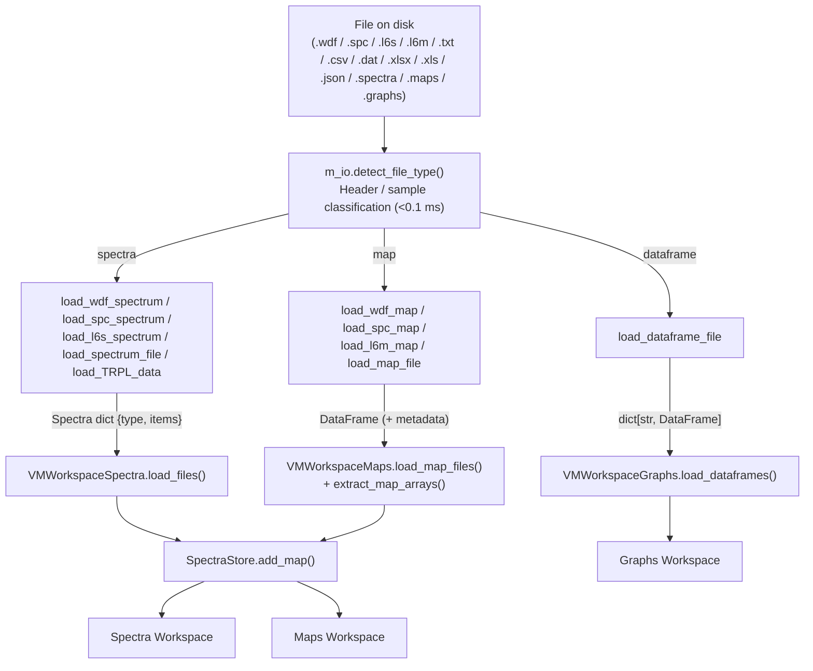

# **File Loading Pipeline (`m_io.py`)**

`m_io.py` is the **universal file reader** for SPECTROview. It sits at the entry point of every data ingestion operation — raw files on disk pass through it before any other part of the application ever touches the data.

**Source file**: [`m_io.py`](https://github.com/CEA-MetroCarac/SPECTROview/blob/main/spectroview/model/m_io.py)

---

## Overview

`m_io.py` handles **all supported file formats** for three distinct data categories:

| Category | Description | Destination |
|----------|-------------|-------------|
| **Discrete Spectra** | 1D or multi-spectrum files (single point acquisitions, temporal series) | → `SpectraStore` → Spectra workspace |
| **Hyperspectral Maps** | 2D spatial grids of spectra | → `SpectraStore` → Maps workspace |
| **Datasheets** | Generic tabular data (fit results, external datasets) | → directly to Graphs workspace |



---

## Supported Formats & Entry Points

| Format / Role | Extension | Function | Returns |
|--------|-----------|----------|---------|
| Fast file classifier | all supported | `detect_file_type()` | `'spectra'` \| `'map'` \| `'dataframe'` \| `'fit_model'` \| `'spectra_workspace'` \| `'maps_workspace'` \| `'graphs_workspace'` |
| WDF header peek | `.wdf` | `peek_wdf_measurement_type()` / `WdfReader.peek_header()` | `'spectra'` \| `'map'` / `dict` (reads 512-byte `WDF1` header) |
| SPC header peek | `.spc` | `SpcReader.peek_header()` | `dict` (reads 512-byte Galactic SPC header) |
| LabSpec 6 header peek | `.l6s`, `.l6m` | `L6sReader.peek_header()` | `dict` (validates 76-byte `"LabSpec6\x00"` binary header) |
| Renishaw WiRE spectrum / series | `.wdf` | `load_wdf_spectrum()` (`m_wdf.WdfReader`) | `spectra dict` |
| Renishaw WiRE map / line profile | `.wdf` | `load_wdf_map()` (`m_wdf.WdfReader`) | `(DataFrame, metadata dict)` |
| Galactic SPC spectrum | `.spc` | `load_spc_spectrum()` (`m_spc.SpcReader`) | `spectra dict` |
| Galactic SPC map | `.spc` | `load_spc_map()` (`m_spc.SpcReader`) | `(DataFrame, metadata dict)` |
| HORIBA LabSpec 6 spectrum | `.l6s` | `load_l6s_spectrum()` (`m_l6s.L6sReader`) | `spectra dict` |
| HORIBA LabSpec 6 map | `.l6m` | `load_l6m_map()` (`m_l6s.L6sReader`) | `(DataFrame, metadata dict)` |
| Text / CSV spectrum | `.txt`, `.csv` | `load_spectrum_file()` | `spectra dict` |
| Text / CSV map | `.txt`, `.csv` | `load_map_file()` | `DataFrame` |
| TRPL time-resolved PL | `.dat` | `load_TRPL_data()` | `spectra dict` |
| Excel / CSV datasheet | `.xlsx`, `.xls`, `.csv` | `load_dataframe_file()` | `dict[str, DataFrame]` |
| Map tensor extractor | DataFrame | `extract_map_arrays()` | `(x0, Y0, coords, fnames)` |
| Renishaw long-format converter | `.txt` | `convert_action()` | writes wide-matrix `.txt` |

---

## Return Formats

### Spectra Dict — Discrete Spectra

All spectra loaders (`load_wdf_spectrum`, `load_spc_spectrum`, `load_l6s_spectrum`, `load_spectrum_file`, `load_TRPL_data`) return a unified **spectra dict**:

```python
{
    "type": "spectra",
    "items": [
        {
            "name": "my_sample",       # str — unique identifier (file stem or stem + index)
            "x0":   np.ndarray,        # float64[M] — wavenumber axis
            "y0":   np.ndarray,        # float64[M] — raw intensity values
            "metadata": {              # dict — acquisition parameters
                "File Format": "Renishaw WDF",
                "Laser Wavelength (nm)": "532.00",
                "Exposure Time (s)": "1.0",
                # ...
            }
        },
        # Additional items for multi-spectrum files (e.g., temporal series from WDF)
        {
            "name": "my_sample_1",
            "x0":   np.ndarray,
            "y0":   np.ndarray,
            "metadata": {"Time (s)": 1.5, "...": "..."}
        },
    ]
}
```

> [!IMPORTANT]
> **Why a list?** A single `.wdf` file configured as a temporal series (e.g., 100 acquisitions over 10 minutes) contains N spectra, not 1. The `items` list handles single spectra (N=1) and multi-spectrum files uniformly without branching logic in the caller.

### Map DataFrame — Hyperspectral Maps

All map loaders (`load_wdf_map`, `load_spc_map`, `load_l6m_map`, `load_map_file`) return a **pandas DataFrame** (and optionally a metadata dict for binary formats):

```python
# Return type for WDF/SPC/L6M: tuple[pd.DataFrame, dict]
# Return type for TXT/CSV: pd.DataFrame

df, metadata = load_wdf_map(path)

#  df layout:
#   Columns:  ['X', 'Y', '100.5', '101.0', '101.5', ...]
#             |     |     |
#             |     |     +-- wavenumber values as strings (cm-1)
#             +-----+-------- spatial stage coordinates (µm)
#
#   Shape: (N_spectra, 2 + M_wavenumbers)
```

| Column type | Content | dtype |
|-------------|---------|-------|
| `X` | Stage X position (µm) | `float64` |
| `Y` | Stage Y position (µm) | `float64` |
| `'100.5'`, `'101.0'`, ... | Spectral intensities at that wavenumber | `float64` |

### Datasheet Dict — Tabular Data

`load_dataframe_file()` returns a dictionary mapping name keys to DataFrames. For single-sheet Excel files or CSVs, the key is the file stem:

```python
# Single-sheet Excel or CSV:
result = load_dataframe_file(path)
# -> {"my_results": pd.DataFrame}

# Multi-sheet Excel:
result = load_dataframe_file(path)
# -> {"my_results_Sheet1": pd.DataFrame, "my_results_Sheet2": pd.DataFrame}
```

---

## How the GUI Transforms I/O Output into SpectraStore

The raw `m_io` output is intentionally a simple Python structure (dict / DataFrame). The conversion into the tensor-centric `SpectraStore` is handled by the ViewModel layer.

### Spectra Workspace: `VMWorkspaceSpectra.load_files()`

```python
# In vm_workspace_spectra.py — simplified for clarity

data_dict = load_wdf_spectrum(path)   # -> {"type": "spectra", "items": [...]}

for item in data_dict["items"]:
    fname    = item["name"]           # unique map key
    x0       = item["x0"]            # float64[M]
    y0       = item["y0"]            # float64[M]
    metadata = item["metadata"]      # dict

    # Each spectrum becomes its own MapData in SpectraStore:
    # N=1 (single row), M = len(x0)
    self.store.add_map(
        name   = fname,
        x0     = x0.copy(),
        Y0     = np.asarray(y0, dtype=np.float32).reshape(1, -1),   # shape (1, M)
        coords = np.array([[0.0, 0.0]], dtype=np.float64),           # no spatial position
        fnames = [fname],
    )
    self.store.get_map_data(fname).map_metadata = metadata
```

> [!NOTE]
> **Each spectrum is its own `MapData` block** (N=1). This is the same structure used for map spectra (N=thousands). The unified model is what lets `VMWorkspaceMaps` extend `VMWorkspaceSpectra` without duplication.

### Maps Workspace: `VMWorkspaceMaps.load_map_files()` & `extract_map_arrays()`

```python
# In vm_workspace_maps.py (and spectroview/api/workspace.py)

df, metadata = load_wdf_map(path)                    # -> (DataFrame, dict)
x0, Y0, coords, fnames = extract_map_arrays(path.stem, df)
# x0:     float64[M]    — all valid numeric wavenumber channels (ascending)
# Y0:     float32[N, M] — contiguous spectral matrix
# coords: float64[N, 2] — stage (X, Y) positions
# fnames: list[str]     — "{map_name}_({x}, {y})" (disambiguated with _{k} on time-resolved duplicate sites)

self.store.add_map(
    name   = path.stem,
    x0     = x0,
    Y0     = Y0,
    coords = coords,
    fnames = fnames,
)
```

### Graphs Workspace: Direct DataFrame Ingestion

Datasheets bypass `SpectraStore` entirely — they go directly from `m_io` to the Graphs workspace ViewModel:

```python
# In vm_workspace_graphs.py

dataframes = load_dataframe_file(path)   # -> dict[str, DataFrame]

for name, df in dataframes.items():
    self.dataframes[name] = df           # stored in VM directly, no SpectraStore
```

---

## Design & Performance Notes

### Zero-Payload Header Classification (`detect_file_type`)

When opening or dragging files into `Main._load_files_by_paths()`, `detect_file_type()` classifies files in `< 0.1 ms` without parsing full datasets:

- **`.wdf`**: `peek_wdf_measurement_type()` reads only the first 144 bytes of the `WDF1` header (`measurement_type` at offset `132`) rather than decoding multi-megabyte spectral cubes twice.
- **`.spc`**: `SpcReader.peek_header()` (`header_only=True`) reads only the 512-byte Galactic SPC header (`fnsub` subfile count) and skips subfile/log reading.
- **`.l6s` / `.l6m`**: `L6sReader.peek_header()` validates the 76-byte `"LabSpec6\x00"` binary header (`magic`, `version`, `root_offset`) in microseconds without reading full node trees or spectral arrays.
- **`.txt` / `.csv`**: Inspects up to 12 non-empty lines in pure Python without launching regex-engine `pandas` reads during routing.

### Consolidated Map DataFrames & Vectorized Parsing

- **Single-block DataFrames**: Binary (`WDF`, `SPC`, `L6M`) and converted maps are assembled via `_build_map_dataframe()`, wrapping the contiguous 2D spectral matrix directly instead of constructing thousands of 1D column slices.
- **C-engine CSV/TXT fast paths**: `load_map_file()` uses `pd.read_csv(..., engine="c")` with `usecols` (stripping trailing semicolons at parse time), `skiprows` callables for alternating-row wafer CSV exports, and positional `iloc` permutation when sorting descending wavenumbers to avoid duplicating large spectral matrices in RAM.
- **Vectorized WDF, SPC & LabSpec 6 binary readers**:
  - `WdfReader` (`spectroview/model/m_wdf.py`) parses Renishaw `.wdf` blocks (`WDF1`, `DATA`, `XLST`, `YLST`, `ORGN`, `WMAP`) natively via single-read `struct.unpack_from` and `np.frombuffer` operations without third-party `renishawWiRE` or `PIL` dependencies, eliminating per-point Python `ORGN` coordinate loops and redundant `WHTL` JPEG decoding.
  - `SpcReader` (`spectroview/model/m_spc.py`) reads uniform multi-subfile `.spc` maps in a single buffered I/O call via structured NumPy `np.frombuffer` dtypes (supporting IEEE `float32`, `TSPREC` `int16`, and `int32` fixed-point scaling), falling back to sequential parsing only for variable-length `TXYXYS` files.
  - `L6sReader` (`spectroview/model/m_l6s.py`) decodes HORIBA LabSpec 6 `.l6s` (1D spectrum) and `.l6m` (2D spectral image `SpIm`) binary node trees (`"LabSpec6\x00"` magic, 24-byte DFS records, shared `0x8000` pointer blocks, and `b'temx'` runtime subtrees), extracting spectral cubes (`float32`), spatial `(X, Y)` stage grids, calibrated laser wavelengths (`Laser.pos`), `S/N`, and all acquisition/description/history metadata tables (`_reorder_metadata()` orders canonical `_METADATA_ORDERED_KEYS` first and appends additional instrument parameters at the end).

### Headerless Spectra, Ascending Axes & Duplicate Coordinates

- **Headerless 1D files**: `load_spectrum_file()` inspects leading lines before calling `pd.read_csv`, preserving row `0` on headerless `.txt`/`.csv` spectra while skipping `#` comments, single headers, or 3-line legacy headers.
- **Ascending X-axis invariant**: All spectrum and map loaders (`WDF`, `SPC`, `L6S`, `L6M`, `TXT`, `CSV`) normalize spectral axes to strictly ascending order so downstream baseline, ROI cropping, and VBF fitting can rely on monotonic `x0`.
- **Time-resolved maps at fixed sites**: When a map contains repeated `(X, Y)` coordinates (e.g., multi-scan time-resolved wafer CSVs), `extract_map_arrays()` appends `_{k}` suffixes (`map_(x, y)_2`, ...) so every measurement retains a unique `SpectraStore` key while `parse_coords_from_fname()` still recovers exact `(X, Y)` coordinates.

### Pure Model-Layer Metadata (`parse_wdf_metadata`)

`parse_wdf_metadata()` lives in `spectroview/model/m_io.py` (re-exported in `viewmodel/utils.py` for backward compatibility), keeping `spectroview/model/` 100% free of Qt and ViewModel imports. It parses binary `WXIS`, `WXCS`, `WXDM`, and `WDF1` `FILETIME` blocks to extract objective, grating, laser power, slit settings, exposure time, and timestamps.

---

## Related Pages

- **[Data Architecture: SpectraStore](spectra_store.md)** — how the loaded data is stored, indexed, and accessed.
- **[Spectra Workspace](spectra.md)** — `VMWorkspaceSpectra.load_files()` and the full spectrum lifecycle.
- **[Maps Workspace](maps.md)** — `VMWorkspaceMaps.load_map_files()` and the full map lifecycle.
