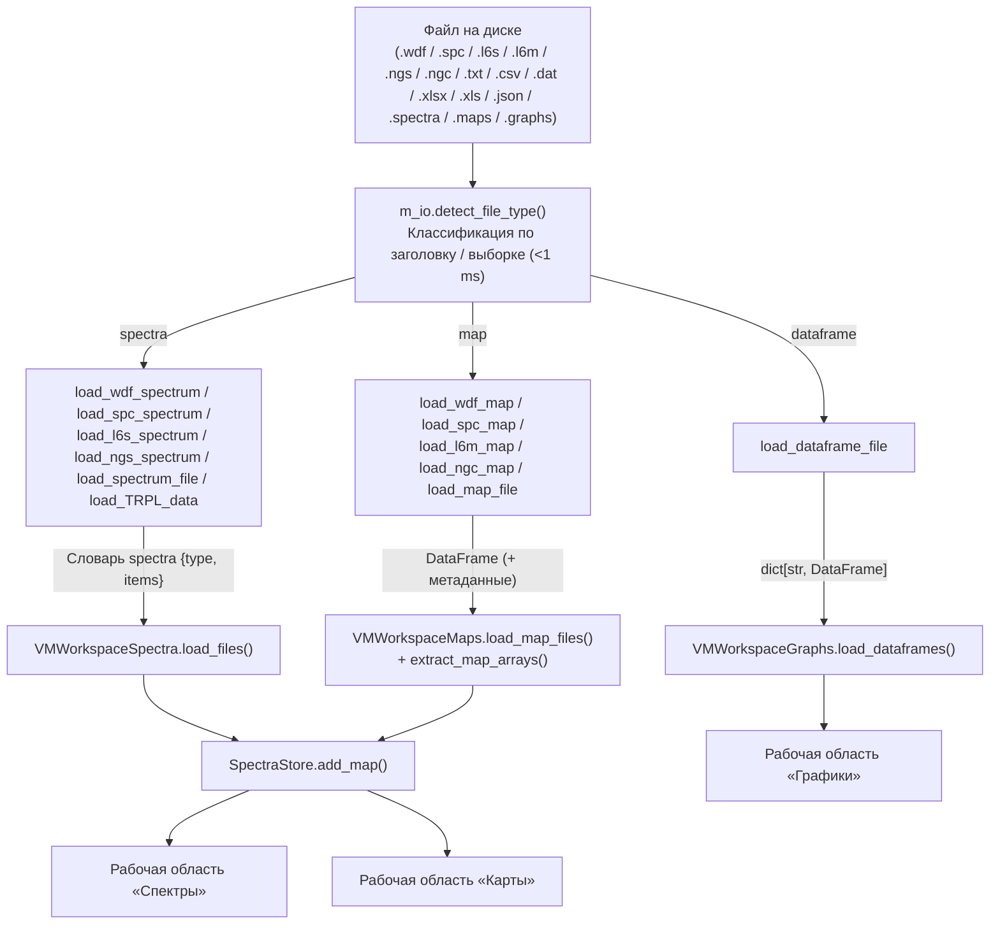

# **Конвейер загрузки файлов (`m_io.py`)** { #file-loading-pipeline-m_iopy }

`m_io.py` — **универсальный модуль чтения файлов** в SPECTROview. Он служит точкой входа для каждой операции загрузки данных: исходные файлы на диске проходят через него прежде, чем к данным обратится какой-либо другой компонент приложения.

**Исходный файл**: [`m_io.py`](https://github.com/CEA-MetroCarac/SPECTROview/blob/main/spectroview/model/io/m_io.py)

---

## Обзор { #overview }

`m_io.py` обрабатывает **все поддерживаемые форматы файлов** для трёх различных категорий данных:

| Категория | Описание | Назначение |
|-----------|----------|------------|
| **Дискретные спектры** | 1D-файлы или мультиспектральные файлы (одиночные измерения, временные серии) | → `SpectraStore` → Рабочая область «Спектры» |
| **Гиперспектральные карты** | Двумерные пространственные сетки спектров | → `SpectraStore` → Рабочая область «Карты» |
| **Таблицы данных** | Общие табличные данные (результаты аппроксимации, внешние наборы данных) | → напрямую в рабочую область «Графики» |



---

## Поддерживаемые форматы и точки входа { #supported-formats-entry-points }

| Format / роль | Расширение | Функция | Возвращаемое значение |
|---------------|------------|---------|-----------------------|
| Быстрый классификатор файлов | все поддерживаемые | `detect_file_type()` | `'spectra'` \| `'map'` \| `'dataframe'` \| `'fit_model'` \| `'spectra_workspace'` \| `'maps_workspace'` \| `'graphs_workspace'` |
| Быстрое чтение заголовка WDF | `.wdf` | `peek_wdf_measurement_type()` / `WdfReader.peek_header()` | `'spectra'` \| `'map'` / `dict` (читает 512-байтный заголовок `WDF1`) |
| Быстрое чтение заголовка SPC | `.spc` | `SpcReader.peek_header()` | `dict` (читает 512-байтный заголовок Galactic SPC) |
| Быстрое чтение заголовка LabSpec 6 | `.l6s`, `.l6m` | `L6sReader.peek_header()` | `dict` (проверяет заголовок несжатого или сжатого контейнера `"LabSpec6\x00"`) |
| Быстрое чтение заголовка LabSpec 5 | `.ngs`, `.ngc` | `NgsReader.peek_header()` | `dict` (проверяет заголовок `"NGSNextGen"` v1/v3 и считывает подтип `DataMatrix`) |
| Спектр / серия Renishaw WiRE | `.wdf` | `load_wdf_spectrum()` (`m_wdf.WdfReader`) | `spectra dict` |
| Карта / линейный профиль Renishaw WiRE | `.wdf` | `load_wdf_map()` (`m_wdf.WdfReader`) | `(DataFrame, metadata dict)` |
| Спектр Galactic SPC | `.spc` | `load_spc_spectrum()` (`m_spc.SpcReader`) | `spectra dict` |
| Карта Galactic SPC | `.spc` | `load_spc_map()` (`m_spc.SpcReader`) | `(DataFrame, metadata dict)` |
| Спектр HORIBA LabSpec 6 | `.l6s` | `load_l6s_spectrum()` (`m_l6s.L6sReader`) | `spectra dict` |
| Карта HORIBA LabSpec 6 | `.l6m` | `load_l6m_map()` (`m_l6s.L6sReader`) | `(DataFrame, metadata dict)` |
| Спектр HORIBA LabSpec 5 | `.ngs`, `.ngc` | `load_ngs_spectrum()` (`m_ngs.NgsReader`) | `spectra dict` |
| Карта HORIBA LabSpec 5 | `.ngc`, `.ngs` | `load_ngc_map()` (`m_ngs.NgsReader`) | `(DataFrame, metadata dict)` |
| Текстовый / CSV-спектр | `.txt`, `.csv` | `load_spectrum_file()` | `spectra dict` |
| Текстовая / CSV-карта | `.txt`, `.csv` | `load_map_file()` | `DataFrame` |
| Фотолюминесценция с временным разрешением (TRPL) | `.dat` | `load_TRPL_data()` | `spectra dict` |
| Таблица Excel / CSV | `.xlsx`, `.xls`, `.csv` | `load_dataframe_file()` | `dict[str, DataFrame]` |
| Экстрактор тензора карты | DataFrame | `extract_map_arrays()` | `(x0, Y0, coords, fnames)` |
| Конвертер длинного формата Renishaw | `.txt` | `convert_action()` | записывает `.txt` в широком матричном формате |

---

## Форматы возвращаемых значений { #return-formats }

### Словарь Spectra — дискретные спектры { #spectra-dict-discrete-spectra }

Все загрузчики спектров (`load_wdf_spectrum`, `load_spc_spectrum`, `load_l6s_spectrum`, `load_ngs_spectrum`, `load_spectrum_file`, `load_TRPL_data`) возвращают унифицированный **словарь spectra**:

```python
{
    "type": "spectra",
    "items": [
        {
            "name": "my_sample",       # str — unique identifier (file stem or stem + index)
            "x0":   np.ndarray,        # float64[M] — wavenumber axis
            "y0":   np.ndarray,        # float64[M] — raw intensity values
            "metadata": {              # dict — acquisition parameters
                "File Format": "Renishaw WDF",
                "Laser Wavelength (nm)": "532.00",
                "Exposure Time (s)": "1.0",
                # ...
            }
        },
        # Additional items for multi-spectrum files (e.g., temporal series from WDF)
        {
            "name": "my_sample_1",
            "x0":   np.ndarray,
            "y0":   np.ndarray,
            "metadata": {"Time (s)": 1.5, "...": "..."}
        },
    ]
}
```

> [!IMPORTANT]
> **Почему используется список?** Один файл `.wdf`, записанный в виде временной серии (например, 100 измерений за 10 минут), содержит N спектров, а не 1. Список `items` позволяет единообразно обрабатывать как одиночные спектры (N=1), так и мультиспектральные файлы без условных ветвлений в вызывающем коде.

### DataFrame карты — гиперспектральные карты { #map-dataframe-hyperspectral-maps }

Все загрузчики карт (`load_wdf_map`, `load_spc_map`, `load_l6m_map`, `load_ngc_map`, `load_map_file`) возвращают **pandas DataFrame** (а для бинарных форматов — дополнительно словарь метаданных):

```python
# Return type for WDF/SPC/L6M/NGC: tuple[pd.DataFrame, dict]
# Return type for TXT/CSV: pd.DataFrame

df, metadata = load_wdf_map(path)

#  df layout:
#   Columns:  ['X', 'Y', '100.5', '101.0', '101.5', ...]
#             |     |     |
#             |     |     +-- wavenumber values as strings (cm-1)
#             +-----+-------- spatial stage coordinates (µm)
#
#   Shape: (N_spectra, 2 + M_wavenumbers)
```

| Тип столбца | Содержимое | dtype |
|-------------|------------|-------|
| `X` | Координата X предметного столика (µm) | `float64` |
| `Y` | Координата Y предметного столика (µm) | `float64` |
| `'100.5'`, `'101.0'`, ... | Спектральные интенсивности при данном волновом числе | `float64` |

### Словарь таблиц — табличные данные { #datasheet-dict-tabular-data }

`load_dataframe_file()` возвращает словарь, сопоставляющий строковые ключи объектам DataFrame. Для однолистовых файлов Excel или файлов CSV ключом служит имя файла без расширения:

```python
# Single-sheet Excel or CSV:
result = load_dataframe_file(path)
# -> {"my_results": pd.DataFrame}

# Multi-sheet Excel:
result = load_dataframe_file(path)
# -> {"my_results_Sheet1": pd.DataFrame, "my_results_Sheet2": pd.DataFrame}
```

---

## Как GUI преобразует выходные данные I/O в SpectraStore { #how-the-gui-transforms-io-output-into-spectrastore }

Необработанный результат `m_io` намеренно остаётся простой структурой Python (dict / DataFrame). Преобразование в тензорно-ориентированное хранилище `SpectraStore` выполняется на уровне ViewModel.

### Рабочая область «Спектры»: `VMWorkspaceSpectra.load_files()` { #spectra-workspace-vmworkspacespectraload_files }

```python
# In viewmodel/spectra/vm_workspace_spectra.py — simplified for clarity

data_dict = load_wdf_spectrum(path)   # -> {"type": "spectra", "items": [...]}

for item in data_dict["items"]:
    fname    = item["name"]           # unique map key
    x0       = item["x0"]            # float64[M]
    y0       = item["y0"]            # float64[M]
    metadata = item["metadata"]      # dict

    # Each spectrum becomes its own MapData in SpectraStore:
    # N=1 (single row), M = len(x0)
    self.store.add_map(
        name   = fname,
        x0     = x0.copy(),
        Y0     = np.asarray(y0, dtype=np.float32).reshape(1, -1),   # shape (1, M)
        coords = np.array([[0.0, 0.0]], dtype=np.float64),           # no spatial position
        fnames = [fname],
    )
    self.store.get_map_data(fname).map_metadata = metadata
```

> [!NOTE]
> **Каждый спектр представляет собой отдельный блок `MapData`** (N=1). Это та же самая структура, которая используется для спектров карты (где N составляет тысячи). Единая модель данных позволяет `VMWorkspaceMaps` наследовать от `VMWorkspaceSpectra` без дублирования кода.

### Рабочая область «Карты»: `VMWorkspaceMaps.load_map_files()` и `extract_map_arrays()` { #maps-workspace-vmworkspacemapsload_map_files-extract_map_arrays }

```python
# In viewmodel/maps/vm_workspace_maps.py (and spectroview/api/workspace.py)

df, metadata = load_wdf_map(path)                    # -> (DataFrame, dict)
x0, Y0, coords, fnames = extract_map_arrays(path.stem, df)
# x0:     float64[M]    — all valid numeric wavenumber channels (ascending)
# Y0:     float32[N, M] — contiguous spectral matrix
# coords: float64[N, 2] — stage (X, Y) positions
# fnames: list[str]     — "{map_name}_({x}, {y})" (disambiguated with _{k} on time-resolved duplicate sites)

self.store.add_map(
    name   = path.stem,
    x0     = x0,
    Y0     = Y0,
    coords = coords,
    fnames = fnames,
)
```

### Рабочая область «Графики»: прямая загрузка DataFrame { #graphs-workspace-direct-dataframe-ingestion }

Таблицы данных полностью обходят `SpectraStore` — они передаются из `m_io` непосредственно в ViewModel рабочей области «Графики»:

```python
# In viewmodel/graphs/vm_workspace_graphs.py

dataframes = load_dataframe_file(path)   # -> dict[str, DataFrame]

for name, df in dataframes.items():
    self.dataframes[name] = df           # stored in VM directly, no SpectraStore
```

---

## Особенности архитектуры и производительности { #design-performance-notes }

### Классификация по заголовку без чтения полезных данных (`detect_file_type`) { #zero-payload-header-classification-detect_file_type }

При открытии или перетаскивании файлов в `Main._load_files_by_paths()` функция `detect_file_type()` классифицирует файлы за `< 0.1 ms` без разбора полных наборов данных:

- **`.wdf`**: `peek_wdf_measurement_type()` считывает только первые 144 байта заголовка `WDF1` (`measurement_type` по смещению `132`), вместо того чтобы дважды декодировать многомегабайтные спектральные кубы.
- **`.spc`**: `SpcReader.peek_header()` (`header_only=True`) читает только 512-байтный заголовок Galactic SPC (число подфайлов `fnsub`) и пропускает чтение подфайлов и журнала.
- **`.l6s` / `.l6m`**: `L6sReader.peek_header()` проверяет заголовок контейнера `"LabSpec6\x00"` и флаги (`0x01` — сжатый, `0x04` — перестановка байтов по 4 плоскостям) без чтения полных спектральных массивов: для небольших заголовков (`<= 256 KiB`) выполняется распаковка для проверки корневого дескриптора, а для крупных сжатых карт префикс потока `lzhuf` проверяется за `< 1 ms`.
- **`.ngs` / `.ngc`**: `NgsReader.peek_header()` проверяет бинарный заголовок `"NGSNextGen"` v1/v3 и считывает первые 96 байт потока блоков (подтип `DataMatrix` `"Spectrum"` или `"SpIm"` и `n_dims`) за ~1 ms без распаковки всей спектральной полезной нагрузки.
- **`.txt` / `.csv`**: Проверяет до 12 непустых строк на чистом Python, не запуская чтение `pandas` с regex-движком на этапе маршрутизации.

### Консолидированные DataFrame карт и векторизованный разбор { #consolidated-map-dataframes-vectorized-parsing }

- **Одноблочные DataFrame**: Бинарные карты (`WDF`, `SPC`, `L6M`, `NGC`) и преобразованные карты собираются через `_build_map_dataframe()`, оборачивая непосредственно непрерывную 2D-матрицу спектров вместо формирования тысяч отдельных 1D-срезов столбцов.
- **Быстрые пути CSV/TXT на C-движке**: `load_map_file()` использует `pd.read_csv(..., engine="c")` с параметром `usecols` (отсекая завершающие точки с запятой ещё на этапе разбора), вызываемыми функциями `skiprows` для экспорта пластин в CSV с чередующимися строками, а также позиционной перестановкой через `iloc` при сортировке убывающих волновых чисел, чтобы избежать дублирования крупных спектральных матриц в оперативной памяти.
- **Векторизованные бинарные загрузчики WDF, SPC, LabSpec 6 и LabSpec 5**:
  - `WdfReader` (`spectroview/model/io/m_wdf.py`) нативно разбирает блоки Renishaw `.wdf` (`WDF1`, `DATA`, `XLST`, `YLST`, `ORGN`, `WMAP`) за одно чтение с помощью `struct.unpack_from` и `np.frombuffer` без сторонних зависимостей `renishawWiRE` или `PIL`, устраняя поточечные циклы Python по координатам `ORGN` и избыточное декодирование JPEG-блоков `WHTL`.
  - `SpcReader` (`spectroview/model/io/m_spc.py`) считывает однородные карты `.spc` с несколькими подфайлами за один буферизованный вызов ввода-вывода с использованием структурированных типов NumPy `np.frombuffer` (с поддержкой IEEE `float32`, масштабирования с фиксированной точкой `TSPREC` `int16` и `int32`), переходя к последовательному разбору только для файлов `TXYXYS` переменной длины.
  - `L6sReader` (`spectroview/model/io/m_l6s.py`) декодирует бинарные деревья узлов HORIBA LabSpec 6 `.l6s` (1D-спектр) и `.l6m` (2D-спектральное изображение `SpIm`) с сигнатурой `"LabSpec6\x00"` — как несжатые 76-байтные заголовки, так и сжатые контейнеры (`lzhuf` + побайтовое дельта-кодирование + перестановка байтов по 4 плоскостям через `_decompress_ngc()`), 24-байтные DFS-записи, общие блоки с дедупликацией по `0x8000` / идентификатору указателя и поддеревья времени выполнения `b'temx'` — извлекая спектральные кубы (`float32`), пространственные сетки предметного столика `(X, Y)`, откалиброванные длины волн лазера (`Laser.pos` или `Laser (nm).pos`), отношение `S/N` и все таблицы метаданных регистрации, описания и истории (`_reorder_metadata()` помещает канонические ключи `_METADATA_ORDERED_KEYS` в начало и добавляет остальные приборные параметры в конец).
  - `NgsReader` (`spectroview/model/io/m_ngs.py`) декодирует контейнеры HORIBA LabSpec 5 `.ngs` (несжатый v1) и `.ngc` (v3 со сжатием `lzhuf` по методу Харухико Окумуры на основе адаптивного кодирования Хаффмана + LZSS и побайтовым дельта-кодированием через `np.cumsum`, сигнатура `"NGSNextGen"`), выполняя разбор спектральных/пространственных тензоров `DataMatrix` и блоков `Table` (`Param`, `Acq`, `Extra`, `Hist`) с каноническим порядком `_METADATA_ORDERED_KEYS` и полным сохранением дополнительных параметров прибора.

### Спектры без заголовка, возрастающие оси и дублирующиеся координаты { #headerless-spectra-ascending-axes-duplicate-coordinates }

- **1D-файлы без заголовка**: `load_spectrum_file()` анализирует первые строки до вызова `pd.read_csv`, сохраняя строку `0` в спектрах `.txt`/`.csv` без заголовка и одновременно пропуская комментарии `#`, однострочные заголовки или устаревшие трёхстрочные заголовки.
- **Инвариант возрастающей оси X**: Все загрузчики спектров и карт (`WDF`, `SPC`, `L6S`, `L6M`, `NGS`, `NGC`, `TXT`, `CSV`) приводят спектральные оси к строго возрастающему порядку, чтобы последующие этапы — коррекция базовой линии, обрезка ROI и аппроксимация VBF — могли опираться на монотонность вектора `x0`.
- **Временные карты в фиксированных точках**: Если карта содержит повторяющиеся координаты `(X, Y)` (например, при многократном сканировании пластин с временным разрешением в CSV), `extract_map_arrays()` добавляет суффиксы `_{k}` (`map_(x, y)_2`, ...), чтобы каждое измерение сохраняло уникальный ключ в `SpectraStore`, при этом `parse_coords_from_fname()` по-прежнему точно восстанавливает координаты `(X, Y)`.

### Метаданные на уровне чистой модели (`parse_wdf_metadata`) { #pure-model-layer-metadata-parse_wdf_metadata }

Функция `parse_wdf_metadata()` расположена в `spectroview/model/io/m_io.py` (и повторно экспортируется в `viewmodel/utils.py` для обратной совместимости), благодаря чему `spectroview/model/` на 100 % свободен от импортов Qt и ViewModel. Она разбирает бинарные блоки `WXIS`, `WXCS`, `WXDM` и `WDF1` `FILETIME` для извлечения параметров объектива, дифракционной решётки, мощности лазера, настроек щели, времени экспозиции и временных меток.

---

## Связанные страницы { #related-pages }

- **[Архитектура данных: SpectraStore](spectra_store.md)** — как загруженные данные хранятся, индексируются и извлекаются.
- **[Рабочая область «Спектры»](spectra.md)** — `VMWorkspaceSpectra.load_files()` и полный жизненный цикл спектра.
- **[Рабочая область «Карты»](maps.md)** — `VMWorkspaceMaps.load_map_files()` и полный жизненный цикл карты.
