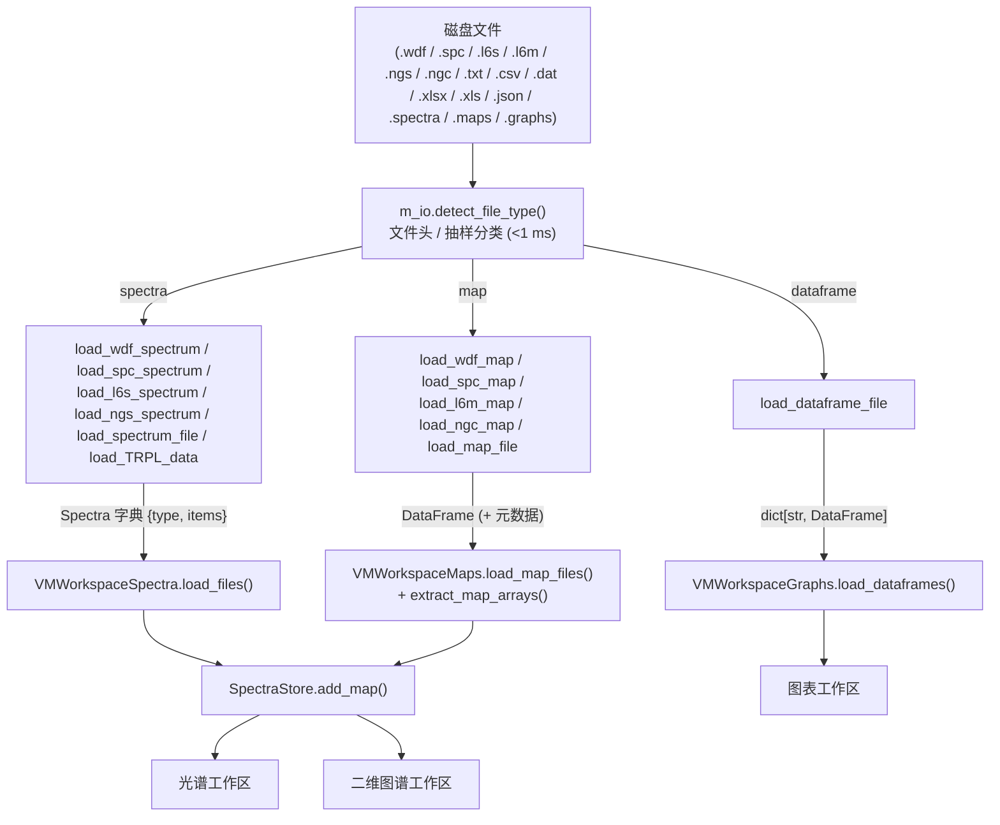

# **文件加载流程 (`m_io.py`)** { #file-loading-pipeline-m_iopy }

`m_io.py` 是 SPECTROview 的**通用文件读取器**。它处于所有数据读取操作的入口处——磁盘上的原始文件在应用其他任何部分接触到数据之前，都会先经过它处理。

**源文件**：[`m_io.py`](https://github.com/CEA-MetroCarac/SPECTROview/blob/main/spectroview/model/io/m_io.py)

---

## 概览 { #overview }

`m_io.py` 处理三大类数据的**所有受支持文件格式**：

| 类别 | 说明 | 目标去向 |
|------|------|----------|
| **离散光谱** | 一维或多光谱文件（单点采集、时间序列） | → `SpectraStore` → 光谱工作区 |
| **高光谱二维图谱** | 光谱的二维空间网格 | → `SpectraStore` → 二维图谱工作区 |
| **数据表** | 通用表格数据（拟合结果、外部数据集） | → 直接进入图表工作区 |



---

## 支持的格式与入口函数 { #supported-formats-entry-points }

| 格式 / 作用 | 扩展名 | 函数 | 返回值 |
|-------------|--------|------|--------|
| 快速文件分类器 | 所有受支持格式 | `detect_file_type()` | `'spectra'` \| `'map'` \| `'dataframe'` \| `'fit_model'` \| `'spectra_workspace'` \| `'maps_workspace'` \| `'graphs_workspace'` |
| WDF 文件头预检 | `.wdf` | `peek_wdf_measurement_type()` / `WdfReader.peek_header()` | `'spectra'` \| `'map'` / `dict`（读取 512 字节 `WDF1` 文件头） |
| SPC 文件头预检 | `.spc` | `SpcReader.peek_header()` | `dict`（读取 512 字节 Galactic SPC 文件头） |
| LabSpec 6 文件头预检 | `.l6s`, `.l6m` | `L6sReader.peek_header()` | `dict`（校验未压缩或已压缩的 `"LabSpec6\x00"` 容器头） |
| LabSpec 5 文件头预检 | `.ngs`, `.ngc` | `NgsReader.peek_header()` | `dict`（校验 `"NGSNextGen"` v1/v3 文件头并预读 `DataMatrix` 子类型） |
| Renishaw WiRE 光谱 / 序列 | `.wdf` | `load_wdf_spectrum()` (`m_wdf.WdfReader`) | `spectra dict` |
| Renishaw WiRE 二维图谱 / 线扫描剖面 | `.wdf` | `load_wdf_map()` (`m_wdf.WdfReader`) | `(DataFrame, metadata dict)` |
| Galactic SPC 光谱 | `.spc` | `load_spc_spectrum()` (`m_spc.SpcReader`) | `spectra dict` |
| Galactic SPC 二维图谱 | `.spc` | `load_spc_map()` (`m_spc.SpcReader`) | `(DataFrame, metadata dict)` |
| HORIBA LabSpec 6 光谱 | `.l6s` | `load_l6s_spectrum()` (`m_l6s.L6sReader`) | `spectra dict` |
| HORIBA LabSpec 6 二维图谱 | `.l6m` | `load_l6m_map()` (`m_l6s.L6sReader`) | `(DataFrame, metadata dict)` |
| HORIBA LabSpec 5 光谱 | `.ngs`, `.ngc` | `load_ngs_spectrum()` (`m_ngs.NgsReader`) | `spectra dict` |
| HORIBA LabSpec 5 二维图谱 | `.ngc`, `.ngs` | `load_ngc_map()` (`m_ngs.NgsReader`) | `(DataFrame, metadata dict)` |
| 文本 / CSV 光谱 | `.txt`, `.csv` | `load_spectrum_file()` | `spectra dict` |
| 文本 / CSV 二维图谱 | `.txt`, `.csv` | `load_map_file()` | `DataFrame` |
| TRPL 时间分辨光致发光 (PL) | `.dat` | `load_TRPL_data()` | `spectra dict` |
| Excel / CSV 数据表 | `.xlsx`, `.xls`, `.csv` | `load_dataframe_file()` | `dict[str, DataFrame]` |
| 二维图谱张量提取器 | DataFrame | `extract_map_arrays()` | `(x0, Y0, coords, fnames)` |
| Renishaw 长格式转换器 | `.txt` | `convert_action()` | 写出宽矩阵 `.txt` 文件 |

---

## 返回格式 { #return-formats }

### Spectra 字典 — 离散光谱 { #spectra-dict-discrete-spectra }

所有光谱加载函数（`load_wdf_spectrum`、`load_spc_spectrum`、`load_l6s_spectrum`、`load_ngs_spectrum`、`load_spectrum_file`、`load_TRPL_data`）均返回一个统一的 **spectra 字典**：

```python
{
    "type": "spectra",
    "items": [
        {
            "name": "my_sample",       # str — unique identifier (file stem or stem + index)
            "x0":   np.ndarray,        # float64[M] — wavenumber axis
            "y0":   np.ndarray,        # float64[M] — raw intensity values
            "metadata": {              # dict — acquisition parameters
                "File Format": "Renishaw WDF",
                "Laser Wavelength (nm)": "532.00",
                "Exposure Time (s)": "1.0",
                # ...
            }
        },
        # Additional items for multi-spectrum files (e.g., temporal series from WDF)
        {
            "name": "my_sample_1",
            "x0":   np.ndarray,
            "y0":   np.ndarray,
            "metadata": {"Time (s)": 1.5, "...": "..."}
        },
    ]
}
```

> [!IMPORTANT]
> **为什么使用列表？** 配置为时间序列的单个 `.wdf` 文件（例如 10 分钟内采集 100 次）包含 N 条光谱，而非仅 1 条。`items` 列表能够统一处理单条光谱（N=1）与多光谱文件，无需调用方编写分支逻辑。

### 二维图谱 DataFrame — 高光谱二维图谱 { #map-dataframe-hyperspectral-maps }

所有二维图谱加载函数（`load_wdf_map`、`load_spc_map`、`load_l6m_map`、`load_ngc_map`、`load_map_file`）均返回一个 **pandas DataFrame**（二进制格式还会附带一个元数据字典）：

```python
# Return type for WDF/SPC/L6M/NGC: tuple[pd.DataFrame, dict]
# Return type for TXT/CSV: pd.DataFrame

df, metadata = load_wdf_map(path)

#  df layout:
#   Columns:  ['X', 'Y', '100.5', '101.0', '101.5', ...]
#             |     |     |
#             |     |     +-- wavenumber values as strings (cm-1)
#             +-----+-------- spatial stage coordinates (µm)
#
#   Shape: (N_spectra, 2 + M_wavenumbers)
```

| 列类型 | 内容 | dtype |
|--------|------|-------|
| `X` | 样品台 X 位置 (µm) | `float64` |
| `Y` | 样品台 Y 位置 (µm) | `float64` |
| `'100.5'`, `'101.0'`, ... | 该波数处的光谱强度 | `float64` |

### 数据表字典 — 表格数据 { #datasheet-dict-tabular-data }

`load_dataframe_file()` 返回一个将名称键映射到 DataFrame 的字典。对于单工作表 Excel 文件或 CSV 文件，键名即为不含扩展名的文件名：

```python
# Single-sheet Excel or CSV:
result = load_dataframe_file(path)
# -> {"my_results": pd.DataFrame}

# Multi-sheet Excel:
result = load_dataframe_file(path)
# -> {"my_results_Sheet1": pd.DataFrame, "my_results_Sheet2": pd.DataFrame}
```

---

## GUI 如何将 I/O 输出转换为 SpectraStore { #how-the-gui-transforms-io-output-into-spectrastore }

`m_io` 的原始输出特意设计为简洁的 Python 结构（字典 / DataFrame）。将其转换为以张量为核心的 `SpectraStore` 的工作由 ViewModel 层负责。

### 光谱工作区：`VMWorkspaceSpectra.load_files()` { #spectra-workspace-vmworkspacespectraload_files }

```python
# In viewmodel/spectra/vm_workspace_spectra.py — simplified for clarity

data_dict = load_wdf_spectrum(path)   # -> {"type": "spectra", "items": [...]}

for item in data_dict["items"]:
    fname    = item["name"]           # unique map key
    x0       = item["x0"]            # float64[M]
    y0       = item["y0"]            # float64[M]
    metadata = item["metadata"]      # dict

    # Each spectrum becomes its own MapData in SpectraStore:
    # N=1 (single row), M = len(x0)
    self.store.add_map(
        name   = fname,
        x0     = x0.copy(),
        Y0     = np.asarray(y0, dtype=np.float32).reshape(1, -1),   # shape (1, M)
        coords = np.array([[0.0, 0.0]], dtype=np.float64),           # no spatial position
        fnames = [fname],
    )
    self.store.get_map_data(fname).map_metadata = metadata
```

> [!NOTE]
> **每条光谱都是一个独立的 `MapData` 数据块**（N=1）。这与二维图谱中的光谱（N 可达数千）采用完全相同的结构。正是这一统一的数据模型，使 `VMWorkspaceMaps` 能够直接继承扩展 `VMWorkspaceSpectra`，而无需重复代码。

### 二维图谱工作区：`VMWorkspaceMaps.load_map_files()` 与 `extract_map_arrays()` { #maps-workspace-vmworkspacemapsload_map_files-extract_map_arrays }

```python
# In viewmodel/maps/vm_workspace_maps.py (and spectroview/api/workspace.py)

df, metadata = load_wdf_map(path)                    # -> (DataFrame, dict)
x0, Y0, coords, fnames = extract_map_arrays(path.stem, df)
# x0:     float64[M]    — all valid numeric wavenumber channels (ascending)
# Y0:     float32[N, M] — contiguous spectral matrix
# coords: float64[N, 2] — stage (X, Y) positions
# fnames: list[str]     — "{map_name}_({x}, {y})" (disambiguated with _{k} on time-resolved duplicate sites)

self.store.add_map(
    name   = path.stem,
    x0     = x0,
    Y0     = Y0,
    coords = coords,
    fnames = fnames,
)
```

### 图表工作区：DataFrame 直接导入 { #graphs-workspace-direct-dataframe-ingestion }

数据表完全绕过 `SpectraStore` —— 它们直接从 `m_io` 传入图表工作区的 ViewModel：

```python
# In viewmodel/graphs/vm_workspace_graphs.py

dataframes = load_dataframe_file(path)   # -> dict[str, DataFrame]

for name, df in dataframes.items():
    self.dataframes[name] = df           # stored in VM directly, no SpectraStore
```

---

## 设计与性能说明 { #design-performance-notes }

### 零负载文件头分类（`detect_file_type`） { #zero-payload-header-classification-detect_file_type }

当打开文件或将文件拖放到 `Main._load_files_by_paths()` 中时，`detect_file_type()` 无需解析完整数据集，即可在 `< 0.1 ms` 内完成文件分类：

- **`.wdf`**：`peek_wdf_measurement_type()` 仅读取 `WDF1` 文件头的前 144 字节（位于偏移量 `132` 处的 `measurement_type`），避免对数兆字节的光谱数据立方体进行两次解码。
- **`.spc`**：`SpcReader.peek_header()`（`header_only=True`）仅读取 512 字节的 Galactic SPC 文件头（`fnsub` 子文件计数），跳过子文件和日志读取。
- **`.l6s` / `.l6m`**：`L6sReader.peek_header()` 在不读取完整光谱数组的情况下校验 `"LabSpec6\x00"` 容器头和标志位（`0x01` 已压缩、`0x04` 4 平面字节重排）——对较小文件头（`<= 256 KiB`）进行解压以检查根描述符，对大型压缩二维图谱则在 `< 1 ms` 内校验 `lzhuf` 流前缀。
- **`.ngs` / `.ngc`**：`NgsReader.peek_header()` 校验 `"NGSNextGen"` v1/v3 二进制文件头，并在约 1 ms 内预读块流的前 96 字节（获取 `DataMatrix` 子类型 `"Spectrum"` 或 `"SpIm"` 以及 `n_dims`），无需解压完整的光谱数据负载。
- **`.txt` / `.csv`**：使用纯 Python 检查最多 12 行非空内容，在文件路由阶段无需启动基于正则表达式引擎的 `pandas` 读取操作。

### 合并式二维图谱 DataFrame 与向量化解析 { #consolidated-map-dataframes-vectorized-parsing }

- **单块 DataFrame**：二进制格式（`WDF`、`SPC`、`L6M`、`NGC`）及转换后的二维图谱均通过 `_build_map_dataframe()` 组装，直接封装连续的二维光谱矩阵，而不是构建数千个一维列切片。
- **C 引擎 CSV/TXT 快速路径**：`load_map_file()` 使用带有 `usecols` 的 `pd.read_csv(..., engine="c")`（在解析时直接去除末尾分号）、针对隔行晶圆 CSV 导出文件的 `skiprows` 回调函数，以及在排序降序波数时采用基于位置的 `iloc` 重排，以避免在内存中复制大型光谱矩阵。
- **向量化 WDF、SPC、LabSpec 6 与 LabSpec 5 二进制读取器**：
  - `WdfReader`（`spectroview/model/io/m_wdf.py`）通过单次读取的 `struct.unpack_from` 和 `np.frombuffer` 操作原生解析 Renishaw `.wdf` 数据块（`WDF1`、`DATA`、`XLST`、`YLST`、`ORGN`、`WMAP`），不依赖第三方 `renishawWiRE` 或 `PIL` 库，消除了逐点处理 `ORGN` 坐标的 Python 循环以及冗余的 `WHTL` JPEG 解码。
  - `SpcReader`（`spectroview/model/io/m_spc.py`）通过结构化 NumPy `np.frombuffer` dtype 在单次缓冲 I/O 调用中读取等长多子文件 `.spc` 二维图谱（支持 IEEE `float32`、`TSPREC` `int16` 和 `int32` 定点缩放），仅在遇到变长 `TXYXYS` 文件时回退至顺序解析。
  - `L6sReader`（`spectroview/model/io/m_l6s.py`）解码 HORIBA LabSpec 6 的 `.l6s`（一维光谱）和 `.l6m`（二维光谱图像 `SpIm`）二进制节点树（`"LabSpec6\x00"` 魔数标识，支持未压缩的 76 字节头以及通过 `_decompress_ngc()` 解码的 `lzhuf` + 字节差分 + 4 平面字节重排压缩容器、24 字节 DFS 记录、基于 `0x8000` / 指针 ID 的共享去重数据块以及 `b'temx'` 运行时子树），提取光谱数据立方体（`float32`）、样品台 `(X, Y)` 空间网格、经校准的激光波长（`Laser.pos` 或 `Laser (nm).pos`）、信噪比 `S/N` 以及全部采集/描述/历史元数据表（`_reorder_metadata()` 将规范键 `_METADATA_ORDERED_KEYS` 排在最前，并在末尾附加其余仪器参数）。
  - `NgsReader`（`spectroview/model/io/m_ngs.py`）解码 HORIBA LabSpec 5 的 `.ngs`（v1 未压缩）和 `.ngc`（v3，采用 Haruhiko Okumura `lzhuf` 自适应 Huffman + LZSS 压缩及字节级 `np.cumsum` 差分编码）容器（`"NGSNextGen"` 魔数标识），解析 `DataMatrix` 光谱/空间张量与 `Table` 数据块（`Param`、`Acq`、`Extra`、`Hist`），按规范键 `_METADATA_ORDERED_KEYS` 排序并完整保留额外仪器参数。

### 无表头光谱、升序坐标轴与重复坐标 { #headerless-spectra-ascending-axes-duplicate-coordinates }

- **无表头一维文件**：`load_spectrum_file()` 在调用 `pd.read_csv` 前会先检查前几行内容，从而在无表头的 `.txt`/`.csv` 光谱文件中保留第 `0` 行数据，同时跳过 `#` 注释行、单行表头或 3 行旧版表头。
- **X 轴升序不变量**：所有光谱与二维图谱加载函数（`WDF`、`SPC`、`L6S`、`L6M`、`NGS`、`NGC`、`TXT`、`CSV`）均将光谱轴归一化为严格升序，使下游的基线处理、ROI 裁剪与 VBF 拟合能够依赖单调递增的 `x0`。
- **固定位点的时间分辨二维图谱**：当二维图谱包含重复的 `(X, Y)` 坐标时（例如多次扫描的时间分辨晶圆 CSV 文件），`extract_map_arrays()` 会自动追加 `_{k}` 后缀（`map_(x, y)_2` 等），使每次测量都保留唯一的 `SpectraStore` 键名，同时 `parse_coords_from_fname()` 仍可还原出准确的 `(X, Y)` 坐标。

### 纯模型层元数据解析（`parse_wdf_metadata`） { #pure-model-layer-metadata-parse_wdf_metadata }

`parse_wdf_metadata()` 位于 `spectroview/model/io/m_io.py`（并在 `viewmodel/utils.py` 中重新导出以保持向后兼容），使 `spectroview/model/` 完全不引入任何 Qt 或 ViewModel 依赖。该函数解析二进制 `WXIS`、`WXCS`、`WXDM` 及 `WDF1` `FILETIME` 数据块，提取物镜、光栅、激光功率、狭缝设置、曝光时间与时间戳信息。

---

## 相关页面 { #related-pages }

- **[数据架构：SpectraStore](spectra_store.md)** —— 已加载数据如何存储、索引与访问。
- **[光谱工作区](spectra.md)** —— `VMWorkspaceSpectra.load_files()` 与光谱的完整生命周期。
- **[二维图谱工作区](maps.md)** —— `VMWorkspaceMaps.load_map_files()` 与二维图谱的完整生命周期。
