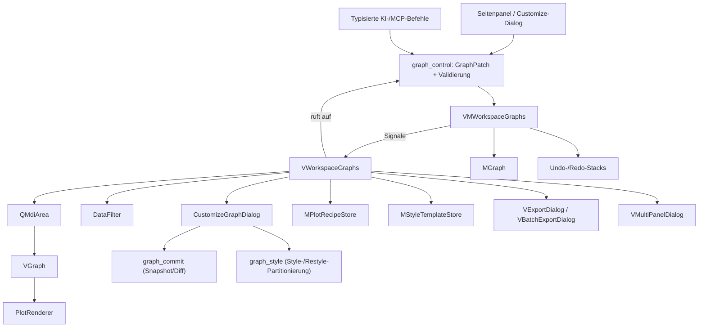
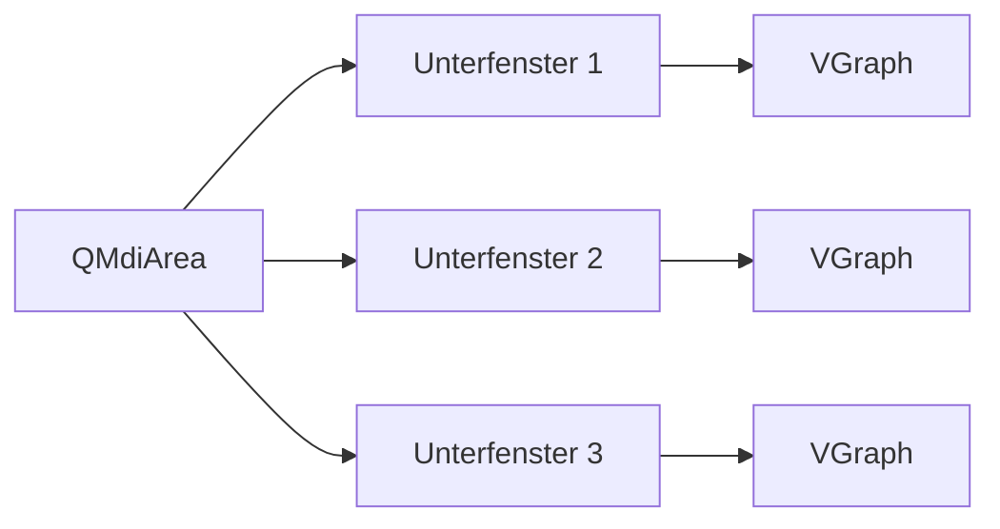

# **Arbeitsbereich: Diagramme** { #workspace-graphs }

Der Arbeitsbereich `Graphs` ist eine eigenständige Umgebung für statistische Datenvisualisierung. Er verwaltet DataFrames (aus Dateien geladen oder aus anderen Arbeitsbereichen injiziert), wendet dynamische Filter an und erzeugt publikationsreife Plots mit reinem `Matplotlib` (sowie `scipy` für statistische Berechnungen) innerhalb eines MDI-Bereichs (*Multiple Document Interface*). Eine Abhängigkeit von Seaborn besteht nicht mehr — jeder Plot-Typ wird in `PlotRenderer` direkt mit Matplotlib-Primitiven gezeichnet.

---

## **Architekturübersicht** { #architecture-overview }



---

## **Schlüsselklassen** { #key-classes }

### **`VMWorkspaceGraphs` — Das ViewModel** { #vmworkspacegraphs-the-viewmodel }

**Datei**: `spectroview/viewmodel/graphs/vm_workspace_graphs.py` (mit Undo/Redo in `spectroview/viewmodel/graphs/graph_undo.py`)

Verwaltet DataFrames, Diagrammmodelle sowie den Undo-/Redo-Verlauf des Arbeitsbereichs. Im Gegensatz zu den ViewModels für `Spectra` und `Maps` bleibt dieses ViewModel vergleichsweise schlank — die rechenintensive Rendering-Logik befindet sich direkt im Widget `VGraph`.

| Zuständigkeit | Methoden |
|---------------|---------|
| **DataFrame-Laden** | `load_dataframes(paths)` — Unterstützt `.xlsx`, `.xls`, `.csv` |
| **DataFrame-Verwaltung** | `add_dataframe()`, `remove_dataframe()`, `select_dataframe()`, `refresh_dataframe()` |
| **Diagramm-CRUD** | `create_graph()`, `get_graph()`, `update_graph()`, `delete_graph()` |
| **Filterung** | `apply_filters(df_name, filters)` — basiert auf `pd.DataFrame.query()` |
| **Multi-Wafer** | `create_multi_wafer_graphs()` — Erstellt im Stapel einen Wafer-Plot pro Slot |
| **Undo/Redo** | `undo()`, `redo()`, `begin_undo_batch()`/`end_undo_batch()`, `can_undo`/`can_redo` |
| **Persistenz** | `save_workspace()`, `load_workspace()`, `clear_workspace()` |

#### **Signale** { #signals }

```python
dataframes_changed = Signal(list)           # List of DataFrame names updated
dataframe_columns_changed = Signal(list)    # Column names of selected DataFrame
graphs_changed = Signal(list)               # List of graph IDs updated
graph_state_changed = Signal()              # Any persisted graph property changed (AI context sync)
undo_state_changed = Signal()               # can_undo/can_redo changed -- sync toolbar buttons
notify = Signal(str)                        # Floating notification
```

### **`MGraph` — Das Plot-Konfigurationsmodell** { #mgraph-the-plot-configuration-model }

**Datei**: `spectroview/model/graphs/m_graph.py`

Eine reine Dataclass, die sämtliche Informationen zum Rekonstruieren eines Plots speichert. `save()`/`load(data)` übernehmen die vollständige Serialisierung; `get_display_name()` erzeugt den Titel des MDI-Unterfensters. Um keine zweite, potenziell abweichende Feldliste zu pflegen (die maßgebliche, vollständige Übersicht findet sich in `m_graph.py`), lassen sich die Felder thematisch wie folgt gruppieren:

| Kategorie | Beispiele |
|---|---|
| Identität / Datenquelle | `graph_id`, `df_name`, `plot_style`, `x`/`y`/`z`, `filters` |
| Grenzen der Hauptachsen | `xmin`/`xmax`, `ymin`/`ymax`, `zmin`/`zmax` |
| Achsenskalierung / -ausrichtung | `xlogscale`/`ylogscale`, `xscale_mode`/`yscale_mode`, `x_inverted`/`y_inverted` |
| Nebenachsen (Y2/Y3/X2) | Spalte je Achse, `color`, `marker`, `min`/`max`, `logscale`, `label` |
| Beschriftungen / Titel | `plot_title`, `plot_subtitle`, `xlabel`/`ylabel`/`zlabel` |
| Stil / Erscheinungsbild | `grid`, `tick_direction`, `tick_label_format`, Schriftgrößen, `figure_facecolor`, `figure_margins`, `spines_visible`, `figure_theme`, Nebenteilstrich-Schalter |
| Legende | `legend_visible`, `legend_outside`, `legend_properties`, `legend_bbox`, `legend_ncol`, `legend_frame`, `legend_title`, `legend_fontsize`, `legend_alpha`, `legend_loc` |
| Plot-typ-spezifisch | Wafer-/2D-Karten-Farbskala (`color_palette`, `colormap_norm`, `colormap_center`), Trendlinien-Anpassung/-Anker, Fehlerbalken, Punkt-/Streudiagramm (`scatter_size`, `scatter_edgecolor`, `unify_marker_style`), Histogramm, Sortierreihenfolge |
| Anmerkungen | `annotations` (Liste typisierter Dicts, siehe [Annotations (`TabAnnotations`)](#annotations-tabannotations)) |
| Unterbrochene Achse | `axis_breaks` |
| Einsatzachsen (Zoom) | `inset_enabled`, `inset_bounds`, `inset_xmin`/`xmax`/`ymin`/`ymax`, `inset_show_zoom_indicator` |
| Export- / Fenstergeometrie | `plot_width`/`height`, `dpi`, `export_width_mm`/`height_mm` |

Hinweis: Stilvorlagen, Plot-Rezepte und die Einstellung für den Arbeitsordner sind **keine** Felder von `MGraph` — es handelt sich um eigenständige Systeme, die auf Teilmengen dieser Felder aufbauen (siehe [Stilvorlagen & Plot-Rezepte](#style-templates-plot-recipes)).

### **`graph_control.py` — Gemeinsamer Zustands- und Befehlsvertrag für Diagramme** { #graph_controlpy-shared-graph-statecommand-contract }

**Datei**: `spectroview/model/graphs/graph_control.py`

Alle Mutationen aus GUI, KI und MCP laufen über diese Qt-freie Schicht zusammen, bevor sie `MGraph` erreichen. `GraphPatch` wird automatisch aus den Feldern der Dataclass generiert, sodass das MCP-Schema automatisch jede veränderbare Diagrammeigenschaft bereitstellt. Wichtige verschachtelte Strukturen (Filter, Stile pro Datenreihe, Rahmenlinien, Achsenbrüche sowie alle acht Anmerkungstypen) besitzen jeweils eigene strenge Schemata.

`normalize_graph_patch()` validiert einen Patch gegen den zusammengeführten aktuellen Zustand, ohne diesen zu verändern: Unbekannte Schlüssel, Nullbarkeit, Wertebereiche, Enum-Werte, Spaltennamen, Grenzen, Geometrie der Einsatzachsen, Struktur von Anmerkungen sowie gegenseitig ausschließende Achsenbrüche werden gemeinsam geprüft. `apply_graph_patch()` übernimmt den bereits validierten Patch anschließend atomar. Ausgelassene Felder bleiben unverändert; ein explizites `null` löscht ausschließlich nullbare Eigenschaften. Änderungen an der Daten- oder Serienidentität setzen abgeleitete `legend_properties` zurück, sofern der Aufrufer keine Ersatzliste mitliefert.

Dieser Vertrag ist bewusst unabhängig vom Renderer gestaltet. Die View bleibt weiterhin für die Erstellung von Matplotlib-Figuren und -Canvas, die Auswertung gefilterter Daten, das Neuzeichnen, die Fenstergeometrie sowie die Aktualisierung eines geöffneten Customize-Dialogs zuständig.

### **`VWorkspaceGraphs` — Der View-Orchestrator** { #vworkspacegraphs-the-view-orchestrator }

**Paket**: `spectroview/view/workspaces/graphs/` (`v_workspace_graphs.py`, `v_mdi_subwindow.py`, `v_graphs_ui.py`, `v_graphs_dataframes.py`, `v_graphs_mdi.py`, `v_graphs_actions.py`)

`VWorkspaceGraphs` setzt die Oberfläche des Arbeitsbereichs `Graphs` aus mehreren Mixins zusammen: der Benutzeroberfläche (`GraphsUIMixin`), dem Panel für DataFrame-Auswahl und -Filterung (`GraphsDataFramesMixin`), dem Layout-, Kachel-/Kaskaden- und Symbolleisten-Management für MDI-Fenster (`GraphsMdiMixin`) sowie den Aktionen zum Erstellen, Aktualisieren, Exportieren, Rückgängigmachen und Verwalten von Vorlagen (`GraphsActionsMixin`). Jedes `VGraph`-Widget wird dabei in ein `MdiSubWindow` eingebettet.

### **`VGraph` — Das Rendering-Widget** { #vgraph-the-rendering-widget }

**Paket**: `spectroview/view/components/graphs/` (`v_graph.py` mit `v_graph_canvas.py`, `v_graph_breaks.py`, `v_graph_axes.py`, `v_graph_annotations.py`)

Jeder Plot im MDI-Bereich ist eine Instanz von `VGraph`. Es hält eine Matplotlib-`Figure` samt `FigureCanvas` und fungiert als UI-Wrapper. Es verwaltet Benutzerinteraktionen, Kontextmenüs und Symbolleisten-Aktionen (`Style`-Menü, `Export`, `Replicate`), delegiert die eigentlichen Zeichenalgorithmen jedoch an `PlotRenderer`. `create_plot_widget()` erzeugt für jedes `VGraph` weiterhin eine eigene Matplotlib-Navigationsleiste samt Aktionsbutton-Zeile (`self.toolbar_container`), fügt sie jedoch nicht in das eigene Layout des Diagramms ein — wo sie tatsächlich angezeigt wird, beschreibt der Abschnitt über [die untere Symbolleiste](#mdi-area-management).

**Reaktionsfähigkeit bei Größenänderung und Verschieben.** Jede Figur nutzt `layout="compressed"`, sodass jedes Neuzeichnen über Agg ein erneutes Durchlaufen des Constrained Layouts auslöst, was mehrere Hundert Millisekunden beansprucht. Drei Maßnahmen halten die Bedienung flüssig:

- `MdiSubWindow` aktiviert `RubberBandResize`/`RubberBandMove`. Beim Ziehen einer Fensterkante wird lediglich ein leichter Rahmen bewegt; der Canvas wird erst **einmalig** beim Loslassen der Maustaste neu dimensioniert und gezeichnet.
- `VGraph.canvas` ist ein `_DebouncedFigureCanvas`. Das erste `resizeEvent` einer Ereignisserie wird sofort ausgeführt; weitere Ereignisse innerhalb von `RESIZE_DEBOUNCE_MS` (60 ms) werden zu einem einzigen abschließenden Resize auf die Endgröße zusammengefasst. Das deckt Größenänderungen ab, die nicht über das Gummiband laufen, etwa beim Kacheln, Maximieren oder Ziehen des Splitters. Der Debounce-Timer ist dem Canvas als Parent zugeordnet.
- `VGraph.toolbar` ist eine `_FastNavigationToolbar`, weiterhin der verborgene `NavigationToolbar2QT`-Helfer für die Schaltflächen Pan/Zoom. Er setzt die Layout-Engine der Figur von `press_pan` bis `release_pan` aus (während des Ziehens ändern sich nur die Achsengrenzen), drosselt Neuzeichnungen beim Ziehen auf rund 30 FPS (`PAN_FRAME_S`) und stellt die Engine beim Loslassen mit einem vollständigen Redraw wieder her. Das Klicken der Pan-Schaltfläche selbst kostet kaum Zeit (~1 ms); die zuvor spürbare Verzögerung entstand durch vollständige Layout-Neuberechnungen bei jeder Mausbewegung während des Ziehens.

Es existieren zwei Rendering-Pfade:

- **`plot(df)`** — vollständiges Neuzeichnen: leert die Achsen und baut sie von Grund auf neu auf. Erforderlich, sobald sich Artists selbst ändern (Seriendaten, punktweise Farben/Marker, Farbskala, sekundäre Zwillingsachsen, Anmerkungen, Einsatzachsen) oder ein Achsenbruch aktiv bzw. umgeschaltet wird.
- **`restyle()`** — schneller Pfad, der bereits gerenderte Achsen direkt an Ort und Stelle neu gestaltet (Titel/Beschriftungen/Schriftgrößen, Gitter, Teilstrichrichtung/-format, Grenzen der Hauptachsen, Log-/Symlog-Skalierung, Hintergrundfarbe/Rahmenlinien/Ränder der Figur, Legendenbox-Stil), ohne die geplotteten Daten anzutasten. Vor dem Umschalten einer Achse auf `"log"` bereinigt `GraphAxesStyleMixin` (`v_graph_axes.py`) veraltete, nicht-positive automatische Lineargrenzen über `_sanitize_log_axis_limits()`, sodass Matplotlib keine Warnungen zu nicht-positiven Log-Grenzen ausgibt. Gibt `False` zurück (und erzwingt damit ein vollständiges Neuzeichnen), sobald eine unterbrochene Achse aktiv ist. Wie der Customize-Dialog zwischen den beiden Pfaden entscheidet, erläutert [Live-Vorschau & Restyle-Fast-Path](#live-preview-restyle-fast-path).

`_set_figure_style()` wendet bei jedem Renderdurchlauf `axes.facecolor`/`figure.facecolor`/`axes.labelcolor`/`text.color`/`xtick.color`/`ytick.color`/`axes.edgecolor` erneut aus `plt.rcParams` an — dies ist notwendig, weil `ax.clear()` eine unter einem anderen Matplotlib-Stil bzw. Design erstellte Achse nicht rückwirkend umfärbt, wodurch Teilstriche, Beschriftungen und Rahmenlinien nach dem Wechsel in ein dunkles Design früher schwarz blieben.

### **`PlotRenderer` — Die Plotting-Engine** { #plotrenderer-the-plotting-engine }

**Dateien**: `spectroview/view/components/graphs/v_plot_renderer.py` (kombiniert mit `SpatialPlotMixin` und `WaferPlot` in `v_plot_spatial.py`)

Zur besseren Wartbarkeit von `VGraph` getrennt, kapselt diese Klasse die reine Matplotlib-Rendering-Logik für alle Plot-Stile (z. B. `_plot_scatter`, `_plot_histogram` sowie die Klasse `WaferPlot`). Sie erhält eine Referenz auf die `VGraph`-Instanz (`self.vg`), um auf deren Konfigurationszustand zuzugreifen (`self.vg.x`, `self.vg.plot_style` usw.), und zeichnet direkt auf die Matplotlib-`Axes`.

#### Farbskalen-Normalisierung { #colormap-normalization }

`_build_color_norm(vmin, vmax, norm_kind, center)` erstellt die Farbskalen-Abbildung für Wafer- und 2D-Karten-Heatmaps aus `MGraph.colormap_norm` (`"linear"`/`"log"`/`"centered"`) und `MGraph.colormap_center`. Beide Werte lassen sich im Tab **Achsen & Grenzen** (Axes & Limits) über die **Z axis**-Skalierung bearbeiten (nur sichtbar für `wafer`/`2Dmap`). `"log"` nutzt `LogNorm`, `"centered"` nutzt `CenteredNorm` (nützlich für divergierende Daten wie um 0 zentrierte Spannungen/Dehnungen); beide fallen sauber auf eine einfache lineare `vmin`/`vmax`-Skala zurück, falls die gewählte Normalisierung für den tatsächlichen Datenbereich ungültig ist (z. B. logarithmische Normalisierung bei nicht-positiven Daten).

Sowohl `_plot_wafer` als auch `_plot_2dmap` bereinigen `vmin`/`vmax` zunächst über `_clear_degenerate_zlim(zmin, zmax)`, das explizit gesetzte, gleiche Grenzen (`zmin == zmax`) wie nicht gesetzt behandelt und auf den aus den Daten abgeleiteten Bereich zurückfällt. Einige ältere gespeicherte `.graphs`-Dateien enthalten explizit `zmin == zmax == 0.0` (aus einem früheren, inzwischen behobenen Standardwert) — würde dies wörtlich übernommen, kollabierte `matplotlib.colors.Normalize(vmin=0, vmax=0)` und bildete jeden Wert auf dieselbe Farbe ab. Genau das störte beim erneuten Öffnen solcher Dateien die Farbdarstellung, nicht die Farbskalen-Normalisierung selbst.

`_resolve_marker_size(style, fallback)` / `_resolve_edge_color(style, fallback)` zentralisieren das Verhalten für „Unify Marker size / Edge color“ (siehe [Legend & Series (`TabLegendSeries`)](#legend-series-tablegendseries)): Ist `VGraph.unify_marker_style` auf `True` gesetzt, verwendet jede Datenreihe die diagrammweiten Werte `scatter_size`/`scatter_edgecolor`; bei `False` greift stattdessen der jeweilige Eintrag aus `legend_properties[i]`, sofern vorhanden.

---

## **Datenfluss: Erstellen eines Plots** { #data-flow-creating-a-plot }

1. **Benutzeraktion**: Der Nutzer wählt einen DataFrame aus, konfiguriert die X-/Y-/Z-Achsen und klickt in der UI von `VWorkspaceGraphs` auf **Plot hinzufügen** (Add plot).
2. **Erfassung der Konfiguration**: Die View ruft `_collect_plot_config()` auf, um alle UI-Einstellungen in einem Konfigurations-Dict zu sammeln, und führt anschließend über `_apply_default_style_to_config()` die Werte aus `MSettings.get_default_graph_style()` ein (die Basislinie des Nutzers aus **Als Standardstil festlegen** (Set as Default Style), falls vorhanden — siehe [Stilvorlagen & Plot-Rezepte](#style-templates-plot-recipes)). Die Datenidentitätsfelder der erfassten Konfiguration (`x`/`y`/`z`/`df_name`/`plot_style`) haben stets Vorrang vor dem Standardstil, da dieser ausschließlich Darstellungsfelder enthält.
3. **Modellerstellung**: Die View ruft `vm.create_graph(plot_config)` auf. Das ViewModel validiert die vollständige Konfiguration über `graph_control`, instanziiert und aktualisiert atomar ein `MGraph(graph_id)`, zeichnet einen Undo-Schritt auf und gibt das Modell zurück.
4. **Widget-Initialisierung**: Die View instanziiert ein Widget `VGraph(graph_id)` und ruft `create_plot_widget(dpi)` auf, um den Matplotlib-Canvas einzurichten.
5. **Datenfilterung**: Die View fordert `filtered_df` vom ViewModel über `vm.apply_filters(df_name, filters)` an.
6. **Rendering**: Die View ruft `VGraph.plot(filtered_df)` auf.
7. **Ausführung des Plots**: `VGraph` ruft `_plot_primary_axis()` auf, das einen `PlotRenderer(self)` instanziiert und die Zeichenlogik delegiert (z. B. `self.renderer._plot_scatter()`), anschließend Grenzen, Beschriftungen und Legenden anwendet und den gerenderten Canvas zurückgibt.
8. **UI-Integration**: Die View bettet das neue `VGraph`-Widget in ein `QMdiSubWindow` ein und fügt es dem MDI-Bereich hinzu.

Dieselbe Zusammenführung mit dem Standardstil gilt auch für `_on_plot_multi_wafer()`; beim Anwenden eines Plot-Rezepts oder beim Replizieren eines vorhandenen Diagramms wird sie bewusst **nicht** angewendet, da diese bereits einen vollständig definierten, gezielt gewählten Stil mitbringen.

### **Datenfluss: KI-/MCP-Aktualisierung** { #data-flow-aimcp-update }

1. `update_graph` validiert seinen typisierten `GraphPatch` gegen jedes Zieldiagramm und jeden DataFrame. `graph_id="all"` wird vor jeder Mutation aufgelöst.
2. Der MCP-Server reiht ein typisiertes `UpdatePlot`-Kommando in die Warteschlange ein; er importiert niemals Qt und verändert niemals direkt ein Widget.
3. `VMChat` wandelt eingereihte Befehle in Anwendungskonfigurationen um, und `main.py` leitet die Aktualisierung an `VWorkspaceGraphs.update_graphs_from_config()` weiter.
4. Der Arbeitsbereich validiert alle Ziele vorab, öffnet einen einzigen Undo-Batch, aktualisiert jedes `MGraph`, baut bzw. zeichnet jedes Widget neu, passt explizite Geometrien an und lädt einen geöffneten Customize-Dialog neu. Bei einem Renderfehler werden sämtliche Modell- und Widget-Snapshots wiederhergestellt, sodass ein Batch niemals nur teilweise angewendet werden kann.
5. `graph_state_changed` aktualisiert den vollständigen serialisierten Diagrammkontext der KI nach GUI-Bearbeitungen, KI-Bearbeitungen, Undo/Redo, Ladevorgängen sowie vom Renderer abgeleiteten Stil-Synchronisationen.

---

## **Plot-Stile** { #plot-styles }

Jeder Plot-Stil bildet auf eine Methode `PlotRenderer._plot_*` ab, die direkt mit Matplotlib-Primitiven zeichnet (ohne Seaborn):

| Stil | Matplotlib-Primitive | Hue-Unterstützung | Hinweise |
|-------|---------------------|-------------|-------|
| `point` | `ax.errorbar()` | ✓ Z-Spalte | Stellt Mittelwerte pro Kategorie mit Fehlerbalken dar; Schalter „Join“ verbindet Punkte mit einer Linie; einziger Stil mit einer Marker-Spalte pro Serie |
| `scatter` | `ax.scatter()` | ✓ Z-Spalte | Markergröße/-randfarbe standardmäßig serienübergreifend vereinheitlicht (siehe Unify-Kontrollkästchen) |
| `box` | `ax.boxplot()` | ✓ Z-Spalte | Palettenunterstützung; Boxbreite aus dem Kategorienabstand abgeleitet |
| `bar` | `ax.bar()` | ✓ Z-Spalte | Optionale Fehlerbalken (SD / **95-%-KI** (95% CI)) |
| `line` | `ax.plot()` | ✓ Z-Spalte | Standard-Liniendiagramm |
| `trendline` | `np.poly1d`-Fit + `ax.scatter()` / `ax.plot()` / `ax.fill_between()` | ✓ Z-Spalte | Polynomiale Regression mit benutzerdefinierter Achsenabschnitt-Verankerung, analytischem 95-%-Konfidenzband und Gleichungstabellen-Export |
| `histogram` | `ax.hist()` (+ `scipy.stats.gaussian_kde`) | ✓ Z-Spalte | Anpassbare Klassenanzahl, optionale KDE-Überlagerung, Stufenumriss vs. gefüllte Balken |
| `wafer` | Benutzerdefinierter `WaferPlot` (`ax.scatter()`) | — | Kreisförmige Wafer-Visualisierung mit Die-Positionen; Farbskalen-Normalisierung (linear/log/zentriert) |
| `2Dmap` | `ax.imshow()` | — | Rechteckige Heatmap via `pivot()`; identische Farbskalen-Normalisierungsoptionen wie bei Wafer-Plots |

### **Multi-Achsen-Unterstützung** { #multi-axis-support }

`VGraph` unterstützt bis zu **3 Y-Achsen** sowie eine sekundäre X-Achse:

- **Primäre Y-Achse** (`self.ax`): Standardachse links
- **Sekundäre Y-Achse** (`self.ax2`): Rechte Achse, erzeugt über `ax.twinx()`
- **Tertiäre Y-Achse** (`self.ax3`): Äußere rechte Achse, nach außen versetzt
- **Sekundäre X-Achse** (`x2`): erzeugt über `ax.twiny()`

Jede Nebenachse kann eine eigene Datenspalte verwenden und besitzt eine eigene Beschriftung, Min/Max-Grenzen, einen Schalter für logarithmische Skalierung, eine Farbe und einen Marker — alles bearbeitbar im Tab **Neben- & Einsatzachsen** (Secondary & Inset Axes) des Customize-Dialogs (`TabSecondaryInset`, zuvor nur per Skript oder fest einprogrammiert zugänglich). Eine Zeile wird erst aktiviert, sobald der jeweiligen Achse eine Spalte zugewiesen wurde.

---

## **DataFrame-Verwaltung** { #dataframe-management }

### **Laden** { #loading }

`VMWorkspaceGraphs.load_dataframes()` nutzt `m_io.load_dataframe_file()`:

- **Excel** (`.xlsx`/`.xls`): Einzelnes Tabellenblatt → `{filename: df}`. Mehrere Tabellenblätter → `{filename_sheetname: df}` pro Blatt.
- **CSV**: Erkennt automatisch Semikolon- vs. Komma-Trennzeichen.

### **Quellenverfolgung und Aktualisierung** { #source-tracking-and-refresh }

Der Quelldateipfad jedes geladenen DataFrames wird in `self.dataframe_sources` gespeichert. Die Schaltfläche „Refresh“ liest die Datei erneut von der Festplatte ein und ermöglicht so iterative Workflows, wenn externe Werkzeuge die Daten aktualisieren.

### **Programmatische Injektion** { #programmatic-injection }

Andere Arbeitsbereiche können DataFrames direkt injizieren:

```python
# From Maps workspace:
self.graphs_workspace.vm.add_dataframe(profile_name, profile_df)

# From Spectra/Maps fit results:
self.graphs_workspace.vm.add_dataframe("fit_results", df_fit_results)
```

---

## **Filtersystem** { #filter-system }

Das Widget `VDataFilter` stellt einen dynamischen Abfrage-Generator bereit:

```python
# Each filter is a dict:
{
    "expression": "Slot == 5",    # Pandas query expression
    "state": True                  # Active/inactive toggle
}
```

Filter werden mittels `pd.DataFrame.query()` angewendet:

```python
def apply_filters(self, df_name, filters):
    df = self.dataframes[df_name].copy()
    for filter_data in filters:
        if filter_data.get("state", False):
            df = df.query(filter_data["expression"])
    return df
```

Filter werden **pro Diagramm** in `MGraph.filters` gespeichert, sodass jeder Plot unterschiedliche aktive Filter besitzen kann.

### **Multi-Wafer-Workflow** { #multi-wafer-workflow }

Enthält ein DataFrame eine Spalte `Slot` (häufig in Halbleiter-Datensätzen):

1. Die View zeigt Slot-Kontrollkästchen sowie die Schaltfläche **Multi-Wafer hinzufügen** (Add Multi-Wafer) an.
2. Der Nutzer wählt die gewünschten Slots aus (z. B. 1, 3, 5, 7).
3. `create_multi_wafer_graphs()` erzeugt einen Wafer-Plot pro Slot, jeweils mit einem in die Basisfilter integrierten Filter `Slot == N`.
4. Alle Wafer-Plots erscheinen gleichzeitig im MDI-Bereich.

---

## **Diagrammanpassung** { #graph-customization }

### **`CustomizeGraphDialog` (Singleton)** { #customizegraphdialog-singleton }

**Paket**: `spectroview/view/components/customize_graph/` — `CustomizeGraphDialog` (in `customize_graph_dialog.py`) verwendet ein modernes, an Einstellungen orientiertes zweispaltiges Layout mit einer reaktiven linken Navigationsleiste samt Echtzeit-Stichwortsuche, einem gestalteten Item-Delegate mit Auswahl-Pill und linkem Akzentindikator sowie modularen, scrollbaren Tab-Seiten mit Groupbox-Hervorhebung und automatischem Scrollen in den sichtbaren Bereich:

| Kategorie | Klasse | Modul | Funktionsumfang |
|---|---|---|---|
| **Allgemein & Typografie** (General & Typography) | `TabGeneral` | `tab_general.py` | Abbildungs-Theme (**Hell** (Light) / **Dunkel** (Dark)), Gitter, Drehung der X-Beschriftung, Schriftgrößen (Titel/Achse/Teilstrich/Farbskala), Datensortierung |
| Achsen & Grenzen | `TabAxesLimits` | `tab_axes_limits.py` | Achsengrenzen mit Bereichsschiebereglern (oben), X-/Y-Skalen (Linear/Log/Symlog), Datentypen, Invertierung, Z-Farbskala, unterbrochene Achse |
| Ticks & Spines | `TabTicksSpines` | `tab_ticks_spines.py` | Teilstrichrichtung, Voreinstellungen für Zahlenformate, Nebenteilstriche (O/R/U/L), Rahmenlinien/Spines (O/R/U/L) |
| Legend & Series | `TabLegendSeries` | `tab_legend_series.py` | Layout/Schriftart/Deckkraft/Position der Legendenbox, Vereinheitlichung des Markerstils, linksbündige Tabelle für Stile pro Datenreihe |
| **Plot-Stil & Fitting** (Plot Style & Fitting) | `TabPlotStyles` | `tab_plot_styles.py` | Stiloptionen (Punkt/Streudiagramm/Wafer), vereinheitlichte Fehlerbalken, Trendlinien-Polynom/-Anker/-Gleichungen, Histogramm |
| Annotations | `TabAnnotations` | `tab_annotations.py` | Visuelle Anmerkungen (V-Linie, H-Linie, Text, Pfeil, V-Bereich, H-Bereich, Rechteck, Hinweisbox) & modale Bearbeitungsdialoge |
| Neben- & Einsatzachsen | `TabSecondaryInset` | `tab_secondary_inset.py` | Sekundäre Doppelachsen (Y2/Y3/X2 mit Beschriftung/Min/Max/Log/Farbe/Marker), Einsatz-Zoomachsen |

Es handelt sich um einen arbeitsbereichsweiten Singleton-Dialog, der seinen Kontext automatisch umschaltet, sobald der Nutzer ein anderes MDI-Unterfenster aktiviert (`switch_graph(graph_widget, graph_id)`). Enthält `_TabsCompatibilityProxy` sowie abwärtskompatible Property-Fassaden (`legend_widget`, `axis_widget`, `more_options_widget`, `annotations_widget`).

### **Live-Vorschau & Restyle-Fast-Path** { #live-preview-restyle-fast-path }

Jedes Steuerelement in jedem Tab startet bei einer Änderung einen gemeinsamen, entprellten 400-ms-`QTimer` neu. Bei Ablauf des Timers wird die `apply`-Methode jedes Tabs mit `replot=False` auf das aktive Widget angewendet, und `graph_commit.snapshot()`/`diff()` (siehe unten) ermitteln exakt, welche Felder sich geändert haben. Bilden die geänderten Felder eine Teilmenge von `graph_style.RESTYLE_SAFE_FIELDS`, ruft der Dialog `VGraph.restyle()` auf (schnelles In-Place-Neuzeichnen); andernfalls führt er ein vollständiges `VGraph.plot(df)` aus. Diese Vorschau berührt weder den Undo-Stack noch `vm.update_graph()` — sie bleibt rein visuell, bis der Nutzer auf **Anwenden** (Apply) klickt, was die Änderungen sämtlicher Tabs in einem einzigen `vm.begin_undo_batch()`/`end_undo_batch()`-Paar bündelt (ein Undo-Schritt pro Anwenden, unabhängig davon, wie viele Tabs bearbeitet wurden). **Abbrechen** (Cancel) setzt das Widget auf einen beim Öffnen des Dialogs erstellten Snapshot zurück, ohne das ViewModel jemals verändert zu haben.

### **`graph_style.py` — Die Partitionierung von Stil- und Datenfeldern** { #graph_stylepy-the-styledata-field-partition }

**Datei**: `spectroview/model/graphs/graph_style.py`

- **`STYLE_FIELD_NAMES`** — jedes Feld von `MGraph` *mit Ausnahme* von Identitäts-/Datenspalten, datenkoordinatenbezogenen Grenzen, Anmerkungen sowie Fenster-/Ausgabegeometrie (berechnet durch Ausschluss von `_NON_STYLE_FIELDS`). Beschreibt „das Erscheinungsbild eines Diagramms“ und ist unabhängig von den zugrunde liegenden Daten von einem Diagramm auf ein anderes übertragbar.
- **`RESTYLE_SAFE_FIELDS`** — eine engere Teilmenge von `STYLE_FIELD_NAMES`: Felder, die sicher über den schnellen Neugestaltungspfad von `VGraph.restyle()` aktualisiert werden können (Titel/Beschriftungen/Schriftgrößen, Gitter, Teilstrichrichtung/-format, Grenzen der Hauptachsen, Log-/Symlog-Skalierung, Figurenhintergrundfarbe/Rahmenlinien/Ränder, Legendenbox-Stil). Schließt alles aus, was das Neuerstellen von Artists erfordert (Farben/Marker/Größen pro Serie, Farbskala, Nebenachsen, Anmerkungen, Einsatzachsen).
- **`extract_style(source_dict)`** / **`apply_style_dict(graph_widget, style_dict)`** / **`default_style()`** — extrahieren die Stil-Teilmenge aus einem Diagramm, schreiben ein Stil-Dict auf ein Widget (wobei `legend_properties` zurückgesetzt werden, sodass Serienfarben neu abgeleitet werden) bzw. liefern den fest einprogrammierten Werkstandardstil.
- **`can_restyle_without_replot(changed_fields)`** — `True` genau dann, wenn jedes geänderte Feld in `RESTYLE_SAFE_FIELDS` enthalten ist.

### **`graph_commit.py` — Änderungsverfolgung** { #graph_commitpy-change-tracking }

**Datei**: `spectroview/view/components/graphs/graph_commit.py`

`snapshot(gw)` erstellt eine tiefe Kopie jedes `MGraph`-Felds (außer `graph_id`) eines aktiven `VGraph`-Widgets; `diff(gw, before)` gibt ein Patch-Dict zurück, das nur diejenigen Felder enthält, die von einem früheren Snapshot abweichen. Dies wird sowohl beim Live-Vorschau-Tick des Customize-Dialogs (Entscheidung zwischen Restyle und Replot) als auch bei direkten Änderungen über Symbolleiste oder Canvas verwendet (z. B. beim Synchronisieren einer verschobenen Legende oder eines in der Größe geänderten Unterfensters in das Modell vor `save_workspace()`) — in beiden Fällen fließt der resultierende Patch über `properties_changed.emit()` → `vm.update_graph()`, wodurch letztlich der Undo-Schritt aufgezeichnet wird.

### **Undo/Redo** { #undoredo }

Der Undo-/Redo-Verlauf liegt in `VMWorkspaceGraphs`, nicht in der View: `_undo_stack`/`_redo_stack` speichern vollständige Arbeitsbereichs-Snapshots (`{graph_id: MGraph.save()-dict}`), begrenzt auf 50 Einträge. Jeder Aufruf von `create_graph()`/`update_graph()`/`delete_graph()` zeichnet einen Undo-Schritt auf, sofern er sich nicht innerhalb eines `begin_undo_batch()`/`end_undo_batch()`-Paares befindet — in diesem Fall verschmilzt der gesamte Batch zu einem einzigen Schritt, was sowohl die Schaltfläche **Anwenden** des Customize-Dialogs (ein Schritt für alle bearbeiteten Tabs) als auch die Anwendung eines Plot-Rezepts nutzt (ein Schritt für das gesamte Rezept, nicht einer pro Plot). `undo_state_changed` hält die Schaltflächen **Rückgängig** (Undo) und Redo der Symbolleiste über `can_undo`/`can_redo` synchron.

### **Tastenkürzel** { #keyboard-shortcuts }

Die Kürzel sind auf `self.mdi_area` registriert (nicht auf dem gesamten Arbeitsbereich-Widget, damit sie während der Eingabe nicht die nativen Kürzel eines `QLineEdit` im Seitenpanel überlagern) und wirken auf das Diagramm des aktiven MDI-Unterfensters. Dieser `WidgetWithChildrenShortcut`-Kontext sorgt zudem dafür, dass sie implizit auf den Tab Diagramme (`Graphs`) selbst beschränkt sind: Solange ein anderer Tab aktiv ist, gehören `self.mdi_area` (und alles darin) nicht zur Fokuskette, sodass die Kürzel gar nicht erst ausgelöst werden.

| Tastenkürzel | Aktion |
|---|---|
| `Ctrl+Z` | Rückgängig |
| `Ctrl+Shift+Z` | Wiederherstellen |
| `Ctrl+C` | Kopiert die *Abbildung* des aktiven Diagramms in die Zwischenablage (`VGraph.copy_to_clipboard()`, entsprechend der Schaltfläche **Kopieren** (Copy) in der Symbolleiste) |
| `Ctrl+V` | Fügt den kopierten *Stil* in das aktive Diagramm ein |
| `Ctrl+E` | Öffnet den Customize Graph Dialog für das aktive Diagramm (entsprechend der Schaltfläche Customize in der Symbolleiste) |

Das Kopieren von Stilen besitzt kein eigenes `Ctrl+C`-Kürzel mehr (`_on_copy_style_shortcut()` wurde entfernt) — `Ctrl+C` kopiert stattdessen die Abbildung, da dies im Alltag deutlich häufiger benötigt wird. Das Kopieren des Stils bleibt weiterhin nur einen Klick entfernt über die Aktion **Stil kopieren** (Copy Style) im `Style`-Menü; `Ctrl+V` fügt nach wie vor den zuletzt auf diesem Weg kopierten Stil ein.

### **Allgemein & Typografie (`TabGeneral`)** { #general-typography-tabgeneral }

- **Display & Grid**: Eine Auswahl für das **Figure theme** (Hell/Dunkel — wendet `axes.facecolor`/Beschriftungs-/Teilstrich-/Rahmenfarben bei jedem Renderdurchlauf erneut aus `plt.rcParams` an, damit beim Themenwechsel keine veralteten schwarzen Texte oder Rahmenlinien zurückbleiben), ein Kontrollkästchen **Gitterlinien anzeigen** (Show grid lines) (`MGraph.grid`) sowie ein Drehfeld **X label rotation** (`MGraph.x_rot`).
- **Typography & Font Sizes (pt)**: Drehfelder für Title, Axis label, Tick label und Colorbar in einer gemeinsamen Zeile (Standardwerte 12/12/9/10, passend zum aktiven Matplotlib-Stil). Die Größe **Colorbar** (`MGraph.colorbar_fontsize`) legt die Schriftgröße der Teilstrichbeschriftung auf der Farbskala von Wafer-/2D-Karten fest — `PlotRenderer._apply_colorbar_fontsize()` wendet sie nach jeder (Neu-)Erstellung der Farbskala an, weshalb jede Änderung ein vollständiges Neuzeichnen auslöst (dieses Feld ist bewusst aus `RESTYLE_SAFE_FIELDS` ausgeschlossen). Der **Untertitel** besitzt keinen eigenen Größenregler — er wird stets 2 pt kleiner als der Titel gerendert (`title_fontsize − 2`, in `_set_figure_style`); sein *Text* wird im Seitenpanel des Arbeitsbereichs (`VWorkspaceGraphs`) bearbeitet. Hintergrundfarbe und Ränder werden weiterhin berücksichtigt, falls sie programmatisch über `MGraph.figure_facecolor`/`figure_margins` gesetzt wurden.
- **Data Sorting**: Schalter für die intelligente kategorische Datensortierung (`MGraph.intelligent_sorting`).

### **Achsen & Grenzen (`TabAxesLimits`)** { #axes-limits-tabaxeslimits }

- **Set Axis Limits**: Jeweils eine Drehfeld-Schieberegler-Zeile für die X-/Y-/Z-Achse (X/Y sind bei `wafer`/`2Dmap` ausgeblendet, da dort Z die Farbskala steuert). Jedes Min-/Max-Drehfeld ist mit einem Zweibereichs-Schieberegler gekoppelt, dessen Ziehbereich sich aus dem tatsächlichen Datenbereich (mit 10 % Puffer) ableitet. Ist eine Grenze nicht gesetzt, zeigt das Drehfeld ausgegraut den realen, aktuell gerenderten Wert des Plots — keinen generischen „Standard“-Platzhalter —, sodass die angezeigte Zahl jederzeit aussagekräftig bleibt. Dasselbe Muster mit realem Wert als Platzhalter gilt für jedes optionale Drehfeld in diesem Dialog (Grenzen der Einsatzachsen, Überschreibungen pro Serie in der Legende).
- **Axis Scales & Data Types**: Skalierung pro Achse (X/Y) (**Linear** (Linear) / **Logarithmisch** (Logarithmic) / **Symlog** (Symlog)), Datentyp (**Auto** (Auto) / **Kategorie** (Category) / **Numerisch** (Numerical)) sowie der Schalter Inverted. Für `wafer`/`2Dmap` erscheint eine zusätzliche **Z axis**-Skalierungszeile (Linear/Logarithmisch/**Zentriert** (Centered), plus ein Center value für Zentriert) — dies bildet die Farbskalen-Normalisierung für `MGraph.colormap_norm`/`colormap_center` ab; siehe [Farbskalen-Normalisierung](#colormap-normalization).
- **Broken axis**: Ein X-Achsenbruch und ein Y-Achsenbruch schließen einander gegenseitig aus (das Aktivieren des einen deaktiviert den anderen, da der Renderer jeweils nur eine unterbrochene Achse unterstützt). Beim Rendern wird `Axes` über `gridspec` in zwei Teilbereiche aufgeteilt — bei einem X-Bruch nebeneinander mit gemeinsamer Y-Achse, bei einem Y-Bruch übereinander mit gemeinsamer X-Achse —, wobei jeder Teilbereich auf seine Hälfte des Bereichs begrenzt wird, die einander zugewandten Rahmenlinien ausgeblendet werden und an den realen Rahmenkanten die üblichen diagonalen Unterbrechungsmarkierungen `//` gezeichnet werden. Eine unterbrochene Achse erzwingt stets ein vollständiges Neuzeichnen (`VGraph.restyle()` gibt `False` zurück, solange eine aktiv ist) und schließt sich gegenseitig mit Einsatzachsen aus.

### **Ticks & Spines (`TabTicksSpines`)** { #ticks-spines-tabticksspines }

- **Tick Appearance**: Teilstrichrichtung (**Standard** (Default) / **Innen** (In) / **Außen** (Out) / **Innen & Außen** (In & Out)) sowie Zahlenformat der Teilstrichbeschriftung (Auto/Integer/1-decimal/2-decimal/Scientific).
- **Minor Ticks & Spines**: Nebenteilstriche (unabhängig für X-Bottom/X-Top/Y-Left/Y-Right, mit intelligenten Standardwerten, die Nebenteilstriche bei numerischen Achsen automatisch ein- und bei kategorischen bzw. Kartenachsen ausblenden) sowie **Show Spines / Frame Borders** (**Oben** (Top) / **Rechts** (Right) / **Unten** (Bottom) / **Links** (Left)).

### **Legend & Series (`TabLegendSeries`)** { #legend-series-tablegendseries }

- **Legend Box Styling**: Spalten, Rahmen, Titel, Schriftgröße, Alpha-Transparenz und Position.
- **Series Styling**: Ein optionales Kontrollkästchen **"Unify marker size / edge color"** (standardmäßig aktiviert). Solange es aktiviert ist, gilt eine einzelne Zeile für Marker size / Edge color am oberen Rand des Bereichs für alle Datenreihen, und die Tabellenspalten für Marker size/Edge color pro Serie bleiben verborgen. Wird es deaktiviert, erscheinen diese serienspezifischen Spalten (nur für Plot-Typen der `point`/`scatter`-Familie), sodass jede Serie Markergröße und Randfarbe unabhängig überschreiben kann — `PlotRenderer._resolve_marker_size()`/`_resolve_edge_color()` setzen diesen Fallback um. **Beschriftung** (Label), **Farbe** (Color) und **Alpha** (Alpha) lassen sich jederzeit pro Serie individuell bearbeiten; **Marker** (Marker) steht nur beim Stil `point` zur Verfügung, und **Linienstärke** (Line width) wird nur bei Stilen angezeigt, die tatsächlich eine Linie zeichnen (`line`/`trendline` oder `point` mit aktiviertem `"Join"`) — ein reines Streu-, Box- oder Balkendiagramm hat keine Linie, auf die sich eine Linienstärke beziehen könnte. Nicht gesetzte Drehfelder für Linienstärke oder Alpha pro Serie zeigen ausgegraut den tatsächlich verwendeten Wert (z. B. „1.50“) anstelle eines generischen Platzhalters.

### **Plot-Stil & Fitting (`TabPlotStyles`)** { #plot-style-fitting-tabplotstyles }

- **Plot Style Options**: Stilabhängige Kontrollkästchen (**Datenpunkte verbinden (Punktdiagramm)** (Join data points (point plot)), **Überlappende Punkte versetzen (Punktdiagramm)** (Dodge overlapping points (point plot)), **Überlappende Punkte versetzen (Streudiagramm)** (Dodge overlapping points (scatter plot)), **Statistik-Zusammenfassung anzeigen (Wafer-Plot)** (Show statistics summary (wafer plot))).
- **Error Bars (Unified)**: Sichtbarkeit, Typ (**95-%-KI** / **Std.-Abw.** (Std. Dev.) / **Std.-Fehler** (Std. Error) / **Keine** (None), stilabhängige Optionen) sowie Endkappenbreite für `point`-, `line`- und `bar`-Plots.
- **Trendline & Histogram Controls**: Polynomgrad, Achsenabschnitt-Anker ($x_0, y_0$), schreibgeschützte Tabelle mit angepassten Gleichungen + $R^2$ samt Kopierschaltfläche sowie Schalter für Histogramm-Klassenanzahl, Darstellungsmodus (**Gefüllt** (Filled) / Step) und KDE-Überlagerung.

### **Annotations (`TabAnnotations`)** { #annotations-tabannotations }

Acht Anmerkungstypen, jeweils mit einer Schaltfläche **Hinzufügen** (Add) und einem eigenen Bearbeitungsdialog in `customize_annotation_dialogs.py`:

| Typ | Zweck | Bearbeitungsdialog |
|---|---|---|
| `vline` / `hline` | Vertikale/horizontale Referenzlinie | `EditLineDialog` |
| `text` | Freie Textbeschriftung mit optionalem Hintergrundrahmen | `EditTextDialog` |
| `arrow` | Punkt-zu-Punkt-Pfeil | `EditArrowDialog` |
| `vspan` / `hspan` | Schattiertes vertikales/horizontales Band | `EditSpanDialog` |
| `box` | Gefülltes/umrandetes Rechteck | `EditBoxDialog` |
| `callout` | Textbeschriftung mit Hinweispfeil auf einen Datenpunkt | `EditCalloutDialog` |

Alle werden als typisierte Dicts in `MGraph.annotations` gespeichert. Jeder Typ unterstützt **interaktives Ziehen (Drag)** — Klicken und Ziehen aktualisiert die Position in Echtzeit und emittiert `annotation_position_changed`, implementiert durch `GraphAnnotationMixin._on_annotation_click()`/`_on_annotation_drag()`/`_on_annotation_release()` in `graphs/v_graph_annotations.py`. Das Hit-Testing erfolgt manuell (`self.ax.findobj()` + `artist.contains(event)`) statt über Matplotlibs `pick_event`: `Figure.pick()` stellt ein Pick-Ereignis nämlich nur dann an einen Artist zu, wenn `event.inaxes` genau der eigenen `Axes` dieses Artists entspricht — was bei einer Anmerkung auf der primären `Axes` stillschweigend nie eintritt, sobald eine sekundäre Y-Achse vorhanden ist (diese überdeckt die primäre `Axes` vollständig und hat eine höhere Z-Order, sodass `event.inaxes` auf sie aufgelöst wird). Dadurch waren früher sämtliche Anmerkungen in Diagrammen mit konfiguriertem `y2`/`y3` unverschiebbar. `VGraph._ax_data_coords(event)` ermittelt die Ziehposition direkt aus den Pixelkoordinaten des Ereignisses über `self.ax.transData` und umgeht so dieselbe `event.inaxes`-Mehrdeutigkeit auch bei der Positionsberechnung.

### **Neben- & Einsatzachsen (`TabSecondaryInset`)** { #secondary-inset-axes-tabsecondaryinset }

- **Secondary Twin Axes**: Eine Zeile pro Y2-/Y3-/X2-Achse (jeweils deaktiviert, bis dieser Achse eine Spalte zugewiesen wurde) mit den Feldern Beschriftung, **Min** (Min)/Max, **Log** (Log), Farbe und Marker — siehe [Multi-Achsen-Unterstützung](#multi-axis-support).
- **Inset (Zoom) Axes**: Eine aktivierbare Gruppe mit **Position** (Position) (x0, y0) und **Größe** (Size) (w, h) in normierten Achsenkoordinaten, unabhängigen X-/Y-Grenzen sowie einem Schalter „Show zoom indicator“, der Verbindungslinien vom Einsatzrahmen zurück zu dem vergrößerten Bereich im Hauptplot zeichnet (`ax.indicate_inset_zoom()`). Die Einsatzachse selbst wird niemals persistiert — sie wird bei jedem Rendervorgang aus `MGraph.inset_bounds` neu aufgebaut. Schließt sich gegenseitig mit einer unterbrochenen Achse aus.

---

## **Stilvorlagen (Style Templates) & Plot-Rezepte (Plot Recipes)** { #style-templates-plot-recipes }

Zwei konzeptionell getrennte Funktionen, die früher vermischt wurden:

- **Plot-Rezept (`Plot Recipe`)** (`MPlotRecipeStore` / `VPlotRecipeDialog`, Ordner: `<working folder>/plot_recipe/`) — ein gespeicherter **Satz vollständiger Plot-Konfigurationen** (Datenbindungen *und* Stil: `df_name`, `x`/`y`/`z`, `filters` sowie sämtliche Stilfelder), eine JSON-Datei pro Rezept. Das Anwenden eines Rezepts **erstellt neue Plots**: `_on_recipe_applied()` richtet `df_name` jeder gespeicherten Konfiguration neu auf den *aktuell ausgewählten* DataFrame aus (nicht auf den ursprünglich gespeicherten DataFrame jedes Plots) und überspringt jeden Plot unter Ausgabe eines Hinweises, falls erforderliche Spalten fehlen, anstatt den gesamten Stapel abzubrechen. Das gesamte Rezept wird als ein einziger Undo-Schritt angewendet. Der Dialog unterstützt Durchsuchen/Suchen/Anwenden/Umbenennen/**duplizieren** (duplicate)/Löschen.
- **Stilvorlage (`Style Template`)** (`MStyleTemplateStore` / `VStyleTemplateDialog`, Ordner: `<working folder>/plot_style/`) — ein gespeichertes Stil-Dict, das **ausschließlich das Erscheinungsbild** betrifft (`graph_style.extract_style()`), eine JSON-Datei pro Vorlage. Beim Anwenden (`_apply_style_to_graph()`) wird es über `graph_style.apply_style_dict()` auf ein **bestehendes** Diagramm geschrieben — Datenbindungen bleiben dabei stets unberührt. Eine schlankere Variante von `VPlotRecipeDialog`: ohne Diagrammzähler oder Duplizieren-Funktion, da eine Stilvorlage immer genau ein Stil-Dict darstellt.

Beide Stores werden bewusst **im Moment der Verwendung aus dem aktuellen Working Folder neu aufgebaut** (`VWorkspaceGraphs._refresh_recipe_and_style_stores()`, aufgerufen zu Beginn jedes Apply-/Save-Handlers, einschließlich des eigenen Rezept-Speicherpfads im KI-Chat über `VMChat.refresh_recipe_store()`), statt einmalig beim Programmstart erstellt zu werden — damit wurde ein Fehler behoben, bei dem ein nach dem Erstellen des Arbeitsbereich-Tabs konfigurierter Working Folder stillschweigend erst nach einem Neustart der Anwendung wirksam wurde.

Das **`Style`-Menü** in der Symbolleiste jedes `VGraph` verbindet diese Konzepte miteinander: **Stil speichern…** (Save Style…) / **Stil anwenden…** (Apply Style…) (öffnen den jeweiligen Dialog), **Stil kopieren** / **Stil einfügen** (Paste Style) (im Arbeitsspeicher, `Ctrl+C`/`Ctrl+V`), **Auf Standard zurücksetzen** (Reset to Default) (immer der fest einprogrammierte Werksstandard `graph_style.default_style()`) sowie **Als Standardstil festlegen** (speichert den Stil des aktuellen Diagramms über `MSettings.set_default_graph_style()` als Basislinie für neu erstellte Diagramme — siehe [Datenfluss: Erstellen eines Plots](#data-flow-creating-a-plot)). Dies sind zwei unabhängige, sich nicht überschneidende Konzepte: **Auf Standard zurücksetzen** stellt stets den Werkstil wieder her, unabhängig davon, was als Standard festgelegt wurde; **Als Standardstil festlegen** ändert nur die Startvorgabe *neu erstellter* Plots, bleibt über Neustarts hinweg erhalten und beeinflusst weder bestehende Diagramme noch das Verhalten von **Auf Standard zurücksetzen**.

---

## **Export & Multi-Panel-Composer** { #export-multi-panel-composer }

**Datei**: `spectroview/view/components/graphs/v_export_dialog.py`

- **`VExportDialog(graph_widget, parent=None)`** — exportiert ein einzelnes Diagramm nach PNG/TIFF/SVG/PDF/EPS mit Steuerelementen für Format/DPI/Transparenz/exportzeitliches Theme-Override sowie einem Bereich für physische Abmessungen (Journal-Vorlagen, mm/Zoll-Umschaltung, leer = aktuelle Bildschirmgröße), die in den Feldern `export_width_mm`/`export_height_mm` des Diagramms persistiert werden.
- **`VBatchExportDialog(graph_widgets: dict, parent=None)`** — exportiert alle aktuell geöffneten Diagramme in einem Durchgang in einen gewählten Ordner, jeweils in der bereits persistierten physischen Größe, und meldet eventuelle Einzelfehler in einem Zusammenfassungsdialog.

**Datei**: `spectroview/view/components/graphs/v_multipanel_dialog.py`

- **`VMultiPanelDialog(graph_widgets: dict, parent=None)`** — setzt mehrere ausgewählte und sortierte geöffnete Diagramme zu einem einmaligen `matplotlib.figure.Figure`-Raster zusammen (automatisch vorgeschlagene Zeilen/Spalten, Constrained Layout, Zusammenführen gemeinsamer Achsenbeschriftungen an inneren Panels, buchstabierte oder nummerierte Panel-Beschriftungen). Jedes Panel wird gerendert, indem `.ax`/`.figure` des Quell-`VGraph` vorübergehend auf das Subplot der zusammengesetzten Figur umgeleitet, der normale Renderpfad aufgerufen und das Quell-Widget anschließend wiederhergestellt wird, sodass der aktive Arbeitsbereich niemals verändert wird. Diagramme mit einem aktiven Achsenbruch werden in der zusammengesetzten Figur über einen vereinfachten Ein-Panel-Pfad gerendert (eine dokumentierte Einschränkung).

KI/MCP stellen die persistente Exportgröße pro Diagramm (`export_width_mm` / `export_height_mm`) sowie Bildschirmgeometrie/DPI über `GraphPatch` bereit. Die eigentlichen Aktionen Export, Batch Export und Multi-Panel bleiben GUI-Workflows: Format, Zielpfad, Transparenz, Export-Theme, Diagrammauswahl/-reihenfolge und Panel-Raster sind einmalige Datei- bzw. Kompositionsentscheidungen und kein Bestandteil des `MGraph`-Zustands.

---

## **Verwaltung des MDI-Bereichs** { #mdi-area-management }

Der Arbeitsbereich `Graphs` nutzt eine `QMdiArea`, um mehrere Plots gleichzeitig anzuzeigen:



- Jeder Plot ist in ein `QMdiSubWindow` eingebettet, um unabhängiges Skalieren, Minimieren und Anordnen zu ermöglichen. Der native Subwindow-Rahmen von Fusion ist relativ breit und stark abgeschrägt; `self.mdi_area.setStyleSheet(...)` ergänzt eine Regel `QMdiSubWindow { border: 1px solid ... }`, um ihn auf eine schmale 1-px-Linie abzuflachen (das Setzen einer beliebigen Border-Eigenschaft per QSS schaltet ein Widget von nativer auf CSS-basierte Rahmenzeichnung um).
- Die untere Symbolleiste stellt globale Steuerelemente bereit: Minimieren/Alle löschen, Rückgängig/Redo, Compose Figure (reine Symbolschaltflächen, hierher aus dem Seitenpanel verschoben, da sie global für den Arbeitsbereich gelten und häufiger genutzt werden als die dort verbliebenen Rezept-Schaltflächen) sowie einen einzigen gemeinsamen **Diagramm-Symbolleisten-Slot** (`self.graph_toolbar_slot` / `self._graph_toolbar_slot_layout`, mit Stretch-Faktor 1, sodass er die verbleibende Breite ausfüllt). Jedes `VGraph` erzeugt in `create_plot_widget()` seine eigene Matplotlib-Navigationsleiste (Home/Pan/Zoom/Subplots) + ein `QFrame.VLine`-Trennzeichen + eine Aktionsbutton-Zeile (Replicate/Customize/Kopieren/Export/`Style`-Menü, über ein `QHBoxLayout.addStretch()` zwischen Trennzeichen und Schaltflächen rechtsbündig ausgerichtet), belässt sie jedoch ohne Parent und verborgen (`self.toolbar_container`), statt sie im eigenen MDI-Fenster darzustellen — jedes MDI-Fenster zeigt ausschließlich seinen Plot-Canvas. Die Schaltfläche Export erfüllt eine Doppelfunktion (`VGraph._on_export_clicked()`, analog zur Schaltfläche Kopieren von `VSpectraViewer`): Ein normaler Klick emittiert `export_requested(graph_id)` (Dialog für den Einzeldiagramm-Export); Strg+Klick (im Click-Handler über `QApplication.keyboardModifiers() & Qt.ControlModifier` abgefragt) emittiert stattdessen `export_all_requested`, verbunden mit demselben `VWorkspaceGraphs._on_export_all_clicked()`, das früher die Seitenpanel-Schaltfläche „Export All“ aufrief — jene Schaltfläche wurde vollständig entfernt, sobald sie dadurch redundant wurde. Jedes Symbol der Aktionsschaltflächen ist ein festes, farbiges Icon, das einmalig bei der Erstellung gesetzt wird; `VGraph.update_icon_colors()` und das themenabhängige Umfärben in `VWorkspaceGraphs` wurden entfernt, da auf einem Diagramm nichts mehr dem App-Theme folgen muss. `VWorkspaceGraphs._sync_active_graph_toolbar()` hängt jeweils den `toolbar_container` des aktuell aktiven MDI-Unterfensters in den gemeinsamen Slot um (nachdem der vorherige gelöst wurde), sodass sich alle Diagramme visuell eine einzige Symbolleiste teilen, statt jeweils eine identische Kopie mitzuführen. Dies wird an jeder Stelle aufgerufen, an der sich das aktive Diagramm ändern kann oder die Symbolleiste eines Diagramms neu aufgebaut wird: `_on_subwindow_activated` (deckt Klicks auf Unterfenster, das Auswahlfeld der Diagrammliste sowie den Fall `None` ohne verbleibende Unterfenster ab), `_build_graph_widget` (neues Diagramm), `_on_update_plot`/der Graph-Update-Pfad des KI-Agenten in `main.py` (`create_plot_widget()` baut `toolbar_container` komplett neu auf, weshalb der Slot auf die neue Instanz synchronisiert werden muss) sowie `_on_graph_closed`/`_on_delete_all`/`clear_workspace`/`_rebuild_all_graph_widgets` (Abbau-/Neuaufbaupfade, damit der Slot niemals auf ein gelöschtes Widget verweist). Auch X-Beschriftungsdrehung und Gitter-Schalter lagen früher in dieser Symbolleiste — sie sind in den Tab **Allgemein & Typografie** (`TabGeneral`, neben Figure theme) des Customize-Dialogs umgezogen, da es sich um diagrammspezifische Stilmerkmale und nicht um arbeitsbereichsweite Einstellungen handelt und die Symbolleisten-Varianten ohnehin nur als einmalige Vorgaben für neue Plots ohne Live-Vorschau wirkten. (Auch ein DPI-Drehfeld befand sich einst hier — entfernt: Es setzte lediglich die *Standard*-DPI für den jeweils nächsten neu erstellten Plot und tat bei Änderungen mit ausgewähltem bestehendem Diagramm stillschweigend nichts, obwohl es visuell auf dessen DPI synchronisiert wurde und damit wie ein Live-Steuerelement wirkte. `MGraph.dpi` hat weiterhin den Standardwert 100 und kann per Skript/KI-Agent gesetzt werden; die Bildschirmauflösung ist nichts, was Nutzer im Alltag von Hand anpassen müssen, und für die Exportauflösung gibt es in `VExportDialog` ein eigenes explizites Steuerelement.)
- Sowohl das Auswahlfeld für Diagramme (**Aktiver Plot:** (Active plot:)) als auch das Live-Label für die Plotgröße wurden aus der unteren Symbolleiste entfernt: Das Auswahlfeld befindet sich nun im Seitenpanel direkt über **Plot hinzufügen** / **Plot aktualisieren** (Update plot) (`VWorkspaceGraphs._setup_action_buttons()`), und das Plotgrößen-Label wurde vollständig gestrichen (zusammen mit dem Parameter `figsize_label` von `MdiSubWindow` und dessen nun zweckloser Überschreibung von `resizeEvent`).
- **Alle minimieren** (Minimize All) klappt sämtliche Fenster für einen aufgeräumten Arbeitsbereich ein.
- Die Auswahl eines Diagramms im Kombinationsfeld aktiviert das zugehörige Unterfenster und synchronisiert die Steuerelemente im rechten Panel.

### **Diagrammspeicherung** { #graph-storage }

```python
# VWorkspaceGraphs maintains a lookup:
self.graph_widgets = {
    graph_id: (VGraph, QDialog, QMdiSubWindow)
}
```

Wird ein Diagramm über das Auswahlfeld oder per Klick auf sein Unterfenster ausgewählt:

1. `_on_subwindow_activated()` ermittelt die `graph_id`.
2. Das `MGraph` des ViewModels wird geladen.
3. Die Steuerelemente im rechten Panel (X-/Y-/Z-Auswahlfelder, Beschriftungen, Stil) werden passend synchronisiert.

---

## **Persistenz** { #persistence }

### **SPECTROview-Arbeitsordner** (SPECTROview Working Folder) { #spectroview-working-folder }

Ein einzelner, universeller und vom Benutzer konfigurierter Stammordner (Einstellungsbereich), unter dem bei der erstmaligen Konfiguration automatisch fünf Unterordner und eine portable Konfigurationsdatei angelegt werden (`os.makedirs(..., exist_ok=True)`):

| Unterordner / Datei | Zweck | `MSettings`-Getter |
|---|---|---|
| `fit_model/` | Fit-Modell-JSON-Vorlagen (Arbeitsbereiche Spektren/Karten) | `get_fit_model_folder()` |
| `plot_recipe/` | Plot-Rezepte | `get_plot_recipe_folder()` |
| `plot_style/` | Stilvorlagen | `get_plot_style_folder()` |
| `ai_chat_history/` | KI-Chat-Unterhaltungsverlauf | `get_history_folder()` / `get_ai_history_folder()` |
| `template/` | Benutzervorlagen und eigene Voreinstellungen | `get_template_folder()` |
| `config.json` | Portable Konfigurationssicherung | `export_config()` / `import_config()` |

`get_working_folder()` migriert einmalig aus den älteren, getrennten Einstellungen „Fit model folder“ / „Plot template folder“, falls eine davon zuvor konfiguriert war, sodass bestehende Einrichtungen nicht verwaist bleiben. Eine separate Einstellung, `get_default_graph_style()`/`set_default_graph_style()`, speichert die Basislinie für **Als Standardstil festlegen** (siehe [Stilvorlagen & Plot-Rezepte](#style-templates-plot-recipes)) — unabhängig vom Arbeitsordner, aber auf demselben Weg persistiert (`QSettings`, festplattengestützt, überdauert Neustarts).

### **Speicherformat (`.graphs`)** { #save-format-graphs }

Das aktuelle Format (`format_version: 4`) ist ein **ZIP-Archiv**, das von `WorkspaceIO.save_workspace()` geschrieben wird. Version 4 bewahrt `x_as_numeric=False` als explizite Auswahl für Kategorie; ältere Versionen behalten ihre Legacy-Migration von False nach Auto bei:

```
metadata.json                          # {"format_version": 4, "plots": {...}, "dataframe_sources": {...}}
dataframes/<name>.parquet              # one Parquet file per DataFrame, streamed directly into the zip
```

Jeder Eintrag in `metadata["plots"]` ist ein vollständiges `MGraph.save()`-Dict mit `graph_id` als Schlüssel:

```json
{
    "plots": {
        "1": {
            "graph_id": 1,
            "df_name": "fit_results",
            "plot_style": "point",
            "x": "Slot",
            "y": ["Si_center"],
            "z": "Zone",
            "filters": [{"expression": "R² > 0.95", "state": true}],
            "legend_properties": [...],
            "annotations": [...],
            "plot_width": 480,
            "plot_height": 400,
            "dpi": 100
        }
    },
    "dataframe_sources": {
        "fit_results": "/path/to/original.xlsx"
    }
}
```

`WorkspaceIO.load_workspace()` prüft die magische ZIP-Signatur (Magic Number); Dateien, die aus der Zeit vor diesem Format stammen (rohes JSON, DataFrames als gzip-komprimierte CSV-Hex-Strings unter einem Schlüssel `original_dfs` eingebettet), werden als Legacy-Format erkannt und über einen eigenen Fallback-Pfad geladen — dieser bleibt ausschließlich zum Öffnen alter Dateien erhalten und wird niemals zum Speichern genutzt.

---

## **Plot-Replikation** { #plot-replication }

Die Schaltfläche „Replicate“ (in der gemeinsamen Diagramm-Symbolleiste, jeweils auf das aktive Diagramm wirkend) erstellt eine tiefe Kopie des Plots:

1. Serialisiert das aktuelle `MGraph` über `save()`.
2. Entfernt `graph_id` (das ViewModel vergibt eine neue ID).
3. Erfasst die aktuelle Größe des Unterfensters für das Duplikat.
4. Ruft `_create_and_display_plot()` mit der geklonten Konfiguration auf.

Dies ermöglicht einen schnellen A/B-Vergleich derselben Daten mit unterschiedlichen visuellen Einstellungen. Anders als bei neu erstellten Plots (**Plot hinzufügen** / **Multi-Wafer hinzufügen**) wird der Stil eines replizierten Diagramms **nicht** durch die Basislinie aus **Als Standardstil festlegen** überschrieben, da er bereits einen vollständig definierten, gezielt gewählten Stil mitbringt.
