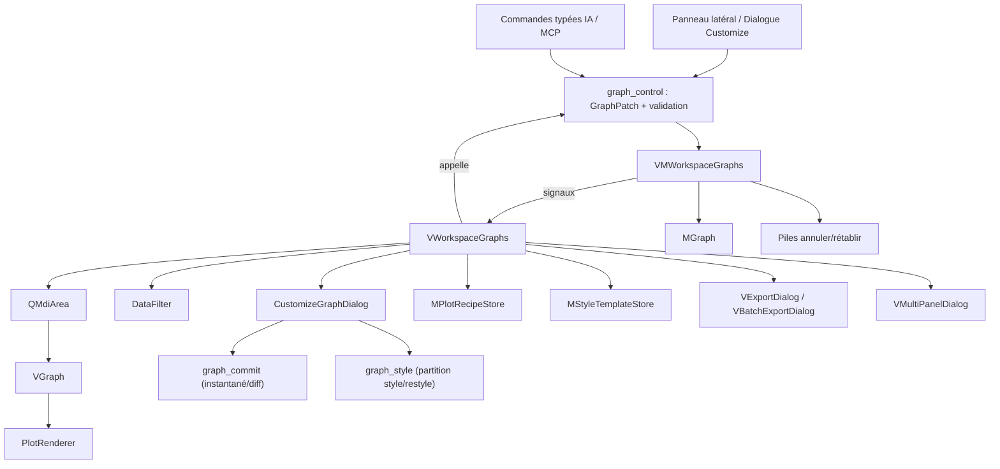
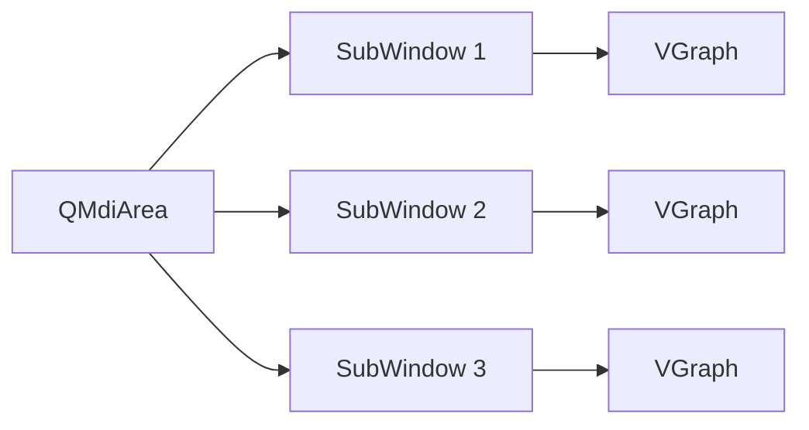

# **Espace de travail : Graphs**

L'espace **`Graphs`** est un environnement autonome de tracé statistique. Il gère des DataFrames (issus de fichiers ou injectés depuis d'autres espaces), applique des filtres dynamiques et produit des graphiques prêts pour la publication en pur `Matplotlib` (avec `scipy` pour les statistiques) au sein d'une zone MDI (*Multiple Document Interface*). Il ne dépend plus de Seaborn — chaque style de tracé est dessiné directement avec des primitives Matplotlib dans `PlotRenderer`.

---

## **Vue d'ensemble de l'architecture**



---

## **Classes principales**

### **`VMWorkspaceGraphs` — Le ViewModel**

**Fichier** : `spectroview/viewmodel/graphs/vm_workspace_graphs.py` (avec annulation/rétablissement dans `spectroview/viewmodel/graphs/graph_undo.py`)

Gère les DataFrames, les modèles de graphiques et l'historique annuler/rétablir de l'espace de travail. Contrairement aux ViewModels `Spectra`/`Maps`, celui-ci reste relativement léger — la logique lourde de rendu réside dans le widget `VGraph`.

| Responsabilité | Méthodes |
|----------------|----------|
| **Chargement de DataFrames** | `load_dataframes(paths)` — Prend en charge `.xlsx`, `.xls`, `.csv` |
| **Gestion des DataFrames** | `add_dataframe()`, `remove_dataframe()`, `select_dataframe()`, `refresh_dataframe()` |
| **CRUD graphiques** | `create_graph()`, `get_graph()`, `update_graph()`, `delete_graph()` |
| **Filtrage** | `apply_filters(df_name, filters)` — basé sur `pd.DataFrame.query()` |
| **Multi-wafer** | `create_multi_wafer_graphs()` — Crée par lots un tracé wafer par slot |
| **Annuler/rétablir** | `undo()`, `redo()`, `begin_undo_batch()`/`end_undo_batch()`, `can_undo`/`can_redo` |
| **Persistance** | `save_workspace()`, `load_workspace()`, `clear_workspace()` |

#### **Signaux**

```python
dataframes_changed = Signal(list)           # Liste des noms de DataFrames mise à jour
dataframe_columns_changed = Signal(list)    # Noms des colonnes du DataFrame sélectionné
graphs_changed = Signal(list)               # Liste des identifiants de graphiques mise à jour
graph_state_changed = Signal()              # Toute propriété persistante modifiée (synchro contexte IA)
undo_state_changed = Signal()               # can_undo/can_redo modifié -- synchronise les boutons
notify = Signal(str)                        # Notification flottante
```

### **`MGraph` — Le modèle de configuration de tracé**

**Fichier** : `spectroview/model/graphs/m_graph.py`

Dataclass pure stockant tout le nécessaire pour recréer un graphique. `save()`/`load(data)` assurent une sérialisation complète ; `get_display_name()` construit le titre de la sous-fenêtre MDI. Plutôt que de maintenir ici une liste dupliquée susceptible de dériver (voir `m_graph.py` pour le schéma exhaustif faisant autorité), les champs se regroupent par domaine :

| Catégorie | Exemples |
|-----------|----------|
| Identité / source de données | `graph_id`, `df_name`, `plot_style`, `x`/`y`/`z`, `filters` |
| Limites des axes principaux | `xmin`/`xmax`, `ymin`/`ymax`, `zmin`/`zmax` |
| Échelle et orientation | `xlogscale`/`ylogscale`, `xscale_mode`/`yscale_mode`, `x_inverted`/`y_inverted` |
| Axes secondaires (Y2/Y3/X2) | colonne par axe, `color`, `marker`, `min`/`max`, `logscale`, `label` |
| Libellés et titres | `plot_title`, `plot_subtitle`, `xlabel`/`ylabel`/`zlabel` |
| Style et apparence | `grid`, `tick_direction`, `tick_label_format`, tailles de polices, `figure_facecolor`, `figure_margins`, `spines_visible`, `figure_theme`, graduations secondaires |
| Légende | `legend_visible`, `legend_outside`, `legend_properties`, `legend_bbox`, `legend_ncol`, `legend_frame`, `legend_title`, `legend_fontsize`, `legend_alpha`, `legend_loc` |
| Spécifique au style de tracé | palette wafer/2Dmap (`color_palette`, `colormap_norm`, `colormap_center`), ajustement/ancrage trendline, barres d'erreur, point/scatter (`scatter_size`, `scatter_edgecolor`, `unify_marker_style`), histogramme, ordre de tri |
| Annotations | `annotations` (liste de dicts typés, voir [Annotations (`TabAnnotations`)](#annotations-tabannotations)) |
| Axe interrompu | `axis_breaks` |
| Axes en incrustation (zoom) | `inset_enabled`, `inset_bounds`, `inset_xmin`/`xmax`/`ymin`/`ymax`, `inset_show_zoom_indicator` |
| Export et géométrie de fenêtre | `plot_width`/`height`, `dpi`, `export_width_mm`/`height_mm` |

Remarque : les modèles de style, les recettes de tracé et le dossier de travail ne sont **pas** des champs de `MGraph` — ce sont des systèmes distincts bâtis autour de sous-ensembles de ces champs (voir [Modèles de style et recettes de tracé](#modeles-de-style-et-recettes-de-trace)).

### **`graph_control.py` — Contrat partagé d'état et de commande graphique**

**Fichier** : `spectroview/model/graphs/graph_control.py`

Toutes les mutations GUI, IA et MCP convergent vers cette couche sans Qt avant d'atteindre `MGraph`. `GraphPatch` est généré automatiquement à partir des champs de la dataclass, de sorte que le schéma MCP expose de lui-même chaque propriété mutable. Les structures imbriquées importantes (filtres, styles par série, bordures, coupures d'axes et les huit types d'annotations) disposent chacune d'un schéma strict.

`normalize_graph_patch()` valide un patch sur l'état fusionné sans mutation : clés inconnues, nullabilité, plages, valeurs énumérées, colonnes, limites, géométrie d'incrustation, structure des annotations et exclusion mutuelle avec les coupures d'axes sont vérifiés d'un bloc. `apply_graph_patch()` applique ensuite atomiquement le patch déjà validé. Les champs omis sont préservés ; un `null` explicite n'efface que les propriétés nullables. Tout changement d'identité des données ou séries réinitialise `legend_properties` sauf si l'appelant fournit une liste de remplacement.

Ce contrat reste volontairement indépendant du moteur de rendu. La View reste responsable de la création de figure/canevas Matplotlib, de l'évaluation des filtres, du ré-affichage, de la géométrie de fenêtre et du rafraîchissement d'un dialogue Customize ouvert.

### **`VWorkspaceGraphs` — L'orchestrateur View**

**Paquet** : `spectroview/view/workspaces/graphs/` (`v_workspace_graphs.py`, `v_mdi_subwindow.py`, `v_graphs_ui.py`, `v_graphs_dataframes.py`, `v_graphs_mdi.py`, `v_graphs_actions.py`)

`VWorkspaceGraphs` assemble l'interface de l'espace Graphs (`GraphsUIMixin`), le panneau de sélection/filtrage des DataFrames (`GraphsDataFramesMixin`), la gestion des fenêtres MDI, mosaïque/cascade et barre active (`GraphsMdiMixin`), et les actions de création/mise à jour/export/annulation/modèles (`GraphsActionsMixin`), en encapsulant chaque `VGraph` dans un `MdiSubWindow`.

### **`VGraph` — Le widget de rendu**

**Paquet** : `spectroview/view/components/graphs/` (`v_graph.py` avec `v_graph_canvas.py`, `v_graph_breaks.py`, `v_graph_axes.py`, `v_graph_annotations.py`)

Chaque graphique de la zone MDI est une instance de `VGraph`. Il possède une `Figure` + `FigureCanvas` Matplotlib et joue le rôle d'enveloppe UI. Il gère les interactions, menus contextuels et actions de barre d'outils (menu Style, Export, Replicate), mais délègue le tracé effectif à `PlotRenderer`. `create_plot_widget()` construit la barre de navigation Matplotlib et la rangée de boutons d'action propres à chaque `VGraph` (`self.toolbar_container`), sans les ajouter dans la mise en page du graphique lui-même — voir [la barre d'outils inférieure](#gestion-de-la-zone-mdi) pour son hébergement réel.

**Réactivité lors du redimensionnement et du déplacement.** Chaque figure utilise `layout="compressed"`, et chaque redessin Agg réexécute la mise en page contrainte, ce qui coûte plusieurs centaines de millisecondes. Trois mécanismes garantissent la fluidité :

- `MdiSubWindow` active `RubberBandResize`/`RubberBandMove`. Faire glisser un bord ou une barre de titre ne déplace qu'un contour léger, et le canevas n'est redimensionné et retracé qu'**une seule fois** au relâchement de la souris.
- `VGraph.canvas` est un `_DebouncedFigureCanvas`. Le premier `resizeEvent` d'une rafale s'applique immédiatement ; les suivants survenant dans `RESIZE_DEBOUNCE_MS` (60 ms) fusionnent en un seul redessin final. Cela couvre les redimensionnements hors contour (mosaïque, maximisation, séparateur). Le temporisateur anti-rebond est parenté au canevas.
- `VGraph.toolbar` est un `_FastNavigationToolbar`, l'assistant `NavigationToolbar2QT` masqué pilotant Pan/Zoom. Il suspend le moteur de mise en page entre `press_pan` et `release_pan` (seules les limites des axes changent pendant le glisser), limite la cadence à ~30 FPS (`PAN_FRAME_S`) et restaure le moteur avec un redessin complet au relâchement.

Deux chemins de rendu existent :

- **`plot(df)`** — redessin complet : efface et reconstruit les axes de zéro. Indispensable dès que les artistes eux-mêmes changent (données des séries, couleurs/marqueurs par point, palette, axes jumeaux secondaires, annotations, incrustations) ou qu'une coupure d'axe est active/basculée.
- **`restyle()`** — chemin rapide qui repeint sur place des axes déjà tracés (titres/libellés/tailles de police, grille, direction/format des graduations, limites des axes principaux, échelles log/symlog, couleur de fond/bordures/marges, style de la boîte de légende) sans toucher aux données tracées. Avant de basculer un axe vers `"log"`, `GraphAxesStyleMixin` (`v_graph_axes.py`) assainit les bornes automatiques linéaires non positives via `_sanitize_log_axis_limits()` afin que Matplotlib n'émette pas d'avertissement. Retourne `False` (déclenchant un redessin complet) dès qu'une coupure d'axe est active. Voir [Aperçu temps réel et chemin rapide Restyle](#apercu-temps-reel-et-chemin-rapide-restyle) pour le choix entre les deux chemins.

`_set_figure_style()` ré-applique `axes.facecolor`/`figure.facecolor`/`axes.labelcolor`/`text.color`/`xtick.color`/`ytick.color`/`axes.edgecolor` depuis `plt.rcParams` à chaque rendu — indispensable car `ax.clear()` ne repeint pas rétroactivement des axes créés sous un autre style Matplotlib, ce qui laissait autrefois des graduations ou libellés noirs après un passage au thème sombre.

### **`PlotRenderer` — Le moteur de tracé**

**Fichiers** : `spectroview/view/components/graphs/v_plot_renderer.py` (composé avec `SpatialPlotMixin` et `WaferPlot` dans `v_plot_spatial.py`)

Séparé de `VGraph` par souci de maintenabilité, ce module encapsule le tracé Matplotlib pur pour tous les styles (ex. `_plot_scatter`, `_plot_histogram` et `WaferPlot`). Il reçoit une référence vers l'instance `VGraph` (`self.vg`) pour lire sa configuration et trace directement sur les `Axes` Matplotlib.

#### Normalisation des palettes

`_build_color_norm(vmin, vmax, norm_kind, center)` construit la normalisation chromatique des cartes thermiques `wafer`/`2Dmap` à partir de `MGraph.colormap_norm` (`"linear"`/`"log"`/`"centered"`) et `MGraph.colormap_center`, éditables dans l'onglet **Axes & Limits** sous le contrôle d'échelle **Z axis**. `"log"` emploie `LogNorm`, `"centered"` emploie `CenteredNorm` (idéal pour les données divergentes centrées autour de 0 comme la contrainte), et les deux retombent proprement en échelle linéaire `vmin`/`vmax` lorsque les données ne sont pas valides pour la normalisation demandée.

`_plot_wafer` et `_plot_2dmap` passent d'abord `vmin`/`vmax` par `_clear_degenerate_zlim(zmin, zmax)`, traitant un couple explicite `zmin == zmax` comme non défini pour retrouver l'étendue des données (évitant ainsi qu'anciens fichiers `.graphs` enregistrés avec `zmin == zmax == 0.0` n'écrasent toute la carte sur une couleur unique).

`_resolve_marker_size(style, fallback)` et `_resolve_edge_color(style, fallback)` centralisent le comportement « Unify Marker size / Edge color » (voir [Legend & Series (`TabLegendSeries`)](#legend-series-tablegendseries)).

---

## **Flux de données : Création d'un graphique**

1. **Action utilisateur** : Sélection d'un DataFrame, configuration des axes X/Y/Z et clic sur « Add plot » dans `VWorkspaceGraphs`.
2. **Capture de la configuration** : La View appelle `_collect_plot_config()` pour rassembler les réglages UI, puis fusionne `MSettings.get_default_graph_style()` (style par défaut défini par « Set as Default Style ») via `_apply_default_style_to_config()`. Les champs d'identité de données (`x`/`y`/`z`/`df_name`/`plot_style`) priment toujours sur le style par défaut.
3. **Création du modèle** : La View appelle `vm.create_graph(plot_config)`. Le ViewModel valide l'ensemble via `graph_control`, instancie et met à jour atomiquement un `MGraph(graph_id)`, enregistre un point d'annulation et le retourne.
4. **Initialisation du widget** : La View crée un widget `VGraph(graph_id)` et appelle `create_plot_widget(dpi)` pour préparer le canevas Matplotlib.
5. **Filtrage des données** : La View récupère `filtered_df` depuis le ViewModel via `vm.apply_filters(df_name, filters)`.
6. **Rendu** : La View appelle `VGraph.plot(filtered_df)`.
7. **Exécution du tracé** : `VGraph` appelle `_plot_primary_axis()`, qui instancie `PlotRenderer(self)`, délègue le tracé (`self.renderer._plot_scatter()`, etc.), puis applique limites, libellés et légendes.
8. **Intégration UI** : La View place `VGraph` dans un `QMdiSubWindow` ajouté à la zone MDI.

Cette fusion du style par défaut s'applique également à `_on_plot_multi_wafer()`, mais est volontairement ignorée lors de l'application d'une recette de tracé ou de la réplication d'un graphique existant.

### **Flux de données : Mise à jour IA / MCP**

1. `update_graph` valide son `GraphPatch` typé sur chaque graphique cible et son DataFrame (`graph_id="all"` est développé avant toute mutation).
2. Le serveur MCP met en file un objet typé `UpdatePlot` sans jamais importer Qt ni modifier un widget.
3. `VMChat` convertit les commandes en configurations applicatives et `main.py` achemine la mise à jour vers `VWorkspaceGraphs.update_graphs_from_config()`.
4. L'espace de travail prévalide toutes les cibles, ouvre un lot d'annulation unique, met à jour chaque `MGraph`, reconstruit/retrace chaque widget, redimensionne la géométrie explicite et rafraîchit le dialogue Customize s'il est ouvert. Un échec de rendu restaure tous les instantanés afin qu'aucun lot ne soit appliqué partiellement.
5. `graph_state_changed` actualise le contexte sérialisé complet transmis à l'IA après toute édition GUI, édition IA, annulation/rétablissement, chargement ou synchronisation issue du rendu.

---

## **Styles de tracé**

Chaque style de tracé correspond à une méthode `PlotRenderer._plot_*` dessinant directement avec des primitives Matplotlib (sans Seaborn) :

| Style | Primitive Matplotlib | Support `hue` | Notes |
|-------|----------------------|---------------|-------|
| `point` | `ax.errorbar()` | ✓ Colonne Z | Moyennes par catégorie avec barres d'erreur ; option « Join » pour relier ; seul style doté d'une colonne Marker par série |
| `scatter` | `ax.scatter()` | ✓ Colonne Z | Taille/bordure des marqueurs unifiées par défaut (voir case Unify) |
| `box` | `ax.boxplot()` | ✓ Colonne Z | Support de palette ; largeur de boîte calculée d'après l'espacement catégoriel |
| `bar` | `ax.bar()` | ✓ Colonne Z | Barres d'erreur optionnelles (sd / IC 95 %) |
| `line` | `ax.plot()` | ✓ Colonne Z | Tracé linéaire standard |
| `trendline` | ajustement `np.poly1d` + `ax.scatter()` / `ax.plot()` / `ax.fill_between()` | ✓ Colonne Z | Régression polynomiale avec ancrage possible, bande IC 95 % analytique et export des équations |
| `histogram` | `ax.hist()` (+ `scipy.stats.gaussian_kde`) | ✓ Colonne Z | Nombre de classes personnalisable, courbe KDE optionnelle, barres pleines ou contour |
| `wafer` | `WaferPlot` personnalisé (`ax.scatter()`) | — | Visualisation circulaire sur wafer avec sites de puces ; normalisation de palette (linéaire/log/centrée) |
| `2Dmap` | `ax.imshow()` | — | Carte thermique rectangulaire via `pivot()` ; mêmes options de normalisation de palette que wafer |

### **Prise en charge multi-axes**

`VGraph` gère jusqu'à **3 axes Y**, ainsi qu'un axe X secondaire :

- **Y principal** (`self.ax`) : Axe gauche standard
- **Y secondaire** (`self.ax2`) : Axe droit, créé via `ax.twinx()`
- **Y tertiaire** (`self.ax3`) : Axe droit déporté vers l'extérieur
- **X secondaire** (`x2`) : créé via `ax.twiny()`

Chaque axe secondaire peut utiliser une colonne distincte et dispose de son propre libellé, limites min/max, échelle logarithmique, couleur et marqueur — tous éditables dans l'onglet **Secondary & Inset Axes** (`TabSecondaryInset`). Chaque ligne s'active dès qu'une colonne est assignée à l'axe correspondant.

---

## **Gestion des DataFrames**

### **Chargement**

`VMWorkspaceGraphs.load_dataframes()` utilise `m_io.load_dataframe_file()` :

- **Excel** (`.xlsx`/`.xls`) : Feuille unique → `{filename: df}`. Multi-feuilles → `{filename_sheetname: df}` par feuille.
- **CSV** : Détection automatique du séparateur point-virgule ou virgule.

### **Suivi des sources et actualisation**

Le chemin source de chaque DataFrame chargé est mémorisé dans `self.dataframe_sources`. Le bouton « Refresh » relit le fichier sur disque, facilitant les flux itératifs lorsque des outils externes modifient les données.

### **Injection programmatique**

Les autres espaces peuvent injecter directement des DataFrames :

```python
# Depuis l'espace Maps :
self.graphs_workspace.vm.add_dataframe(profile_name, profile_df)

# Depuis les résultats d'ajustement Spectra/Maps :
self.graphs_workspace.vm.add_dataframe("fit_results", df_fit_results)
```

---

## **Système de filtrage**

Le widget `VDataFilter` fournit un constructeur dynamique de requêtes :

```python
# Chaque filtre est un dict :
{
    "expression": "Slot == 5",    # Expression Pandas query
    "state": True                  # Bascule actif/inactif
}
```

Les filtres sont appliqués via `pd.DataFrame.query()` :

```python
def apply_filters(self, df_name, filters):
    df = self.dataframes[df_name].copy()
    for filter_data in filters:
        if filter_data.get("state", False):
            df = df.query(filter_data["expression"])
    return df
```

Les filtres sont **enregistrés par graphique** dans `MGraph.filters`, permettant à chaque tracé d'avoir ses propres filtres actifs.

### **Flux multi-wafer**

Lorsqu'un DataFrame contient une colonne `Slot` (fréquent dans les jeux de données semi-conducteurs) :

1. La View affiche des cases à cocher par slot et le bouton « Add Multi-Wafer ».
2. L'utilisateur sélectionne les slots (ex. 1, 3, 5, 7).
3. `create_multi_wafer_graphs()` crée un tracé wafer par slot avec le filtre `Slot == N` fusionné aux filtres de base.
4. Tous les tracés apparaissent simultanément dans la zone MDI.

---

## **Personnalisation des graphiques**

### **`CustomizeGraphDialog` (Singleton)**

**Paquet** : `spectroview/view/components/customize_graph/` — `CustomizeGraphDialog` (dans `customize_graph_dialog.py`) adopte une disposition moderne à deux volets similaire aux Paramètres, incluant une barre latérale gauche avec recherche instantanée par mot-clé, un délégué stylé à indicateur gauche et pilule de sélection, ainsi que sept pages modulaires à défilement avec surlignage des encadrés :

| Catégorie | Classe | Module | Périmètre |
|---|---|---|---|
| General & Typography | `TabGeneral` | `tab_general.py` | Thème figure (Light/Dark), grille, rotation X, tailles de polices (Title/Axis/Tick/Colorbar), tri |
| Axes & Limits | `TabAxesLimits` | `tab_axes_limits.py` | Limites avec curseurs de plage (en haut), échelles X/Y (Linear/Log/Symlog), types de données, inversion, échelle Z, coupures d'axes |
| Ticks & Spines | `TabTicksSpines` | `tab_ticks_spines.py` | Orientation des graduations, formats prédéfinis, graduations secondaires (T/R/B/L), bordures (T/R/B/L) |
| Legend & Series | `TabLegendSeries` | `tab_legend_series.py` | Disposition/police/alpha/position de légende, unification des marqueurs, tableau de style par série |
| Plot Style & Fitting | `TabPlotStyles` | `tab_plot_styles.py` | Options de style (point/scatter/wafer), barres d'erreur unifiées, polynôme/ancrage/équations trendline, histogramme |
| Annotations | `TabAnnotations` | `tab_annotations.py` | Annotations visuelles (V-Line, H-Line, Text, Arrow, V-Span, H-Span, Box, Callout) et fenêtres d'édition modales |
| Secondary & Inset Axes | `TabSecondaryInset` | `tab_secondary_inset.py` | Axes jumeaux secondaires (Y2/Y3/X2 avec libellé/min/max/log/couleur/marqueur), axes zoom en incrustation |

Dialogue singleton à l'échelle de l'espace qui change automatiquement de cible lorsque l'utilisateur active une autre sous-fenêtre MDI (`switch_graph(graph_widget, graph_id)`). Comporte `_TabsCompatibilityProxy` et des façades de propriétés rétrocompatibles (`legend_widget`, `axis_widget`, `more_options_widget`, `annotations_widget`).

### **Aperçu temps réel et chemin rapide Restyle**

Chaque contrôle dans chaque onglet redémarre un temporisateur unique de 400 ms à chaque modification. À échéance, chaque onglet applique ses valeurs avec `replot=False` sur le widget actif, et `graph_commit.snapshot()`/`diff()` déterminent exactement les champs modifiés. Si ces champs forment un sous-ensemble de `graph_style.RESTYLE_SAFE_FIELDS`, le dialogue appelle `VGraph.restyle()` (rafraîchissement rapide sur place) ; sinon il effectue un `VGraph.plot(df)` complet. Cet aperçu ne touche jamais la pile d'annulation ni `vm.update_graph()` — il reste purement visuel jusqu'au clic sur **Apply**, qui regroupe toutes les modifications dans un bloc unique `vm.begin_undo_batch()`/`end_undo_batch()`. **Cancel** restaure le widget à partir de l'instantané capturé à l'ouverture sans avoir jamais modifié le ViewModel.

### **`graph_style.py` — Partition style / données**

**Fichier** : `spectroview/model/graphs/graph_style.py`

- **`STYLE_FIELD_NAMES`** — chaque champ de `MGraph` *sauf* identité/colonnes de données, limites en coordonnées de données, annotations et géométrie de fenêtre/export (calculé par exclusion de `_NON_STYLE_FIELDS`). Représente « l'apparence d'un graphique », transférable indépendamment des données.
- **`RESTYLE_SAFE_FIELDS`** — sous-ensemble plus strict de `STYLE_FIELD_NAMES` : champs sûrs pour `VGraph.restyle()` (titres/libellés/tailles de police, grille, direction/format des graduations, limites des axes principaux, échelles log/symlog, couleur de fond/bordures/marges, style de légende). Exclut tout élément nécessitant de recréer les artistes (couleurs/marqueurs/tailles par série, palette, axes secondaires, annotations, incrustations).
- **`extract_style(source_dict)`** / **`apply_style_dict(graph_widget, style_dict)`** / **`default_style()`** — extraient les champs de style, appliquent un dictionnaire de style sur un widget (en réinitialisant `legend_properties` pour recalculer les couleurs par série) et fournissent le style d'usine par défaut.
- **`can_restyle_without_replot(changed_fields)`** — `True` ssi chaque champ modifié appartient à `RESTYLE_SAFE_FIELDS`.

### **`graph_commit.py` — Suivi des modifications**

**Fichier** : `spectroview/view/components/graphs/graph_commit.py`

`snapshot(gw)` copie en profondeur tous les champs `MGraph` (sauf `graph_id`) d'un widget `VGraph` ; `diff(gw, before)` renvoie un patch contenant uniquement les champs modifiés. Utilisé à la fois par l'aperçu temps réel du dialogue Customize et par les éditions directes sur la barre/canevas (légende déplacée, sous-fenêtre redimensionnée avant `save_workspace()`) via `properties_changed.emit()` → `vm.update_graph()`.

### **Annuler / Rétablir**

La pile annuler/rétablir réside dans `VMWorkspaceGraphs`, et non dans la View : `_undo_stack`/`_redo_stack` conservent des instantanés complets d'espace (`{graph_id: MGraph.save()-dict}`), plafonnés à 50 entrées. Chaque `create_graph()`/`update_graph()`/`delete_graph()` enregistre une étape, sauf à l'intérieur d'un bloc `begin_undo_batch()`/`end_undo_batch()` qui fusionne tout le lot en une étape unique (utilisé par Apply et par l'application de recettes de tracé). `undo_state_changed` maintient les boutons Undo/Redo synchronisés via `can_undo`/`can_redo`.

### **Raccourcis clavier**

Enregistrés sur `self.mdi_area` (et non sur tout le widget d'espace, afin de ne pas masquer les raccourcis natifs des champs `QLineEdit` latéraux) et agissant sur la sous-fenêtre MDI active. Ce contexte `WidgetWithChildrenShortcut` garantit également qu'ils sont automatiquement restreints à l'onglet Graphs :

| Raccourci | Action |
|-----------|--------|
| `Ctrl+Z` | Annuler |
| `Ctrl+Shift+Z` | Rétablir |
| `Ctrl+C` | Copier la *figure* du graphique actif dans le presse-papiers (`VGraph.copy_to_clipboard()`) |
| `Ctrl+V` | Coller le *style* copié sur le graphique actif |
| `Ctrl+E` | Ouvrir Customize Graph Dialog pour le graphique actif |

La copie de style n'a plus son propre raccourci `Ctrl+C` (`_on_copy_style_shortcut()` a été supprimé) — `Ctrl+C` copie désormais la figure, usage bien plus fréquent. « Copy Style » reste accessible en un clic dans le menu Style, et `Ctrl+V` colle toujours le dernier style copié.

### **General & Typography (`TabGeneral`)**

- **Display & Grid** : sélecteur **Figure theme** (Light/Dark), case **Show grid lines** (`MGraph.grid`) et champ **X label rotation** (`MGraph.x_rot`).
- **Typography & Font Sizes (pt)** : champs Title, Axis label, Tick label et Colorbar sur une même ligne (valeurs par défaut 12/12/9/10). **Colorbar** (`MGraph.colorbar_fontsize`) fixe la taille des étiquettes de la barre de couleur wafer/2Dmap — `PlotRenderer._apply_colorbar_fontsize()` l'applique après (re)création, déclenchant donc un replot complet (volontairement hors de `RESTYLE_SAFE_FIELDS`). Le **sous-titre** reste toujours 2 pt plus petit que le titre (`title_fontsize − 2` dans `_set_figure_style`) ; son texte est édité dans le panneau latéral.
- **Data Sorting** : bascule de tri catégoriel intelligent (`MGraph.intelligent_sorting`).

### **Axes & Limits (`TabAxesLimits`)**

- **Set Axis Limits** : une ligne champ-curseur par axe X/Y/Z (X/Y masqués pour `wafer`/`2Dmap`, où Z contrôle l'échelle de couleur). Les champs non définis affichent en grisé la valeur réelle courante du graphique plutôt qu'un texte générique — règle appliquée partout dans ce dialogue.
- **Axis Scales & Data Types** : échelle par axe (Linear/Logarithmic/Symlog), type de données (Auto/Category/Numerical) et inversion. Pour `wafer`/`2Dmap`, une ligne supplémentaire d'échelle **Z axis** apparaît (Linear/Logarithmic/Centered, plus Center value) — voir [Normalisation des palettes](#normalisation-des-palettes).
- **Broken axis** : coupures X et Y mutuellement exclusives. Le rendu divise les axes en deux panneaux via `gridspec` — côte à côte partageant Y pour une coupure X, empilés partageant X pour une coupure Y — avec marques diagonales `//` sur les bordures. Force toujours un replot complet (`VGraph.restyle()` renvoie `False`) et est mutuellement exclusif avec les axes en incrustation.

### **Ticks & Spines (`TabTicksSpines`)**

- **Tick Appearance** : direction des graduations (Default/In/Out/In & Out) et format d'étiquettes (Auto/Integer/1-decimal/2-decimal/Scientific).
- **Minor Ticks & Spines** : graduations secondaires indépendantes (X-Bottom/X-Top/Y-Left/Y-Right, activées intelligemment sur les axes numériques) et visibilité des bordures **Show Spines / Frame Borders** (Top/Right/Bottom/Left).

### **Legend & Series (`TabLegendSeries`)**

- **Legend Box Styling** : colonnes, cadre, titre, taille de police, transparence alpha et position.
- **Series Styling** : case optionnelle **"Unify marker size / edge color"** (cochée par défaut). Lorsqu'elle est décochée, les colonnes par série Marker size / Edge color deviennent visibles pour les styles `point`/`scatter` — implémentées via `PlotRenderer._resolve_marker_size()`/`_resolve_edge_color()`. Les champs non définis affichent en grisé la valeur effective qui sera utilisée.

### **Plot Style & Fitting (`TabPlotStyles`)**

- **Plot Style Options** : cases dépendant du style (`Join data points`, `Dodge overlapping points`, `Show statistics summary`).
- **Error Bars (Unified)** : visibilité, type (`95% CI` / `Std. Dev.` / `Std. Error` / `None`) et taille d'embout pour `point`, `line` et `bar`.
- **Trendline & Histogram Controls** : degré polynomial, point d'ancrage ($x_0, y_0$), tableau en lecture seule des équations et $R^2$ avec bouton de copie, nombre de classes, mode (`Filled` / `Step`) et courbe KDE.

### **Annotations (`TabAnnotations`)**

Huit types d'annotations, chacun associé à un bouton d'ajout et à une fenêtre d'édition dans `customize_annotation_dialogs.py` :

| Type | Rôle | Fenêtre d'édition |
|------|------|-------------------|
| `vline` / `hline` | Ligne de référence verticale/horizontale | `EditLineDialog` |
| `text` | Étiquette texte libre avec fond optionnel | `EditTextDialog` |
| `arrow` | Flèche point à point | `EditArrowDialog` |
| `vspan` / `hspan` | Bande ombrée verticale/horizontale | `EditSpanDialog` |
| `box` | Rectangle plein ou contouré | `EditBoxDialog` |
| `callout` | Étiquette avec flèche vers un point | `EditCalloutDialog` |

Toutes stockées sous forme de dicts typés dans `MGraph.annotations`. Chaque type gère le **glisser-déposer interactif** via `GraphAnnotationMixin._on_annotation_click()`/`_on_annotation_drag()`/`_on_annotation_release()` dans `graphs/v_graph_annotations.py`. La détection des clics est réalisée manuellement (`self.ax.findobj()` + `artist.contains(event)`) au lieu de `pick_event` de Matplotlib : en présence d'un axe secondaire `twinx()` (`y2`/`y3`), `event.inaxes` pointe vers l'axe secondaire superposé, ce qui bloquait autrefois le déplacement sur l'axe principal. `VGraph._ax_data_coords(event)` convertit directement les coordonnées pixels de l'événement via `self.ax.transData`.

### **Secondary & Inset Axes (`TabSecondaryInset`)**

- **Secondary Twin Axes** : une ligne par axe Y2/Y3/X2 (désactivée tant qu'aucune colonne n'est affectée), exposant Label, Min/Max, Log, Color et Marker — voir [Prise en charge multi-axes](#prise-en-charge-multi-axes).
- **Inset (Zoom) Axes** : groupe activable avec Position (x0, y0) et Size (w, h) en coordonnées relatives d'axes, limites X/Y indépendantes et « Show zoom indicator » (`ax.indicate_inset_zoom()`). Reconstruit à chaque rendu depuis `MGraph.inset_bounds` ; mutuellement exclusif avec les coupures d'axes.

---

## **Modèles de style et recettes de tracé**

Deux fonctionnalités distinctes :

- **Recette de tracé (`Plot Recipe`)** (`MPlotRecipeStore` / `VPlotRecipeDialog`, dossier : `<working folder>/plot_recipe/`) — **ensemble sauvegardé de configurations complètes** (liaisons de données *et* style : `df_name`, `x`/`y`/`z`, `filters` et tous les champs de style), un fichier JSON par recette. L'application crée de nouveaux graphiques en reciblant le DataFrame *actuellement sélectionné* et en ignorant avec notification tout graphique dont les colonnes requises manquent, le tout en une seule étape d'annulation. Le dialogue gère parcours/recherche/application/renommage/**duplication**/suppression.
- **Modèle de style (`Style Template`)** (`MStyleTemplateStore` / `VStyleTemplateDialog`, dossier : `<working folder>/plot_style/`) — dictionnaire **d'apparence uniquement** (`graph_style.extract_style()`). Son application (`_apply_style_to_graph()`) écrit sur un graphique **existant** via `graph_style.apply_style_dict()` sans jamais toucher aux liaisons de données.

Les deux magasins sont **reconstruits depuis le Working Folder courant au moment de l'usage** (`VWorkspaceGraphs._refresh_recipe_and_style_stores()`, ainsi que dans `VMChat.refresh_recipe_store()`), de sorte qu'un changement de dossier de travail prend effet immédiatement sans redémarrer l'application.

Le **menu Style** de chaque `VGraph` relie ces mécanismes : **Save Style…** / **Apply Style…**, **Copy Style** / **Paste Style** (`Ctrl+C`/`Ctrl+V`), **Reset to Default** (toujours le style d'usine `graph_style.default_style()`) et **Set as Default Style** (enregistre le style courant via `MSettings.set_default_graph_style()` comme base des *nouveaux* graphiques uniquement).

---

## **Export et compositeur multi-panneaux**

**Fichier** : `spectroview/view/components/graphs/v_export_dialog.py`

- **`VExportDialog(graph_widget, parent=None)`** — exporte un graphique unique en PNG/TIFF/SVG/PDF/EPS avec contrôles format/DPI/transparence/thème d'export et dimensions physiques (préréglages revues, mm/pouces, vide = taille écran), persistées dans `export_width_mm`/`export_height_mm`.
- **`VBatchExportDialog(graph_widgets: dict, parent=None)`** — exporte tous les graphiques ouverts vers un dossier choisi en une passe, chacun à sa taille physique persistée, avec rapport des éventuels échecs.

**Fichier** : `spectroview/view/components/graphs/v_multipanel_dialog.py`

- **`VMultiPanelDialog(graph_widgets: dict, parent=None)`** — assemble plusieurs graphiques cochés/réordonnés dans une grille `matplotlib.figure.Figure` temporaire (lignes/colonnes suggérées, mise en page contrainte, fusion des libellés d'axes partagés, étiquettes de panneaux). Chaque panneau est tracé en redirigeant temporairement `.ax`/`.figure` du `VGraph` source puis en le restaurant sans jamais modifier les graphiques ouverts. Les graphiques comportant une coupure d'axe s'affichent selon un chemin simplifié à panneau unique dans la figure composée (limitation documentée).

IA/MCP exposent la taille physique persistante d'export (`export_width_mm` / `export_height_mm`) et la géométrie/DPI écran via `GraphPatch`. Les actions Export, Batch Export et Multi-Panel restent des flux GUI (format, chemin de destination, transparence, thème d'export et grille de panneaux étant des choix ponctuels et non de l'état `MGraph`).

---

## **Gestion de la zone MDI**

L'espace `Graphs` utilise un `QMdiArea` pour afficher simultanément plusieurs tracés :



- Chaque tracé est encapsulé dans un `QMdiSubWindow` avec bordure aplatie à 1 px via QSS.
- La barre inférieure regroupe les commandes globales (réduire/supprimer tout, Undo/Redo, Compose Figure) et un unique **emplacement de barre d'outils graphique partagée** (`self.graph_toolbar_slot` / `self._graph_toolbar_slot_layout`, facteur d'étirement 1). Chaque `VGraph` construit sa propre barre Matplotlib + séparateur `QFrame.VLine` + boutons d'action (Replicate/Customize/Copy/Export/Style menu) dans `self.toolbar_container`, sans l'afficher dans sa fenêtre MDI. Le bouton Export gère à la fois le clic simple (export unitaire) et `Ctrl+Click` (export groupé). `VWorkspaceGraphs._sync_active_graph_toolbar()` reparente la barre du graphique actif dans l'emplacement partagé à chaque changement de fenêtre, création, mise à jour ou fermeture.
- La liste déroulante « Active plot: » réside dans le panneau latéral juste au-dessus de Add/Update Plot (`VWorkspaceGraphs._setup_action_buttons()`).
- « Minimize All » réduit toutes les fenêtres pour désencombrer l'espace.
- Sélectionner un graphique dans la liste déroulante active sa sous-fenêtre et synchronise les contrôles du panneau droit.

### **Stockage des graphiques**

```python
# VWorkspaceGraphs maintient une table de correspondance :
self.graph_widgets = {
    graph_id: (VGraph, QDialog, QMdiSubWindow)
}
```

Lorsqu'un graphique est sélectionné :

1. `_on_subwindow_activated()` identifie le `graph_id`.
2. Le modèle `MGraph` correspondant est lu depuis le ViewModel.
3. Les contrôles du panneau droit (listes X/Y/Z, libellés, style) sont synchronisés.

---

## **Persistance**

### **Dossier de travail SPECTROview (`Working Folder`)**

Dossier racine unique configuré dans les Paramètres, créant automatiquement cinq sous-dossiers et un fichier de configuration portable (`os.makedirs(..., exist_ok=True)`) :

| Sous-dossier / Fichier | Rôle | Accesseur `MSettings` |
|---|---|---|
| `fit_model/` | Modèles d'ajustement JSON (espaces Spectra/Maps) | `get_fit_model_folder()` |
| `plot_recipe/` | Recettes de tracé | `get_plot_recipe_folder()` |
| `plot_style/` | Modèles de style | `get_plot_style_folder()` |
| `ai_chat_history/` | Historique des conversations IA | `get_history_folder()` / `get_ai_history_folder()` |
| `template/` | Modèles et préréglages utilisateur | `get_template_folder()` |
| `config.json` | Sauvegarde portable de la configuration | `export_config()` / `import_config()` |

`get_working_folder()` migre automatiquement les anciens réglages séparés « Fit model folder » / « Plot template folder » s'ils étaient configurés. `get_default_graph_style()`/`set_default_graph_style()` stockent séparément dans `QSettings` le style de base défini par « Set as Default Style ».

### **Format de sauvegarde (`.graphs`)**

Le format actuel (`format_version: 4`) est une **archive ZIP**, écrite par `WorkspaceIO.save_workspace()`. La version 4 préserve `x_as_numeric=False` comme sélection explicite Category ; les versions antérieures conservent la migration historique False-vers-Auto :

```
metadata.json                          # {"format_version": 4, "plots": {...}, "dataframe_sources": {...}}
dataframes/<name>.parquet              # un fichier Parquet par DataFrame, écrit en flux direct dans le zip
```

Chaque entrée de `metadata["plots"]` est un dictionnaire `MGraph.save()` complet indexé par `graph_id` :

```json
{
    "plots": {
        "1": {
            "graph_id": 1,
            "df_name": "fit_results",
            "plot_style": "point",
            "x": "Slot",
            "y": ["Si_center"],
            "z": "Zone",
            "filters": [{"expression": "R² > 0.95", "state": true}],
            "legend_properties": [...],
            "annotations": [...],
            "plot_width": 480,
            "plot_height": 400,
            "dpi": 100
        }
    },
    "dataframe_sources": {
        "fit_results": "/path/to/original.xlsx"
    }
}
```

`WorkspaceIO.load_workspace()` inspecte l'en-tête magique ZIP ; les fichiers plus anciens (JSON brut contenant des DataFrames CSV gzippés encodés en hexadécimal sous `original_dfs`) sont détectés comme historiques et relus via le chargeur de compatibilité uniquement en lecture.

---

## **Réplication de graphiques**

Le bouton « Replicate » (dans la barre d'outils partagée, agissant sur le graphique actif) crée une copie profonde du tracé :

1. Sérialise le `MGraph` courant via `save()`.
2. Supprime `graph_id` (le ViewModel en attribue un nouveau).
3. Capture la taille courante de la sous-fenêtre pour la réplique.
4. Appelle `_create_and_display_plot()` avec la configuration clonée.

Cela permet une comparaison A/B rapide des mêmes données sous différents réglages visuels. Contrairement aux nouveaux tracés (Add Plot / Add Multi-Wafer), un graphique répliqué n'est **pas** écrasé par le style par défaut « Set as Default Style », puisqu'il embarque déjà un style complet et intentionnel.
