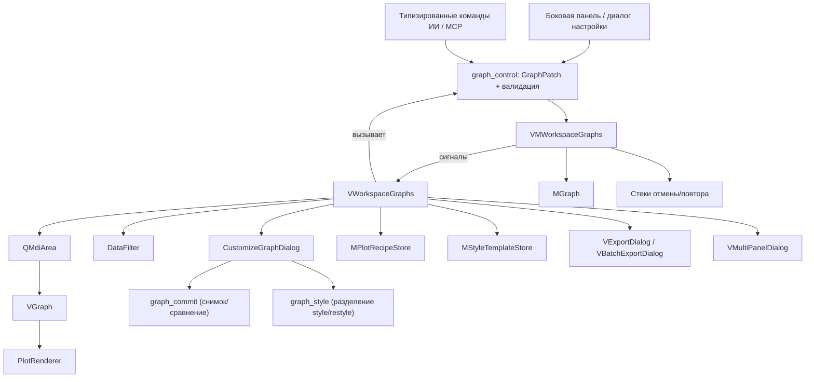
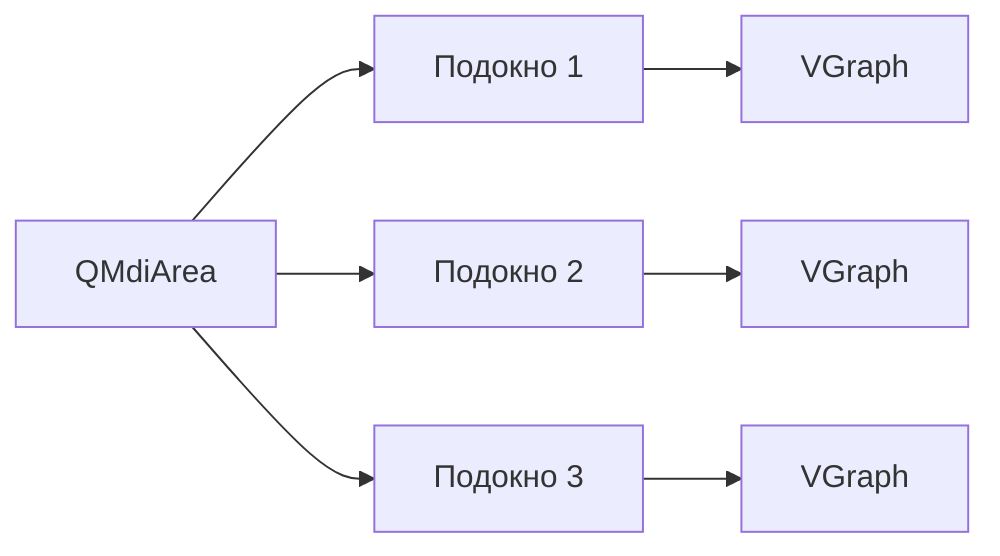

# **Рабочая область: Графики** { #workspace-graphs }

Рабочая область `Graphs` представляет собой автономную среду для статистического построения графиков. Она управляет таблицами DataFrame (загруженными из файлов или переданными из других рабочих областей), применяет динамические фильтры и создаёт графики публикационного качества на чистом `Matplotlib` (с использованием `scipy` для статистических расчётов) внутри области MDI (Multiple Document Interface). Она больше не зависит от Seaborn — каждый стиль графика отрисовывается напрямую графическими примитивами Matplotlib в `PlotRenderer`.

---

## **Обзор архитектуры** { #architecture-overview }



---

## **Ключевые классы** { #key-classes }

### **`VMWorkspaceGraphs` — ViewModel** { #vmworkspacegraphs-the-viewmodel }

**Файл**: `spectroview/viewmodel/graphs/vm_workspace_graphs.py` (логика отмены и повтора вынесена в `spectroview/viewmodel/graphs/graph_undo.py`)

Управляет объектами DataFrame, моделями графиков и историей отмены/повтора рабочей области. В отличие от ViewModel для `Spectra`/`Maps`, данный ViewModel остаётся сравнительно лёгким — основная логика отрисовки сосредоточена в виджете `VGraph`.

| Зона ответственности | Методы |
|---|---|
| **Загрузка DataFrame** | `load_dataframes(paths)` — поддерживает `.xlsx`, `.xls`, `.csv` |
| **Управление DataFrame** | `add_dataframe()`, `remove_dataframe()`, `select_dataframe()`, `refresh_dataframe()` |
| **CRUD-операции с графиками** | `create_graph()`, `get_graph()`, `update_graph()`, `delete_graph()` |
| **Фильтрация** | `apply_filters(df_name, filters)` — на основе `pd.DataFrame.query()` |
| **Мульти-пластины (Multi-wafer)** | `create_multi_wafer_graphs()` — пакетно создаёт по одной карте пластины на каждый слот |
| **Отмена и повтор (Undo/redo)** | `undo()`, `redo()`, `begin_undo_batch()`/`end_undo_batch()`, `can_undo`/`can_redo` |
| **Сохранение состояния** | `save_workspace()`, `load_workspace()`, `clear_workspace()` |

#### **Сигналы** { #signals }

```python
dataframes_changed = Signal(list)           # List of DataFrame names updated
dataframe_columns_changed = Signal(list)    # Column names of selected DataFrame
graphs_changed = Signal(list)               # List of graph IDs updated
graph_state_changed = Signal()              # Any persisted graph property changed (AI context sync)
undo_state_changed = Signal()               # can_undo/can_redo changed -- sync toolbar buttons
notify = Signal(str)                        # Floating notification
```

### **`MGraph` — модель конфигурации графика** { #mgraph-the-plot-configuration-model }

**Файл**: `spectroview/model/graphs/m_graph.py`

Чистый dataclass, хранящий все данные, необходимые для воссоздания графика. Методы `save()`/`load(data)` обеспечивают полную сериализацию; `get_display_name()` формирует заголовок подокна MDI. Чтобы не поддерживать здесь дублирующийся список или счётчик полей (исчерпывающий и актуальный перечень см. в `m_graph.py`), поля можно сгруппировать по следующим категориям:

| Категория | Примеры |
|---|---|
| Идентификация / источник данных | `graph_id`, `df_name`, `plot_style`, `x`/`y`/`z`, `filters` |
| Пределы основных осей | `xmin`/`xmax`, `ymin`/`ymax`, `zmin`/`zmax` |
| Масштаб и ориентация осей | `xlogscale`/`ylogscale`, `xscale_mode`/`yscale_mode`, `x_inverted`/`y_inverted` |
| Дополнительные оси (Y2/Y3/X2) | столбец для каждой оси, `color`, `marker`, `min`/`max`, `logscale`, `label` |
| Подписи и заголовки | `plot_title`, `plot_subtitle`, `xlabel`/`ylabel`/`zlabel` |
| Стиль и оформление | `grid`, `tick_direction`, `tick_label_format`, размеры шрифтов, `figure_facecolor`, `figure_margins`, `spines_visible`, `figure_theme`, переключатели промежуточных делений |
| Легенда | `legend_visible`, `legend_outside`, `legend_properties`, `legend_bbox`, `legend_ncol`, `legend_frame`, `legend_title`, `legend_fontsize`, `legend_alpha`, `legend_loc` |
| Специфичные для стиля графика | цветовая палитра для wafer/2Dmap (`color_palette`, `colormap_norm`, `colormap_center`), аппроксимация/привязка линии тренда, планки ошибок, параметры точечных графиков (`scatter_size`, `scatter_edgecolor`, `unify_marker_style`), гистограмма, порядок сортировки |
| Аннотации | `annotations` (список типизированных словарей, см. [Annotations (`TabAnnotations`)](#annotations-tabannotations)) |
| Разрыв оси | `axis_breaks` |
| Оси врезки (масштабирования) | `inset_enabled`, `inset_bounds`, `inset_xmin`/`xmax`/`ymin`/`ymax`, `inset_show_zoom_indicator` |
| Геометрия экспорта и окна | `plot_width`/`height`, `dpi`, `export_width_mm`/`height_mm` |

Примечание: шаблоны стилей, рецепты графиков и настройка рабочей папки **не** являются полями `MGraph` — это отдельные подсистемы, построенные вокруг подмножеств этих полей (см. [Шаблоны стилей и рецепты графиков](#style-templates-plot-recipes)).

### **`graph_control.py` — общий контракт состояния и команд графика** { #graph_controlpy-shared-graph-statecommand-contract }

**Файл**: `spectroview/model/graphs/graph_control.py`

Все изменения из графического интерфейса, ИИ и MCP сходятся в этом независимом от Qt слое до того, как затронут `MGraph`. Схема `GraphPatch` генерируется на основе полей dataclass, поэтому схема MCP автоматически раскрывает все изменяемые параметры графика. Значимые вложенные структуры (фильтры, стили отдельных серий, границы осей, разрывы осей и все восемь типов аннотаций) имеют собственные строгие схемы.

Функция `normalize_graph_patch()` проверяет патч относительно объединённого текущего состояния без его модификации: совместно проверяются неизвестные ключи, допустимость `null`, диапазоны, значения перечислений, столбцы, пределы, геометрия врезки, структура аннотаций и взаимная исключительность разрывов осей. Затем `apply_graph_patch()` атомарно фиксирует уже проверенный патч. Пропущенные поля сохраняются без изменений; явное значение `null` очищает только свойства, допускающие `null`. Изменение идентификации данных или серий сбрасывает производное поле `legend_properties`, если вызывающая сторона не передала заменяющий список.

Этот контракт намеренно не зависит от движка отрисовки. Слой View по-прежнему отвечает за создание фигуры и холста Matplotlib, выборку отфильтрованных данных, повторную отрисовку, геометрию окна и обновление открытого диалога настройки.

### **`VWorkspaceGraphs` — оркестратор уровня View** { #vworkspacegraphs-the-view-orchestrator }

**Пакет**: `spectroview/view/workspaces/graphs/` (`v_workspace_graphs.py`, `v_mdi_subwindow.py`, `v_graphs_ui.py`, `v_graphs_dataframes.py`, `v_graphs_mdi.py`, `v_graphs_actions.py`)

`VWorkspaceGraphs` объединяет интерфейс рабочей области `Graphs` (`GraphsUIMixin`), панель выбора и фильтрации DataFrame (`GraphsDataFramesMixin`), управление компоновкой/раскладкой плиткой/каскадом окон MDI и синхронизацией активной панели инструментов (`GraphsMdiMixin`), а также действия создания/обновления/экспорта/отмены/шаблонов (`GraphsActionsMixin`), оборачивая каждый виджет `VGraph` в `MdiSubWindow`.

### **`VGraph` — виджет отрисовки** { #vgraph-the-rendering-widget }

**Пакет**: `spectroview/view/components/graphs/` (`v_graph.py` совместно с `v_graph_canvas.py`, `v_graph_breaks.py`, `v_graph_axes.py`, `v_graph_annotations.py`)

Каждый график в области MDI представляет собой экземпляр `VGraph`. Он содержит объекты Matplotlib `Figure` + `FigureCanvas` и выступает обёрткой пользовательского интерфейса. Он управляет взаимодействием, контекстными меню и действиями панели инструментов (меню Style, Export, Replicate), но делегирует сами алгоритмы рисования классу `PlotRenderer`. Метод `create_plot_widget()` по-прежнему создаёт для каждого `VGraph` собственную панель навигации Matplotlib + строку кнопок действий (`self.toolbar_container`), но не добавляет её в компоновку самого графика — о том, где она фактически отображается, см. в разделе о [нижней панели инструментов](#mdi-area-management).

**Производительность при интерактивном изменении размера и панорамировании.** Каждая фигура использует `layout="compressed"`, и каждая перерисовка бэкендом Agg повторно запускает движок constrained layout, что занимает сотни миллисекунд. Отзывчивость интерфейса обеспечивают три механизма:

- `MdiSubWindow` включает режимы `RubberBandResize`/`RubberBandMove`. При перетаскивании границы подокна перемещается лишь лёгкий контур, а размер холста изменяется и перерисовывается **один раз** — при отпускании кнопки мыши.
- `VGraph.canvas` представляет собой `_DebouncedFigureCanvas`. Первое событие `resizeEvent` в серии применяется немедленно; любые последующие события в пределах `RESIZE_DEBOUNCE_MS` (60 мс) объединяются в одно завершающее изменение до конечного размера. Это охватывает изменения размера, не проходящие через контурную рамку (раскладка плиткой, разворачивание на весь экран, перетаскивание разделителя). Таймер антидребезга привязан к холсту как дочерний объект (`parent`).
- `VGraph.toolbar` представляет собой `_FastNavigationToolbar` — скрытый вспомогательный класс на базе `NavigationToolbar2QT`, управляющий кнопками Pan/Zoom. Он приостанавливает движок компоновки фигуры от `press_pan` до `release_pan` (во время перетаскивания меняются только пределы осей), ограничивает частоту перерисовок при перетаскивании примерно до 30 FPS (`PAN_FRAME_S`) и восстанавливает движок с одной полной перерисовкой при отпускании кнопки. Само нажатие кнопки Pan практически мгновенно (~1 мс); задержки, которые ранее замечали пользователи, возникали из-за полной перерисовки компоновки на каждое движение мыши во время перетаскивания.

Существуют два пути отрисовки:

- **`plot(df)`** — полная перерисовка: очищает и заново строит объект `Axes` с нуля. Необходима всякий раз, когда меняются сами графические объекты (данные серий, цвета/маркеры для отдельных точек, цветовая палитра, дополнительные/спаренные оси, аннотации, врезки) либо активен/переключается разрыв оси.
- **`restyle()`** — быстрый путь, перекрашивающий уже отрисованные `Axes` на месте (заголовки/подписи/размеры шрифтов, сетка, направление и формат делений, пределы основных осей, логарифмический/symlog-масштаб, цвет фона фигуры, границы осей и отступы, оформление рамки легенды) без затрагивания построенных данных. Перед переключением оси на масштаб `"log"` примесь `GraphAxesStyleMixin` (`v_graph_axes.py`) очищает устаревшие неположительные линейные автопределы с помощью `_sanitize_log_axis_limits()`, чтобы Matplotlib не выдавал предупреждений о неположительных логарифмических пределах. Метод возвращает `False` (принудительно запуская полную перерисовку) всякий раз, когда активен разрыв оси. Подробнее о том, как диалог настройки выбирает путь отрисовки, см. в разделе [Предпросмотр в реальном времени и быстрый путь перерисовки (`restyle`)](#live-preview-restyle-fast-path).

Метод `_set_figure_style()` повторно применяет параметры `axes.facecolor`/`figure.facecolor`/`axes.labelcolor`/`text.color`/`xtick.color`/`ytick.color`/`axes.edgecolor` из `plt.rcParams` при каждой отрисовке — это необходимо, поскольку `ax.clear()` не перекрашивает задним числом оси `Axes`, созданные в другом контексте стиля/темы Matplotlib, из-за чего ранее после переключения на тёмную тему цвета делений, подписей и рамки оставались чёрными.

### **`PlotRenderer` — движок построения графиков** { #plotrenderer-the-plotting-engine }

**Файлы**: `spectroview/view/components/graphs/v_plot_renderer.py` (скомпонован с `SpatialPlotMixin` и `WaferPlot` из `v_plot_spatial.py`)

Выделен из `VGraph` для удобства сопровождения и инкапсулирует чистую логику отрисовки Matplotlib для всех стилей графиков (например, `_plot_scatter`, `_plot_histogram` и класс `WaferPlot`). Он получает ссылку на экземпляр `VGraph` (`self.vg`) для доступа к состоянию конфигурации (`self.vg.x`, `self.vg.plot_style` и т.д.) и рисует непосредственно на `Axes` Matplotlib.

#### Нормализация цветовой палитры { #colormap-normalization }

`_build_color_norm(vmin, vmax, norm_kind, center)` формирует отображение цветовой шкалы для тепловых карт пластин (`wafer`) и 2D-карт (`2Dmap`) на основе `MGraph.colormap_norm` (`"linear"`/`"log"`/`"centered"`) и `MGraph.colormap_center`, доступных для редактирования на вкладке **Оси и пределы** (Axes & Limits) в разделе масштаба **Z axis** (отображается только для `wafer`/`2Dmap`). Режим `"log"` использует `LogNorm`, `"centered"` использует `CenteredNorm` (удобно для знакопеременных данных вроде механических напряжений/деформаций с центром в 0); оба режима корректно откатываются к обычной линейной шкале `vmin`/`vmax`, если запрошенная нормализация недопустима для фактического диапазона данных (например, логарифмическая нормализация на неположительных данных).

Оба метода `_plot_wafer` и `_plot_2dmap` предварительно пропускают `vmin`/`vmax` через `_clear_degenerate_zlim(zmin, zmax)`, которая трактует явно заданные равные пределы `zmin == zmax` как незаданные и возвращает диапазон, вычисленный по данным. В ряде старых сохранённых файлов `.graphs` явно записано `zmin == zmax == 0.0` (из-за прежнего, уже исправленного значения по умолчанию) — буквальное применение этих границ схлопывает `matplotlib.colors.Normalize(vmin=0, vmax=0)`, отображая все значения одним цветом; именно это, а не сама функция нормализации цветовой шкалы, нарушало отображение цветов при повторном открытии таких файлов.

Функции `_resolve_marker_size(style, fallback)` / `_resolve_edge_color(style, fallback)` централизуют логику «Unify Marker size / Edge color» (см. [Legend & Series (`TabLegendSeries`)](#legend-series-tablegendseries)): когда `VGraph.unify_marker_style` равно `True`, каждая серия использует общие для графика значения `scatter_size`/`scatter_edgecolor`; при `False` приоритет имеет индивидуальное переопределение серии в `legend_properties[i]` (если оно задано).

---

## **Поток данных: создание графика** { #data-flow-creating-a-plot }

1. **Действие пользователя**: пользователь выбирает DataFrame, настраивает оси X/Y/Z и нажимает кнопку **Добавить график** (Add plot) в интерфейсе `VWorkspaceGraphs`.
2. **Сбор конфигурации**: View вызывает `_collect_plot_config()`, чтобы собрать все настройки интерфейса в словарь конфигурации, затем через `_apply_default_style_to_config()` подмешивает туда `MSettings.get_default_graph_style()` — базовый стиль пользователя, сохранённый через **Сделать стилем по умолчанию** (Set as Default Style), если он задан (см. [Шаблоны стилей и рецепты графиков](#style-templates-plot-recipes)). Поля идентификации данных из собранной конфигурации (`x`/`y`/`z`/`df_name`/`plot_style`) всегда имеют приоритет над стилем по умолчанию, поскольку стиль по умолчанию содержит только поля внешнего вида.
3. **Создание модели**: View вызывает `vm.create_graph(plot_config)`. ViewModel проверяет полную конфигурацию через `graph_control`, создаёт и атомарно обновляет `MGraph(graph_id)`, записывает шаг в историю отмены и возвращает модель.
4. **Инициализация виджета**: View создаёт виджет `VGraph(graph_id)` и вызывает `create_plot_widget(dpi)` для настройки холста Matplotlib.
5. **Фильтрация данных**: View запрашивает `filtered_df` у ViewModel, вызывая `vm.apply_filters(df_name, filters)`.
6. **Отрисовка**: View вызывает `VGraph.plot(filtered_df)`.
7. **Выполнение построения**: `VGraph` вызывает `_plot_primary_axis()`, который создаёт `PlotRenderer(self)` и делегирует логику рисования (например, `self.renderer._plot_scatter()`), затем применяет пределы, подписи и легенды, после чего возвращает отрисованный холст.
8. **Интеграция в интерфейс**: View оборачивает новый виджет `VGraph` в `QMdiSubWindow` и добавляет его в область MDI.

То же слияние со стилем по умолчанию применяется в `_on_plot_multi_wafer()`; оно намеренно **не** выполняется при применении рецепта графиков или дублировании существующего графика, поскольку они уже содержат полностью заданный и осознанный стиль.

### **Поток данных: обновление через ИИ/MCP** { #data-flow-aimcp-update }

1. `update_graph` проверяет типизированный `GraphPatch` для каждого целевого графика и DataFrame. Значение `graph_id="all"` раскрывается до начала любых изменений.
2. MCP-сервер ставит в очередь одну типизированную команду `UpdatePlot`; он никогда не импортирует Qt и не изменяет виджеты напрямую.
3. `VMChat` преобразует поставленные в очередь команды в конфигурации приложения, а `main.py` маршрутизирует обновление в `VWorkspaceGraphs.update_graphs_from_config()`.
4. Рабочая область предварительно проверяет все цели, открывает один пакет отмены, обновляет каждый `MGraph`, перестраивает/перерисовывает каждый виджет, применяет явную геометрию размеров и перезагружает открытый диалог настройки. При ошибке отрисовки восстанавливаются все снимки моделей и виджетов, так что пакет не может примениться частично.
5. Сигнал `graph_state_changed` обновляет полный сериализованный контекст графиков для ИИ после редактирования через GUI, правок ИИ, отмены/повтора, загрузки и синхронизации стиля, производного от рендерера.

---

## **Стили графиков** { #plot-styles }

Каждый стиль графика соответствует методу `PlotRenderer._plot_*`, который рисует напрямую графическими примитивами Matplotlib (без Seaborn):

| Стиль | Примитив Matplotlib | Поддержка группировки `hue` | Примечания |
|---|---|---|---|
| `point` | `ax.errorbar()` | ✓ Столбец Z | Строит средние по категориям с планками ошибок; переключатель «Join» соединяет их линией; единственный стиль со столбцом **Маркер** (Marker) для каждой серии |
| `scatter` | `ax.scatter()` | ✓ Столбец Z | Размер и цвет контура маркеров по умолчанию унифицированы для всех серий (см. флажок Unify) |
| `box` | `ax.boxplot()` | ✓ Столбец Z | Поддержка палитры; ширина ящика вычисляется из интервала между категориями |
| `bar` | `ax.bar()` | ✓ Столбец Z | Необязательные планки ошибок (СКО / 95% ДИ) |
| `line` | `ax.plot()` | ✓ Столбец Z | Стандартный линейный график |
| `trendline` | аппроксимация `np.poly1d` + `ax.scatter()` / `ax.plot()` / `ax.fill_between()` | ✓ Столбец Z | Полиномиальная регрессия с настраиваемой привязкой к нулю или точке, аналитической полосой 95% ДИ и экспортом таблицы уравнений |
| `histogram` | `ax.hist()` (+ `scipy.stats.gaussian_kde`) | ✓ Столбец Z | Настройка числа интервалов, опциональное наложение KDE, ступенчатый контур или сплошные столбцы |
| `wafer` | Пользовательский `WaferPlot` (`ax.scatter()`) | — | Круговая визуализация пластины с позициями кристаллов (die sites); нормализация цветовой палитры (линейная/логарифмическая/центрированная) |
| `2Dmap` | `ax.imshow()` | — | Прямоугольная тепловая карта через `pivot()`; те же параметры нормализации палитры, что и для пластины |

### **Поддержка нескольких осей** { #multi-axis-support }

`VGraph` поддерживает до **3 осей Y** и одну дополнительную ось X:

- **Основная Y** (`self.ax`): стандартная левая ось
- **Вторичная Y** (`self.ax2`): правая ось, создаваемая через `ax.twinx()`
- **Третичная Y** (`self.ax3`): крайняя правая ось, смещённая наружу
- **Вторичная X** (`x2`): создаётся через `ax.twiny()`

Каждая дополнительная ось может использовать отдельный столбец и имеет собственные подпись, пределы min/max, переключатель логарифмической шкалы, цвет и маркер — все они редактируются на вкладке **Вторые оси и врезка** (Secondary & Inset Axes) диалога настройки (`TabSecondaryInset`, ранее задавались только через скрипт или жёстко в коде). Строка параметров оси активируется только после назначения столбца этой оси.

---

## **Управление DataFrame** { #dataframe-management }

### **Загрузка** { #loading }

`VMWorkspaceGraphs.load_dataframes()` использует `m_io.load_dataframe_file()`:

- **Excel** (`.xlsx`/`.xls`): один лист → `{filename: df}`. Несколько листов → `{filename_sheetname: df}` для каждого листа.
- **CSV**: автоматическое определение разделителя (точка с запятой или запятая).

### **Отслеживание источника и обновление** { #source-tracking-and-refresh }

Путь к исходному файлу каждого загруженного DataFrame хранится в `self.dataframe_sources`. Кнопка «Refresh» перечитывает файл с диска, обеспечивая итеративный рабочий процесс, когда внешние инструменты модифицируют данные.

### **Программная передача данных** { #programmatic-injection }

Другие рабочие области могут напрямую передавать DataFrame:

```python
# From Maps workspace:
self.graphs_workspace.vm.add_dataframe(profile_name, profile_df)

# From Spectra/Maps fit results:
self.graphs_workspace.vm.add_dataframe("fit_results", df_fit_results)
```

---

## **Система фильтрации** { #filter-system }

Виджет `VDataFilter` предоставляет динамический конструктор запросов:

```python
# Each filter is a dict:
{
    "expression": "Slot == 5",    # Pandas query expression
    "state": True                  # Active/inactive toggle
}
```

Фильтры применяются с помощью `pd.DataFrame.query()`:

```python
def apply_filters(self, df_name, filters):
    df = self.dataframes[df_name].copy()
    for filter_data in filters:
        if filter_data.get("state", False):
            df = df.query(filter_data["expression"])
    return df
```

Фильтры **сохраняются отдельно для каждого графика** в `MGraph.filters`, поэтому у каждого графика может быть собственный набор активных фильтров.

### **Работа с несколькими пластинами (Multi-Wafer)** { #multi-wafer-workflow }

Если DataFrame содержит столбец `Slot` (типично для полупроводниковых наборов данных):

1. View отображает флажки слотов и кнопку **Добавить пластины** (Add Multi-Wafer).
2. Пользователь выбирает нужные слоты (например, 1, 3, 5, 7).
3. `create_multi_wafer_graphs()` создаёт по одной карте пластины на каждый слот, объединяя фильтр `Slot == N` с базовыми фильтрами.
4. Все карты пластин одновременно появляются в области MDI.

---

## **Настройка графиков** { #graph-customization }

### **`CustomizeGraphDialog` (синглтон)** { #customizegraphdialog-singleton }

**Пакет**: `spectroview/view/components/customize_graph/` — `CustomizeGraphDialog` (в `customize_graph_dialog.py`) использует современный двухпанельный макет в стиле «Параметров»: адаптивную левую боковую панель навигации с поиском по ключевым словам в реальном времени, стилизованный делегат элементов с капсулой выделения и левым акцентным индикатором, а также модульные прокручиваемые страницы вкладок с подсветкой групп параметров (`QGroupBox`) и автоматической прокруткой к элементу:

| Категория | Класс | Модуль | Область охвата |
|---|---|---|---|
| **Общие и типографика** (General & Typography) | `TabGeneral` | `tab_general.py` | Тема рисунка (**Светлая** (Light) / **Тёмная** (Dark)), сетка, поворот подписей X, размеры шрифтов (заголовок/ось/деления/цветовая шкала), сортировка данных |
| **Оси и пределы** | `TabAxesLimits` | `tab_axes_limits.py` | Пределы осей с ползунками диапазона (сверху), шкалы X/Y (**Линейный** (Linear)/Log/Symlog), типы данных, инверсия, цветовая шкала Z, разрыв оси |
| Ticks & Spines | `TabTicksSpines` | `tab_ticks_spines.py` | Направление делений, предустановки формата подписей, промежуточные деления (верх/право/низ/лево), границы осей / рамка (верх/право/низ/лево) |
| Legend & Series | `TabLegendSeries` | `tab_legend_series.py` | Компоновка/шрифт/непрозрачность/положение рамки легенды, унификация стиля маркеров, выровненная по левому краю таблица стилей для каждой серии |
| **Стиль графиков и аппроксимация** (Plot Style & Fitting) | `TabPlotStyles` | `tab_plot_styles.py` | Параметры стиля (`point`/`scatter`/`wafer`), унифицированные планки ошибок, полином/привязка/уравнения линии тренда, гистограмма |
| Annotations | `TabAnnotations` | `tab_annotations.py` | Визуальные аннотации (**Верт. линия** (V-Line), **Гориз. линия** (H-Line), **Текст** (Text), **Стрелка** (Arrow), **Верт. полоса** (V-Span), **Гориз. полоса** (H-Span), **Прямоугольник** (Box), **Выноска** (Callout)) и модальные диалоги редактирования |
| **Вторые оси и врезка** | `TabSecondaryInset` | `tab_secondary_inset.py` | Вторые спаренные оси (`Y2`/`Y3`/`X2` с подписью/min/max/log/цветом/маркером), оси врезки (увеличения) |

Это диалоговое окно-синглтон уровня рабочей области, которое автоматически переключает контекст при активации пользователем другого подокна MDI (`switch_graph(graph_widget, graph_id)`). Содержит `_TabsCompatibilityProxy` и обратно совместимые фасады свойств (`legend_widget`, `axis_widget`, `more_options_widget`, `annotations_widget`).

### **Предпросмотр в реальном времени и быстрый путь перерисовки (`restyle`)** { #live-preview-restyle-fast-path }

Каждый элемент управления на любой вкладке при изменении перезапускает единый таймер антидребезга `QTimer` на 400 мс. По срабатывании таймера метод применения каждой вкладки выполняется с параметром `replot=False` для живого виджета, а `graph_commit.snapshot()`/`diff()` (см. ниже) точно определяют, какие поля изменились. Если изменённые поля являются подмножеством `graph_style.RESTYLE_SAFE_FIELDS`, диалог вызывает `VGraph.restyle()` (быстрая перерисовка на месте); в противном случае выполняется полная перерисовка `VGraph.plot(df)`. Такой предпросмотр никогда не затрагивает стек отмены и не вызывает `vm.update_graph()` — изменения носят чисто визуальный характер до тех пор, пока пользователь не нажмёт **Применить** (Apply), что оборачивает изменения всех вкладок в единую пару `vm.begin_undo_batch()`/`end_undo_batch()` (один шаг отмены на одно нажатие **Применить**, независимо от того, сколько вкладок было отредактировано). Кнопка **Отмена** (Cancel) откатывает виджет к снимку состояния, снятому при открытии диалога, так ни разу и не затронув ViewModel.

### **`graph_style.py` — разделение полей стиля и данных** { #graph_stylepy-the-styledata-field-partition }

**Файл**: `spectroview/model/graphs/graph_style.py`

- **`STYLE_FIELD_NAMES`** — все поля `MGraph`, *за исключением* столбцов идентификации и данных, пределов в координатах данных, аннотаций и геометрии окна/экспорта (вычисляется исключением `_NON_STYLE_FIELDS`). Описывает «внешний вид графика», переносимый с одного графика на другой независимо от его данных.
- **`RESTYLE_SAFE_FIELDS`** — более узкое подмножество `STYLE_FIELD_NAMES`: поля, безопасные для быстрого пути перерисовки `VGraph.restyle()` (заголовки/подписи/размеры шрифтов, сетка, направление и формат делений, пределы основных осей, логарифмический/symlog-масштаб, цвет фона фигуры, границы осей и отступы, оформление рамки легенды). Исключает всё, что требует пересоздания графических объектов (цвета/маркеры/размеры для отдельных серий, цветовая палитра, дополнительные оси, аннотации, врезки).
- **`extract_style(source_dict)`** / **`apply_style_dict(graph_widget, style_dict)`** / **`default_style()`** — соответственно извлекают подмножество полей стиля из графика, записывают словарь стилей в виджет (сбрасывая `legend_properties`, чтобы цвета серий пересчитались заново) и возвращают жёстко заданный заводской стиль по умолчанию.
- **`can_restyle_without_replot(changed_fields)`** — возвращает `True` тогда и только тогда, когда каждое изменённое поле входит в `RESTYLE_SAFE_FIELDS`.

### **`graph_commit.py` — отслеживание изменений** { #graph_commitpy-change-tracking }

**Файл**: `spectroview/view/components/graphs/graph_commit.py`

`snapshot(gw)` делает глубокую копию каждого поля `MGraph` (кроме `graph_id`) с живого виджета `VGraph`; `diff(gw, before)` возвращает словарь-патч только с теми полями, которые отличаются от предыдущего снимка. Используется как в цикле предпросмотра в реальном времени диалога настройки (для выбора между `restyle` и полной перерисовкой `replot`), так и при редактировании на уровне панели инструментов или холста (например, для синхронизации перетащенного положения легенды или изменённого размера подокна в модель перед `save_workspace()`) — в обоих случаях полученный патч проходит через `properties_changed.emit()` → `vm.update_graph()`, который и записывает шаг отмены.

### **Отмена и повтор (Undo/Redo)** { #undoredo }

Стеки отмены и повтора находятся в `VMWorkspaceGraphs`, а не во View: `_undo_stack`/`_redo_stack` хранят снимки состояния всей рабочей области (`{graph_id: MGraph.save()-dict}`), ограниченные 50 записями. Каждый вызов `create_graph()`/`update_graph()`/`delete_graph()` записывает один шаг отмены, если только он не выполняется внутри пары `begin_undo_batch()`/`end_undo_batch()`, когда весь пакет схлопывается в один шаг — это используется кнопкой **Применить** диалога настройки (один шаг для всех отредактированных вкладок) и применением рецепта графиков (один шаг на весь рецепт, а не по одному на каждый график). Сигнал `undo_state_changed` синхронизирует кнопки **Отменить** (Undo) и Redo на панели инструментов через свойства `can_undo`/`can_redo`.

### **Горячие клавиши** { #keyboard-shortcuts }

Зарегистрированы на `self.mdi_area` (а не на всём виджете рабочей области, чтобы при вводе текста не перекрывать штатные сочетания клавиш полей `QLineEdit` боковой панели) и действуют на график активного подокна MDI. Контекст `WidgetWithChildrenShortcut` также гарантирует, что они неявно ограничены самой вкладкой `Graphs`: пока открыта другая вкладка, `self.mdi_area` (и всё её содержимое) не входит в цепочку фокуса, поэтому горячие клавиши попросту не срабатывают.

| Горячая клавиша | Действие |
|---|---|
| `Ctrl+Z` | Отменить действие |
| `Ctrl+Shift+Z` | Повторить отменённое действие |
| `Ctrl+C` | Копирует *фигуру* активного графика в буфер обмена (`VGraph.copy_to_clipboard()`, аналогично кнопке **Копировать** (Copy) на панели инструментов) |
| `Ctrl+V` | Вставляет скопированный *стиль* в активный график |
| `Ctrl+E` | Открывает диалог настройки графика (Customize Graph Dialog) для активного графика (аналогично кнопке Customize на панели инструментов) |

Копирование стиля больше не имеет отдельного сочетания `Ctrl+C` (`_on_copy_style_shortcut()` удалён) — вместо этого `Ctrl+C` копирует сам рисунок графика, поскольку это действие требуется гораздо чаще. Копирование стиля по-прежнему доступно в один клик через пункт **Копировать стиль** (Copy Style) меню Style; `Ctrl+V` по-прежнему вставляет последний скопированный таким способом стиль.

### **Общие и типографика (`TabGeneral`)** { #general-typography-tabgeneral }

- **Display & Grid**: селектор **Figure theme** (**Светлая** / **Тёмная** — при каждой отрисовке повторно применяет цвета `axes.facecolor`/подписей/делений/рамки из `plt.rcParams`, чтобы переключение темы не оставляло старый чёрный текст или линии рамки), флажок **Линии сетки** (Show grid lines) (`MGraph.grid`) и числовое поле **X label rotation** (`MGraph.x_rot`).
- **Typography & Font Sizes (pt)**: числовые поля Title, Axis label, Tick label и **Colorbar** в одной строке (значения по умолчанию 12/12/9/10, соответствующие активному стилю Matplotlib). Размер **Colorbar** (`MGraph.colorbar_fontsize`) задаёт размер шрифта подписей делений на цветовой шкале карт пластин и 2D-карт — `PlotRenderer._apply_colorbar_fontsize()` применяет его после каждого создания или пересоздания цветовой шкалы, поэтому его изменение запускает полную перерисовку (это поле намеренно исключено из `RESTYLE_SAFE_FIELDS`). **Подзаголовок** не имеет отдельного регулятора размера — он всегда отображается на 2 pt меньше заголовка (`title_fontsize − 2` в `_set_figure_style`); его *текст* редактируется на боковой панели рабочей области (`VWorkspaceGraphs`). Настройки цвета фона и отступов по-прежнему учитываются, если заданы программно через `MGraph.figure_facecolor`/`figure_margins`.
- **Data Sorting**: переключатель интеллектуальной сортировки категориальных данных (`MGraph.intelligent_sorting`).

### **Оси и пределы (`TabAxesLimits`)** { #axes-limits-tabaxeslimits }

- **Set Axis Limits**: по одной строке со счётчиками и ползунком для осей X/Y/Z (X/Y скрыты для `wafer`/`2Dmap`, где вместо них Z управляет цветовой шкалой). Каждая пара счётчиков min/max связана с двойным ползунком диапазона, границы перетаскивания которого вычисляются из фактического диапазона данных (с запасом 10%). Если предел не задан, счётчик отображает серым цветом реальное текущее отрисованное значение на графике — а не условный заполнитель вроде «default», — поэтому отображаемое число всегда информативно; этот же шаблон подсказки с реальным значением применяется ко всем необязательным числовым полям в данном диалоге (пределы врезки, индивидуальные переопределения легенды для серий).
- **Axis Scales & Data Types**: масштаб по каждой оси (X/Y) (**Линейный** / **Логарифмическая** (Logarithmic) / Symlog), тип данных (**Авто** (Auto) / **Категория** (Category) / **Числовые** (Numerical)) и переключатель Inverted. Для `wafer`/`2Dmap` появляется дополнительная строка масштаба **Z axis** (**Линейный** / **Логарифмическая** / **Центрированная** (Centered), плюс Center value для **Центрированная**) — нормализация цветовой палитры для `MGraph.colormap_norm`/`colormap_center`; см. [Нормализация цветовой палитры](#colormap-normalization).
- **Broken axis**: разрывы осей X и Y взаимно исключают друг друга (включение одного отключает другой, так как движок отрисовки поддерживает только одну ось с разрывом за раз). При отрисовке `Axes` разделяются на две панели через `gridspec` — рядом друг с другом с общей осью Y для разрыва по X либо друг над другом с общей осью X для разрыва по Y — причём каждая панель обрезается до своей половины диапазона, обращённые друг к другу границы рамки скрываются, а на реальных границах осей рисуются стандартные диагональные знаки разрыва `//`. Разрыв оси всегда требует полной перерисовки (`VGraph.restyle()` возвращает `False`, пока разрыв активен) и взаимно исключает использование осей врезки.

### **Ticks & Spines (`TabTicksSpines`)** { #ticks-spines-tabticksspines }

- **Tick Appearance**: направление делений (**По умолчанию** (Default) / **Внутрь** (In) / **Наружу** (Out) / **Обе стороны** (In & Out)) и формат подписей делений (**Авто** / Integer / 1-decimal / 2-decimal / Scientific).
- **Minor Ticks & Spines**: промежуточные деления (независимо для X-Bottom/X-Top/Y-Left/Y-Right, с разумными значениями по умолчанию, которые автоматически включают промежуточные деления на числовых осях и скрывают их на категориальных осях и картах) и **Show Spines / Frame Borders** (**Сверху** (Top) / **Справа** (Right) / **Снизу** (Bottom) / **Слева** (Left)).

### **Legend & Series (`TabLegendSeries`)** { #legend-series-tablegendseries }

- **Legend Box Styling**: число столбцов, рамка, заголовок, размер шрифта, прозрачность (alpha) и расположение.
- **Series Styling**: необязательный флажок **"Unify marker size / edge color"** (включён по умолчанию). Пока он установлен, единая строка Marker size / Edge color в верхней части блока применяется ко всем сериям, а столбцы Marker size/Edge color в таблице для отдельных серий скрыты. Снятие флажка раскрывает эти столбцы для каждой серии (только для стилей семейства `point`/`scatter`), позволяя каждой серии независимо переопределять размер маркера и цвет контура — резервную логику реализуют `PlotRenderer._resolve_marker_size()`/`_resolve_edge_color()`. Параметры **Подпись** (Label), **Цвет** (Color) и **Прозрачность** (Alpha) всегда редактируются индивидуально для каждой серии; **Маркер** доступен только для стиля `point`, а **Толщина** (Line width) отображается только для стилей, которые действительно рисуют линию (`line`/`trendline` или `point` с включённым `"Join"`) — у обычного графика рассеяния, ящика с усами или столбчатой диаграммы нет линии, для которой имела бы смысл толщина. Незаданные числовые поля толщины линии или прозрачности серии отображают серым цветом фактическое значение, которое будет использовано (например, `"1.50"`), вместо обезличенной подсказки.

### **Стиль графиков и аппроксимация (`TabPlotStyles`)** { #plot-style-fitting-tabplotstyles }

- **Plot Style Options**: зависящие от типа графика флажки (**Соединять точки (точечный график)** (Join data points (point plot)), **Разнести совпадающие точки (точечный)** (Dodge overlapping points (point plot)), **Разнести совпадающие точки (рассеяние)** (Dodge overlapping points (scatter plot)), **Статистическая сводка (карта пластины)** (Show statistics summary (wafer plot))).
- **Error Bars (Unified)**: видимость планок ошибок, тип (**95% ДИ** (95% CI) / **СКО** (Std. Dev.) / **Ст. ошибка** (Std. Error) / **Нет** (None) — набор вариантов зависит от типа графика) и ширина засечек для графиков `point`, `line` и `bar`.
- **Trendline & Histogram Controls**: степень полинома, опорная точка привязки ($x_0, y_0$), таблица только для чтения с подобранными уравнениями + $R^2$ и кнопкой копирования, а также число интервалов гистограммы, режим отображения (**Сплошная** (Filled) / Step) и переключатели наложения кривой KDE.

### **Annotations (`TabAnnotations`)** { #annotations-tabannotations }

Восемь типов аннотаций, каждому из которых соответствует кнопка **Добавить** (Add) и собственный диалог редактирования в `customize_annotation_dialogs.py`:

| Тип | Назначение | Диалог редактирования |
|---|---|---|
| `vline` / `hline` | Вертикальная/горизонтальная опорная линия | `EditLineDialog` |
| `text` | Свободная текстовая подпись с опциональной фоновой подложкой | `EditTextDialog` |
| `arrow` | Стрелка от точки к точке | `EditArrowDialog` |
| `vspan` / `hspan` | Закрашенная вертикальная/горизонтальная полоса | `EditSpanDialog` |
| `box` | Заполненный или контурный прямоугольник | `EditBoxDialog` |
| `callout` | Текстовая выноска со стрелкой к точке данных | `EditCalloutDialog` |

Все аннотации хранятся в виде типизированных словарей в `MGraph.annotations`. Каждый тип поддерживает **интерактивное перетаскивание** — нажатие и перетаскивание мышью обновляет положение в реальном времени и испускает сигнал `annotation_position_changed`, что реализовано в `GraphAnnotationMixin._on_annotation_click()`/`_on_annotation_drag()`/`_on_annotation_release()` в `graphs/v_graph_annotations.py`. Проверка попадания курсора (hit-testing) выполняется вручную (`self.ax.findobj()` + `artist.contains(event)`), а не через `pick_event` Matplotlib: метод `Figure.pick()` доставляет событие выбора графическому объекту только тогда, когда `event.inaxes` совпадает с собственным объектом `Axes` этого элемента — чего для аннотации на основной оси `Axes` незаметно никогда не происходит при наличии дополнительной оси Y (она полностью перекрывает основную `Axes` и имеет более высокий z-order, поэтому `event.inaxes` разрешается в неё). Раньше это делало абсолютно неперетаскиваемыми любые аннотации на графике с настроенными `y2`/`y3`. Метод `VGraph._ax_data_coords(event)` вычисляет координаты при перетаскивании напрямую из пиксельных координат события через `self.ax.transData`, обходя ту же неоднозначность `event.inaxes` и при определении позиции.

### **Вторые оси и врезка (`TabSecondaryInset`)** { #secondary-inset-axes-tabsecondaryinset }

- **Secondary Twin Axes**: по одной строке для каждой оси Y2/Y3/X2 (неактивна, пока оси не назначен столбец) с полями **Подпись**, **Мин** (Min) / **Макс** (Max), переключателем **Log**, **Цвет** и **Маркер** — см. [Поддержка нескольких осей](#multi-axis-support).
- **Inset (Zoom) Axes**: включаемая группа с полями **Позиция** (Position) (x0, y0) и **Размер** (Size) (w, h) в относительных координатах осей (долях от 0 до 1), независимыми пределами X/Y и переключателем `"Show zoom indicator"`, который рисует соединительные линии от рамки врезки к увеличенной области на основном графике (`ax.indicate_inset_zoom()`). Сами оси врезки никогда не сохраняются как объект — они перестраиваются при каждой отрисовке из `MGraph.inset_bounds`. Взаимно исключают разрыв оси.

---

## **Шаблоны стилей и рецепты графиков** { #style-templates-plot-recipes }

Две концептуально различные функции, которые ранее смешивались воедино:

- **Рецепты графиков** (Plot Recipes) (`Plot Recipe`, `MPlotRecipeStore` / `VPlotRecipeDialog`, папка: `<working folder>/plot_recipe/`) — сохранённый **набор полных конфигураций графиков** (привязки к данным *и* стиль: `df_name`, `x`/`y`/`z`, `filters`, а также все поля стиля), один JSON-файл на рецепт. Применение рецепта **создаёт новые графики**: `_on_recipe_applied()` перенацеливает `df_name` каждой сохранённой конфигурации на *текущий выбранный* DataFrame (а не на исходно сохранённый DataFrame каждого графика), пропуская с уведомлением любой график, для которого отсутствуют нужные столбцы, вместо того чтобы прерывать весь пакет. Весь рецепт применяется как один шаг отмены. Диалог поддерживает просмотр, поиск, применение, переименование, **дублирование** (кнопка **Дублировать** (duplicate)) и удаление.
- **Шаблоны стилей** (Style Templates) (`Style Template`, `MStyleTemplateStore` / `VStyleTemplateDialog`, папка: `<working folder>/plot_style/`) — сохранённый словарь **исключительно внешнего вида** (`graph_style.extract_style()`), один JSON-файл на шаблон. Применение шаблона (`_apply_style_to_graph()`) записывает его в **существующий** график через `graph_style.apply_style_dict()` — привязки к данным никогда не затрагиваются. Облегчённый аналог `VPlotRecipeDialog`: без счётчика графиков и кнопки дублирования, так как шаблон стиля всегда представляет ровно один словарь стиля.

Оба хранилища намеренно **пересоздаются из текущей настройки рабочей папки в момент использования** (`VWorkspaceGraphs._refresh_recipe_and_style_stores()`, вызывается в начале каждого обработчика применения и сохранения, включая собственный сценарий сохранения рецептов на панели ИИ-чата через `VMChat.refresh_recipe_store()`), вместо того чтобы создаваться один раз при запуске — это устранило ошибку, при которой изменение рабочей папки после создания вкладки рабочей области незаметно не вступало в силу до перезапуска приложения.

Меню **Style** на панели инструментов каждого `VGraph` связывает все эти возможности воедино: **Сохранить стиль…** (Save Style…) / **Применить стиль…** (Apply Style…) (открывают соответствующий диалог), **Копировать стиль** / **Вставить стиль** (Paste Style) (в памяти, `Ctrl+C`/`Ctrl+V`), **Сбросить по умолчанию** (Reset to Default) (всегда жёстко заданный заводской стиль `graph_style.default_style()`) и **Сделать стилем по умолчанию** (сохраняет стиль текущего графика через `MSettings.set_default_graph_style()` как базовый стиль для новых графиков — см. [Поток данных: создание графика](#data-flow-creating-a-plot)). Это два независимых, не пересекающихся понятия: **Сбросить по умолчанию** всегда восстанавливает заводской стиль независимо от того, какой стиль назначен по умолчанию; **Сделать стилем по умолчанию** изменяет только стартовый стиль *вновь создаваемых* графиков, сохраняется между перезапусками и никогда не влияет ни на существующие графики, ни на поведение **Сбросить по умолчанию**.

---

## **Экспорт и компоновщик многопанельных рисунков** { #export-multi-panel-composer }

**Файл**: `spectroview/view/components/graphs/v_export_dialog.py`

- **`VExportDialog(graph_widget, parent=None)`** — экспортирует отдельный график в PNG/TIFF/SVG/PDF/EPS с настройками формата, DPI, прозрачности, переопределения темы на время экспорта, а также разделом физических размеров (журнальные шаблоны, переключение мм/дюймы, пустое поле = текущий размер на экране), которые сохраняются обратно в поля `export_width_mm`/`export_height_mm` графика.
- **`VBatchExportDialog(graph_widgets: dict, parent=None)`** — экспортирует все открытые в данный момент графики в выбранную папку за один проход, каждый со своим уже сохранённым физическим размером, выводя отчёт о сбоях по отдельным графикам в итоговом диалоге.

**Файл**: `spectroview/view/components/graphs/v_multipanel_dialog.py`

- **`VMultiPanelDialog(graph_widgets: dict, parent=None)`** — компонует несколько отмеченных и упорядоченных открытых графиков в единую временную сетку `matplotlib.figure.Figure` (автоматический подбор числа строк и столбцов, компоновка constrained layout, скрытие дублирующихся подписей общих осей на внутренних панелях, буквенные или числовые метки панелей). Каждая панель отрисовывается путём временного перенаправления `.ax`/`.figure` исходного `VGraph` на подграфик составной фигуры и вызова его обычного пути отрисовки с последующим восстановлением исходного виджета, поэтому живая рабочая область никогда не изменяется. Графики с активным разрывом оси отрисовываются в составной фигуре по упрощённому однопанельному пути (документированное ограничение).

ИИ и MCP предоставляют доступ к сохраняемому физическому размеру экспорта каждого графика (`export_width_mm` / `export_height_mm`) и экранной геометрии/DPI через `GraphPatch`. Сами действия экспорта, пакетного экспорта и компоновки многопанельного рисунка остаются рабочими процессами GUI: формат, путь сохранения, прозрачность, тема при экспорте, выбор/порядок графиков и сетка панелей — это разовые параметры файла или композиции, а не состояние `MGraph`.

---

## **Управление областью MDI** { #mdi-area-management }

Рабочая область `Graphs` использует `QMdiArea` для одновременного отображения нескольких графиков:



- Каждый график обёрнут в `QMdiSubWindow` для независимого изменения размера, сворачивания и упорядочивания. Штатная рамка подокна в стиле Fusion довольно толстая и сильно скошенная; `self.mdi_area.setStyleSheet(...)` добавляет правило `QMdiSubWindow { border: 1px solid ... }`, делая её тонкой линией в 1 px (задание любого свойства `border` через QSS переводит виджет со штатной отрисовки рамки на CSS-отрисовку).
- Нижняя панель инструментов содержит общие элементы управления: сворачивание / удаление всех графиков, Отмена/Повтор, Compose Figure (кнопки только со значками, перенесённые сюда с боковой панели, поскольку они глобальны для рабочей области и используются чаще оставшихся там кнопок рецептов) и один общий **слот панели инструментов графика** (`self.graph_toolbar_slot` / `self._graph_toolbar_slot_layout` с коэффициентом растяжения `1`, чтобы он занимал всю оставшуюся ширину). Каждый `VGraph` в `create_plot_widget()` строит собственную панель навигации Matplotlib (Home/Pan/Zoom/Subplots) + разделитель `QFrame.VLine` + строку кнопок действий (Replicate/Customize/Copy/Export/меню Style, прижатые к правому краю через `QHBoxLayout.addStretch()` между разделителем и кнопками), но оставляет её без родителя и скрытой (`self.toolbar_container`), вместо того чтобы показывать внутри собственного окна MDI — каждое окно MDI отображает только холст графика. Кнопка Export выполняет двойную функцию (`VGraph._on_export_clicked()`, аналогично кнопке Копировать в `VSpectraViewer`): обычный клик испускает `export_requested(graph_id)` (диалог экспорта одного графика); `Ctrl+Click` (проверяется через `QApplication.keyboardModifiers() & Qt.ControlModifier` внутри обработчика нажатия) вместо этого испускает `export_all_requested`, подключённый к тому же `VWorkspaceGraphs._on_export_all_clicked()`, который раньше вызывала кнопка `"Export All"` на боковой панели — старая кнопка была полностью удалена, как только стала избыточной. Каждая иконка кнопки действия представляет собой фиксированный цветной значок, задаваемый один раз при создании; метод `VGraph.update_icon_colors()` и перекрашивание под тему в `VWorkspaceGraphs` были удалены, поскольку элементам графика больше не нужно отслеживать тему приложения. Метод `VWorkspaceGraphs._sync_active_graph_toolbar()` переназначает родителя для `toolbar_container` текущего активного подокна MDI в общий слот (предварительно отсоединяя предыдущий контейнер), так что все графики визуально делят одну общую панель инструментов вместо хранения идентичной копии на каждом окне. Он вызывается изо всех мест, где может смениться активный график или перестроиться панель инструментов графика: `_on_subwindow_activated` (охватывает клики по подокнам, выпадающий список графиков и случай `None`, когда подокон не осталось), `_build_graph_widget` (новый график), `_on_update_plot`/путь обновления графика ИИ-агентом в `main.py` (`create_plot_widget()` перестраивает `toolbar_container` с нуля, поэтому слот должен синхронизироваться с новым экземпляром) и `_on_graph_closed`/`_on_delete_all`/`clear_workspace`/`_rebuild_all_graph_widgets` (пути очистки/перестройки, чтобы слот никогда не хранил висячую ссылку на удалённый виджет). Поворот подписей X и переключатель сетки раньше тоже находились на этой панели — они перенесены на вкладку **Общие и типографика** (`TabGeneral`, рядом с Figure theme) диалога настройки, поскольку это параметры стиля отдельного графика, а не всей рабочей области, и элементы на панели инструментов всё равно применялись лишь как разовые настройки по умолчанию для новых графиков без предпросмотра в реальном времени. (Раньше здесь также находилось числовое поле DPI — оно удалено: оно лишь задавало *DPI по умолчанию* для следующего нового графика и молча ничего не делало при изменении при выбранном существующем графике, хотя визуально синхронизировалось с его DPI и создавало иллюзию живого редактирования. По умолчанию `MGraph.dpi` по-прежнему равно 100 и может задаваться через скрипт или ИИ-агента; разрешение экранной отрисовки не требует повседневной ручной настройки, а для разрешения экспорта предусмотрен явный элемент управления в `VExportDialog`.)
- Выпадающий список выбора графика (**Активный график:** (Active plot:)) и текстовая метка текущего размера графика перенесены с нижней панели инструментов: теперь список выбора располагается на боковой панели прямо над кнопками **Добавить график** / **Обновить график** (Update plot) (`VWorkspaceGraphs._setup_action_buttons()`), а метка размера графика полностью удалена (вместе с параметром `figsize_label` класса `MdiSubWindow` и его ставшим бессмысленным переопределением `resizeEvent`).
- Кнопка **Свернуть все** (Minimize All) сворачивает все окна для наведения порядка в рабочей области.
- Выбор графика в выпадающем списке активирует соответствующее подокно и синхронизирует элементы управления на правой панели.

### **Хранение графиков** { #graph-storage }

```python
# VWorkspaceGraphs maintains a lookup:
self.graph_widgets = {
    graph_id: (VGraph, QDialog, QMdiSubWindow)
}
```

Когда график выбирается через выпадающий список или кликом по его подокну:

1. `_on_subwindow_activated()` определяет `graph_id`.
2. Из ViewModel загружается соответствующий `MGraph`.
3. Элементы управления на правой панели (выпадающие списки X/Y/Z, подписи, стиль) синхронизируются с моделью.

---

## **Сохранение состояния** { #persistence }

### **Рабочая папка SPECTROview** { #spectroview-working-folder }

Единая универсальная корневая папка, настраиваемая пользователем (в панели настроек), внутри которой при первой настройке автоматически создаются пять подпапок и переносимый файл конфигурации (`os.makedirs(..., exist_ok=True)`):

| Подпапка / Файл | Назначение | Метод чтения `MSettings` |
|---|---|---|
| `fit_model/` | JSON-шаблоны моделей аппроксимации (рабочие области `Spectra`/`Maps`) | `get_fit_model_folder()` |
| `plot_recipe/` | Рецепты графиков | `get_plot_recipe_folder()` |
| `plot_style/` | Шаблоны стилей | `get_plot_style_folder()` |
| `ai_chat_history/` | История диалогов с ИИ-ассистентом | `get_history_folder()` / `get_ai_history_folder()` |
| `template/` | Пользовательские шаблоны и пресеты | `get_template_folder()` |
| `config.json` | Переносимая резервная копия конфигурации | `export_config()` / `import_config()` |

Метод `get_working_folder()` однократно выполняет миграцию из прежних раздельных настроек `"Fit model folder"` / `"Plot template folder"`, если какая-либо из них была настроена ранее, чтобы существующие конфигурации не потерялись. Отдельная настройка `get_default_graph_style()`/`set_default_graph_style()` хранит базовый стиль, заданный через **Сделать стилем по умолчанию** (см. [Шаблоны стилей и рецепты графиков](#style-templates-plot-recipes)) — она не связана с настройкой **Рабочая папка SPECTROview** (SPECTROview Working Folder), но сохраняется тем же способом (`QSettings`, на диске, переживает перезапуск).

### **Формат сохранения (`.graphs`)** { #save-format-graphs }

Текущий формат (`format_version: 4`) представляет собой **ZIP-архив**, записываемый методом `WorkspaceIO.save_workspace()`. Версия 4 сохраняет `x_as_numeric=False` как явный выбор режима **Категория**; более ранние версии сохраняют прежнюю миграцию `False` в **Авто**:

```
metadata.json                          # {"format_version": 4, "plots": {...}, "dataframe_sources": {...}}
dataframes/<name>.parquet              # one Parquet file per DataFrame, streamed directly into the zip
```

Каждая запись в `metadata["plots"]` представляет собой полный словарь `MGraph.save()`, индексированный по `graph_id`:

```json
{
    "plots": {
        "1": {
            "graph_id": 1,
            "df_name": "fit_results",
            "plot_style": "point",
            "x": "Slot",
            "y": ["Si_center"],
            "z": "Zone",
            "filters": [{"expression": "R² > 0.95", "state": true}],
            "legend_properties": [...],
            "annotations": [...],
            "plot_width": 480,
            "plot_height": 400,
            "dpi": 100
        }
    },
    "dataframe_sources": {
        "fit_results": "/path/to/original.xlsx"
    }
}
```

Метод `WorkspaceIO.load_workspace()` проверяет сигнатуру (magic number) ZIP; файлы, созданные в более ранних форматах (чистый JSON, где таблицы DataFrame встроены как сжатые gzip строки CSV в шестнадцатеричной кодировке под ключом `original_dfs`), распознаются как устаревшие и загружаются через отдельный резервный путь — он оставлен только для открытия старых файлов и никогда не используется для сохранения.

---

## **Дублирование графиков** { #plot-replication }

Кнопка «Replicate» (на общей панели инструментов графика, действует на текущий активный график) создаёт глубокую копию графика:

1. Сериализует текущий `MGraph` через `save()`.
2. Удаляет `graph_id` (ViewModel присваивает новый идентификатор).
3. Фиксирует текущий размер подокна для создаваемой копии.
4. Вызывает `_create_and_display_plot()` с клонированной конфигурацией.

Это позволяет быстро проводить A/B-сравнение одних и тех же данных с разными настройками оформления. В отличие от вновь создаваемых графиков (**Добавить график** / **Добавить пластины**), стиль дублированного графика **не** перезаписывается базовым стилем, заданным через **Сделать стилем по умолчанию**, так как он уже содержит полностью заданный и осознанный стиль.
