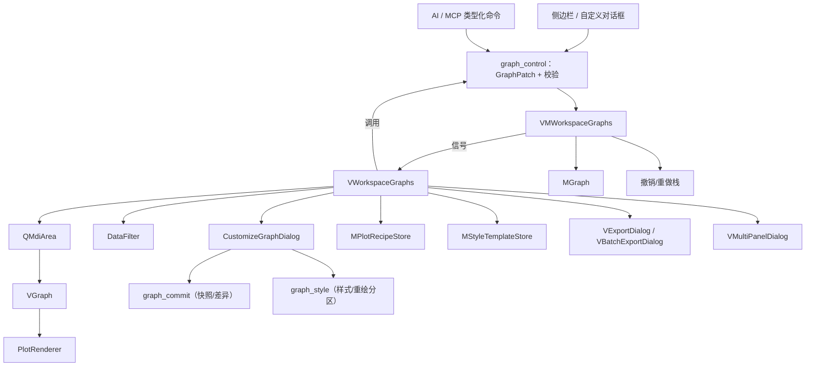
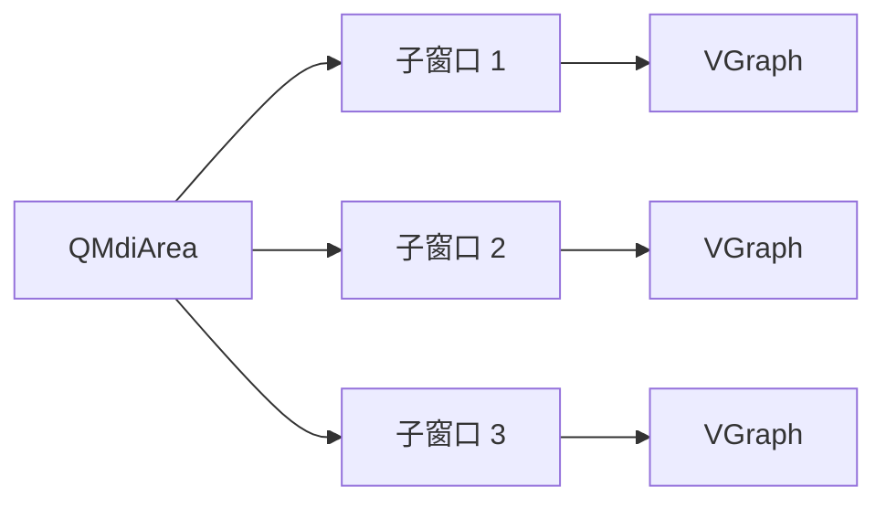

# **工作区：图表** { #workspace-graphs }

`Graphs` 工作区是一个独立的统计绘图环境。它负责管理 DataFrame（来自文件导入或跨工作区注入），应用动态筛选条件，并在 MDI（多文档界面，Multiple Document Interface）区域内使用纯 `Matplotlib`（配合 `scipy` 进行统计计算）生成达到学术发表质量的图表。该工作区已不再依赖 Seaborn——所有图表样式均直接在 `PlotRenderer` 中使用 Matplotlib 原语绘制。

---

## **架构概览** { #architecture-overview }



---

## **核心类** { #key-classes }

### **`VMWorkspaceGraphs` — 视图模型 (ViewModel)** { #vmworkspacegraphs-the-viewmodel }

**文件**：`spectroview/viewmodel/graphs/vm_workspace_graphs.py`（撤销/重做逻辑位于 `spectroview/viewmodel/graphs/graph_undo.py`）

负责管理 DataFrame、图表模型以及工作区的撤销/重做历史。与 `Spectra`/`Maps` 的 ViewModel 不同，该 ViewModel 相对轻量——繁重的渲染逻辑均由 `VGraph` 控件承担。

| 职责 | 方法 |
|---|---|
| **DataFrame 加载** | `load_dataframes(paths)` — 支持 `.xlsx`、`.xls`、`.csv` |
| **DataFrame 管理** | `add_dataframe()`、`remove_dataframe()`、`select_dataframe()`、`refresh_dataframe()` |
| **图表增删改查 (CRUD)** | `create_graph()`、`get_graph()`、`update_graph()`、`delete_graph()` |
| **数据筛选** | `apply_filters(df_name, filters)` — 基于 `pd.DataFrame.query()` |
| **多晶圆绘图** | `create_multi_wafer_graphs()` — 按槽位（slot）批量创建晶圆图 |
| **撤销/重做** | `undo()`、`redo()`、`begin_undo_batch()`/`end_undo_batch()`、`can_undo`/`can_redo` |
| **持久化** | `save_workspace()`、`load_workspace()`、`clear_workspace()` |

#### **信号** { #signals }

```python
dataframes_changed = Signal(list)           # List of DataFrame names updated
dataframe_columns_changed = Signal(list)    # Column names of selected DataFrame
graphs_changed = Signal(list)               # List of graph IDs updated
graph_state_changed = Signal()              # Any persisted graph property changed (AI context sync)
undo_state_changed = Signal()               # can_undo/can_redo changed -- sync toolbar buttons
notify = Signal(str)                        # Floating notification
```

### **`MGraph` — 图表配置模型** { #mgraph-the-plot-configuration-model }

**文件**：`spectroview/model/graphs/m_graph.py`

一个纯 dataclass，用于存储重建图表所需的全部信息。`save()`/`load(data)` 提供完整的序列化能力；`get_display_name()` 负责构造 MDI 子窗口标题。为了避免在此维护可能产生分歧的第二份字段计数或完整清单（详尽且权威的定义请参见 `m_graph.py`），其字段按功能归纳如下：

| 类别 | 示例字段 |
|---|---|
| 标识 / 数据源 | `graph_id`、`df_name`、`plot_style`、`x`/`y`/`z`、`filters` |
| 主坐标轴范围 | `xmin`/`xmax`、`ymin`/`ymax`、`zmin`/`zmax` |
| 坐标轴刻度与方向 | `xlogscale`/`ylogscale`、`xscale_mode`/`yscale_mode`、`x_inverted`/`y_inverted` |
| 副坐标轴（Y2/Y3/X2） | 各轴对应数据列、`color`、`marker`、`min`/`max`、`logscale`、`label` |
| 标签与标题 | `plot_title`、`plot_subtitle`、`xlabel`/`ylabel`/`zlabel` |
| 样式与外观 | `grid`、`tick_direction`、`tick_label_format`、字体大小、`figure_facecolor`、`figure_margins`、`spines_visible`、`figure_theme`、次刻度开关 |
| 图例 | `legend_visible`、`legend_outside`、`legend_properties`、`legend_bbox`、`legend_ncol`、`legend_frame`、`legend_title`、`legend_fontsize`、`legend_alpha`、`legend_loc` |
| 特定图表类型字段 | 晶圆/二维图谱色标（`color_palette`、`colormap_norm`、`colormap_center`）、趋势线拟合/锚点、误差棒、点图/散点图（`scatter_size`、`scatter_edgecolor`、`unify_marker_style`）、直方图、排序方式 |
| 标注 | `annotations`（类型化字典列表，参见 [Annotations (`TabAnnotations`)](#annotations-tabannotations)） |
| 断轴 | `axis_breaks` |
| 局部放大插图坐标轴 | `inset_enabled`、`inset_bounds`、`inset_xmin`/`xmax`/`ymin`/`ymax`、`inset_show_zoom_indicator` |
| 导出与窗口几何尺寸 | `plot_width`/`height`、`dpi`、`export_width_mm`/`height_mm` |

注意：样式模板、绘图配方以及工作目录设置**并不属于** `MGraph` 字段——它们是围绕这些字段子集构建的独立系统（参见 [样式模板与绘图配方](#style-templates-plot-recipes)）。

### **`graph_control.py` — 共享图表状态与命令契约** { #graph_controlpy-shared-graph-statecommand-contract }

**文件**：`spectroview/model/graphs/graph_control.py`

所有 GUI、AI 及 MCP 修改操作在触及 `MGraph` 之前，都会先汇聚到这一不依赖 Qt 的中间层。`GraphPatch` 直接依据 dataclass 字段自动生成，因此 MCP 模式能够自动暴露每一项可变的图表能力。重要的嵌套结构（筛选条件、逐系列样式、坐标轴边框线、断轴以及全部八种标注类型）各自均设有严格的 schema 校验规则。

`normalize_graph_patch()` 会在不实际修改状态的前提下，针对合并后的当前状态对补丁进行整体校验：统一检查未知键、可空性、取值范围、枚举值、数据列存在性、坐标上下限、插图几何位置、标注结构以及互斥的断轴设置。随后，`apply_graph_patch()` 会以原子方式提交已通过校验的补丁。未提及的字段保持不变；显式传入 `null` 仅清除可空属性。只要数据或系列标识发生变化，就会重置派生出的 `legend_properties`（除非调用方同时提供了替换列表）。

该契约在设计上保持渲染器无关性。View 层仍负责创建 Matplotlib Figure/Canvas、查询过滤后的数据、重新渲染、调整窗口几何尺寸以及刷新当前已打开的 Customize 对话框。

### **`VWorkspaceGraphs` — 视图编排器** { #vworkspacegraphs-the-view-orchestrator }

**包路径**：`spectroview/view/workspaces/graphs/`（`v_workspace_graphs.py`、`v_mdi_subwindow.py`、`v_graphs_ui.py`、`v_graphs_dataframes.py`、`v_graphs_mdi.py`、`v_graphs_actions.py`）

`VWorkspaceGraphs` 组合了图表工作区界面（`GraphsUIMixin`）、DataFrame 选择与筛选面板（`GraphsDataFramesMixin`）、MDI 窗口布局/平铺/层叠与活动工具栏同步（`GraphsMdiMixin`），以及图表创建/更新/导出/撤销/模板操作（`GraphsActionsMixin`），并将每个 `VGraph` 控件封装在 `MdiSubWindow` 中。

### **`VGraph` — 渲染控件** { #vgraph-the-rendering-widget }

**包路径**：`spectroview/view/components/graphs/`（`v_graph.py` 及其辅助模块 `v_graph_canvas.py`、`v_graph_breaks.py`、`v_graph_axes.py`、`v_graph_annotations.py`）

MDI 区域中的每个图表都是一个 `VGraph` 实例。它持有一个 Matplotlib `Figure` + `FigureCanvas` 并充当 UI 外壳。它负责管理交互操作、右键菜单和工具栏动作（Style 菜单、Export、Replicate），但将实际绘制算法委托给 `PlotRenderer`。`create_plot_widget()` 仍会为每个 `VGraph` 构建其专属的 Matplotlib 导航工具栏和动作按钮行（`self.toolbar_container`），但不会将其添加到图表自身的布局中——其实际承载位置参见[底部工具栏](#mdi-area-management)。

**交互式调整大小与平移性能。** 每个 figure 都启用了 `layout="compressed"`，而每次 Agg 重绘都会重新执行约束布局计算，耗时可达数百毫秒。以下三项机制保证了交互响应的流畅性：

- `MdiSubWindow` 启用了 `RubberBandResize`/`RubberBandMove`。拖拽子窗口边缘或标题栏时仅移动一个轻量级轮廓框；待鼠标松开时，画布才按最终尺寸重新调整并重绘**一次**。
- `VGraph.canvas` 使用 `_DebouncedFigureCanvas`。连续事件流中的首个 `resizeEvent` 会立即应用；在 `RESIZE_DEBOUNCE_MS`（60 ms）内到达的后续事件会合并为一次以最终尺寸执行的尾部重绘。这覆盖了不经过橡皮筋轮廓的尺寸变化，例如窗口平铺、最大化或拖动分隔条（splitter）。防抖定时器以画布为父对象。
- `VGraph.toolbar` 使用 `_FastNavigationToolbar`，即驱动 Pan/Zoom 按钮的隐藏版 `NavigationToolbar2QT` 辅助组件。它在 `press_pan` 到 `release_pan` 期间暂停 figure 的布局引擎（拖拽过程中仅坐标轴范围发生变化），将拖拽重绘帧率节流至约 30 FPS（`PAN_FRAME_S`），并在松开鼠标时恢复布局引擎并执行一次完整重绘。点击 Pan 按钮本身开销极低（约 1 ms）；此前用户感知到的卡顿源于拖拽期间每次鼠标移动都会触发完整布局重绘。

提供两条渲染路径：

- **`plot(df)`** — 全量重绘：清空并从零重建坐标轴。每当图形艺术家（artist）本身发生变更（系列数据、逐点颜色/标记、色标、副坐标轴/孪生轴、标注、放大插图）或启用/切换断轴时必须执行此路径。
- **`restyle()`** — 快速路径：在不触碰已绘制数据的情况下，原地重绘已渲染的坐标轴（标题/轴标签/字号、网格、刻度方向与格式、主坐标轴范围、对数/对称对数刻度、背景色/边框线/边距、图例框样式）。在将坐标轴切换为 `"log"` 刻度之前，`GraphAxesStyleMixin`（`v_graph_axes.py`）会通过 `_sanitize_log_axis_limits()` 清理残余的非正线性自动范围，避免 Matplotlib 发出非正对数范围警告。只要当前激活了断轴，该方法便会返回 `False`（从而回退为全量重绘）。关于 Customize 对话框如何判定选用哪条路径，参见[实时预览与 Restyle 快速路径](#live-preview-restyle-fast-path)。

`_set_figure_style()` 会在每次渲染时重新从 `plt.rcParams` 应用 `axes.facecolor`/`figure.facecolor`/`axes.labelcolor`/`text.color`/`xtick.color`/`ytick.color`/`axes.edgecolor`——这是必需的，因为 `ax.clear()` 并不会回溯重绘在另一套 Matplotlib 样式/主题上下文中创建的坐标轴，过去这曾导致切换到深色主题后刻度、标签和边框仍停留在黑色。

### **`PlotRenderer` — 绘图引擎** { #plotrenderer-the-plotting-engine }

**文件**：`spectroview/view/components/graphs/v_plot_renderer.py`（与 `v_plot_spatial.py` 中的 `SpatialPlotMixin` 和 `WaferPlot` 组合使用）

出于可维护性考虑从 `VGraph` 中拆分独立，该类封装了所有图表样式的纯 Matplotlib 渲染逻辑（例如 `_plot_scatter`、`_plot_histogram` 以及 `WaferPlot` 类）。它接收 `VGraph` 实例的引用（`self.vg`）以读取配置状态（`self.vg.x`、`self.vg.plot_style` 等），并直接在 Matplotlib `Axes` 上绘图。

#### 色标归一化 { #colormap-normalization }

`_build_color_norm(vmin, vmax, norm_kind, center)` 基于 `MGraph.colormap_norm`（`"linear"`/`"log"`/`"centered"`）和 `MGraph.colormap_center` 为晶圆图/二维图谱热图构建颜色映射归一化器，可在 **坐标轴与范围** (Axes & Limits) 标签页中通过 **Z axis** 刻度控件进行编辑（仅针对 `wafer`/`2Dmap` 显示）。`"log"` 使用 `LogNorm`，`"centered"` 使用 `CenteredNorm`（适用于以 0 为中心的发散型数据，如应力/应变）；当所请求的归一化方式对当前数据范围无效时（例如对包含非正值的数据使用对数归一化），两者均会平滑回退为普通线性 `vmin`/`vmax`。

`_plot_wafer` 和 `_plot_2dmap` 均会先通过 `_clear_degenerate_zlim(zmin, zmax)` 处理 `vmin`/`vmax`，将显式设置且相等的 `zmin == zmax` 视同未设置，从而回退至由数据推导的范围。少数早期保存的 `.graphs` 文件中带有显式的 `zmin == zmax == 0.0`（源于早年现已修复的默认值）——如果字面遵从该值，会导致 `matplotlib.colors.Normalize(vmin=0, vmax=0)` 将所有数据点塌缩映射到同一颜色；当年重新打开这些文件时颜色映射失效的真正原因正是如此，而非色标归一化功能本身的问题。

`_resolve_marker_size(style, fallback)` 与 `_resolve_edge_color(style, fallback)` 集中实现了 "Unify Marker size / Edge color" 的行为逻辑（参见 [Legend & Series (`TabLegendSeries`)](#legend-series-tablegendseries)）：当 `VGraph.unify_marker_style` 为 `True` 时，所有系列均使用全局统一的 `scatter_size`/`scatter_edgecolor`；当其为 `False` 时，优先采用各个系列自身的 `legend_properties[i]` 覆写值（如有）。

---

## **数据流：创建图表** { #data-flow-creating-a-plot }

1. **用户操作**：用户选择一个 DataFrame，配置 X/Y/Z 轴，并在 `VWorkspaceGraphs` 界面中点击 **添加图表** (Add plot)。
2. **配置捕获**：View 调用 `_collect_plot_config()` 将所有界面设置收集为配置字典，随后通过 `_apply_default_style_to_config()` 混入 `MSettings.get_default_graph_style()`（即用户通过 **设为默认样式** (Set as Default Style) 保存的基准样式，若有——参见 [样式模板与绘图配方](#style-templates-plot-recipes)）。收集到的数据标识字段（`x`/`y`/`z`/`df_name`/`plot_style`）优先级始终高于默认样式，因为默认样式中只包含外观字段。
3. **模型创建**：View 调用 `vm.create_graph(plot_config)`。ViewModel 通过 `graph_control` 校验完整配置，随后实例化并原子化更新 `MGraph(graph_id)`，记录一个撤销点，并返回该模型。
4. **控件初始化**：View 实例化 `VGraph(graph_id)` 控件，并调用 `create_plot_widget(dpi)` 初始化 Matplotlib 画布。
5. **数据筛选**：View 调用 `vm.apply_filters(df_name, filters)` 从 ViewModel 获取过滤后的 `filtered_df`。
6. **渲染**：View 调用 `VGraph.plot(filtered_df)`。
7. **绘图执行**：`VGraph` 调用 `_plot_primary_axis()`，实例化 `PlotRenderer(self)` 并委托具体绘制逻辑（例如 `self.renderer._plot_scatter()`），随后应用坐标轴范围、标签与图例，最后返回渲染完成的画布。
8. **界面集成**：View 将新建的 `VGraph` 控件封装在 `QMdiSubWindow` 中，并将其添加到 MDI 区域。

这套默认样式混入逻辑同样适用于 `_on_plot_multi_wafer()`；但在应用绘图配方或复制现有图表时则刻意**不**应用默认样式，因为它们本身已经携带了完整且刻意指定的样式配置。

### **数据流：AI/MCP 更新** { #data-flow-aimcp-update }

1. `update_graph` 会先针对每一个目标图表及其 DataFrame 校验类型化的 `GraphPatch`。`graph_id="all"` 会在任何修改前先展开为具体 ID 列表。
2. MCP 服务器向队列推入一个类型化的 `UpdatePlot` 指令；它绝不导入 Qt，也不直接修改任何控件。
3. `VMChat` 将队列命令转换为应用层配置，随后 `main.py` 将更新路由至 `VWorkspaceGraphs.update_graphs_from_config()`。
4. 工作区预校验所有目标，开启单一撤销批处理，依次更新每个 `MGraph`、重建/重绘对应控件、按显式几何尺寸调整窗口大小，并刷新当前已打开的 Customize 对话框。只要发生任何渲染失败，就会恢复所有模型与控件快照，确保批处理绝不会出现半应用状态。
5. 在 GUI 编辑、AI 编辑、撤销/重做、文件加载以及渲染器派生的样式同步之后，`graph_state_changed` 会刷新提供给 AI 的完整序列化图表上下文。

---

## **图表样式** { #plot-styles }

每种图表样式均对应一个 `PlotRenderer._plot_*` 方法，直接使用 Matplotlib 原语进行绘制（不依赖 Seaborn）：

| 样式 | Matplotlib 原语 | Hue 分组支持 | 说明 |
|---|---|---|---|
| `point` | `ax.errorbar()` | ✓ Z 列 | 绘制各分类均值及误差棒；"Join" 开关可用线段连接均值点；唯一支持逐系列 **标记** (Marker) 列的样式 |
| `scatter` | `ax.scatter()` | ✓ Z 列 | 默认在所有系列间统一标记大小与边框色（见 Unify 复选框） |
| `box` | `ax.boxplot()` | ✓ Z 列 | 支持调色板；箱体宽度根据分类间距自动计算 |
| `bar` | `ax.bar()` | ✓ Z 列 | 可选误差棒（标准差 / 95% 置信区间） |
| `line` | `ax.plot()` | ✓ Z 列 | 标准折线图 |
| `trendline` | `np.poly1d` 拟合 + `ax.scatter()` / `ax.plot()` / `ax.fill_between()` | ✓ Z 列 | 支持自定义非原点/零截距锚定的多项式回归、解析计算的 95% 置信区间带及方程表导出 |
| `histogram` | `ax.hist()`（+ `scipy.stats.gaussian_kde`） | ✓ Z 列 | 支持自定义分箱数、可选 KDE 密度曲线叠加，以及阶梯轮廓或实心填充柱 |
| `wafer` | 自定义 `WaferPlot`（`ax.scatter()`） | — | 带晶粒位点的圆形晶圆可视化；支持色标归一化（线性/对数/居中） |
| `2Dmap` | `ax.imshow()` | — | 通过 `pivot()` 生成矩形热图；支持与晶圆图相同的色标归一化选项 |

### **多坐标轴支持** { #multi-axis-support }

`VGraph` 最多支持 **3 个 Y 轴** 以及 1 个次 X 轴：

- **主 Y 轴**（`self.ax`）：标准左侧坐标轴
- **次 Y 轴**（`self.ax2`）：右侧坐标轴，通过 `ax.twinx()` 创建
- **第三 Y 轴**（`self.ax3`）：最右侧坐标轴，向外偏移
- **次 X 轴**（`x2`）：通过 `ax.twiny()` 创建

每个副坐标轴都可以使用独立的数据列，并拥有自己的标题、最小/最大值范围、对数刻度开关、颜色和标记——全部均可在 Customize 对话框的 **副坐标轴与放大插图** (Secondary & Inset Axes) 标签页（`TabSecondaryInset`）中编辑（此前仅能通过脚本设置或硬编码）。只有当某副坐标轴分配了数据列之后，对应行才会启用。

---

## **DataFrame 管理** { #dataframe-management }

### **加载** { #loading }

`VMWorkspaceGraphs.load_dataframes()` 使用 `m_io.load_dataframe_file()`：

- **Excel**（`.xlsx`/`.xls`）：单工作表 → `{filename: df}`。多工作表 → 每个工作表映射为 `{filename_sheetname: df}`。
- **CSV**：自动检测分号与逗号分隔符。

### **源路径追踪与刷新** { #source-tracking-and-refresh }

每个已加载 DataFrame 的源文件路径均记录在 `self.dataframe_sources` 中。"Refresh" 按钮会从磁盘重新读取文件，方便外部工具修改数据后的迭代分析工作流。

### **编程式注入** { #programmatic-injection }

其他工作区可以直接注入 DataFrame：

```python
# From Maps workspace:
self.graphs_workspace.vm.add_dataframe(profile_name, profile_df)

# From Spectra/Maps fit results:
self.graphs_workspace.vm.add_dataframe("fit_results", df_fit_results)
```

---

## **筛选系统** { #filter-system }

`VDataFilter` 控件提供动态查询构建器：

```python
# Each filter is a dict:
{
    "expression": "Slot == 5",    # Pandas query expression
    "state": True                  # Active/inactive toggle
}
```

筛选条件通过 `pd.DataFrame.query()` 应用：

```python
def apply_filters(self, df_name, filters):
    df = self.dataframes[df_name].copy()
    for filter_data in filters:
        if filter_data.get("state", False):
            df = df.query(filter_data["expression"])
    return df
```

筛选条件**按图表独立保存**在 `MGraph.filters` 中，因此每个图表都可以拥有不同的启用筛选条件。

### **多晶圆工作流** { #multi-wafer-workflow }

当 DataFrame 包含 `Slot` 列时（半导体数据集中非常常见）：

1. View 会显示槽位复选框以及 **添加多晶圆图** (Add Multi-Wafer) 按钮。
2. 用户勾选所需槽位（例如 1、3、5、7）。
3. `create_multi_wafer_graphs()` 为每个槽位创建一个晶圆图，并将 `Slot == N` 筛选条件合并进基础筛选条件中。
4. 所有晶圆图将同时显示在 MDI 区域中。

---

## **图表自定义** { #graph-customization }

### **`CustomizeGraphDialog`（单例）** { #customizegraphdialog-singleton }

**包路径**：`spectroview/view/components/customize_graph/` — `CustomizeGraphDialog`（位于 `customize_graph_dialog.py`）采用类似现代“设置”页面的双栏布局，配有支持实时关键词搜索的响应式左侧导航栏、带选中胶囊和左侧强调条的样式化列表项代理（item delegate），以及支持分组框高亮与自动滚动定位的模块化可滚动标签页：

| 类别 | 类名 | 模块 | 作用域 |
|---|---|---|---|
| **常规与字体排版** (General & Typography) | `TabGeneral` | `tab_general.py` | 图像主题（**浅色** (Light) / **深色** (Dark)）、**网格** (Grid)、X 轴标签旋转、字体大小（Title/Axis/Tick/Colorbar）、数据排序 |
| **坐标轴与范围** | `TabAxesLimits` | `tab_axes_limits.py` | 带范围滑块（置于顶部）的坐标轴范围、X/Y 刻度（**线性** (Linear)/**对数** (Log)/**对称对数 (Symlog)**）、数据类型、反转、Z 色标刻度、断轴 |
| Ticks & Spines | `TabTicksSpines` | `tab_ticks_spines.py` | 刻度方向、标签格式预设、次刻度线 (T/R/B/L)、坐标轴边框线 (T/R/B/L) |
| Legend & Series | `TabLegendSeries` | `tab_legend_series.py` | 图例框布局/字号/透明度/位置、统一标记样式、左对齐逐系列样式表 |
| **图表样式与拟合** (Plot Style & Fitting) | `TabPlotStyles` | `tab_plot_styles.py` | 图表样式选项（point/scatter/wafer）、统一误差棒、趋势线多项式/锚点/方程、直方图 |
| Annotations | `TabAnnotations` | `tab_annotations.py` | 可视化标注（**垂直线** (V-Line)、**水平线** (H-Line)、**文本** (Text)、**箭头** (Arrow)、**垂直区域** (V-Span)、**水平区域** (H-Span)、**矩形框** (Box)、**引线标注** (Callout)）及模态编辑对话框 |
| **副坐标轴与放大插图** | `TabSecondaryInset` | `tab_secondary_inset.py` | 双坐标副轴（Y2/Y3/X2，含标签/最小最大范围/对数/颜色/标记）、局部放大插图坐标轴 |

这是一个工作区级单例对话框，当用户激活不同的 MDI 子窗口时会自动切换上下文（`switch_graph(graph_widget, graph_id)`）。内部包含 `_TabsCompatibilityProxy` 以及向后兼容的属性门面（`legend_widget`、`axis_widget`、`more_options_widget`、`annotations_widget`）。

### **实时预览与 Restyle 快速路径** { #live-preview-restyle-fast-path }

任意标签页中的任何控件发生变更时，都会重启同一个 400 ms 防抖 `QTimer`。超时触发后，各标签页的 apply 方法会以 `replot=False` 作用于实时控件，再由 `graph_commit.snapshot()`/`diff()`（见下文）精确判断哪些字段发生了变化。若变更字段是 `graph_style.RESTYLE_SAFE_FIELDS` 的子集，对话框就会调用 `VGraph.restyle()`（快速原地重绘）；否则执行全量 `VGraph.plot(df)`。该实时预览绝不会触碰撤销栈或 `vm.update_graph()`——在用户点击 **应用** (Apply) 之前，所有更改仅体现于视觉效果；点击应用后，所有标签页的更改会被打包进一对 `vm.begin_undo_batch()`/`end_undo_batch()` 中（无论编辑了多少个标签页，每次点击应用仅产生一步撤销记录）。点击 **取消** (Cancel) 则依据对话框打开时捕获的快照还原控件状态，自始至终不会修改 ViewModel。

### **`graph_style.py` — 样式与数据字段分区** { #graph_stylepy-the-styledata-field-partition }

**文件**：`spectroview/model/graphs/graph_style.py`

- **`STYLE_FIELD_NAMES`** — 除标识/数据列、数据坐标范围、标注以及窗口/输出几何尺寸外的所有 `MGraph` 字段（通过排除 `_NON_STYLE_FIELDS` 计算得出）。它定义了“图表的视觉外观”，可在不同数据构成的图表之间自由迁移。
- **`RESTYLE_SAFE_FIELDS`** — `STYLE_FIELD_NAMES` 中更窄的子集：即对 `VGraph.restyle()` 快速重绘路径安全的字段（标题/标签/字号、网格、刻度方向与格式、主坐标轴范围、对数/对称对数刻度、背景色/边框线/边距、图例框样式）。排除一切需要重建图形艺术家的属性（逐系列颜色/标记/大小、色标、副坐标轴、标注、放大插图）。
- **`extract_style(source_dict)`** / **`apply_style_dict(graph_widget, style_dict)`** / **`default_style()`** — 分别用于从图表中提取样式子集、将样式字典写入控件（并重置 `legend_properties` 以便重新派生逐系列颜色），以及生成硬编码的出厂默认样式。
- **`can_restyle_without_replot(changed_fields)`** — 当且仅当每个变更字段均位于 `RESTYLE_SAFE_FIELDS` 中时返回 `True`。

### **`graph_commit.py` — 变更追踪** { #graph_commitpy-change-tracking }

**文件**：`spectroview/view/components/graphs/graph_commit.py`

`snapshot(gw)` 会从实时 `VGraph` 控件深拷贝除 `graph_id` 外的每一个 `MGraph` 字段；`diff(gw, before)` 则仅返回与此前快照存在差异的字段补丁字典。该函数同时服务于 Customize 对话框的实时预览触发（决定选用 restyle 还是全量 replot）以及工具栏层面的编辑（例如在 `save_workspace()` 之前将拖拽后的图例位置或调整后的子窗口尺寸同步回模型）——在两种场景下，生成的补丁都会经由 `properties_changed.emit()` → `vm.update_graph()` 流转，也正是这一步真正记录撤销历史。

### **撤销/重做** { #undoredo }

撤销/重做栈位于 `VMWorkspaceGraphs` 而非 View 层：`_undo_stack`/`_redo_stack` 保存整个工作区的快照（`{graph_id: MGraph.save()-dict}`），上限为 50 条记录。每次调用 `create_graph()`/`update_graph()`/`delete_graph()` 都会记录一个撤销点，除非调用位于 `begin_undo_batch()`/`end_undo_batch()` 批处理块内部——此时整批操作会被折叠为单个撤销步骤（Customize 对话框的 **应用** 按钮以及绘图配方应用流程正是利用这一点，将多标签页或多图表的操作合并为一步撤销）。`undo_state_changed` 通过 `can_undo`/`can_redo` 使工具栏上的 **撤销** (Undo)/Redo 按钮保持同步。

### **键盘快捷键** { #keyboard-shortcuts }

快捷键注册在 `self.mdi_area` 上（而非整个工作区控件，以免用户在侧边栏 `QLineEdit` 中输入时遮蔽原生编辑快捷键），并作用于当前活动 MDI 子窗口中的图表。这种 `WidgetWithChildrenShortcut` 上下文还意味着它们天然仅限于 Graphs 标签页内生效：当切换到其他标签页时，`self.mdi_area`（及其内部一切控件）不在焦点链中，因此这些快捷键完全不会误触发。

| 快捷键 | 动作 |
|---|---|
| `Ctrl+Z` | 撤销 |
| `Ctrl+Shift+Z` | 重做 |
| `Ctrl+C` | 将当前活动图表的*图像*复制到剪贴板（`VGraph.copy_to_clipboard()`，对应工具栏的 **复制** (Copy) 按钮） |
| `Ctrl+V` | 将已复制的*样式*粘贴到当前活动图表 |
| `Ctrl+E` | 为当前活动图表打开 Customize Graph Dialog（对应工具栏的 Customize 按钮） |

样式复制/粘贴不再拥有独立的 `Ctrl+C` 快捷键（`_on_copy_style_shortcut()` 已被移除）——现在 `Ctrl+C` 用于复制图像，因为这是使用频率高得多的操作。样式复制仍可通过 Style 菜单中的 **复制样式** (Copy Style) 一键完成；`Ctrl+V` 依然会粘贴最近一次通过该方式复制的样式。

### **常规与字体排版 (`TabGeneral`)** { #general-typography-tabgeneral }

- **Display & Grid**：**Figure theme** 选择器（浅色/深色 —— 每次渲染都会从 `plt.rcParams` 重新应用 `axes.facecolor`/标签/刻度/边框线颜色，防止切换主题时残留下黑色文字或边框）、**显示网格线** (Show grid lines) 复选框（`MGraph.grid`），以及 **X label rotation** 微调框（`MGraph.x_rot`）。
- **Typography & Font Sizes (pt)**：Title、Axis label、Tick label 和 **Colorbar** 四个微调框排成一行（默认值为 12/12/9/10，与当前激活的 Matplotlib 样式一致）。**Colorbar** 字号（`MGraph.colorbar_fontsize`）用于设置晶圆图/二维图谱色标的刻度标签字号——`PlotRenderer._apply_colorbar_fontsize()` 会在每次色标（重新）创建后应用该设置，因此修改它会触发一次全量重绘（特意未纳入 `RESTYLE_SAFE_FIELDS`）。**副标题**没有独立的字号控件——它始终比主标题小 2 pt（在 `_set_figure_style` 中按 `title_fontsize − 2` 计算）；其*文本内容*在工作区侧边栏（`VWorkspaceGraphs`）中编辑。若通过编程方式设置了 `MGraph.figure_facecolor`/`figure_margins`，背景色与边距控制仍会被忠实保留与生效。
- **Data Sorting**：智能分类排序开关（`MGraph.intelligent_sorting`）。

### **坐标轴与范围 (`TabAxesLimits`)** { #axes-limits-tabaxeslimits }

- **Set Axis Limits**：X/Y/Z 每个轴各占一行微调框与滑块组合（对于 `wafer`/`2Dmap`，X/Y 会隐藏，此时 Z 用作色标控制）。每个最小/最大值微调框均配有一个双端范围滑块，其可拖拽边界根据实际数据范围（外扩 10% 余量）自动推导。当某一范围未设定时，微调框会以灰色显示图表当前的实际渲染边界值——而非通用的 "default" 占位文本——使显示的数字始终具有实际参考意义；同一“真实值占位”模式也应用于该对话框中的所有其他可选微调框（插图范围、逐系列图例覆写）。
- **Axis Scales & Data Types**：每个轴（X/Y）的刻度（线性/**对数** (Logarithmic)/对称对数 (Symlog)）、数据类型（**自动** (Auto)/**分类** (Category)/**数值** (Numerical)）以及 Inverted 开关。针对 `wafer`/`2Dmap`，还会额外出现一行 **Z axis** 刻度控件（线性/对数/**居中** (Centered)，选择居中时附带 Center 基准值输入框）——这是支撑 `MGraph.colormap_norm`/`colormap_center` 的色标归一化控件；参见[色标归一化](#colormap-normalization)。
- **Broken axis**：X 轴断轴与 Y 轴断轴互斥（启用其中一项会自动禁用另一项，因为渲染器一次仅支持在一个轴上断轴）。渲染时通过 `gridspec` 将坐标轴拆分为两个面板——X 轴断轴时左右并排并共享 Y 轴，Y 轴断轴时上下堆叠并共享 X 轴——每个面板各自裁剪到其半段范围，隐藏相对一侧的边框线，并在真实边框边界绘制标准的斜双线 "//" 断轴标记。启用断轴时始终强制执行全量重绘（此时 `VGraph.restyle()` 返回 `False`），且与局部放大插图坐标轴互斥。

### **Ticks & Spines (`TabTicksSpines`)** { #ticks-spines-tabticksspines }

- **Tick Appearance**：刻度方向（**默认** (Default)/**向内** (In)/**向外** (Out)/**双向** (In & Out)）和刻度标签格式（自动/Integer/1-decimal/2-decimal/Scientific）。
- **Minor Ticks & Spines**：次刻度线（分别控制 X-**底部** (Bottom)/X-**顶部** (Top)/Y-**左侧** (Left)/Y-**右侧** (Right)，并具备智能默认行为：自动在数值轴上显示次刻度线，而在分类轴或图谱上隐藏）以及 **Show Spines / Frame Borders**（顶部/右侧/底部/左侧）。

### **Legend & Series (`TabLegendSeries`)** { #legend-series-tablegendseries }

- **Legend Box Styling**：列数、边框、标题、字体大小、透明度（alpha）及位置。
- **Series Styling**：一个可选的 **"Unify marker size / edge color"** 复选框（默认勾选）。勾选时，选框顶部单一的一行 Marker size / Edge color 控件作用于全部系列，表格中的逐系列 Marker size/Edge color 列保持隐藏。取消勾选后，这些逐系列列将显现（仅适用于 `point`/`scatter` 系列样式），允许每个系列独立覆写标记大小与边框颜色——回退逻辑由 `PlotRenderer._resolve_marker_size()`/`_resolve_edge_color()` 实现。逐系列的 **标签** (Label)、**颜色** (Color) 和 **透明度** (Alpha) 始终可独立编辑；**标记**仅在 point 样式下显示，而 **线宽** (Line width) 仅在实际绘制线条的样式中显示（`line`/`trendline`，或启用了 "Join" 的 `point`）——纯散点图/箱线图/柱状图并不存在可描述的线宽属性。未设置的逐系列线宽/透明度微调框同样会以灰色显示实际将使用的真实数值（如 `"1.50"`），而不是通用占位符。

### **图表样式与拟合 (`TabPlotStyles`)** { #plot-style-fitting-tabplotstyles }

- **Plot Style Options**：依赖当前图表类型的复选框（**连接数据点（点图）** (Join data points (point plot))、**错开重叠点（点图）** (Dodge overlapping points (point plot))、**错开重叠点（散点图）** (Dodge overlapping points (scatter plot))、**显示统计摘要（晶圆图）** (Show statistics summary (wafer plot))）。
- **Error Bars (Unified)**：跨 `point`、`line` 和 `bar` 图表的误差棒显示开关、统计类型（**95% 置信区间** (95% CI) / **标准差** (Std. Dev.) / **标准误** (Std. Error) / **无** (None)，选项随图表类型而异）以及端帽宽度。
- **Trendline & Histogram Controls**：多项式阶数、截距锚点 ($x_0, y_0$)、带复制按钮的拟合方程与 $R^2$ 只读表格，以及直方图分箱数量、显示模式（**实心填充** (Filled) / Step）和 KDE 曲线叠加开关。

### **Annotations (`TabAnnotations`)** { #annotations-tabannotations }

八种标注类型，每种都对应一个 **添加** (Add) 按钮以及 `customize_annotation_dialogs.py` 中的专用编辑对话框：

| 类型 | 用途 | 编辑对话框 |
|---|---|---|
| `vline` / `hline` | 垂直/水平参考线 | `EditLineDialog` |
| `text` | 带可选背景框的自由文本标签 | `EditTextDialog` |
| `arrow` | 点对点箭头 | `EditArrowDialog` |
| `vspan` / `hspan` | 垂直/水平阴影条带 | `EditSpanDialog` |
| `box` | 实心填充或描边矩形 | `EditBoxDialog` |
| `callout` | 带指向特定数据点箭头的文本标签 | `EditCalloutDialog` |

全部以类型化字典形式存储在 `MGraph.annotations` 中。每种标注类型均支持**拖拽交互**——按住并拖拽即可实时更新位置并发射 `annotation_position_changed`——由 `graphs/v_graph_annotations.py` 中的 `GraphAnnotationMixin._on_annotation_click()`/`_on_annotation_drag()`/`_on_annotation_release()` 实现。点击命中测试采用手动方式（`self.ax.findobj()` + `artist.contains(event)`），而非使用 Matplotlib 的 `pick_event`：`Figure.pick()` 仅当 `event.inaxes` 等于图形艺术家自身的 Axes 时才投递拾取事件；但只要同时配置了次 Y 轴，它就会完全覆盖主 Axes 且拥有更高的 z-order，导致 `event.inaxes` 总是解析到次 Y 轴上，从而使主 Axes 上的标注根本收不到事件——这在过去会导致配置了 `y2`/`y3` 的图表上所有标注完全无法拖拽。`VGraph._ax_data_coords(event)` 则直接通过 `self.ax.transData` 从事件自身的像素坐标反算数据位置，从而绕开了 `event.inaxes` 的同源歧义问题。

### **副坐标轴与放大插图 (`TabSecondaryInset`)** { #secondary-inset-axes-tabsecondaryinset }

- **Secondary Twin Axes**：Y2/Y3/X2 各自对应一行（在分配数据列之前保持禁用），提供 Label、**最小值** (Min)/**最大值** (Max)、Log 开关、Color 和 Marker 设置——参见[多坐标轴支持](#multi-axis-support)。
- **Inset (Zoom) Axes**：可勾选启用的一组控件，包含以坐标轴比例表示的 **位置** (Position) (x0, y0) 和 **大小** (Size) (w, h)、独立的 X/Y 范围，以及 "Show zoom indicator" 开关（调用 `ax.indicate_inset_zoom()`，从放大插图框向主图中被放大的区域绘制引导连接线）。插图 Axes 本身不会被持久化保存——每次渲染都会依据 `MGraph.inset_bounds` 重新构建。与断轴功能互斥。

---

## **样式模板与绘图配方** { #style-templates-plot-recipes }

这是两个在概念上截然不同、过去曾容易混淆的功能：

- **绘图配方** (Plot Recipe)（`MPlotRecipeStore` / `VPlotRecipeDialog`，目录：`<working folder>/plot_recipe/`）——保存了一**整套完整的图表配置集合**（同时包含数据绑定*与*样式：`df_name`、`x`/`y`/`z`、`filters` 以及所有样式字段），每个配方对应一个 JSON 文件。应用配方时会**创建新图表**：`_on_recipe_applied()` 会将每条保存配置中的 `df_name` 重新指向*当前选中的* DataFrame（而非每张图表最初保存时的旧 DataFrame），并跳过缺少所需列的图表同时向用户报告，而不会中止整批应用。整套配方会作为单个撤销步骤一次性应用。该对话框支持浏览/搜索/应用/重命名/**复制副本** (duplicate)/删除。
- **样式模板** (Style Template)（`MStyleTemplateStore` / `VStyleTemplateDialog`，目录：`<working folder>/plot_style/`）——保存了**仅包含外观**的样式字典（`graph_style.extract_style()`），每个模板对应一个 JSON 文件。应用模板时（`_apply_style_to_graph()`）会通过 `graph_style.apply_style_dict()` 直接写入**现有**图表——绝不触碰任何数据绑定。它是 `VPlotRecipeDialog` 的精简姊妹版：由于样式模板始终只对应单个样式字典，因此没有图表计数，也不提供复制副本功能。

这两个存储管理器都会刻意在**每次使用时依据当前的 Working Folder 设置重新构建**（`VWorkspaceGraphs._refresh_recipe_and_style_stores()`，会在所有应用/保存处理器顶部调用，包括 AI 对话面板通过 `VMChat.refresh_recipe_store()` 触发的配方保存流程），而不再于启动时一次性构建——此举修复了一个原有缺陷：此前若在工作区标签页已创建后再配置 Working Folder，该更改会静默失效，直到重启应用才生效。

每个 `VGraph` 工具栏上的 **Style 菜单**将上述机制串接起来：**保存样式...** (Save Style…) / **应用样式...** (Apply Style…)（分别打开对应的管理对话框）、**复制样式** / **粘贴样式** (Paste Style)（内存剪贴板操作，`Ctrl+C`/`Ctrl+V`）、**恢复默认** (Reset to Default)（始终恢复为硬编码的出厂 `graph_style.default_style()`），以及 **设为默认样式**（通过 `MSettings.set_default_graph_style()` 将当前图表样式保存为新建图表的起始基准——参见[数据流：创建图表](#data-flow-creating-a-plot)）。后两者是相互独立、互不重叠的概念：**恢复默认**无论当前默认样式是什么，始终还原为出厂样式；而**设为默认样式**仅影响*新创建*图表的初始外观，可跨重启持久化，既不会改变现有图表，也不会影响“恢复默认”的行为。

---

## **导出与多子图组合器** { #export-multi-panel-composer }

**文件**：`spectroview/view/components/graphs/v_export_dialog.py`

- **`VExportDialog(graph_widget, parent=None)`** — 将单个图表导出为 PNG/TIFF/SVG/PDF/EPS，提供格式/DPI/透明背景/导出时临时主题覆写等控制项，外加物理尺寸区块（期刊预设、mm/英寸切换，留空则采用当前屏幕尺寸），该尺寸会回写持久化到图表的 `export_width_mm`/`export_height_mm` 字段中。
- **`VBatchExportDialog(graph_widgets: dict, parent=None)`** — 一键将所有当前已打开的图表按各自已持久化的物理尺寸批量导出至指定文件夹，并在汇总对话框中报告逐个图表的失败详情。

**文件**：`spectroview/view/components/graphs/v_multipanel_dialog.py`

- **`VMultiPanelDialog(graph_widgets: dict, parent=None)`** — 将多个已勾选并重排顺序的打开图表组合到一张临时的 `matplotlib.figure.Figure` 网格中（自动推荐行列数、约束布局、合并内部子图共享的坐标轴标签、添加字母/数字子图标签）。每个子图均通过临时将源 `VGraph` 的 `.ax`/`.figure` 重定向至组合画布的子图位置并调用其常规渲染路径完成绘制，随后立即恢复源控件引用，因此绝不会修改实时工作区中的图表。激活了断轴的图表在组合图中会走简化的单面板渲染路径（这是一个已知的功能边界）。

AI/MCP 通过 `GraphPatch` 暴露了持久化的单图导出尺寸（`export_width_mm` / `export_height_mm`）以及屏幕几何尺寸/DPI。实际的导出/批量导出和多子图组合操作仍保留为 GUI 工作流：输出格式、目标路径、透明背景、导出主题、图表勾选与排序以及子图网格布局均属于一次性的文件/排版选择，而非 `MGraph` 状态。

---

## **MDI 区域管理** { #mdi-area-management }

`Graphs` 工作区使用 `QMdiArea` 同时显示多个图表：



- 每个图表都被封装在独立的 `QMdiSubWindow` 中，以支持自由调整尺寸、最小化和窗口排列。Qt Fusion 原生子窗口边框较厚且带有明显斜面立体感；`self.mdi_area.setStyleSheet(...)` 通过添加 `QMdiSubWindow { border: 1px solid ... }` 规则将其压平为 1 px 细线（通过 QSS 设置任意边框属性都会使控件从原生边框渲染切换为 CSS 边框渲染）。
- 底部工具栏汇总了全局控制按钮：全部最小化/全部删除、撤销/Redo、Compose Figure（纯图标按钮，因属于工作区全局操作且使用频率高于保留在侧边栏的配方按钮而迁移至此），以及一个共享的**图表工具栏插槽**（`self.graph_toolbar_slot` / `self._graph_toolbar_slot_layout`，伸缩因子设为 1 使其填满剩余宽度）。每个 `VGraph` 都在 `create_plot_widget()` 中构建其自身的 Matplotlib 导航工具栏（Home/Pan/**缩放** (Zoom)/Subplots）+ 一条 `QFrame.VLine` 分隔线 + 动作按钮行（Replicate/Customize/复制/Export/Style 菜单，通过分隔线与按钮之间的 `QHBoxLayout.addStretch()` 推紧至右边缘），但它被保留为无父对象且隐藏的状态（`self.toolbar_container`），不会显示在各自的 MDI 窗口内部——每个 MDI 窗口内只展示绘图画布本身。Export 按钮兼具双重功能（`VGraph._on_export_clicked()`，设计镜像自 `VSpectraViewer` 的 Copy 按钮）：普通点击发射 `export_requested(graph_id)`（单图导出对话框）；Ctrl+点击（在点击处理器内部通过 `QApplication.keyboardModifiers() & Qt.ControlModifier` 检测）则改为发射 `export_all_requested`，连接到过去由侧边栏已移除的 `"Export All"` 按钮所调用的 `VWorkspaceGraphs._on_export_all_clicked()`——该功能合一后原按钮因冗余而被直接删除。每个动作按钮图标均在创建时一次性设定为固定的彩色图标；`VGraph.update_icon_colors()` 以及 `VWorkspaceGraphs` 中按主题重新着色的逻辑均已移除，因为图表上的任何图标都不再需要跟随应用主题变色。`VWorkspaceGraphs._sync_active_graph_toolbar()` 负责将当前活动 MDI 子窗口所属图表的 `toolbar_container` 重新挂接到该共享插槽中（在此之前先拆离上一个图表的容器），从而使所有图表在视觉上共用同一条工具栏，而不是各自携带一份完全相同的副本。在所有可能改变活动图表或重建图表工具栏的位置均会调用该方法：`_on_subwindow_activated`（涵盖子窗口点击、图表下拉选择器以及“已无子窗口”时的 `None` 情况）、`_build_graph_widget`（新建图表）、`_on_update_plot` / `main.py` 中的 AI 智能体图表更新路径（`create_plot_widget()` 会从零重建 `toolbar_container`，因此插槽必须重新同步到新实例），以及 `_on_graph_closed`/`_on_delete_all`/`clear_workspace`/`_rebuild_all_graph_widgets`（销毁/重建路径，确保插槽绝不悬空引用已销毁的控件）。X 轴标签旋转与网格开关过去也曾位于这条工具栏中——现已迁移到 Customize 对话框的 **常规与字体排版** 标签页（`TabGeneral`，与 Figure theme 并列），因为它们属于单图样式而非工作区全局属性，且原先工具栏里的控件既没有实时预览，也只作为一次性新建图表的默认值生效。（这里过去还曾有一个 DPI 微调框——现已移除：它以前只负责设置下一个新建图表的*默认* DPI，在选中现有图表时虽然视觉上会同步显示该图表的 DPI，但修改它却静默无效，极易被误解为实时编辑控件。`MGraph.dpi` 仍默认为 100 且可通过脚本或 AI 智能体设置；日常使用中用户无需手动微调屏幕渲染分辨率，而导出分辨率则在 `VExportDialog` 中拥有专门的显式控件。）
- 图表选择下拉框（**当前图表：** (Active plot:)）与实时图像尺寸标签也均已移出底部工具栏：选择器现位于侧边栏中、紧邻 **添加图表** / **更新图表** (Update plot) 按钮上方（`VWorkspaceGraphs._setup_action_buttons()`），而图像尺寸标签则被彻底移除（连同 `MdiSubWindow` 的 `figsize_label` 参数及其随之失去意义的 `resizeEvent` 覆写一并移除）。
- **全部最小化** (Minimize All) 可折叠所有窗口以保持工作区整洁。
- 在下拉框中选择图表会激活对应的子窗口并同步右侧面板控件。

### **图表存储** { #graph-storage }

```python
# VWorkspaceGraphs maintains a lookup:
self.graph_widgets = {
    graph_id: (VGraph, QDialog, QMdiSubWindow)
}
```

当通过下拉框或点击子窗口选中某个图表时：

1. `_on_subwindow_activated()` 识别对应的 `graph_id`。
2. 加载 ViewModel 中对应的 `MGraph`。
3. 同步右侧面板控件（X/Y/Z 下拉框、标签、样式）以与之匹配。

---

## **持久化** { #persistence }

### **SPECTROview 工作目录** { #spectroview-working-folder }

一个在 **设置** (Settings) 面板中配置的全局统一根目录（**SPECTROview 工作目录** (SPECTROview Working Folder)），首次配置时会在其下自动创建（`os.makedirs(..., exist_ok=True)`）五个子目录和一个便携式配置文件：

| 子目录 / 文件 | 用途 | `MSettings` 获取方法 |
|---|---|---|
| `fit_model/` | 拟合模型 JSON 模板（`Spectra`/`Maps` 工作区） | `get_fit_model_folder()` |
| `plot_recipe/` | **绘图配方** (Plot Recipes) | `get_plot_recipe_folder()` |
| `plot_style/` | **样式模板** (Style Templates) | `get_plot_style_folder()` |
| `ai_chat_history/` | AI 对话历史记录 | `get_history_folder()` / `get_ai_history_folder()` |
| `template/` | 用户模板与自定义预设 | `get_template_folder()` |
| `config.json` | 便携式配置备份 | `export_config()` / `import_config()` |

如果先前配置过旧版互相独立的 "Fit model folder" / "Plot template folder" 设置，`get_working_folder()` 会执行一次性自动迁移，以免既有配置被遗弃。另一项独立设置 `get_default_graph_style()`/`set_default_graph_style()` 用于保存 **设为默认样式** 的基准（参见[样式模板与绘图配方](#style-templates-plot-recipes)）——它与工作目录无关，但采用相同的持久化方式（基于磁盘存储的 `QSettings`，重启后依然保留）。

### **保存格式 (`.graphs`)** { #save-format-graphs }

当前格式（`format_version: 4`）是一个 **ZIP 压缩包**，由 `WorkspaceIO.save_workspace()` 写入。版本 4 将 `x_as_numeric=False` 保留为显式的 **分类** 选择；更早版本则沿用历史上的 False 转 **自动** 迁移逻辑：

```
metadata.json                          # {"format_version": 4, "plots": {...}, "dataframe_sources": {...}}
dataframes/<name>.parquet              # one Parquet file per DataFrame, streamed directly into the zip
```

`metadata["plots"]` 中的每一项都是按 `graph_id` 索引的完整 `MGraph.save()` 字典：

```json
{
    "plots": {
        "1": {
            "graph_id": 1,
            "df_name": "fit_results",
            "plot_style": "point",
            "x": "Slot",
            "y": ["Si_center"],
            "z": "Zone",
            "filters": [{"expression": "R² > 0.95", "state": true}],
            "legend_properties": [...],
            "annotations": [...],
            "plot_width": 480,
            "plot_height": 400,
            "dpi": 100
        }
    },
    "dataframe_sources": {
        "fit_results": "/path/to/original.xlsx"
    }
}
```

`WorkspaceIO.load_workspace()` 会嗅探文件开头的 ZIP 魔数；早于该格式的旧文件（原始 JSON，其中 DataFrame 作为经过 gzip 压缩的十六进制 CSV 字符串存储在 `original_dfs` 键下）会被识别为旧版格式，并经由专用的兼容回退路径加载——该路径仅用于打开旧文件，绝不用于保存。

---

## **图表复制** { #plot-replication }

（位于共享图表工具栏中的）"Replicate" 按钮会针对当前活动图表创建一份深拷贝：

1. 通过 `save()` 序列化当前 `MGraph`。
2. 移除 `graph_id`（由 ViewModel 重新分配新 ID）。
3. 捕获当前子窗口尺寸作为副本的初始尺寸。
4. 使用克隆后的配置调用 `_create_and_display_plot()`。

这使得开发者和用户能够针对同一份数据快速开展不同视觉设置的 A/B 对比。与新建图表（添加图表 / 添加多晶圆图）不同，复制出来的图表其样式**不会**被 **设为默认样式** 基准覆盖，因为它本身已经携带了一套完整且刻意指定的样式。
