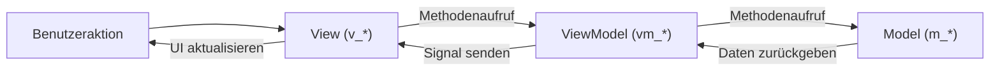
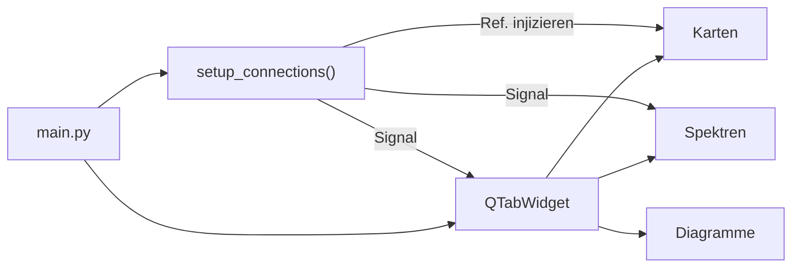
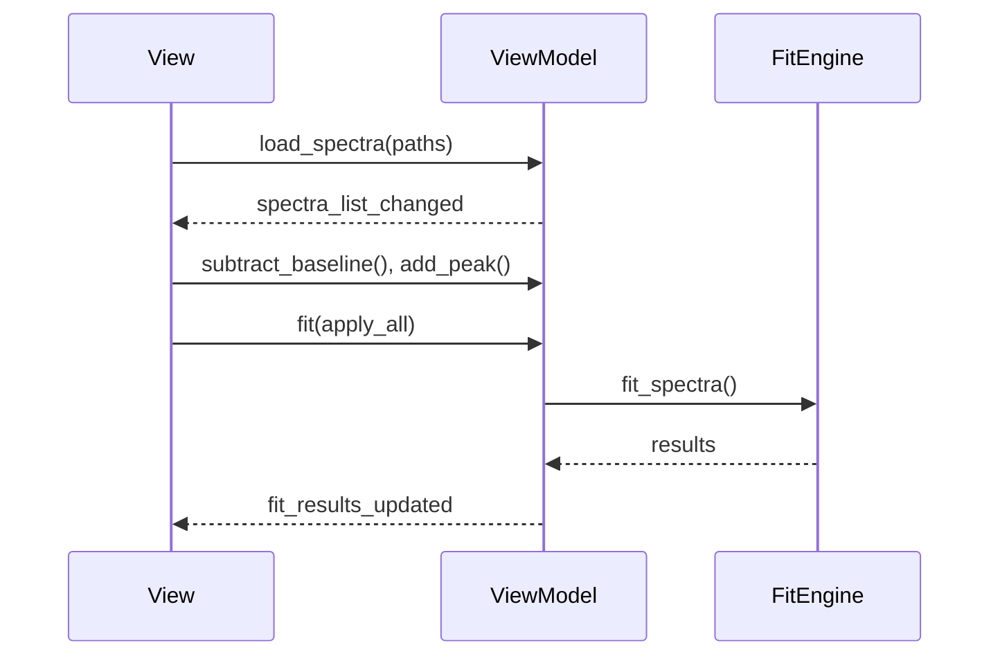
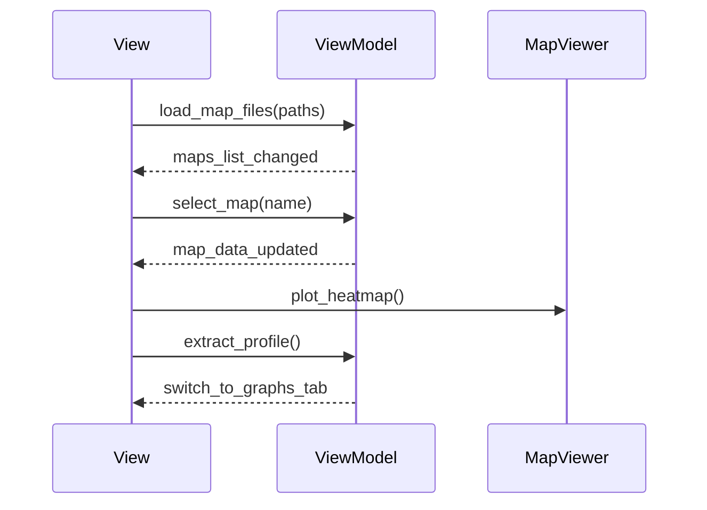
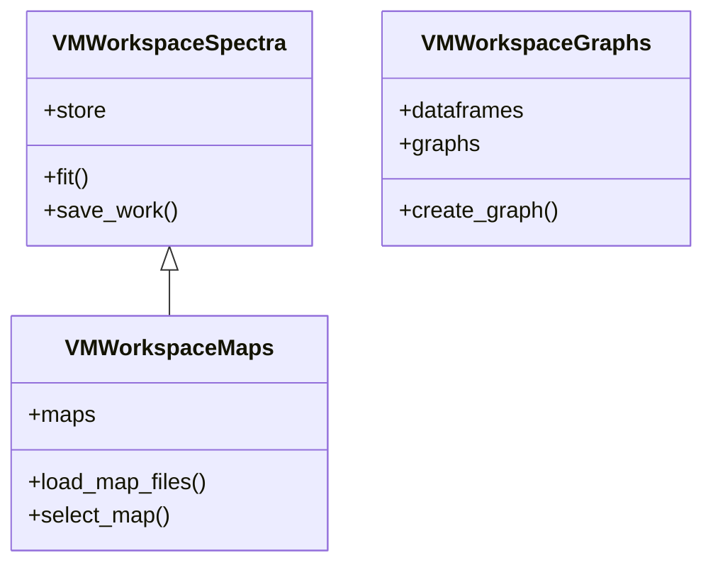

# **Anwendungsarchitektur** { #application-architecture }

Dieser Leitfaden beschreibt die technische Architektur, die Code-Organisation und die Entwicklungsmuster von `SPECTROview`. Er richtet sich an Entwicklerinnen und Entwickler, die die Anwendung verstehen, warten oder erweitern möchten.

---

## **MVVM-Muster** { #mvvm-pattern }

`SPECTROview` setzt konsequent auf eine strikte **Model-View-ViewModel**-Architektur.
Jeder Arbeitsbereich folgt derselben dreischichtigen Trennung der Zuständigkeiten:

- **Model** — Reine Datencontainer und Domänenlogik. Models enthalten keine Referenzen auf Qt-Widgets und können unabhängig getestet werden.
- **ViewModel** — Orchestrator der Geschäftslogik. Das ViewModel liest und verändert Models und benachrichtigt anschließend die View über Qt-Signale. Es importiert oder referenziert **niemals** View-Klassen.
- **View** — Qt-Widget-Schicht. Views verbinden sich mit den Signalen des ViewModels und rufen als Reaktion auf Benutzeraktionen Methoden des ViewModels auf.



### **Dateinamenskonvention** { #file-naming-convention }

| Schicht | Präfix | Beispiel |
|---------|--------|----------|
| View | `v_` | `workspaces/v_workspace_spectra.py` |
| ViewModel | `vm_` | `spectra/vm_workspace_spectra.py` |
| Model | `m_` | `spectra/spectra_store.py` |

### **Importregeln** { #import-rules }

| Schicht | Darf importieren | Darf nicht importieren |
|---------|------------------|------------------------|
| **View** | ViewModel, Components | — |
| **ViewModel** | Model, `fit_engine` | View |
| **Model** | Nur Standardbibliotheken | View, ViewModel |

### **Signal/Slot-Kommunikation** { #signalslot-communication }

Views und ViewModels kommunizieren **ausschließlich über Qt-Signale und -Slots**. Ein ViewModel darf niemals direkt Methoden einer View aufrufen, und eine View darf niemals den Zustand eines Models verändern, ohne über ihr ViewModel zu gehen.

```python
# ── ViewModel defines signals ──
class VMWorkspaceSpectra(QObject):
    spectra_list_changed = Signal(list)       # ViewModel → View
    fit_progress_updated = Signal(int, int, int, float, int)

# ── View connects in __init__ ──
class VWorkspaceSpectra(QWidget):
    def __init__(self):
        self.vm.spectra_list_changed.connect(self._update_list)
```

---

## **Projektstruktur** { #project-structure }

```
spectroview/
├── __init__.py             # Constants, peak models, resource paths, VERSION, BUILD_NUMBER
├── _build_info.py          # Build metadata, populated with timestamp during wheel/sdist packaging
├── main.py                 # Entry point, QMainWindow, cross-workspace wiring
├── application/            # API facade for the currently running desktop state
│   ├── service.py          # Dataset/spectra/fit/graph/map domain operations
│   ├── dispatch.py         # Queued Qt main-thread execution boundary
│   └── errors.py           # Stable integration error codes
│
├── i18n/                   # Centralized multilingual localization & live Qt bindings
│   ├── __init__.py         # Public tr/tr_plural & declarative bind_* exports
│   ├── manager.py          # TranslationManager singleton, JSON catalog loader & QTranslator lifecycle
│   ├── bindings.py         # Weak-ref widget/tab/combo/header live retranslation bindings
│   └── validator.py        # AST key extractor, catalog validator & untranslated UI literal audit
│
├── settings/               # Unified settings architecture (Model, ViewModel, & 2-panel Settings UI)
│   ├── m_settings.py          # Persistent app settings & portable config.json
│   ├── vm_settings.py         # Settings ViewModel & background LLM connection tester
│   ├── secrets.py             # Cross-platform obfuscated QSettings secret store (_credentials/)
│   ├── build_info.py          # Dual-mode runtime dependency resolution & build snapshot capture
│   └── ui/                    # Two-panel settings dialog with sidebar & instant search
│       ├── settings_dialog.py # Host dialog with sidebar navigation & instant search
│       ├── tab_general.py     # General preferences & Working Folder
│       ├── tab_fit.py         # Fitting solver convergence & peak bounds
│       ├── tab_ai.py          # LLM credentials, connection tests, & local MCP
│       └── tab_about.py       # Application details, Python env, & runtime package dependencies
│
├── model/                  # Data models organized by domain (no Qt widgets)
│   ├── m_settings.py       # Persistent app settings compatibility facade (wraps spectroview.settings)
│   ├── io/                 # File loaders & workspace serialization
│   │   ├── m_io.py         # Universal file loader dispatch & text/CSV readers
│   │   ├── m_wdf.py        # Renishaw WiRE WDF binary reader
│   │   ├── m_spc.py        # Galactic SPC binary reader
│   │   ├── m_l6s.py        # HORIBA LabSpec 6 (.l6s / .l6m) binary reader
│   │   ├── m_ngs.py        # HORIBA LabSpec 5 (.ngs / .ngc) binary reader
│   │   └── workspace_io.py # Unified serialization for Workspaces
│   ├── spectra/            # Spectral tensor store, metrics, & fit model models
│   │   ├── spectra_store.py       # Tensor-centric SpectraStore & MapData structures
│   │   ├── spectral_parameters.py # Vectorized raw spectral metrics (Area, Max, Pos_Max, Barycenter, FWHM)
│   │   ├── heatmap.py             # Pure-NumPy 2D heatmap grid interpolation & triangulation
│   │   ├── peak_model.py          # Helper functions for peak parameters
│   │   └── m_fit_model_manager.py # Saved fit model file management
│   ├── graphs/             # Graph schemas, recipes, & style templates
│   │   ├── m_graph.py                 # Plot configuration model (MGraph dataclass)
│   │   ├── graph_control.py           # Graph control & validation contract
│   │   ├── graph_style.py             # Graph styling & restyle-without-replot predicate
│   │   ├── m_plot_recipe.py           # Plot recipe dataclass (+ m_plot_recipe_store.py)
│   │   └── m_style_template_store.py  # Graph style template persistence
│   ├── analysis/           # Numerical analysis & calculator engines
│   │   ├── m_mva.py               # PCA + NMF engine
│   │   └── m_quick_calculators.py # Pure math logic for scientific calculators
│   └── system/             # Runtime environment, TLS, & update services
│       ├── m_tls.py              # Hardened TLS trust-store & certifi/pip validation
│       ├── m_installation.py     # Centralized runtime install detection (InstallType & InstallationManager)
│       ├── m_update_manager.py   # Multi-platform UpdateManager facade, ETag cache, SHA256SUMS
│       ├── m_update_checker.py   # Legacy pip/wheel QThread workers & detached upgrade helper
│       └── m_macos_font_patch.py # macOS font rendering compatibility patch
│
├── viewmodel/              # Business logic and data orchestration (PEP 562 lazy facade)
│   ├── spectra/            # Spectra workspace ViewModel & mixins
│   │   ├── vm_workspace_spectra.py     # Core workspace state, selection & I/O coordination
│   │   ├── vm_spectra_preprocessing.py # X/Y corrections, ROI crop, baseline & cosmic-ray removal
│   │   ├── vm_spectra_fitting.py       # Peak editing, fit-model clipboard/JSON & VBFthread launch
│   │   ├── vm_spectra_results.py       # Fit results collection, computed columns & Excel/clipboard export
│   │   ├── vm_spectra_persistence.py   # ZIP/NPZ workspace save/load & legacy v1 .spectra loader
│   │   └── vm_fit_model_builder.py     # Fit model file management orchestration
│   ├── maps/               # Maps workspace & Live Maps ViewModels
│   │   ├── vm_workspace_maps.py        # Maps workspace (extends VMWorkspaceSpectra)
│   │   ├── vm_maps_fitting.py          # Batch map fitting & wafer Zone/Quadrant post-processing
│   │   ├── vm_maps_persistence.py      # Legacy v1 .maps JSON loader
│   │   ├── vm_live_maps.py             # Live Maps state, debounce & synchronous evaluation
│   │   └── live_maps_worker.py         # Asynchronous _LiveMapWorker (QRunnable) & snapshot offload
│   ├── graphs/             # Graphs workspace ViewModel
│   │   ├── vm_workspace_graphs.py      # DataFrames, filtering, graph CRUD & persistence
│   │   └── graph_undo.py               # Whole-workspace snapshot undo/redo & batching mixin
│   ├── analysis/           # Numerical analysis orchestration
│   │   └── vm_mva.py                   # Multivariate analysis (PCA/NMF) orchestration
│   ├── common/             # Shared ViewModel utilities
│   │   ├── spectral_utils.py           # closest_index, parse_coords_from_fname, Fano & metadata helpers
│   │   ├── export_utils.py             # Excel, clipboard & figure file export
│   │   └── ui_utils.py                 # Notification, alert, icon & status-color adapters
│   ├── vm_settings.py      # Compatibility facade -> spectroview.settings.vm_settings
│   └── utils.py            # Backward-compatible re-export facade -> viewmodel.common & v_metadata_tooltip
│
├── ai_agent/               # AI Data Chat module (multi-provider; runtime-optional)
│   ├── __init__.py              # Module docstring, keeps import guarded
│   ├── m_llm_client.py          # Multi-provider LLM clients (Ollama/OpenAI/Anthropic) + QThread workers
│   ├── m_conversation.py        # Conversation model (+ m_conversation_store.py: history)
│   ├── m_prompt_manager.py      # System-prompt / rules / knowledge assembly
│   ├── mcp/server.py            # Shared FastMCP chat + full desktop tool profiles
│   ├── mcp/runtime.py           # Opt-in loopback Streamable HTTP lifecycle
│   ├── config/, prompts/, rules/, knowledge/, examples/, utils/  # Prompt assets + helpers (see ai_agent.md)
│   ├── vm_chat.py               # Chat ViewModel (prompt-tier selection, agentic loop)
│   └── v_chat_panel.py          # Embedded chat panel (+ v_history_dialog.py)
│
├── view/                   # Qt widgets and UI layout (PEP 562 lazy facade)
│   ├── __init__.py               # Lazy exports for workspaces, components & theme
│   ├── workspaces/               # Top-level workspace View packages
│   │   ├── __init__.py                # Lazy workspace exports
│   │   ├── v_workspace_spectra.py     # Spectra workspace View
│   │   ├── v_workspace_maps.py        # Maps workspace View (extends Spectra)
│   │   └── graphs/                    # Graphs workspace View package
│   │       ├── __init__.py            # Package exports (VWorkspaceGraphs, MdiSubWindow)
│   │       ├── v_workspace_graphs.py  # VWorkspaceGraphs orchestrator
│   │       ├── v_mdi_subwindow.py     # MdiSubWindow (rubber-band resize/move)
│   │       ├── v_graphs_ui.py         # GraphsUIMixin (panels, toolbars, shortcuts)
│   │       ├── v_graphs_dataframes.py # GraphsDataFramesMixin (DF selection & sync)
│   │       ├── v_graphs_mdi.py        # GraphsMdiMixin (MDI creation & layout)
│   │       └── v_graphs_actions.py    # GraphsActionsMixin (plot create/update/export/undo)
│   ├── components/               # Shared / reusable widgets (PEP 562 lazy facade)
│   │   ├── __init__.py                # Lazy subpackage exports + settings alias
│   │   ├── v_settings.py              # Fit/view settings dialog (compat shim)
│   │   ├── common/                    # Shell, notifications, calculators & shared widgets
│   │   │   ├── __init__.py
│   │   │   ├── v_menubar.py           # Main menu bar
│   │   │   ├── v_about.py             # About dialog
│   │   │   ├── v_update_banner.py     # Update notification banner widget
│   │   │   ├── v_notification.py      # Native floating notification badges & manager
│   │   │   ├── v_quick_calculators.py # Scientific calculators GUI
│   │   │   ├── customized_widgets.py  # Palette combobox, custom toolbar
│   │   │   └── markdown_utils.py      # Markdown spacing normalizer for Python-Markdown
│   │   ├── lists/                     # Spectral/map list, DataFrame table & tooltips
│   │   │   ├── __init__.py
│   │   │   ├── v_spectra_list.py      # Spectrum list with checkboxes
│   │   │   ├── v_map_list.py          # Loaded maps list panel (Two-Tier Selection)
│   │   │   ├── v_dataframe_table.py   # Generic DataFrame viewer
│   │   │   └── v_metadata_tooltip.py  # Metadata tooltip popup builder
│   │   ├── spectra_viewer/            # Spectra viewer package (1D, Heatmap, 3D, interactions)
│   │   │   ├── __init__.py            # Package exports (VSpectraViewer, FastLine3DCollection, etc.)
│   │   │   ├── common.py              # Palettes, style cache, filename tokens & 1D normalization
│   │   │   ├── v_spectra_viewer.py    # VSpectraViewer main widget, toolbar & theme
│   │   │   ├── v_spectra_options.py   # SpectraOptionsMenuMixin (options menu, sync & plot style)
│   │   │   ├── v_plot_1d.py           # SpectraPlot1DMixin (1D segments, shifts, fit overlays)
│   │   │   ├── v_plot_heatmap.py      # SpectraHeatmapMixin (2D series heatmap & Y-axis tokens)
│   │   │   ├── v_plot_3d.py           # FastLine3DCollection & SpectraPlot3DMixin
│   │   │   ├── v_interactions.py      # SpectraInteractionMixin (zoom, hover, peak drag, eraser)
│   │   │   └── v_spectra_legend_editor.py  # Batch legend editor dialog, color combo & mixin
│   │   ├── lower_tabs/                # Lower workspace tab panels package
│   │   │   ├── __init__.py            # Package exports (VFitModelBuilder, VPeakTable, VFitResults, VMVA, VMoreTab)
│   │   │   ├── v_fit_model_builder.py # Baseline + Peak + Fit controls
│   │   │   ├── v_peak_table.py        # Interactive peak parameter table
│   │   │   ├── v_fit_results.py       # Fit results DataFrame table
│   │   │   ├── v_mva.py               # PCA/NMF controls and tab coordinator
│   │   │   ├── v_mva_plots.py         # MVA _PlotTab widget & Matplotlib plotting mixin
│   │   │   └── v_moretab.py           # Metadata & normalization tab panel
│   │   ├── map_viewer/                # Map viewer package (2D/wafer heatmap, interactions, dialog)
│   │   │   ├── __init__.py            # Package exports (VMapViewer, VMapViewerDialog, selection helpers)
│   │   │   ├── map_selection.py       # Shared spatial geometry, selection resolution & overlay helper
│   │   │   ├── v_map_data.py          # MapDataProcessingMixin (griddata cache, mask, outlier, profile)
│   │   │   ├── v_map_plot.py          # MapPlotMixin (2D/wafer heatmap rendering, stats, profile overlay)
│   │   │   ├── v_map_interactions.py  # MapInteractionMixin (mouse selection, coordinates, copy)
│   │   │   ├── v_map_viewer.py        # VMapViewer main widget, toolbar, sliders & options menu
│   │   │   └── v_map_viewer_dialog.py # VMapViewerDialog detachable map viewer window
│   │   ├── rgb_live_maps/             # RGB range bracketing & Live Maps package
│   │   │   ├── __init__.py            # Package exports for RGB range selectors & Live Maps
│   │   │   ├── common.py              # Shared palettes, themes, view options & 1D norm helpers
│   │   │   ├── v_live_maps.py         # VLiveMaps multi-panel tab view & options menu
│   │   │   ├── v_live_maps_options.py # LiveMapsOptionsMenuMixin (legend & view options menu)
│   │   │   ├── v_live_map_subpanel.py # LiveMapSubpanel container widget
│   │   │   ├── v_live_map_1d.py       # LiveMap1DMixin (1D series & profile rendering)
│   │   │   ├── v_live_map_2d.py       # LiveMap2DMixin (2D heatmap rendering)
│   │   │   ├── v_live_map_selection.py # LiveMapSelectionMixin (point/marquee/legend selection)
│   │   │   ├── v_live_maps_legend_editor.py # LiveMapsLegendEditorDialog labels & colors editor
│   │   │   ├── v_range_selector.py    # VRangeSelectorPanel & RangeSelectorManager
│   │   │   └── v_range_bracket_mixin.py # SpectraRangeBracketMixin for VSpectraViewer
│   │   ├── graphs/                    # Graphs plotting, rendering, filtering & export package
│   │   │   ├── __init__.py
│   │   │   ├── v_graph.py             # VGraph widget orchestrator (restyle/replot/actions)
│   │   │   ├── v_graph_canvas.py      # _DebouncedFigureCanvas & _FastNavigationToolbar
│   │   │   ├── v_graph_breaks.py      # GraphBreakInsetMixin (broken & inset axes)
│   │   │   ├── v_graph_axes.py        # GraphAxesStyleMixin (limits, scales, ticks, theme)
│   │   │   ├── v_graph_annotations.py # GraphAnnotationMixin (8 annotation types & canvas drag)
│   │   │   ├── v_plot_renderer.py     # Stateless Matplotlib plot rendering engine (PlotRenderer)
│   │   │   ├── v_plot_spatial.py      # SpatialPlotMixin & WaferPlot (2Dmap / wafer rendering)
│   │   │   ├── graph_commit.py        # Graph state snapshot & undo/redo diff engine
│   │   │   ├── v_export_dialog.py     # Single- & batch-graph figure export dialogs
│   │   │   ├── v_multipanel_dialog.py # Multi-panel publication figure composer
│   │   │   ├── v_plot_recipe_dialog.py    # Plot Recipe manager dialog
│   │   │   ├── v_style_template_dialog.py # Graph Style Template manager dialog
│   │   │   └── v_data_filter.py       # Dynamic query filter panel
│   │   └── customize_graph/           # Graph customization dialog (two-panel Settings-like package)
│           ├── customize_graph_dialog.py     # CustomizeGraphDialog (two-panel host with search & live preview)
│           ├── common.py                     # NavItemDelegate and highlight styling helpers
│           ├── tab_general.py                # General & Typography tab (theme, grid, rotation, fonts, sorting)
│           ├── tab_axes_limits.py            # Axes & Limits tab (scales, limits, sliders, breaks)
│           ├── tab_ticks_spines.py           # Ticks & Spines tab (direction, format, minor ticks, borders)
│           ├── tab_secondary_inset.py        # Secondary & Inset tab (Y2/Y3/X2 twin axes, zoom insets)
│           ├── tab_legend_series.py          # Legend & Series tab (legend box, unify markers, series table)
│           ├── tab_plot_styles.py            # Plot Style & Fitting tab (style options, unified error bars, trendlines, histograms)
│           ├── tab_annotations.py            # Annotations tab (add, edit, list, canvas drag sync)
│           └── customize_annotation_dialogs.py  # EditLineDialog/EditTextDialog/ColorDelegate
│       └── theme/                     # Theme & font architecture (ThemeManager, tokens, palettes, fonts)
│           ├── manager.py             # Single owner of application-wide theme state
│           ├── fonts.py               # Cross-platform application font configuration (macOS/Windows/Linux)
│           ├── palettes.py            # QPalette builders for 5 canonical themes
│           ├── qss_template.py        # Parameterized QSS template
│           └── tokens.py              # ThemeTokens dataclass and presets
│
├── fit_engine/             # High-performance batch fitting
│   ├── vbf_engine.py            # Orchestrator (VBFengine)
│   ├── evaluator.py             # Parameter mapping (VBFevaluator)
│   ├── optimizer.py             # Batched Levenberg-Marquardt
│   ├── models.py                # Batched peak functions + Jacobians
│   ├── scalar_models.py         # Fallback scalar functions + PEAK_MODEL_REGISTRY
│   ├── vbf_thread.py            # QThread wrapper
│   ├── baseline.py              # Baseline algorithms (arPLS, airPLS, etc)
│   ├── noise.py                 # Noise estimation functions
│   └── weights.py               # Region-weighted fitting mask & weight computation
│
├── resources/              # Icons, fonts, localization catalogs, Matplotlib stylesheets
│   ├── icons/
│   ├── i18n/{fr,zh,de,ru}.json  # Translation catalogs (`strings`, `plurals`, `contexts`)
│   └── *.mplstyle
│
packaging/                  # Standalone platform build pipelines (reusing root main.spec)
├── windows/build_windows.py      # PyInstaller --onedir + Portable ZIP + Velopack vpk pack
├── macos/{build_dmg.py,build_dmg.sh,entitlements.plist}
└── linux/{build_linux.py,build_appimage.sh,build_deb.sh,spectroview.desktop}
```

---


## **Einstiegspunkt der Anwendung** { #application-entry-point }

`spectroview/main.py` erstellt das `QMainWindow` und instanziiert alle Arbeitsbereiche als Tabs in einem `QTabWidget`:



Die Methode `setup_connections()` in `main.py` verknüpft arbeitsbereichsübergreifende Abhängigkeiten:

- **Karten** (Maps) → **Diagramme** (Graphs): `VMWorkspaceMaps.set_graphs_workspace(v_graphs)` injiziert eine Referenz, sodass der Arbeitsbereich **Karten** Profile und DataFrames direkt an den Arbeitsbereich **Diagramme** senden kann.
- **Karten** → **Spektren** (Spectra): `main.py` verbindet `send_spectra_to_workspace` mit `receive_spectra()` des **Spektren**-ViewModels, das tiefe Kopien der ausgewählten Kartenspektren in den `SpectraStore` des Tabs **Spektren** übernimmt.
- **Fit-Ergebnisse** (Fit Results) → **Diagramme**: Sowohl **Spektren** als auch **Karten** senden `fit_results_updated` mit einem `pd.DataFrame`, der für statistische Auswertungen an den Arbeitsbereich **Diagramme** weitergeleitet werden kann.

### **Den Startpfad schlank halten** { #keeping-the-startup-path-lean }

Beim Import von `main.py` wird transitiv jedes von dort erreichbare Modul geladen, und dieser Importgraph bestimmt maßgeblich die Startzeit. Zwei Paketfamilien werden gezielt aus diesem Startpfad **herausgehalten** und erst bei tatsächlicher Nutzung importiert:

| Paket | Importkosten | Aktueller Importort |
|---|---|---|
| `anthropic`, `openai`, `ollama`, `mcp` | ~4,5 s insgesamt | `Main.open_ai_chat()`, `_load_*()` in `ai_agent/m_llm_client.py`, `MCPHub._open_session()` |
| `scipy.stats`, `scipy.interpolate`, `scipy.linalg` | ~1,3 s insgesamt | `PlotRenderer._plot_histogram()` / `WaferPlot.plot()`, `SpectraStore.batch_preprocess()`, `VMMVA._build_from_all_maps()`, `build_heatmap_grid()`, `optimizer._batched_solve()` |

`scipy` stellt hierbei eine besondere Anforderung: Ein rein verzögerter Import würde die Wartezeit lediglich auf das *erste* Histogramm oder den ersten Wafer-Plot verschieben, was das Öffnen eines gespeicherten `.graphs`-Arbeitsbereichs spürbar verlangsamt hat. `Main.showEvent()` startet daher unmittelbar nach dem ersten Zeichnen der Oberfläche einen Daemon-Thread (`_prewarm_heavy_imports`), der die drei `scipy`-Untermodule vorab lädt — das Fenster erscheint nach ~2 s, und ~1 s später ist `scipy` bereit, sodass jedes funktionslokale `import scipy...` beim Auslösen durch den Benutzer direkt aus `sys.modules` bedient wird. Die LLM-SDKs werden bewusst *nicht* vorgewärmt: Die meisten Sitzungen öffnen den Chat gar nicht, und das Chat-Panel zeigt ohnehin einen Ladezustand an.

Prüfen Sie vor dem Hinzufügen eines neuen modulweiten Imports eines umfangreichen Drittanbieterpakets mit `python -X importtime -c "import spectroview.main"` — wird es für das erste Zeichnen des Fensters nicht benötigt, laden Sie es verzögert. `tests/performance/test_startup_imports.py` schlägt fehl, falls eines dieser Pakete wieder im Startpfad auftaucht.

---

## **Datenlebenszyklus** { #data-lifecycle }

### **Spektren: Laden → Verarbeitung → Fit → Ergebnisse** { #spectra-loading-processing-fitting-results }



### **Karten: Laden → Extraktion → Heatmap → Profil** { #maps-loading-extraction-heatmap-profile }



---

## **Vererbung zwischen Arbeitsbereichen** { #workspace-inheritance }

`VMWorkspaceMaps` **erweitert** `VMWorkspaceSpectra`. Dadurch steht jede Funktion für Fitting, Basislinienkorrektur, Peak-Verwaltung und Serialisierung aus dem Arbeitsbereich **Spektren** automatisch auch im Arbeitsbereich **Karten** zur Verfügung, ergänzt um kartenspezifische Überschreibungen:



---

## **Wiederverwendbares Komponentensystem** { #reusable-component-system }

Arbeitsbereiche setzen sich aus **gemeinsam genutzten Komponenten** zusammen, die demselben signalbasierten Muster folgen:

| Komponente | Datei | Zweck |
|------------|-------|-------|
| `VSpectraViewer` | `spectra_viewer/v_spectra_viewer.py` | Matplotlib-Zeichenflächenpaket für 1D-/Heatmap-/3D-Spektrendarstellung, Zoom/Verschieben sowie Peak-/Basislinien-/Radierer-Interaktionen |
| `SpectraLegendEditorDialog` | `spectra_viewer/v_spectra_legend_editor.py` | Transaktionaler Editor für Farbpalette, Legendenlimit, Beschriftungen und Farben (100-Zeilen-Stapel) |
| `VFitModelBuilder` | `lower_tabs/v_fit_model_builder.py` | X-Korrektur, Spektralbereich, Basislinie, Peaks, Fit-Steuerung |
| `VPeakTable` | `lower_tabs/v_peak_table.py` | Editierbare Tabelle der Peak-Parameter (Position, FWHM, Amplitude, Grenzen) |
| `VMapViewer` | `map_viewer/v_map_viewer.py` | Heatmap-/Wafer-Zeichenfläche mit Z-/X-Bereichsreglern, Maske und Profilextraktion |
| `VMapViewerDialog` | `map_viewer/v_map_viewer_dialog.py` | Abdockbares Fenster („Immer im Vordergrund“), das `VMapViewer` einbettet |
| `VGraph` | `graphs/v_graph.py` | Matplotlib-Diagramm-Widget mit Unterstützung für über 10 Plot-Stile |
| `VDataFilter` | `graphs/v_data_filter.py` | Dynamischer Filter-Editor auf Basis von `pandas` `.query()` |
| `VFitResults` | `lower_tabs/v_fit_results.py` | Farbkodierte Fit-Ergebnistabelle |
| `VMVA` | `lower_tabs/v_mva.py` | PCA-/NMF-Steuerung und integrierte Diagrammdarstellung |
| `VMoreTab` | `lower_tabs/v_moretab.py` | Anzeige von Spektren-Metadaten und Steuerung der Y-Normierung |
| `CustomizeGraphDialog` | `customize_graph/customize_graph_dialog.py` | Singleton-Dialog zur Anpassung von Diagrammanmerkungen, Legenden und Achsen |

---

## **Theme- & Typografiesystem** { #theme-typography-system }

SPECTROview nutzt eine zentralisierte Theme- und Typografiearchitektur (`spectroview/view/theme/`):

- **`ThemeManager` (`manager.py`)**: Verwaltet den kanonischen aktiven Theme-Zustand (`dark`, `gray`, `light`, `classic_dark`, `classic_light`), wendet `QPalette` sowie parametrisierte Stylesheets (`qss_template.py`) an und steuert den Theme-Wechsel zur Laufzeit.
- **Vektor-SVG-Icon-Architektur (`icons_svg.py` & `icons.py`)**: Echtzeit-Vektorrendering-Engine (`_SvgIconEngine(QIconEngine)`), die vorgerasterte PNGs durch gestochen scharfes Vektorrendering im physischen 1:1-Gerätepixelverhältnis, dynamische Einfärbung zur Zeichenzeit gemäß Theme-Tokens und eine einheitliche `Icons`-Fassade ersetzt.
- **Plattformübergreifende Schriftarten (`fonts.py`)**: `setup_application_font(app)` weist `QApplication` die jeweils plattformgerechte Standardschriftart zu:
  - **Windows**: `Segoe UI` mit 10 pt (Standard-Desktop-Schriftart bei 96 DPI unter Windows, ~13,3 px).
  - **macOS**: `.AppleSystemUIFont` (San Francisco) mit 13 pt (Apple-HIG-Standardschriftart bei 72 DPI, 13 px).
  - **Linux / Sonstige**: Sans-Serif-Schriftart der Desktop-Umgebung mit >= 10 pt.
- **DPI- & Größen-Invariante**: Durch den Verzicht auf globale `QWidget { font-size: ... }`-Regeln in Stylesheets vermeiden Theme-Wechsel kostspielige Font-Cache-Invalidierungen. Steuerelemente erben ihre Größe von der Anwendungsschriftart, wodurch native Lesbarkeit, Standard-Menümetriken und nahtlose Multi-Monitor-DPI-Skalierung über alle Plattformen erhalten bleiben.

---

## **Persistenz & Serialisierung** { #persistence-serialization }

`SPECTROview` delegiert sämtliche Lade- und Speicheroperationen an die vereinheitlichte Klasse `WorkspaceIO` (`model/io/workspace_io.py`), die die E/A-Logik von den ViewModels entkoppelt. Jeder Arbeitsbereich verwendet über `WorkspaceIO` sein eigenes Speicher-/Ladeformat:

| Arbeitsbereich | Dateiendung | Schlüsselstrategie |
|----------------|-------------|--------------------|
| **Spektren** | `.spectra` | ZIP-Archiv (`format_version: 2`): `metadata.json` (`store_meta` pro Karte) + NPZ-Arrays pro Karte. Geschrieben von `WorkspaceIO.save_workspace()`. |
| **Karten** | `.maps` | Dasselbe einheitliche ZIP-Format wie `.spectra` (`WorkspaceIO.save_workspace()`), dessen Metadaten zusätzlich `maps_metadata`, `map_type` und den Fit-Ergebnis-DataFrame enthalten. |
| **Diagramme** | `.graphs` | ZIP-Archiv (`format_version: 4`) über `WorkspaceIO.save_workspace()`: `metadata.json` (Plots + DataFrame-Quellen) + komprimierte DataFrames. |

### **Ablauf der Spektren-Serialisierung** { #spectrum-serialization-flow }

```python
# Save (format_version 2): SpectraStore → ZIP archive (metadata.json + NPZ arrays)
metadata = {
    "format_version": 2,
    "store_meta": {                 # keyed by map name (== fname for single spectra)
        "sample_001": {
            "fnames": ["sample_001"],
            "is_active": [True],
            "baseline_config": {...},
            "peak_params": [...],
            "range_min": None, "range_max": None,
            # ...
        }
    }
}
# arrays: per-map NPZ blocks produced by SpectraStore.to_npz_dict(map_name)
# (raw x0 float64 axis + Y0 float32 intensities, plus any processed/fit arrays)
```

---

## **Threading-Modell** { #threading-model }

Lang laufende Operationen werden in Unterklassen von `QThread` ausgeführt, um ein Einfrieren der Benutzeroberfläche zu verhindern.
Alle Threads senden Fortschrittssignale, die das ViewModel an die Fortschrittsleiste der View weiterleitet:

| Thread-Klasse | Speicherort | Zweck |
|---------------|-------------|-------|
| `VBFthread` | `fit_engine/vbf_thread.py` | Batch-Fitting (Haupt-Engine) |
| `_LiveMapWorker` | `viewmodel/maps/live_maps_worker.py` | Asynchroner `QRunnable` (`QThreadPool`) für Berechnungen in **Live-Karten** (Live Maps) auf großen Datensätzen ($\ge 25,000$ Spektren) |
| `UnifiedUpdateCheckWorker` / `UnifiedUpdateDownloadWorker` | `model/system/m_update_manager.py` | Plattformübergreifende Release-Prüfungen (mit ETag-Cache) und SHA-256-verifizierte Downloads |
| `UpdateCheckerWorker` | `model/system/m_update_checker.py` | Ältere pip/wheel-Hintergrundprüfer und -Updater (Abwärtskompatibilität) |
| `LLMWorker` / `APIWorker` / `AnthropicWorker` | `ai_agent/m_llm_client.py` | Streaming-Chat-Anfragen für AI Data Chat — ein Worker pro Backend (Ollama / OpenAI-kompatibel / Anthropic) |
| `_ConnectionTestWorker` | `settings/vm_settings.py` | Nicht-blockierende Hintergrundprüfung der Verbindung zu LLM-Anbietern |

**Thread-Lebenszyklus**:

1. Das ViewModel instanziiert den Thread und verbindet die Signale `finished` / `progress`.
2. Thread `.start()` — führt `run()` auf einem separaten Betriebssystem-Thread aus.
3. Nach Abschluss löst das `finished`-Signal `_on_fit_finished()` im ViewModel aus.
4. Das ViewModel emittiert Ergebnissignale → die View aktualisiert die UI.

---

## **Arbeitsbereichsübergreifende Kommunikation** { #cross-workspace-communication }

`SPECTROview` verzichtet auf einen globalen Event-Bus. Stattdessen verwendet `main.py` **Dependency Injection** und **direkte Signalverbindungen**:

```python
# main.py → setup_connections()
# 1. Inject reference: Maps VM can call Graphs workspace methods
self.v_maps_workspace.vm.set_graphs_workspace(self.v_graphs_workspace)

# 2. Maps → Spectra: ingest spectra sent from the Maps workspace
self.v_maps_workspace.vm.send_spectra_to_workspace.connect(
    self.v_spectra_workspace.vm.receive_spectra
)

# 3. Signal: Maps requests tab switch after sending profile
self.v_maps_workspace.vm.switch_to_graphs_tab.connect(
    lambda: self.tabWidget.setCurrentWidget(self.v_graphs_workspace)
)
```

---

## **Globale Konstanten (`__init__.py`)** { #global-constants-__init__py }

`spectroview/__init__.py` definiert anwendungsweite Konstanten:

| Konstante | Zweck |
|-----------|-------|
| `VERSION`, `BUILD_NUMBER` | Semantische Anwendungsversion und unveränderlicher Build-Zeitstempel |
| `PEAK_MODELS` | Registrierte Peak-Profile (`Lorentzian`, `Gaussian`, `PseudoVoigt`, `GaussianAsym`, `LorentzianAsym`, `Fano`, `DecaySingleExp`, `DecayBiExp`) |
| `PLOT_STYLES` | Verfügbare Diagrammtypen (`point`, `scatter`, `box`, `bar`, `line`, `trendline`, `histogram`, `wafer`, `2Dmap`) |
| `PALETTE`, `DEFAULT_COLORS`, `MARKERS` | Farbskalen, publikationstauglicher Standard-Zyklus aus 20 Farben und Matplotlib-Markerstile |
| `X_AXIS_UNIT`, `Y_AXIS_UNIT` | Register für Achsenbeschriftungs-Einheiten |
| `AXIS_LABELS` | Autovervollständigungs-Vorschläge für Diagrammbeschriftungen |
| `ICON_DIR` | Aufgelöster Pfad zu `resources/icons/` |
| `PLOT_POLICY_LIGHT`, `PLOT_POLICY_DARK` | Pfade zu Matplotlib-Stylesheets |

---

## **Plattformübergreifende Update- & Paketierungsarchitektur** { #multi-platform-update-packaging-architecture }

### Überblick { #overview }

`SPECTROview` stellt eine vereinheitlichte Fassade zur Installationserkennung und Aktualisierung (`UpdateManager` in `model/system/m_update_manager.py`) bereit, gestützt auf `InstallationManager` (`model/system/m_installation.py`) und eine zentralisierte TLS-Härtung (`model/system/m_tls.py`). Benutzer erhalten über jedes Distributionsziel hinweg denselben Update-Banner, dieselbe Release-Prüfung mit ETag-Cache, denselben Schalter für Vorabversionen und denselben Workflow zur Integritätsprüfung über `SHA256SUMS.txt`, ohne wissen zu müssen, wie SPECTROview installiert wurde.

### Zentrale Dateien { #key-files }

| Datei | Rolle |
|-------|-------|
| `model/system/m_tls.py` | Reine Model-seitige Durchsetzung der CA-Vertrauenskette (`GHSA-6q48-6c7w-9gw2`): `SSL_CERT_FILE`/`REQUESTS_CA_BUNDLE` → Betriebssystem-`truststore` → validiertes `certifi >= 2026.10.23` (`pip >= 26.2.2` Build-Gate) |
| `model/system/m_installation.py` | Reiner Model-seitiger `InstallType`-Klassifizierer (`DEV_SOURCE`, `PIP_WHEEL`, `WINDOWS_VELOPACK`, `WINDOWS_PORTABLE`, `MACOS_BUNDLE`, `LINUX_APPIMAGE`, `LINUX_DEB`, `STANDALONE_UNKNOWN`) |
| `model/system/m_macos_font_patch.py` | Patch für die macOS-Schriftarten-Cache-Erkennung, der `system_profiler SPFontsDataType` abfängt, um den Upstream-Absturz `KeyError: '_items'` in `matplotlib` sowie das 10-Sekunden-Einfrieren zu verhindern |
| `model/system/m_update_manager.py` | `GitHubReleaseClient` (`ETag` + TTL-Cache), `UpdateManager`-Fassade, `UnifiedUpdateCheckWorker`, `UnifiedUpdateDownloadWorker` und plattformspezifische Updater |
| `model/system/m_update_checker.py` | Sauber erhaltene ältere pip/wheel-Worker sowie gehärteter pip-Upgrade-Runner (`--use-feature=truststore` / `--cert`) |
| `view/components/common/v_update_banner.py` | Schlankes Banner zur Anzeige des Versionsübergangs (`current → latest`) und einer dynamischen, plattformabhängigen Aktionsbeschriftung |
| `main.py` | Führt den frühen Hook `_run_velopack_bootstrap()` vor `QApplication` nur dann aus, wenn Velopack aktiv ist; verdrahtet das einheitliche Update-Banner und geführte Dialoge |
| `main.spec` & `packaging/` | Einheitliche PyInstaller-Konfiguration aus einer Hand sowie Plattform-Builder für Windows (`Setup.exe` + `Portable.zip`), macOS (Apple Silicon `arm64` `.dmg`) und Linux (`.AppImage` + `.deb`) |

### Plattform-Update-Matrix & Entwurfsbegründung { #platform-update-matrix-design-rationale }

| `InstallType` | Erkennungsgrundlage | Update-Backend & Mechanismus |
|---|---|---|
| `DEV_SOURCE` | Nicht gebündelt (unfrozen) + `.git` / `pyproject.toml` / editierbare PEP-610-Metadaten | `UnsupportedUpdater`: nur Versionsbenachrichtigung — verändert niemals Entwickler-Checkouts |
| `PIP_WHEEL` | Nicht gebündelte `site-packages`-Installation | `PythonUpdater`: lädt eine SHA-256-verifizierte `.whl`-Datei herunter, startet einen losgelösten `pip install --upgrade`-Prozess mit gehärtetem TLS und startet neu |
| `WINDOWS_VELOPACK` | Gebündeltes Windows in `current/` mit `Update.exe` oder `sq.version` | `WindowsVelopackUpdater`: lädt `releases.win.json` und Delta-/Voll-`.nupkg` in Python über gehärtetes `m_tls` herunter (umgeht `webpki-roots` in `velopack 1.2.161`) und übergibt anschließend AUSSCHLIESSLICH das lokale Verzeichnis an `velopack.UpdateManager` |
| `WINDOWS_PORTABLE` | Gebündeltes Windows außerhalb des Velopack-Layouts | `WindowsPortableUpdater`: lädt `Portable.zip` herunter, verifiziert es und bietet die gegen Zip-Slip geschützte Funktion **In Ordner entpacken...** (Extract to Folder...) |
| `MACOS_BUNDLE` | Gebündeltes macOS in `*.app/Contents/MacOS` | `MacOSUpdater`: lädt ein verifiziertes `arm64`-`.dmg` herunter (eingestellte Intel-`x64`-Hosts laden keine inkompatiblen `arm64`-Binärdateien) und zeigt eine Gatekeeper-Anleitung per Control-Klick *(stiller Austausch ist zurückgestellt, bis Apple-Developer-ID-Signierung/Notarisierung eingerichtet ist)* |
| `LINUX_APPIMAGE` | Gebündeltes Linux mit `$APPIMAGE` passend zu `$APPDIR` | `LinuxAppImageUpdater`: prüft ELF-Header und SHA-256; atomarer `mv`-Austausch + Neustart über ein `shlex.quote`-Skript, sofern `$APPIMAGE` beschreibbar ist, andernfalls geführter Download |
| `LINUX_DEB` | Gebündeltes Linux mit `/opt/spectroview/` oder `.spectroview-deb`-Markierung | `LinuxDebUpdater`: verifiziert `!<arch>\n` + SHA-256 und stellt einen mit einem Klick kopierbaren `sudo apt install`-Befehl bereit |

### Plattformübergreifende Release-Automatisierung (`.github/workflows/release.yml`) { #multi-platform-release-automation-githubworkflowsreleaseyml }

Das Pushen eines Release-Tags (`vMAJOR.MINOR.PATCH` oder `vMAJOR.MINOR.PATCH-rc.N` passend zu `spectroview.VERSION`) löst einen einheitlichen Python-3.14-Workflow aus:

1. **`verify`**: Prüft die Übereinstimmung von Tag und Version, erzwingt `pip>=26.2.2` sowie `certifi>=2026.10.23` und führt die Headless-Unit- und Startup-Import-Testsuiten aus.
2. **Parallele Plattform-Builder**:
   - **`build-python`**: `.whl` + `.tar.gz`, `twine check` und Überprüfung der Installationserkennung in einer sauberen venv.
   - **`build-windows`**: PyInstaller (`--onedir`) + Offscreen-Smoke-Test + `Portable.zip` + Velopack `vpk pack` (`Setup.exe`, `releases.win.json`, `*.nupkg` mit Verkettung der Delta-Historie).
   - **`build-macos`** (`macos-15` `arm64`): Nativer Apple-Silicon-`.app`- + `.dmg`-Build mit PyInstaller-Runtime-Hook und Offscreen-`--smoke-test`-Prüfung (umgebungsgesteuerte optionale Hooks `APPLE_SIGNING_IDENTITY` / `APPLE_CERTIFICATE_P12` / `APPLE_ID` für Notarisierung bereit, sobald Zugangsdaten hinterlegt sind).
   - **`build-linux`** (`ubuntu-22.04` glibc-Basis): Erstellt `.AppImage` und `.deb`, validiert `.desktop` und führt Live-Tests für `apt-get install`, Offscreen-Start, AppImage-Start und Konfigurationspersistenz (`~/.config/CEA-Leti/`) durch.
3. **`release`**: Veröffentlicht ein einheitliches GitHub Release mit `SHA256SUMS.txt` (und markiert Vorabversionen automatisch).
4. **`publish-pypi`**: Bei stabilen Releases bleibt der bestehende PyPI Trusted Publisher erhalten (`pypi`-Umgebung, `id-token: write`, `pypa/gh-action-pypi-publish@release/v1`).

Vor dem ersten PyPI-Release auf einem neuen Fork oder Repository registrieren Sie in PyPI einen Trusted Publisher für `CEA-MetroCarac/SPECTROview` mit dem Workflow-Dateinamen `release.yml` und der Umgebung `pypi`.

---

## **Internationalisierung (i18n)** { #internationalization-i18n }

`SPECTROview` bietet eine dynamische mehrsprachige GUI-Lokalisierung in **Englisch** (`"en"`, Standard), **Französisch** (`"fr"`), **Vereinfachtem Chinesisch** (`"zh"`, `zh_CN`), **Deutsch** (`"de"`, `de_DE`) und **Russisch** (`"ru"`, `ru_RU`) über `spectroview/i18n/`:

- **`TranslationManager` (`manager.py`)**: Singleton, das die aktive Sprache (`get_language()` / `set_language()`), JSON-Kataloge (`spectroview/resources/i18n/<lang>.json`), lokalisierungsbewusste Funktionen `tr()` / `tr_plural()` (einschließlich chinesischer 1-Form-, französischer/deutscher 2-Form- und russischer slawischer 3-Form-Pluralisierung) sowie Qt-`QTranslator` (`qtbase_fr.qm`, `qtbase_zh_CN.qm`, `qtbase_de.qm`, `qtbase_ru.qm`) verwaltet, ohne `QLocale` zu verändern (sodass die Dezimaltrennung per Punkt `.` in wissenschaftlichen Spinboxen erhalten bleibt).
- **Live-Bindungen (`bindings.py`)**: Schwach referenzierte deklarative Hilfsfunktionen (`bind_text`, `bind_tooltip`, `bind_placeholder`, `bind_title`, `bind_window_title`, `bind_tab_text`, `bind_header_labels`, `bind_combo_items`, `on_language_changed`) wenden Beschriftungen bei `set_language()` neu an und bewahren dabei kanonische Schlüssel in `Qt.UserRole` (`itemData`) über `combo_data_or_text()` / `set_combo_by_data_or_text()`.
- **Validierung & Audit (`validator.py`)**: `validate_catalog(...)` prüft die Vollständigkeit der Kataloge, die Anzahl der Pluralformen pro Sprache (`expected_plural_forms()`) sowie Platzhalter-Parität über `"fr"`, `"zh"`, `"de"` und `"ru"`, während `audit_untranslated_ui_literals()` aktive View-/Settings-/KI-UI-Module per AST scannt (erzwungen in `tests/unit/test_i18n.py`).
- **Erweiterung auf eine neue Sprache**: Registrieren Sie `(code, native_name)` in `SUPPORTED_LANGUAGES`, fügen Sie `spectroview/resources/i18n/<code>.json` (sowie optionale `qtbase_*.qm`-Kandidaten) hinzu und aktualisieren Sie `_plural_index()` / `expected_plural_forms()`, falls abweichende Pluralregeln gelten.

---

## **Weiterführende Dokumentation** { #deep-dive-documentation }

| Thema | Seite | Zusammenfassung |
|-------|-------|-----------------|
| **Datenarchitektur: SpectraStore** | [spectra_store.md](spectra_store.md) | `MapData`, `MapInfo`, `SpectrumProxy`, Datenhierarchie, Vorverarbeitungs-Pipeline, Persistenz |
| **Arbeitsbereich Spektren** | [spectra.md](spectra.md) | `VMWorkspaceSpectra`, Spektren-Lebenszyklus, Basislinien-/Peak-Pipeline, Fit-Modellverwaltung |
| **Arbeitsbereich Karten** | [maps.md](maps.md) | `VMWorkspaceMaps`, Laden hyperspektraler Daten, Heatmap-Rendering, Koordinatenverarbeitung |
| **Arbeitsbereich Diagramme** | [graphs.md](graphs.md) | `VMWorkspaceGraphs`, DataFrame-Verwaltung, Plot-Erstellung, `VGraph`-Rendering |
| **Vektorisierte Batch-Fit-Engine (`VBF Engine`)** | [vbf_engine.md](vbf_engine.md) | Batch-LM-Optimierer, analytische Jacobi-Matrizen, Hinzufügen neuer Peak-Modelle |
| **Multivariate Analyse** | [mva.md](mva.md) | PCA-/NMF-Implementierung, Daten-Pipeline, Export nach **Diagramme** |
| **AI Data Chat** | [ai_agent.md](ai_agent.md) | Multi-Provider-LLM-Chat (Ollama/OpenAI/Anthropic/…), MCP-Tool-Aufrufe, System-Prompt, Integration in **Diagramme** |


---

## **Ausführung & Tests** { #running-testing }

```bash
# Run from source
python -m spectroview.main

# Install in editable mode with dev dependencies
pip install -e ".[dev]"

# Run fast test suite (skips slow real-data benchmarks; headless offscreen auto-configured)
pytest tests/ -m "not slow" -q

# Run full test suite (including real benchmark datasets; ~7-8 min)
pytest tests/ -q

# Static syntax & import check on modified files
python -m pyflakes spectroview/<modified_file>.py

# Build and preview documentation
mkdocs serve
```

> [!NOTE]
> Detaillierte Richtlinien für Entwicklung und Pair Programming finden Sie im [KI-Entwicklungs-Framework (AGENTS.md)](https://github.com/CEA-MetroCarac/SPECTROview/blob/main/AGENTS.md) sowie im Leitfaden zur Testsuite unter [tests/README.md](https://github.com/CEA-MetroCarac/SPECTROview/blob/main/tests/README.md).


---

## **Abhängigkeiten** { #dependencies }

| Paket | Einschränkung | Zweck |
|-------|---------------|-------|
| `PySide6` | — | Qt-6-Bindings (**nicht** PyQt) |
| `matplotlib` | `&ge; 3.8.0, < 3.10.9` | Plot-Backend für Spektren und Karten |
| `numpy` | `&ge; 2.0.2` | Numerische Array-Operationen (NumPy 2.x) |
| `scipy` | — | Interpolation, KDTree, SVD |
| `pandas` | — | DataFrame-Verwaltung |
| `superqt` | — | Erweiterte Qt-Widgets (Bereichsregler) |
| `ollama` / `openai` / `anthropic` / `mcp` | `ollama ≥ 0.4`, `mcp ≥ 2.2` | LLM-Backends + Model Context Protocol für AI Data Chat. **Kernabhängigkeiten** (keine optionale `[ai]`-Extras-Gruppe) — ein einfaches `pip install` installiert sie mit; die Funktion ist zur Laufzeit lediglich *optional nutzbar*. |
| `truststore` / `certifi` | `truststore ≥ 0.9.0`, `certifi ≥ 2026.10.23` | Gehärtete TLS-Verifizierung, die zuerst über den Vertrauensspeicher des Host-Betriebssystems routet und auf ein gepatchtes `certifi` zurückfällt (`GHSA-6q48-6c7w-9gw2`); Import ist geschützt |
| `velopack` / `pyinstaller` *(optional `[standalone]`)* | `velopack ≥ 1.2.161`, `pyinstaller ≥ 6.10.0` | Eigenständiges Desktop-Bundling sowie Runtime-Hooks für Windows-Installer/-Updater über Velopack |
