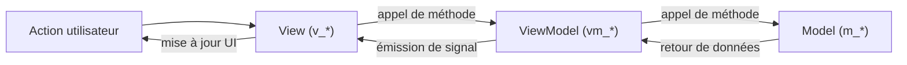
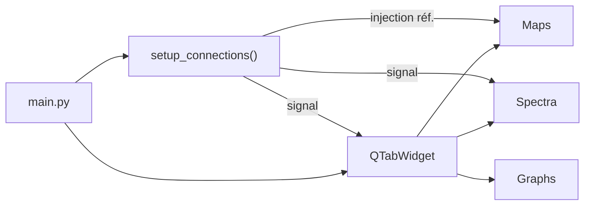
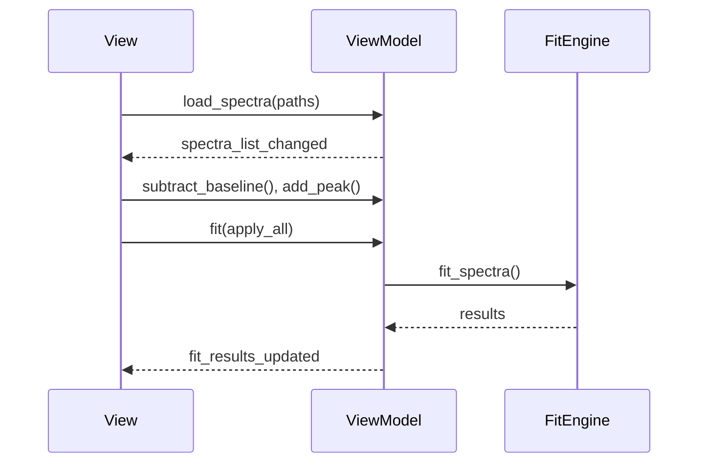
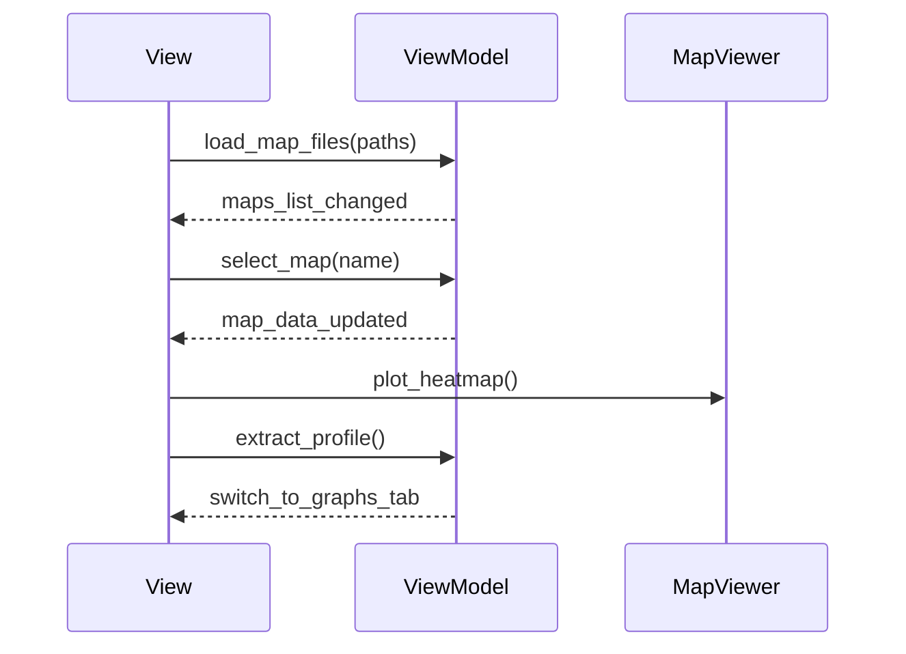
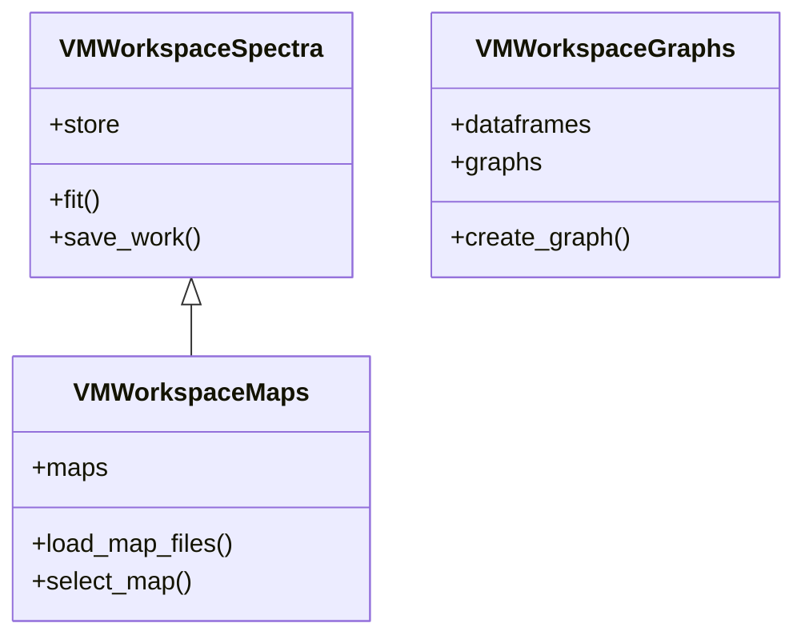

# **Architecture de l'application**

Ce guide couvre l'architecture technique, l'organisation du code et les patrons de développement de `SPECTROview`. Il s'adresse aux développeurs souhaitant comprendre, maintenir ou étendre l'application.

---

## **Patron MVVM**

`SPECTROview` applique strictement une architecture **Modèle-Vue-VueModèle (MVVM)**.
Chaque espace de travail respecte la même séparation des responsabilités en trois couches :

- **Model (Modèle)** — Conteneurs de données purs et logique métier. Les modèles ne détiennent aucune référence vers des widgets Qt et peuvent être testés de manière autonome.
- **ViewModel (Vue-Modèle)** — Orchestrateur de la logique applicative. Le ViewModel lit et modifie les Models, puis notifie la View par des signaux Qt. Il n'**importe et ne référence jamais** de classes View.
- **View (Vue)** — Couche de widgets Qt. Les Views se connectent aux signaux du ViewModel et appellent ses méthodes en réponse aux actions utilisateur.



### **Convention de nommage des fichiers**

| Couche | Préfixe | Exemple |
|--------|---------|---------|
| View | `v_` | `workspaces/v_workspace_spectra.py` |
| ViewModel | `vm_` | `spectra/vm_workspace_spectra.py` |
| Model | `m_` | `spectra/spectra_store.py` |

### **Règles d'importation**

| Couche | Peut importer | Ne peut pas importer |
|--------|---------------|----------------------|
| **View** | ViewModel, Components | — |
| **ViewModel** | Model, `fit_engine` | View |
| **Model** | Bibliothèques standard uniquement | View, ViewModel |

### **Communication par signaux et slots**

Les Views et les ViewModels communiquent **exclusivement via les signaux et slots Qt**. Un ViewModel ne doit jamais appeler directement une méthode d'une View, et une View ne doit jamais modifier l'état d'un Model sans passer par son ViewModel.

```python
# ── Le ViewModel définit les signaux ──
class VMWorkspaceSpectra(QObject):
    spectra_list_changed = Signal(list)       # ViewModel → View
    fit_progress_updated = Signal(int, int, int, float, int)

# ── La View s'y connecte dans __init__ ──
class VWorkspaceSpectra(QWidget):
    def __init__(self):
        self.vm.spectra_list_changed.connect(self._update_list)
```

---

## **Structure du projet**

```
spectroview/
├── __init__.py             # Constantes, modèles de pics, chemins de ressources, VERSION, BUILD_NUMBER
├── _build_info.py          # Métadonnées de build, renseignées avec l'horodatage lors du packaging wheel/sdist
├── main.py                 # Point d'entrée, QMainWindow, câblage inter-espaces
├── application/            # Façade API pour l'état courant de l'application de bureau
│   ├── service.py          # Opérations métier sur jeux de données/spectres/ajustements/graphiques/cartes
│   ├── dispatch.py         # Frontière d'exécution en file sur le thread principal Qt
│   └── errors.py           # Codes d'erreur d'intégration stables
│
├── i18n/                   # Localisation centralisée EN/FR et liaisons Qt dynamiques
│   ├── __init__.py         # Exports publics tr/tr_plural et liaisons déclaratives bind_*
│   ├── manager.py          # Singleton TranslationManager, chargeur de catalogues JSON et QTranslator
│   ├── bindings.py         # Liaisons faiblement référencées (texte, onglet, liste déroulante, en-tête)
│   └── validator.py        # Extracteur AST de clés, validation de catalogue et audit de littéraux UI
│
├── settings/               # Architecture unifiée des paramètres (Model, ViewModel et UI à 2 panneaux)
│   ├── m_settings.py          # Paramètres persistants et config.json portable
│   ├── vm_settings.py         # ViewModel des paramètres et testeur de connexion LLM en arrière-plan
│   ├── secrets.py             # Magasin de secrets obfusqué multiplateforme sous QSettings (_credentials/)
│   ├── build_info.py          # Résolution double mode des dépendances et capture d'instantané de build
│   └── ui/                    # Boîte de dialogue des paramètres à deux volets avec recherche instantanée
│       ├── settings_dialog.py # Fenêtre hôte avec navigation latérale et recherche instantanée
│       ├── tab_general.py     # Préférences générales et dossier de travail
│       ├── tab_fit.py         # Convergence du solveur d'ajustement et bornes des pics
│       ├── tab_ai.py          # Identifiants LLM, tests de connexion et serveur MCP local
│       └── tab_about.py       # Détails de l'application, environnement Python et dépendances
│
├── model/                  # Modèles de données organisés par domaine (aucun widget Qt)
│   ├── m_settings.py       # Façade de compatibilité des paramètres persistants (encapsule spectroview.settings)
│   ├── io/                 # Chargeurs de fichiers et sérialisation des espaces de travail
│   │   ├── m_io.py         # Routage universel et lecteurs texte/CSV
│   │   ├── m_wdf.py        # Lecteur binaire Renishaw WiRE WDF
│   │   ├── m_spc.py        # Lecteur binaire Galactic SPC
│   │   ├── m_l6s.py        # Lecteur binaire HORIBA LabSpec 6 (.l6s / .l6m)
│   │   ├── m_ngs.py        # Lecteur binaire HORIBA LabSpec 5 (.ngs / .ngc)
│   │   └── workspace_io.py # Sérialisation unifiée pour les espaces de travail
│   ├── spectra/            # Magasin tensoriel spectral, métriques et modèles d'ajustement
│   │   ├── spectra_store.py       # Structures tensorielles SpectraStore & MapData
│   │   ├── spectral_parameters.py # Métriques spectrales brutes vectorisées (Area, Max, Pos_Max, Barycenter, FWHM)
│   │   ├── heatmap.py             # Interpolation et triangulation 2D de cartes thermiques en pur NumPy
│   │   ├── peak_model.py          # Fonctions utilitaires pour les paramètres de pics
│   │   └── m_fit_model_manager.py # Gestion des fichiers de modèles d'ajustement sauvegardés
│   ├── graphs/             # Schémas graphiques, recettes et modèles de style
│   │   ├── m_graph.py                 # Modèle de configuration de tracé (dataclass MGraph)
│   │   ├── graph_control.py           # Contrat de contrôle et validation des graphiques
│   │   ├── graph_style.py             # Style graphique et prédicat de restyle sans replot
│   │   ├── m_plot_recipe.py           # Dataclass de recette de tracé (+ m_plot_recipe_store.py)
│   │   └── m_style_template_store.py  # Persistance des modèles de style graphique
│   ├── analysis/           # Moteurs d'analyse numérique et calculateurs
│   │   ├── m_mva.py               # Moteur PCA + NMF
│   │   └── m_quick_calculators.py # Logique mathématique pure pour les calculateurs scientifiques
│   └── system/             # Environnement d'exécution, TLS et services de mise à jour
│       ├── m_tls.py              # Validation durcie des certificats TLS (truststore, certifi, pip)
│       ├── m_installation.py     # Détection centralisée du mode d'installation (InstallType & InstallationManager)
│       ├── m_update_manager.py   # Façade multiplateforme UpdateManager, cache ETag, SHA256SUMS
│       ├── m_update_checker.py   # Anciens workers QThread pip/wheel et utilitaire de mise à jour détaché
│       └── m_macos_font_patch.py # Correctif de compatibilité pour le rendu des polices sous macOS
│
├── viewmodel/              # Logique métier et orchestration des données (façade paresseuse PEP 562)
│   ├── spectra/            # ViewModel et mixins de l'espace Spectra
│   │   ├── vm_workspace_spectra.py     # État principal, sélection et coordination E/S
│   │   ├── vm_spectra_preprocessing.py # Corrections X/Y, recadrage ROI, ligne de base et suppression des rayons cosmiques
│   │   ├── vm_spectra_fitting.py       # Édition de pics, presse-papiers/JSON de modèle et lancement de VBFthread
│   │   ├── vm_spectra_results.py       # Collecte des résultats, colonnes calculées et export Excel/presse-papiers
│   │   ├── vm_spectra_persistence.py   # Sauvegarde/chargement ZIP/NPZ et lecteur historique .spectra v1
│   │   └── vm_fit_model_builder.py     # Orchestration de gestion des fichiers de modèles d'ajustement
│   ├── maps/               # ViewModels de l'espace Maps et de Live Maps
│   │   ├── vm_workspace_maps.py        # Espace Maps (étend VMWorkspaceSpectra)
│   │   ├── vm_maps_fitting.py          # Ajustement par lots de cartes et post-traitement Zone/Quadrant wafer
│   │   ├── vm_maps_persistence.py      # Chargeur JSON historique .maps v1
│   │   ├── vm_live_maps.py             # État Live Maps, anti-rebond et évaluation synchrone
│   │   └── live_maps_worker.py         # _LiveMapWorker (QRunnable) asynchrone et déchargement par instantané
│   ├── graphs/             # ViewModel de l'espace Graphs
│   │   ├── vm_workspace_graphs.py      # DataFrames, filtrage, CRUD graphique et persistance
│   │   └── graph_undo.py               # Mixin d'annulation/rétablissement par instantané complet et regroupement
│   ├── analysis/           # Orchestration de l'analyse numérique
│   │   └── vm_mva.py                   # Orchestration de l'analyse multivariée (PCA/NMF)
│   ├── common/             # Utilitaires ViewModel partagés
│   │   ├── spectral_utils.py           # closest_index, parse_coords_from_fname, Fano et métadonnées
│   │   ├── export_utils.py             # Export Excel, presse-papiers et fichiers figure
│   │   └── ui_utils.py                 # Adaptateurs de notification, alerte, icône et couleur d'état
│   ├── vm_settings.py      # Façade de compatibilité -> spectroview.settings.vm_settings
│   └── utils.py            # Façade de ré-export rétrocompatible -> viewmodel.common & v_metadata_tooltip
│
├── ai_agent/               # Module AI Data Chat (multi-fournisseurs ; optionnel à l'exécution)
│   ├── __init__.py              # Docstring uniquement, maintient l'importation protégée
│   ├── m_llm_client.py          # Clients LLM multi-fournisseurs (Ollama/OpenAI/Anthropic) + workers QThread
│   ├── m_conversation.py        # Modèle de conversation (+ m_conversation_store.py : historique)
│   ├── m_prompt_manager.py      # Assemblage du prompt système / règles / connaissances
│   ├── mcp/server.py            # Profils partagés FastMCP pour le chat et l'application complète
│   ├── mcp/runtime.py           # Cycle de vie optionnel HTTP Streamable sur loopback
│   ├── config/, prompts/, rules/, knowledge/, examples/, utils/  # Ressources de prompts et utilitaires (voir ai_agent.md)
│   ├── vm_chat.py               # ViewModel du chat (sélection du profil de prompt, boucle agentique)
│   └── v_chat_panel.py          # Panneau de discussion intégré (+ v_history_dialog.py)
│
├── view/                   # Widgets Qt et mise en page UI (façade paresseuse PEP 562)
│   ├── __init__.py               # Exports paresseux des espaces, composants et thème
│   ├── workspaces/               # Paquets View des espaces de premier niveau
│   │   ├── __init__.py                # Exports paresseux des espaces
│   │   ├── v_workspace_spectra.py     # View de l'espace Spectra
│   │   ├── v_workspace_maps.py        # View de l'espace Maps (étend Spectra)
│   │   └── graphs/                    # Paquet View de l'espace Graphs
│   │       ├── __init__.py            # Exports du paquet (VWorkspaceGraphs, MdiSubWindow)
│   │       ├── v_workspace_graphs.py  # Orchestrateur VWorkspaceGraphs
│   │       ├── v_mdi_subwindow.py     # MdiSubWindow (redimensionnement/déplacement par contour)
│   │       ├── v_graphs_ui.py         # GraphsUIMixin (panneaux, barres d'outils, raccourcis)
│   │       ├── v_graphs_dataframes.py # GraphsDataFramesMixin (sélection et synchronisation de DF)
│   │       ├── v_graphs_mdi.py        # GraphsMdiMixin (création MDI et disposition)
│   │       └── v_graphs_actions.py    # GraphsActionsMixin (création/mise à jour/export/annulation)
│   ├── components/               # Widgets partagés et réutilisables (façade paresseuse PEP 562)
│   │   ├── __init__.py                # Exports paresseux des sous-paquets + alias des paramètres
│   │   ├── v_settings.py              # Boîte de dialogue des paramètres (shim de compatibilité)
│   │   ├── common/                    # Coque principale, notifications, calculateurs et widgets partagés
│   │   │   ├── __init__.py
│   │   │   ├── v_menubar.py           # Barre de menus principale
│   │   │   ├── v_about.py             # Boîte de dialogue À propos
│   │   │   ├── v_update_banner.py     # Bannière de notification de mise à jour
│   │   │   ├── v_notification.py      # Badges flottants natifs et gestionnaire
│   │   │   ├── v_quick_calculators.py # Interface des calculateurs scientifiques
│   │   │   ├── customized_widgets.py  # Combobox de palette, barre d'outils personnalisée
│   │   │   └── markdown_utils.py      # Normaliseur d'espacement Markdown pour Python-Markdown
│   │   ├── lists/                     # Liste de spectres/cartes, tableau DataFrame et infobulles
│   │   │   ├── __init__.py
│   │   │   ├── v_spectra_list.py      # Liste des spectres avec cases à cocher
│   │   │   ├── v_map_list.py          # Panneau des cartes chargées (sélection à deux niveaux)
│   │   │   ├── v_dataframe_table.py   # Visionneuse générique de DataFrame
│   │   │   └── v_metadata_tooltip.py  # Constructeur d'infobulles de métadonnées
│   │   ├── spectra_viewer/            # Paquet du visualiseur de spectres (1D, Heatmap, 3D, interactions)
│   │   │   ├── __init__.py            # Exports du paquet (VSpectraViewer, FastLine3DCollection, etc.)
│   │   │   ├── common.py              # Palettes, cache de styles, jetons de noms et normalisation 1D
│   │   │   ├── v_spectra_viewer.py    # Widget principal VSpectraViewer, barre d'outils et thème
│   │   │   ├── v_spectra_options.py   # SpectraOptionsMenuMixin (menu options, synchro et style)
│   │   │   ├── v_plot_1d.py           # SpectraPlot1DMixin (segments 1D, décalages, superpositions d'ajustement)
│   │   │   ├── v_plot_heatmap.py      # SpectraHeatmapMixin (carte thermique 2D et jetons Y)
│   │   │   ├── v_plot_3d.py           # FastLine3DCollection & SpectraPlot3DMixin
│   │   │   ├── v_interactions.py      # SpectraInteractionMixin (zoom, survol, déplacement de pics, gomme)
│   │   │   └── v_spectra_legend_editor.py  # Dialogue d'édition de légende par lots et mixin
│   │   ├── lower_tabs/                # Paquet des onglets inférieurs
│   │   │   ├── __init__.py            # Exports (VFitModelBuilder, VPeakTable, VFitResults, VMVA, VMoreTab)
│   │   │   ├── v_fit_model_builder.py # Contrôles Baseline + Peak + Fit
│   │   │   ├── v_peak_table.py        # Tableau interactif des paramètres de pics
│   │   │   ├── v_fit_results.py       # Tableau DataFrame des résultats d'ajustement
│   │   │   ├── v_mva.py               # Contrôles PCA/NMF et coordinateur d'onglets
│   │   │   ├── v_mva_plots.py         # Widget _PlotTab MVA et mixin de tracé Matplotlib
│   │   │   └── v_moretab.py           # Panneau métadonnées et normalisation
│   │   ├── map_viewer/                # Paquet du visualiseur de cartes (2D/wafer, interactions, dialogue)
│   │   │   ├── __init__.py            # Exports (VMapViewer, VMapViewerDialog, helpers de sélection)
│   │   │   ├── map_selection.py       # Géométrie spatiale partagée, résolution de sélection et superposition
│   │   │   ├── v_map_data.py          # MapDataProcessingMixin (cache griddata, masque, valeurs aberrantes, profil)
│   │   │   ├── v_map_plot.py          # MapPlotMixin (rendu carte 2D/wafer, statistiques, profil)
│   │   │   ├── v_map_interactions.py  # MapInteractionMixin (sélection souris, coordonnées, copie)
│   │   │   ├── v_map_viewer.py        # Widget principal VMapViewer, barre d'outils, curseurs et options
│   │   │   └── v_map_viewer_dialog.py # Fenêtre détachable VMapViewerDialog
│   │   ├── rgb_live_maps/             # Paquet sélecteurs de plages RVB et Live Maps
│   │   │   ├── __init__.py            # Exports pour les sélecteurs RVB et Live Maps
│   │   │   ├── common.py              # Palettes, thèmes, options et normalisation 1D partagés
│   │   │   ├── v_live_maps.py         # Vue multi-panneaux VLiveMaps et menu options
│   │   │   ├── v_live_maps_options.py # LiveMapsOptionsMenuMixin (légende et options d'affichage)
│   │   │   ├── v_live_map_subpanel.py # Widget conteneur LiveMapSubpanel
│   │   │   ├── v_live_map_1d.py       # LiveMap1DMixin (rendu séries 1D et profils)
│   │   │   ├── v_live_map_2d.py       # LiveMap2DMixin (rendu carte thermique 2D)
│   │   │   ├── v_live_map_selection.py # LiveMapSelectionMixin (sélection point/zone/légende)
│   │   │   ├── v_live_maps_legend_editor.py # LiveMapsLegendEditorDialog éditeur libellés et couleurs
│   │   │   ├── v_range_selector.py    # VRangeSelectorPanel & RangeSelectorManager
│   │   │   └── v_range_bracket_mixin.py # SpectraRangeBracketMixin pour VSpectraViewer
│   │   ├── graphs/                    # Paquet de tracé, rendu, filtrage et export Graphs
│   │   │   ├── __init__.py
│   │   │   ├── v_graph.py             # Widget orchestrateur VGraph (restyle/replot/actions)
│   │   │   ├── v_graph_canvas.py      # _DebouncedFigureCanvas & _FastNavigationToolbar
│   │   │   ├── v_graph_breaks.py      # GraphBreakInsetMixin (axes coupés et incrustés)
│   │   │   ├── v_graph_axes.py        # GraphAxesStyleMixin (limites, échelles, graduations, thème)
│   │   │   ├── v_graph_annotations.py # GraphAnnotationMixin (8 types d'annotations et glisser sur canevas)
│   │   │   ├── v_plot_renderer.py     # Moteur de rendu Matplotlib sans état (PlotRenderer)
│   │   │   ├── v_plot_spatial.py      # SpatialPlotMixin & WaferPlot (rendu 2Dmap / wafer)
│   │   │   ├── graph_commit.py        # Instantané d'état graphique et moteur de diff annuler/rétablir
│   │   │   ├── v_export_dialog.py     # Dialogues d'export unitaire et par lots
│   │   │   ├── v_multipanel_dialog.py # Compositeur de figures multi-panneaux pour publication
│   │   │   ├── v_plot_recipe_dialog.py    # Gestionnaire de recettes de tracé
│   │   │   ├── v_style_template_dialog.py # Gestionnaire de modèles de style graphique
│   │   │   └── v_data_filter.py       # Panneau de filtrage dynamique par requête
│   │   └── customize_graph/           # Boîte de dialogue Customize Graph (à deux panneaux type Settings)
│   │       ├── customize_graph_dialog.py     # CustomizeGraphDialog (hôte à deux volets avec recherche et aperçu)
│   │       ├── common.py                     # NavItemDelegate et aides de mise en évidence
│   │       ├── tab_general.py                # Onglet General & Typography
│   │       ├── tab_axes_limits.py            # Onglet Axes & Limits
│   │       ├── tab_ticks_spines.py           # Onglet Ticks & Spines
│   │       ├── tab_secondary_inset.py        # Onglet Secondary & Inset
│   │       ├── tab_legend_series.py          # Onglet Legend & Series
│   │       ├── tab_plot_styles.py            # Onglet Plot Style & Fitting
│   │       ├── tab_annotations.py            # Onglet Annotations
│   │       └── customize_annotation_dialogs.py  # EditLineDialog/EditTextDialog/ColorDelegate
│   └── theme/                         # Architecture des thèmes et polices (ThemeManager, jetons, palettes, polices)
│       ├── manager.py                 # Propriétaire unique de l'état global du thème
│       ├── fonts.py                   # Configuration multiplateforme des polices (macOS/Windows/Linux)
│       ├── palettes.py                # Constructeurs QPalette pour les 5 thèmes canoniques
│       ├── qss_template.py            # Modèle QSS paramétré
│       └── tokens.py                  # Dataclass ThemeTokens et préréglages
│
├── fit_engine/             # Ajustement par lots haute performance
│   ├── vbf_engine.py            # Orchestrateur (VBFengine)
│   ├── optimizer.py             # Levenberg-Marquardt vectorisé par lots
│   ├── evaluator.py             # Correspondance de paramètres (VBFevaluator)
│   ├── models.py                # Fonctions de pics vectorisées + jacobiennes
│   ├── scalar_models.py         # Fonctions scalaires de repli + PEAK_MODEL_REGISTRY
│   ├── vbf_thread.py            # Encapsuleur QThread
│   ├── baseline.py              # Algorithmes de ligne de base (arPLS, airPLS, etc.)
│   ├── noise.py                 # Fonctions d'estimation du bruit
│   └── weights.py               # Masque d'ajustement pondéré par région et calcul des poids
│
├── resources/              # Icônes, polices, catalogues de localisation, feuilles de style Matplotlib
│   ├── icons/
│   ├── i18n/fr.json        # Catalogue de traduction française UI et graphiques (`strings`, `plurals`, `contexts`)
│   └── *.mplstyle
│
packaging/                  # Pipelines de compilation autonomes par plateforme (réutilisant main.spec)
├── windows/build_windows.py      # PyInstaller --onedir + Portable ZIP + Velopack vpk pack
├── macos/{build_dmg.py,build_dmg.sh,entitlements.plist}
└── linux/{build_linux.py,build_appimage.sh,build_deb.sh,spectroview.desktop}
```

---

## **Point d'entrée de l'application**

`spectroview/main.py` instancie la `QMainWindow` et crée tous les espaces de travail sous forme d'onglets dans un `QTabWidget` :



La méthode `setup_connections()` dans `main.py` relie les dépendances inter-espaces :

- **Maps → Graphs** : `VMWorkspaceMaps.set_graphs_workspace(v_graphs)` injecte une référence permettant à `Maps` d'envoyer directement des profils et des DataFrames à l'espace `Graphs`.
- **Maps → Spectra** : `main.py` connecte `send_spectra_to_workspace` à la méthode `receive_spectra()` du ViewModel Spectra, qui insère des copies profondes des spectres de carte sélectionnés dans le `SpectraStore` de l'onglet `Spectra`.
- **Fit Results → Graphs** : `Spectra` et `Maps` émettent tous deux `fit_results_updated` avec un `pd.DataFrame` pouvant être transmis à l'espace `Graphs` pour les tracés statistiques.

### **Garder le chemin de démarrage léger**

Importer `main.py` entraîne transitivement l'importation de chaque module atteignable, et ce graphe d'importation domine le temps de démarrage. Deux familles de paquets sont volontairement maintenues **hors** de ce graphe initial et importées uniquement au moment de leur utilisation :

| Paquet | Coût d'import | Où il est désormais importé |
|---|---|---|
| `anthropic`, `openai`, `ollama`, `mcp` | ~4,5 s cumulés | `Main.open_ai_chat()`, `_load_*()` dans `ai_agent/m_llm_client.py`, `MCPHub._open_session()` |
| `scipy.stats`, `scipy.interpolate`, `scipy.linalg` | ~1,3 s cumulés | `PlotRenderer._plot_histogram()` / `WaferPlot.plot()`, `SpectraStore.batch_preprocess()`, `VMMVA._build_from_all_maps()`, `build_heatmap_grid()`, `optimizer._batched_solve()` |

`scipy` impose une contrainte particulière : une importation purement paresseuse ne ferait que déplacer la latence vers le *premier* histogramme ou tracé *wafer*, ce qui ralentissait visiblement l'ouverture d'un espace `.graphs` enregistré. `Main.showEvent()` lance donc un thread démon (`_prewarm_heavy_imports`) qui importe les trois sous-modules `scipy` juste après le premier affichage — la fenêtre s'affiche en ~2 s et `scipy` est déjà prêt ~1 s plus tard, faisant de chaque `import scipy...` local un simple accès en cache `sys.modules`. Les SDK LLM ne sont volontairement **pas** préchauffés : la majorité des sessions n'ouvrent jamais le panneau de discussion, qui affiche déjà un indicateur de chargement.

Vérifiez avec `python -X importtime -c "import spectroview.main"` avant d'ajouter tout nouvel import de paquet lourd au niveau module — s'il n'est pas nécessaire pour afficher la première fenêtre, différez-le. `tests/performance/test_startup_imports.py` échoue si l'un d'entre eux réapparaît sur le chemin de démarrage.

---

## **Cycle de vie des données**

### **Spectra : Chargement → Traitement → Ajustement → Résultats**



### **Maps : Chargement → Extraction → Carte thermique → Profil**



---

## **Héritage entre espaces de travail**

`VMWorkspaceMaps` **étend** `VMWorkspaceSpectra`. Ainsi, chaque fonctionnalité d'ajustement, de ligne de base, de gestion des pics et de sérialisation disponible dans `Spectra` l'est automatiquement dans `Maps`, complétée par des surcharges propres aux cartes :



---

## **Système de composants réutilisables**

Les espaces sont assemblés à partir de **composants partagés** qui suivent tous le même modèle fondé sur les signaux Qt :

| Composant | Fichier | Rôle |
|-----------|---------|------|
| `VSpectraViewer` | `spectra_viewer/v_spectra_viewer.py` | Paquet de canevas Matplotlib pour affichage 1D/Heatmap/3D, zoom/pan, interactions pics/ligne de base/gomme |
| `SpectraLegendEditorDialog` | `spectra_viewer/v_spectra_legend_editor.py` | Éditeur transactionnel de palette, limite de légende, libellés et couleurs (par lots de 100 lignes) |
| `VFitModelBuilder` | `lower_tabs/v_fit_model_builder.py` | Correction X, plage spectrale, ligne de base, pics, commandes d'ajustement |
| `VPeakTable` | `lower_tabs/v_peak_table.py` | Tableau éditable des paramètres de pics (centre, FWHM, amplitude, bornes) |
| `VMapViewer` | `map_viewer/v_map_viewer.py` | Canevas carte thermique / wafer avec curseurs Z/X, masque et extraction de profil |
| `VMapViewerDialog` | `map_viewer/v_map_viewer_dialog.py` | Fenêtre détachable toujours au premier plan encapsulant `VMapViewer` |
| `VGraph` | `graphs/v_graph.py` | Widget graphique Matplotlib prenant en charge plus de 10 variantes et styles de tracé |
| `VDataFilter` | `graphs/v_data_filter.py` | Constructeur dynamique de filtres `pandas` `.query()` |
| `VFitResults` | `lower_tabs/v_fit_results.py` | Tableau des résultats d'ajustement coloré par convergence |
| `VMVA` | `lower_tabs/v_mva.py` | Contrôles PCA/NMF et graphiques intégrés |
| `VMoreTab` | `lower_tabs/v_moretab.py` | Affichage des métadonnées et contrôles de normalisation en Y |
| `CustomizeGraphDialog` | `customize_graph/customize_graph_dialog.py` | Boîte de dialogue singleton pour la personnalisation des annotations, légendes et axes |

---

## **Système de thèmes et typographie**

SPECTROview utilise une architecture centralisée de thèmes et de typographie (`spectroview/view/theme/`) :

- **`ThemeManager` (`manager.py`)** : Détient l'état canonique du thème actif (`dark`, `gray`, `light`, `classic_dark`, `classic_light`), applique `QPalette` ainsi que les feuilles de style paramétrées (`qss_template.py`) et gère le changement dynamique à chaud.
- **Architecture d'icônes vectorielles SVG (`icons_svg.py` & `icons.py`)** : Moteur de rendu vectoriel temps réel (`_SvgIconEngine(QIconEngine)`) remplaçant les PNG pré-rastérisés par un rendu net au ratio de pixels physiques 1:1, une colorisation dynamique à l'affichage selon les jetons du thème et une façade unifiée `Icons`.
- **Polices multiplateformes (`fonts.py`)** : `setup_application_font(app)` applique la police par défaut adaptée à chaque plateforme sur `QApplication` :
  - **Windows** : `Segoe UI` à 10 pt (police bureau standard à 96 DPI, ~13,3 px).
  - **macOS** : `.AppleSystemUIFont` (San Francisco) à 13 pt (police standard Apple HIG à 72 DPI, 13 px).
  - **Linux / Autres** : Police sans-serif de l'environnement de bureau à >= 10 pt.
- **Invariant de DPI et de dimensionnement** : En évitant les règles globales `QWidget { font-size: ... }` dans les feuilles de style, les changements de thème évitent le coût d'invalidation du cache des polices. Les contrôles héritent leur taille de la police applicative, préservant la lisibilité native, les métriques standard des menus et la mise à l'échelle multi-écrans sur toutes les plateformes.

---

## **Persistance et sérialisation**

`SPECTROview` délègue toutes les opérations de chargement et d'enregistrement à la classe unifiée `WorkspaceIO` (`model/io/workspace_io.py`), isolant les entrées/sorties des ViewModels. Chaque espace possède son propre format via `WorkspaceIO` :

| Espace | Extension | Stratégie clé |
|--------|-----------|---------------|
| `Spectra` | `.spectra` | Archive ZIP (`format_version: 2`) : `metadata.json` (`store_meta` par carte) + tableaux NPZ par carte. Écrite par `WorkspaceIO.save_workspace()`. |
| `Maps` | `.maps` | Même format ZIP unifié que `.spectra` (`WorkspaceIO.save_workspace()`), dont les métadonnées contiennent en plus `maps_metadata`, `map_type` et le DataFrame des résultats d'ajustement. |
| `Graphs` | `.graphs` | Archive ZIP (`format_version: 4`) via `WorkspaceIO.save_workspace()` : `metadata.json` (tracés + sources de DataFrames) + DataFrames compressés. |

### **Flux de sérialisation d'un spectre**

```python
# Enregistrement (format_version 2) : SpectraStore → Archive ZIP (metadata.json + tableaux NPZ)
metadata = {
    "format_version": 2,
    "store_meta": {                 # indexé par nom de carte (== fname pour un spectre isolé)
        "sample_001": {
            "fnames": ["sample_001"],
            "is_active": [True],
            "baseline_config": {...},
            "peak_params": [...],
            "range_min": None, "range_max": None,
            # ...
        }
    }
}
# arrays : blocs NPZ par carte produits par SpectraStore.to_npz_dict(map_name)
# (axe brut x0 float64 + intensités Y0 float32, plus éventuels tableaux traités/ajustés)
```

---

## **Modèle de threading**

Les opérations longues s'exécutent dans des sous-classes de `QThread` afin d'éviter tout gel de l'interface graphique.
Tous les threads émettent des signaux d'avancement que le ViewModel relaie vers la barre de progression de la View :

| Classe de thread | Emplacement | Rôle |
|------------------|-------------|------|
| `VBFthread` | `fit_engine/vbf_thread.py` | Ajustement par lots (moteur principal) |
| `_LiveMapWorker` | `viewmodel/maps/live_maps_worker.py` | `QRunnable` asynchrone (`QThreadPool`) pour les calculs Live Maps sur grands jeux de données ($\ge 25\,000$ spectres) |
| `UnifiedUpdateCheckWorker` / `UnifiedUpdateDownloadWorker` | `model/system/m_update_manager.py` | Vérifications multiplateformes des versions (cache ETag) et téléchargements vérifiés par SHA-256 |
| `UpdateCheckerWorker` | `model/system/m_update_checker.py` | Anciens workers pip/wheel conservés pour rétrocompatibilité |
| `LLMWorker` / `APIWorker` / `AnthropicWorker` | `ai_agent/m_llm_client.py` | Requêtes de chat en streaming pour AI Data Chat — un worker par fournisseur (Ollama / compatible OpenAI / Anthropic) |
| `_ConnectionTestWorker` | `settings/vm_settings.py` | Vérification non bloquante en arrière-plan de la connexion aux fournisseurs LLM |

**Cycle de vie d'un thread** :

1. Le ViewModel instancie le thread et connecte les signaux `finished` / `progress`.
2. `thread.start()` — exécute `run()` sur un thread OS distinct.
3. À l'achèvement, le signal `finished` déclenche `_on_fit_finished()` dans le ViewModel.
4. Le ViewModel émet les signaux de résultat → la View met à jour l'interface.

---

## **Communication inter-espaces**

`SPECTROview` évite tout bus d'événements global. À la place, `main.py` emploie l'**injection de dépendances** et des **connexions directes de signaux** :

```python
# main.py → setup_connections()
# 1. Injection de référence : le VM Maps peut appeler les méthodes de l'espace Graphs
self.v_maps_workspace.vm.set_graphs_workspace(self.v_graphs_workspace)

# 2. Maps → Spectra : ingérer les spectres envoyés depuis l'espace Maps
self.v_maps_workspace.vm.send_spectra_to_workspace.connect(
    self.v_spectra_workspace.vm.receive_spectra
)

# 3. Signal : Maps demande l'ouverture de l'onglet Graphs après extraction d'un profil
self.v_maps_workspace.vm.switch_to_graphs_tab.connect(
    lambda: self.tabWidget.setCurrentWidget(self.v_graphs_workspace)
)
```

---

## **Constantes globales (`__init__.py`)**

`spectroview/__init__.py` définit les constantes globales de l'application :

| Constante | Rôle |
|-----------|------|
| `VERSION`, `BUILD_NUMBER` | Version sémantique de l'application et horodatage immuable de build |
| `PEAK_MODELS` | Profils de pics enregistrés (`Lorentzian`, `Gaussian`, `PseudoVoigt`, `GaussianAsym`, `LorentzianAsym`, `Fano`, `DecaySingleExp`, `DecayBiExp`) |
| `PLOT_STYLES` | Types de graphiques disponibles (`point`, `scatter`, `box`, `bar`, `line`, `trendline`, `histogram`, `wafer`, `2Dmap`) |
| `PALETTE`, `DEFAULT_COLORS`, `MARKERS` | Palettes de couleurs, cycle de 20 couleurs adaptées aux publications et marqueurs Matplotlib |
| `X_AXIS_UNIT`, `Y_AXIS_UNIT` | Registres des unités d'axes |
| `AXIS_LABELS` | Suggestions d'autocomplétion pour les libellés de graphiques |
| `ICON_DIR` | Chemin résolu vers `resources/icons/` |
| `PLOT_POLICY_LIGHT`, `PLOT_POLICY_DARK` | Chemins vers les feuilles de style Matplotlib |

---

## **Architecture de mise à jour et de packaging multiplateforme**

### Vue d'ensemble

`SPECTROview` expose une façade unifiée de détection d'installation et de mise à jour (`UpdateManager` dans `model/system/m_update_manager.py`) appuyée sur `InstallationManager` (`model/system/m_installation.py`) et un durcissement TLS centralisé (`model/system/m_tls.py`). Les utilisateurs bénéficient d'une même bannière, d'une vérification par cache `ETag`, d'un sélecteur de préversions et d'une vérification d'intégrité `SHA256SUMS.txt` sur chaque cible de distribution, sans avoir à connaître la méthode d'installation utilisée.

### Fichiers clés

| Fichier | Rôle |
|---------|------|
| `model/system/m_tls.py` | Application pure-modèle des autorités de certification (`GHSA-6q48-6c7w-9gw2`) : `SSL_CERT_FILE`/`REQUESTS_CA_BUNDLE` → magasin OS `truststore` → `certifi >= 2026.10.23` validé (contrôle `pip >= 26.2.2` au build) |
| `model/system/m_installation.py` | Classificateur pure-modèle `InstallType` (`DEV_SOURCE`, `PIP_WHEEL`, `WINDOWS_VELOPACK`, `WINDOWS_PORTABLE`, `MACOS_BUNDLE`, `LINUX_APPIMAGE`, `LINUX_DEB`, `STANDALONE_UNKNOWN`) |
| `model/system/m_macos_font_patch.py` | Correctif du cache de polices macOS interceptant `system_profiler SPFontsDataType` pour éviter le plantage amont `KeyError: '_items'` de `matplotlib` et le gel de 10 s |
| `model/system/m_update_manager.py` | `GitHubReleaseClient` (`ETag` + cache TTL), façade `UpdateManager`, `UnifiedUpdateCheckWorker`, `UnifiedUpdateDownloadWorker` et metteurs à jour par plateforme |
| `model/system/m_update_checker.py` | Anciens workers pip/wheel préservés ainsi que le lanceur de mise à niveau pip sécurisé (`--use-feature=truststore` / `--cert`) |
| `view/components/common/v_update_banner.py` | Bannière fine affichant la transition de version (`current → latest`) et le libellé d'action adapté à la plateforme |
| `main.py` | Exécute `_run_velopack_bootstrap()` avant `QApplication` uniquement lorsque Velopack est actif ; connecte la bannière et les dialogues guidés |
| `main.spec` & `packaging/` | Configuration PyInstaller unique et scripts de build pour Windows (`Setup.exe` + `Portable.zip`), macOS (`.dmg` Apple Silicon `arm64`) et Linux (`.AppImage` + `.deb`) |

### Matrice de mise à jour par plateforme et justification technique

| `InstallType` | Base de détection | Mécanisme de mise à jour |
|---|---|---|
| `DEV_SOURCE` | Non figé + `.git` / `pyproject.toml` / métadonnées éditables PEP 610 | `UnsupportedUpdater` : notification uniquement — ne modifie jamais un dépôt de développement |
| `PIP_WHEEL` | Installation `site-packages` non figée | `PythonUpdater` : télécharge le `.whl` vérifié par SHA-256, lance `pip install --upgrade` avec TLS durci en processus détaché et redémarre |
| `WINDOWS_VELOPACK` | Windows figé dans `current/` avec `Update.exe` ou `sq.version` | `WindowsVelopackUpdater` : télécharge `releases.win.json` et les `.nupkg` delta/complets en Python via `m_tls` (en contournant `webpki-roots` intégré dans `velopack 1.2.161`), puis transmet uniquement le dossier local à `velopack.UpdateManager` |
| `WINDOWS_PORTABLE` | Windows figé hors arborescence Velopack | `WindowsPortableUpdater` : télécharge et vérifie `Portable.zip`, propose **Extract to Folder...** avec protection contre le *zip-slip* |
| `MACOS_BUNDLE` | macOS figé dans `*.app/Contents/MacOS` | `MacOSUpdater` : télécharge le `.dmg` `arm64` vérifié (les hôtes Intel `x64` obsolètes ne téléchargent pas de binaire `arm64` incompatible) et affiche le guide Gatekeeper par Contrôle-clic *(le remplacement silencieux est différé tant que la signature/notarisation Apple Developer ID n'est pas configurée)* |
| `LINUX_APPIMAGE` | Linux figé avec `$APPIMAGE` correspondant à `$APPDIR` | `LinuxAppImageUpdater` : vérifie l'en-tête ELF et le SHA-256 ; remplacement atomique par `mv` + relance via un script `shlex.quote` lorsque `$APPIMAGE` est accessible en écriture, téléchargement guidé sinon |
| `LINUX_DEB` | Linux figé avec `/opt/spectroview/` ou marqueur `.spectroview-deb` | `LinuxDebUpdater` : vérifie `!<arch>\n` + SHA-256 et fournit une commande `sudo apt install` copiable en un clic |

### Automatisation des releases multiplateformes (`.github/workflows/release.yml`)

Le poussage d'un tag de version (`vMAJOR.MINOR.PATCH` ou `vMAJOR.MINOR.PATCH-rc.N` correspondant à `spectroview.VERSION`) déclenche un workflow Python 3.14 unifié :

1. **`verify`** : Valide la correspondance tag/version, impose `pip>=26.2.2` et `certifi>=2026.10.23`, et exécute les suites de tests unitaires headless et de temps d'import au démarrage.
2. **Constructeurs parallèles par plateforme** :
   - **`build-python`** : `.whl` + `.tar.gz`, `twine check` et vérification d'installation propre en environnement virtuel.
   - **`build-windows`** : PyInstaller (`--onedir`) + test de démarrage offscreen + `Portable.zip` + `vpk pack` Velopack (`Setup.exe`, `releases.win.json`, `*.nupkg`, chaînage de l'historique delta).
   - **`build-macos`** (`macos-15` `arm64`) : Build natif Apple Silicon `.app` + `.dmg` avec hook d'exécution PyInstaller et vérification `--smoke-test` offscreen (hooks optionnels `APPLE_SIGNING_IDENTITY` / `APPLE_CERTIFICATE_P12` / `APPLE_ID` prêts dès ajout des identifiants).
   - **`build-linux`** (`ubuntu-22.04` glibc baseline) : Construit `.AppImage` et `.deb`, valide `.desktop`, puis exécute les tests réels `apt-get install`, lancement offscreen, lancement AppImage et persistance de configuration (`~/.config/CEA-Leti/`).
3. **`release`** : Publie une GitHub Release unifiée accompagnée de `SHA256SUMS.txt` (en marquant automatiquement les préversions).
4. **`publish-pypi`** : Pour les versions stables, conserve le mécanisme PyPI Trusted Publisher existant (environnement `pypi`, `id-token: write`, `pypa/gh-action-pypi-publish@release/v1`).

Avant la première publication PyPI sur un nouveau fork ou dépôt, enregistrez un Trusted Publisher pour `CEA-MetroCarac/SPECTROview` dans PyPI avec le fichier de workflow `release.yml` et l'environnement `pypi`.

---

## **Internationalisation (i18n)**

`SPECTROview` prend en charge l'**anglais** (`"en"`, par défaut) et le **français** (`"fr"`) avec changement de langue à chaud via `spectroview/i18n/` :

- **`TranslationManager` (`manager.py`)** : Singleton gérant la langue active (`get_language()` / `set_language()`), les catalogues JSON (`spectroview/resources/i18n/<lang>.json`), les aides `tr()` / `tr_plural()` et le `QTranslator` Qt (`qtbase_<lang>.qm`) sans modifier `QLocale` (afin de conserver le point `.` comme séparateur décimal dans les champs numériques).
- **Liaisons dynamiques (`bindings.py`)** : Aides déclaratives à références faibles (`bind_text`, `bind_tooltip`, `bind_placeholder`, `bind_title`, `bind_window_title`, `bind_tab_text`, `bind_header_labels`, `bind_combo_items`, `on_language_changed`) qui actualisent l'interface lors de `set_language()` tout en préservant les clés canoniques dans `Qt.UserRole` (`itemData`) via `combo_data_or_text()` et `set_combo_by_data_or_text()`.
- **Validation et audit (`validator.py`)** : `validate_catalog("fr")` vérifie l'exhaustivité du catalogue et la cohérence des variables de formatage, tandis que `audit_untranslated_ui_literals()` inspecte par AST les modules View/Settings/IA (vérifié par `tests/unit/test_i18n.py`).
- **Ajouter une nouvelle langue** : Ajoutez `(code, nom_natif)` dans `SUPPORTED_LANGUAGES`, fournissez `spectroview/resources/i18n/<code>.json` (ainsi que `qtbase_<code>.qm` si besoin) et adaptez `_plural_index()` dans `manager.py` si les règles de pluriel diffèrent.

---

## **Documentation approfondie**

| Sujet | Page | Résumé |
|-------|------|--------|
| **Architecture de données : SpectraStore** | [spectra_store.md](spectra_store.md) | `MapData`, `MapInfo`, `SpectrumProxy`, hiérarchie des données, pipeline de prétraitement, persistance |
| **Espace Spectra** | [spectra.md](spectra.md) | `VMWorkspaceSpectra`, cycle de vie d'un spectre, pipeline ligne de base/pics, gestion des modèles d'ajustement |
| **Espace Maps** | [maps.md](maps.md) | `VMWorkspaceMaps`, chargement hyperspectral, rendu de carte thermique, gestion des coordonnées |
| **Espace Graphs** | [graphs.md](graphs.md) | `VMWorkspaceGraphs`, gestion des DataFrames, création de tracés, rendu `VGraph` |
| **Moteur d'ajustement vectorisé (`VBF Engine`)** | [vbf_engine.md](vbf_engine.md) | Optimiseur LM par lots, jacobiennes analytiques, ajout de nouveaux profils de pics |
| **Analyse multivariée** | [mva.md](mva.md) | Implémentation PCA/NMF, pipeline de données, export vers `Graphs` |
| **Agent conversationnel IA** | [ai_agent.md](ai_agent.md) | Chat LLM multi-fournisseurs (Ollama/OpenAI/Anthropic/…), appels d'outils MCP, prompt système, intégration Graphs |


---

## **Exécution et tests**

```bash
# Lancer depuis les sources
python -m spectroview.main

# Installer en mode éditable avec les dépendances de développement
pip install -e ".[dev]"

# Exécuter la suite de tests rapide (ignore les benchmarks lents sur données réelles ; mode offscreen configuré automatiquement)
pytest tests/ -m "not slow" -q

# Exécuter la suite complète de tests (incluant les jeux de benchmark réels ; ~7-8 min)
pytest tests/ -q

# Vérification statique de syntaxe et d'imports sur les fichiers modifiés
python -m pyflakes spectroview/<modified_file>.py

# Construire et prévisualiser la documentation
mkdocs serve
```

> [!NOTE]
> Pour les consignes détaillées de développement et de programmation en binôme, consultez le [cadre de développement IA (AGENTS.md)](https://github.com/CEA-MetroCarac/SPECTROview/blob/main/AGENTS.md) ainsi que le guide de la suite de tests dans [tests/README.md](https://github.com/CEA-MetroCarac/SPECTROview/blob/main/tests/README.md).


---

## **Dépendances**

| Paquet | Contrainte | Rôle |
|--------|-----------|------|
| `PySide6` | — | Liaisons Qt 6 (**et non** PyQt) |
| `matplotlib` | `&ge; 3.8.0, < 3.10.9` | Moteur de tracé pour les spectres et les cartes |
| `numpy` | `&ge; 2.0.2` | Calcul numérique sur tableaux (NumPy 2.x) |
| `scipy` | — | Interpolation, KDTree, SVD |
| `pandas` | — | Gestion des DataFrames |
| `superqt` | — | Widgets Qt enrichis (curseurs de plage) |
| `ollama` / `openai` / `anthropic` / `mcp` | `ollama ≥ 0.4`, `mcp ≥ 2.2` | Fournisseurs LLM + Model Context Protocol pour AI Data Chat. **Dépendances principales** (aucun groupe optionnel `[ai]`) — une installation `pip` standard les inclut ; la fonctionnalité reste uniquement *facultative à l'usage*. |
| `truststore` / `certifi` | `truststore ≥ 0.9.0`, `certifi ≥ 2026.10.23` | Vérification TLS durcie utilisant d'abord le magasin système puis le bundle `certifi` corrigé (`GHSA-6q48-6c7w-9gw2`) ; importation protégée |
| `velopack` / `pyinstaller` *(optionnel `[standalone]`)* | `velopack ≥ 1.2.161`, `pyinstaller ≥ 6.10.0` | Empaquetage autonome de bureau et hooks d'installation/mise à jour Velopack sous Windows |
