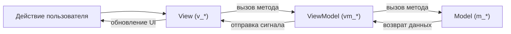
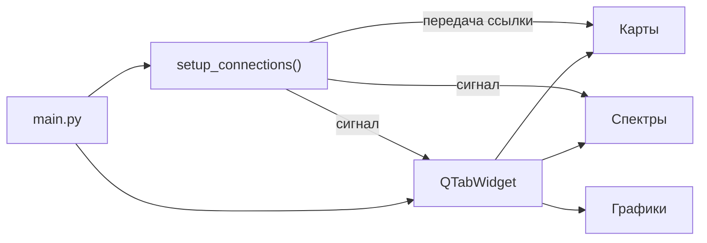
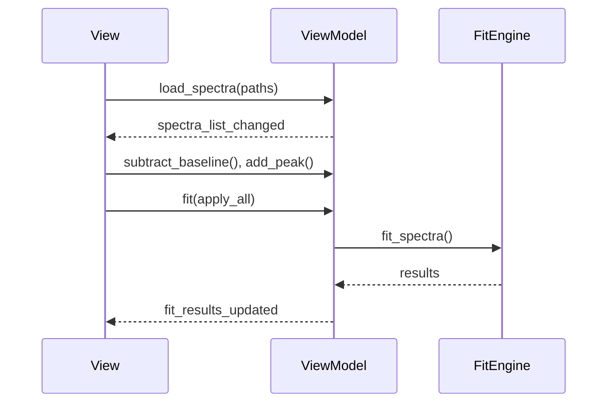
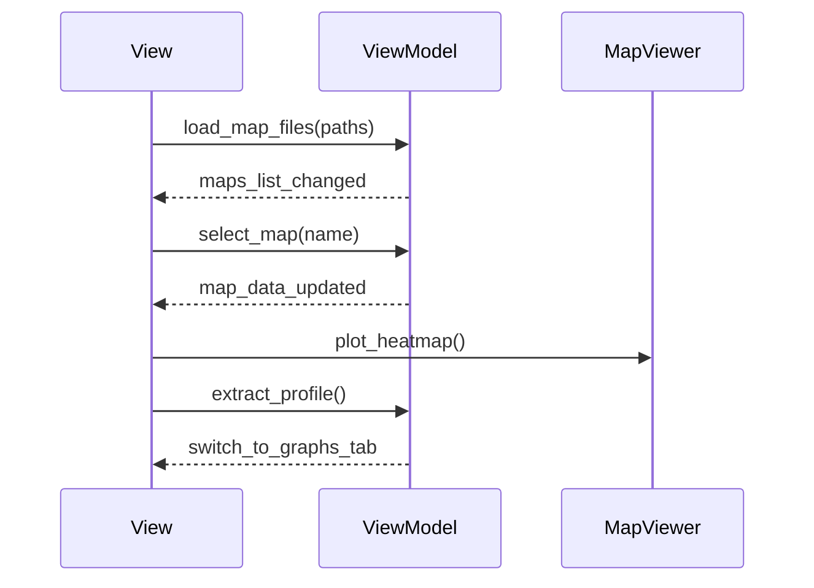
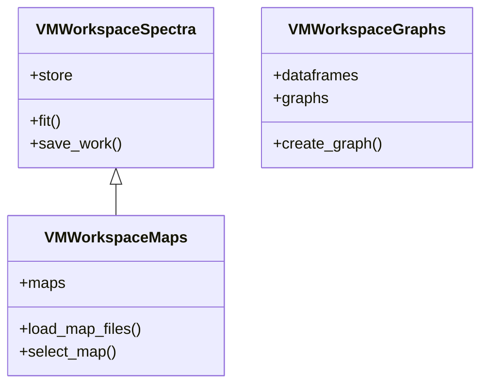

# **Архитектура приложения** { #application-architecture }

Данное руководство описывает техническую архитектуру, организацию кода и шаблоны проектирования в `SPECTROview`. Оно предназначено для разработчиков, которые хотят разобраться в устройстве приложения, сопровождать его или расширять его функциональность.

---

## **Паттерн MVVM** { #mvvm-pattern }

`SPECTROview` строго следует архитектуре **Model-View-ViewModel (MVVM)**.
Каждая рабочая область построена по единому трёхслойному разделению ответственности:

- **Model** — чистые контейнеры данных и предметная логика. Модели не содержат ссылок на виджеты Qt и могут тестироваться независимо.
- **ViewModel** — оркестратор бизнес-логики. ViewModel считывает и изменяет модели (Model), после чего уведомляет представление (View) посредством сигналов Qt. Он **никогда** не импортирует классы View и не ссылается на них.
- **View** — слой виджетов Qt. Представления (View) подключаются к сигналам ViewModel и вызывают методы ViewModel в ответ на действия пользователя.



### **Соглашение об именовании файлов** { #file-naming-convention }

| Слой | Префикс | Пример |
|------|---------|--------|
| View | `v_` | `workspaces/v_workspace_spectra.py` |
| ViewModel | `vm_` | `spectra/vm_workspace_spectra.py` |
| Model | `m_` | `spectra/spectra_store.py` |

### **Правила импорта** { #import-rules }

| Слой | Разрешено импортировать | Запрещено импортировать |
|------|-------------------------|-------------------------|
| **View** | ViewModel, компоненты (Components) | — |
| **ViewModel** | Model, `fit_engine` | View |
| **Model** | Только стандартные библиотеки | View, ViewModel |

### **Взаимодействие через сигналы и слоты** { #signalslot-communication }

Компоненты View и ViewModel взаимодействуют **исключительно через сигналы и слоты Qt**. ViewModel никогда не должен напрямую вызывать методы View, а View никогда не должен изменять состояние Model в обход своего ViewModel.

```python
# ── ViewModel defines signals ──
class VMWorkspaceSpectra(QObject):
    spectra_list_changed = Signal(list)       # ViewModel → View
    fit_progress_updated = Signal(int, int, int, float, int)

# ── View connects in __init__ ──
class VWorkspaceSpectra(QWidget):
    def __init__(self):
        self.vm.spectra_list_changed.connect(self._update_list)
```

---

## **Структура проекта** { #project-structure }

```
spectroview/
├── __init__.py             # Constants, peak models, resource paths, VERSION, BUILD_NUMBER
├── _build_info.py          # Build metadata, populated with timestamp during wheel/sdist packaging
├── main.py                 # Entry point, QMainWindow, cross-workspace wiring
├── application/            # API facade for the currently running desktop state
│   ├── service.py          # Dataset/spectra/fit/graph/map domain operations
│   ├── dispatch.py         # Queued Qt main-thread execution boundary
│   └── errors.py           # Stable integration error codes
│
├── i18n/                   # Centralized multilingual localization & live Qt bindings
│   ├── __init__.py         # Public tr/tr_plural & declarative bind_* exports
│   ├── manager.py          # TranslationManager singleton, JSON catalog loader & QTranslator lifecycle
│   ├── bindings.py         # Weak-ref widget/tab/combo/header live retranslation bindings
│   └── validator.py        # AST key extractor, catalog validator & untranslated UI literal audit
│
├── settings/               # Unified settings architecture (Model, ViewModel, & 2-panel Settings UI)
│   ├── m_settings.py          # Persistent app settings & portable config.json
│   ├── vm_settings.py         # Settings ViewModel & background LLM connection tester
│   ├── secrets.py             # Cross-platform obfuscated QSettings secret store (_credentials/)
│   ├── build_info.py          # Dual-mode runtime dependency resolution & build snapshot capture
│   └── ui/                    # Two-panel settings dialog with sidebar & instant search
│       ├── settings_dialog.py # Host dialog with sidebar navigation & instant search
│       ├── tab_general.py     # General preferences & Working Folder
│       ├── tab_fit.py         # Fitting solver convergence & peak bounds
│       ├── tab_ai.py          # LLM credentials, connection tests, & local MCP
│       └── tab_about.py       # Application details, Python env, & runtime package dependencies
│
├── model/                  # Data models organized by domain (no Qt widgets)
│   ├── m_settings.py       # Persistent app settings compatibility facade (wraps spectroview.settings)
│   ├── io/                 # File loaders & workspace serialization
│   │   ├── m_io.py         # Universal file loader dispatch & text/CSV readers
│   │   ├── m_wdf.py        # Renishaw WiRE WDF binary reader
│   │   ├── m_spc.py        # Galactic SPC binary reader
│   │   ├── m_l6s.py        # HORIBA LabSpec 6 (.l6s / .l6m) binary reader
│   │   ├── m_ngs.py        # HORIBA LabSpec 5 (.ngs / .ngc) binary reader
│   │   └── workspace_io.py # Unified serialization for Workspaces
│   ├── spectra/            # Spectral tensor store, metrics, & fit model models
│   │   ├── spectra_store.py       # Tensor-centric SpectraStore & MapData structures
│   │   ├── spectral_parameters.py # Vectorized raw spectral metrics (Area, Max, Pos_Max, Barycenter, FWHM)
│   │   ├── heatmap.py             # Pure-NumPy 2D heatmap grid interpolation & triangulation
│   │   ├── peak_model.py          # Helper functions for peak parameters
│   │   └── m_fit_model_manager.py # Saved fit model file management
│   ├── graphs/             # Graph schemas, recipes, & style templates
│   │   ├── m_graph.py                 # Plot configuration model (MGraph dataclass)
│   │   ├── graph_control.py           # Graph control & validation contract
│   │   ├── graph_style.py             # Graph styling & restyle-without-replot predicate
│   │   ├── m_plot_recipe.py           # Plot recipe dataclass (+ m_plot_recipe_store.py)
│   │   └── m_style_template_store.py  # Graph style template persistence
│   ├── analysis/           # Numerical analysis & calculator engines
│   │   ├── m_mva.py               # PCA + NMF engine
│   │   └── m_quick_calculators.py # Pure math logic for scientific calculators
│   └── system/             # Runtime environment, TLS, & update services
│       ├── m_tls.py              # Hardened TLS trust-store & certifi/pip validation
│       ├── m_installation.py     # Centralized runtime install detection (InstallType & InstallationManager)
│       ├── m_update_manager.py   # Multi-platform UpdateManager facade, ETag cache, SHA256SUMS
│       ├── m_update_checker.py   # Legacy pip/wheel QThread workers & detached upgrade helper
│       └── m_macos_font_patch.py # macOS font rendering compatibility patch
│
├── viewmodel/              # Business logic and data orchestration (PEP 562 lazy facade)
│   ├── spectra/            # Spectra workspace ViewModel & mixins
│   │   ├── vm_workspace_spectra.py     # Core workspace state, selection & I/O coordination
│   │   ├── vm_spectra_preprocessing.py # X/Y corrections, ROI crop, baseline & cosmic-ray removal
│   │   ├── vm_spectra_fitting.py       # Peak editing, fit-model clipboard/JSON & VBFthread launch
│   │   ├── vm_spectra_results.py       # Fit results collection, computed columns & Excel/clipboard export
│   │   ├── vm_spectra_persistence.py   # ZIP/NPZ workspace save/load & legacy v1 .spectra loader
│   │   └── vm_fit_model_builder.py     # Fit model file management orchestration
│   ├── maps/               # Maps workspace & Live Maps ViewModels
│   │   ├── vm_workspace_maps.py        # Maps workspace (extends VMWorkspaceSpectra)
│   │   ├── vm_maps_fitting.py          # Batch map fitting & wafer Zone/Quadrant post-processing
│   │   ├── vm_maps_persistence.py      # Legacy v1 .maps JSON loader
│   │   ├── vm_live_maps.py             # Live Maps state, debounce & synchronous evaluation
│   │   └── live_maps_worker.py         # Asynchronous _LiveMapWorker (QRunnable) & snapshot offload
│   ├── graphs/             # Graphs workspace ViewModel
│   │   ├── vm_workspace_graphs.py      # DataFrames, filtering, graph CRUD & persistence
│   │   └── graph_undo.py               # Whole-workspace snapshot undo/redo & batching mixin
│   ├── analysis/           # Numerical analysis orchestration
│   │   └── vm_mva.py                   # Multivariate analysis (PCA/NMF) orchestration
│   ├── common/             # Shared ViewModel utilities
│   │   ├── spectral_utils.py           # closest_index, parse_coords_from_fname, Fano & metadata helpers
│   │   ├── export_utils.py             # Excel, clipboard & figure file export
│   │   └── ui_utils.py                 # Notification, alert, icon & status-color adapters
│   ├── vm_settings.py      # Compatibility facade -> spectroview.settings.vm_settings
│   └── utils.py            # Backward-compatible re-export facade -> viewmodel.common & v_metadata_tooltip
│
├── ai_agent/               # AI Data Chat module (multi-provider; runtime-optional)
│   ├── __init__.py              # Module docstring, keeps import guarded
│   ├── m_llm_client.py          # Multi-provider LLM clients (Ollama/OpenAI/Anthropic) + QThread workers
│   ├── m_conversation.py        # Conversation model (+ m_conversation_store.py: history)
│   ├── m_prompt_manager.py      # System-prompt / rules / knowledge assembly
│   ├── mcp/server.py            # Shared FastMCP chat + full desktop tool profiles
│   ├── mcp/runtime.py           # Opt-in loopback Streamable HTTP lifecycle
│   ├── config/, prompts/, rules/, knowledge/, examples/, utils/  # Prompt assets + helpers (see ai_agent.md)
│   ├── vm_chat.py               # Chat ViewModel (prompt-tier selection, agentic loop)
│   └── v_chat_panel.py          # Embedded chat panel (+ v_history_dialog.py)
│
├── view/                   # Qt widgets and UI layout (PEP 562 lazy facade)
│   ├── __init__.py               # Lazy exports for workspaces, components & theme
│   ├── workspaces/               # Top-level workspace View packages
│   │   ├── __init__.py                # Lazy workspace exports
│   │   ├── v_workspace_spectra.py     # Spectra workspace View
│   │   ├── v_workspace_maps.py        # Maps workspace View (extends Spectra)
│   │   └── graphs/                    # Graphs workspace View package
│   │       ├── __init__.py            # Package exports (VWorkspaceGraphs, MdiSubWindow)
│   │       ├── v_workspace_graphs.py  # VWorkspaceGraphs orchestrator
│   │       ├── v_mdi_subwindow.py     # MdiSubWindow (rubber-band resize/move)
│   │       ├── v_graphs_ui.py         # GraphsUIMixin (panels, toolbars, shortcuts)
│   │       ├── v_graphs_dataframes.py # GraphsDataFramesMixin (DF selection & sync)
│   │       ├── v_graphs_mdi.py        # GraphsMdiMixin (MDI creation & layout)
│   │       └── v_graphs_actions.py    # GraphsActionsMixin (plot create/update/export/undo)
│   ├── components/               # Shared / reusable widgets (PEP 562 lazy facade)
│   │   ├── __init__.py                # Lazy subpackage exports + settings alias
│   │   ├── v_settings.py              # Fit/view settings dialog (compat shim)
│   │   ├── common/                    # Shell, notifications, calculators & shared widgets
│   │   │   ├── __init__.py
│   │   │   ├── v_menubar.py           # Main menu bar
│   │   │   ├── v_about.py             # About dialog
│   │   │   ├── v_update_banner.py     # Update notification banner widget
│   │   │   ├── v_notification.py      # Native floating notification badges & manager
│   │   │   ├── v_quick_calculators.py # Scientific calculators GUI
│   │   │   ├── customized_widgets.py  # Palette combobox, custom toolbar
│   │   │   └── markdown_utils.py      # Markdown spacing normalizer for Python-Markdown
│   │   ├── lists/                     # Spectral/map list, DataFrame table & tooltips
│   │   │   ├── __init__.py
│   │   │   ├── v_spectra_list.py      # Spectrum list with checkboxes
│   │   │   ├── v_map_list.py          # Loaded maps list panel (Two-Tier Selection)
│   │   │   ├── v_dataframe_table.py   # Generic DataFrame viewer
│   │   │   └── v_metadata_tooltip.py  # Metadata tooltip popup builder
│   │   ├── spectra_viewer/            # Spectra viewer package (1D, Heatmap, 3D, interactions)
│   │   │   ├── __init__.py            # Package exports (VSpectraViewer, FastLine3DCollection, etc.)
│   │   │   ├── common.py              # Palettes, style cache, filename tokens & 1D normalization
│   │   │   ├── v_spectra_viewer.py    # VSpectraViewer main widget, toolbar & theme
│   │   │   ├── v_spectra_options.py   # SpectraOptionsMenuMixin (options menu, sync & plot style)
│   │   │   ├── v_plot_1d.py           # SpectraPlot1DMixin (1D segments, shifts, fit overlays)
│   │   │   ├── v_plot_heatmap.py      # SpectraHeatmapMixin (2D series heatmap & Y-axis tokens)
│   │   │   ├── v_plot_3d.py           # FastLine3DCollection & SpectraPlot3DMixin
│   │   │   ├── v_interactions.py      # SpectraInteractionMixin (zoom, hover, peak drag, eraser)
│   │   │   └── v_spectra_legend_editor.py  # Batch legend editor dialog, color combo & mixin
│   │   ├── lower_tabs/                # Lower workspace tab panels package
│   │   │   ├── __init__.py            # Package exports (VFitModelBuilder, VPeakTable, VFitResults, VMVA, VMoreTab)
│   │   │   ├── v_fit_model_builder.py # Baseline + Peak + Fit controls
│   │   │   ├── v_peak_table.py        # Interactive peak parameter table
│   │   │   ├── v_fit_results.py       # Fit results DataFrame table
│   │   │   ├── v_mva.py               # PCA/NMF controls and tab coordinator
│   │   │   ├── v_mva_plots.py         # MVA _PlotTab widget & Matplotlib plotting mixin
│   │   │   └── v_moretab.py           # Metadata & normalization tab panel
│   │   ├── map_viewer/                # Map viewer package (2D/wafer heatmap, interactions, dialog)
│   │   │   ├── __init__.py            # Package exports (VMapViewer, VMapViewerDialog, selection helpers)
│   │   │   ├── map_selection.py       # Shared spatial geometry, selection resolution & overlay helper
│   │   │   ├── v_map_data.py          # MapDataProcessingMixin (griddata cache, mask, outlier, profile)
│   │   │   ├── v_map_plot.py          # MapPlotMixin (2D/wafer heatmap rendering, stats, profile overlay)
│   │   │   ├── v_map_interactions.py  # MapInteractionMixin (mouse selection, coordinates, copy)
│   │   │   ├── v_map_viewer.py        # VMapViewer main widget, toolbar, sliders & options menu
│   │   │   └── v_map_viewer_dialog.py # VMapViewerDialog detachable map viewer window
│   │   ├── rgb_live_maps/             # RGB range bracketing & Live Maps package
│   │   │   ├── __init__.py            # Package exports for RGB range selectors & Live Maps
│   │   │   ├── common.py              # Shared palettes, themes, view options & 1D norm helpers
│   │   │   ├── v_live_maps.py         # VLiveMaps multi-panel tab view & options menu
│   │   │   ├── v_live_maps_options.py # LiveMapsOptionsMenuMixin (legend & view options menu)
│   │   │   ├── v_live_map_subpanel.py # LiveMapSubpanel container widget
│   │   │   ├── v_live_map_1d.py       # LiveMap1DMixin (1D series & profile rendering)
│   │   │   ├── v_live_map_2d.py       # LiveMap2DMixin (2D heatmap rendering)
│   │   │   ├── v_live_map_selection.py # LiveMapSelectionMixin (point/marquee/legend selection)
│   │   │   ├── v_live_maps_legend_editor.py # LiveMapsLegendEditorDialog labels & colors editor
│   │   │   ├── v_range_selector.py    # VRangeSelectorPanel & RangeSelectorManager
│   │   │   └── v_range_bracket_mixin.py # SpectraRangeBracketMixin for VSpectraViewer
│   │   ├── graphs/                    # Graphs plotting, rendering, filtering & export package
│   │   │   ├── __init__.py
│   │   │   ├── v_graph.py             # VGraph widget orchestrator (restyle/replot/actions)
│   │   │   ├── v_graph_canvas.py      # _DebouncedFigureCanvas & _FastNavigationToolbar
│   │   │   ├── v_graph_breaks.py      # GraphBreakInsetMixin (broken & inset axes)
│   │   │   ├── v_graph_axes.py        # GraphAxesStyleMixin (limits, scales, ticks, theme)
│   │   │   ├── v_graph_annotations.py # GraphAnnotationMixin (8 annotation types & canvas drag)
│   │   │   ├── v_plot_renderer.py     # Stateless Matplotlib plot rendering engine (PlotRenderer)
│   │   │   ├── v_plot_spatial.py      # SpatialPlotMixin & WaferPlot (2Dmap / wafer rendering)
│   │   │   ├── graph_commit.py        # Graph state snapshot & undo/redo diff engine
│   │   │   ├── v_export_dialog.py     # Single- & batch-graph figure export dialogs
│   │   │   ├── v_multipanel_dialog.py # Multi-panel publication figure composer
│   │   │   ├── v_plot_recipe_dialog.py    # Plot Recipe manager dialog
│   │   │   ├── v_style_template_dialog.py # Graph Style Template manager dialog
│   │   │   └── v_data_filter.py       # Dynamic query filter panel
│   │   └── customize_graph/           # Graph customization dialog (two-panel Settings-like package)
│           ├── customize_graph_dialog.py     # CustomizeGraphDialog (two-panel host with search & live preview)
│           ├── common.py                     # NavItemDelegate and highlight styling helpers
│           ├── tab_general.py                # General & Typography tab (theme, grid, rotation, fonts, sorting)
│           ├── tab_axes_limits.py            # Axes & Limits tab (scales, limits, sliders, breaks)
│           ├── tab_ticks_spines.py           # Ticks & Spines tab (direction, format, minor ticks, borders)
│           ├── tab_secondary_inset.py        # Secondary & Inset tab (Y2/Y3/X2 twin axes, zoom insets)
│           ├── tab_legend_series.py          # Legend & Series tab (legend box, unify markers, series table)
│           ├── tab_plot_styles.py            # Plot Style & Fitting tab (style options, unified error bars, trendlines, histograms)
│           ├── tab_annotations.py            # Annotations tab (add, edit, list, canvas drag sync)
│           └── customize_annotation_dialogs.py  # EditLineDialog/EditTextDialog/ColorDelegate
│       └── theme/                     # Theme & font architecture (ThemeManager, tokens, palettes, fonts)
│           ├── manager.py             # Single owner of application-wide theme state
│           ├── fonts.py               # Cross-platform application font configuration (macOS/Windows/Linux)
│           ├── palettes.py            # QPalette builders for 5 canonical themes
│           ├── qss_template.py        # Parameterized QSS template
│           └── tokens.py              # ThemeTokens dataclass and presets
│
├── fit_engine/             # High-performance batch fitting
│   ├── vbf_engine.py            # Orchestrator (VBFengine)
│   ├── evaluator.py             # Parameter mapping (VBFevaluator)
│   ├── optimizer.py             # Batched Levenberg-Marquardt
│   ├── models.py                # Batched peak functions + Jacobians
│   ├── scalar_models.py         # Fallback scalar functions + PEAK_MODEL_REGISTRY
│   ├── vbf_thread.py            # QThread wrapper
│   ├── baseline.py              # Baseline algorithms (arPLS, airPLS, etc)
│   ├── noise.py                 # Noise estimation functions
│   └── weights.py               # Region-weighted fitting mask & weight computation
│
├── resources/              # Icons, fonts, localization catalogs, Matplotlib stylesheets
│   ├── icons/
│   ├── i18n/{fr,zh,de,ru}.json  # Translation catalogs (`strings`, `plurals`, `contexts`)
│   └── *.mplstyle
│
packaging/                  # Standalone platform build pipelines (reusing root main.spec)
├── windows/build_windows.py      # PyInstaller --onedir + Portable ZIP + Velopack vpk pack
├── macos/{build_dmg.py,build_dmg.sh,entitlements.plist}
└── linux/{build_linux.py,build_appimage.sh,build_deb.sh,spectroview.desktop}
```

---

## **Точка входа приложения** { #application-entry-point }

`spectroview/main.py` создаёт главное окно `QMainWindow` и размещает все рабочие области в виде вкладок в `QTabWidget`:



Метод `setup_connections()` в `main.py` связывает зависимости между рабочими областями:

- **Карты** (Maps) → **Графики** (Graphs): `VMWorkspaceMaps.set_graphs_workspace(v_graphs)` передаёт ссылку, благодаря чему рабочая область `Maps` может отправлять профили и DataFrame напрямую в рабочую область `Graphs`.
- **Карты** → **Спектры** (Spectra): `main.py` связывает сигнал `send_spectra_to_workspace` с методом `receive_spectra()` ViewModel рабочей области **Спектры**, который помещает глубокие копии выбранных спектров карты в `SpectraStore` вкладки **Спектры**.
- **Результаты аппроксимации** (Fit Results) → **Графики**: как **Спектры**, так и **Карты** генерируют сигнал `fit_results_updated` с объектом `pd.DataFrame`, который можно передать в рабочую область `Graphs` для статистического построения графиков.

### **Оптимизация пути запуска** { #keeping-the-startup-path-lean }

Импорт `main.py` транзитивно подгружает все достижимые из него модули, и именно этот граф импорта определяет время запуска приложения. Два семейства пакетов намеренно вынесены **за пределы** этого графа и импортируются только в момент непосредственного использования:

| Пакет | Время импорта | Где импортируется сейчас |
|---|---|---|
| `anthropic`, `openai`, `ollama`, `mcp` | ~4,5 с суммарно | `Main.open_ai_chat()`, `_load_*()` в `ai_agent/m_llm_client.py`, `MCPHub._open_session()` |
| `scipy.stats`, `scipy.interpolate`, `scipy.linalg` | ~1,3 с суммарно | `PlotRenderer._plot_histogram()` / `WaferPlot.plot()`, `SpectraStore.batch_preprocess()`, `VMMVA._build_from_all_maps()`, `build_heatmap_grid()`, `optimizer._batched_solve()` |

С `scipy` связано дополнительное ограничение: чисто отложенный (ленивый) импорт лишь переносил задержку на отрисовку *первой* гистограммы или карты пластины, из-за чего заметно замедлялось открытие сохранённой рабочей области `.graphs`. Поэтому `Main.showEvent()` сразу после первой отрисовки окна запускает фоновый поток-демон (`_prewarm_heavy_imports`), который импортирует три подмодуля `scipy` — окно появляется примерно за 2 с, а ещё через ~1 с `scipy` уже загружен, так что к моменту обращения пользователя каждый локальный `import scipy...` внутри функции мгновенно берётся из кэша `sys.modules`. В отличие от этого, SDK для LLM намеренно *не* прогреваются заранее: в большинстве сеансов чат не открывается, а сама панель чата уже отображает индикатор загрузки.

Перед добавлением нового импорта тяжёлой сторонней библиотеки на уровне модуля проверяйте его командой `python -X importtime -c "import spectroview.main"` — если пакет не требуется для отрисовки первого окна, отложите его импорт. Тест `tests/performance/test_startup_imports.py` завершится ошибкой, если какой-либо из этих пакетов снова попадёт на путь запуска.

---

## **Жизненный цикл данных** { #data-lifecycle }

### **Спектры: Загрузка → Обработка → Аппроксимация → Результаты** { #spectra-loading-processing-fitting-results }



### **Карты: Загрузка → Извлечение → Тепловая карта → Профиль** { #maps-loading-extraction-heatmap-profile }



---

## **Наследование рабочих областей** { #workspace-inheritance }

Класс `VMWorkspaceMaps` **наследует** `VMWorkspaceSpectra`. Это означает, что любая функция аппроксимации, коррекции базовой линии, работы с пиками и сериализации, доступная в рабочей области `Spectra`, автоматически работает и в рабочей области `Maps` — с добавлением переопределений, специфичных для карт:



---

## **Система переиспользуемых компонентов** { #reusable-component-system }

Рабочие области собираются из **общих компонентов**, построенных по единому шаблону на основе сигналов:

| Компонент | Файл | Назначение |
|-----------|------|------------|
| `VSpectraViewer` | `spectra_viewer/v_spectra_viewer.py` | Пакет на базе холста Matplotlib для 1D-отображения, тепловых карт и 3D-визуализации спектров, масштабирования/панорамирования и интерактивного редактирования пиков, базовой линии и удаления космических выбросов |
| `SpectraLegendEditorDialog` | `spectra_viewer/v_spectra_legend_editor.py` | Транзакционный редактор цветовой палитры, ограничения числа элементов легенды, подписей и цветов (обработка пакетами по 100 строк) |
| `VFitModelBuilder` | `lower_tabs/v_fit_model_builder.py` | Управление X-коррекцией, спектральным диапазоном, базовой линией, пиками и параметрами аппроксимации |
| `VPeakTable` | `lower_tabs/v_peak_table.py` | Редактируемая таблица параметров пиков (положение центра, FWHM, амплитуда, границы) |
| `VMapViewer` | `map_viewer/v_map_viewer.py` | Холст тепловой карты / карты пластины со слайдерами диапазона Z/X, маской и извлечением профиля |
| `VMapViewerDialog` | `map_viewer/v_map_viewer_dialog.py` | Открепляемое окно поверх остальных окон, оборачивающее `VMapViewer` |
| `VGraph` | `graphs/v_graph.py` | Виджет графика Matplotlib, поддерживающий более 10 типов графиков |
| `VDataFilter` | `graphs/v_data_filter.py` | Динамический конструктор фильтров на основе `pandas` `.query()` |
| `VFitResults` | `lower_tabs/v_fit_results.py` | Таблица результатов аппроксимации с цветовой индикацией |
| `VMVA` | `lower_tabs/v_mva.py` | Элементы управления PCA/NMF и встроенное построение графиков |
| `VMoreTab` | `lower_tabs/v_moretab.py` | Отображение метаданных спектра и управление нормировкой по оси Y |
| `CustomizeGraphDialog` | `customize_graph/customize_graph_dialog.py` | Синглтон-диалог для настройки аннотаций, легенд и осей графика |

---

## **Система тем и типографики** { #theme-typography-system }

SPECTROview использует централизованную архитектуру тем оформления и типографики (`spectroview/view/theme/`):

- **`ThemeManager` (`manager.py`)**: хранит каноническое состояние активной темы (`dark`, `gray`, `light`, `classic_dark`, `classic_light`), применяет `QPalette` и параметризованные таблицы стилей (`qss_template.py`), а также управляет переключением тем во время работы приложения.
- **Векторная архитектура SVG-иконок (`icons_svg.py` & `icons.py`)**: движок векторной отрисовки в реальном времени (`_SvgIconEngine(QIconEngine)`), заменяющий предварительно растеризованные PNG-файлы чётким векторным рендерингом с соотношением физических пикселей устройства 1:1, динамической тонировкой цвета при отрисовке согласно токенам темы и единым фасадом `Icons`.
- **Кроссплатформенные шрифты (`fonts.py`)**: `setup_application_font(app)` задаёт для `QApplication` системный шрифт, соответствующий платформе:
  - **Windows**: `Segoe UI` размером 10 pt (стандартный шрифт рабочего стола Windows при 96 DPI, ~13,3 px).
  - **macOS**: `.AppleSystemUIFont` (San Francisco) размером 13 pt (стандартный шрифт Apple HIG при 72 DPI, 13 px).
  - **Linux / прочие ОС**: шрифт без засечек (sans-serif) среды рабочего стола размером >= 10 pt.
- **Инвариант DPI и размеров элементов**: отсутствие глобальных правил `QWidget { font-size: ... }` в таблицах стилей избавляет переключение тем от ресурсоёмкой инвалидации кэша шрифтов. Элементы управления наследуют размер от шрифта приложения, сохраняя нативную читаемость, стандартные метрики меню и корректное масштабирование на нескольких мониторах с разным DPI на всех платформах.

---

## **Хранение данных и сериализация** { #persistence-serialization }

`SPECTROview` делегирует все операции загрузки и сохранения унифицированному классу `WorkspaceIO` (`model/io/workspace_io.py`), изолируя логику ввода-вывода от ViewModel. Каждая рабочая область использует собственный формат сохранения и загрузки через `WorkspaceIO`:

| Рабочая область | Расширение файла | Ключевая стратегия |
|-----------------|------------------|--------------------|
| `Spectra` | `.spectra` | ZIP-архив (`format_version: 2`): `metadata.json` (`store_meta` для каждой карты) + массивы NPZ по картам. Записывается унифицированным методом `WorkspaceIO.save_workspace()`. |
| `Maps` | `.maps` | Тот же унифицированный ZIP-формат, что и `.spectra` (`WorkspaceIO.save_workspace()`), метаданные которого дополнительно содержат `maps_metadata`, `map_type` и DataFrame с результатами аппроксимации. |
| `Graphs` | `.graphs` | ZIP-архив (`format_version: 4`) через `WorkspaceIO.save_workspace()`: `metadata.json` (графики + источники DataFrame) + сжатые DataFrame. |

### **Поток сериализации спектра** { #spectrum-serialization-flow }

```python
# Save (format_version 2): SpectraStore → ZIP archive (metadata.json + NPZ arrays)
metadata = {
    "format_version": 2,
    "store_meta": {                 # keyed by map name (== fname for single spectra)
        "sample_001": {
            "fnames": ["sample_001"],
            "is_active": [True],
            "baseline_config": {...},
            "peak_params": [...],
            "range_min": None, "range_max": None,
            # ...
        }
    }
}
# arrays: per-map NPZ blocks produced by SpectraStore.to_npz_dict(map_name)
# (raw x0 float64 axis + Y0 float32 intensities, plus any processed/fit arrays)
```

---

## **Модель многопоточности** { #threading-model }

Длительные операции выполняются в подклассах `QThread`, чтобы не допускать зависания пользовательского интерфейса.
Все потоки отправляют сигналы прогресса, которые ViewModel передаёт в индикатор выполнения в View:

| Класс потока | Расположение | Назначение |
|--------------|--------------|------------|
| `VBFthread` | `fit_engine/vbf_thread.py` | Пакетная аппроксимация (основной движок) |
| `_LiveMapWorker` | `viewmodel/maps/live_maps_worker.py` | Асинхронный `QRunnable` (`QThreadPool`) для вычислений **Live-карт** (Live Maps) на больших наборах данных ($\ge 25,000$ спектров) |
| `UnifiedUpdateCheckWorker` / `UnifiedUpdateDownloadWorker` | `model/system/m_update_manager.py` | Кроссплатформенная проверка обновлений (с кэшированием ETag) и загрузка с проверкой SHA-256 |
| `UpdateCheckerWorker` | `model/system/m_update_checker.py` | Устаревшие фоновые воркеры проверки и обновления pip/wheel (для обратной совместимости) |
| `LLMWorker` / `APIWorker` / `AnthropicWorker` | `ai_agent/m_llm_client.py` | Потоковые запросы чата для AI Data Chat — по одному воркеру на каждый бэкенд (Ollama / OpenAI-совместимый / Anthropic) |
| `_ConnectionTestWorker` | `settings/vm_settings.py` | Неблокирующая фоновая проверка подключения к провайдерам LLM |

**Жизненный цикл потока**:

1. ViewModel создаёт экземпляр потока и подключает сигналы `finished` / `progress`.
2. Вызывается `.start()` — поток выполняет `run()` в отдельном потоке ОС.
3. По завершении сигнал `finished` запускает `_on_fit_finished()` в ViewModel.
4. ViewModel отправляет сигналы с результатами → View обновляет интерфейс.

---

## **Взаимодействие между рабочими областями** { #cross-workspace-communication }

`SPECTROview` обходится без глобальной шины событий. Вместо этого `main.py` использует **внедрение зависимостей** и **прямые подключения сигналов**:

```python
# main.py → setup_connections()
# 1. Inject reference: Maps VM can call Graphs workspace methods
self.v_maps_workspace.vm.set_graphs_workspace(self.v_graphs_workspace)

# 2. Maps → Spectra: ingest spectra sent from the Maps workspace
self.v_maps_workspace.vm.send_spectra_to_workspace.connect(
    self.v_spectra_workspace.vm.receive_spectra
)

# 3. Signal: Maps requests tab switch after sending profile
self.v_maps_workspace.vm.switch_to_graphs_tab.connect(
    lambda: self.tabWidget.setCurrentWidget(self.v_graphs_workspace)
)
```

---

## **Глобальные константы (`__init__.py`)** { #global-constants-__init__py }

Модуль `spectroview/__init__.py` определяет глобальные константы приложения:

| Константа | Назначение |
|-----------|------------|
| `VERSION`, `BUILD_NUMBER` | Семантическая версия приложения и неизменяемая метка времени сборки |
| `PEAK_MODELS` | Зарегистрированные профили пиков (`Lorentzian`, `Gaussian`, `PseudoVoigt`, `GaussianAsym`, `LorentzianAsym`, `Fano`, `DecaySingleExp`, `DecayBiExp`) |
| `PLOT_STYLES` | Доступные типы графиков (`point`, `scatter`, `box`, `bar`, `line`, `trendline`, `histogram`, `wafer`, `2Dmap`) |
| `PALETTE`, `DEFAULT_COLORS`, `MARKERS` | Цветовые палитры, стандартный цикл из 20 цветов для научных публикаций и стили маркеров Matplotlib |
| `X_AXIS_UNIT`, `Y_AXIS_UNIT` | Реестры единиц измерения и подписей осей |
| `AXIS_LABELS` | Подсказки автодополнения для подписей графиков |
| `ICON_DIR` | Разрешённый путь к `resources/icons/` |
| `PLOT_POLICY_LIGHT`, `PLOT_POLICY_DARK` | Пути к таблицам стилей Matplotlib |

---

## **Архитектура кроссплатформенных обновлений и упаковки** { #multi-platform-update-packaging-architecture }

### Обзор { #overview }

`SPECTROview` предоставляет унифицированный фасад определения способа установки и обновления (`UpdateManager` в `model/system/m_update_manager.py`), опирающийся на `InstallationManager` (`model/system/m_installation.py`) и централизованное усиление защиты TLS (`model/system/m_tls.py`). Пользователи получают единый баннер обновлений, проверку релизов с кэшированием `ETag`, переключатель предварительных сборок и проверку целостности по `SHA256SUMS.txt` для любой целевой платформы распространения — без необходимости знать, каким именно способом установлен SPECTROview.

### Ключевые файлы { #key-files }

| Файл | Назначение |
|------|------------|
| `model/system/m_tls.py` | Реализация проверки цепочки доверия CA на уровне чистой модели (`GHSA-6q48-6c7w-9gw2`): `SSL_CERT_FILE`/`REQUESTS_CA_BUNDLE` → системный `truststore` → валидированный `certifi >= 2026.10.23` (ограничение сборки `pip >= 26.2.2`) |
| `model/system/m_installation.py` | Классификатор `InstallType` на уровне чистой модели (`DEV_SOURCE`, `PIP_WHEEL`, `WINDOWS_VELOPACK`, `WINDOWS_PORTABLE`, `MACOS_BUNDLE`, `LINUX_APPIMAGE`, `LINUX_DEB`, `STANDALONE_UNKNOWN`) |
| `model/system/m_macos_font_patch.py` | Патч обнаружения кэша шрифтов macOS, перехватывающий `system_profiler SPFontsDataType` для предотвращения сбоя `KeyError: '_items'` в `matplotlib` и 10-секундного зависания |
| `model/system/m_update_manager.py` | `GitHubReleaseClient` (`ETag` + кэш с TTL), фасад `UpdateManager`, `UnifiedUpdateCheckWorker`, `UnifiedUpdateDownloadWorker` и платформенные модули обновления |
| `model/system/m_update_checker.py` | Устаревшие воркеры pip/wheel, сохранённые для совместимости, а также защищённый запуск обновления через pip (`--use-feature=truststore` / `--cert`) |
| `view/components/common/v_update_banner.py` | Компактный баннер, отображающий переход версий (`current → latest`) и динамическую подпись действия для текущей платформы |
| `main.py` | Выполняет ранний хук `_run_velopack_bootstrap()` до создания `QApplication` только при активном Velopack; связывает единый баннер обновлений и пошаговые диалоги |
| `main.spec` & `packaging/` | Единая конфигурация PyInstaller и сборочные скрипты для Windows (`Setup.exe` + `Portable.zip`), macOS (Apple Silicon `arm64` `.dmg`) и Linux (`.AppImage` + `.deb`) |

### Матрица обновлений по платформам и обоснование архитектуры { #platform-update-matrix-design-rationale }

| `InstallType` | Основа определения | Бэкенд и механизм обновления |
|---|---|---|
| `DEV_SOURCE` | Неупакованный (unfrozen) + `.git` / `pyproject.toml` / метаданные редактируемой установки PEP 610 | `UnsupportedUpdater`: только уведомление о новой версии — никогда не изменяет рабочую копию разработчика |
| `PIP_WHEEL` | Неупакованная установка в `site-packages` | `PythonUpdater`: скачивает проверенный по SHA-256 файл `.whl`, запускает отсоединённый процесс `pip install --upgrade` с усиленной защитой TLS и перезапускает приложение |
| `WINDOWS_VELOPACK` | Сборка Windows внутри `current/` с `Update.exe` или `sq.version` | `WindowsVelopackUpdater`: загружает `releases.win.json` и дельта-/полные `.nupkg` на стороне Python с использованием защищённого `m_tls` (в обход встроенного в `velopack 1.2.161` хранилища `webpki-roots`), после чего передаёт в `velopack.UpdateManager` ТОЛЬКО локальный каталог |
| `WINDOWS_PORTABLE` | Сборка Windows вне структуры Velopack | `WindowsPortableUpdater`: скачивает и проверяет `Portable.zip`, предлагая функцию **Распаковать в папку...** (Extract to Folder...) с защитой от zip-slip |
| `MACOS_BUNDLE` | Сборка macOS внутри `*.app/Contents/MacOS` | `MacOSUpdater`: скачивает проверенный `.dmg` для `arm64` (устаревшие хосты Intel `x64` не загружают несовместимые бинарные сборки `arm64`) и показывает инструкцию по обходу Gatekeeper через Control-клик *(тихая замена отложена до настройки подписи и нотаризации Apple Developer ID)* |
| `LINUX_APPIMAGE` | Сборка Linux, где `$APPIMAGE` соответствует `$APPDIR` | `LinuxAppImageUpdater`: проверяет заголовок ELF и SHA-256; при наличии прав на запись в `$APPIMAGE` выполняет атомарную замену через `mv` и перезапуск скриптом с `shlex.quote`, в противном случае — пошаговую загрузку |
| `LINUX_DEB` | Сборка Linux с `/opt/spectroview/` или маркером `.spectroview-deb` | `LinuxDebUpdater`: проверяет заголовок `!<arch>\n` и SHA-256, предоставляя команду `sudo apt install` с копированием в один клик |

### Автоматизация мультиплатформенных релизов (`.github/workflows/release.yml`) { #multi-platform-release-automation-githubworkflowsreleaseyml }

Отправка тега релиза (`vMAJOR.MINOR.PATCH` или `vMAJOR.MINOR.PATCH-rc.N`, соответствующего `spectroview.VERSION`) запускает единый рабочий процесс (workflow) на Python 3.14:

1. **`verify`**: проверяет соответствие тега и версии, требует `pip>=26.2.2` и `certifi>=2026.10.23`, а также запускает наборы модульных тестов в headless-режиме и тестов импорта при запуске.
2. **Параллельные сборщики для разных платформ**:
   - **`build-python`**: `.whl` + `.tar.gz`, проверка `twine check` и тестирование определения типа установки из пакета wheel в чистом виртуальном окружении.
   - **`build-windows`**: PyInstaller (`--onedir`) + smoke-тест в режиме offscreen + `Portable.zip` + Velopack `vpk pack` (`Setup.exe`, `releases.win.json`, `*.nupkg` с цепочкой дельта-истории).
   - **`build-macos`** (`macos-15` `arm64`): нативная сборка `.app` + `.dmg` для Apple Silicon с runtime-хуком PyInstaller и проверкой `--smoke-test` в режиме offscreen (готовы опциональные хуки нотаризации через переменные окружения `APPLE_SIGNING_IDENTITY` / `APPLE_CERTIFICATE_P12` / `APPLE_ID` после добавления учётных данных).
   - **`build-linux`** (`ubuntu-22.04`, базовая версия glibc): собирает `.AppImage` и `.deb`, проверяет файл `.desktop`, а также выполняет реальные проверки установки `apt-get install`, запуска в режиме offscreen, запуска AppImage и сохранения конфигурации (`~/.config/CEA-Leti/`).
3. **`release`**: публикует единый релиз на GitHub с файлом `SHA256SUMS.txt` (автоматически помечая предварительные сборки как pre-release).
4. **`publish-pypi`**: для стабильных релизов сохраняет существующую публикацию через PyPI Trusted Publisher (окружение `pypi`, `id-token: write`, `pypa/gh-action-pypi-publish@release/v1`).

Перед первым релизом на PyPI в новом форке или репозитории зарегистрируйте Trusted Publisher для `CEA-MetroCarac/SPECTROview` в PyPI с именем файла workflow `release.yml` и окружением `pypi`.

---

## **Интернационализация (i18n)** { #internationalization-i18n }

`SPECTROview` обеспечивает динамическую многоязычную локализацию интерфейса на **английском** (`"en"`, по умолчанию), **французском** (`"fr"`), **упрощённом китайском** (`"zh"`, `zh_CN`), **немецком** (`"de"`, `de_DE`) и **русском** (`"ru"`, `ru_RU`) языках через модуль `spectroview/i18n/`:

- **`TranslationManager` (`manager.py`)**: синглтон, хранящий текущий язык (`get_language()` / `set_language()`), JSON-каталоги (`spectroview/resources/i18n/<lang>.json`), функции `tr()` / `tr_plural()` с учётом правил языка (включая 1 форму для китайского, 2 формы для французского/немецкого и 3 славянские формы множественного числа для русского) и `QTranslator` Qt (`qtbase_fr.qm`, `qtbase_zh_CN.qm`, `qtbase_de.qm`, `qtbase_ru.qm`) без изменения `QLocale` (чтобы сохранить точку `.` в качестве десятичного разделителя в научных числовых полях).
- **Динамические привязки (`bindings.py`)**: декларативные вспомогательные функции на слабых ссылках (`bind_text`, `bind_tooltip`, `bind_placeholder`, `bind_title`, `bind_window_title`, `bind_tab_text`, `bind_header_labels`, `bind_combo_items`, `on_language_changed`), которые повторно применяют подписи при вызове `set_language()`, сохраняя канонические ключи в `Qt.UserRole` (`itemData`) через `combo_data_or_text()` / `set_combo_by_data_or_text()`.
- **Валидация и аудит (`validator.py`)**: `validate_catalog(...)` проверяет полноту каталогов, число форм множественного числа для каждого языка (`expected_plural_forms()`) и совпадение заполнителей (placeholders) для `"fr"`, `"zh"`, `"de"` и `"ru"`, тогда как `audit_untranslated_ui_literals()` сканирует активные UI-модули View/Settings/AI с помощью AST (контролируется в `tests/unit/test_i18n.py`).
- **Добавление нового языка**: зарегистрируйте `(code, native_name)` в `SUPPORTED_LANGUAGES`, добавьте `spectroview/resources/i18n/<code>.json` (а также при необходимости пути к `qtbase_*.qm`) и обновите `_plural_index()` / `expected_plural_forms()`, если правила образования множественного числа отличаются.

---

## **Углублённая документация** { #deep-dive-documentation }

| Тема | Страница | Описание |
|------|----------|----------|
| **Архитектура данных: SpectraStore** | [spectra_store.md](spectra_store.md) | `MapData`, `MapInfo`, `SpectrumProxy`, иерархия данных, конвейер предобработки, сохранение состояния |
| **Рабочая область «Спектры»** | [spectra.md](spectra.md) | `VMWorkspaceSpectra`, жизненный цикл спектра, конвейер базовой линии и пиков, управление моделями аппроксимации |
| **Рабочая область «Карты»** | [maps.md](maps.md) | `VMWorkspaceMaps`, загрузка гиперспектральных данных, отрисовка тепловых карт, работа с координатами |
| **Рабочая область «Графики»** | [graphs.md](graphs.md) | `VMWorkspaceGraphs`, управление DataFrame, создание графиков, отрисовка `VGraph` |
| **Векторизованный движок пакетной аппроксимации (`VBF Engine`)** | [vbf_engine.md](vbf_engine.md) | Пакетный оптимизатор LM, аналитические якобианы, добавление новых моделей пиков |
| **Многомерный анализ** | [mva.md](mva.md) | Реализация PCA/NMF, конвейер данных, экспорт в `Graphs` |
| **AI Data Chat** | [ai_agent.md](ai_agent.md) | Мультипровайдерный LLM-чат (Ollama/OpenAI/Anthropic/…), вызов инструментов MCP, системный промпт, интеграция с рабочей областью **Графики** |

---

## **Запуск и тестирование** { #running-testing }

```bash
# Run from source
python -m spectroview.main

# Install in editable mode with dev dependencies
pip install -e ".[dev]"

# Run fast test suite (skips slow real-data benchmarks; headless offscreen auto-configured)
pytest tests/ -m "not slow" -q

# Run full test suite (including real benchmark datasets; ~7-8 min)
pytest tests/ -q

# Static syntax & import check on modified files
python -m pyflakes spectroview/<modified_file>.py

# Build and preview documentation
mkdocs serve
```

> [!NOTE]
> Подробные рекомендации по разработке и парному программированию приведены в [Руководстве по ИИ-разработке (AGENTS.md)](https://github.com/CEA-MetroCarac/SPECTROview/blob/main/AGENTS.md), а описание набора тестов — в [tests/README.md](https://github.com/CEA-MetroCarac/SPECTROview/blob/main/tests/README.md).

---

## **Зависимости** { #dependencies }

| Пакет | Ограничение | Назначение |
|-------|-------------|------------|
| `PySide6` | — | Привязки к Qt 6 (**не** PyQt) |
| `matplotlib` | `&ge; 3.8.0, < 3.10.9` | Бэкенд построения графиков для спектров и карт |
| `numpy` | `&ge; 2.0.2` | Численные операции с массивами (NumPy 2.x) |
| `scipy` | — | Интерполяция, KDTree, SVD |
| `pandas` | — | Работа с таблицами DataFrame |
| `superqt` | — | Расширенные виджеты Qt (ползунки диапазонов) |
| `ollama` / `openai` / `anthropic` / `mcp` | `ollama ≥ 0.4`, `mcp ≥ 2.2` | LLM-бэкенды + Model Context Protocol для AI Data Chat. **Основные зависимости** (без отдельной группы extras `[ai]`) — обычная установка через `pip install` сразу устанавливает их; сама функция лишь *опционально используется* во время выполнения. |
| `truststore` / `certifi` | `truststore ≥ 0.9.0`, `certifi ≥ 2026.10.23` | Усиленная проверка TLS через системное хранилище доверенных сертификатов ОС в первую очередь с резервным переходом на исправленный `certifi` (`GHSA-6q48-6c7w-9gw2`); импорт защищён |
| `velopack` / `pyinstaller` *(опционально `[standalone]`)* | `velopack ≥ 1.2.161`, `pyinstaller ≥ 6.10.0` | Автономная сборка десктопного приложения и runtime-хуки установщика/обновления Velopack для Windows |
