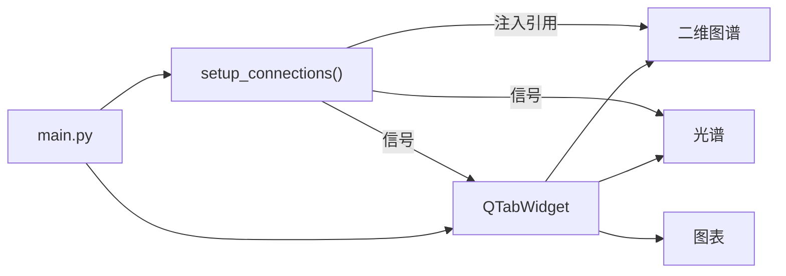
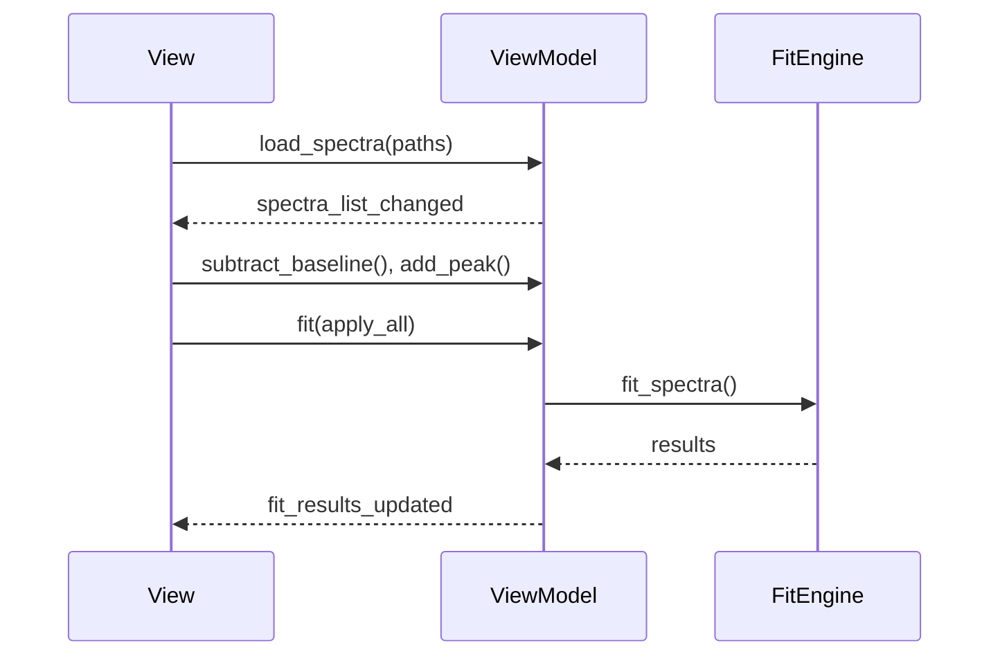
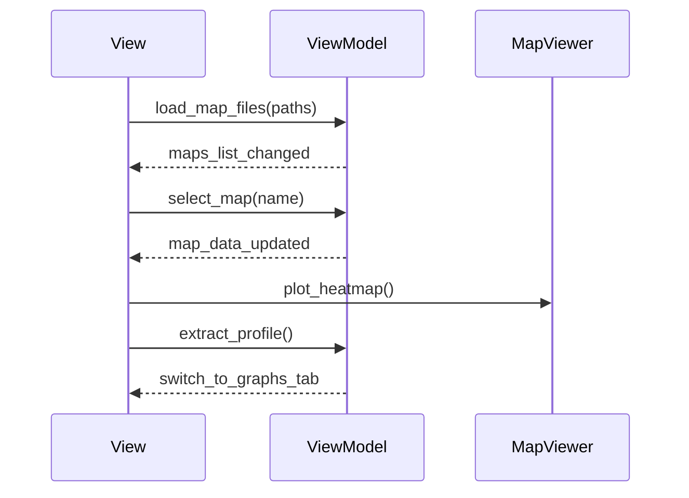
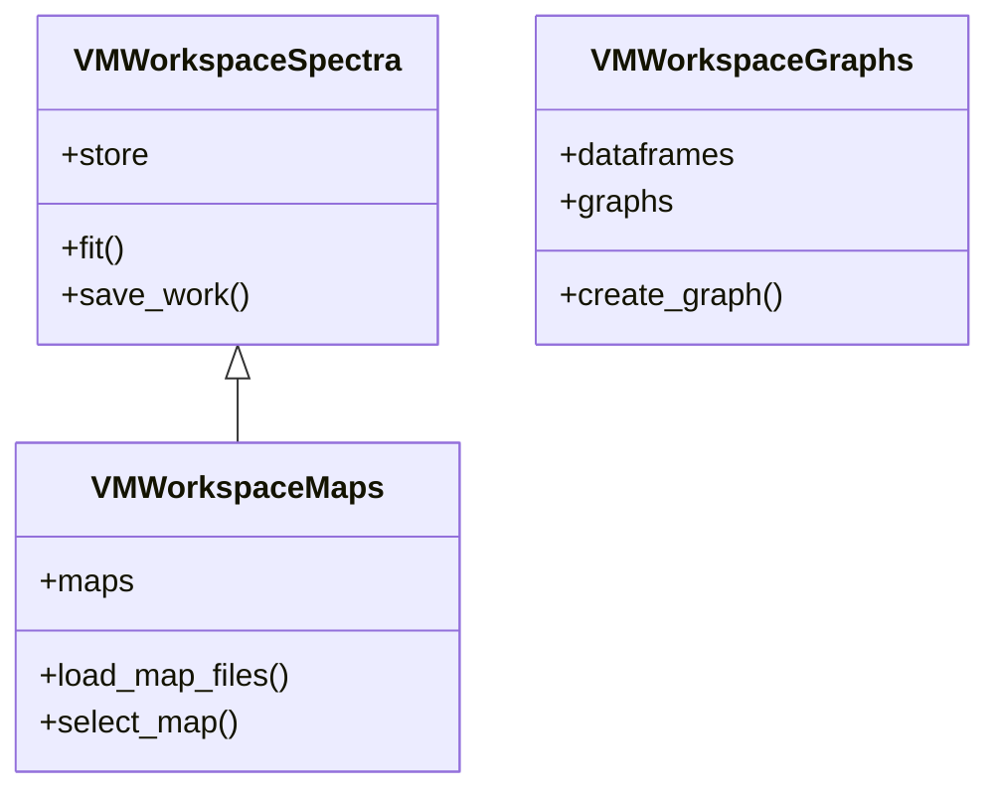

# **应用程序架构** { #application-architecture }

本指南介绍 `SPECTROview` 的技术架构、代码组织结构及开发模式，旨在帮助开发者理解、维护和扩展该应用程序。

---

## **MVVM 模式** { #mvvm-pattern }

`SPECTROview` 严格遵循 **Model-View-ViewModel (MVVM)** 架构。
每个工作区均采用相同的三层职责分离设计：

- **Model（模型层）** — 纯数据容器与领域逻辑。模型层不持有任何 Qt 控件引用，可独立开展单元测试。
- **ViewModel（视图模型层）** — 业务逻辑编排器。ViewModel 负责读取和修改 Model，并通过 Qt 信号通知 View；它**绝不**导入或引用任何 View 类。
- **View（视图层）** — Qt 控件层。View 连接到 ViewModel 的信号，并在响应用户操作时调用 ViewModel 的方法。


### **文件命名规范** { #file-naming-convention }

| 层级 | 前缀 | 示例 |
|------|------|------|
| View | `v_` | `workspaces/v_workspace_spectra.py` |
| ViewModel | `vm_` | `spectra/vm_workspace_spectra.py` |
| Model | `m_` | `spectra/spectra_store.py` |

### **导入规则** { #import-rules }

| 层级 | 允许导入 | 禁止导入 |
|------|----------|----------|
| **View** | ViewModel、Components | — |
| **ViewModel** | Model、`fit_engine` | View |
| **Model** | 仅限标准库 | View、ViewModel |

### **信号/槽通信** { #signalslot-communication }

View 与 ViewModel 之间**完全通过 Qt 信号与槽（Signal/Slot）进行通信**。ViewModel 绝不能直接调用 View 的方法，View 也绝不能绕过 ViewModel 直接修改 Model 状态。

```python
# ── ViewModel defines signals ──
class VMWorkspaceSpectra(QObject):
    spectra_list_changed = Signal(list)       # ViewModel → View
    fit_progress_updated = Signal(int, int, int, float, int)

# ── View connects in __init__ ──
class VWorkspaceSpectra(QWidget):
    def __init__(self):
        self.vm.spectra_list_changed.connect(self._update_list)
```

---

## **项目结构** { #project-structure }

```
spectroview/
├── __init__.py             # Constants, peak models, resource paths, VERSION, BUILD_NUMBER
├── _build_info.py          # Build metadata, populated with timestamp during wheel/sdist packaging
├── main.py                 # Entry point, QMainWindow, cross-workspace wiring
├── application/            # API facade for the currently running desktop state
│   ├── service.py          # Dataset/spectra/fit/graph/map domain operations
│   ├── dispatch.py         # Queued Qt main-thread execution boundary
│   └── errors.py           # Stable integration error codes
│
├── i18n/                   # Centralized multilingual localization & live Qt bindings
│   ├── __init__.py         # Public tr/tr_plural & declarative bind_* exports
│   ├── manager.py          # TranslationManager singleton, JSON catalog loader & QTranslator lifecycle
│   ├── bindings.py         # Weak-ref widget/tab/combo/header live retranslation bindings
│   └── validator.py        # AST key extractor, catalog validator & untranslated UI literal audit
│
├── settings/               # Unified settings architecture (Model, ViewModel, & 2-panel Settings UI)
│   ├── m_settings.py          # Persistent app settings & portable config.json
│   ├── vm_settings.py         # Settings ViewModel & background LLM connection tester
│   ├── secrets.py             # Cross-platform obfuscated QSettings secret store (_credentials/)
│   ├── build_info.py          # Dual-mode runtime dependency resolution & build snapshot capture
│   └── ui/                    # Two-panel settings dialog with sidebar & instant search
│       ├── settings_dialog.py # Host dialog with sidebar navigation & instant search
│       ├── tab_general.py     # General preferences & Working Folder
│       ├── tab_fit.py         # Fitting solver convergence & peak bounds
│       ├── tab_ai.py          # LLM credentials, connection tests, & local MCP
│       └── tab_about.py       # Application details, Python env, & runtime package dependencies
│
├── model/                  # Data models organized by domain (no Qt widgets)
│   ├── m_settings.py       # Persistent app settings compatibility facade (wraps spectroview.settings)
│   ├── io/                 # File loaders & workspace serialization
│   │   ├── m_io.py         # Universal file loader dispatch & text/CSV readers
│   │   ├── m_wdf.py        # Renishaw WiRE WDF binary reader
│   │   ├── m_spc.py        # Galactic SPC binary reader
│   │   ├── m_l6s.py        # HORIBA LabSpec 6 (.l6s / .l6m) binary reader
│   │   ├── m_ngs.py        # HORIBA LabSpec 5 (.ngs / .ngc) binary reader
│   │   └── workspace_io.py # Unified serialization for Workspaces
│   ├── spectra/            # Spectral tensor store, metrics, & fit model models
│   │   ├── spectra_store.py       # Tensor-centric SpectraStore & MapData structures
│   │   ├── spectral_parameters.py # Vectorized raw spectral metrics (Area, Max, Pos_Max, Barycenter, FWHM)
│   │   ├── heatmap.py             # Pure-NumPy 2D heatmap grid interpolation & triangulation
│   │   ├── peak_model.py          # Helper functions for peak parameters
│   │   └── m_fit_model_manager.py # Saved fit model file management
│   ├── graphs/             # Graph schemas, recipes, & style templates
│   │   ├── m_graph.py                 # Plot configuration model (MGraph dataclass)
│   │   ├── graph_control.py           # Graph control & validation contract
│   │   ├── graph_style.py             # Graph styling & restyle-without-replot predicate
│   │   ├── m_plot_recipe.py           # Plot recipe dataclass (+ m_plot_recipe_store.py)
│   │   └── m_style_template_store.py  # Graph style template persistence
│   ├── analysis/           # Numerical analysis & calculator engines
│   │   ├── m_mva.py               # PCA + NMF engine
│   │   └── m_quick_calculators.py # Pure math logic for scientific calculators
│   └── system/             # Runtime environment, TLS, & update services
│       ├── m_tls.py              # Hardened TLS trust-store & certifi/pip validation
│       ├── m_installation.py     # Centralized runtime install detection (InstallType & InstallationManager)
│       ├── m_update_manager.py   # Multi-platform UpdateManager facade, ETag cache, SHA256SUMS
│       ├── m_update_checker.py   # Legacy pip/wheel QThread workers & detached upgrade helper
│       └── m_macos_font_patch.py # macOS font rendering compatibility patch
│
├── viewmodel/              # Business logic and data orchestration (PEP 562 lazy facade)
│   ├── spectra/            # Spectra workspace ViewModel & mixins
│   │   ├── vm_workspace_spectra.py     # Core workspace state, selection & I/O coordination
│   │   ├── vm_spectra_preprocessing.py # X/Y corrections, ROI crop, baseline & cosmic-ray removal
│   │   ├── vm_spectra_fitting.py       # Peak editing, fit-model clipboard/JSON & VBFthread launch
│   │   ├── vm_spectra_results.py       # Fit results collection, computed columns & Excel/clipboard export
│   │   ├── vm_spectra_persistence.py   # ZIP/NPZ workspace save/load & legacy v1 .spectra loader
│   │   └── vm_fit_model_builder.py     # Fit model file management orchestration
│   ├── maps/               # Maps workspace & Live Maps ViewModels
│   │   ├── vm_workspace_maps.py        # Maps workspace (extends VMWorkspaceSpectra)
│   │   ├── vm_maps_fitting.py          # Batch map fitting & wafer Zone/Quadrant post-processing
│   │   ├── vm_maps_persistence.py      # Legacy v1 .maps JSON loader
│   │   ├── vm_live_maps.py             # Live Maps state, debounce & synchronous evaluation
│   │   └── live_maps_worker.py         # Asynchronous _LiveMapWorker (QRunnable) & snapshot offload
│   ├── graphs/             # Graphs workspace ViewModel
│   │   ├── vm_workspace_graphs.py      # DataFrames, filtering, graph CRUD & persistence
│   │   └── graph_undo.py               # Whole-workspace snapshot undo/redo & batching mixin
│   ├── analysis/           # Numerical analysis orchestration
│   │   └── vm_mva.py                   # Multivariate analysis (PCA/NMF) orchestration
│   ├── common/             # Shared ViewModel utilities
│   │   ├── spectral_utils.py           # closest_index, parse_coords_from_fname, Fano & metadata helpers
│   │   ├── export_utils.py             # Excel, clipboard & figure file export
│   │   └── ui_utils.py                 # Notification, alert, icon & status-color adapters
│   ├── vm_settings.py      # Compatibility facade -> spectroview.settings.vm_settings
│   └── utils.py            # Backward-compatible re-export facade -> viewmodel.common & v_metadata_tooltip
│
├── ai_agent/               # AI Data Chat module (multi-provider; runtime-optional)
│   ├── __init__.py              # Module docstring, keeps import guarded
│   ├── m_llm_client.py          # Multi-provider LLM clients (Ollama/OpenAI/Anthropic) + QThread workers
│   ├── m_conversation.py        # Conversation model (+ m_conversation_store.py: history)
│   ├── m_prompt_manager.py      # System-prompt / rules / knowledge assembly
│   ├── mcp/server.py            # Shared FastMCP chat + full desktop tool profiles
│   ├── mcp/runtime.py           # Opt-in loopback Streamable HTTP lifecycle
│   ├── config/, prompts/, rules/, knowledge/, examples/, utils/  # Prompt assets + helpers (see ai_agent.md)
│   ├── vm_chat.py               # Chat ViewModel (prompt-tier selection, agentic loop)
│   └── v_chat_panel.py          # Embedded chat panel (+ v_history_dialog.py)
│
├── view/                   # Qt widgets and UI layout (PEP 562 lazy facade)
│   ├── __init__.py               # Lazy exports for workspaces, components & theme
│   ├── workspaces/               # Top-level workspace View packages
│   │   ├── __init__.py                # Lazy workspace exports
│   │   ├── v_workspace_spectra.py     # Spectra workspace View
│   │   ├── v_workspace_maps.py        # Maps workspace View (extends Spectra)
│   │   └── graphs/                    # Graphs workspace View package
│   │       ├── __init__.py            # Package exports (VWorkspaceGraphs, MdiSubWindow)
│   │       ├── v_workspace_graphs.py  # VWorkspaceGraphs orchestrator
│   │       ├── v_mdi_subwindow.py     # MdiSubWindow (rubber-band resize/move)
│   │       ├── v_graphs_ui.py         # GraphsUIMixin (panels, toolbars, shortcuts)
│   │       ├── v_graphs_dataframes.py # GraphsDataFramesMixin (DF selection & sync)
│   │       ├── v_graphs_mdi.py        # GraphsMdiMixin (MDI creation & layout)
│   │       └── v_graphs_actions.py    # GraphsActionsMixin (plot create/update/export/undo)
│   ├── components/               # Shared / reusable widgets (PEP 562 lazy facade)
│   │   ├── __init__.py                # Lazy subpackage exports + settings alias
│   │   ├── v_settings.py              # Fit/view settings dialog (compat shim)
│   │   ├── common/                    # Shell, notifications, calculators & shared widgets
│   │   │   ├── __init__.py
│   │   │   ├── v_menubar.py           # Main menu bar
│   │   │   ├── v_about.py             # About dialog
│   │   │   ├── v_update_banner.py     # Update notification banner widget
│   │   │   ├── v_notification.py      # Native floating notification badges & manager
│   │   │   ├── v_quick_calculators.py # Scientific calculators GUI
│   │   │   ├── customized_widgets.py  # Palette combobox, custom toolbar
│   │   │   └── markdown_utils.py      # Markdown spacing normalizer for Python-Markdown
│   │   ├── lists/                     # Spectral/map list, DataFrame table & tooltips
│   │   │   ├── __init__.py
│   │   │   ├── v_spectra_list.py      # Spectrum list with checkboxes
│   │   │   ├── v_map_list.py          # Loaded maps list panel (Two-Tier Selection)
│   │   │   ├── v_dataframe_table.py   # Generic DataFrame viewer
│   │   │   └── v_metadata_tooltip.py  # Metadata tooltip popup builder
│   │   ├── spectra_viewer/            # Spectra viewer package (1D, Heatmap, 3D, interactions)
│   │   │   ├── __init__.py            # Package exports (VSpectraViewer, FastLine3DCollection, etc.)
│   │   │   ├── common.py              # Palettes, style cache, filename tokens & 1D normalization
│   │   │   ├── v_spectra_viewer.py    # VSpectraViewer main widget, toolbar & theme
│   │   │   ├── v_spectra_options.py   # SpectraOptionsMenuMixin (options menu, sync & plot style)
│   │   │   ├── v_plot_1d.py           # SpectraPlot1DMixin (1D segments, shifts, fit overlays)
│   │   │   ├── v_plot_heatmap.py      # SpectraHeatmapMixin (2D series heatmap & Y-axis tokens)
│   │   │   ├── v_plot_3d.py           # FastLine3DCollection & SpectraPlot3DMixin
│   │   │   ├── v_interactions.py      # SpectraInteractionMixin (zoom, hover, peak drag, eraser)
│   │   │   └── v_spectra_legend_editor.py  # Batch legend editor dialog, color combo & mixin
│   │   ├── lower_tabs/                # Lower workspace tab panels package
│   │   │   ├── __init__.py            # Package exports (VFitModelBuilder, VPeakTable, VFitResults, VMVA, VMoreTab)
│   │   │   ├── v_fit_model_builder.py # Baseline + Peak + Fit controls
│   │   │   ├── v_peak_table.py        # Interactive peak parameter table
│   │   │   ├── v_fit_results.py       # Fit results DataFrame table
│   │   │   ├── v_mva.py               # PCA/NMF controls and tab coordinator
│   │   │   ├── v_mva_plots.py         # MVA _PlotTab widget & Matplotlib plotting mixin
│   │   │   └── v_moretab.py           # Metadata & normalization tab panel
│   │   ├── map_viewer/                # Map viewer package (2D/wafer heatmap, interactions, dialog)
│   │   │   ├── __init__.py            # Package exports (VMapViewer, VMapViewerDialog, selection helpers)
│   │   │   ├── map_selection.py       # Shared spatial geometry, selection resolution & overlay helper
│   │   │   ├── v_map_data.py          # MapDataProcessingMixin (griddata cache, mask, outlier, profile)
│   │   │   ├── v_map_plot.py          # MapPlotMixin (2D/wafer heatmap rendering, stats, profile overlay)
│   │   │   ├── v_map_interactions.py  # MapInteractionMixin (mouse selection, coordinates, copy)
│   │   │   ├── v_map_viewer.py        # VMapViewer main widget, toolbar, sliders & options menu
│   │   │   └── v_map_viewer_dialog.py # VMapViewerDialog detachable map viewer window
│   │   ├── rgb_live_maps/             # RGB range bracketing & Live Maps package
│   │   │   ├── __init__.py            # Package exports for RGB range selectors & Live Maps
│   │   │   ├── common.py              # Shared palettes, themes, view options & 1D norm helpers
│   │   │   ├── v_live_maps.py         # VLiveMaps multi-panel tab view & options menu
│   │   │   ├── v_live_maps_options.py # LiveMapsOptionsMenuMixin (legend & view options menu)
│   │   │   ├── v_live_map_subpanel.py # LiveMapSubpanel container widget
│   │   │   ├── v_live_map_1d.py       # LiveMap1DMixin (1D series & profile rendering)
│   │   │   ├── v_live_map_2d.py       # LiveMap2DMixin (2D heatmap rendering)
│   │   │   ├── v_live_map_selection.py # LiveMapSelectionMixin (point/marquee/legend selection)
│   │   │   ├── v_live_maps_legend_editor.py # LiveMapsLegendEditorDialog labels & colors editor
│   │   │   ├── v_range_selector.py    # VRangeSelectorPanel & RangeSelectorManager
│   │   │   └── v_range_bracket_mixin.py # SpectraRangeBracketMixin for VSpectraViewer
│   │   ├── graphs/                    # Graphs plotting, rendering, filtering & export package
│   │   │   ├── __init__.py
│   │   │   ├── v_graph.py             # VGraph widget orchestrator (restyle/replot/actions)
│   │   │   ├── v_graph_canvas.py      # _DebouncedFigureCanvas & _FastNavigationToolbar
│   │   │   ├── v_graph_breaks.py      # GraphBreakInsetMixin (broken & inset axes)
│   │   │   ├── v_graph_axes.py        # GraphAxesStyleMixin (limits, scales, ticks, theme)
│   │   │   ├── v_graph_annotations.py # GraphAnnotationMixin (8 annotation types & canvas drag)
│   │   │   ├── v_plot_renderer.py     # Stateless Matplotlib plot rendering engine (PlotRenderer)
│   │   │   ├── v_plot_spatial.py      # SpatialPlotMixin & WaferPlot (2Dmap / wafer rendering)
│   │   │   ├── graph_commit.py        # Graph state snapshot & undo/redo diff engine
│   │   │   ├── v_export_dialog.py     # Single- & batch-graph figure export dialogs
│   │   │   ├── v_multipanel_dialog.py # Multi-panel publication figure composer
│   │   │   ├── v_plot_recipe_dialog.py    # Plot Recipe manager dialog
│   │   │   ├── v_style_template_dialog.py # Graph Style Template manager dialog
│   │   │   └── v_data_filter.py       # Dynamic query filter panel
│   │   └── customize_graph/           # Graph customization dialog (two-panel Settings-like package)
│           ├── customize_graph_dialog.py     # CustomizeGraphDialog (two-panel host with search & live preview)
│           ├── common.py                     # NavItemDelegate and highlight styling helpers
│           ├── tab_general.py                # General & Typography tab (theme, grid, rotation, fonts, sorting)
│           ├── tab_axes_limits.py            # Axes & Limits tab (scales, limits, sliders, breaks)
│           ├── tab_ticks_spines.py           # Ticks & Spines tab (direction, format, minor ticks, borders)
│           ├── tab_secondary_inset.py        # Secondary & Inset tab (Y2/Y3/X2 twin axes, zoom insets)
│           ├── tab_legend_series.py          # Legend & Series tab (legend box, unify markers, series table)
│           ├── tab_plot_styles.py            # Plot Style & Fitting tab (style options, unified error bars, trendlines, histograms)
│           ├── tab_annotations.py            # Annotations tab (add, edit, list, canvas drag sync)
│           └── customize_annotation_dialogs.py  # EditLineDialog/EditTextDialog/ColorDelegate
│       └── theme/                     # Theme & font architecture (ThemeManager, tokens, palettes, fonts)
│           ├── manager.py             # Single owner of application-wide theme state
│           ├── fonts.py               # Cross-platform application font configuration (macOS/Windows/Linux)
│           ├── palettes.py            # QPalette builders for 5 canonical themes
│           ├── qss_template.py        # Parameterized QSS template
│           └── tokens.py              # ThemeTokens dataclass and presets
│
├── fit_engine/             # High-performance batch fitting
│   ├── vbf_engine.py            # Orchestrator (VBFengine)
│   ├── evaluator.py             # Parameter mapping (VBFevaluator)
│   ├── optimizer.py             # Batched Levenberg-Marquardt
│   ├── models.py                # Batched peak functions + Jacobians
│   ├── scalar_models.py         # Fallback scalar functions + PEAK_MODEL_REGISTRY
│   ├── vbf_thread.py            # QThread wrapper
│   ├── baseline.py              # Baseline algorithms (arPLS, airPLS, etc)
│   ├── noise.py                 # Noise estimation functions
│   └── weights.py               # Region-weighted fitting mask & weight computation
│
├── resources/              # Icons, fonts, localization catalogs, Matplotlib stylesheets
│   ├── icons/
│   ├── i18n/{fr,zh,de,ru}.json  # Translation catalogs (`strings`, `plurals`, `contexts`)
│   └── *.mplstyle
│
packaging/                  # Standalone platform build pipelines (reusing root main.spec)
├── windows/build_windows.py      # PyInstaller --onedir + Portable ZIP + Velopack vpk pack
├── macos/{build_dmg.py,build_dmg.sh,entitlements.plist}
└── linux/{build_linux.py,build_appimage.sh,build_deb.sh,spectroview.desktop}
```

---

## **应用程序入口** { #application-entry-point }

`spectroview/main.py` 创建 `QMainWindow` 主窗口，并将所有工作区作为标签页实例化到 `QTabWidget` 中：



`main.py` 中的 `setup_connections()` 方法负责连接跨工作区依赖关系：

- **二维图谱** (Maps) → **图表** (Graphs)：`VMWorkspaceMaps.set_graphs_workspace(v_graphs)` 注入引用，使 `Maps` 工作区能够将剖面数据与 DataFrame 直接发送至 `Graphs` 工作区。
- **二维图谱** → **光谱** (Spectra)：`main.py` 将 `send_spectra_to_workspace` 信号连接至光谱 ViewModel 的 `receive_spectra()` 方法，从而将所选二维图谱光谱的深拷贝导入到 **光谱** 标签页的 `SpectraStore` 中。
- **拟合结果** (Fit Results) → **图表**：**光谱** 与 **二维图谱** 均会发射携带 `pd.DataFrame` 的 `fit_results_updated` 信号，可将其转发至 `Graphs` 工作区进行统计绘图。

### **精简启动加载路径** { #keeping-the-startup-path-lean }

导入 `main.py` 会传递性地加载其可达的所有模块，而这一导入依赖图直接决定了应用启动耗时。以下两类依赖包被有意**排除在**该导入图之外，仅在实际使用时按需导入：

| 依赖包 | 导入耗时 | 当前延迟导入位置 |
|---|---|---|
| `anthropic`、`openai`、`ollama`、`mcp` | 合计约 4.5 s | `Main.open_ai_chat()`、`ai_agent/m_llm_client.py` 中的 `_load_*()`、`MCPHub._open_session()` |
| `scipy.stats`、`scipy.interpolate`、`scipy.linalg` | 合计约 1.3 s | `PlotRenderer._plot_histogram()` / `WaferPlot.plot()`、`SpectraStore.batch_preprocess()`、`VMMVA._build_from_all_maps()`、`build_heatmap_grid()`、`optimizer._batched_solve()` |

`scipy` 还带来一个额外约束：如果只做纯延迟导入，卡顿只会转移到*首次*绘制直方图或晶圆图时才发生，这曾导致打开已保存的 `.graphs` 工作区明显变慢。因此，`Main.showEvent()` 会在界面首次绘制完成后立即启动一个守护线程（`_prewarm_heavy_imports`），在后台预导入上述三个 `scipy` 子模块——主窗口约在 2 s 内即可弹出，而约 1 s 后 `scipy` 已就绪，因此等到用户触发相关操作时，函数局部的每一次 `import scipy...` 都会直接命中 `sys.modules` 缓存。而 LLM SDK 则刻意*不作*预热：大多数会话并不会打开 AI 对话功能，且对话面板本身已具备加载状态提示。

在模块顶层新增重型第三方库的导入之前，请务必使用 `python -X importtime -c "import spectroview.main"` 进行验证——只要绘制首个主窗口不需要它，就应当推迟导入。如果上述任一包重新出现在启动导入路径上，`tests/performance/test_startup_imports.py` 测试将会失败。

---

## **数据生命周期** { #data-lifecycle }

### **光谱：加载 → 处理 → 拟合 → 结果** { #spectra-loading-processing-fitting-results }



### **二维图谱：加载 → 提取 → 热图 → 剖面** { #maps-loading-extraction-heatmap-profile }



---

## **工作区继承关系** { #workspace-inheritance }

`VMWorkspaceMaps` **继承并扩展了** `VMWorkspaceSpectra`。这意味着 `Spectra` 工作区中提供的所有拟合、基线、峰处理及序列化功能都会自动在 `Maps` 工作区中生效，同时还包含针对二维图谱的专属方法覆写：



---

## **可复用组件系统** { #reusable-component-system }

各工作区均由遵循统一信号通信模式的**共享组件**组合而成：

| 组件 | 文件 | 用途 |
|------|------|------|
| `VSpectraViewer` | `spectra_viewer/v_spectra_viewer.py` | 支持 1D/热图/3D 光谱显示的 Matplotlib 画布组件包，包含缩放/平移及峰/基线/宇宙射线擦除交互 |
| `SpectraLegendEditorDialog` | `spectra_viewer/v_spectra_legend_editor.py` | 事务式调色板、图例数量上限、标签及颜色编辑器（按每批 100 行处理） |
| `VFitModelBuilder` | `lower_tabs/v_fit_model_builder.py` | X 轴校正、光谱范围、基线、峰及拟合控制面板 |
| `VPeakTable` | `lower_tabs/v_peak_table.py` | 可编辑的峰参数表（中心位置、半高全宽 FWHM、振幅、上下界） |
| `VMapViewer` | `map_viewer/v_map_viewer.py` | 带 Z/X 范围滑块、掩膜及剖面提取功能的热图/晶圆画布 |
| `VMapViewerDialog` | `map_viewer/v_map_viewer_dialog.py` | 封装 `VMapViewer` 的可分离置顶独立窗口 |
| `VGraph` | `graphs/v_graph.py` | 支持 10 余种绘图样式的 Matplotlib 图表控件 |
| `VDataFilter` | `graphs/v_data_filter.py` | 动态 `pandas` `.query()` 查询筛选构建器 |
| `VFitResults` | `lower_tabs/v_fit_results.py` | 按收敛状态着色的拟合结果表格 |
| `VMVA` | `lower_tabs/v_mva.py` | PCA/NMF 控制面板与嵌入式绘图视图 |
| `VMoreTab` | `lower_tabs/v_moretab.py` | 光谱元数据显示与 Y 轴归一化控制面板 |
| `CustomizeGraphDialog` | `customize_graph/customize_graph_dialog.py` | 用于图表标注、图例与坐标轴自定义的单例对话框 |

---

## **主题与字体排版系统** { #theme-typography-system }

SPECTROview 采用集中式主题与字体排版架构（`spectroview/view/theme/`）：

- **`ThemeManager` (`manager.py`)**：持有规范的活动主题状态（`dark`、`gray`、`light`、`classic_dark`、`classic_light`），负责应用 `QPalette` 与参数化样式表（`qss_template.py`），并管理运行时动态切换。
- **矢量 SVG 图标架构（`icons_svg.py` 与 `icons.py`）**：实时矢量渲染引擎（`_SvgIconEngine(QIconEngine)`），以 1:1 物理设备像素的清晰矢量渲染取代预光栅化 PNG 图标，支持在绘制时依据主题令牌动态着色，并通过统一的 `Icons` 外观接口对外提供。
- **跨平台字体（`fonts.py`）**：`setup_application_font(app)` 为 `QApplication` 应用适配当前操作系统的默认字体：
  - **Windows**：10pt `Segoe UI`（96 DPI 下标准 Windows 桌面字体，约 13.3px）。
  - **macOS**：13pt `.AppleSystemUIFont`（San Francisco，72 DPI 下标准 Apple HIG 字体，13px）。
  - **Linux / 其他**：10pt 及以上的桌面环境无衬线字体。
- **DPI 与尺寸不变性**：通过在样式表中避免使用全局规则 `QWidget { font-size: ... }`，切换主题时可避免高开销的字体缓存失效瓶颈。各控件直接继承应用程序字体尺寸，从而在各平台上保持原生可读性、标准菜单度量以及流畅的多显示器 DPI 缩放体验。

---

## **持久化与序列化** { #persistence-serialization }

`SPECTROview` 将所有加载与保存操作委托给统一的 `WorkspaceIO` 类（`model/io/workspace_io.py`），从而将 I/O 逻辑与 ViewModel 隔离。各工作区通过 `WorkspaceIO` 使用各自的存取格式：

| 工作区 | 文件扩展名 | 核心策略 |
|--------|-----------|----------|
| `Spectra` | `.spectra` | ZIP 归档（`format_version: 2`）：`metadata.json`（按图谱名称索引的 `store_meta`）+ 各图谱对应的 NPZ 数组。由统一的 `WorkspaceIO.save_workspace()` 写入。 |
| `Maps` | `.maps` | 与 `.spectra` 采用相同的统一 ZIP 格式（`WorkspaceIO.save_workspace()`），其元数据中额外包含 `maps_metadata`、`map_type` 及拟合结果 DataFrame。 |
| `Graphs` | `.graphs` | 通过 `WorkspaceIO.save_workspace()` 写入的 ZIP 归档（`format_version: 4`）：`metadata.json`（图表配置 + DataFrame 数据源）+ 压缩后的 DataFrame。 |

### **光谱序列化流程** { #spectrum-serialization-flow }

```python
# Save (format_version 2): SpectraStore → ZIP archive (metadata.json + NPZ arrays)
metadata = {
    "format_version": 2,
    "store_meta": {                 # keyed by map name (== fname for single spectra)
        "sample_001": {
            "fnames": ["sample_001"],
            "is_active": [True],
            "baseline_config": {...},
            "peak_params": [...],
            "range_min": None, "range_max": None,
            # ...
        }
    }
}
# arrays: per-map NPZ blocks produced by SpectraStore.to_npz_dict(map_name)
# (raw x0 float64 axis + Y0 float32 intensities, plus any processed/fit arrays)
```

---

## **线程模型** { #threading-model }

耗时较长的操作均在 `QThread` 子类中执行，以防止 UI 界面卡顿冻结。
所有工作线程都会发射进度信号，并由 ViewModel 转发至 View 的进度条：

| 线程类 | 所在位置 | 用途 |
|--------|----------|------|
| `VBFthread` | `fit_engine/vbf_thread.py` | 批量拟合（核心引擎） |
| `_LiveMapWorker` | `viewmodel/maps/live_maps_worker.py` | 面向大数据集（$\ge 25,000$ 条光谱）的实时图谱计算异步 `QRunnable`（`QThreadPool`） |
| `UnifiedUpdateCheckWorker` / `UnifiedUpdateDownloadWorker` | `model/system/m_update_manager.py` | 多平台版本发布检查（ETag 缓存）及 SHA-256 校验下载 |
| `UpdateCheckerWorker` | `model/system/m_update_checker.py` | 旧版 pip/wheel 后台检查与更新工作线程（保留用于向后兼容） |
| `LLMWorker` / `APIWorker` / `AnthropicWorker` | `ai_agent/m_llm_client.py` | AI 数据对话的流式聊天请求——每个后端对应一个工作线程（Ollama / OpenAI 兼容接口 / Anthropic） |
| `_ConnectionTestWorker` | `settings/vm_settings.py` | 非阻塞的后台 LLM 服务商连接校验 |

**线程生命周期**：

1. ViewModel 实例化工作线程，并连接 `finished` / `progress` 信号。
2. 调用线程 `.start()` —— 在独立的操作系统线程上运行 `run()`。
3. 执行完成后，`finished` 信号触发 ViewModel 中的 `_on_fit_finished()`。
4. ViewModel 发射结果信号 → View 更新 UI。

---

## **跨工作区通信** { #cross-workspace-communication }

`SPECTROview` 不采用全局事件总线。相反，`main.py` 使用**依赖注入**和**直接信号连接**：

```python
# main.py → setup_connections()
# 1. Inject reference: Maps VM can call Graphs workspace methods
self.v_maps_workspace.vm.set_graphs_workspace(self.v_graphs_workspace)

# 2. Maps → Spectra: ingest spectra sent from the Maps workspace
self.v_maps_workspace.vm.send_spectra_to_workspace.connect(
    self.v_spectra_workspace.vm.receive_spectra
)

# 3. Signal: Maps requests tab switch after sending profile
self.v_maps_workspace.vm.switch_to_graphs_tab.connect(
    lambda: self.tabWidget.setCurrentWidget(self.v_graphs_workspace)
)
```

---

## **全局常量（`__init__.py`）** { #global-constants-__init__py }

`spectroview/__init__.py` 定义了应用程序级常量：

| 常量 | 用途 |
|------|------|
| `VERSION`、`BUILD_NUMBER` | 应用语义化版本号及不可变构建时间戳 |
| `PEAK_MODELS` | 已注册的峰型函数（`Lorentzian`、`Gaussian`、`PseudoVoigt`、`GaussianAsym`、`LorentzianAsym`、`Fano`、`DecaySingleExp`、`DecayBiExp`） |
| `PLOT_STYLES` | 可用图表类型（`point`、`scatter`、`box`、`bar`、`line`、`trendline`、`histogram`、`wafer`、`2Dmap`） |
| `PALETTE`、`DEFAULT_COLORS`、`MARKERS` | 颜色映射表、20 色出版级默认循环色板及 Matplotlib 标记样式 |
| `X_AXIS_UNIT`、`Y_AXIS_UNIT` | 坐标轴标签单位注册表 |
| `AXIS_LABELS` | 图表标签的自动补全建议 |
| `ICON_DIR` | 解析后的 `resources/icons/` 目录路径 |
| `PLOT_POLICY_LIGHT`、`PLOT_POLICY_DARK` | Matplotlib 样式表路径 |

---

## **多平台更新与打包架构** { #multi-platform-update-packaging-architecture }

### 概述 { #overview }

`SPECTROview` 对外提供统一的安装方式检测与更新外观接口（`model/system/m_update_manager.py` 中的 `UpdateManager`），底层由 `InstallationManager`（`model/system/m_installation.py`）和集中式 TLS 安全加固模块（`model/system/m_tls.py`）提供支撑。无论采用何种分发目标，用户都能获得完全一致的更新横幅、ETag 缓存发布检查、预发布版本切换开关以及 `SHA256SUMS.txt` 完整性校验流程，而无需了解 SPECTROview 的具体安装方式。

### 核心文件 { #key-files }

| 文件 | 职责 |
|------|------|
| `model/system/m_tls.py` | 纯模型层 CA 信任链强制校验（`GHSA-6q48-6c7w-9gw2`）：`SSL_CERT_FILE`/`REQUESTS_CA_BUNDLE` → 操作系统 `truststore` → 已校验的 `certifi >= 2026.10.23`（`pip >= 26.2.2` 构建门禁） |
| `model/system/m_installation.py` | 纯模型层 `InstallType` 分类器（`DEV_SOURCE`、`PIP_WHEEL`、`WINDOWS_VELOPACK`、`WINDOWS_PORTABLE`、`MACOS_BUNDLE`、`LINUX_APPIMAGE`、`LINUX_DEB`、`STANDALONE_UNKNOWN`） |
| `model/system/m_macos_font_patch.py` | macOS 字体缓存发现补丁，拦截 `system_profiler SPFontsDataType` 以防止上游 `matplotlib` 发生 `KeyError: '_items'` 崩溃及长达 10 s 的卡顿 |
| `model/system/m_update_manager.py` | `GitHubReleaseClient`（`ETag` + TTL 缓存）、`UpdateManager` 外观类、`UnifiedUpdateCheckWorker`、`UnifiedUpdateDownloadWorker` 以及各平台更新器 |
| `model/system/m_update_checker.py` | 完整保留的旧版 pip/wheel 工作线程，以及经过 TLS 加固的 pip 升级执行器（`--use-feature=truststore` / `--cert`） |
| `view/components/common/v_update_banner.py` | 紧凑型更新横幅，显示版本变更（`current → latest`）及随平台动态适配的操作标签 |
| `main.py` | 仅在 Velopack 处于激活状态时，于创建 `QApplication` 之前执行早期 `_run_velopack_bootstrap()` 钩子；连接统一更新横幅与引导对话框 |
| `main.spec` 与 `packaging/` | 单一来源的 PyInstaller 配置，以及面向 Windows（`Setup.exe` + `Portable.zip`）、macOS（Apple Silicon `arm64` `.dmg`）和 Linux（`.AppImage` + `.deb`）的平台构建脚本 |

### 各平台更新矩阵与设计考量 { #platform-update-matrix-design-rationale }

| `InstallType` | 检测依据 | 更新后端与机制 |
|---|---|---|
| `DEV_SOURCE` | 未打包状态（unfrozen）+ `.git` / `pyproject.toml` / PEP 610 可编辑安装元数据 | `UnsupportedUpdater`：仅提供版本更新通知——绝不修改开发工作区源码 |
| `PIP_WHEEL` | 未打包的 `site-packages` 安装 | `PythonUpdater`：下载经 SHA-256 校验的 `.whl` 包，启动独立的 TLS 加固 `pip install --upgrade` 进程并重启应用 |
| `WINDOWS_VELOPACK` | 位于 `current/` 目录中且包含 `Update.exe` 或 `sq.version` 的 Windows 打包版本 | `WindowsVelopackUpdater`：在 Python 侧使用加固的 `m_tls` 下载 `releases.win.json` 与增量/全量 `.nupkg`（绕过 `velopack 1.2.161` 内置的 Rust `webpki-roots`），随后仅将本地目录路径传递给 `velopack.UpdateManager` |
| `WINDOWS_PORTABLE` | 位于 Velopack 目录布局之外的 Windows 打包版本 | `WindowsPortableUpdater`：下载并校验 `Portable.zip`，提供具备 zip-slip 路径穿越防护的 **解压到文件夹...** (Extract to Folder...) 功能 |
| `MACOS_BUNDLE` | 位于 `*.app/Contents/MacOS` 中的 macOS 打包版本 | `MacOSUpdater`：下载经校验的 `arm64` `.dmg`（已停止支持的 Intel `x64` 主机不会下载不兼容的 `arm64` 二进制文件），并展示按住 Control 键点击的 Gatekeeper 指引*（在配置 Apple Developer ID 签名/公证前暂缓实现静默替换）* |
| `LINUX_APPIMAGE` | 具有匹配 `$APPDIR` 的 `$APPIMAGE` 环境变量的 Linux 打包版本 | `LinuxAppImageUpdater`：检查 ELF 文件头与 SHA-256；当 `$APPIMAGE` 可写时，通过 `shlex.quote` 脚本执行原子化 `mv` 替换并重启，否则提供引导下载 |
| `LINUX_DEB` | 包含 `/opt/spectroview/` 或 `.spectroview-deb` 标记的 Linux 打包版本 | `LinuxDebUpdater`：校验 `!<arch>\n` 文件头与 SHA-256，并提供可一键复制的 `sudo apt install` 命令 |

### 多平台发布自动化（`.github/workflows/release.yml`） { #multi-platform-release-automation-githubworkflowsreleaseyml }

推送与 `spectroview.VERSION` 相匹配的发布标签（`vMAJOR.MINOR.PATCH` 或 `vMAJOR.MINOR.PATCH-rc.N`）将触发统一的 Python 3.14 工作流：

1. **`verify`**：校验标签与版本号的一致性，强制要求 `pip>=26.2.2` 和 `certifi>=2026.10.23`，并运行无头（headless）单元测试与启动导入测试套件。
2. **并行平台构建任务**：
   - **`build-python`**：生成 `.whl` + `.tar.gz`，执行 `twine check`，并在干净的虚拟环境中验证 wheel 安装类型检测。
   - **`build-windows`**：PyInstaller（`--onedir`）+ offscreen 冒烟测试 + `Portable.zip` + Velopack `vpk pack`（生成 `Setup.exe`、`releases.win.json`、`*.nupkg`，并串联增量更新历史）。
   - **`build-macos`**（`macos-15` `arm64`）：原生 Apple Silicon `.app` + `.dmg` 构建，集成 PyInstaller 运行时钩子与 offscreen `--smoke-test` 验证（已预留受环境变量控制的 `APPLE_SIGNING_IDENTITY` / `APPLE_CERTIFICATE_P12` / `APPLE_ID` 公证钩子，添加凭据即可启用）。
   - **`build-linux`**（`ubuntu-22.04` glibc 基线）：构建 `.AppImage` 与 `.deb`，校验 `.desktop` 文件，并执行真实的 `apt-get install` 安装、offscreen 启动、AppImage 启动以及配置持久化（`~/.config/CEA-Leti/`）检查。
3. **`release`**：发布包含 `SHA256SUMS.txt` 的统一 GitHub Release（并自动将预发布版本标记为 pre-release）。
4. **`publish-pypi`**：在正式稳定版本发布时保留现有的 PyPI Trusted Publisher 发布流程（`pypi` 环境、`id-token: write`、`pypa/gh-action-pypi-publish@release/v1`）。

在新的 Fork 或仓库首次向 PyPI 发布之前，请在 PyPI 中为 `CEA-MetroCarac/SPECTROview` 注册 Trusted Publisher，并将工作流文件名设为 `release.yml`、环境设为 `pypi`。

---

## **国际化 (i18n)** { #internationalization-i18n }

`SPECTROview` 通过 `spectroview/i18n/` 提供涵盖**英语**（`"en"`，默认）、**法语**（`"fr"`）、**简体中文**（`"zh"`、`zh_CN`）、**德语**（`"de"`、`de_DE`）和**俄语**（`"ru"`、`ru_RU`）的实时多语言 GUI 本地化支持：

- **`TranslationManager` (`manager.py`)**：单例管理器，负责维护当前活动语言（`get_language()` / `set_language()`）、JSON 翻译目录（`spectroview/resources/i18n/<lang>.json`）、语言感知的 `tr()` / `tr_plural()`（包括中文 1 种形式、法语/德语 2 种形式及俄语斯拉夫语系 3 种复数形式规则），以及 Qt 的 `QTranslator`（`qtbase_fr.qm`、`qtbase_zh_CN.qm`、`qtbase_de.qm`、`qtbase_ru.qm`），同时保持 `QLocale` 不变（确保科学数值微调框中的小数点 `.` 解析不受区域设置影响）。
- **动态绑定（`bindings.py`）**：基于弱引用的声明式辅助函数（`bind_text`、`bind_tooltip`、`bind_placeholder`、`bind_title`、`bind_window_title`、`bind_tab_text`、`bind_header_labels`、`bind_combo_items`、`on_language_changed`），在调用 `set_language()` 时自动重新应用标签文本，同时通过 `combo_data_or_text()` / `set_combo_by_data_or_text()` 将规范键保留在 `Qt.UserRole`（`itemData`）中。
- **校验与审计（`validator.py`）**：`validate_catalog(...)` 负责校验 `"fr"`、`"zh"`、`"de"` 和 `"ru"` 翻译目录的完整性、各语言复数形式数量（`expected_plural_forms()`）及占位符一致性，而 `audit_untranslated_ui_literals()` 则通过 AST 扫描活动 View/Settings/AI UI 模块（由 `tests/unit/test_i18n.py` 强制执行）。
- **扩展至新语言**：在 `SUPPORTED_LANGUAGES` 中注册 `(code, native_name)`，添加 `spectroview/resources/i18n/<code>.json`（及可选的 `qtbase_*.qm` 候选文件），并在复数规则不同时更新 `_plural_index()` / `expected_plural_forms()`。

---

## **深入主题文档** { #deep-dive-documentation }

| 主题 | 页面 | 摘要 |
|------|------|------|
| **数据架构：SpectraStore** | [spectra_store.md](spectra_store.md) | `MapData`、`MapInfo`、`SpectrumProxy`、数据层级结构、预处理流程、持久化 |
| **光谱工作区** | [spectra.md](spectra.md) | `VMWorkspaceSpectra`、光谱生命周期、基线/峰流水线、拟合模型管理 |
| **二维图谱工作区** | [maps.md](maps.md) | `VMWorkspaceMaps`、高光谱数据加载、热图渲染、坐标处理 |
| **图表工作区** | [graphs.md](graphs.md) | `VMWorkspaceGraphs`、DataFrame 管理、图表创建、`VGraph` 渲染 |
| **向量化批量拟合引擎（`VBF Engine`）** | [vbf_engine.md](vbf_engine.md) | 批量 LM 优化器、解析雅可比矩阵、添加新峰型模型 |
| **多元分析** | [mva.md](mva.md) | PCA/NMF 实现、数据处理流程、导出至 `Graphs` |
| **AI 数据对话** | [ai_agent.md](ai_agent.md) | 多服务商 LLM 对话（Ollama/OpenAI/Anthropic/…）、MCP 工具调用、系统提示词、图表工作区集成 |


---

## **运行与测试** { #running-testing }

```bash
# Run from source
python -m spectroview.main

# Install in editable mode with dev dependencies
pip install -e ".[dev]"

# Run fast test suite (skips slow real-data benchmarks; headless offscreen auto-configured)
pytest tests/ -m "not slow" -q

# Run full test suite (including real benchmark datasets; ~7-8 min)
pytest tests/ -q

# Static syntax & import check on modified files
python -m pyflakes spectroview/<modified_file>.py

# Build and preview documentation
mkdocs serve
```

> [!NOTE]
> 有关详细的开发与结对编程规范，请参阅 [AI 开发框架 (AGENTS.md)](https://github.com/CEA-MetroCarac/SPECTROview/blob/main/AGENTS.md) 以及测试套件指南 [tests/README.md](https://github.com/CEA-MetroCarac/SPECTROview/blob/main/tests/README.md)。


---

## **依赖项** { #dependencies }

| 依赖包 | 版本约束 | 用途 |
|--------|----------|------|
| `PySide6` | — | Qt 6 绑定（**非** PyQt） |
| `matplotlib` | `&ge; 3.8.0, < 3.10.9` | 光谱与二维图谱绘图后端 |
| `numpy` | `&ge; 2.0.2` | 数值数组运算（NumPy 2.x） |
| `scipy` | — | 插值、KDTree、SVD |
| `pandas` | — | DataFrame 管理 |
| `superqt` | — | 增强型 Qt 控件（范围滑块） |
| `ollama` / `openai` / `anthropic` / `mcp` | `ollama ≥ 0.4`, `mcp ≥ 2.2` | 用于 AI 数据对话的 LLM 后端与 Model Context Protocol。属于**核心依赖**（无 `[ai]` 可选附加分组）——标准 `pip install` 即可自动安装；仅在运行时按需*选择使用*该功能。 |
| `truststore` / `certifi` | `truststore ≥ 0.9.0`, `certifi ≥ 2026.10.23` | 加固的 TLS 证书校验，优先路由至宿主机操作系统信任库并回退至已打补丁的 `certifi`（`GHSA-6q48-6c7w-9gw2`）；采用保护性延迟导入 |
| `velopack` / `pyinstaller` *（可选 `[standalone]`）* | `velopack ≥ 1.2.161`, `pyinstaller ≥ 6.10.0` | 独立桌面端打包与 Windows Velopack 安装器/更新器运行时钩子 |
