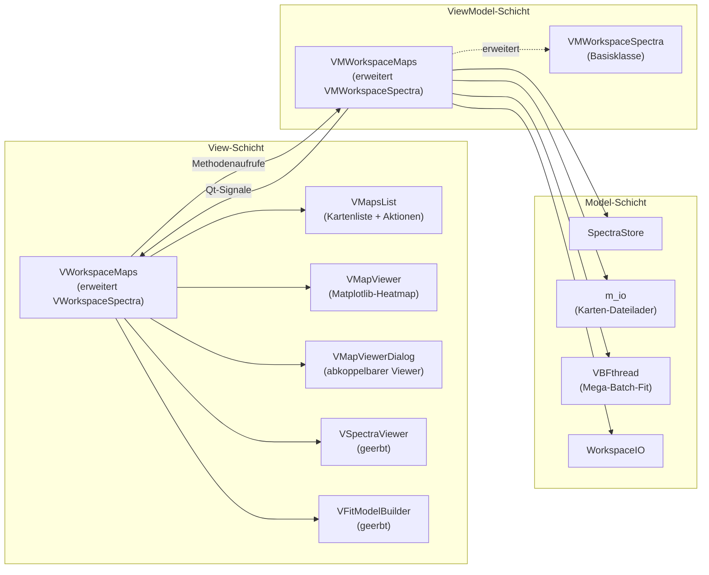

# **Arbeitsbereich: Karten** { #workspace-maps }

Der Arbeitsbereich `Maps` verarbeitet **hyperspektrale Kartendaten** — räumlich aufgelöste Spektraldatensätze, bei denen jedem Pixel ein vollständiges Spektrum entspricht. Er erweitert den [Arbeitsbereich Spektren](spectra.md) per Vererbung, übernimmt dadurch sämtliche Funktionen für Fitting, Basislinienkorrektur, Peak-Bearbeitung sowie Persistenz und ergänzt sie um räumliche Zuordnung, Heatmap-Visualisierung und koordinatenbasierte Operationen.

> [!NOTE]
> **Voraussetzungen** — Bevor Sie diesen Leitfaden lesen, sollten Sie mit folgenden Grundlagen vertraut sein:
>
>
> - [Datenarchitektur: SpectraStore](spectra_store.md) — das gemeinsame Datenmodell `MapData` / `SpectraStore`.
> - [Arbeitsbereich: Spektren](spectra.md) — das zugrunde liegende ViewModel, die View-Komponenten und die Datenflussmuster.
>
> Diese Seite behandelt **ausschließlich die Maps-spezifischen Erweiterungen**. Geerbtes Verhalten wird hier nicht wiederholt.

---

## Wie sich Maps von Spectra unterscheidet { #how-maps-differs-from-spectra }

Der wesentliche Unterschied liegt in der Kardinalität von `MapData.N`:

| Arbeitsbereich | `MapData.N` | Bedeutung |
|---|---|---|
| **Spektren** (Spectra) | 1 | Ein Spektrum pro `MapData`-Block |
| **Karten** (Maps) | 2 – 100 000 | N Spektren mit einer gemeinsamen Wellenzahlachse |

Da das zugrunde liegende [Tensormodell](spectra_store.md#mapdata-the-tensor-block) identisch ist, funktioniert ein vektorisierter Fit sowohl für 1 Spektrum als auch für 100 000 Spektren ohne jegliche Änderung an der Engine.

### MapData im Maps-Kontext { #mapdata-in-maps-context }

```
MapData ("wafer_300mm") — 50×50 wafer (2500 spectra, 1000 wavenumbers)
├── x0:          float64[1000]          1 shared wavenumber axis
├── Y0:          float32[2500, 1000]    raw intensities — 10 MB
├── x:           float64[800]           after spectral crop
├── Y:           float32[2500, 800]     after crop + baseline sub — 8 MB
├── coords:      float64[2500, 2]       (X, Y) stage positions in µm
├── fnames:      list[str] × 2500       "wafer_300mm_(x_pos, y_pos)"
├── is_active:   bool[2500]             checkbox state
├── peak_params: float64[2500, K]       after VBF fit — all 2500 at once
├── fit_success: bool[2500]
├── fit_r2:      float64[2500]
├── Y_bestfit:   float32[2500, 800]     8 MB
└── Y_peaks:     [float32[2500, 800], ...]   8 MB per peak
```

---

## Architekturübersicht { #architecture-overview }



### Warum Vererbung statt Komposition? { #why-inheritance-instead-of-composition }

`VMWorkspaceMaps` **erweitert** `VMWorkspaceSpectra`, statt es zu kapseln:

- Jeder Fitting-Algorithmus (Basislinie, Peaks, VBF-Engine) arbeitet identisch sowohl auf Einzelspektren (N=1) als auch auf Karten (N>1).
- Eine Duplizierung oder Delegation des Fitting-Codes würde die Wartung unnötig fehleranfällig machen.
- Das Überschreiben über das **Template-Method-Entwurfsmuster** (drei Hook-Methoden) reicht aus, um die Zielauswahl von Massenoperationen anzupassen, ohne irgendeine Algorithmuslogik abzuspalten.

Dasselbe Prinzip gilt auf der View-Ebene: `VWorkspaceMaps` erweitert `VWorkspaceSpectra`, überschreibt `setup_connections()`, um eine doppelte Signalverknüpfung während `__init__` zu verhindern, und ersetzt anschließend das rechte Seitenleisten-Widget durch das kartenspezifische Panel aus `VMapsList + VMapViewer`.

---

## Maps-spezifische Komponenten { #maps-specific-components }

### `VMWorkspaceMaps` — Das ViewModel { #vmworkspacemaps-the-viewmodel }

**Datei**: [`vm_workspace_maps.py`](https://github.com/CEA-MetroCarac/SPECTROview/blob/main/spectroview/viewmodel/maps/vm_workspace_maps.py) (mit Fitting- und Persistenz-Mixins unter `spectroview/viewmodel/maps/`)

Zusätzlicher Zustand über das geerbte [VMWorkspaceSpectra](spectra.md#vmworkspacespectra-the-viewmodel) hinaus:

| Attribut | Typ | Zweck |
|---|---|---|
| `maps` | `dict[str, pd.DataFrame]` | Rohe Karten-DataFrames, indiziert nach Namen (Legacy-Cache) |
| `current_map_name` | `str \| None` | Aktiv ausgewählte Karte |
| `maps_metadata` | `dict[str, dict]` | Aufnahmemetadaten pro Karte (WDF, SPC, L6M, NGC) |
| `map_type` | `str` | `'2Dmap'` oder `'Wafer_300mm'` / `'Wafer_200mm'` / `'Wafer_100mm'` |
| `graphs_workspace` | ref | Injizierte Referenz für die Profilextraktion |

#### Zusätzliche Signale { #additional-signals }

```python
maps_list_changed       = Signal(list)    # map name list updated → VMapsList
map_data_updated        = Signal(object)  # current map DF changed → trigger heatmap redraw
send_spectra_to_workspace = Signal(list)  # deep copies → Spectra workspace
clear_map_cache_requested = Signal(str)   # map name → VMapViewer cache invalidation
switch_to_graphs_tab    = Signal()        # request tab switch after profile extraction
```

#### Referenz weiterer Methoden { #additional-method-reference }

| Kategorie | Methoden |
|---|---|
| **Karten laden** | `load_map_files(paths)` |
| **Kartenauswahl & -reihenfolge** | `select_map(name)`, `select_maps(names, primary)`, `reorder_maps(new_order)`, `_show_map_spectra(name)` |
| **Karten löschen** | `delete_current_map()`, `remove_map(name)` |
| **Kartendaten** | `get_current_map_dataframe()`, `get_fit_results_dataframe()` |
| **Export** | `save_selected_maps_to_csv(dir_path)`, `save_current_map_to_csv(file_path)` |
| **Fit** | `fit()`, `_run_fit_thread()`, `collect_fit_results()` — alle überschreiben die Elternklasse |
| **Arbeitsbereichsübergreifend** | `send_selected_spectra_to_spectra_workspace()`, `extract_and_send_profile_to_graphs()` |
| **Persistenz** | `save_work()`, `load_work()`, `_load_legacy_maps()` |

### `VWorkspaceMaps` — Die View { #vworkspacemaps-the-view }

**Datei**: [`v_workspace_maps.py`](https://github.com/CEA-MetroCarac/SPECTROview/blob/main/spectroview/view/workspaces/v_workspace_maps.py)

Überschreibt `_add_maps_panel()`, um die geerbte Spektren-Seitenleiste zu ersetzen durch:

- `VMapViewer` — die Heatmap-Zeichenfläche mit Auswahlfeld für den Z-Parameter und Doppelschieberegler für den X-Bereich.
- `VMapsList` — das Kartenlisten-Panel mit Schaltflächen zur Kartenverwaltung und für Spektrenaktionen.

Die linke Seite (`SpectraViewer` + untere Tabs) wird von `VWorkspaceSpectra` geerbt. Während `VWorkspaceSpectra` die Instanzen `VLiveMaps` und `VMLiveMaps` im Modus `"spectra"` initialisiert (wobei 1D-Parameterverlaufsdiagramme über die aktuell ausgewählten Spektren dargestellt werden), schaltet `VWorkspaceMaps` die geerbten Instanzen `v_live_maps` und `vm_live_maps` in den Modus `"map"` (`set_mode("map")`).

Im Arbeitsbereich `Maps` synchronisiert `VWorkspaceMaps` beim Laden oder Auswählen von Karten ein **zweistufiges Auswahlmodell**:

- **Primäre Karte (`VMWorkspaceMaps.current_map_name`)**: Steuert Vorverarbeitung, Fitting, `VMapViewer`, `VSpectraViewer`, MVA und die `More`-Metadaten exakt wie bei der Einzelauswahl.
- **Liste ausgewählter Karten (`VMWorkspaceMaps.selected_map_names`)**: Wird über `VMapsList` (`QAbstractItemView.ExtendedSelection`) befüllt und ermöglicht Vergleiche per `Ctrl+Click` / `Shift+Click`, ohne Operationen auf der primären Karte zu verändern oder ein Neuzeichnen von `VMapViewer` auszulösen, solange die primäre Karte unverändert bleibt.

`VWorkspaceMaps` leitet `[MapData, ...]` zusammen mit `primary_name` nur dann an `self.vm_live_maps.set_map_datas(...)` weiter, wenn der Tab **Live-Karten** (Live Maps) aktiv ist (andernfalls wird `_live_maps_dirty = True` gesetzt, sodass beim Aktivieren des Tabs eine einmalige verzögerte Aktualisierung erfolgt, während räumliche Punktklicks in `VMapViewer` ignoriert werden). Das Aktivieren eines R/B/G-Bereichswählers in `VSpectraViewer` schaltet `bottom_tabs` in `VWorkspaceSpectra._on_range_selector_toggled()` automatisch auf `Live Maps` um und verarbeitet jede ausstehende Auswahl sofort. `VMLiveMaps` untersucht `md.coords` über die zwischengespeicherten Funktionen `analyze_map_geometry()` und `build_map_gridder()` (welche regelmäßige Gitterindizes oder baryzentrische `Delaunay`-Eckpunkte und -Gewichte zwischenspeichern, bis sich `coords` oder `is_active` ändern), schließt abgewählte Spektren (`~md.is_active`) aus, puffert Parameterausschnitte über Ziehbewegungen hinweg anhand des Schlüssels `(id(md), md.name, md.data_version, param, range)` und wendet eine Dimensionsanpassung mit **Primärkarten-Vorrang** an:

- **Primäre Karte ist ein 1D-Profil**: Sendet `multi_profile_data_ready` (bei $\ge 2$ Profilen) oder `profile_data_ready` (einzelnes Profil) und überlagert alle ausgewählten 1D-Profile in aufeinander abgestimmten Farben (`DEFAULT_COLORS`) mit einheitlicher Linienstärke, wobei eventuell ausgeschlossene 2D-Karten in der Kontext-Kopfzeile vermerkt werden.
- **Primäre Karte ist eine 2D-Karte**: Befüllt `map_2d_candidates_changed` für den `[◀ | ComboBox | ▶]`-2D-Kartenumschalter des Tabs, schließt 1D-Profile aus und berechnet bzw. rendert über `map_data_ready` ausschließlich die eine aktuell sichtbare 2D-Heatmap.
- **Rot/Blau-Intensitätsverhältnis (`R/B ratio`)**: Berechnet $I_{\mathrm{Red}} / I_{\mathrm{Blue}}$ dynamisch sowohl für einzelne/mehrfache 1D-Profile als auch für 2D-Heatmaps und maskiert dabei Blau-Intensitäten nahe oder gleich null sowie abgewählte Spektren als `NaN`. Solange `R/B ratio` im Grün-Kanal ausgewählt ist, benachrichtigt `VWorkspaceSpectra._on_range_selector_parameter_changed()` die Methode `VSpectraViewer.set_range_selector_parameter()`, sodass der grüne Bereichswähler auf der Spektren-Zeichenfläche ausgeblendet wird (und wiederhergestellt wird, sobald ein anderer Spektralparameter gewählt wird).

Bei sehr großen Datensätzen (standardmäßig `>= 25,000` aktive Spektren über `ASYNC_SPECTRUM_THRESHOLD`) lagert `VMLiveMaps` die reine NumPy-Auswertung und Gitterberechnung in einen Single-Worker-`QThreadPool` (`_LiveMapWorker`) aus, der über ein mit einem Parent verknüpftes `QObject` (`_LiveMapWorkerBridge`) mit monotonem Abbruch per `_generation_id` und sauberem `shutdown()` beim Beenden angebunden ist. Zudem sendet `VMLiveMaps` das Signal `spatial_sites_changed` (mit geordneten aktiven Messpunktkoordinaten, optionalen 1D-Profilpositionen und dem Namen der Zielkarte), damit die Live-Karten-Panels stets am aktiven Datensatz ausgerichtet bleiben. Auf der UI-Seite befinden sich die Widgets für RGB-Bereichsauswahl und Live-Karten gemeinsam unter [`spectroview/view/components/rgb_live_maps/`](https://github.com/CEA-MetroCarac/SPECTROview/blob/main/spectroview/view/components/rgb_live_maps/__init__.py) (`v_live_maps.py`, `v_live_maps_options.py`, `v_live_map_subpanel.py`, `v_live_map_1d.py`, `v_live_map_2d.py`, `v_live_map_selection.py`, `v_live_maps_legend_editor.py`, `v_range_selector.py`, `v_range_bracket_mixin.py`, `common.py`). `VLiveMaps` stellt die persistente Schaltfläche **Show Legend** sowie ein kompaktes zweispaltiges Menü **Weitere Ansichtsoptionen** (More view options) (`btn_legend` / `btn_options`) mit denselben Zeilenabständen wie `VSpectraViewer` (Ränder `(2, 2, 2, 2)`) zur sofortigen clientseitigen Darstellungsanpassung bei einer klaren 96-DPI-Basisauflösung bereit: unabhängiges **Plot theme** (Standard `"Light Mode"` vs. `"Dark Mode"`, über `apply_global_theme()` von globalen Qt-UI-Icons entkoppelt), lineare/logarithmische X-, Y- und Z-Farbskalierung mit Schutz gegen nicht-positive Wertebereiche, die Plot-Stile `line`/`dot`/`line+dots` (Standard `"line"`), Linienstärke (`1.5`), Punktgröße (`1.5`), Diagramm-Textgröße (`6–24 pt`), **Copied figure size** (`copy_fig_width`/`copy_fig_height`, Standard `5.5 × 4.0` in) & **Copied figure theme** (`Light Mode`/`Dark Mode`), sodass Abbildungen für die Zwischenablage unabhängig von Fenstergrößenänderungen in fester physikalischer Größe und festem Seitenverhältnis gerendert werden, Legendenpositionierung/-spalten/-schriftgröße, `LiveMapsLegendEditorDialog` für benutzerdefinierte Legendenbeschriftungen und -farben, gemeinsame 1D-Y-Achsen-Synchronisierung (mit Wiederherstellung der panelbezogenen Grenzen beim Deaktivieren), Umschalter für Achsen-Abbildungstitel (`show_figure_label`, standardmäßig aus), warnungsfreie Gitterlinien (standardmäßig aus), Heatmap-Glättung sowie Sichtbarkeit der Farbskala. Ansichtsoptionen bleiben über Neustarts hinweg in `MSettings` erhalten (`live_maps_view_options/*`, entprelltes Speichern nach 250 ms sowie Schreiben beim Beenden) und werden zwischen den Arbeitsbereichen Spektren und Karten synchronisiert. Jedes `LiveMapSubpanel` integriert außerdem panelbezogene Schaltflächen für **Rescale**, **Pan** und **Zoom**, die bidirektional mit `NoDoubleClickZoomToolbar` synchronisiert sind (wobei die Legendenbearbeitung per Doppelklick erhalten bleibt), unterstützt **Kopieren** (Copy) im Dual-Modus (`btn_copy`: ein einfacher Klick kopiert die Abbildungsfläche mit fester Größe `copy_fig_width` × `copy_fig_height` und `copy_fig_theme`; `Ctrl + Click` sendet `copy_data_requested(color_id)` und kopiert die zugrunde liegenden Tabellendaten als TSV über `copy_df_to_clb()` für 1D-Reihen, einzelne/mehrfache 1D-Profile sowie 2D-`(X, Y, Value)`-Punkte über `VMLiveMaps.get_2d_copy_points()` mit `_grid`/`_extent`-Fallback), ersetzt bei der Anzeige von 1D-Linienplots den 2D-Farbpalettenwähler in Zeile 2 durch rein darstellungsbezogene panelweite 1D-**Normalization**-Steuerelemente (`btn_norm`, `norm_xmin`, `norm_xmax`, gestützt durch `_normalize_1d_values()` sowie normierte `_get_primary_profile_values()` / `reset_view()` + `normalization_changed` → `_sync_shared_y()`), teilt über [`map_selection.py`](https://github.com/CEA-MetroCarac/SPECTROview/blob/main/spectroview/view/components/map_viewer/map_selection.py) räumliche Geometrie (`compute_2d_spatial_geometry()`), Klick-/Strg+Klick-/Rechteck-Auswahllogik (`resolve_xy_selection()` / `resolve_1d_profile_selection()`) und rote Auswahl-Overlays (`MapCanvasSelector`) mit `VMapViewer`, wann immer Pan/Zoom-Werkzeuge und Legendenfelder inaktiv sind (wobei `VLiveMaps.spectra_selected` über `VWorkspaceMaps._on_live_maps_point_selection()` geleitet wird, um `VSpectraViewer`, `VMapViewer`, Dialog-Viewer und alle R/B/G-Panels ohne Neuberechnung der Gitter zu aktualisieren), und hält interaktive Optionsänderungen durch schnelle UI-Neugestaltung (`apply_view_options_fast()`), per `@lru_cache` gepufferte `mplstyle`-Dictionaries (`_get_cached_style_dict`), Einfrieren stabiler Layouts (`_on_canvas_draw` / `_request_relayout`) und mit einem Parent verknüpfte, gebündelte 35-ms-Neuzeichnungs-Timer verzögerungsfrei.

Aktualisierungen der Bereichswähler werden bei kontinuierlicher Bewegung adaptiv entprellt (60–250 ms) und beim Loslassen der Maustaste sofort ausgeführt (`VSpectraViewer.range_drag_finished` → `VMLiveMaps.flush_pending()`). Während des Ziehens einer Bereichsklammer aktualisiert `RangeSelectorManager.render()` vorhandene Matplotlib-Artists direkt vor Ort (`set_animated(True)` mit Agg-Hintergrund-Blitting und vorübergehendem Aussetzen von `layout_engine` über `SpectraRangeBracketMixin` in `VSpectraViewer` sowie horizontaler Begrenzung über `transData.inverted()`), während die Schnellpfad-Aktualisierungen von `LiveMapSubpanel` (`update_series()` / `update_multi_profile()`) Signaturen für Theme, Textgröße, Gitter und X-Wertebereich zwischenspeichern (`_invalidate_style_caches()`) und `MapCanvasSelector.draw_1d_overlay()` vorhandene 1D-Auswahlmarker direkt wiederverwendet, um unnötige Neuzeichnungen durch `tick_params()`/`AutoLocator()` zu vermeiden. Die Artists der Bereichswähler nutzen Matplotlibs `ax.add_artist()`, damit `ax.dataLim` niemals verfälscht wird und die Schaltfläche **Rescale** (`Ctrl+R`) ausschließlich auf die Spektraldaten zoomt.

**Zentrale Verwaltung des Kartentyps:** Das Attribut `selected_map_type` dient als einzige Wahrheitsquelle (Single Source of Truth) für alle Viewer (Hauptfenster + Dialogfenster). Ändert der Benutzer das Auswahlfeld in einem beliebigen Viewer, aktualisiert `_on_map_type_changed()` sämtliche Viewer synchron und verhindert so Abweichungen.

### `VMapViewer` — Die Heatmap-Zeichenfläche { #vmapviewer-the-heatmap-canvas }

**Paket**: [`map_viewer/`](https://github.com/CEA-MetroCarac/SPECTROview/blob/main/spectroview/view/components/map_viewer/__init__.py) (`v_map_viewer.py`, `v_map_plot.py`, `v_map_data.py`, `v_map_interactions.py`, `map_selection.py`)

Die komplexeste View-Komponente (~1 300 Zeilen). Sie rendert sowohl rechteckige 2D-Karten als auch kreisförmige Wafer-Karten. Funktionsumfang:

- Z-Parameter-Auswahlfeld (**Intensität** (Intensity) / **Fläche** (Area) / beliebige Fit-Ergebnisspalte)
- Doppelschieberegler für den X-Bereich (filtert, welche Wellenzahlen zu Z beitragen)
- Umschalter zur Ausreißer-Entfernung
- **Exakte räumliche Koordinatenplatzierung**: Regelmäßige kartesische Gitter werden schnell über `imshow` mit symmetrischen Ausdehnungsgrenzen gerendert. Bei unregelmäßigen oder verstreuten Koordinaten (etwa Wafer-Kartendateien im Modus `2Dmap`) werden automatisch quadratische Pixel-Patches zentriert auf den exakten $(X, Y)$-Koordinaten jedes Punktes über `PatchCollection` gerendert, was jeglichen räumlichen Versatz zwischen Heatmap-Pixeln und Auswahl-Overlays vollständig eliminiert.
- **Farbskalen-Auswahlfeld (Linear / Log)** im Optionsmenü (`…`) — `_build_color_kwargs()` liefert für „Log“ eine `matplotlib.colors.LogNorm` (mit Rückfall auf einfaches lineares `vmin`/`vmax`, wenn der Z-Bereich nicht strikt positiv ist, da Intensität/Fläche auf `>=0` begrenzt sind und Fit-Parameter `<=0` sein können); dies gilt sowohl für `imshow` im Modus `2Dmap` als auch für `griddata` + `imshow` bei Wafer-Karten.
- Interaktive Auswahl (Einzelklick, Rechteck-Auswahl per Ziehen, Profillinie)
- **Direkte Artist-Aktualisierungen vor Ort & Datensatzisolation**: Bei Änderungen von Parameter, X-Bereich oder Farbpalette auf der aktuell aktiven Karte (`_last_rendered_map_name == map_df_name`) wählt `_do_plot_heatmap_internal()` den Schnellpfad, indem `self.img` (`set_data` / `set_array`, `set_extent`, `set_clim`) und `self.cbar.update_normal(...)` direkt vor Ort aktualisiert werden — ohne destruktives `figure.clf()`, Neuerstellung von Subplots oder rechenintensives `tight_layout()`. Beim Wechsel zwischen verschiedenen Kartendatensätzen oder Kartentypen wird ein sauberer Neuaufbau der Achsen durchgeführt, wobei zwischengespeicherte Werte `(heatmap_pivot, extent, vmin, vmax, grid_z, final_z_col, dx, dy)` aus `_griddata_cache` wiederverwendet werden.
- **Schnelle Aktualisierungen des Z-Bereichs-Schiebereglers**: Ereignisse beim Ziehen des Schiebereglers in Echtzeit umgehen Cache-Schlüssel-Neuberechnungen sowie Karten-Neuzeichnungen und aktualisieren `set_clim()` / `set_norm()` sowie die Farbskala direkt vor Ort.
- **Vektor-Navigationssteuerelemente & integrierte Koordinatenanzeige**: Interaktive Navigationsschaltflächen (`btn_home` / `btn_rescale`, `btn_pan`, `btn_zoom`), gestaltet wie die übrigen SPECTROview-Werkzeugleisten (`28x28`, `@surface_elevated`, abgerundete Ecken) mit SVG-Vektoricons (`Icons.rescale()`, `Icons.pan()`, `Icons.zoom()`), ersetzen die Standard-Matplotlib-Symbole bei bidirektionaler Modussynchronisation mit `NavigationToolbar2QT`. Die native Matplotlib-Symbolleiste ist im Hintergrund vollständig ausgeblendet, und Live-Koordinaten werden sauber über ein dediziertes natives `lbl_coordinates`-Label (`min-width: 180px`, `@text_secondary`, rechtsbündig) ohne Abschneiden oder Layout-Verschiebungen dargestellt.
- Öffnen mehrerer abkoppelbarer Viewer-Dialoge

### `VMapsList` — Kartenliste & Aktionsleiste { #vmapslist-the-maps-list-actions-panel }

**Datei**: [`v_map_list.py`](https://github.com/CEA-MetroCarac/SPECTROview/blob/main/spectroview/view/components/lists/v_map_list.py)

Zeigt geladene Kartennamen in einem internen `_ReorderableMapsList(QListWidget)` an (`ExtendedSelection` für Mehrfachauswahl per `Shift+Click` / `Ctrl+Click` mit Nachverfolgung des primären Fokus über `maps_selection_changed(selected_names, primary_name)`, sowie internes Umsortieren per Drag-and-Drop über `InternalMove`, das `maps_order_changed(new_order)` sendet und gleichzeitig externe URL-MIME-Drops ignoriert, sodass abgelegte Dateien an übergeordnete Fenster weitergereicht werden). Beim internen Ablegen bleiben Auswahl und primärer Fokus ohne zwischenzeitliches Auswahlflackern erhalten und werden an `VMWorkspaceMaps.reorder_maps()` weitergeleitet, welches `self.maps`, `SpectraStore.reorder_maps()` und `selected_map_names` neu anordnet und sowohl `VMapsList` als auch Live-Karten aktualisiert, ohne `VMapViewer` zurückzusetzen. Ergänzt wird dies durch schnelle Verwaltungsschaltflächen (View, **Löschen** (Delete) — mit Bestätigungsabfrage beim Löschen mehrerer ausgewählter Karten, Export CSV — Speichern aller ausgewählten Karten in einem gewählten Zielordner) sowie einheitliche Spektrenaktions-Schaltflächen (**Alle auswählen** (Select All), Reinitialize, Fitting Statistics, Send to Spectra Workspace), die auf die primäre Karte und deren räumlich ausgewählte Spektren wirken.

### `VMapViewerDialog` — Abkoppelbares Fenster { #vmapviewerdialog-detachable-window }

**Datei**: [`v_map_viewer_dialog.py`](https://github.com/CEA-MetroCarac/SPECTROview/blob/main/spectroview/view/components/map_viewer/v_map_viewer_dialog.py)

Ein `QDialog`-Wrapper um eine zweite `VMapViewer`-Instanz. Nutzt `Qt.WindowStaysOnTopHint`, sodass der Benutzer Pixel im schwebenden Fenster auswählen kann, während das Hauptfenster das zugehörige Spektrum anzeigt. Mehrere Dialogfenster können gleichzeitig geöffnet sein und jeweils einen anderen Z-Parameter derselben räumlichen Daten darstellen. Die Daten werden per Referenz geteilt — ohne Duplizierung.

---

## Das Dual-Storage-Muster { #the-dual-storage-pattern }

Der Arbeitsbereich `Maps` führt **zwei Datenspeicher** für dieselben Daten:

1. **`self.maps[map_name]`** — ein `pd.DataFrame` mit den Spalten `X, Y, w1, w2, ...` (eine Zeile pro Spektrum). Dies ist der beim Laden vom Dateiparser befüllte Legacy-Speicher.
2. **`self.store.get_map_data(map_name)`** — der `MapData`-Tensorblock mit dem gesamten Verarbeitungszustand.

Der DataFrame dient als **Eingabe für die Heatmap** (Pivottabelle → `imshow`) sowie für den **CSV-Export**. Der Tensorblock wird für **alle Analyseoperationen** verwendet (Basislinie, Fitting, Ergebnissammlung). Beim Speichern verarbeiteter Daten als CSV lesen `save_selected_maps_to_csv()` und `save_current_map_to_csv()` aus `md.x` / `md.Y` (verarbeitet) statt aus dem rohen DataFrame.

> [!IMPORTANT]
> Wenn sich ein neuer Entwickler fragt, „wo liegen eigentlich die Daten?“, lautet die Antwort: **an beiden Orten, für unterschiedliche Zwecke**. Der DataFrame ist der Einstiegspunkt aus dem Dateilader und die Eingabe für die Heatmap-Pipeline. Der Tensorblock ist die maßgebliche Quelle für alle Analysen. Änderungen (Basislinie, Zuschneiden) betreffen ausschließlich den Tensorblock — sie aktualisieren den DataFrame nicht.

### Dateinamen-Konvention { #filename-convention }

Jede Spektrumszeile in einem `MapData`-Block erhält eine eindeutige `fname`-Kennung, die aus ihren Koordinaten gebildet wird:

```python
fname = f"{map_name}_({float(x_pos)}, {float(y_pos)})"
# Example: "wafer_300mm_(12.5, -7.0)"
```

Diese Konvention wird im gesamten Code verwendet, um:

- Spektren zu filtern, die zu einer bestimmten Karte gehören: `fname.startswith(f"{map_name}_(")`
- Koordinaten aus `fnames` zu extrahieren: Parsen zwischen `(` und `)`.
- `SpectraStore`-Einträge für das Heatmap-Rendering wieder mit den Zeilen des `DataFrame` zu verknüpfen.

Das Parsen der Koordinaten ist in `parse_coords_from_fname()` (`viewmodel/common/spectral_utils.py`, re-exportiert in `viewmodel/utils.py`) zentralisiert; `VWorkspaceMaps._extract_coords_from_fname()` und `VMWorkspaceMaps._extract_coords_for_spectra()` delegieren beide an diese Funktion. Wenn Sie die `fname`-Konvention ändern, passen Sie ausschließlich diese eine Hilfsfunktion an (und behalten Sie auf der Schreibseite in `_extract_spectra_from_map()` die identische `float()`-Formatierung bei).

---

## Datenfluss { #data-flow }

### Laden einer hyperspektralen Karte { #loading-a-hyperspectral-map }

1. **Benutzeraktion**: Der Benutzer löst in `VWorkspaceMaps` das Laden einer Karte aus.
2. **View → ViewModel**: Die View ruft `vm.load_map_files(paths)` auf.
3. **Dateiparsing**: Für jede Datei delegiert das ViewModel an das Modul `m_io` (`load_wdf_map`, `load_spc_map`, `load_l6m_map`, `load_ngc_map` usw.). Das IO-Modul liefert einen DataFrame mit `X`, `Y` und allen Wellenzahlspalten sowie Metadaten zurück.
4. **Datenspeicherung (Legacy)**: Das ViewModel legt den zurückgegebenen DataFrame in `self.maps[name]` ab.
5. **Datenextraktion**: Das ViewModel ruft `_extract_spectra_from_map(name, map_df)` auf, was an `extract_map_arrays(name, map_df)` in `m_io.py` delegiert, um die Arrays `x0`, `Y0` und die räumlichen `coords` aus dem DataFrame zu extrahieren sowie die Pixel-Liste `fnames` aufzubauen.
6. **Datenspeicherung (Tensor)**: Das ViewModel registriert die Daten über `add_map(name, x0, Y0, coords, fnames, is_active)` im `SpectraStore`.
7. **UI-Aktualisierung**: Sobald alle Dateien verarbeitet sind, sendet das ViewModel das Signal `maps_list_changed` mit der Liste der geladenen Kartennamen.

`extract_map_arrays()` filtert etwaige nachgestellte oder nicht-numerische `Unnamed:`-Spalten heraus, bewahrt dabei alle gültigen numerischen Wellenzahlkanäle und hängt `_{k}`-Suffixe automatisch nur dann an `fnames` an, wenn doppelte räumliche `(X, Y)`-Koordinaten auftreten (z. B. bei zeitaufgelösten Mehrfachscans an festen Wafer-Positionen).

### Kartenauswahl { #map-selection }

Wenn der Benutzer auf einen Kartennamen in `VMapsList` klickt oder eine neue Karte öffnet:

1. **Benutzeraktion**: Der Benutzer öffnet eine Kartendatei oder klickt auf einen Kartennamen im UI-Widget `VMapsList`.
2. **View → ViewModel**: Die View fängt dies ab und ruft `vm.select_map(map_name)` auf.
3. **Zustandsaktualisierung & automatische Auswahl**: Das ViewModel setzt `current_map_name = map_name`, befüllt `_show_map_spectra(map_name)` und wählt automatisch das erste Spektrum `self.selected_fnames = [md.fnames[0]]` aus, wobei `spectra_selection_changed` ausgelöst wird, um das erste Spektrum sofort in `VSpectraViewer` darzustellen.
4. **Aktualisierung des Karten-Viewers**: Das ViewModel sendet `map_data_updated(current_map_df)`.
5. **Neuzeichnen der Zeichenfläche & Auswahl-Overlay**: `VWorkspaceMaps` leitet die aktualisierten Daten an `VMapViewer.set_map_data()` weiter, was automatisch die erste Koordinate `(x_0, y_0)` mit dem roten Auswahl-Overlay hervorhebt und `plot_heatmap()` zum Rendern der räumlichen Daten aufruft. Schwebende Viewer-Dialoge bleiben synchronisiert.

### Fit-Workflow (Maps-Überschreibung) { #fitting-workflow-maps-override }

Der Arbeitsbereich `Maps` überschreibt [`fit()`](spectra.md#fitting-workflow), um **Multi-Task-Batches** aufzubauen, die die gesamte Karte umfassen können:

1. **Benutzeraktion**: Der Benutzer klickt auf **Anpassen** (Fit) (oder `Ctrl+Fit`, um den Fit auf alle Karten anzuwenden).
2. **Task-Erstellung**:
    - Bei `apply_all = True`: Das ViewModel gruppiert Karten nach der Länge ihrer X-Achse und stapelt sie zu Mega-Batch-`Y`-Matrizen.
    - Bei `apply_all = False`: Das ViewModel erstellt eine Aufgabe ausschließlich für die aktuelle Karte und die ausgewählten Indizes.
3. **Thread-Start**: Das ViewModel startet einen `VBFthread` mit der Aufgabenliste.
4. **Engine-Ausführung (Hintergrund)**: Für jede Aufgabe ruft der Thread `VBFengine.fit_spectra()` auf. Gestapelte Multi-Karten-Aufgaben werden in einem einzigen vektorisierten Vorgang angepasst.
5. **Ergebnisspeicherung (Hintergrund)**: Der Thread verteilt die Ergebnisse über `SpectraStore.set_fit_results()` wieder auf die jeweiligen Karten zurück.
6. **Abschluss**: Der Thread sendet `finished()`, und das ViewModel ruft `_on_fit_finished()` auf.
7. **Ergebnissammlung**: `collect_fit_results()` führt die Ergebnisse in einem einzigen DataFrame zusammen.
8. **UI-Aktualisierung**: Signale werden ausgelöst, um sowohl die Heatmap (`map_data_updated`) als auch die Ergebnistabelle (`fit_results_updated`) neu zu zeichnen.

Die **Mega-Batch-Gruppierung** ist die zentrale Performance-Optimierung. Bei `apply_all=True` werden Karten mit identischer X-Achsenlänge in einer einzigen `Y`-Matrix gestapelt und in einem einzigen vektorisierten Aufruf angepasst. Eine Wafer-Messung mit 10 Karten, die einzeln jeweils 30 s benötigen, lässt sich im Batch-Verfahren in insgesamt ~35 s abschließen.

### Nach dem Fit: Weitergabe der Ergebnisse { #after-fitting-propagating-results }

Nach `_on_fit_finished()`:

1. `collect_fit_results()` wird aufgerufen → erstellt `self.df_fit_results` (DataFrame mit den Spalten `X, Y` sowie allen Fit-Spalten).
2. `fit_results_updated` wird gesendet → die Tabelle `VFitResults` aktualisiert sich.
3. `map_data_updated` wird gesendet → `VMapViewer` liest `df_fit_results` neu ein und fügt die Fit-Spalten seinem Z-Parameter-Auswahlfeld hinzu.
4. `clear_map_cache_requested` wird gesendet → `VMapViewer` invalidiert seinen `griddata`-Cache für den betroffenen Kartennamen.

---

## Pipeline zur Kartenvisualisierung { #map-visualization-pipeline }

1. **Datenquelle**: Abhängig vom Vorverarbeitungszustand entweder die verarbeiteten Intensitäten (`md.Y`) oder die Rohintensitäten (`md.Y0`).
2. **DataFrame-Filterung**: `get_current_map_dataframe()` filtert inaktive Spektren heraus.
3. **Viewer-Bindung**: Der DataFrame wird an `VMapViewer.set_map_data()` übergeben.
4. **Berechnung der Z-Werte**: `_compute_z_values()` berechnet die Zielgröße anhand der Auswahl im Auswahlfeld:
    - *Intensität*: summiert über den mit dem X-Bereichs-Schieberegler gewählten Bereich.
    - *Fläche*: berechnet ein Trapezintegral.
    - *Fit-Parameter*: entnimmt die Werte direkt aus `df_fit_results`.
5. **Ausreißer-Entfernung**: Z-Werte werden anhand von Perzentilen begrenzt, sofern der Benutzer die Funktion aktiviert hat.
6. **Rendering-Logik**: Abhängig von `map_type`:
    - *2D-Karte*: Schnellpfad. Eine Pivottabelle ordnet `(X, Y)` auf einem exakten Gitter dem Wert `Z` zu und rendert per Matplotlib `imshow()`.
    - *Wafer-Karte*: Langsamer Pfad. `scipy.griddata` interpoliert unregelmäßige kreisförmige Messpunkte vor dem Rendern über `imshow()` auf ein 80×80-Gitter.

**Warum zwei Rendering-Pfade?**

Eine rechteckige 2D-Karte liegt auf einem regelmäßigen Gitter vor — eine Pivottabelle genügt und rendert in Millisekunden. Bei einer Wafer-Messung sind die Messpunkte über eine Kreisfläche verteilt (kein regelmäßiges Gitter), sodass `scipy.griddata` zuerst auf ein regelmäßiges Gitter interpolieren muss, bevor `imshow` sie darstellen kann. Dies ist der rechenintensive Schritt.

### Strategie zum Heatmap-Caching { #heatmap-caching-strategy }

Da `scipy.griddata` bei großen Karten 100–500 ms dauern kann, nutzt der Viewer einen **Multi-Key-Cache**, um Neuberechnungen zu vermeiden:

```python
cache_key = (
    map_name,        # which map
    parameter,       # which Z parameter
    (xmin, xmax),    # X-range filter
    map_type,        # 2Dmap vs Wafer variant
    mask_config,     # mask settings or None
    remove_outliers  # outlier removal flag
)
```

Der Cache speichert `(heatmap_pivot, extent, vmin, vmax, grid_z, final_z_col, dx, dy)` und bewahrt dabei die exakten räumlichen Pixelabmessungen (`dx, dy`) über Kartentyp-Wechsel und Dateiauswahlen hinweg, um datensatzübergreifende Geometriedrift zu verhindern.

Der Cache wird:

- **Über Kartenwechsel hinweg erhalten** — der Rückwechsel zu einer zuvor betrachteten Karte erfolgt augenblicklich und stellt deren exakte räumliche Abmessungen sowie `griddata`-Werte wieder her.
- **Nach Abschluss eines Fits namentlich invalidiert** über das Signal `clear_map_cache_requested`.
- **Nicht sitzungsübergreifend persistiert** — er existiert ausschließlich in `VMapViewer._griddata_cache`.
- **Pro Datensatz isoliert**: `can_fast_update` erfordert `_last_rendered_map_name == map_df_name` und prüft die Patch-Anzahl der `PatchCollection`, sodass direkte Artist-Aktualisierungen vor Ort nur auf dem aktiven Datensatz laufen, während Datensatzwechsel stets ein sauberes Neuzeichnen auslösen.

### Interaktive Auswahl { #interactive-selection }

`VMapViewer` unterstützt drei Auswahlmodi:

| Modus | Auslöser | Verhalten |
|---|---|---|
| **Einzelklick** | Linksklick auf die Karte | Wählt den nächstgelegenen Messpunkt aus und hebt ihn mit einem roten Rechteck hervor |
| **Rechteck-Auswahl** | Klicken und Ziehen | Wählt alle Messpunkte innerhalb des aufgezogenen Rechtecks aus |
| **Profil** | Genau 2 ausgewählte Punkte, 2D-Modus | Aktiviert die Schaltfläche **Profil extrahieren** (Extract profile) |

Jede Auswahl in `VMapViewer` sendet `spectra_selected(list[tuple])`. `VWorkspaceMaps._on_map_viewer_selection()` bildet die `(x, y)`-Koordinaten zurück auf `fnames` ab und ruft `vm.set_selected_fnames()` auf, wodurch `_emit_selected_spectra()` ausgelöst wird → `VSpectraViewer` zeichnet die ausgewählten Spektren neu.

Ausgewählte Punkte werden als eine einzige `PatchCollection` (ein einziger Zeichenaufruf für alle Rechtecke) statt über einzelne `add_patch()`-Aufrufe gerendert, was unabhängig von der Auswahlgröße eine Rendering-Zeit in O(1) ergibt.

---

## Überschreibungen der Template-Methoden { #template-method-overrides }

Der Arbeitsbereich `Maps` passt die geerbte Pipeline für Massenoperationen über drei [Hook-Methoden](spectra.md#template-method-hooks) an. Das Verständnis dieser Methoden ist entscheidend, wenn Massenoperationen debuggt oder erweitert werden sollen.

### `_get_target_mds(apply_all)` { #_get_target_mdsapply_all }

Bestimmt, **auf welche `MapData`-Objekte** eine Massenoperation abzielt.

| `apply_all` | Arbeitsbereich Spektren | Arbeitsbereich Karten |
|---|---|---|
| `False` | `MapData`-Blöcke der ausgewählten Spektren | Ausschließlich der `MapData`-Block der aktuellen Karte |
| `True` | Alle `MapData`-Blöcke im Speicher | `MapData`-Blöcke aller Karten |

Deshalb subtrahiert `Ctrl+Subtract-Baseline` im Arbeitsbereich `Maps` die Basislinie von **allen Spektren der aktuellen Karte** (und nicht nur von den ausgewählten) — die Maps-Überschreibung gibt das `MapData`-Objekt der gesamten Karte zurück.

### `_on_map_data_changed(md, action)` { #_on_map_data_changedmd-action }

Wird **nach der Änderung jedes einzelnen `MapData`-Objekts** innerhalb einer Massenschleife aufgerufen.

```python
# Maps workspace override:
def _on_map_data_changed(self, md, action: str):
    if action == "reinit_spectra":
        self.store.clear_preprocess(md.name)
    elif action in ("delete_baseline", "subtract_baseline", "apply_spectral_range"):
        self.store.batch_preprocess(md.name, md.baseline_config, md.range_min, md.range_max)
    elif action == "paste_peaks":
        self._reconstruct_y_peaks(md)
    # Always invalidate heatmap cache
    self.clear_map_cache_requested.emit(md.name)
```

### `_post_bulk_action(apply_all, action)` { #_post_bulk_actionapply_all-action }

Wird **einmalig aufgerufen, nachdem alle `MapData`-Objekte verarbeitet wurden**. Die Maps-Überschreibung aktualisiert die Fit-Ergebnisse und sendet die Kartenansicht erneut.

### Überschreibung von `_emit_selected_spectra()` { #_emit_selected_spectra-override }

Die Maps-Überschreibung erstellt ein `"type": "tensor"`-Payload (Batch mit gemeinsamer X-Achse) anstelle des `"type": "tensor_list"`-Formats des Arbeitsbereichs Spektren (unabhängige Arrays pro Spektrum):

```python
# Maps workspace:
batch_data = {
    'type': 'tensor',
    'x': x,             # shared float64[M_proc]
    'y': Y,             # float32[n_selected, M_proc]
    'indices': indices, # which rows within the map
    ...
}
```

Dadurch kann `VSpectraViewer` mehrere Kartenspektren über Matrixoperationen statt über eine Python-Schleife rendern.

---

## Arbeitsbereichsübergreifende Kommunikation { #cross-workspace-communication }

### Maps → Arbeitsbereich Spektren { #maps-spectra-workspace }

```python
# User selects spectra in Maps workspace and clicks "Send to Spectra"
vm.send_selected_spectra_to_spectra_workspace()
```

Für jedes ausgewählte Spektrum:

1. Erstellt ein **tief kopiertes** Payload-Dictionary (Rohdaten `x0`, `Y0`, `baseline_config`, `fit_model`, `range_min/max`, `is_subtracted`).
2. Sendet `send_spectra_to_workspace(payloads)`.
3. `main.py` verbindet dieses Signal mit `receive_spectra()` des Spectra-ViewModels, das jedes Payload als neuen `MapData`-Block mit N=1 im `SpectraStore` des Arbeitsbereichs **Spektren** registriert.

Durch das tiefe Kopieren wird eine arbeitsbereichsübergreifende Zustandsvermischung verhindert — das Bearbeiten des Spektrums im Tab Spektren wirkt sich nicht auf die ursprüngliche Karte aus.

### Maps → Arbeitsbereich Diagramme (Profilextraktion) { #maps-graphs-workspace-profile-extraction }

Wenn der Benutzer im 2D-Kartenmodus genau 2 Punkte auswählt und auf **Profil extrahieren** klickt:

1. **Benutzeraktion**: Der Benutzer wählt genau 2 Punkte auf einer 2D-Karte aus und klickt auf **Profil extrahieren**.
2. **View → ViewModel**: `VMapViewer` sendet das Signal `extract_profile_requested(profile_name)`.
3. **Extraktionslogik**: `VWorkspaceMaps` delegiert an `_extract_profile()`, das einen `profile_df`-DataFrame durch Interpolation von Punkten entlang der Verbindungsstrecke erstellt.
4. **Weitergabe des Payloads**: Die View übergibt das Payload an `VMWorkspaceMaps.extract_and_send_profile_to_graphs()`.
5. **Arbeitsbereichs-Transfer**: Das ViewModel ruft direkt `VMWorkspaceGraphs.add_dataframe()` auf.
6. **UI-Aktualisierung**: Ein Signal weist das Hauptfenster an, den Fokus auf den Tab Diagramme umzuschalten.

Der Profil-DataFrame enthält die Spalten `distance` (µm) und `values` (Z-Intensität). Der Arbeitsbereich Diagramme erstellt daraus automatisch ein Liniendiagramm.

---

## Fit-Ergebnisse mit räumlichen Spalten { #fit-results-with-spatial-columns }

`collect_fit_results()` überschreibt die Methode der Elternklasse, um räumliche und Zonenspalten hinzuzufügen:

```python
# After super().collect_fit_results():
# base DataFrame includes: Filename, X, Y, [Quadrant, Zone for wafers],
# sorted fit parameters (x0_Peak1, fwhm_Peak1, area_Peak1, ...), and trailing R2

# Maps workspace adds X, Y, and ensures Quadrant and Zone are present for wafer maps

# Final columns:
# Filename | X | Y | Quadrant | Zone | x0_Peak1 | fwhm_Peak1 | area_Peak1 | ... | R2
```

`Zone` klassifiziert nach dem radialen Abstand:

| Zone | Abstand |
|---|---|
| Center | ≤ 35 % des Radius |
| Mid-Radius | 35 – 80 % |
| Edge | ≥ 80 % |

`Quadrant` klassifiziert nach den Vorzeichen von (X, Y): Q1 (−,−), Q2 (−,+), Q3 (+,+), Q4 (+,−).

---

## Persistenz { #persistence }

### Modernes Format (v2+, ZIP-basiert) { #modern-format-v2-zip-backed }

Dateien des Arbeitsbereichs Karten (`.maps`) nutzen dieselbe ZIP-Struktur wie unter [SpectraStore: Persistenz](spectra_store.md#persistence) beschrieben, jedoch mit größerem Datenumfang aufgrund der größeren Tensoren.

Karten-DataFrames werden aus Geschwindigkeitsgründen in einem eigenen Binärformat serialisiert:

```python
# Fast serialization (vs to_csv which is 20-70× slower)
arr = map_df.to_numpy()
buf = io.BytesIO(); np.save(buf, arr)
gzip.compress(buf.getvalue(), compresslevel=1)  # level=1: 70× faster, ~5% larger
```

### Legacy-Loader { #legacy-loader }

`_load_legacy_maps()` verarbeitet ältere `.maps`-JSON-Dateien, in denen jede Karte als gzip-komprimierter, hexadezimal kodierter CSV-String gespeichert war:

1. Parst das Top-Level-Dictionary `"maps"` (`map_name` → `hex_string`).
2. Dekomprimiert jedes CSV und liest es in einen DataFrame ein.
3. Erstellt eine Koordinaten-Nachschlagetabelle aus den `"spectrums_data"`-Einträgen (indiziert nach `(map_name, x, y)`).
4. Registriert jede Karte über `add_map()` im `SpectraStore`.
5. Stellt Basislinien, Peak-Kurven und Fit-Ergebnisse vektorisiert wieder her.

---

## Erweiterungsleitfaden { #extension-guide }

### Hinzufügen eines neuen Kartendateiformats { #adding-a-new-map-file-format }

1. Erstellen Sie eine Ladefunktion in `spectroview/model/io/m_io.py` (z. B. `load_xyz_map(path) → pd.DataFrame`).
2. Ergänzen Sie in `VMWorkspaceMaps.load_map_files()` einen `elif path.suffix.lower() == '.xyz':`-Zweig.
3. Der zurückgegebene DataFrame muss die Spalten `X` und `Y` gefolgt von numerischen Wellenzahlspalten enthalten.
4. Wenn das Format Metadaten bereitstellt, geben Sie ein Tupel `(DataFrame, dict)` zurück und speichern Sie das Dictionary in `self.maps_metadata[map_name]`.

### Hinzufügen eines neuen Z-Parametertyps { #adding-a-new-z-parameter-type }

Neue Z-Parametertypen werden in `VMapViewer._compute_z_values()` berechnet. Um z. B. ein Peak-Verhältnis hinzuzufügen:

1. Fügen Sie den Parameternamen zur Befüllungslogik des Auswahlfelds in `VMapViewer` hinzu.
2. Ergänzen Sie in `_compute_z_values()` einen `elif parameter == "My Ratio":`-Zweig, der aus `df_fit_results` liest.
3. Der Cache-Schlüssel enthält `parameter` bereits, sodass das Caching automatisch funktioniert.

### Hinzufügen eines neuen Kartentyps (über Wafer hinaus) { #adding-a-new-map-type-beyond-wafer }

Neue räumliche Layouts erfordern:

1. Hinzufügen des Typ-Strings zum Auswahlfeld `cbb_map_type`.
2. Hinzufügen eines Rendering-Zweigs in `VMapViewer.plot_heatmap()` (vermutlich `scipy.griddata` mit einer eigenen Maske).
3. Hinzufügen eines Klassifizierungszweigs für Zone/Quadrant in `VMWorkspaceMaps.collect_fit_results()` für den neuen Typ.

---

## Fehlerbehebung { #troubleshooting }

**Heatmap aktualisiert sich nach dem Fitting nicht**

- `collect_fit_results()` muss nach `_on_fit_finished()` aufgerufen werden. Prüfen Sie, ob `clear_map_cache_requested` für den Kartennamen gesendet wird und ob `parameter` im Cache-Schlüssel exakt der aktuellen Auswahl im Auswahlfeld entspricht.

**Ausgewähltes Pixel hebt nicht das richtige Spektrum hervor**

- Die Zuordnung von `(x, y)`-Koordinaten zu `fnames` beruht darauf, dass das Format `{map_name}_(x, y)` mit `md.fnames` übereinstimmt. Prüfen Sie, ob `float(x_pos)` in `_extract_spectra_from_map()` und `_on_map_viewer_selection()` exakt dieselbe Zeichenkette erzeugt.

**Das Fitten einer großen Karte friert die UI beim Start kurz ein**

- Die Task-Erstellung (`_run_fit_thread()`) läuft auf dem Hauptthread, bevor `VBFthread.start()` aufgerufen wird. Bei sehr großen Karten ist der Indexaufbau via `np.arange(md.n_spectra)` schnell, aber das `vstack` der `Y`-Matrizen kann langsam werden. Profilieren Sie den Aufruf von `_run_fit_thread()` mit `cProfile`, falls dies zum Engpass wird.

**Send to Spectra erzeugt doppelte Spektren**

- `receive_spectra()` des Spectra-ViewModels prüft vor dem Hinzufügen `name in self.store.map_names`. Falls Duplikate auftreten, überprüfen Sie die Konsistenz des `fname`-Formats (achten Sie auf Rundungsunterschiede bei Gleitkommazahlen in den String-Darstellungen von `(x_pos, y_pos)`).

**Wafer-`griddata` ist bei jedem Neuzeichnen langsam**

- Stellen Sie sicher, dass `clear_map_cache_requested` nur dann gesendet wird, wenn es erforderlich ist (nach dem Fitting, nicht bei jeder Auswahländerung). Prüfen Sie, dass das `cache_key`-Tupel hashbar und stabil ist — ändert sich ein Element zwischen Rendervorgängen unbemerkt, greift der Cache nie.

**Speicherspitze beim Laden vieler großer Karten**

- Bei einer 50×50-Karte (2 500 Spektren) mit 1 000 Wellenzahlen belegt `MapData.Y0` (`float32`) ca. 10 MB; bei einer Karte mit 25 000 Spektren und 1 000 Wellenzahlen belegt `Y0` ca. 100 MB, und beim Fitting werden zusätzlich Arrays allokiert (`Y_bestfit` sowie ein `Y_peaks`-Eintrag pro Peak). Verwenden Sie `remove_map()` für nicht mehr benötigte Karten.

Hinweise zur Fehlerbehebung am Datenmodell (Vorverarbeitung nicht angewendet, Speicherverwaltung) finden Sie unter [SpectraStore: Fehlerbehebung](spectra_store.md#troubleshooting).
