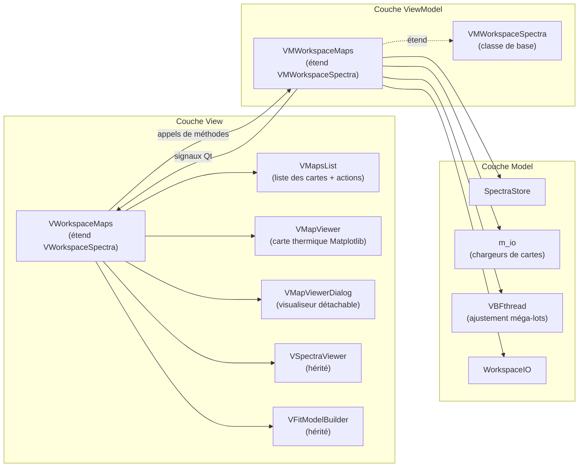

# **Espace de travail : Maps**

L'espace **`Maps`** traite les **données de cartographie hyperspectrale** — des jeux de données résolus spatialement où chaque pixel correspond à un spectre complet. Il étend l'[espace Spectra](spectra.md) par héritage, récupérant gratuitement toutes les capacités d'ajustement, ligne de base, édition de pics et persistance, tout en ajoutant la gestion spatiale, l'affichage en cartes thermiques et les opérations par coordonnées.

> [!NOTE]
> **Prérequis** — Avant de lire ce guide, assurez-vous de bien connaître :
>
>
> - [Architecture de données : SpectraStore](spectra_store.md) — le modèle de données partagé `MapData` / `SpectraStore`.
> - [Espace de travail : Spectra](spectra.md) — le ViewModel de base, les composants View et les flux de données.
>
> Cette page ne couvre **que les extensions propres à Maps**. Les comportements hérités ne sont pas répétés ici.

---

## Comment Maps diffère de Spectra

La différence fondamentale réside dans la cardinalité `MapData.N` :

| Espace | `MapData.N` | Signification |
|--------|-------------|---------------|
| **Spectra** | 1 | Un spectre par bloc `MapData` |
| **Maps** | 2 – 100 000 | N spectres partageant un même axe de nombres d'onde |

Parce que le [modèle tensoriel](spectra_store.md#mapdata-le-bloc-tensoriel) sous-jacent est identique, un ajustement vectorisé qui fonctionne pour 1 spectre fonctionne également pour 100 000, sans aucune modification du moteur.

### `MapData` dans le contexte Maps

```
MapData ("wafer_300mm") — wafer 50×50 (2500 spectres, 1000 nombres d'onde)
├── x0:          float64[1000]          1 axe de nombres d'onde partagé
├── Y0:          float32[2500, 1000]    intensités brutes — 10 Mo
├── x:           float64[800]           après recadrage spectral
├── Y:           float32[2500, 800]     après recadrage + soustraction ligne de base — 8 Mo
├── coords:      float64[2500, 2]       positions (X, Y) de platine en µm
├── fnames:      list[str] × 2500       "wafer_300mm_(x_pos, y_pos)"
├── is_active:   bool[2500]             état de case à cocher
├── peak_params: float64[2500, K]       après ajustement VBF — les 2500 simultanément
├── fit_success: bool[2500]
├── fit_r2:      float64[2500]
├── Y_bestfit:   float32[2500, 800]     8 Mo
└── Y_peaks:     [float32[2500, 800], ...]   8 Mo par pic
```

---

## Vue d'ensemble de l'architecture



### Pourquoi l'héritage plutôt que la composition ?

`VMWorkspaceMaps` **étend** `VMWorkspaceSpectra` au lieu de l'encapsuler :

- Chaque algorithme (ligne de base, pics, moteur VBF) opère à l'identique sur un spectre isolé (N=1) comme sur une carte (N>1).
- Dupliquer ou déléguer le code d'ajustement fragiliserait la maintenance.
- Surcharger via le **patron Template Method** (trois méthodes points d'extension) suffit à adapter le ciblage des opérations globales sans jamais dupliquer la logique algorithmique.

Le même principe s'applique côté View : `VWorkspaceMaps` étend `VWorkspaceSpectra`, surcharge `setup_connections()` pour éviter le double câblage durant `__init__`, puis remplace le panneau latéral droit par le panneau spécifique `VMapsList + VMapViewer`.

---

## Composants spécifiques à Maps

### `VMWorkspaceMaps` — Le ViewModel

**Fichier** : [`vm_workspace_maps.py`](https://github.com/CEA-MetroCarac/SPECTROview/blob/main/spectroview/viewmodel/maps/vm_workspace_maps.py) (avec mixins d'ajustement et de persistance dans `spectroview/viewmodel/maps/`)

État additionnel au-delà du [VMWorkspaceSpectra](spectra.md#vmworkspacespectra-le-viewmodel) hérité :

| Attribut | Type | Rôle |
|----------|------|------|
| `maps` | `dict[str, pd.DataFrame]` | DataFrames bruts des cartes indexés par nom (cache historique) |
| `current_map_name` | `str \| None` | Carte sélectionnée active |
| `maps_metadata` | `dict[str, dict]` | Métadonnées d'acquisition par carte (WDF, SPC, L6M, NGC) |
| `map_type` | `str` | `'2Dmap'` ou `'Wafer_300mm'` / `'Wafer_200mm'` / `'Wafer_100mm'` |
| `graphs_workspace` | réf. | Référence injectée pour l'extraction de profils |

#### Signaux supplémentaires

```python
maps_list_changed         = Signal(list)    # liste des noms de cartes mise à jour → VMapsList
map_data_updated          = Signal(object)  # DF de carte active modifié → redessin carte thermique
send_spectra_to_workspace = Signal(list)    # copies profondes → espace Spectra
clear_map_cache_requested = Signal(str)     # nom de carte → invalidation cache VMapViewer
switch_to_graphs_tab      = Signal()        # demande de bascule d'onglet après extraction de profil
```

#### Référence des méthodes supplémentaires

| Catégorie | Méthodes |
|-----------|----------|
| **Chargement** | `load_map_files(paths)` |
| **Sélection et ordre** | `select_map(name)`, `select_maps(names, primary)`, `reorder_maps(new_order)`, `_show_map_spectra(name)` |
| **Suppression** | `delete_current_map()`, `remove_map(name)` |
| **Données de carte** | `get_current_map_dataframe()`, `get_fit_results_dataframe()` |
| **Export** | `save_current_map_to_csv(file_path)` |
| **Ajustement** | `fit()`, `_run_fit_thread()`, `collect_fit_results()` — toutes surchargent la classe parente |
| **Inter-espaces** | `send_selected_spectra_to_spectra_workspace()`, `extract_and_send_profile_to_graphs()` |
| **Persistance** | `save_work()`, `load_work()`, `_load_legacy_maps()` |

### `VWorkspaceMaps` — La View

**Fichier** : [`v_workspace_maps.py`](https://github.com/CEA-MetroCarac/SPECTROview/blob/main/spectroview/view/workspaces/v_workspace_maps.py)

Surcharge `_add_maps_panel()` pour remplacer la barre latérale des spectres héritée par :

- `VMapViewer` — le canevas de carte thermique avec curseurs de paramètre Z et de plage X.
- `VMapsList` — panneau de liste des cartes avec boutons de gestion des cartes et des spectres.

La partie gauche (`SpectraViewer` + onglets inférieurs) est héritée de `VWorkspaceSpectra`. Alors que `VWorkspaceSpectra` initialise `VLiveMaps` et `VMLiveMaps` en mode `"spectra"` (traçant des courbes 1D de variation sur les spectres sélectionnés), `VWorkspaceMaps` bascule les instances héritées `v_live_maps` et `vm_live_maps` en mode `"map"` (`set_mode("map")`).

Dans Maps, lors du chargement ou de la sélection de cartes, `VWorkspaceMaps` synchronise un **modèle de sélection à deux niveaux** :

- **Carte principale (`VMWorkspaceMaps.current_map_name`)** : Pilote le prétraitement, l'ajustement, `VMapViewer`, `VSpectraViewer`, la MVA et les métadonnées `More` à l'identique d'une sélection simple.
- **Liste des cartes sélectionnées (`VMWorkspaceMaps.selected_map_names`)** : Alimentée via `VMapsList` (`QAbstractItemView.ExtendedSelection`), permettant la comparaison multi-cartes via `Ctrl+Click` / `Shift+Click` sans modifier les opérations sur la carte principale ni redessiner `VMapViewer` tant que celle-ci reste inchangée.

`VWorkspaceMaps` transmet `[MapData, ...]` et `primary_name` à `self.vm_live_maps.set_map_datas(...)` uniquement lorsque l'onglet **Live Maps** est actif (positionnant sinon `_live_maps_dirty = True` pour un recalcul paresseux à l'ouverture de l'onglet). L'activation d'un crochet R/B/G sur `VSpectraViewer` bascule automatiquement `bottom_tabs` sur `Live Maps` dans `VWorkspaceSpectra._on_range_selector_toggled()` et déclenche immédiatement tout calcul en attente. `VMLiveMaps` inspecte `md.coords` via les fonctions mises en cache `analyze_map_geometry()` et `build_map_gridder()` (mettant en cache la grille régulière ou les poids barycentriques `Delaunay` tant que `coords` et `is_active` ne changent pas), exclut les spectres décochés (`~md.is_active`), met en cache les tranches paramétriques selon `(id(md), md.name, md.data_version, param, range)` et applique l'adaptation dimensionnelle à **priorité de la carte principale** :

- **Carte principale = profil 1D** : Émet `multi_profile_data_ready` ($\ge 2$ profils) ou `profile_data_ready` (profil unique), superposant tous les profils 1D sélectionnés avec des couleurs distinctes (`DEFAULT_COLORS`) et une épaisseur de trait uniforme, tout en signalant dans l'en-tête d'éventuelles cartes 2D exclues.
- **Carte principale = carte 2D** : Alimente `map_2d_candidates_changed` pour le sélecteur d'en-tête `[◀ | ComboBox | ▶]`, exclut les profils 1D et ne calcule/affiche que l'unique carte thermique 2D visible via `map_data_ready`.
- **Rapport d'intensité Rouge/Bleu (`R/B ratio`)** : Calcule dynamiquement $I_{\mathrm{Red}} / I_{\mathrm{Blue}}$ pour les profils 1D simples/multiples comme pour les cartes 2D, en masquant en `NaN` les intensités Bleues nulles/quasi nulles et les spectres décochés. Tant que `R/B ratio` est choisi sur le canal Vert, `VWorkspaceSpectra._on_range_selector_parameter_changed()` informe `VSpectraViewer.set_range_selector_parameter()` afin de masquer le crochet Vert (et de le restaurer dès le retour à un autre paramètre).

Pour les très grands lots (`>= 25 000` spectres actifs par défaut via `ASYNC_SPECTRUM_THRESHOLD`), `VMLiveMaps` déporte l'évaluation NumPy pure et le maillage sur un `QThreadPool` à un worker (`_LiveMapWorker`) relié via un `QObject` parenté (`_LiveMapWorkerBridge`) avec annulation par `_generation_id` monotone et arrêt propre via `shutdown()`. `VMLiveMaps` émet aussi `spatial_sites_changed` afin que les sous-panneaux Live Maps restent alignés sur les coordonnées actives. Côté interface, les widgets RVB et Live Maps se trouvent dans [`spectroview/view/components/rgb_live_maps/`](https://github.com/CEA-MetroCarac/SPECTROview/blob/main/spectroview/view/components/rgb_live_maps/__init__.py) (`v_live_maps.py`, `v_live_maps_options.py`, `v_live_map_subpanel.py`, `v_live_map_1d.py`, `v_live_map_2d.py`, `v_live_map_selection.py`, `v_live_maps_legend_editor.py`, `v_range_selector.py`, `v_range_bracket_mixin.py`, `common.py`). Chaque `LiveMapSubpanel` intègre ses contrôles **Rescale**, **Pan** et **Zoom**, le **Copy** double-mode (`Ctrl + Click` copie les données TSV via `copy_df_to_clb()`), la normalisation par panneau des courbes 1D et la sélection interactive de sites via les utilitaires partagés de [`map_selection.py`](https://github.com/CEA-MetroCarac/SPECTROview/blob/main/spectroview/view/components/map_viewer/map_selection.py) (`MapCanvasSelector`, `resolve_xy_selection()`, `resolve_1d_profile_selection()`), tout en persistant ses options dans `MSettings` (`live_maps_view_options/*`).

Les mises à jour des sélecteurs de plage appliquent un anti-rebond adaptatif (60–250 ms) pendant le glissement et se vident immédiatement au relâchement (`VSpectraViewer.range_drag_finished` → `VMLiveMaps.flush_pending()`). Durant le glissement d'un crochet, `RangeSelectorManager.render()` met à jour les artistes Matplotlib existants sur place (`set_animated(True)` avec *blitting* Agg et suspension temporaire de `layout_engine` via `SpectraRangeBracketMixin`, plus bornage horizontal via `transData.inverted()`), tandis que les chemins rapides de `LiveMapSubpanel` (`update_series()` / `update_multi_profile()`) et `MapCanvasSelector.draw_1d_overlay()` réutilisent les artistes existants pour éliminer la latence de redessin. Les artistes des sélecteurs utilisent `ax.add_artist()` afin de ne jamais polluer `ax.dataLim`, garantissant que **Rescale** (`Ctrl+R`) zoome exclusivement sur les données spectrales.

**Gestion centralisée du type de carte** : L'attribut `selected_map_type` constitue la source unique de vérité pour tous les visualiseurs (principal + fenêtres détachables). Lorsque l'utilisateur modifie la liste déroulante dans n'importe quelle fenêtre, `_on_map_type_changed()` synchronise tous les visualiseurs et évite toute dérive.

### `VMapViewer` — Le canevas de carte thermique

**Paquet** : [`map_viewer/`](https://github.com/CEA-MetroCarac/SPECTROview/blob/main/spectroview/view/components/map_viewer/__init__.py) (`v_map_viewer.py`, `v_map_plot.py`, `v_map_data.py`, `v_map_interactions.py`, `map_selection.py`)

Composant View parmi les plus riches (~1 300 lignes), il affiche à la fois des cartes rectangulaires 2D et des cartographies circulaires *wafer* :

- Liste déroulante du paramètre Z (`Intensity` / `Area` / toute colonne de résultat d'ajustement)
- Double curseur de plage X (filtre les nombres d'onde contribuant à Z)
- Option d'écrêtage des valeurs aberrantes
- **Placement spatial exact** : Pour les grilles cartésiennes régulières, rendu rapide via `imshow` avec bornes d'emprise symétriques. Pour les coordonnées irrégulières ou dispersées (par exemple fichiers *wafer* ouverts en mode `2Dmap`), génère automatiquement des pavés carrés centrés sur chaque coordonnée exacte $(X, Y)$ via `PatchCollection`, éliminant tout décalage entre pixels et rectangles de sélection.
- **Sélecteur d'échelle de couleur (Linear / Log)** dans le menu options (`…`) — `_build_color_kwargs()` retourne une `matplotlib.colors.LogNorm` pour « Log » (revenant en échelle linéaire `vmin`/`vmax` si la plage Z n'est pas strictement positive) ; s'applique aussi bien à `imshow` 2Dmap qu'à l'interpolation *wafer*.
- Sélection interactive (clic simple, rectangle par glisser, ligne de profil)
- **Mises à jour d'artistes sur place et isolation des jeux de données** : Lors d'un changement de paramètre, de plage X ou de palette sur la carte active (`_last_rendered_map_name == map_df_name`), `_do_plot_heatmap_internal()` emprunte le chemin rapide en actualisant `self.img` (`set_data` / `set_array`, `set_extent`, `set_clim`) et `self.cbar.update_normal(...)` sur place sans `figure.clf()` destructeur ni `tight_layout()`. Lors d'un changement de carte ou de type, l'axe est reconstruit proprement tout en réutilisant le cache `(heatmap_pivot, extent, vmin, vmax, grid_z, final_z_col, dx, dy)` de `_griddata_cache`.
- **Mises à jour instantanées du curseur Z** : Les déplacements temps réel des curseurs Z contournent les recalculs de cache et mettent directement à jour `set_clim()` / `set_norm()` et la barre de couleur sur place.
- **Contrôles de navigation vectoriels et affichage des coordonnées** : Boutons de navigation (`btn_home` / `btn_rescale`, `btn_pan`, `btn_zoom`) stylés comme les barres SPECTROview (`28x28`, `@surface_elevated`, coins arrondis) avec icônes vectorielles SVG (`Icons.rescale()`, `Icons.pan()`, `Icons.zoom()`), synchronisés de façon bidirectionnelle avec la barre `NavigationToolbar2QT` masquée en arrière-plan, tandis que les coordonnées sous curseur s'affichent proprement dans `lbl_coordinates` (`min-width: 180px`, aligné à droite).
- Ouverture de fenêtres de visualisation multiples détachables

### `VMapsList` — Le panneau liste et actions des cartes

**Fichier** : [`v_map_list.py`](https://github.com/CEA-MetroCarac/SPECTROview/blob/main/spectroview/view/components/lists/v_map_list.py)

Affiche les noms des cartes chargées dans un `_ReorderableMapsList(QListWidget)` (`ExtendedSelection` pour multi-sélection `Shift+Click` / `Ctrl+Click` avec suivi de la carte principale via `maps_selection_changed(selected_names, primary_name)`, et réorganisation interne par glisser-déposer `InternalMove` émettant `maps_order_changed(new_order)` tout en ignorant les dépôts d'URL externes pour laisser passer les ouvertures de fichiers). Sur dépôt interne, la sélection et la carte principale sont préservées et transmises à `VMWorkspaceMaps.reorder_maps()`, réordonnant `self.maps`, `SpectraStore.reorder_maps()` et `selected_map_names` sans réinitialiser `VMapViewer`. Associé aux boutons de gestion rapide (`View`, `Delete` avec confirmation sur sélections multiples, `Export CSV`) et aux boutons d'action sur spectres (`Select All`, `Reinitialize`, `Fitting Statistics`, `Send to Spectra Workspace`).

### `VMapViewerDialog` — Fenêtre détachable

**Fichier** : [`v_map_viewer_dialog.py`](https://github.com/CEA-MetroCarac/SPECTROview/blob/main/spectroview/view/components/map_viewer/v_map_viewer_dialog.py)

Boîte de dialogue `QDialog` encapsulant une instance secondaire de `VMapViewer`. Utilise `Qt.WindowStaysOnTopHint` afin de permettre la sélection de pixels dans la fenêtre flottante tout en observant le spectre dans la fenêtre principale. Plusieurs fenêtres peuvent être ouvertes simultanément sur différents paramètres Z ; les données sont partagées par référence sans duplication.

---

## Le modèle à double stockage

L'espace Maps conserve **deux structures** pour les mêmes données :

1. **`self.maps[map_name]`** — un `pd.DataFrame` de colonnes `X, Y, w1, w2, ...` (une ligne par spectre). C'est le stockage historique renseigné au chargement depuis l'analyseur de fichier.
2. **`self.store.get_map_data(map_name)`** — le bloc tensoriel `MapData` contenant l'ensemble de l'état de traitement.

Le DataFrame sert à l'**entrée de carte thermique** (table pivot → `imshow`) et à l'**export CSV**. Le bloc tensoriel sert à **toutes les opérations analytiques** (ligne de base, ajustement, collecte des résultats). Lors de l'exportation des données traitées en CSV, `save_current_map_to_csv()` lit depuis `md.x` / `md.Y` (données traitées) plutôt que depuis le DataFrame brut.

> [!IMPORTANT]
> Lorsqu'un développeur se demande « où sont stockées les données ? », la réponse est : **aux deux endroits, pour des usages distincts**. Le DataFrame constitue l'entrée issue du lecteur de fichier et du pipeline de carte thermique. Le bloc tensoriel fait autorité pour toute l'analyse. Les transformations (ligne de base, recadrage) ne modifient que le bloc tensoriel — elles ne mettent pas à jour le DataFrame.

### Convention de nommage des spectres

Chaque ligne spectrale d'un bloc `MapData` reçoit un identifiant `fname` unique construit à partir de ses coordonnées :

```python
fname = f"{map_name}_({float(x_pos)}, {float(y_pos)})"
# Exemple : "wafer_300mm_(12.5, -7.0)"
```

Cette convention est utilisée dans tout le code pour :

- Filtrer les spectres appartenant à une carte donnée : `fname.startswith(f"{map_name}_(")`
- Extraire les coordonnées d'un `fname` : analyser entre `(` et `)`.
- Relier les entrées de `SpectraStore` aux lignes du `DataFrame` pour le tracé des cartes thermiques.

L'analyse des coordonnées est centralisée dans `parse_coords_from_fname()` (`viewmodel/common/spectral_utils.py`, ré-exportée dans `viewmodel/utils.py`) ; `VWorkspaceMaps._extract_coords_from_fname()` et `VMWorkspaceMaps._extract_coords_for_spectra()` y délèguent toutes deux. Toute évolution de ce format ne doit modifier que cet utilitaire (en maintenant un formatage `float()` identique dans `_extract_spectra_from_map()`).

---

## Flux de données

### Chargement d'une carte hyperspectrale

1. **Action utilisateur** : L'utilisateur déclenche le chargement d'une carte dans `VWorkspaceMaps`.
2. **View → ViewModel** : La View appelle `vm.load_map_files(paths)`.
3. **Analyse de fichier** : Pour chaque fichier, le ViewModel délègue à `m_io` (`load_wdf_map`, `load_spc_map`, `load_l6m_map`, `load_ngc_map`, etc.), qui renvoie un DataFrame contenant `X`, `Y` et toutes les colonnes de nombres d'onde, ainsi que les métadonnées.
4. **Stockage (historique)** : Le ViewModel met le DataFrame en cache dans `self.maps[name]`.
5. **Extraction des tableaux** : Le ViewModel appelle `_extract_spectra_from_map(name, map_df)`, qui délègue à `extract_map_arrays(name, map_df)` dans `m_io.py` pour extraire `x0`, `Y0`, `coords` et la liste `fnames` des pixels.
6. **Stockage (tenseur)** : Le ViewModel enregistre les données dans `SpectraStore` via `add_map(name, x0, Y0, coords, fnames, is_active)`.
7. **Mise à jour UI** : Une fois tous les fichiers traités, le ViewModel émet `maps_list_changed` avec la liste des cartes chargées.

`extract_map_arrays()` filtre toute colonne `Unnamed:` finale ou non numérique tout en conservant tous les canaux de nombres d'onde valides, et ajoute automatiquement des suffixes `_{k}` à `fnames` uniquement en cas de coordonnées spatiales `(X, Y)` dupliquées (cartes multi-balayages résolues en temps sur les mêmes sites).

### Sélection de carte

Lorsque l'utilisateur clique sur une carte dans `VMapsList` ou en ouvre une nouvelle :

1. **Action utilisateur** : Clic sur un nom de carte ou ouverture de fichier.
2. **View → ViewModel** : La View appelle `vm.select_map(map_name)`.
3. **Mise à jour d'état et autosélection** : Le ViewModel positionne `current_map_name = map_name`, remplit `_show_map_spectra(map_name)` et sélectionne automatiquement le premier spectre `self.selected_fnames = [md.fnames[0]]`, émettant `spectra_selection_changed` pour tracer immédiatement ce premier spectre dans `VSpectraViewer`.
4. **Rafraîchissement du visualiseur de carte** : Le ViewModel émet `map_data_updated(current_map_df)`.
5. **Redessin et superposition de sélection** : `VWorkspaceMaps` transmet les données à `VMapViewer.set_map_data()`, qui encadre automatiquement la première coordonnée `(x_0, y_0)` en rouge et appelle `plot_heatmap()`. Les visualiseurs flottants sont maintenus synchronisés.

### Flux d'ajustement (surcharge Maps)

L'espace Maps surcharge [`fit()`](spectra.md#flux-dajustement) pour construire des **lots multi-tâches** pouvant couvrir toute la carte :

1. **Action utilisateur** : Clic sur « Fit » (ou `Ctrl+Fit` pour appliquer à toutes les cartes).
2. **Construction des tâches** :
    - Si `apply_all = True` : Le ViewModel regroupe les cartes par longueur d'axe X et les empile en méga-matrices `Y`.
    - Si `apply_all = False` : Le ViewModel construit une tâche pour la carte active et les indices sélectionnés uniquement.
3. **Lancement du thread** : Le ViewModel démarre un `VBFthread` avec la liste des tâches.
4. **Exécution moteur (arrière-plan)** : Pour chaque tâche, le thread appelle `VBFengine.fit_spectra()`. Les tâches multi-cartes empilées sont ajustées en une seule opération vectorisée.
5. **Écriture des résultats (arrière-plan)** : Le thread redistribue les résultats vers chaque carte via `SpectraStore.set_fit_results()`.
6. **Achèvement** : Le thread émet `finished()`, puis le ViewModel exécute `_on_fit_finished()`.
7. **Collecte des résultats** : `collect_fit_results()` agrège l'ensemble dans un DataFrame unique.
8. **Rafraîchissement UI** : Des signaux déclenchent le redessin de la carte thermique (`map_data_updated`) et la mise à jour du tableau (`fit_results_updated`).

Le **regroupement en méga-lots (*mega-batch*)** est l'optimisation clé de performance : lorsque `apply_all=True`, les cartes partageant la même longueur d'axe X sont empilées en une matrice `Y` unique et ajustées en un seul appel vectorisé. Une mesure de 10 cartes *wafer* demandant 30 s chacune individuellement peut s'achever en ~35 s au total.

### Après ajustement : propagation des résultats

À la suite de `_on_fit_finished()` :

1. `collect_fit_results()` est appelée → construit `self.df_fit_results` (DataFrame avec `X, Y` et toutes les colonnes d'ajustement).
2. `fit_results_updated` est émis → le tableau `VFitResults` se met à jour.
3. `map_data_updated` est émis → `VMapViewer` relit `df_fit_results` et ajoute les colonnes ajustées à sa liste déroulante du paramètre Z.
4. `clear_map_cache_requested` est émis → `VMapViewer` invalide son cache `griddata` pour la carte concernée.

---

## Pipeline de visualisation des cartes

1. **Source des données** : Selon l'état de prétraitement, les intensités traitées (`md.Y`) ou brutes (`md.Y0`).
2. **Filtrage du DataFrame** : `get_current_map_dataframe()` exclut les spectres inactifs.
3. **Liaison au visualiseur** : Le DataFrame est transmis à `VMapViewer.set_map_data()`.
4. **Calcul des valeurs Z** : `_compute_z_values()` calcule la grandeur cible selon le choix de la liste déroulante :
    - *Intensity* : somme sur la plage sélectionnée par le curseur X.
    - *Area* : intégrale trapézoïdale.
    - *Fit parameter* : lecture directe depuis `df_fit_results`.
5. **Écrêtage des valeurs aberrantes** : Écrêtage par percentiles si l'option est activée.
6. **Logique de rendu** : Selon `map_type` :
    - *2D map* : Chemin rapide. Une table pivot associe `(X, Y)` à `Z` sur une grille exacte, tracée par `imshow()` de Matplotlib.
    - *Wafer map* : Chemin interpolé. `scipy.griddata` interpole les points circulaires irréguliers sur une grille 80×80 avant affichage via `imshow()`.

**Pourquoi deux chemins de rendu ?**

Une carte rectangulaire 2D repose sur une grille régulière — une simple table pivot suffit et s'affiche en quelques millisecondes. Une mesure sur *wafer* comporte des sites répartis sur un disque (et non une grille régulière) ; `scipy.griddata` doit donc d'abord interpoler sur une grille régulière avant que `imshow` ne puisse dessiner. C'est l'étape coûteuse.

### Stratégie de mise en cache des cartes thermiques

`scipy.griddata` pouvant prendre de 100 à 500 ms sur de grandes cartes, le visualiseur maintient un **cache multi-clés** afin d'éviter tout recalcul inutile :

```python
cache_key = (
    map_name,        # quelle carte
    parameter,       # quel paramètre Z
    (xmin, xmax),    # filtre de plage X
    map_type,        # variante 2Dmap vs Wafer
    mask_config,     # paramètres de masque ou None
    remove_outliers  # drapeau d'écrêtage
)
```

Le cache stocke `(heatmap_pivot, extent, vmin, vmax, grid_z, final_z_col, dx, dy)`, conservant les pas spatiaux exacts (`dx, dy`) lors des changements de type ou de fichier afin d'éviter toute dérive géométrique entre jeux de données.

Ce cache est :

- **Conservé d'une carte à l'autre** — revenir sur une carte déjà affichée est instantané et restaure ses dimensions exactes.
- **Invalidé par nom** après la fin d'un ajustement via le signal `clear_map_cache_requested`.
- **Non persisté** entre sessions — il ne vit que dans `VMapViewer._griddata_cache`.
- **Isolé par jeu de données** : `can_fast_update` vérifie `_last_rendered_map_name == map_df_name` et le nombre de pavés de `PatchCollection`, assurant que les mises à jour sur place ne s'exécutent que sur le jeu actif tandis qu'un changement de carte déclenche toujours un redessin propre.

### Sélection interactive

`VMapViewer` propose trois modes de sélection :

| Mode | Déclencheur | Comportement |
|------|-------------|--------------|
| **Clic simple** | Clic gauche sur la carte | Sélectionne le site le plus proche, surligné par un rectangle rouge |
| **Rectangle par glisser** | Cliquer-glisser | Sélectionne tous les sites contenus dans le rectangle tracé |
| **Profil** | Exactement 2 sites sélectionnés en mode 2D | Active le bouton « Extract profile » |

Toute sélection dans `VMapViewer` émet `spectra_selected(list[tuple])`. `VWorkspaceMaps._on_map_viewer_selection()` convertit les coordonnées `(x, y)` en `fnames` et appelle `vm.set_selected_fnames()`, ce qui déclenche `_emit_selected_spectra()` → `VSpectraViewer` affiche le ou les spectres sélectionnés.

Les points sélectionnés sont tracés sous forme d'un unique `PatchCollection` (un seul appel de rendu pour tous les rectangles) plutôt que des `add_patch()` individuels, assurant un temps de rendu en O(1) quelle que soit la taille de la sélection.

---

## Surcharges de méthodes modèles

L'espace Maps personnalise le pipeline global hérité via trois [méthodes points d'extension](spectra.md#methodes-modeles-template-method). Les comprendre est essentiel pour déboguer ou étendre les opérations par lots.

### `_get_target_mds(apply_all)`

Détermine **quels objets `MapData`** sont ciblés par une opération globale.

| `apply_all` | Espace Spectra | Espace Maps |
|-------------|----------------|-------------|
| `False` | Blocs `MapData` des spectres sélectionnés | Bloc `MapData` de la carte active uniquement |
| `True` | Tous les blocs `MapData` du magasin | Blocs `MapData` de toutes les cartes |

C'est pour cela qu'un `Ctrl+Subtract-Baseline` dans Maps soustrait la ligne de base à **tous les spectres de la carte active** (et pas uniquement à ceux sélectionnés) — la surcharge Maps retourne le `MapData` complet de la carte.

### `_on_map_data_changed(md, action)`

Appelée **après modification de chaque `MapData` individuel** au sein d'une boucle globale.

```python
# Surcharge de l'espace Maps :
def _on_map_data_changed(self, md, action: str):
    if action == "reinit_spectra":
        self.store.clear_preprocess(md.name)
    elif action in ("delete_baseline", "subtract_baseline", "apply_spectral_range"):
        self.store.batch_preprocess(md.name, md.baseline_config, md.range_min, md.range_max)
    elif action == "paste_peaks":
        self._reconstruct_y_peaks(md)
    # Toujours invalider le cache de carte thermique
    self.clear_map_cache_requested.emit(md.name)
```

### `_post_bulk_action(apply_all, action)`

Appelée **une fois l'ensemble des objets `MapData` traités**. La surcharge Maps actualise les résultats d'ajustement et ré-émet la vue de la carte.

### Surcharge de `_emit_selected_spectra()`

La surcharge Maps construit une charge utile `"type": "tensor"` (lot partageant un même axe X) au lieu du format `"type": "tensor_list"` de l'espace Spectra (tableaux indépendants par spectre) :

```python
# Espace Maps :
batch_data = {
    'type': 'tensor',
    'x': x,             # partagé float64[M_proc]
    'y': Y,             # float32[n_selected, M_proc]
    'indices': indices, # indices de lignes au sein de la carte
    ...
}
```

Cela permet à `VSpectraViewer` de tracer plusieurs spectres de carte par opérations matricielles sans boucle Python.

---

## Communication inter-espaces

### Maps → Espace Spectra

```python
# L'utilisateur sélectionne des spectres dans Maps et clique sur "Send to Spectra"
vm.send_selected_spectra_to_spectra_workspace()
```

Pour chaque spectre sélectionné :

1. Construit un dictionnaire **copié en profondeur** (bruts `x0`, `Y0`, `baseline_config`, `fit_model`, `range_min/max`, `is_subtracted`).
2. Émet `send_spectra_to_workspace(payloads)`.
3. `main.py` connecte ce signal à `receive_spectra()` du ViewModel Spectra, qui enregistre chaque élément comme un nouveau bloc `MapData` (N=1) dans le `SpectraStore` de l'onglet **Spectra**.

La copie profonde évite toute contamination croisée — modifier le spectre dans l'onglet Spectra n'altère pas la carte d'origine.

### Maps → Espace Graphs (Extraction de profil)

Lorsque l'utilisateur sélectionne exactement 2 points en mode 2D et clique sur « Extract profile » :

1. **Action utilisateur** : Sélection de 2 points sur une carte 2D puis clic sur « Extract profile ».
2. **View → ViewModel** : `VMapViewer` émet `extract_profile_requested(profile_name)`.
3. **Logique d'extraction** : `VWorkspaceMaps` délègue à `_extract_profile()`, qui construit un DataFrame `profile_df` par interpolation le long du segment.
4. **Transmission** : La View passe le DataFrame à `VMWorkspaceMaps.extract_and_send_profile_to_graphs()`.
5. **Transfert d'espace** : Le ViewModel appelle directement `VMWorkspaceGraphs.add_dataframe()`.
6. **Mise à jour UI** : Un signal demande à la fenêtre principale de basculer sur l'onglet Graphs.

Le DataFrame de profil possède les colonnes `distance` (µm) et `values` (intensité Z). L'espace Graphs en génère automatiquement une courbe.

---

## Résultats d'ajustement avec colonnes spatiales

`collect_fit_results()` surcharge la méthode parente pour ajouter les colonnes spatiales et de zone :

```python
# Après super().collect_fit_results() :
# Le DataFrame de base inclut : Filename, X, Y, [Quadrant, Zone pour les wafers],
# les paramètres ajustés triés (x0_Peak1, fwhm_Peak1, area_Peak1, ...), et R2 en fin de tableau

# L'espace Maps ajoute X, Y et garantit la présence de Quadrant et Zone pour les cartes wafer

# Colonnes finales :
# Filename | X | Y | Quadrant | Zone | x0_Peak1 | fwhm_Peak1 | area_Peak1 | ... | R2
```

`Zone` classe selon la distance radiale :

| Zone | Distance |
|------|----------|
| Center | ≤ 35 % du rayon |
| Mid-Radius | 35 – 80 % |
| Edge | ≥ 80 % |

`Quadrant` classe selon le signe de `(X, Y)` : Q1 (−,−), Q2 (−,+), Q3 (+,+), Q4 (+,−).

---

## Persistance

### Format moderne (v2+, basé sur ZIP)

Les fichiers de l'espace Maps (`.maps`) utilisent la même structure ZIP décrite dans [SpectraStore : Persistance](spectra_store.md#persistance), avec un volume plus important dû aux tenseurs.

Les DataFrames de cartes sont sérialisés dans un format binaire rapide :

```python
# Sérialisation rapide (vs to_csv qui est 20 à 70× plus lent)
arr = map_df.to_numpy()
buf = io.BytesIO(); np.save(buf, arr)
gzip.compress(buf.getvalue(), compresslevel=1)  # level=1 : 70× plus rapide, ~5 % plus lourd
```

### Chargeur historique

`_load_legacy_maps()` lit les anciens fichiers JSON `.maps` où chaque carte était stockée sous forme de chaîne CSV gzippée encodée en hexadécimal :

1. Analyse le dictionnaire racine `"maps"` (`map_name → hex_string`).
2. Décompresse et lit chaque CSV dans un DataFrame.
3. Construit une table de correspondance de coordonnées à partir des entrées `"spectrums_data"` (indexées par `(map_name, x, y)`).
4. Enregistre chaque carte dans `SpectraStore` via `add_map()`.
5. Restaure de manière vectorisée les lignes de base, courbes de pics et résultats d'ajustement.

---

## Guide d'extension

### Ajouter un nouveau format de fichier carte

1. Créez une fonction de chargement dans `spectroview/model/io/m_io.py` (ex. `load_xyz_map(path) → pd.DataFrame`).
2. Dans `VMWorkspaceMaps.load_map_files()`, ajoutez une branche `elif path.suffix.lower() == '.xyz':`.
3. Le DataFrame retourné doit comporter les colonnes `X` et `Y` suivies des colonnes numériques de nombres d'onde.
4. Si le format fournit des métadonnées, retournez un tuple `(DataFrame, dict)` et enregistrez le dictionnaire dans `self.maps_metadata[map_name]`.

### Ajouter un nouveau type de paramètre Z

Les nouveaux paramètres Z sont calculés dans `VMapViewer._compute_z_values()`. Pour ajouter par exemple un rapport de pics :

1. Ajoutez le nom du paramètre à la logique de remplissage de la liste déroulante de `VMapViewer`.
2. Dans `_compute_z_values()`, ajoutez une branche `elif parameter == "My Ratio":` lisant depuis `df_fit_results`.
3. La clé de cache inclut déjà `parameter`, la mise en cache fonctionne donc automatiquement.

### Ajouter un nouveau type de carte (au-delà de Wafer)

Les nouvelles géométries spatiales nécessitent :

1. D'ajouter la chaîne de type à la liste déroulante `cbb_map_type`.
2. Dans `VMapViewer.plot_heatmap()`, d'ajouter une branche de rendu (vraisemblablement `scipy.griddata` avec un masque dédié).
3. Dans `VMWorkspaceMaps.collect_fit_results()`, d'ajouter une classification de zone/quadrant pour ce type.

---

## Dépannage

**La carte thermique ne se met pas à jour après ajustement**

- `collect_fit_results()` doit être appelée après `_on_fit_finished()`. Vérifiez que `clear_map_cache_requested` est bien émis pour le nom de la carte et que `parameter` dans la clé de cache correspond bien à la sélection courante de la liste déroulante.

**Le pixel sélectionné ne surligne pas le bon spectre**

- La correspondance entre coordonnées `(x, y)` et `fnames` repose sur le format `{map_name}_(x, y)` dans `md.fnames`. Vérifiez que `float(x_pos)` produit exactement la même chaîne dans `_extract_spectra_from_map()` et `_on_map_viewer_selection()`.

**Ajuster une grande carte fige brièvement l'UI au démarrage**

- La construction des tâches (`_run_fit_thread()`) s'exécute sur le thread principal avant `VBFthread.start()`. Pour les très grandes cartes, `np.arange(md.n_spectra)` est rapide mais le `vstack` des matrices `Y` peut être coûteux. Profilez `_run_fit_thread()` avec `cProfile` si cela devient un goulot d'étranglement.

**Send to Spectra crée des spectres en double**

- `receive_spectra()` du ViewModel Spectra vérifie `name in self.store.map_names` avant d'ajouter. Si des doublons apparaissent, vérifiez la cohérence du format de `fname` (attention aux arrondis flottants dans la mise en forme de `(x_pos, y_pos)`).

**`griddata` wafer est lent à chaque redessin**

- Vérifiez que `clear_map_cache_requested` n'est émis que lorsque nécessaire (après un ajustement, jamais à chaque clic de sélection). Vérifiez que le tuple `cache_key` est hachable et stable — si un élément change involontairement entre deux rendus, le cache rate à chaque fois.

**Pic mémoire lors du chargement de nombreuses grandes cartes**

- Pour une carte 50×50 (2 500 spectres) de 1 000 nombres d'onde, `MapData.Y0` (`float32`) occupe ~10 Mo ; pour une carte de 25 000 spectres à 1 000 nombres d'onde, `Y0` occupe ~100 Mo, et l'ajustement alloue en plus `Y_bestfit` et un tableau `Y_peaks` par pic. Utilisez `remove_map()` pour libérer les cartes dont vous n'avez plus besoin.

Pour le dépannage lié au modèle de données (prétraitement non appliqué, gestion mémoire), consultez [SpectraStore : Dépannage](spectra_store.md#depannage).
