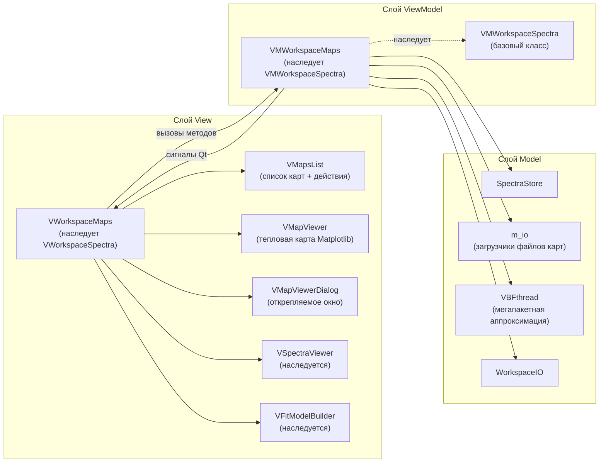

# **Рабочая область: «Карты»** { #workspace-maps }

Рабочая область `Maps` предназначена для обработки **гиперспектральных карт** — пространственно разрешённых спектральных наборов данных, в которых каждому пикселю соответствует полный спектр. Она расширяет [рабочую область «Спектры»](spectra.md) путём наследования, автоматически получая все возможности аппроксимации, коррекции базовой линии, редактирования пиков и сохранения состояния, а также добавляя пространственную привязку, визуализацию в виде тепловых карт и операции на основе координат.

> [!NOTE]
> **Предварительные требования** — Перед изучением данного руководства убедитесь, что вы знакомы со следующими материалами:
>
>
> - [Архитектура данных: SpectraStore](spectra_store.md) — общая модель данных `MapData` / `SpectraStore`.
> - [Рабочая область: Спектры](spectra.md) — базовый ViewModel, компоненты View и шаблоны потоков данных.
>
> На этой странице рассматриваются **только расширения, специфичные для Maps**. Унаследованное поведение здесь не повторяется.

---

## Чем Maps отличается от Spectra { #how-maps-differs-from-spectra }

Принципиальное различие заключается в мощности `MapData.N`:

| Рабочая область | `MapData.N` | Назначение |
|-----------------|-------------|------------|
| **Спектры** (Spectra) | 1 | Один спектр на блок `MapData` |
| **Карты** (Maps) | 2 – 100 000 | N спектров с общей осью волновых чисел |

Поскольку базовая [тензорная модель](spectra_store.md#mapdata-the-tensor-block) полностью идентична, одна и та же векторизованная аппроксимация, работающая для 1 спектра, работает и для 100 000 без каких-либо изменений в движке.

### MapData в контексте Maps { #mapdata-in-maps-context }

```
MapData ("wafer_300mm") — 50×50 wafer (2500 spectra, 1000 wavenumbers)
├── x0:          float64[1000]          1 shared wavenumber axis
├── Y0:          float32[2500, 1000]    raw intensities — 10 MB
├── x:           float64[800]           after spectral crop
├── Y:           float32[2500, 800]     after crop + baseline sub — 8 MB
├── coords:      float64[2500, 2]       (X, Y) stage positions in µm
├── fnames:      list[str] × 2500       "wafer_300mm_(x_pos, y_pos)"
├── is_active:   bool[2500]             checkbox state
├── peak_params: float64[2500, K]       after VBF fit — all 2500 at once
├── fit_success: bool[2500]
├── fit_r2:      float64[2500]
├── Y_bestfit:   float32[2500, 800]     8 MB
└── Y_peaks:     [float32[2500, 800], ...]   8 MB per peak
```

---

## Обзор архитектуры { #architecture-overview }



### Почему наследование вместо композиции? { #why-inheritance-instead-of-composition }

Класс `VMWorkspaceMaps` **наследует** `VMWorkspaceSpectra`, а не оборачивает его:

- Все алгоритмы (базовая линия, пики, движок VBF) работают одинаково как с одиночными спектрами (N=1), так и с картами (N>1).
- Дублирование или делегирование кода аппроксимации усложнило бы сопровождение и снизило надёжность.
- Переопределения по **паттерну «Шаблонный метод»** (Template Method) (три метода-перехватчика) достаточно для настройки выбора целевых объектов в массовых операциях без разветвления алгоритмической логики.

Тот же принцип применяется и на уровне View: `VWorkspaceMaps` наследует `VWorkspaceSpectra`, переопределяет `setup_connections()`, чтобы предотвратить двойное связывание сигналов в `__init__`, а затем заменяет виджет правой боковой панели специализированной панелью карт `VMapsList + VMapViewer`.

---

## Компоненты, специфичные для Maps { #maps-specific-components }

### `VMWorkspaceMaps` — ViewModel { #vmworkspacemaps-the-viewmodel }

**Файл**: [`vm_workspace_maps.py`](https://github.com/CEA-MetroCarac/SPECTROview/blob/main/spectroview/viewmodel/maps/vm_workspace_maps.py) (вместе с миксинами аппроксимации и сохранения состояния в `spectroview/viewmodel/maps/`)

Дополнительное состояние помимо унаследованного из [VMWorkspaceSpectra](spectra.md#vmworkspacespectra-the-viewmodel):

| Атрибут | Тип | Назначение |
|---------|-----|------------|
| `maps` | `dict[str, pd.DataFrame]` | Исходные DataFrame карт, индексированные по имени (устаревший кэш) |
| `current_map_name` | `str \| None` | Текущая активная карта |
| `maps_metadata` | `dict[str, dict]` | Метаданные измерений для каждой карты (WDF, SPC, L6M, NGC) |
| `map_type` | `str` | `'2Dmap'` или `'Wafer_300mm'` / `'Wafer_200mm'` / `'Wafer_100mm'` |
| `graphs_workspace` | ссылка | Внедрённая ссылка для извлечения профилей |

#### Дополнительные сигналы { #additional-signals }

```python
maps_list_changed       = Signal(list)    # map name list updated → VMapsList
map_data_updated        = Signal(object)  # current map DF changed → trigger heatmap redraw
send_spectra_to_workspace = Signal(list)  # deep copies → Spectra workspace
clear_map_cache_requested = Signal(str)   # map name → VMapViewer cache invalidation
switch_to_graphs_tab    = Signal()        # request tab switch after profile extraction
```

#### Справочник дополнительных методов { #additional-method-reference }

| Категория | Методы |
|-----------|--------|
| **Загрузка карт** | `load_map_files(paths)` |
| **Выбор и порядок карт** | `select_map(name)`, `select_maps(names, primary)`, `reorder_maps(new_order)`, `_show_map_spectra(name)` |
| **Удаление карт** | `delete_current_map()`, `remove_map(name)` |
| **Данные карты** | `get_current_map_dataframe()`, `get_fit_results_dataframe()` |
| **Экспорт** | `save_current_map_to_csv(file_path)` |
| **Аппроксимация** | `fit()`, `_run_fit_thread()`, `collect_fit_results()` — все переопределяют методы родительского класса |
| **Межмодульное взаимодействие** | `send_selected_spectra_to_spectra_workspace()`, `extract_and_send_profile_to_graphs()` |
| **Сохранение состояния** | `save_work()`, `load_work()`, `_load_legacy_maps()` |

### `VWorkspaceMaps` — View { #vworkspacemaps-the-view }

**Файл**: [`v_workspace_maps.py`](https://github.com/CEA-MetroCarac/SPECTROview/blob/main/spectroview/view/workspaces/v_workspace_maps.py)

Переопределяет `_add_maps_panel()`, заменяя унаследованную боковую панель спектров на:

- `VMapViewer` — холст тепловой карты с ползунками Z-параметра и диапазона X.
- `VMapsList` — панель списка карт с кнопками управления картами и действий со спектрами.

Левая часть (`SpectraViewer` + нижние вкладки) наследуется от `VWorkspaceSpectra`. В то время как `VWorkspaceSpectra` инициализирует `VLiveMaps` и `VMLiveMaps` в режиме `"spectra"` (отображая 1D-графики изменения параметров по текущим выбранным спектрам), `VWorkspaceMaps` переключает унаследованные экземпляры `v_live_maps` и `vm_live_maps` в режим `"map"` (`set_mode("map")`).

В рабочей области Maps при загрузке или выборе карт `VWorkspaceMaps` синхронизирует **двухуровневую модель выбора**:

- **Основная карта (`VMWorkspaceMaps.current_map_name`)**: управляет предобработкой, аппроксимацией, `VMapViewer`, `VSpectraViewer`, MVA и метаданными `More` полностью аналогично сценарию одиночного выбора.
- **Список выбранных карт (`VMWorkspaceMaps.selected_map_names`)**: заполняется через `VMapsList` (`QAbstractItemView.ExtendedSelection`), позволяя выполнять сравнение с помощью `Ctrl+Click` / `Shift+Click` без изменения операций над основной картой и без перерисовки `VMapViewer`, пока основная карта остаётся неизменной.

`VWorkspaceMaps` передаёт `[MapData, ...]` и `primary_name` в `self.vm_live_maps.set_map_datas(...)` только тогда, когда активна вкладка **Live-карты** (Live Maps) (в противном случае устанавливается флаг `_live_maps_dirty = True` для однократного отложенного обновления при активации вкладки, а клики по пространственным точкам в `VMapViewer` игнорируются). Активация R/B/G-селектора диапазона в `VSpectraViewer` автоматически переключает `bottom_tabs` на `Live Maps` в методе `VWorkspaceSpectra._on_range_selector_toggled()` и немедленно применяет отложенный выбор. `VMLiveMaps` анализирует `md.coords` с помощью кэшируемых функций `analyze_map_geometry()` и `build_map_gridder()` (которые кэшируют индексы регулярной сетки или барицентрические вершины и веса `Delaunay` до тех пор, пока не изменятся `coords` или `is_active`), исключает неактивные (снятые с отметки) спектры (`~md.is_active`), кэширует срезы по параметрам при перетаскивании по ключу `(id(md), md.name, md.data_version, param, range)` и применяет адаптацию размерности с **приоритетом основной карты**:

- **Основная карта — 1D-профиль**: испускает `multi_profile_data_ready` (при $\ge 2$ профилях) или `profile_data_ready` (одиночный профиль), накладывая все выбранные 1D-профили в согласованных цветах (`DEFAULT_COLORS`) с единой толщиной линий, при этом исключённые 2D-карты отмечаются в контекстном заголовке.
- **Основная карта — 2D-карта**: заполняет `map_2d_candidates_changed` для переключателя 2D-карт `[◀ | ComboBox | ▶]` на вкладке, исключает 1D-профили и вычисляет/отрисовывает только одну видимую в данный момент 2D тепловую карту через `map_data_ready`.
- **Отношение интенсивностей Красный/Синий (`R/B ratio`)**: динамически вычисляет $I_{\mathrm{Red}} / I_{\mathrm{Blue}}$ как для одиночных/множественных 1D-профилей, так и для 2D тепловых карт, маскируя нулевые и близкие к нулю значения синего канала, а также отключённые спектры как `NaN`. Пока в зелёном канале выбран режим `R/B ratio`, `VWorkspaceSpectra._on_range_selector_parameter_changed()` уведомляет `VSpectraViewer.set_range_selector_parameter()`, чтобы скрыть зелёный селектор диапазона на холсте спектра (и восстановить его сразу при выборе другого спектрального параметра).

Для сверхкрупных пакетов (по умолчанию `>= 25,000` активных спектров согласно `ASYNC_SPECTRUM_THRESHOLD`) `VMLiveMaps` выносит чистые вычисления NumPy и построение сетки в однопоточный пул `QThreadPool` (`_LiveMapWorker`), связанный через родительский `QObject` (`_LiveMapWorkerBridge`) с отменой по монотонно возрастающему `_generation_id` и корректным завершением `shutdown()` при выходе. `VMLiveMaps` также испускает `spatial_sites_changed` (передающий упорядоченные координаты активных точек, опциональные позиции 1D-профиля и имя целевой карты), чтобы панели Live-карт оставались синхронизированными с активным набором данных. На стороне UI виджеты RGB-диапазонов и Live-карт размещены вместе в пакете [`spectroview/view/components/rgb_live_maps/`](https://github.com/CEA-MetroCarac/SPECTROview/blob/main/spectroview/view/components/rgb_live_maps/__init__.py) (`v_live_maps.py`, `v_live_maps_options.py`, `v_live_map_subpanel.py`, `v_live_map_1d.py`, `v_live_map_2d.py`, `v_live_map_selection.py`, `v_live_maps_legend_editor.py`, `v_range_selector.py`, `v_range_bracket_mixin.py`, `common.py`). `VLiveMaps` предоставляет постоянную кнопку **Show Legend** и компактное двухколоночное меню **Дополнительные настройки вида** (More view options) (`btn_legend` / `btn_options`), согласованное с отступами строк `VSpectraViewer` (поля `(2, 2, 2, 2)`), для мгновенной смены стиля на клиентской стороне при чётком базовом разрешении 96 DPI: независимую **Plot theme** (`"Light Mode"` по умолчанию или `"Dark Mode"`, отделённую от глобальных иконок интерфейса Qt через `apply_global_theme()`), линейное/логарифмическое масштабирование осей X, Y и цветовой шкалы Z с защитой от неположительных областей определения, стили графиков `line`/`dot`/`line+dots` (по умолчанию `"line"`), толщину линии (`1.5`), размер точек (`1.5`), размер текста графика (`6–24 pt`), **Copied figure size** (`copy_fig_width`/`copy_fig_height`, по умолчанию `5.5 × 4.0` in) и **Copied figure theme** (`Light Mode`/`Dark Mode`), благодаря чему рисунки для буфера обмена рендерятся с фиксированным физическим размером и соотношением сторон независимо от изменения размеров окна, настройку расположения/столбцов/шрифта легенды, диалог `LiveMapsLegendEditorDialog` для пользовательских подписей и цветов легенды, синхронизацию общей оси Y для 1D-графиков (с восстановлением индивидуальных границ каждой панели при отключении), переключатель заголовка осей рисунка (`show_figure_label`, по умолчанию выключен), линии сетки без предупреждений (по умолчанию выключены), сглаживание тепловой карты и видимость цветовой шкалы. Настройки вида сохраняются между запусками в `MSettings` (`live_maps_view_options/*`, отложенное сохранение с задержкой 250 ms и сброс на диск при выходе) и взаимно синхронизируются между рабочими областями Spectra и Maps. Каждая панель `LiveMapSubpanel` также содержит встроенные кнопки **Rescale**, **Pan** и **Масштаб** (Zoom), двунаправленно синхронизированные с `NoDoubleClickZoomToolbar` (с сохранением редактирования легенды по двойному клику), поддерживает двухрежимное действие **Копировать** (Copy) (`btn_copy`: обычный клик копирует холст рисунка с фиксированными параметрами `copy_fig_width` × `copy_fig_height` и `copy_fig_theme`; `Ctrl + Click` испускает `copy_data_requested(color_id)` и копирует исходные табличные данные в формате TSV через `copy_df_to_clb()` для 1D-серий, одиночных/множественных 1D-профилей и 2D-точек `(X, Y, Value)`, формируемых `VMLiveMaps.get_2d_copy_points()` с резервным переходом на `_grid`/`_extent`), при отображении 1D линейных графиков заменяет выбор 2D цветовой палитры во 2-й строке на по-панельные визуальные (без изменения данных) элементы управления **Normalization** для 1D (`btn_norm`, `norm_xmin`, `norm_xmax`, опирающиеся на `_normalize_1d_values()` и нормированные `_get_primary_profile_values()` / `reset_view()` + `normalization_changed` $\rightarrow$ `_sync_shared_y()`), разделяет с `VMapViewer` через [`map_selection.py`](https://github.com/CEA-MetroCarac/SPECTROview/blob/main/spectroview/view/components/map_viewer/map_selection.py) пространственную геометрию (`compute_2d_spatial_geometry()`), логику разрешения клика/Ctrl+Click/выделения рамкой (`resolve_xy_selection()` / `resolve_1d_profile_selection()`) и красные наложения выделения (`MapCanvasSelector`), когда инструменты Pan/Масштаб и рамки легенд неактивны (направляя `VLiveMaps.spectra_selected` через `VWorkspaceMaps._on_live_maps_point_selection()` для обновления `VSpectraViewer`, `VMapViewer`, диалогов просмотра и всех панелей R/B/G без пересчёта сеток), в то время как быстрая смена стиля UI (`apply_view_options_fast()`), кэшированные с помощью `@lru_cache` словари `mplstyle` (`_get_cached_style_dict`), заморозка установившегося макета (`_on_canvas_draw` / `_request_relayout`) и привязанные к родительскому объекту таймеры объединённой перерисовки на 35 ms обеспечивают отсутствие подвисаний при интерактивном изменении параметров.

Обновления селекторов диапазона адаптивно сглаживаются (debounce 60–250 ms) при непрерывном перемещении и немедленно применяются при отпускании кнопки мыши (`VSpectraViewer.range_drag_finished` $\rightarrow$ `VMLiveMaps.flush_pending()`). Во время перетаскивания границ `RangeSelectorManager.render()` обновляет существующие графические примитивы (artists) Matplotlib на месте (`set_animated(True)` с Agg-блиттингом фона и временной приостановкой `layout_engine` через `SpectraRangeBracketMixin` в `VSpectraViewer`, а также горизонтальным ограничением через `transData.inverted()`), тогда как быстрые пути обновления `LiveMapSubpanel` (`update_series()` / `update_multi_profile()`) кэшируют сигнатуры темы, размера текста, сетки и X-области (`_invalidate_style_caches()`), а `MapCanvasSelector.draw_1d_overlay()` повторно использует существующие 1D-маркеры выделения на месте, устраняя лишние перерисовки `tick_params()`/`AutoLocator()`. Графические элементы селектора диапазона используют `ax.add_artist()` в Matplotlib, чтобы никогда не искажать `ax.dataLim`, гарантируя, что кнопка **Rescale** (`Ctrl+R`) масштабирует график исключительно по спектральным данным.

**Централизованное управление типом карты:** атрибут `selected_map_type` является единым источником истины для всех окон просмотра (основного и открепляемых диалогов). Когда пользователь меняет значение в выпадающем списке любого просмотрщика, `_on_map_type_changed()` синхронно обновляет все окна просмотра, предотвращая рассогласование.

### `VMapViewer` — холст тепловой карты { #vmapviewer-the-heatmap-canvas }

**Пакет**: [`map_viewer/`](https://github.com/CEA-MetroCarac/SPECTROview/blob/main/spectroview/view/components/map_viewer/__init__.py) (`v_map_viewer.py`, `v_map_plot.py`, `v_map_data.py`, `v_map_interactions.py`, `map_selection.py`)

Наиболее сложный компонент View (~1 300 строк). Он отрисовывает как прямоугольные 2D-карты, так и круглые карты пластин (wafer). Возможности:

- Выпадающий список Z-параметра (**Интенсивность** (Intensity) / **Площадь** (Area) / любой столбец результатов аппроксимации)
- Двойной ползунок диапазона X (фильтрует волновые числа, учитываемые при расчёте Z)
- Переключатель удаления выбросов
- **Точное пространственное позиционирование координат**: для регулярных декартовых сеток отрисовка выполняется через быстрый `imshow` с симметричными границами охвата. Для нерегулярных или разбросанных координат (например, файлов карт пластин, открытых в режиме `2Dmap`) автоматически отрисовываются квадратные пиксельные прямоугольники, центрированные точно в координатах $(X, Y)$ каждой точки через `PatchCollection`, что полностью устраняет пространственный сдвиг между пикселями тепловой карты и наложениями выделения.
- **Выпадающий список цветовой шкалы** (**Линейный** (Linear) / **Log**) в меню параметров (`…`) — `_build_color_kwargs()` возвращает `matplotlib.colors.LogNorm` для «Log» (с возвратом к обычному линейному `vmin`/`vmax`, если диапазон Z не является строго положительным, так как интенсивность/площадь ограничены значением `>=0`, а параметры аппроксимации могут быть `<=0`); применяется как к `imshow` в режиме `2Dmap`, так и к `imshow` после `griddata` для карт пластин
- Интерактивное выделение (одиночный клик, выделение прямоугольником, линия профиля)
- **Обновление графических элементов на месте и изоляция наборов данных**: при изменении параметра, диапазона X или палитры на текущей активной карте (`_last_rendered_map_name == map_df_name`) `_do_plot_heatmap_internal()` использует быстрый путь, обновляя `self.img` (`set_data` / `set_array`, `set_extent`, `set_clim`) и `self.cbar.update_normal(...)` на месте без деструктивного вызова `figure.clf()`, пересоздания подграфиков и дорогостоящего `tight_layout()`. При переключении между разными наборами данных карт или типами карт выполняется чистая перестройка осей с повторным использованием кэшированного кортежа `(heatmap_pivot, extent, vmin, vmax, grid_z, final_z_col, dx, dy)` из `_griddata_cache`.
- **Быстрое обновление ползунка диапазона Z**: события перетаскивания ползунка в реальном времени обходят пересчёт ключей кэша и полную перерисовку карты, напрямую обновляя `set_clim()` / `set_norm()` и цветовую шкалу на месте.
- **Векторные элементы навигации и встроенное отображение координат**: интерактивные кнопки навигации (`btn_home` / `btn_rescale`, `btn_pan`, `btn_zoom`), оформленные идентично элементам панели инструментов SPECTROview (`28x28`, `@surface_elevated`, скруглённые углы) с векторными SVG-иконками (`Icons.rescale()`, `Icons.pan()`, `Icons.zoom()`), заменяют стандартные иконки Matplotlib, сохраняя двустороннюю синхронизацию режимов с `NavigationToolbar2QT`. Нативная панель инструментов Matplotlib полностью скрыта в фоне, а текущие координаты аккуратно отображаются в специальной нативной метке `lbl_coordinates` (`min-width: 180px`, `@text_secondary`, выравнивание по правому краю) без обрезания и сдвигов макета.
- Открытие нескольких открепляемых диалоговых окон просмотра

### `VMapsList` — панель списка карт и действий { #vmapslist-the-maps-list-actions-panel }

**Файл**: [`v_map_list.py`](https://github.com/CEA-MetroCarac/SPECTROview/blob/main/spectroview/view/components/lists/v_map_list.py)

Отображает имена загруженных карт во внутреннем списке `_ReorderableMapsList(QListWidget)` (`ExtendedSelection` для множественного выбора с помощью `Shift+Click` / `Ctrl+Click` с отслеживанием основного фокуса через `maps_selection_changed(selected_names, primary_name)`, а также переупорядочивание перетаскиванием `InternalMove`, которое испускает сигнал `maps_order_changed(new_order)` и игнорирует перетаскивание внешних URL MIME, чтобы перетаскивание файлов передавалось родительским окнам). При внутреннем перетаскивании выделение и основной фокус сохраняются без лишнего мелькания выбора и передаются в `VMWorkspaceMaps.reorder_maps()`, который переупорядочивает `self.maps`, `SpectraStore.reorder_maps()` и `selected_map_names`, обновляя `VMapsList` и Live-карты без сброса `VMapViewer`. Дополняется кнопками быстрого управления (View, **Удалить** (Delete) — с запросом подтверждения при удалении нескольких выбранных карт, Export CSV) и унифицированными кнопками действий со спектрами (**Выбрать все** (Select All), Reinitialize, Fitting Statistics, Send to Spectra Workspace), которые применяются к основной карте и её пространственно выбранным спектрам.

### `VMapViewerDialog` — открепляемое окно { #vmapviewerdialog-detachable-window }

**Файл**: [`v_map_viewer_dialog.py`](https://github.com/CEA-MetroCarac/SPECTROview/blob/main/spectroview/view/components/map_viewer/v_map_viewer_dialog.py)

Обёртка `QDialog` вокруг второго экземпляра `VMapViewer`. Использует флаг `Qt.WindowStaysOnTopHint`, позволяющий пользователю выбирать пиксели в плавающем окне, пока основное окно отображает соответствующий спектр. Одновременно может быть открыто несколько диалоговых окон, каждое из которых отображает отдельный Z-параметр на одних и тех же пространственных данных. Данные передаются по ссылке — без дублирования.

---

## Паттерн двойного хранения { #the-dual-storage-pattern }

Рабочая область Maps поддерживает **два хранилища** для одних и тех же данных:

1. **`self.maps[map_name]`** — объект `pd.DataFrame` со столбцами `X, Y, w1, w2, ...` (по одной строке на спектр). Это устаревшее хранилище, заполняемое при загрузке парсером файлов.
2. **`self.store.get_map_data(map_name)`** — тензорный блок `MapData` со всем состоянием обработки.

DataFrame используется как **входные данные для тепловой карты** (сводная таблица → imshow) и для **экспорта в CSV**. Тензорный блок применяется во **всех аналитических операциях** (базовая линия, аппроксимация, сбор результатов). При сохранении обработанных данных в CSV метод `save_current_map_to_csv()` читает из `md.x` / `md.Y` (обработанных данных), а не из исходного DataFrame.

> [!IMPORTANT]
> Когда новый разработчик задаётся вопросом «где находятся данные?», ответ таков: **в обоих местах, для разных задач**. DataFrame является входной точкой от загрузчика файлов и входом для конвейера тепловой карты. Тензорный блок является источником истины для всего анализа. Модификации (базовая линия, обрезка) затрагивают только тензорный блок — они не обновляют DataFrame.

### Соглашение об именовании файлов { #filename-convention }

Каждая строка спектра в блоке `MapData` получает уникальное имя `fname`, сформированное из её координат:

```python
fname = f"{map_name}_({float(x_pos)}, {float(y_pos)})"
# Example: "wafer_300mm_(12.5, -7.0)"
```

Это соглашение используется по всей кодовой базе для:

- Фильтрации спектров, принадлежащих определённой карте: `fname.startswith(f"{map_name}_(")`
- Извлечения координат из `fname`: разбор строки между `(` и `)`.
- Сопоставления записей `SpectraStore` со строками `DataFrame` при отрисовке тепловых карт.

Разбор координат централизован в `parse_coords_from_fname()` (`viewmodel/common/spectral_utils.py`, реэкспортируется в `viewmodel/utils.py`); оба метода — `VWorkspaceMaps._extract_coords_from_fname()` и `VMWorkspaceMaps._extract_coords_for_spectra()` — делегируют ему эту задачу. При изменении соглашения об именах `fname` достаточно обновить эту единую вспомогательную функцию (сохраняя идентичное форматирование `float()` на стороне записи в `_extract_spectra_from_map()`).

---

## Потоки данных { #data-flow }

### Загрузка гиперспектральной карты { #loading-a-hyperspectral-map }

1. **Действие пользователя**: пользователь запускает загрузку карты в `VWorkspaceMaps`.
2. **View → ViewModel**: View вызывает `vm.load_map_files(paths)`.
3. **Разбор файла**: для каждого файла ViewModel обращается к модулю `m_io` (`load_wdf_map`, `load_spc_map`, `load_l6m_map`, `load_ngc_map` и др.). Модуль ввода-вывода возвращает DataFrame, содержащий `X`, `Y` и все столбцы волновых чисел, а также метаданные.
4. **Сохранение данных (устаревшее)**: ViewModel кэширует возвращённый DataFrame в `self.maps[name]`.
5. **Извлечение данных**: ViewModel вызывает `_extract_spectra_from_map(name, map_df)`, который делегирует функции `extract_map_arrays(name, map_df)` в `m_io.py` извлечение массивов `x0`, `Y0` и пространственных координат `coords` из DataFrame, а также построение списка пиксельных имён `fnames`.
6. **Сохранение данных (тензорное)**: ViewModel регистрирует данные в `SpectraStore` с помощью `add_map(name, x0, Y0, coords, fnames, is_active)`.
7. **Обновление UI**: после обработки всех файлов ViewModel испускает сигнал `maps_list_changed` со списком загруженных имён карт.

Функция `extract_map_arrays()` отфильтровывает любые завершающие или нечисловые столбцы `Unnamed:`, сохраняя все корректные числовые каналы волновых чисел, и автоматически добавляет суффиксы `_{k}` к `fnames` только в случае дублирующихся пространственных координат `(X, Y)` (например, при многократном сканировании с временным разрешением в фиксированных точках пластины).

### Выбор карты { #map-selection }

Когда пользователь кликает по имени карты в `VMapsList` или открывает новую карту:

1. **Действие пользователя**: пользователь открывает файл карты или кликает по имени карты в виджете `VMapsList`.
2. **View → ViewModel**: View перехватывает событие и вызывает `vm.select_map(map_name)`.
3. **Обновление состояния и автовыбор**: ViewModel устанавливает `current_map_name = map_name`, заполняет `_show_map_spectra(map_name)` и автоматически выбирает первый спектр `self.selected_fnames = [md.fnames[0]]`, испуская `spectra_selection_changed` для немедленного построения первого спектра в `VSpectraViewer`.
4. **Обновление просмотрщика карт**: ViewModel испускает `map_data_updated(current_map_df)`.
5. **Перерисовка холста и наложение выделения**: `VWorkspaceMaps` передаёт обновлённые данные в `VMapViewer.set_map_data()`, который автоматически подсвечивает первую координату `(x_0, y_0)` красной рамкой выделения и вызывает `plot_heatmap()` для отрисовки пространственных данных. Плавающие диалоги просмотра остаются синхронизированными.

### Рабочий процесс аппроксимации (переопределение в Maps) { #fitting-workflow-maps-override }

Рабочая область Maps переопределяет [`fit()`](spectra.md#fitting-workflow) для формирования **многозадачных пакетов (batches)**, способных охватывать всю карту целиком:

1. **Действие пользователя**: пользователь нажимает кнопку **Подгонка** (Fit) (или Ctrl+Fit для применения ко всем картам).
2. **Формирование задач**:
    - Если `apply_all = True`: ViewModel группирует карты по длине оси X и объединяет их в мегапакетные матрицы `Y`.
    - Если `apply_all = False`: ViewModel создаёт задачу только для текущей карты и выбранных индексов.
3. **Запуск потока**: ViewModel запускает `VBFthread` со списком задач.
4. **Выполнение в движке (фон)**: для каждой задачи поток вызывает `VBFengine.fit_spectra()`. Объединённые задачи по нескольким картам аппроксимируются за одну векторизованную операцию.
5. **Сохранение результатов (фон)**: поток распределяет результаты обратно в соответствующие карты через `SpectraStore.set_fit_results()`.
6. **Завершение**: поток испускает `finished()`, после чего ViewModel вызывает `_on_fit_finished()`.
7. **Сбор результатов**: `collect_fit_results()` объединяет результаты в единый DataFrame.
8. **Обновление UI**: испускаются сигналы для перерисовки как тепловой карты (`map_data_updated`), так и таблицы результатов (`fit_results_updated`).

**Мегапакетная группировка (mega-batch grouping)** является ключевой оптимизацией производительности. Когда `apply_all=True`, карты с одинаковой длиной оси X объединяются в общую матрицу `Y` и аппроксимируются за один векторизованный вызов. Набор из 10 карт пластины, обработка каждой из которых по отдельности требует по 30 s, при пакетной обработке завершается примерно за ~35 s суммарно.

### После аппроксимации: распространение результатов { #after-fitting-propagating-results }

После `_on_fit_finished()`:

1. Вызывается `collect_fit_results()` → формируется `self.df_fit_results` (DataFrame со столбцами `X, Y` и всеми столбцами результатов аппроксимации).
2. Испускается `fit_results_updated` → обновляется таблица `VFitResults`.
3. Испускается `map_data_updated` → `VMapViewer` перечитывает `df_fit_results` и добавляет столбцы результатов аппроксимации в выпадающий список Z-параметров.
4. Испускается `clear_map_cache_requested` → `VMapViewer` очищает свой кэш `griddata` для затронутой карты.

---

## Конвейер визуализации карт { #map-visualization-pipeline }

1. **Источник данных**: в зависимости от состояния предобработки источником служат либо обработанные интенсивности (`md.Y`), либо исходные интенсивности (`md.Y0`).
2. **Фильтрация DataFrame**: `get_current_map_dataframe()` отфильтровывает неактивные спектры.
3. **Привязка к просмотрщику**: DataFrame передаётся в `VMapViewer.set_map_data()`.
4. **Вычисление Z-значений**: `_compute_z_values()` вычисляет целевую метрику в соответствии с выбором в выпадающем списке:
    - *Интенсивность*: суммирует значения в пределах диапазона, заданного ползунком по оси X.
    - *Площадь*: вычисляет интеграл методом трапеций.
    - *Параметр аппроксимации*: считывает значения напрямую из `df_fit_results`.
5. **Удаление выбросов**: при включённой пользователем опции Z-значения отсекаются по процентилям.
6. **Логика отрисовки**: в зависимости от `map_type`:
    - *2D-карта*: быстрый путь. Сводная таблица отображает `(X, Y)` в `Z` на точной регулярной сетке, которая отрисовывается через `imshow()` в Matplotlib.
    - *Карта пластины (wafer)*: медленный путь. `scipy.griddata` интерполирует нерегулярные точки круговой пластины на сетку 80×80 перед отрисовкой через `imshow()`.

**Зачем нужны два пути отрисовки?**

Прямоугольная 2D-карта содержит данные на регулярной сетке — сводной таблицы достаточно, и отрисовка занимает миллисекунды. При измерении пластины точки распределены по круговой области (не образуя регулярной сетки), поэтому `scipy.griddata` должен предварительно интерполировать данные на регулярную сетку, прежде чем `imshow` сможет их отобразить. Именно этот шаг является наиболее ресурсоёмким.

### Стратегия кэширования тепловой карты { #heatmap-caching-strategy }

Выполнение `scipy.griddata` на крупных картах может занимать 100–500 ms. Просмотрщик использует **многоключевой кэш**, чтобы избежать повторных вычислений:

```python
cache_key = (
    map_name,        # which map
    parameter,       # which Z parameter
    (xmin, xmax),    # X-range filter
    map_type,        # 2Dmap vs Wafer variant
    mask_config,     # mask settings or None
    remove_outliers  # outlier removal flag
)
```

В кэше хранится кортеж `(heatmap_pivot, extent, vmin, vmax, grid_z, final_z_col, dx, dy)`, сохраняющий точные пространственные размеры пикселя (`dx, dy`) при переключении типов карт и выборе файлов, что предотвращает смещение геометрии между наборами данных.

Характеристики кэша:

- **Сохраняется при переключении карт** — возврат к ранее просмотренной карте происходит мгновенно с восстановлением её точных пространственных размеров и интерполированной сетки `griddata`.
- **Инвалидируется по имени** после завершения аппроксимации с помощью сигнала `clear_map_cache_requested`.
- **Не сохраняется на диск** между сеансами работы — кэш существует только в `VMapViewer._griddata_cache`.
- **Изолируется по наборам данных**: `can_fast_update` требует выполнения условия `_last_rendered_map_name == map_df_name` и проверяет число прямоугольников в `PatchCollection`, гарантируя, что обновление графических элементов на месте выполняется только для активного набора данных, тогда как смена карты всегда вызывает чистую перерисовку.

### Интерактивное выделение { #interactive-selection }

`VMapViewer` поддерживает три режима выделения:

| Режим | Триггер | Поведение |
|-------|---------|-----------|
| **Одиночный клик** | Левый клик по карте | Выбирает ближайшую точку и подсвечивает её красным прямоугольником |
| **Выделение прямоугольником** | Нажатие и перетаскивание | Выбирает все точки внутри выделенного прямоугольника |
| **Профиль** | Ровно 2 выбранные точки, 2D-режим | Активирует кнопку **Извлечь профиль** (Extract profile) |

Выделение в `VMapViewer` испускает сигнал `spectra_selected(list[tuple])`. Метод `VWorkspaceMaps._on_map_viewer_selection()` преобразует координаты `(x, y)` обратно в `fnames` и вызывает `vm.set_selected_fnames()`, что запускает `_emit_selected_spectra()` → `VSpectraViewer` перерисовывает выбранный спектр.

Выделенные точки отрисовываются как единый объект `PatchCollection` (один вызов отрисовки для всех прямоугольников) вместо множества отдельных вызовов `add_patch()`, что обеспечивает время отрисовки O(1) независимо от размера выделения.

---

## Переопределение шаблонных методов { #template-method-overrides }

Рабочая область Maps настраивает унаследованный конвейер массовых операций с помощью трёх [методов-перехватчиков](spectra.md#template-method-hooks). Понимание их работы необходимо при отладке и расширении массовых операций.

### `_get_target_mds(apply_all)` { #_get_target_mdsapply_all }

Определяет, **к каким объектам `MapData`** применяется массовая операция.

| `apply_all` | Рабочая область Spectra | Рабочая область Maps |
|-------------|-------------------------|----------------------|
| `False` | Блоки `MapData` выбранных спектров | Только блок `MapData` текущей карты |
| `True` | Все блоки `MapData` в хранилище | Блоки `MapData` всех карт |

Именно поэтому действие Ctrl+Subtract-Baseline в рабочей области Maps вычитает базовую линию из **всех спектров текущей карты** (а не только из выбранных) — переопределение в Maps возвращает объект `MapData` всей карты.

### `_on_map_data_changed(md, action)` { #_on_map_data_changedmd-action }

Вызывается **после изменения каждого отдельного объекта `MapData`** в цикле массовой обработки.

```python
# Maps workspace override:
def _on_map_data_changed(self, md, action: str):
    if action == "reinit_spectra":
        self.store.clear_preprocess(md.name)
    elif action in ("delete_baseline", "subtract_baseline", "apply_spectral_range"):
        self.store.batch_preprocess(md.name, md.baseline_config, md.range_min, md.range_max)
    elif action == "paste_peaks":
        self._reconstruct_y_peaks(md)
    # Always invalidate heatmap cache
    self.clear_map_cache_requested.emit(md.name)
```

### `_post_bulk_action(apply_all, action)` { #_post_bulk_actionapply_all-action }

Вызывается **один раз после обработки всех объектов `MapData`**. Переопределение в Maps обновляет результаты аппроксимации и повторно отправляет представление карты.

### Переопределение `_emit_selected_spectra()` { #_emit_selected_spectra-override }

Переопределение в Maps формирует полезную нагрузку с `"type": "tensor"` (пакет с общей осью X) вместо формата `"type": "tensor_list"` (независимые массивы для каждого спектра), используемого в рабочей области Spectra:

```python
# Maps workspace:
batch_data = {
    'type': 'tensor',
    'x': x,             # shared float64[M_proc]
    'y': Y,             # float32[n_selected, M_proc]
    'indices': indices, # which rows within the map
    ...
}
```

Это позволяет `VSpectraViewer` отрисовывать сразу несколько спектров карты за счёт матричных операций вместо цикла Python.

---

## Межмодульное взаимодействие рабочих областей { #cross-workspace-communication }

### Maps → рабочая область Spectra { #maps-spectra-workspace }

```python
# User selects spectra in Maps workspace and clicks "Send to Spectra"
vm.send_selected_spectra_to_spectra_workspace()
```

Для каждого выбранного спектра выполняются следующие шаги:

1. Создаётся **глубокая копия** словаря полезной нагрузки (исходные `x0`, `Y0`, `baseline_config`, `fit_model`, `range_min/max`, `is_subtracted`).
2. Испускается сигнал `send_spectra_to_workspace(payloads)`.
3. `main.py` связывает этот сигнал с методом `receive_spectra()` ViewModel рабочей области Spectra, который регистрирует каждый словарь как новый блок `MapData` с N=1 в `SpectraStore` рабочей области **Спектры**.

Глубокое копирование предотвращает перекрёстное загрязнение состояния между рабочими областями — редактирование спектра на вкладке Spectra не затрагивает исходную карту.

### Maps → рабочая область Graphs (извлечение профиля) { #maps-graphs-workspace-profile-extraction }

Когда пользователь выбирает ровно 2 точки в режиме 2D-карты и нажимает **Извлечь профиль**:

1. **Действие пользователя**: пользователь выбирает ровно 2 точки на 2D-карте и нажимает **Извлечь профиль**.
2. **View → ViewModel**: `VMapViewer` испускает сигнал `extract_profile_requested(profile_name)`.
3. **Логика извлечения**: `VWorkspaceMaps` делегирует задачу `_extract_profile()`, который строит DataFrame `profile_df` путём интерполяции точек вдоль соединяющего отрезка.
4. **Передача данных**: View передаёт сформированный набор данных в `VMWorkspaceMaps.extract_and_send_profile_to_graphs()`.
5. **Перенос в рабочую область**: ViewModel напрямую вызывает `VMWorkspaceGraphs.add_dataframe()`.
6. **Обновление UI**: сигнал даёт команду главному окну переключить фокус на вкладку Graphs.

DataFrame профиля содержит столбцы `distance` (µm) и `values` (интенсивность Z). Рабочая область Graphs автоматически создаёт по нему линейный график.

---

## Результаты аппроксимации с пространственными столбцами { #fit-results-with-spatial-columns }

`collect_fit_results()` переопределяет метод родительского класса, добавляя столбцы пространственных координат и зон:

```python
# After super().collect_fit_results():
# base DataFrame includes: Filename, X, Y, [Quadrant, Zone for wafers],
# sorted fit parameters (x0_Peak1, fwhm_Peak1, area_Peak1, ...), and trailing R2

# Maps workspace adds X, Y, and ensures Quadrant and Zone are present for wafer maps

# Final columns:
# Filename | X | Y | Quadrant | Zone | x0_Peak1 | fwhm_Peak1 | area_Peak1 | ... | R2
```

Столбец `Zone` классифицирует точки по радиальному расстоянию:

| Зона | Расстояние |
|------|------------|
| Center | ≤ 35 % радиуса |
| Mid-Radius | 35 – 80 % |
| Edge | ≥ 80 % |

Столбец `Quadrant` классифицирует точки по знаку координат (X, Y): Q1 (−,−), Q2 (−,+), Q3 (+,+), Q4 (+,−).

---

## Постоянное хранение { #persistence }

### Современный формат (v2+, на основе ZIP) { #modern-format-v2-zip-backed }

Файлы рабочей области Maps (`.maps`) используют ту же ZIP-структуру, что описана в разделе [SpectraStore: Постоянное хранение](spectra_store.md#persistence), но имеют больший объём из-за размеров тензоров.

DataFrame карт сериализуются в собственном двоичном формате для повышения скорости:

```python
# Fast serialization (vs to_csv which is 20-70× slower)
arr = map_df.to_numpy()
buf = io.BytesIO(); np.save(buf, arr)
gzip.compress(buf.getvalue(), compresslevel=1)  # level=1: 70× faster, ~5% larger
```

### Устаревший загрузчик { #legacy-loader }

Метод `_load_legacy_maps()` обрабатывает старые файлы `.maps` в формате JSON, где каждая карта хранилась как сжатая с помощью gzip и закодированная в шестнадцатеричном виде CSV-строка:

1. Разбирает словарь верхнего уровня `"maps"` (map_name → hex_string).
2. Распаковывает и считывает каждый CSV в DataFrame.
3. Строит словарь поиска по координатам из записей `"spectrums_data"` (с ключом `(map_name, x, y)`).
4. Регистрирует каждую карту в `SpectraStore` с помощью `add_map()`.
5. Векторизованно восстанавливает базовые линии, кривые пиков и результаты аппроксимации.

---

## Руководство по расширению { #extension-guide }

### Добавление нового формата файлов карт { #adding-a-new-map-file-format }

1. Создайте функцию загрузки в `spectroview/model/io/m_io.py` (например, `load_xyz_map(path) → pd.DataFrame`).
2. В `VMWorkspaceMaps.load_map_files()` добавьте ветку `elif path.suffix.lower() == '.xyz':`.
3. Возвращаемый DataFrame должен содержать столбцы `X` и `Y`, за которыми следуют числовые столбцы волновых чисел.
4. Если формат предоставляет метаданные, возвращайте кортеж `(DataFrame, dict)` и сохраняйте словарь в `self.maps_metadata[map_name]`.

### Добавление нового типа Z-параметра { #adding-a-new-z-parameter-type }

Новые типы Z-параметров вычисляются в `VMapViewer._compute_z_values()`. Чтобы добавить, например, отношение пиков:

1. Добавьте название параметра в логику заполнения выпадающего списка `VMapViewer`.
2. В `_compute_z_values()` добавьте ветку `elif parameter == "My Ratio":`, считывающую данные из `df_fit_results`.
3. Ключ кэша уже включает `parameter`, поэтому кэширование будет работать автоматически.

### Добавление нового типа карт (помимо Wafer) { #adding-a-new-map-type-beyond-wafer }

Новые пространственные схемы размещения требуют следующих изменений:

1. Добавьте строку типа в выпадающий список `cbb_map_type`.
2. В `VMapViewer.plot_heatmap()` добавьте ветку отрисовки (вероятнее всего, `scipy.griddata` со специальной маской).
3. В `VMWorkspaceMaps.collect_fit_results()` добавьте ветку классификации зон и квадрантов для нового типа карты.

---

## Устранение неполадок { #troubleshooting }

**Тепловая карта не обновляется после аппроксимации**

- После `_on_fit_finished()` должен вызываться метод `collect_fit_results()`. Убедитесь, что для имени карты испускается сигнал `clear_map_cache_requested`, а значение `parameter` в ключе кэша совпадает с текущим выбранным пунктом выпадающего списка.

**Выбранный пиксель подсвечивает не тот спектр**

- Сопоставление координат `(x, y)` с именами `fnames` опирается на соответствие формата `{map_name}_(x, y)` значениям в `md.fnames`. Проверьте, что `float(x_pos)` формирует одинаковую строку в `_extract_spectra_from_map()` и в `_on_map_viewer_selection()`.

**Аппроксимация большой карты ненадолго замораживает UI при запуске**

- Формирование задач (`_run_fit_thread()`) выполняется в основном потоке до вызова `VBFthread.start()`. Для очень больших карт построение индексов `np.arange(md.n_spectra)` происходит быстро, но операция `vstack` для матриц `Y` может быть медленной. Если это становится узким местом, профилируйте вызов `_run_fit_thread()` с помощью `cProfile`.

**Send to Spectra создаёт дублирующиеся спектры**

- Метод `receive_spectra()` в ViewModel рабочей области Spectra перед добавлением проверяет условие `name in self.store.map_names`. Если появляются дубликаты, проверьте согласованность формата `fname` (обратите внимание на округление чисел с плавающей точкой в строковом представлении `(x_pos, y_pos)`).

**Вызов `griddata` для пластины тормозит при каждой перерисовке**

- Убедитесь, что сигнал `clear_map_cache_requested` испускается только при необходимости (после аппроксимации, а не при каждом изменении выделения). Проверьте, что кортеж `cache_key` является хешируемым и стабильным — если какой-либо элемент незаметно меняется между перерисовками, кэш никогда не будет срабатывать.

**Скачок потребления памяти при загрузке большого числа крупных карт**

- Для карты 50×50 (2 500 спектров) при 1 000 волновых чисел массив `MapData.Y0` (`float32`) занимает ~10 MB; для карты из 25 000 спектров при 1 000 волновых чисел `Y0` занимает ~100 MB, а при аппроксимации дополнительно выделяются массивы (`Y_bestfit` и по одному массиву `Y_peaks` на каждый пик). Используйте `remove_map()` для удаления карт, которые больше не нужны.

По вопросам устранения неполадок, связанных с моделью данных (неприменённая предобработка, управление памятью), см. [SpectraStore: Устранение неполадок](spectra_store.md#troubleshooting).
