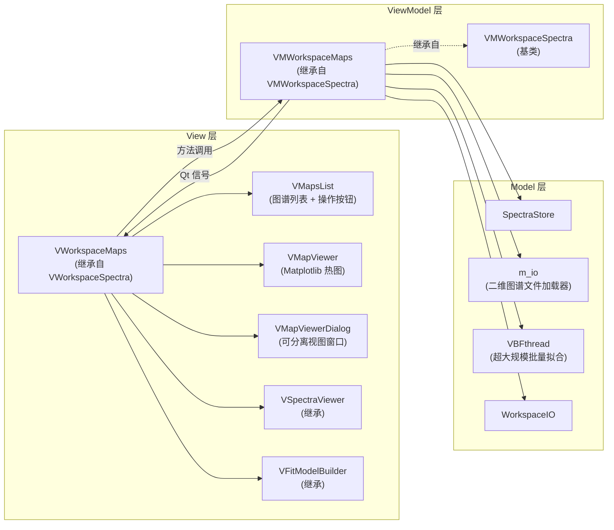

# **工作区：二维图谱** { #workspace-maps }

`Maps` 工作区专门处理**高光谱二维图谱数据**——即每个像素对应一条完整光谱的空间分辨光谱数据集。它通过继承扩展了[光谱工作区](spectra.md)，自动获得所有的拟合、基线处理、峰编辑及持久化功能，并在此基础上增加了空间位置感知、热图可视化以及基于坐标的操作。

> [!NOTE]
> **前置知识** —— 在阅读本指南前，请确保您已熟悉以下内容：
>
> - [数据架构：SpectraStore](spectra_store.md) —— 共享的 `MapData` / `SpectraStore` 数据模型。
> - [工作区：光谱](spectra.md) —— 基础 ViewModel、View 组件与数据流模式。
>
> 本页**仅介绍 Maps 工作区特有的扩展功能**，继承自父类的行为不再赘述。

---

## Maps 与 Spectra 的差异 { #how-maps-differs-from-spectra }

两者的核心差异在于 `MapData.N` 的基数不同：

| 工作区 | `MapData.N` | 含义 |
|--------|------------|------|
| **光谱** (Spectra) | 1 | 每个 `MapData` 数据块包含 1 条光谱 |
| **二维图谱** (Maps) | 2 – 100 000 | N 条光谱共享同一个波数轴 |

由于底层的[张量模型](spectra_store.md#mapdata-the-tensor-block)完全一致，因此适用于 1 条光谱的向量化拟合同样可以直接处理 100 000 条光谱，引擎代码无需任何改动。

### Maps 上下文中的 `MapData` { #mapdata-in-maps-context }

```
MapData ("wafer_300mm") — 50×50 wafer (2500 spectra, 1000 wavenumbers)
├── x0:          float64[1000]          1 shared wavenumber axis
├── Y0:          float32[2500, 1000]    raw intensities — 10 MB
├── x:           float64[800]           after spectral crop
├── Y:           float32[2500, 800]     after crop + baseline sub — 8 MB
├── coords:      float64[2500, 2]       (X, Y) stage positions in µm
├── fnames:      list[str] × 2500       "wafer_300mm_(x_pos, y_pos)"
├── is_active:   bool[2500]             checkbox state
├── peak_params: float64[2500, K]       after VBF fit — all 2500 at once
├── fit_success: bool[2500]
├── fit_r2:      float64[2500]
├── Y_bestfit:   float32[2500, 800]     8 MB
└── Y_peaks:     [float32[2500, 800], ...]   8 MB per peak
```

---

## 架构概览 { #architecture-overview }



### 为何采用继承而非组合？ { #why-inheritance-instead-of-composition }

`VMWorkspaceMaps` **继承并扩展** `VMWorkspaceSpectra`，而非将其封装组合：

- 所有拟合算法（基线、峰、VBF 引擎）对单条光谱（N=1）与二维图谱（N>1）均采用完全相同的处理逻辑。
- 复制或委派拟合代码会增加维护上的脆弱性。
- 通过**模板方法模式（Template Method pattern）**覆写三个钩子方法，即可定制批量操作的作用目标，而无需分叉任何算法逻辑。

View 层也采用相同的模式：`VWorkspaceMaps` 继承 `VWorkspaceSpectra`，覆写 `setup_connections()` 以避免在 `__init__` 期间重复连接信号槽，随后将右侧边栏控件替换为二维图谱专用的 `VMapsList + VMapViewer` 面板。

---

## Maps 专用组件 { #maps-specific-components }

### `VMWorkspaceMaps` — ViewModel 层 { #vmworkspacemaps-the-viewmodel }

**文件**：[`vm_workspace_maps.py`](https://github.com/CEA-MetroCarac/SPECTROview/blob/main/spectroview/viewmodel/maps/vm_workspace_maps.py)（拟合与持久化 Mixin 位于 `spectroview/viewmodel/maps/`）

除继承自 [VMWorkspaceSpectra](spectra.md#vmworkspacespectra-the-viewmodel) 的状态外，新增以下属性：

| 属性 | 类型 | 用途 |
|------|------|------|
| `maps` | `dict[str, pd.DataFrame]` | 按名称索引的原始图谱 DataFrame（历史兼容缓存） |
| `current_map_name` | `str \| None` | 当前激活选中的图谱名称 |
| `maps_metadata` | `dict[str, dict]` | 各图谱的采集元数据（WDF、SPC、L6M、NGC） |
| `map_type` | `str` | `'2Dmap'` 或 `'Wafer_300mm'` / `'Wafer_200mm'` / `'Wafer_100mm'` |
| `graphs_workspace` | ref | 注入的图表工作区引用，用于剖面提取 |

#### 新增信号 { #additional-signals }

```python
maps_list_changed       = Signal(list)    # map name list updated → VMapsList
map_data_updated        = Signal(object)  # current map DF changed → trigger heatmap redraw
send_spectra_to_workspace = Signal(list)  # deep copies → Spectra workspace
clear_map_cache_requested = Signal(str)   # map name → VMapViewer cache invalidation
switch_to_graphs_tab    = Signal()        # request tab switch after profile extraction
```

#### 新增方法参考 { #additional-method-reference }

| 类别 | 方法 |
|------|------|
| **图谱加载** | `load_map_files(paths)` |
| **图谱选择与排序** | `select_map(name)`, `select_maps(names, primary)`, `reorder_maps(new_order)`, `_show_map_spectra(name)` |
| **图谱删除** | `delete_current_map()`, `remove_map(name)` |
| **图谱数据** | `get_current_map_dataframe()`, `get_fit_results_dataframe()` |
| **导出** | `save_selected_maps_to_csv(dir_path)`, `save_current_map_to_csv(file_path)` |
| **拟合** (Fit) | `fit()`, `_run_fit_thread()`, `collect_fit_results()` —— 均覆写父类方法 |
| **跨工作区** | `send_selected_spectra_to_spectra_workspace()`, `extract_and_send_profile_to_graphs()` |
| **持久化** | `save_work()`, `load_work()`, `_load_legacy_maps()` |

### `VWorkspaceMaps` — View 层 { #vworkspacemaps-the-view }

**文件**：[`v_workspace_maps.py`](https://github.com/CEA-MetroCarac/SPECTROview/blob/main/spectroview/view/workspaces/v_workspace_maps.py)

覆写 `_add_maps_panel()`，将继承而来的光谱侧边栏替换为：

- `VMapViewer` —— 带有 Z 参数选择与 X 范围滑块的热图画布。
- `VMapsList` —— 包含图谱管理与光谱操作按钮的图谱列表面板。

左侧区域（`SpectraViewer` + 底部标签页）继承自 `VWorkspaceSpectra`。其中 `VWorkspaceSpectra` 会将 `VLiveMaps` 和 `VMLiveMaps` 初始化为 `"spectra"` 模式（绘制当前所选光谱的一维参数变化曲线），而 `VWorkspaceMaps` 则将继承的 `v_live_maps` 和 `vm_live_maps` 实例切换为 `"map"` 模式（`set_mode("map")`）。

在 `Maps` 工作区中，加载或选择图谱时，`VWorkspaceMaps` 会同步维护一套**双层选择模型（Two-Tier selection model）**：

- **主图谱（`VMWorkspaceMaps.current_map_name`）**：驱动预处理、拟合、`VMapViewer`、`VSpectraViewer`、多元分析（MVA）以及 `More` 元数据面板，其行为与单选工作流完全一致。
- **已选图谱列表（`VMWorkspaceMaps.selected_map_names`）**：通过 `VMapsList`（`QAbstractItemView.ExtendedSelection`）填充，支持使用 `Ctrl+Click` / `Shift+Click` 进行多图谱对比，而不会改变针对主图谱的操作；只要主图谱未发生变化，也不会触发 `VMapViewer` 重绘。

`VWorkspaceMaps` 仅在**实时图谱** (Live Maps) 标签页处于激活状态时，才将 `[MapData, ...]` 和 `primary_name` 转发给 `self.vm_live_maps.set_map_datas(...)`（否则标记 `_live_maps_dirty = True` 以便在切换至该标签页时执行单次延迟刷新，同时忽略 `VMapViewer` 上的空间测点点击）。在 `VSpectraViewer` 上启用 R/B/G 波段选择器时，`VWorkspaceSpectra._on_range_selector_toggled()` 会自动将 `bottom_tabs` 切换至 `Live Maps` 并立即刷新任何待处理的选择。`VMLiveMaps` 通过带缓存的 `analyze_map_geometry()` 与 `build_map_gridder()` 检查 `md.coords`（在 `coords` 或 `is_active` 未改变前一直缓存规则网格索引或 `Delaunay` 重心顶点/权重），排除未勾选的光谱（`~md.is_active`），按 `(id(md), md.name, md.data_version, param, range)` 键在拖动期间缓存单参数数据切片，并应用**主图谱优先（Primary-Precedence）**的维度自适应策略：

- **主图谱为一维剖面**：发射 `multi_profile_data_ready`（当 $\ge 2$ 条剖面时）或 `profile_data_ready`（单条剖面）信号，以匹配的配色方案（`DEFAULT_COLORS`）和统一线宽叠加绘制所有选中的一维剖面，并在上下文标题栏提示被排除的二维图谱。
- **主图谱为二维图谱**：填充 `map_2d_candidates_changed` 以驱动标签页顶部的 `[◀ | ComboBox | ▶]` 二维图谱切换器，排除一维剖面，并仅通过 `map_data_ready` 计算并渲染当前可见的单幅二维热图。
- **红/蓝强度比值（`R/B ratio`）**：在单/多条一维剖面与二维热图上均动态计算 $I_{\mathrm{Red}} / I_{\mathrm{Blue}}$，并将零或近零的蓝区强度以及未勾选的光谱屏蔽为 `NaN`。当绿区通道选中 `R/B ratio` 时，`VWorkspaceSpectra._on_range_selector_parameter_changed()` 会通知 `VSpectraViewer.set_range_selector_parameter()` 在光谱画布上隐藏绿区选框括号（一旦切换回其他光谱参数即自动恢复显示）。

对于超大规模批次（默认通过 `ASYNC_SPECTRUM_THRESHOLD` 设定为 `>= 25,000` 条激活光谱），`VMLiveMaps` 会将纯 NumPy 计算与网格化任务卸载到单工作线程的 `QThreadPool`（`_LiveMapWorker`）中执行，通过带父对象的 `QObject`（`_LiveMapWorkerBridge`）进行桥接通信，并配合单调递增的 `_generation_id` 实现过期任务取消及退出时的 `shutdown()` 清理。`VMLiveMaps` 还会发射 `spatial_sites_changed` 信号（携带按序排列的激活测点坐标、可选的一维剖面位置以及目标图谱名称），使实时图谱面板与当前激活数据集保持对齐。在 UI 层面，RGB 波段选择与实时图谱相关控件共同位于 [`spectroview/view/components/rgb_live_maps/`](https://github.com/CEA-MetroCarac/SPECTROview/blob/main/spectroview/view/components/rgb_live_maps/__init__.py)（包括 `v_live_maps.py`、`v_live_maps_options.py`、`v_live_map_subpanel.py`、`v_live_map_1d.py`、`v_live_map_2d.py`、`v_live_map_selection.py`、`v_live_maps_legend_editor.py`、`v_range_selector.py`、`v_range_bracket_mixin.py`、`common.py`）。`VLiveMaps` 提供持久化的 **Show Legend** 按钮以及与 `VSpectraViewer` 行间距（`(2, 2, 2, 2)` 边距）一致的紧凑双栏**更多视图选项** (More view options) 菜单（`btn_legend` / `btn_options`），可在清晰的 96 DPI 基准下实现即时的客户端样式重绘：独立的 **Plot theme**（默认 `"Light Mode"` 或 `"Dark Mode"`，与全局 Qt UI 图标通过 `apply_global_theme()` 解耦）、线性/对数 X、Y 和 Z 色标缩放（带非正定义域保护）、`line`/`dot`/`line+dots` 绘图样式（默认 `"line"`）、线宽（`1.5`）、点大小（`1.5`）、图表文字大小（`6–24 pt`）、**Copied figure size**（`copy_fig_width`/`copy_fig_height`，默认 `5.5 × 4.0` in）与 **Copied figure theme**（`Light Mode`/`Dark Mode`），确保复制到剪贴板的图像始终以固定物理尺寸与纵横比渲染而不受窗口大小变化影响；此外还支持图例位置/列数/字号配置、用于自定义画布图例标签与颜色的 `LiveMapsLegendEditorDialog`、一维共享 Y 轴同步（关闭时恢复各子面板原有边界）、坐标轴图像标签开关（`show_figure_label`，默认关闭）、无警告网格线（默认关闭）、热图平滑以及色标显示开关。视图选项通过 `MSettings` 跨重启持久化存储（`live_maps_view_options/*`，带有 250 ms 防抖保存及退出刷盘机制），并在光谱工作区与二维图谱工作区之间保持双向同步。每个 `LiveMapSubpanel` 还在内部集成了与 `NoDoubleClickZoomToolbar` 双向同步的每面板独立 **Rescale**、**Pan** 和**缩放** (Zoom) 按钮（同时保留双击图例打开编辑的功能）；支持双模式**复制** (Copy)（`btn_copy`：普通点击按固定 `copy_fig_width` × `copy_fig_height` 和 `copy_fig_theme` 复制图像画布；`Ctrl + Click` 则发射 `copy_data_requested(color_id)`，通过 `copy_df_to_clb()` 将底层表格数据以 TSV 格式复制至剪贴板，全面覆盖一维变化序列、单/多条一维剖面，以及由 `VMLiveMaps.get_2d_copy_points()` 提供并支持 `_grid`/`_extent` 回退的二维 `(X, Y, Value)` 数据点）；当显示一维折线图时，会自动将第 2 行的二维色标选择器替换为各子面板独享的仅视图显示级一维 **Normalization** 控件（`btn_norm`、`norm_xmin`、`norm_xmax`，底层由 `_normalize_1d_values()` 以及归一化后的 `_get_primary_profile_values()` / `reset_view()` + `normalization_changed` → `_sync_shared_y()` 支撑）；并通过 [`map_selection.py`](https://github.com/CEA-MetroCarac/SPECTROview/blob/main/spectroview/view/components/map_viewer/map_selection.py) 与 `VMapViewer` 共享空间几何计算（`compute_2d_spatial_geometry()`）、单击/Ctrl+Click/框选解析（`resolve_xy_selection()` / `resolve_1d_profile_selection()`）以及红色选区叠加层（`MapCanvasSelector`），只要 Pan/Zoom 工具及图例框未处于激活交互状态即可生效（通过 `VWorkspaceMaps._on_live_maps_point_selection()` 路由 `VLiveMaps.spectra_selected` 信号，在不重算网格的前提下同步更新 `VSpectraViewer`、`VMapViewer`、独立弹窗视图以及全部 R/B/G 子面板）；同时借助快速 UI 样式重绘（`apply_view_options_fast()`）、`@lru_cache` 缓存的 `mplstyle` 字典（`_get_cached_style_dict`）、稳定布局冻结（`_on_canvas_draw` / `_request_relayout`）以及带父对象的 35 ms 合并重绘定时器，确保交互式选项调节始终流畅不卡顿。

在连续拖动波段选择器时，更新会进行自适应防抖（60–250 ms），并在鼠标松开时立即刷新（`VSpectraViewer.range_drag_finished` → `VMLiveMaps.flush_pending()`）。在拖动选框括号期间，`RangeSelectorManager.render()` 原地更新现有的 Matplotlib Artist 对象（启用 `set_animated(True)` 配合 Agg 背景位块传输 *blitting*，通过 `VSpectraViewer` 上的 `SpectraRangeBracketMixin` 暂时挂起 `layout_engine`，并利用 `transData.inverted()` 限制水平边界）；与此同时，`LiveMapSubpanel` 的快速更新路径（`update_series()` / `update_multi_profile()`）会缓存主题/字号/网格/X 域签名（`_invalidate_style_caches()`），而 `MapCanvasSelector.draw_1d_overlay()` 则原地复用已有的一维选区标记，彻底消除因频繁调用 `tick_params()`/`AutoLocator()` 导致的重绘开销。波段选择器的 Artist 通过 Matplotlib 的 `ax.add_artist()` 添加，避免污染 `ax.dataLim`，从而保证 **Rescale** 按钮（`Ctrl+R`）始终仅缩放到光谱数据本身的范围。

**集中式图谱类型管理**：`selected_map_type` 属性是所有视图组件（主视图 + 独立弹窗）的唯一事实来源。当用户在任意视图中更改组合框选项时，`_on_map_type_changed()` 会同步更新全部视图，从而避免状态漂移。

### `VMapViewer` — 热图画布 { #vmapviewer-the-heatmap-canvas }

**包路径**：[`map_viewer/`](https://github.com/CEA-MetroCarac/SPECTROview/blob/main/spectroview/view/components/map_viewer/__init__.py)（`v_map_viewer.py`、`v_map_plot.py`、`v_map_data.py`、`v_map_interactions.py`、`map_selection.py`）

这是整个 View 层中最复杂的组件（约 1 300 行代码），同时负责渲染二维矩形图谱与圆形晶圆图谱。其核心特性包括：

- Z 参数组合框（**强度** (Intensity) / **面积** (Area) / 任意拟合结果列）
- X 范围双滑块（筛选参与计算 Z 值的波数区间）
- 异常点剔除开关
- **精确空间坐标定位**：对于规则笛卡尔网格，通过带对称边界范围的 `imshow` 实现快速渲染；对于不规则或离散坐标（例如在 `2Dmap` 模式下加载的晶圆图文件），则自动通过 `PatchCollection` 在每个测点的精确 $(X, Y)$ 坐标处绘制正方形像素块，彻底消除热图单元与选区叠加层之间的空间错位。
- **色标刻度组合框**（**线性** (Linear) / **对数** (Log)，位于选项菜单 `…` 中）—— `_build_color_kwargs()` 会为“对数”返回 `matplotlib.colors.LogNorm`（当 Z 范围并非严格正值时，由于强度/面积会被截断至 `>=0` 且拟合参数可能 `<=0`，会自动回退至普通线性 `vmin`/`vmax`）；该逻辑同时适用于 `2Dmap` 的 `imshow` 与晶圆的 `griddata` `imshow`。
- 交互式选择（单击、矩形框选、剖面线）
- **原地 Artist 更新与数据集隔离**：当对当前活动图谱（`_last_rendered_map_name == map_df_name`）修改参数、X 范围或调色板时，`_do_plot_heatmap_internal()` 会走快速路径，原地更新 `self.img`（`set_data` / `set_array`、`set_extent`、`set_clim`）及 `self.cbar.update_normal(...)`，避开破坏性的 `figure.clf()`、子图重建和高耗时的 `tight_layout()`。而在不同图谱数据集或图谱类型之间切换时，则会执行干净的坐标轴重建，同时复用 `_griddata_cache` 中缓存的 `(heatmap_pivot, extent, vmin, vmax, grid_z, final_z_col, dx, dy)`。
- **Z 范围滑块快速更新**：实时拖动滑块事件会绕过缓存键重算与图谱重绘，直接原地更新 `set_clim()` / `set_norm()` 与色标。
- **矢量导航控件与内置坐标显示**：交互式导航按钮（`btn_home` / `btn_rescale`、`btn_pan`、`btn_zoom`）采用与 SPECTROview 工具栏控件完全一致的样式（`28x28`、`@surface_elevated`、圆角边框）和矢量 SVG 图标（`Icons.rescale()`、`Icons.pan()`、`Icons.zoom()`），替换默认的 Matplotlib 图标并与 `NavigationToolbar2QT` 保持双向模式同步。原生 Matplotlib 工具栏完全隐藏在后台，实时坐标则由专用的原生 `lbl_coordinates` 标签（`min-width: 180px`、`@text_secondary`、右对齐）整洁显示，无裁切或布局抖动。
- 多视图弹窗生成

### `VMapsList` — 图谱列表与操作面板 { #vmapslist-the-maps-list-actions-panel }

**文件**：[`v_map_list.py`](https://github.com/CEA-MetroCarac/SPECTROview/blob/main/spectroview/view/components/lists/v_map_list.py)

在内部的 `_ReorderableMapsList(QListWidget)` 中展示已加载的图谱名称（支持通过 `Shift+Click` / `Ctrl+Click` 进行 `ExtendedSelection` 多选，并通过 `maps_selection_changed(selected_names, primary_name)` 跟踪主图谱焦点；同时支持 `InternalMove` 拖放重排并发射 `maps_order_changed(new_order)` 信号，同时忽略外部 URL MIME 拖放以便文件拖放能够传递至父窗口）。在内部拖放时，系统会保留当前选区与主图谱焦点而不会产生瞬时选择抖动，并将新顺序转发至 `VMWorkspaceMaps.reorder_maps()`，从而更新 `self.maps`、`SpectraStore.reorder_maps()` 与 `selected_map_names`，并同步刷新 `VMapsList` 和实时图谱，而无需重置 `VMapViewer`。同时配备快捷管理按钮（View、**删除** (Delete)——在删除多幅所选图谱时会弹出确认提示、Export CSV——将所有所选图谱保存至指定目录）以及统一的光谱操作按钮（**全选** (Select All)、Reinitialize、Fitting Statistics、Send to Spectra Workspace），针对主图谱及其空间选中的光谱执行对应操作。

### `VMapViewerDialog` — 可分离独立窗口 { #vmapviewerdialog-detachable-window }

**文件**：[`v_map_viewer_dialog.py`](https://github.com/CEA-MetroCarac/SPECTROview/blob/main/spectroview/view/components/map_viewer/v_map_viewer_dialog.py)

围绕第二个 `VMapViewer` 实例构建的 `QDialog` 包装器。它启用了 `Qt.WindowStaysOnTopHint`，使用户在浮动窗口中挑选像素点的同时，主窗口仍能持续展示对应的光谱。支持同时打开多个独立弹窗，各自在同一份空间数据上展示不同的 Z 参数。底层数据以引用方式共享，不存在任何数据复制开销。

---

## 双重存储模式 { #the-dual-storage-pattern }

`Maps` 工作区为同一份数据维护了**两套存储结构**：

1. **`self.maps[map_name]`** —— 包含 `X, Y, w1, w2, ...` 列的 `pd.DataFrame`（每行对应一条光谱）。这是加载阶段由文件解析器填充的历史兼容存储结构。
2. **`self.store.get_map_data(map_name)`** —— 包含全部处理状态的 `MapData` 张量数据块。

DataFrame 用于**热图输入**（数据透视表 → `imshow`）和 **CSV 导出**；张量数据块则用于**所有分析运算**（基线处理、拟合、结果汇总）。将已处理数据保存为 CSV 时，`save_selected_maps_to_csv()` 和 `save_current_map_to_csv()` 会从 `md.x` / `md.Y`（已处理数据）而非原始 DataFrame 中读取。

> [!IMPORTANT]
> 当新开发者疑惑“数据究竟存在哪里？”时，答案是：**两处均有存储，但各自承担不同职责**。DataFrame 是文件加载器的入口以及热图流水线的输入源；张量数据块则是所有分析运算的唯一事实来源。各类预处理修改（基线、裁剪）仅作用于张量数据块——不会回写更新 DataFrame。

### 文件命名约定 { #filename-convention }

`MapData` 数据块中的每一行光谱都会根据其空间坐标生成唯一的 `fname`：

```python
fname = f"{map_name}_({float(x_pos)}, {float(y_pos)})"
# Example: "wafer_300mm_(12.5, -7.0)"
```

该命名约定贯穿整个代码库，用于实现以下功能：

- 筛选属于特定图谱的光谱：`fname.startswith(f"{map_name}_(")`
- 从 `fname` 中提取坐标：解析 `(` 与 `)` 之间的坐标文本。
- 将 `SpectraStore` 条目匹配回 `DataFrame` 行，用于热图渲染。

坐标解析逻辑集中实现在 `parse_coords_from_fname()`（位于 `viewmodel/common/spectral_utils.py`，并在 `viewmodel/utils.py` 中重新导出）；`VWorkspaceMaps._extract_coords_from_fname()` 与 `VMWorkspaceMaps._extract_coords_for_spectra()` 均委托给该函数执行。如果未来需要修改 `fname` 约定，只需更新这一处辅助函数（同时确保写入端 `_extract_spectra_from_map()` 中的 `float()` 格式化逻辑保持完全一致）。

---

## 数据流 { #data-flow }

### 加载高光谱二维图谱 { #loading-a-hyperspectral-map }

1. **用户操作**：用户在 `VWorkspaceMaps` 中触发加载图谱文件的操作。
2. **View → ViewModel**：View 调用 `vm.load_map_files(paths)`。
3. **文件解析**：针对每个文件，ViewModel 委托给 `m_io` 模块（`load_wdf_map`、`load_spc_map`、`load_l6m_map`、`load_ngc_map` 等）。I/O 模块返回包含 `X`、`Y` 与所有波数列的 DataFrame，以及采集元数据。
4. **数据存储（历史结构）**：ViewModel 将返回的 DataFrame 缓存在 `self.maps[name]` 中。
5. **数据提取**：ViewModel 调用 `_extract_spectra_from_map(name, map_df)`，该函数进一步委托给 `m_io.py` 中的 `extract_map_arrays(name, map_df)`，从 DataFrame 中提取 `x0`、`Y0` 和空间坐标 `coords` 数组，并构建像素的 `fnames` 列表。
6. **数据存储（张量）**：ViewModel 通过 `add_map(name, x0, Y0, coords, fnames, is_active)` 将数据注册到 `SpectraStore` 中。
7. **UI 更新**：所有文件处理完成后，ViewModel 发射携带有已加载图谱名称列表的 `maps_list_changed` 信号。

`extract_map_arrays()` 会自动剔除末尾或非数值型的 `Unnamed:` 列，同时保留全部有效的数值波数通道；并且仅当存在重复的 `(X, Y)` 空间坐标（例如固定晶圆位点的时间分辨多次扫描图谱）时，才会自动向 `fnames` 追加 `_{k}` 后缀。

### 二维图谱选择 { #map-selection }

当用户在 `VMapsList` 中点击某个图谱名称或打开新图谱时：

1. **用户操作**：用户在 `VMapsList` 控件中打开图谱文件或点击某个图谱名称。
2. **View → ViewModel**：View 捕获该事件并调用 `vm.select_map(map_name)`。
3. **状态更新与自动选中**：ViewModel 设置 `current_map_name = map_name`，填充 `_show_map_spectra(map_name)`，并自动选中第一条光谱 `self.selected_fnames = [md.fnames[0]]`，同时发射 `spectra_selection_changed` 信号以立即在 `VSpectraViewer` 中绘制第一条光谱。
4. **图谱视图刷新**：ViewModel 发射 `map_data_updated(current_map_df)`。
5. **画布重绘与选区叠加**：`VWorkspaceMaps` 将更新后的数据转发给 `VMapViewer.set_map_data()`，后者自动用红色选区叠加层高亮第一个坐标点 `(x_0, y_0)` 并调用 `plot_heatmap()` 渲染空间数据。浮动独立视图弹窗也会保持同步。

### 拟合工作流（Maps 覆写） { #fitting-workflow-maps-override }

Maps 工作区覆写了 [`fit()`](spectra.md#fitting-workflow)，用于构建可覆盖整幅二维图谱的**多任务批次（multi-task batches）**：

1. **用户操作**：用户点击“拟合”（或按下 `Ctrl+Fit` 以应用到所有图谱）。
2. **任务构建**：
    - 若 `apply_all = True`：ViewModel 按 X 轴长度对图谱进行分组，并将它们堆叠为超大规模批次的 `Y` 矩阵。
    - 若 `apply_all = False`：ViewModel 仅针对当前图谱及选中的光谱索引构建任务。
3. **启动线程**：ViewModel 使用任务列表启动 `VBFthread`。
4. **引擎执行（后台线程）**：针对每个任务，线程调用 `VBFengine.fit_spectra()`。堆叠后的多图谱任务作为单次向量化运算完成拟合。
5. **结果写入（后台线程）**：线程通过 `SpectraStore.set_fit_results()` 将结果分发回各自对应的图谱。
6. **执行完成**：线程发射 `finished()` 信号，ViewModel 随之调用 `_on_fit_finished()`。
7. **结果汇总**：`collect_fit_results()` 将结果聚合为单个 DataFrame。
8. **UI 刷新**：发射信号以同时重绘热图（`map_data_updated`）与结果表（`fit_results_updated`）。

**超大规模批量分组（Mega-batch grouping）**是核心的性能优化策略。当 `apply_all=True` 时，具有相同 X 轴长度的图谱会被堆叠进单个 `Y` 矩阵中并在一次向量化调用里完成拟合。包含 10 幅晶圆测试的数据若单幅各自耗时 30 s，采用批量合并后总共仅需约 35 s 即可完成。

### 拟合后：结果传递与同步 { #after-fitting-propagating-results }

在 `_on_fit_finished()` 执行完毕后：

1. 调用 `collect_fit_results()` → 构建 `self.df_fit_results`（包含 `X, Y` 列及所有拟合列的 DataFrame）。
2. 发射 `fit_results_updated` 信号 → `VFitResults` 表格更新。
3. 发射 `map_data_updated` 信号 → `VMapViewer` 重新读取 `df_fit_results` 并将拟合参数列添加至其 Z 参数组合框。
4. 发射 `clear_map_cache_requested` 信号 → `VMapViewer` 使受影响图谱名称的 `griddata` 缓存失效。

---

## 图谱可视化流水线 { #map-visualization-pipeline }

1. **数据源**：依据预处理状态，数据源为已处理强度（`md.Y`）或原始强度（`md.Y0`）。
2. **DataFrame 过滤**：`get_current_map_dataframe()` 过滤掉未激活的光谱。
3. **视图绑定**：将 DataFrame 传入 `VMapViewer.set_map_data()`。
4. **Z 值计算**：`_compute_z_values()` 根据组合框当前选中项计算目标指标：
    - *强度*：对所选 X 范围滑块区间内的强度求和。
    - *面积*：计算梯形数值积分。
    - *拟合参数*：直接从 `df_fit_results` 中读取对应数值。
5. **异常点剔除**：若用户启用该功能，则按百分位数对 Z 值进行截断。
6. **渲染逻辑**：依据 `map_type` 区分路径：
    - *2D 图谱*：快速路径。通过数据透视表将 `(X, Y)` 映射到规则网格上的 `Z` 值，并由 Matplotlib `imshow()` 进行渲染。
    - *晶圆图*：慢速路径。通过 `scipy.griddata` 将不规则圆形分布的测点插值到 80×80 网格上，再经由 `imshow()` 渲染。

**为何采用两条渲染路径？**

二维矩形图谱的数据点本身位于规则网格上——仅构建数据透视表即可在毫秒级完成渲染。而晶圆测量数据的测点分布在圆形区域内（并非规则网格），因此必须先通过 `scipy.griddata` 插值到规则网格上，才能由 `imshow` 进行绘制。这正是开销较大的步骤。

### 热图缓存策略 { #heatmap-caching-strategy }

对于大型图谱，`scipy.griddata` 的插值运算可能耗时 100–500 ms。为此，视图组件采用**多键缓存（multi-key cache）**来避免重复计算：

```python
cache_key = (
    map_name,        # which map
    parameter,       # which Z parameter
    (xmin, xmax),    # X-range filter
    map_type,        # 2Dmap vs Wafer variant
    mask_config,     # mask settings or None
    remove_outliers  # outlier removal flag
)
```

该缓存条目存储 `(heatmap_pivot, extent, vmin, vmax, grid_z, final_z_col, dx, dy)`，在切换图谱类型和选择文件时保留精确的像素空间尺寸（`dx, dy`），以防止跨数据集的几何尺度漂移。

该缓存具有以下特性：

- **跨图谱切换保留** —— 切换回先前查看过的图谱时可瞬时渲染，并恢复其精确的空间尺寸与插值网格数据。
- **按名称失效** —— 拟合完成后通过 `clear_map_cache_requested` 信号使对应图谱缓存失效。
- **不跨会话持久化** —— 仅驻留在内存中的 `VMapViewer._griddata_cache` 内。
- **数据集隔离**：`can_fast_update` 要求满足 `_last_rendered_map_name == map_df_name` 并校验 `PatchCollection` 的图元数量，确保原地 Artist 更新仅在当前活动数据集上执行，而切换数据集时始终触发干净的整图重绘。

### 交互式选择 { #interactive-selection }

`VMapViewer` 支持三种选择模式：

| 模式 | 触发方式 | 行为 |
|------|----------|------|
| **单击** | 在图谱上左键点击 | 选中距离最近的测点，并以红色矩形框高亮标记 |
| **矩形框选** | 按住并拖动鼠标 | 选中所拖选矩形区域内的所有测点 |
| **剖面** | 在二维模式下准确选中 2 个测点 | 启用“**提取剖面** (Extract profile)”按钮 |

在 `VMapViewer` 中进行选择会发射 `spectra_selected(list[tuple])` 信号。`VWorkspaceMaps._on_map_viewer_selection()` 将 `(x, y)` 坐标映射回 `fnames` 并调用 `vm.set_selected_fnames()`，进而触发 `_emit_selected_spectra()` → `VSpectraViewer` 重绘所选光谱。

所有选中测点均作为一个整体的 `PatchCollection` 渲染（仅需单次绘制调用即可画出所有矩形框），而非逐个调用 `add_patch()`，从而确保无论选区大小如何，渲染时间复杂度始终保持为 O(1)。

---

## 模板方法覆写 { #template-method-overrides }

Maps 工作区通过三个[钩子方法](spectra.md#template-method-hooks)定制继承而来的批量操作流水线。在调试或扩展批量操作时，理解这些钩子方法至关重要。

### `_get_target_mds(apply_all)` { #_get_target_mdsapply_all }

决定批量操作所针对的 **`MapData` 目标对象**。

| `apply_all` | 光谱工作区 | 二维图谱工作区 |
|-------------|------------|----------------|
| `False` | 所选光谱对应的 `MapData` 数据块 | 仅当前图谱的 `MapData` 数据块 |
| `True` | 存储中所有的 `MapData` 数据块 | 所有图谱的 `MapData` 数据块 |

正因如此，在 `Maps` 工作区中执行 `Ctrl+Subtract-Baseline` 会对**当前图谱中的所有光谱**执行基线扣除（而不仅是当前选中的光谱）——因为 Maps 的覆写实现返回的是整幅图谱的 `MapData`。

### `_on_map_data_changed(md, action)` { #_on_map_data_changedmd-action }

在批量操作循环中，**每当单个 `MapData` 被修改后**调用。

```python
# Maps workspace override:
def _on_map_data_changed(self, md, action: str):
    if action == "reinit_spectra":
        self.store.clear_preprocess(md.name)
    elif action in ("delete_baseline", "subtract_baseline", "apply_spectral_range"):
        self.store.batch_preprocess(md.name, md.baseline_config, md.range_min, md.range_max)
    elif action == "paste_peaks":
        self._reconstruct_y_peaks(md)
    # Always invalidate heatmap cache
    self.clear_map_cache_requested.emit(md.name)
```

### `_post_bulk_action(apply_all, action)` { #_post_bulk_actionapply_all-action }

在**所有 `MapData` 对象处理完毕后统一调用一次**。Maps 的覆写实现会刷新拟合结果并重新发射图谱视图更新信号。

### `_emit_selected_spectra()` 覆写 { #_emit_selected_spectra-override }

Maps 的覆写实现构建 `"type": "tensor"` 负载（共享 X 轴批次），而非 Spectra 工作区的 `"type": "tensor_list"`（每条光谱各自独立的数组）：

```python
# Maps workspace:
batch_data = {
    'type': 'tensor',
    'x': x,             # shared float64[M_proc]
    'y': Y,             # float32[n_selected, M_proc]
    'indices': indices, # which rows within the map
    ...
}
```

这使得 `VSpectraViewer` 能够通过矩阵运算而非 Python 循环同时渲染多条二维图谱光谱。

---

## 跨工作区通信 { #cross-workspace-communication }

### Maps → 光谱工作区 { #maps-spectra-workspace }

```python
# User selects spectra in Maps workspace and clicks "Send to Spectra"
vm.send_selected_spectra_to_spectra_workspace()
```

对于每条所选光谱：

1. 构建一个**深拷贝（deep-copied）**的负载字典（包含原始 `x0`、`Y0`、`baseline_config`、`fit_model`、`range_min/max`、`is_subtracted`）。
2. 发射 `send_spectra_to_workspace(payloads)` 信号。
3. `main.py` 将该信号连接至光谱 ViewModel 的 `receive_spectra()`，后者将每条负载作为新的 N=1 `MapData` 数据块注册到**光谱**工作区的 `SpectraStore` 中。

深拷贝可防止跨工作区的状态污染——在光谱标签页中编辑该光谱不会影响原始二维图谱。

### Maps → 图表工作区（剖面提取） { #maps-graphs-workspace-profile-extraction }

当用户在二维图谱模式下准确选择 2 个测点并点击“提取剖面”时：

1. **用户操作**：用户在二维图谱上准确选择 2 个测点并点击“提取剖面”。
2. **View → ViewModel**：`VMapViewer` 发射 `extract_profile_requested(profile_name)` 信号。
3. **提取逻辑**：`VWorkspaceMaps` 委托给 `_extract_profile()`，后者沿两点连线段对测点进行插值，构建 `profile_df` DataFrame。
4. **负载转发**：View 将负载传递至 `VMWorkspaceMaps.extract_and_send_profile_to_graphs()`。
5. **工作区传输**：ViewModel 直接调用 `VMWorkspaceGraphs.add_dataframe()`。
6. **UI 更新**：发射信号通知主窗口将焦点切换至**图表** (Graphs) 标签页。

生成的剖面 DataFrame 包含 `distance` (µm) 与 `values`（Z 强度）两列，图表工作区会自动据此创建一条折线图。

---

## 带空间列的拟合结果 { #fit-results-with-spatial-columns }

`collect_fit_results()` 覆写父类方法以追加空间坐标列与晶圆分区列：

```python
# After super().collect_fit_results():
# base DataFrame includes: Filename, X, Y, [Quadrant, Zone for wafers],
# sorted fit parameters (x0_Peak1, fwhm_Peak1, area_Peak1, ...), and trailing R2

# Maps workspace adds X, Y, and ensures Quadrant and Zone are present for wafer maps

# Final columns:
# Filename | X | Y | Quadrant | Zone | x0_Peak1 | fwhm_Peak1 | area_Peak1 | ... | R2
```

`Zone` 按径向距离划分区域：

| Zone | 距离范围 |
|------|----------|
| Center | ≤ 半径的 35 % |
| Mid-Radius | 35 – 80 % |
| Edge | ≥ 80 % |

`Quadrant` 按 `(X, Y)` 坐标正负号划分象限：Q1 (−,−)、Q2 (−,+)、Q3 (+,+)、Q4 (+,−)。

---

## 持久化 { #persistence }

### 现代格式（v2+，基于 ZIP） { #modern-format-v2-zip-backed }

Maps 工作区文件（`.maps`）采用与 [SpectraStore：持久化](spectra_store.md#persistence) 中相同的 ZIP 归档结构，只是由于张量数据更大而体积更大。

二维图谱 DataFrame 采用自定义二进制格式进行高速序列化：

```python
# Fast serialization (vs to_csv which is 20-70× slower)
arr = map_df.to_numpy()
buf = io.BytesIO(); np.save(buf, arr)
gzip.compress(buf.getvalue(), compresslevel=1)  # level=1: 70× faster, ~5% larger
```

### 旧版加载器 { #legacy-loader }

`_load_legacy_maps()` 用于读取旧版 `.maps` JSON 文件，其中每幅图谱均以 gzip+hex 编码的 CSV 字符串形式存储：

1. 解析顶层 `"maps"` 字典（`map_name → hex_string`）。
2. 解压并将每个 CSV 读取为 DataFrame。
3. 根据 `"spectrums_data"` 条目构建坐标查找字典（以 `(map_name, x, y)` 为键）。
4. 通过 `add_map()` 将每幅图谱注册到 `SpectraStore` 中。
5. 以向量化方式恢复基线、峰曲线及拟合结果。

---

## 扩展指南 { #extension-guide }

### 添加新的二维图谱文件格式 { #adding-a-new-map-file-format }

1. 在 `spectroview/model/io/m_io.py` 中创建加载函数（例如 `load_xyz_map(path) → pd.DataFrame`）。
2. 在 `VMWorkspaceMaps.load_map_files()` 中添加 `elif path.suffix.lower() == '.xyz':` 分支。
3. 返回的 DataFrame 必须包含 `X` 和 `Y` 列，其后紧跟数值型波数列。
4. 若该格式包含元数据，请返回 `(DataFrame, dict)` 元组，并将该字典存入 `self.maps_metadata[map_name]`。

### 添加新的 Z 参数类型 { #adding-a-new-z-parameter-type }

新的 Z 参数类型在 `VMapViewer._compute_z_values()` 中计算。例如，若要添加峰比值参数：

1. 将参数名称添加至 `VMapViewer` 组合框选项填充逻辑中。
2. 在 `_compute_z_values()` 中添加 `elif parameter == "My Ratio":` 分支，从 `df_fit_results` 读取数据。
3. 由于缓存键中已包含 `parameter`，缓存机制会自动生效。

### 添加新的图谱类型（晶圆图之外） { #adding-a-new-map-type-beyond-wafer }

新增空间布局类型需要以下步骤：

1. 将类型名称字符串添加至 `cbb_map_type` 组合框中。
2. 在 `VMapViewer.plot_heatmap()` 中添加渲染分支（通常使用带自定义掩膜的 `scipy.griddata`）。
3. 在 `VMWorkspaceMaps.collect_fit_results()` 中为该新类型添加分区/象限（Zone/Quadrant）分类分支。

---

## 故障排查 { #troubleshooting }

**拟合完成后热图未更新**

- 必须在 `_on_fit_finished()` 之后调用 `collect_fit_results()`。请检查是否针对该图谱名称发射了 `clear_map_cache_requested` 信号，以及缓存键中的 `parameter` 是否与组合框当前选中的参数一致。

**选中的像素未高亮显示对应的正确光谱**

- 从 `(x, y)` 坐标到 `fnames` 的映射依赖 `{map_name}_(x, y)` 格式与 `md.fnames` 的严格匹配。请检查 `float(x_pos)` 在 `_extract_spectra_from_map()` 与 `_on_map_viewer_selection()` 中生成的字符串表示是否完全一致。

**拟合大型图谱时，启动瞬间 UI 短暂卡顿**

- 任务构建（`_run_fit_thread()`）在调用 `VBFthread.start()` 之前于主线程执行。对于超大型图谱，`np.arange(md.n_spectra)` 索引构建很快，但多个 `Y` 矩阵的 `vstack` 拼接操作可能较慢。若该处成为性能瓶颈，可使用 `cProfile` 对 `_run_fit_thread()` 进行性能剖析。

**Send to Spectra 创建了重复光谱**

- 光谱 ViewModel 的 `receive_spectra()` 在添加前会检查 `name in self.store.map_names`。若仍出现重复，请检查 `fname` 格式是否一致（留意 `(x_pos, y_pos)` 字符串格式中的浮点数舍入差异）。

**每次重绘晶圆 `griddata` 都很慢**

- 请确保仅在必要时发射 `clear_map_cache_requested`（即拟合完成之后，切勿在每次点击选区时触发）。同时检查 `cache_key` 元组是否可哈希且稳定——若其中任意元素在两次渲染间意外发生改变，缓存将永远无法命中。

**加载多幅大型图谱时出现内存峰值**

- 对于包含 1,000 个波数的 50×50 图谱（2,500 条光谱），`MapData.Y0`（`float32`）约占 10 MB；对于包含 1,000 个波数的 25,000 条光谱图谱，`Y0` 约占 100 MB，且拟合过程还会额外分配数组（`Y_bestfit` 以及每个峰对应一个 `Y_peaks` 条目）。请对不再需要的图谱调用 `remove_map()` 释放内存。

有关数据模型相关的故障排查（预处理未生效、内存管理等），请参阅 [SpectraStore：故障排查](spectra_store.md#troubleshooting)。
