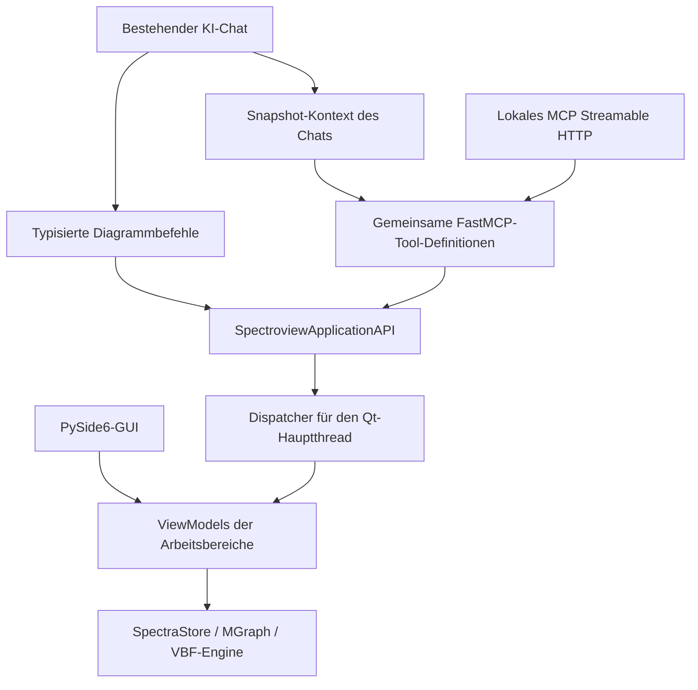

# Lokaler MCP-Server { #local-mcp-server }

SPECTROview kann den Zustand der aktuell laufenden Desktop-Anwendung für
vertrauenswürdige MCP-Clients auf demselben Rechner bereitstellen. Der Server ist
**standardmäßig deaktiviert**, bindet ausschließlich an `127.0.0.1` und nutzt
MCP Streamable HTTP unter `http://127.0.0.1:8765/mcp`, sofern kein anderer Port
gewählt wurde.

## Architektur { #architecture }



Es gibt zwei verwandte APIs:

- `spectroview.api` erstellt eigenständige Arbeitsbereiche ohne grafische Oberfläche (headless) für Python-Skripte.
- `spectroview.application.SpectroviewApplicationAPI` steuert die aktuell laufende
  Desktop-Sitzung. Sie bildet die Live-Anwendungsschnittstelle, die von MCP genutzt wird.

Die MCP-Schicht enthält keine Algorithmen für das Fitting, die Vorverarbeitung oder
das Rendering. Sie greift auf die bestehende ViewModel-Orchestrierung, `SpectraStore`,
`graph_control` und die vektorisierte Batch-Fit-Engine zurück. Das Rendern der
Diagramme bleibt eine Aufgabe der View-Schicht.

### Warum eingebettetes Streamable HTTP { #why-embedded-streamable-http }

Es wurden drei Laufzeit-Entwürfe in Betracht gezogen:

| Entwurf | Ergebnis |
|---|---|
| Eingebetteter Server im Desktop-Prozess | Ausgewählt. Ermöglicht direkten Zugriff auf den aktuellen Zustand und benötigt nur eine einzige Qt-Dispatch-Grenze. |
| Separater Localhost-Dienst mit eigener IPC | Für die erste Iteration verworfen. Fügt ein weiteres Protokoll, Zustandssynchronisation sowie eine zusätzliche Fehlerquelle im Lebenszyklus hinzu. |
| Separater stdio-MCP-Prozess mit IPC-Brücke | Für den Live-Zustand der Desktop-Anwendung verworfen. Stdio ist sinnvoll, wenn der Client den Serverprozess besitzt; bei SPECTROview verwaltet jedoch bereits die GUI den Zustand. |

Anstelle des veralteten SSE-Transports wird Streamable HTTP verwendet. Uvicorn läuft
in einem Daemon-Thread; `LocalMCPRuntime.stop()` sorgt für ein deterministisches
Herunterfahren. Die FastMCP-ASGI-Anwendung behält die Host-/Origin-Prüfungen für
`localhost` des SDKs bei.

## Aktivieren und verbinden { #enable-and-connect }

1. Öffnen Sie **Einstellungen** (Settings) → **AI** → **Lokaler MCP-Server** (Local MCP Server).
2. Aktivieren Sie **Enable local MCP endpoint**.
3. Behalten Sie den Standardport bei oder wählen Sie einen freien Port zwischen 1024 und 65535.
4. Wählen Sie **OK**. Der Endpunkt startet sofort; ein Neustart der Anwendung ist
   nicht erforderlich.
5. Konfigurieren Sie einen MCP-Client mit der angezeigten Streamable-HTTP-URL, normalerweise:

   ```text
   http://127.0.0.1:8765/mcp
   ```

Die Desktop-Anwendung SPECTROview muss dabei geöffnet bleiben. Das Deaktivieren der
Einstellung oder das Schließen von SPECTROview beendet den Endpunkt.

## Sicherheit und Berechtigungen { #security-and-permissions }

- Die Bind-Adresse ist fest auf die IPv4-Loopback-Adresse programmiert und lässt
  sich in der Benutzeroberfläche nicht ändern. SPECTROview lauscht auf keiner
  LAN- oder öffentlichen Schnittstelle.
- In dieser ersten, rein lokalen Loopback-Iteration gibt es keine Authentifizierung.
  Leiten Sie den Endpunkt weder über einen Proxy noch per Portweiterleitung weiter.
- Lese- und Schreib-Tools sind strikt getrennt, und ihre Beschreibungen kennzeichnen
  Zustandsänderungen eindeutig.
- Die MCP-Annotationen `read_only_hint`, `destructive_hint`, `idempotent_hint` und
  `open_world_hint` klassifizieren Tools für Clients, die Freigaberichtlinien
  umsetzen.
- `export_results` erfordert einen vom Aufrufer angegebenen Pfad, erstellt niemals ein
  übergeordnetes Verzeichnis und überschreibt keine vorhandene Datei, sofern der
  Aufruf nicht `overwrite=true` enthält.
- Das Löschen von Datensätzen oder Diagrammen wird niemals implizit aus einer
  Leseanfrage abgeleitet. `delete_graph` ist ein explizites zustandsänderndes Tool.

Diese Trennung liefert einem zukünftigen Work Harness ausreichende Informationen, um
Freigaberichtlinien auf Diagrammänderungen, Vorverarbeitung, Fitting, Löschvorgänge
und Exporte anzuwenden.

## Tools { #tools }

| Tool | Zweck | Zugriff |
|---|---|---|
| `get_application_state` | Aktiver Arbeitsbereich, Auswahl, Objektanzahlen, Fit-Aktivität | Lesen |
| `get_active_workspace` | Sichtbarer Arbeitsbereich | Lesen |
| `get_current_selection` | Arbeitsbereichsspezifische Auswahl | Lesen |
| `list_datasets` | Katalog der Spektren, Karten und DataFrames mit stabilen IDs | Lesen |
| `get_dataset_info` | Dimensionen, Bereich sowie Verarbeitungs- und Fit-Metadaten des Datensatzes | Lesen |
| `get_spectrum` | Begrenzte bzw. heruntergesampelte rohe oder vorverarbeitete X/Y-Werte | Lesen |
| `get_current_spectrum` | Ausgewählte X/Y-Werte (Arbeitsbereiche Spektren/Karten) | Lesen |
| `query_dataframe` | Validierte DataFrame-Abfrage bzw. -Ausdruck | Lesen |
| `get_statistics` | Deskriptive Statistik für benannte Spalten | Lesen |
| `crop_spectrum` | Aktuelle bzw. alle anwendbaren Daten gemäß Arbeitsbereichslogik zuschneiden | Schreiben |
| `normalize_spectrum` | Einen expliziten Intensitätsdivisor anwenden | Schreiben |
| `subtract_baseline` | Eine bereits konfigurierte Basislinie subtrahieren | Schreiben |
| `get_fit_configuration` | Aktuelles Fit-Modell und Parameter | Lesen |
| `fit_spectrum` | Den bestehenden VBF-Fitting-Pfad starten | Schreiben |
| `get_fit_results` | Begrenzte strukturierte Fit-Ergebniszeilen sammeln/lesen | Lesen/Schreiben bei `collect=true` |
| `list_graphs` | Vollständige typisierte `MGraph`-Konfigurationen | Lesen |
| `get_active_graph` | Vollständige Konfiguration des aktiven Diagramms | Lesen |
| `plot_graph` | Diagramm validieren und erstellen | Schreiben |
| `plot_graphs` | Mehrere Diagramme gleichzeitig validieren und erstellen (Rezept-/Batch-Modus) | Schreiben |
| `update_graph` | Typisierte Teilaktualisierung, einschließlich jedes veränderlichen `MGraph`-Felds | Schreiben |
| `delete_graph` | Angegebenes oder alle Diagramme schließen | Destruktives Schreiben |
| `get_active_map` | Konfiguration und Auswahl der aktiven Karte | Lesen |
| `export_results` | CSV-/Excel-Export der Fit-Ergebnisse mit Überschreibschutz | Dateisystem-Schreibzugriff |

Jedes neue Desktop-Tool gibt einen JSON-Umschlag (Envelope) zurück:

```json
{"ok": true, "result": {}}
```

oder einen stabilen Fehlercode samt Fehlermeldung:

```json
{"ok": false, "error": {"code": "NO_ACTIVE_GRAPH", "message": "No graph is active."}}
```

Die installierte Version des MCP-SDKs stellt dieses JSON als Textinhalt dar. Clients
sollten es als JSON parsen, statt auf menschenlesbare Meldungen zu prüfen.

## Ressourcen { #resources }

| URI | Inhalt |
|---|---|
| `spectroview://application/state` | Zusammenfassung von Anwendung und Arbeitsbereich |
| `spectroview://workspace/current` | Aktueller Arbeitsbereich und Auswahl |
| `spectroview://datasets` | Kompakter Katalog der geladenen Datensätze |
| `spectroview://dataframes/detail` | DataFrame-Spalten, Beispiele und Vorschau |
| `spectroview://graphs/detail` | Alle Diagrammkonfigurationen |
| `spectroview://graphs/current` | Aktive Diagrammkonfiguration oder typisierter Fehler |
| `spectroview://fit/current` | Aktive Fit-Konfiguration oder typisierter Fehler |

Ressourcen dienen als schreibgeschützter Kontext. Aktionen bleiben Tools vorbehalten.

## Thread-Sicherheit { #thread-safety }

Der HTTP/ASGI-Thread liest oder verändert von Qt verwaltete Zustände niemals
direkt. `QtMainThreadDispatcher` sendet ein eingereihtes Signal (Queued Signal) mit
einem Callable und wartet auf dem Server-Thread auf das Ergebnis. Das Callable wird
im `QApplication`-Thread ausgeführt. Aufrufe, die sich bereits in diesem Thread
befinden, werden direkt ausgeführt. Anfragen während des Herunterfahrens schlagen mit
`APPLICATION_NOT_READY` fehl; blockierte Dispatches brechen mit
`MAIN_THREAD_TIMEOUT` ab, statt unbegrenzt zu warten.

Das Fitting selbst bleibt asynchron und verwendet weiterhin den bestehenden
`VBFthread` von SPECTROview. `fit_spectrum` meldet den Start des Fits; Clients
prüfen `get_application_state`, bevor sie die Ergebnisse abrufen.

## Kompatibilität mit dem bestehenden KI-Chat { #existing-ai-chat-compatibility }

Der interne Chat wird nicht in einen HTTP-Client umgewandelt. Sein bestehender
MCP-Hub, die ReAct-Schleife, die Anbieter-Adapter, das Gesprächsverhalten sowie die
typisierte Warteschlange für Diagrammbefehle bleiben unverändert. Er behält bewusst
das ursprüngliche kompakte Fünf-Tool-Profil (`query_dataframe`, `get_statistics`,
`plot_graph`, `update_graph`, `delete_graph`) bei, da umfangreiche Schemas die
Zuverlässigkeit kleiner lokaler Modelle spürbar verringern. Die daraus resultierenden
Diagrammbefehle werden über `SpectroviewApplicationAPI` angewendet – dieselbe
Live-Anwendungsschnittstelle, die auch der externe Server nutzt.

Die DataFrame- und Diagramm-Lesezugriffe des Chats bleiben Runden-Snapshots. Würde
ein synchroner In-Process-Tool-Aufruf des Chats über einen blockierenden
Qt-Dispatcher zurückgeleitet, entstünde ein Deadlock im GUI-Thread; der externe
Server unterliegt dieser Einschränkung nicht.

## Eine Funktion hinzufügen { #adding-a-capability }

1. Verwenden Sie eine bestehende Domänenoperation wieder oder ergänzen Sie eine
   solche in einem Model/ViewModel bzw. in der Headless-API `spectroview.api`;
   implementieren Sie keine wissenschaftliche Logik im MCP-Handler.
2. Fügen Sie `SpectroviewApplicationAPI` eine fachlich modellierte Methode hinzu.
   Belassen Sie Widget-Suche, Auswahlfelder, Dialoge und Signalverdrahtung innerhalb
   des Adapters.
3. Registrieren Sie ein typisiertes Tool in
   `create_mcp_server(..., include_application_tools=True)`. Nutzen Sie
   `Literal`/`Field`-Einschränkungen und das Antwortformat `{ok,result|error}`.
4. Legen Sie explizit fest, ob es sich um einen reinen Lesezugriff, eine
   Zustandsänderung, einen destruktiven Vorgang oder einen Dateisystem-Schreibzugriff
   handelt. Verlangen Sie gegebenenfalls ein Überschreib- oder Lösch-Flag.
5. Ergänzen Sie Service-Tests, Tests für das generierte Schema, gültige und ungültige
   MCP-Aufrufe sowie einen Thread-Grenztest, falls Qt-Zustände berührt werden.
6. Aktualisieren Sie die Tool- und Ressourcentabellen auf dieser Seite.

## Fehlerbehebung { #troubleshooting }

- **Verbindung abgelehnt:** Aktivieren Sie den Server, lassen Sie SPECTROview
  geöffnet und verwenden Sie genau den in den Einstellungen angezeigten Endpunkt.
- **Serverfehler / Port bereits belegt:** Wählen Sie einen anderen Port und klicken
  Sie auf OK. Startfehler werden in der Statusleiste gemeldet.
- **HTTP 421:** Verbinden Sie sich über `127.0.0.1` oder `localhost`. Das SDK lehnt
  unerwartete Host-Header bewusst ab, um das Risiko von DNS-Rebinding zu verringern.
- **`APPLICATION_NOT_READY`:** SPECTROview wird gerade gestartet oder beendet, oder das
  kompakte Profil des internen Chats wurde ohne aktive Desktop-Fassade verwendet.
- **`MAIN_THREAD_TIMEOUT`:** Ein modaler Dialog oder eine langlaufende GUI-Operation
  hat die Hauptereignisschleife daran gehindert, die Anfrage zu bearbeiten. Schließen
  Sie den Dialog und versuchen Sie es erneut.
- **Keine Fit-Ergebnisse:** Warten Sie den Abschluss des Fits ab und rufen Sie vor
  dem Exportieren einmalig `get_fit_results` mit `collect=true` auf.

## Bewusste Einschränkungen der ersten Iteration { #intentional-first-iteration-limits }

- Noch kein Tool zum Exportieren von Diagrammbildern; derzeit wird nur der Export von
  Fit-Ergebnissen bereitgestellt.
- Es ist kein Glättungs-Tool verfügbar, da aktuell keine einzelne unterstützte
  Arbeitsbereichsoperation einen stabilen Glättungsvertrag besitzt.
- MCP kann noch keine Fit-Modelle oder Basislinienpunkte erstellen oder bearbeiten;
  es kann ein konfiguriertes Modell inspizieren und die bestehende Engine ausführen.
- Die Anpassung von Farbskalen und Karten-Viewern sowie der Export von Kartenbildern
  sind nicht verfügbar.
- Keine Authentifizierung, kein Remote-Bind, kein TLS, kein serverinitiiertes
  Sampling und keine Elicitation.
- Keine MCP-Fortschrittsbenachrichtigungen für VBF; der Fit-Fortschritt wird derzeit
  über den Anwendungszustand abgefragt (Polling).
