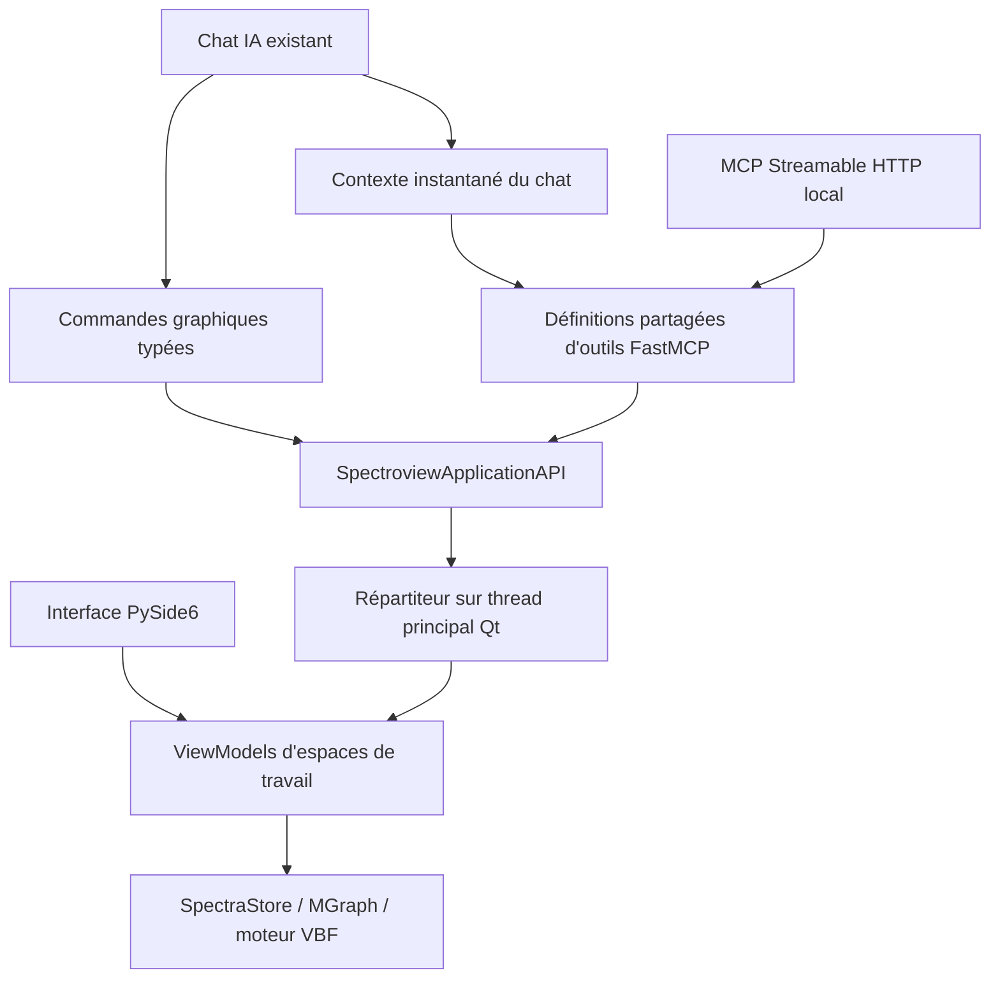

# Serveur MCP local

SPECTROview peut exposer l'état de l'application de bureau en cours d'exécution à des clients MCP de confiance situés sur la même machine. Le serveur est **désactivé par défaut**, écoute uniquement sur `127.0.0.1` et utilise le transport MCP Streamable HTTP à l'adresse `http://127.0.0.1:8765/mcp` sauf si un autre port est choisi.

## Architecture



Deux API complémentaires coexistent :

- `spectroview.api` crée des espaces de travail indépendants sans interface graphique pour les scripts Python.
- `spectroview.application.SpectroviewApplicationAPI` pilote la session de bureau actuellement ouverte. C'est la frontière applicative en direct utilisée par MCP.

La couche MCP ne contient aucun algorithme d'ajustement, de prétraitement ou de rendu. Elle s'appuie sur l'orchestration des ViewModels existants, `SpectraStore`, `graph_control` et le moteur Vectorized Batch Fit. Le rendu des graphiques demeure une responsabilité de la couche View.

### Pourquoi un serveur HTTP Streamable embarqué

Trois architectures d'exécution ont été évaluées :

| Architecture | Décision |
|---|---|
| Serveur embarqué dans le processus de l'application bureau | Retenue. Accède directement à l'état courant et ne nécessite qu'une seule frontière de répartition Qt. |
| Service localhost séparé avec IPC personnalisé | Écartée pour la première itération. Ajouterait un protocole, une synchronisation d'état et un mode de panne supplémentaires. |
| Processus MCP stdio séparé avec pont IPC | Écartée pour l'état live de l'application. Stdio convient lorsque le client possède le serveur, mais l'interface SPECTROview est déjà propriétaire de l'état. |

Le transport Streamable HTTP remplace l'ancien transport SSE obsolète. Uvicorn tourne dans un thread démon ; `LocalMCPRuntime.stop()` assure un arrêt déterministe. L'application ASGI FastMCP conserve les vérifications localhost Host/Origin du SDK.

## Activer et se connecter

1. Ouvrez **Settings → AI → Local MCP Server**.
2. Cochez **Enable local MCP endpoint**.
3. Conservez le port par défaut ou choisissez un port libre entre 1024 et 65535.
4. Validez par **OK**. Le serveur démarre immédiatement ; aucun redémarrage de l'application n'est requis.
5. Configurez votre client MCP avec l'URL Streamable HTTP affichée, normalement :

   ```text
   http://127.0.0.1:8765/mcp
   ```

L'application de bureau SPECTROview doit rester ouverte. Désactiver le réglage ou fermer SPECTROview arrête le serveur.

## Sécurité et autorisations

- L'adresse d'écoute est figée en dur sur la boucle locale IPv4 et n'est pas modifiable dans l'interface. SPECTROview n'écoute jamais sur une interface LAN ou publique.
- Aucune authentification n'est présente dans cette première version strictement locale. Ne mettez pas ce port derrière un proxy ou une redirection de port.
- Les outils de lecture et d'écriture sont distincts et leurs descriptions indiquent explicitement toute mutation.
- Les annotations MCP `read_only_hint`, `destructive_hint`, `idempotent_hint` et `open_world_hint` classifient les outils pour les clients appliquant des politiques d'approbation.
- `export_results` exige un chemin fourni par l'appelant, ne crée jamais de dossier parent et refuse d'écraser un fichier existant sauf si `overwrite=true` est passé.
- La suppression de jeux de données ou de graphiques n'est jamais déclenchée implicitement lors d'une lecture. `delete_graph` est un outil explicite modifiant l'état.

Cette séparation fournit à un futur harnais d'agents suffisamment d'informations pour soumettre à approbation modifications de graphiques, traitements, ajustements, suppressions et exports.

## Outils

| Outil | Rôle | Accès |
|---|---|---|
| `get_application_state` | Espace actif, sélection, compteurs d'objets, activité d'ajustement | Lecture |
| `get_active_workspace` | Espace de travail visible | Lecture |
| `get_current_selection` | Sélection propre à l'espace actif | Lecture |
| `list_datasets` | Catalogue des spectres, cartes et DataFrames avec IDs stables | Lecture |
| `get_dataset_info` | Dimensions, plage, métadonnées de traitement et d'ajustement | Lecture |
| `get_spectrum` | Valeurs X/Y brutes ou traitées bornées/sous-échantillonnées | Lecture |
| `get_current_spectrum` | Valeurs X/Y sélectionnées dans Spectra/Maps | Lecture |
| `query_dataframe` | Requête/expression DataFrame validée | Lecture |
| `get_statistics` | Statistiques descriptives pour les colonnes nommées | Lecture |
| `crop_spectrum` | Recadrage des données courantes ou applicables selon la logique de l'espace | Écriture |
| `normalize_spectrum` | Applique un diviseur d'intensité explicite | Écriture |
| `subtract_baseline` | Soustrait une ligne de base déjà configurée | Écriture |
| `get_fit_configuration` | Modèle d'ajustement et paramètres courants | Lecture |
| `fit_spectrum` | Démarre le chemin d'ajustement VBF existant | Écriture |
| `get_fit_results` | Collecte/lit les lignes structurées et bornées de résultats | Lecture/Écriture si `collect=true` |
| `list_graphs` | Configurations typées `MGraph` complètes | Lecture |
| `get_active_graph` | Configuration complète du graphique actif | Lecture |
| `plot_graph` | Valide et crée un graphique | Écriture |
| `plot_graphs` | Valide et crée plusieurs graphiques simultanément (mode recette / lots) | Écriture |
| `update_graph` | Mise à jour partielle typée de tout champ mutable `MGraph` | Écriture |
| `delete_graph` | Ferme les graphiques spécifiés ou tous les graphiques | Écriture destructive |
| `get_active_map` | Configuration et sélection de la carte active | Lecture |
| `export_results` | Export CSV/Excel des résultats d'ajustement avec garde anti-écrasement | Écriture disque |

Chaque nouvel outil applicatif renvoie une enveloppe JSON :

```json
{"ok": true, "result": {}}
```

ou un code d'erreur stable accompagné d'un message :

```json
{"ok": false, "error": {"code": "NO_ACTIVE_GRAPH", "message": "No graph is active."}}
```

La version installée du SDK MCP restitue ce JSON en contenu texte. Les clients doivent l'analyser en JSON plutôt que de s'appuyer sur des correspondances sur les messages textuels.

## Ressources

| URI | Contenu |
|---|---|
| `spectroview://application/state` | Résumé application/espace |
| `spectroview://workspace/current` | Espace courant et sélection |
| `spectroview://datasets` | Catalogue compact des jeux chargés |
| `spectroview://dataframes/detail` | Colonnes, échantillons et aperçu des DataFrames |
| `spectroview://graphs/detail` | Toutes les configurations graphiques |
| `spectroview://graphs/current` | Configuration du graphique actif ou erreur typée |
| `spectroview://fit/current` | Configuration d'ajustement active ou erreur typée |

Les ressources constituent un contexte en lecture seule. Les actions restent des outils.

## Sûreté des threads

Le thread HTTP/ASGI ne lit ni ne modifie jamais directement un état appartenant à Qt. `QtMainThreadDispatcher` émet un signal en file portant un objet appelable et attend le résultat côté serveur. L'objet appelable s'exécute sur le thread `QApplication` (les appels déjà sur ce thread s'exécutent directement). Les requêtes durant l'arrêt échouent avec `APPLICATION_NOT_READY` ; les appels bloqués dépassant le délai expirent avec `MAIN_THREAD_TIMEOUT` au lieu de bloquer indéfiniment.

L'ajustement lui-même reste asynchrone et continue d'utiliser `VBFthread`. `fit_spectrum` signale que le calcul a démarré ; les clients interrogent `get_application_state` avant de collecter les résultats.

## Compatibilité avec le chat IA existant

Le chat interne n'est pas converti en client HTTP. Son hub MCP, sa boucle ReAct, ses adaptateurs de fournisseurs, sa gestion des conversations et sa file de commandes graphiques typées demeurent inchangés. Il conserve délibérément le profil compact à cinq outils (`query_dataframe`, `get_statistics`, `plot_graph`, `update_graph`, `delete_graph`) afin de préserver la fiabilité des petits modèles locaux. Les commandes produites passent toutefois par `SpectroviewApplicationAPI`, la même frontière applicative que le serveur externe.

Les lectures de DataFrames et graphiques du chat conservent leurs instantanés par tour afin d'éviter tout interblocage synchrone sur le thread GUI.

## Ajouter une capacité

1. Réutilisez ou ajoutez une opération métier dans un Model/ViewModel ou dans l'API headless `spectroview.api` ; n'implémentez jamais de logique scientifique dans le gestionnaire MCP.
2. Ajoutez une méthode métier dans `SpectroviewApplicationAPI`. Gardez recherches de widgets, listes déroulantes, dialogues et câblages de signaux confinés à l'adaptateur.
3. Enregistrez un outil typé dans `create_mcp_server(..., include_application_tools=True)` avec contraintes `Literal`/`Field` et enveloppe `{ok, result|error}`.
4. Définissez explicitement s'il s'agit d'une opération en lecture seule, d'écriture d'état, destructive ou d'écriture disque, avec drapeaux d'écrasement/suppression appropriés.
5. Ajoutez des tests de service, de schéma généré, d'appels MCP valides/invalides et un test de frontière de thread si l'état Qt est sollicité.
6. Mettez à jour les tableaux d'outils et de ressources sur cette page.

## Dépannage

- **Connexion refusée :** activez le serveur, laissez SPECTROview ouvert et utilisez exactement le point d'accès affiché dans Settings.
- **Échec du serveur / port déjà utilisé :** choisissez un autre port puis cliquez sur OK. La barre d'état signale les échecs de démarrage.
- **HTTP 421 :** connectez-vous via `127.0.0.1` ou `localhost`. Le SDK rejette volontairement les en-têtes Host inattendus pour éviter le *DNS rebinding*.
- **`APPLICATION_NOT_READY` :** SPECTROview démarre ou s'arrête, ou bien le profil interne compact a été appelé sans façade applicative live.
- **`MAIN_THREAD_TIMEOUT` :** une boîte de dialogue modale ou une longue opération GUI a empêché la boucle événementielle principale de traiter la requête. Fermez le dialogue et réessayez.
- **Aucun résultat d'ajustement :** attendez la fin de l'ajustement puis appelez une fois `get_fit_results` avec `collect=true` avant d'exporter.

## Limites intentionnelles de la première version

- Aucun outil d'export d'image graphique pour l'instant ; seul l'export de résultats d'ajustement est exposé.
- Aucun outil de lissage exposé car aucune opération d'espace unique ne porte actuellement de contrat de lissage stable.
- MCP ne peut pas encore créer/éditer de modèles d'ajustement ni de points de ligne de base ; il peut inspecter un modèle configuré et lancer le moteur existant.
- La personnalisation du visualiseur de carte et l'export d'image de carte ne sont pas exposés.
- Aucune authentification, écoute distante, TLS, échantillonnage initié par le serveur ou élicitation.
- Aucune notification d'avancement MCP pour VBF ; la progression s'interroge pour l'instant via l'état de l'application.
