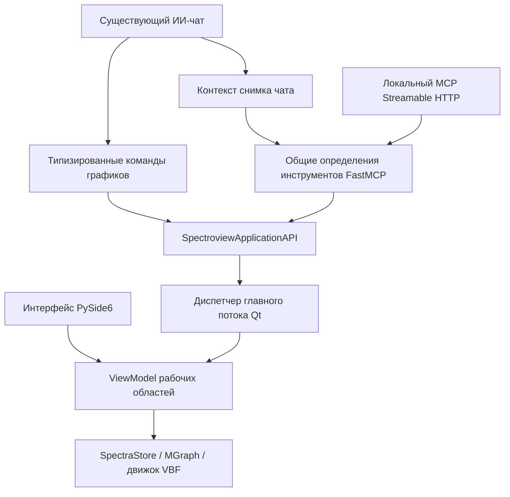

# Локальный MCP-сервер { #local-mcp-server }

SPECTROview может предоставлять состояние текущего запущенного настольного
приложения доверенным MCP-клиентам на том же компьютере. Сервер **отключён по
умолчанию**, привязывается только к адресу `127.0.0.1` и использует транспорт
MCP Streamable HTTP по адресу `http://127.0.0.1:8765/mcp`, если не выбран другой
порт.

## Архитектура { #architecture }



Имеются два взаимосвязанных API:

- `spectroview.api` создаёт независимые рабочие области без графического
  интерфейса (headless) для Python-скриптов.
- `spectroview.application.SpectroviewApplicationAPI` управляет текущим
  запущенным сеансом настольного приложения. Именно этот интерфейс уровня
  работающего приложения используется в MCP.

Слой MCP не содержит алгоритмов аппроксимации, предобработки или отрисовки.
Он опирается на существующую оркестрацию ViewModel, `SpectraStore`,
`graph_control` и движок пакетной аппроксимации (Vectorized Batch Fit).
Отрисовка графиков остаётся ответственностью слоя View.

### Почему выбран встроенный Streamable HTTP { #why-embedded-streamable-http }

Рассматривались три варианта архитектуры среды выполнения:

| Вариант архитектуры | Результат |
|---|---|
| Встроенный сервер в процессе настольного приложения | Выбран. Обеспечивает прямой доступ к текущему состоянию и требует лишь одну границу диспетчеризации Qt. |
| Отдельный сервис на localhost с собственным IPC | Отклонён для первой итерации. Добавляет ещё один протокол, необходимость синхронизации состояния и дополнительные точки отказа жизненного цикла. |
| Отдельный stdio-процесс MCP с IPC-мостом | Отклонён для работы с живым состоянием приложения. Stdio удобен, когда процессом сервера владеет клиент, но в SPECTROview владельцем состояния уже является графический интерфейс. |

Вместо устаревшего транспорта SSE используется Streamable HTTP. Uvicorn
запускается в фоновом потоке-демоне; метод `LocalMCPRuntime.stop()`
обеспечивает детерминированное завершение работы. ASGI-приложение FastMCP
сохраняет встроенные в SDK проверки заголовков Host/Origin для localhost.

## Включение и подключение { #enable-and-connect }

1. Откройте **Настройки** (Settings) → **AI** → **Локальный MCP-сервер** (Local MCP Server).
2. Установите флажок **Enable local MCP endpoint**.
3. Оставьте порт по умолчанию или выберите свободный порт в диапазоне от 1024 до 65535.
4. Нажмите **OK**. Конечная точка запускается немедленно; перезапуск приложения
   не требуется.
5. Настройте MCP-клиент, указав отображаемый URL Streamable HTTP, обычно:

   ```text
   http://127.0.0.1:8765/mcp
   ```

Настольное приложение SPECTROview должно оставаться запущенным. Отключение этого
параметра или закрытие SPECTROview останавливает конечную точку.

## Безопасность и права доступа { #security-and-permissions }

- Адрес привязки жёстко задан как петлевой адрес (loopback) IPv4 и не может
  быть изменён в интерфейсе. SPECTROview не прослушивает сетевые интерфейсы
  локальной сети или публичные интерфейсы.
- В этой первой итерации, работающей только через loopback, аутентификация
  отсутствует. Не проксируйте эту конечную точку и не настраивайте для неё
  проброс портов.
- Инструменты чтения и записи чётко разделены, а их описания явно указывают на
  изменение состояния.
- Аннотации MCP `read_only_hint`, `destructive_hint`, `idempotent_hint` и
  `open_world_hint` классифицируют инструменты для клиентов, реализующих
  политики подтверждения действий.
- Инструмент `export_results` требует путь, переданный вызывающей стороной,
  никогда не создаёт родительские каталоги и отказывается перезаписывать
  существующий файл, если в вызове не указано `overwrite=true`.
- Удаление наборов данных или графиков никогда не выполняется неявно при
  запросах на чтение. `delete_graph` — это отдельный инструмент, явно
  изменяющий состояние.

Такое разделение предоставляет будущей оркестрирующей среде (Work Harness)
достаточно сведений для применения политик подтверждения к изменению графиков,
обработке данных, аппроксимации, удалению и экспорту.

## Инструменты { #tools }

| Инструмент | Назначение | Доступ |
|---|---|---|
| `get_application_state` | Активная рабочая область, выделение, количество объектов, статус аппроксимации | Чтение |
| `get_active_workspace` | Видимая рабочая область | Чтение |
| `get_current_selection` | Выделение в текущей рабочей области | Чтение |
| `list_datasets` | Каталог спектров, карт и DataFrame со стабильными идентификаторами | Чтение |
| `get_dataset_info` | Размерность, диапазон, метаданные обработки и аппроксимации набора данных | Чтение |
| `get_spectrum` | Ограниченные или прореженные исходные либо обработанные значения X/Y | Чтение |
| `get_current_spectrum` | Выбранные значения X/Y в «Спектрах»/«Картах» | Чтение |
| `query_dataframe` | Проверенный запрос или выражение к DataFrame | Чтение |
| `get_statistics` | Описательная статистика для указанных столбцов | Чтение |
| `crop_spectrum` | Обрезка текущих или всех применимых данных по логике рабочей области | Запись |
| `normalize_spectrum` | Применение явного делителя интенсивности | Запись |
| `subtract_baseline` | Вычитание уже настроенной базовой линии | Запись |
| `get_fit_configuration` | Текущая модель аппроксимации и её параметры | Чтение |
| `fit_spectrum` | Запуск существующего конвейера аппроксимации VBF | Запись |
| `get_fit_results` | Сбор/чтение ограниченных структурированных строк результатов аппроксимации | Чтение/Запись при `collect=true` |
| `list_graphs` | Полные типизированные конфигурации `MGraph` | Чтение |
| `get_active_graph` | Полная конфигурация активного графика | Чтение |
| `plot_graph` | Валидация и создание графика | Запись |
| `plot_graphs` | Валидация и одновременное создание нескольких графиков (режим рецепта / пакетный режим) | Запись |
| `update_graph` | Типизированное частичное обновление, включая все изменяемые поля `MGraph` | Запись |
| `delete_graph` | Закрытие указанных или всех графиков | Деструктивная запись |
| `get_active_map` | Конфигурация и выделение активной карты | Чтение |
| `export_results` | Экспорт результатов аппроксимации в CSV/Excel с защитой от перезаписи | Запись в файловую систему |

Каждый новый инструмент настольного приложения возвращает JSON-обёртку:

```json
{"ok": true, "result": {}}
```

либо стабильный код ошибки и сообщение:

```json
{"ok": false, "error": {"code": "NO_ACTIVE_GRAPH", "message": "No graph is active."}}
```

Установленная версия MCP SDK передаёт этот JSON в виде текстового содержимого.
Клиентам следует разбирать его именно как JSON, а не сопоставлять
человекочитаемые сообщения.

## Ресурсы { #resources }

| URI | Содержимое |
|---|---|
| `spectroview://application/state` | Сводка по приложению и рабочей области |
| `spectroview://workspace/current` | Текущая рабочая область и выделение |
| `spectroview://datasets` | Компактный каталог загруженных наборов данных |
| `spectroview://dataframes/detail` | Столбцы DataFrame, выборки, предпросмотр |
| `spectroview://graphs/detail` | Конфигурации всех графиков |
| `spectroview://graphs/current` | Конфигурация активного графика или типизированная ошибка |
| `spectroview://fit/current` | Активная конфигурация аппроксимации или типизированная ошибка |

Ресурсы предоставляют контекст только для чтения. Все действия выполняются
через инструменты.

## Потокобезопасность { #thread-safety }

Поток HTTP/ASGI никогда не читает и не изменяет состояние, принадлежащее Qt,
напрямую. `QtMainThreadDispatcher` отправляет поставленный в очередь сигнал
(queued signal) с вызываемым объектом и ожидает результат в потоке сервера.
Вызываемый объект выполняется в потоке `QApplication`. Вызовы, уже
находящиеся в этом потоке, выполняются напрямую. Запросы во время завершения
работы завершаются с ошибкой `APPLICATION_NOT_READY`; заблокированные вызовы
диспетчеризации завершаются по тайм-ауту с кодом `MAIN_THREAD_TIMEOUT`, а не
ожидают бесконечно.

Сама аппроксимация остаётся асинхронной и продолжает использовать существующий
в SPECTROview поток `VBFthread`. Инструмент `fit_spectrum` сообщает о запуске
аппроксимации; перед сбором результатов клиенты проверяют состояние через
`get_application_state`.

## Совместимость с существующим ИИ-чатом { #existing-ai-chat-compatibility }

Внутренний чат не преобразуется в HTTP-клиент. Его существующий MCP-хаб, цикл
ReAct, адаптеры провайдеров, поведение диалогов и типизированная очередь команд
для графиков остаются без изменений. Он намеренно сохраняет исходный компактный
профиль из пяти инструментов (`query_dataframe`, `get_statistics`, `plot_graph`,
`update_graph`, `delete_graph`), поскольку громоздкие схемы заметно снижают
надёжность работы небольших локальных моделей. Сформированные команды для
графиков применяются через `SpectroviewApplicationAPI` — тот же живой интерфейс
приложения, который использует и внешний сервер.

Чтение DataFrame и графиков в чате по-прежнему опирается на снимки состояния на
каждый шаг (turn snapshots). Перенаправление синхронного внутрипроцессного
вызова инструмента чата обратно через блокирующий диспетчер Qt привело бы к
взаимной блокировке (deadlock) потока графического интерфейса; внешний сервер
этого ограничения не имеет.

## Добавление новой возможности { #adding-a-capability }

1. Переиспользуйте или добавьте предметную операцию в Model/ViewModel или в
   headless-интерфейс `spectroview.api`; не реализуйте научную логику внутри
   MCP-обработчика.
2. Добавьте метод уровня предметной области в `SpectroviewApplicationAPI`.
   Поиск виджетов, выпадающие списки, диалоговые окна и связывание сигналов
   оставляйте внутри адаптера.
3. Зарегистрируйте типизированный инструмент в
   `create_mcp_server(..., include_application_tools=True)`. Используйте
   ограничения `Literal`/`Field` и формат ответа `{ok,result|error}`.
4. Явно определите тип операции: только чтение, изменение состояния,
   деструктивная операция или запись в файловую систему. При необходимости
   требуйте флаг перезаписи или удаления.
5. Добавьте сервисные тесты, тесты сгенерированной схемы, проверки корректных
   и некорректных вызовов MCP, а также тест пересечения границы потоков, если
   затрагивается состояние Qt.
6. Обновите таблицы инструментов и ресурсов на этой странице.

## Устранение неполадок { #troubleshooting }

- **В соединении отказано (Connection refused):** включите сервер, не
  закрывайте SPECTROview и используйте точный адрес конечной точки,
  отображаемый в Настройках.
- **Ошибка запуска сервера / порт занят:** выберите другой порт и нажмите OK.
  Сбои запуска отображаются в строке состояния.
- **HTTP 421:** подключайтесь через `127.0.0.1` или `localhost`. SDK намеренно
  отклоняет неожиданные заголовки Host, чтобы снизить риск атак типа
  DNS-rebinding.
- **`APPLICATION_NOT_READY`:** приложение SPECTROview находится в процессе
  запуска или завершения работы, либо компактный профиль внутреннего чата был
  использован без активного фасада настольного приложения.
- **`MAIN_THREAD_TIMEOUT`:** модальное диалоговое окно или длительная операция
  графического интерфейса помешали главному циклу обработки событий обслужить
  запрос. Закройте диалоговое окно и повторите попытку.
- **Нет результатов аппроксимации:** дождитесь завершения аппроксимации, затем
  перед экспортом один раз вызовите `get_fit_results` с параметром
  `collect=true`.

## Намеренные ограничения первой итерации { #intentional-first-iteration-limits }

- Пока отсутствует инструмент экспорта изображений графиков; доступен только
  экспорт результатов аппроксимации.
- Инструмент сглаживания не предоставляется, поскольку на данный момент ни одна
  поддерживаемая операция рабочей области не обладает стабильным контрактом
  сглаживания.
- MCP пока не может создавать или редактировать модели аппроксимации и точки
  базовой линии; можно лишь просматривать настроенную модель и запускать
  существующий движок.
- Настройка палитры и параметров просмотра карт, а также экспорт изображений
  карт не предоставляются.
- Отсутствуют аутентификация, привязка к внешним сетевым интерфейсам, TLS,
  инициируемые сервером сэмплирование (sampling) и запросы уточнений
  (elicitation).
- Отсутствуют MCP-уведомления о ходе выполнения VBF; прогресс аппроксимации в
  настоящее время опрашивается через состояние приложения.
