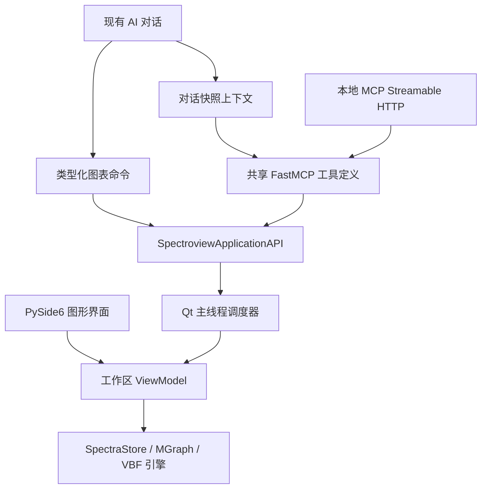

# 本地 MCP 服务器 { #local-mcp-server }

SPECTROview 可以将当前运行中的桌面应用程序状态开放给同一台计算机上受信任的 MCP 客户端。该服务器**默认处于禁用状态**，仅绑定到 `127.0.0.1`，且除非另行指定端口，否则均在 `http://127.0.0.1:8765/mcp` 上使用 MCP Streamable HTTP 协议。

## 架构 { #architecture }



存在两个相关的 API：

- `spectroview.api` 为 Python 脚本创建独立的无界面（headless）工作区。
- `spectroview.application.SpectroviewApplicationAPI` 用于控制当前运行中的桌面会话。它是 MCP 所使用的实时应用程序边界。

MCP 层不包含任何拟合、预处理或渲染算法。它复用现有的 ViewModel 编排逻辑、`SpectraStore`、`graph_control` 以及向量化批量拟合（Vectorized Batch Fit）引擎。图表渲染仍由 View 层负责。

### 为何选择嵌入式 Streamable HTTP { #why-embedded-streamable-http }

设计时评估了三种运行时方案：

| 方案设计 | 结论 |
|---|---|
| 桌面进程内嵌服务器 | 已采用。可直接访问当前应用状态，且仅需单一 Qt 调度边界。 |
| 独立的 localhost 服务加自定义 IPC | 在首次迭代中否决。会引入额外的协议、状态同步机制及生命周期故障模式。 |
| 独立的 stdio MCP 进程加 IPC 桥接 | 针对实时桌面状态否决。stdio 适用于客户端拥有服务器进程生命周期的场景，而 SPECTROview GUI 本身已是状态所有者。 |

传输层采用 Streamable HTTP，而非已被取代的 SSE 传输协议。Uvicorn 运行在守护线程上；`LocalMCPRuntime.stop()` 提供确定性关闭能力。FastMCP ASGI 应用程序保留了 SDK 的 localhost Host/Origin 安全校验。

## 启用与连接 { #enable-and-connect }

1. 打开 **设置** (Settings) → **AI** → **本地 MCP 服务器** (Local MCP Server)。
2. 勾选 **Enable local MCP endpoint**。
3. 保留默认端口，或在 1024 到 65535 之间选择一个未使用的端口。
4. 点击 **OK**。端点将立即启动，无需重启应用程序。
5. 使用界面中显示的 Streamable HTTP URL 配置 MCP 客户端，通常为：

   ```text
   http://127.0.0.1:8765/mcp
   ```

SPECTROview 桌面应用程序必须保持运行状态。禁用该设置或关闭 SPECTROview 将停止该端点。

## 安全与权限 { #security-and-permissions }

- 绑定地址硬编码为 IPv4 回环地址，且无法在界面中修改。SPECTROview 不会在局域网或公网接口上进行监听。
- 在这一仅限本地回环访问的首次迭代中未设置身份认证。请勿对该端点进行代理或端口转发。
- 读取工具与写入工具严格区分，且工具描述中明确标明了状态变更操作。
- MCP 注解 `read_only_hint`、`destructive_hint`、`idempotent_hint` 和 `open_world_hint` 对工具进行了分类，以便实现审批策略的客户端据此控制权限。
- `export_results` 要求由调用方提供路径，绝不会自动创建父目录，且除非调用中包含 `overwrite=true`，否则拒绝替换已存在的文件。
- 系统绝不会从读取请求中隐式推断数据集或图表的删除操作。`delete_graph` 是一个显式变更状态的工具。

这种职责隔离为未来的任务编排框架（Work Harness）提供了充足信息，使其能够对图表更改、数据处理、拟合、删除和导出操作实施审批策略。

## 工具 { #tools }

| 工具 | 用途 | 访问权限 |
|---|---|---|
| `get_application_state` | 活动工作区、当前选区、对象数量、拟合活动状态 | 读取 |
| `get_active_workspace` | 当前可见工作区 | 读取 |
| `get_current_selection` | 当前工作区对应的选区 | 读取 |
| `list_datasets` | 包含稳定 ID 的光谱、二维图谱与 DataFrame 目录 | 读取 |
| `get_dataset_info` | 数据集形状、范围、预处理及拟合元数据 | 读取 |
| `get_spectrum` | 限长/降采样后的原始或已处理 X/Y 数值 | 读取 |
| `get_current_spectrum` | 光谱 / 二维图谱工作区中已选定的 X/Y 数值 | 读取 |
| `query_dataframe` | 经过校验的 DataFrame 查询/表达式 | 读取 |
| `get_statistics` | 指定列的描述性统计信息 | 读取 |
| `crop_spectrum` | 按工作区逻辑裁剪当前或所有适用数据 | 写入 |
| `normalize_spectrum` | 应用显式的强度除数 | 写入 |
| `subtract_baseline` | 扣除已配置的基线 | 写入 |
| `get_fit_configuration` | 当前拟合模型与参数 | 读取 |
| `fit_spectrum` | 启动现有的 VBF 拟合流程 | 写入 |
| `get_fit_results` | 汇总/读取有限长度的结构化拟合结果行 | 读取 / 当 `collect=true` 时为写入 |
| `list_graphs` | 完整的类型化 `MGraph` 配置 | 读取 |
| `get_active_graph` | 当前活动图表的完整配置 | 读取 |
| `plot_graph` | 校验并创建图表 | 写入 |
| `plot_graphs` | 同时校验并创建多个图表（配方 / 批量模式） | 写入 |
| `update_graph` | 类型化部分更新，包含所有可变 `MGraph` 字段 | 写入 |
| `delete_graph` | 关闭指定或全部图表 | 破坏性写入 |
| `get_active_map` | 当前活动二维图谱的配置与选区 | 读取 |
| `export_results` | 带防覆盖保护的 CSV/Excel 拟合结果导出 | 文件系统写入 |

每个新增的桌面端工具均返回一个 JSON 封装格式：

```json
{"ok": true, "result": {}}
```

或返回一个稳定的错误代码及消息：

```json
{"ok": false, "error": {"code": "NO_ACTIVE_GRAPH", "message": "No graph is active."}}
```

当前安装的 MCP SDK 版本会将此 JSON 表示为文本内容。客户端应将其作为 JSON 解析，而非匹配人类可读的消息文本。

## 资源 { #resources }

| URI | 内容 |
|---|---|
| `spectroview://application/state` | 应用程序/工作区摘要 |
| `spectroview://workspace/current` | 当前工作区与选区 |
| `spectroview://datasets` | 已加载数据集的精简目录 |
| `spectroview://dataframes/detail` | DataFrame 列信息、样本与预览 |
| `spectroview://graphs/detail` | 所有图表的配置 |
| `spectroview://graphs/current` | 当前活动图表配置或类型化错误 |
| `spectroview://fit/current` | 当前活动拟合配置或类型化错误 |

资源仅作为只读上下文；具体操作仍由工具执行。

## 线程安全性 { #thread-safety }

HTTP/ASGI 线程绝不会直接读取或修改归属 Qt 管理的状态。`QtMainThreadDispatcher` 会发射一个携带可调用对象的队列信号，并在服务器线程上等待其返回结果。该可调用对象将在 `QApplication` 线程上执行；已处于该线程上的调用则会直接执行。应用关闭期间发起的请求将返回 `APPLICATION_NOT_READY` 错误；发生卡顿超时的调度将返回 `MAIN_THREAD_TIMEOUT` 错误，而不会无限期等待。

拟合过程本身仍保持异步，并继续使用 SPECTROview 现有的 `VBFthread`。`fit_spectrum` 仅报告拟合已启动；客户端应先检查 `get_application_state`，再收集拟合结果。

## 现有 AI 对话兼容性 { #existing-ai-chat-compatibility }

内置对话功能不会被改造为 HTTP 客户端。其现有的 MCP Hub、ReAct 循环、服务商适配器、会话行为以及类型化图表命令队列均保持不变。它刻意保留了原有的精简五工具配置（`query_dataframe`、`get_statistics`、`plot_graph`、`update_graph`、`delete_graph`），因为过大的参数 Schema 会显著降低小型本地模型的可靠性。最终生成的图表命令会通过 `SpectroviewApplicationAPI` 应用执行——这与外部服务器所使用的实时应用程序边界完全相同。

对话中的 DataFrame 与图表读取操作仍保持为轮次快照（turn snapshots）。若将进程内的同步对话工具调用反向路由至阻塞式 Qt 调度器，将会导致 GUI 线程死锁；而外部服务器则没有这一限制。

## 添加新功能 { #adding-a-capability }

1. 在 Model/ViewModel 或无界面 `spectroview.api` 中复用或新增领域操作；切勿在 MCP 处理程序中实现科学计算逻辑。
2. 在 `SpectroviewApplicationAPI` 中添加符合领域语义的方法。将控件查找、下拉框、对话框及信号连接保留在适配器内部。
3. 在 `create_mcp_server(..., include_application_tools=True)` 中注册类型化工具。使用 `Literal`/`Field` 约束以及 `{ok,result|error}` 响应封装格式。
4. 明确决定该工具属于只读、状态变更、破坏性操作还是文件系统写入，并在适当时要求传入覆盖或删除标志。
5. 添加服务层测试、Schema 生成测试、有效/无效 MCP 调用测试；如果涉及 Qt 状态，还需添加线程边界测试。
6. 更新本页中的工具与资源表格。

## 故障排查 { #troubleshooting }

- **连接被拒绝：** 启用服务器，保持 SPECTROview 处于运行状态，并使用设置中显示的精确端点地址。
- **服务器启动失败 / 端口被占用：** 选择另一个端口并按 OK。状态栏会报告启动失败信息。
- **HTTP 421：** 请使用 `127.0.0.1` 或 `localhost` 进行连接。SDK 会刻意拒绝非预期的 Host 请求头，以降低 DNS 重绑定（DNS-rebinding）风险。
- **`APPLICATION_NOT_READY`：** SPECTROview 正在启动或停止，或者在缺少实时桌面门面（facade）的情况下使用了精简版内部对话配置。
- **`MAIN_THREAD_TIMEOUT`：** 模态对话框或耗时较长的 GUI 操作阻塞了主事件循环，导致无法响应请求。关闭该对话框后重试。
- **无拟合结果：** 等待拟合完成，然后在导出前调用一次带 `collect=true` 参数的 `get_fit_results`。

## 首次迭代的刻意限制 { #intentional-first-iteration-limits }

- 暂未提供图表图像导出工具；目前仅开放了拟合结果导出功能。
- 暂未开放平滑处理工具，因为当前尚无单一受支持的工作区操作拥有稳定的平滑接口契约。
- MCP 尚不能创建或编辑拟合模型及基线锚点；它可以检查已配置的模型并运行现有拟合引擎。
- 暂未开放二维图谱色标/视图自定义以及图谱图像导出功能。
- 不支持身份认证、远程绑定、TLS、服务端发起的采样（sampling）或交互式信息征询（elicitation）。
- 暂不支持针对 VBF 的 MCP 进度通知；当前需通过轮询应用程序状态来获取拟合进度。
