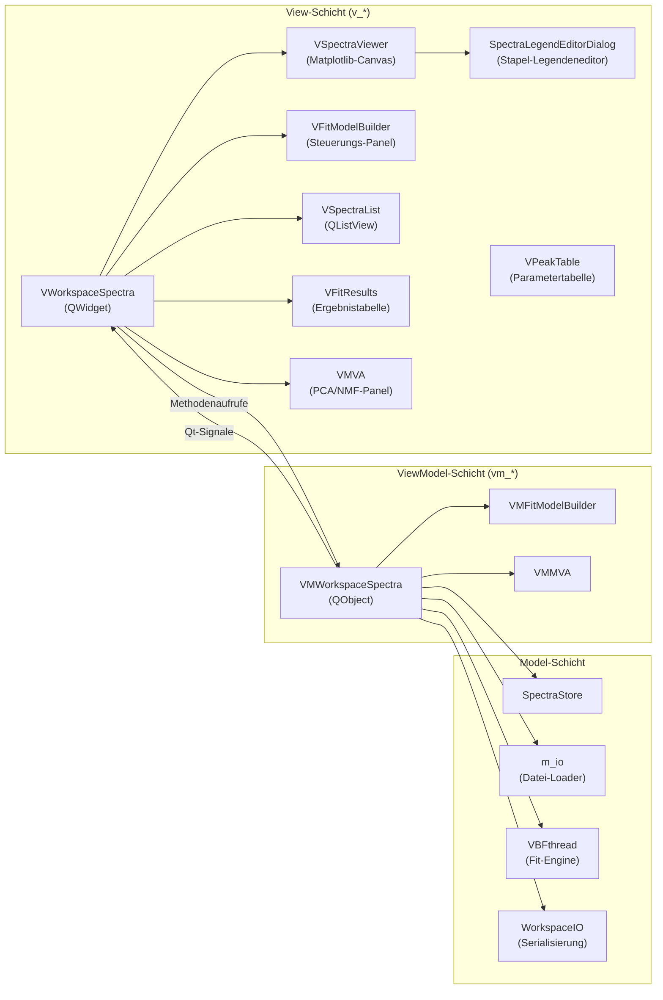
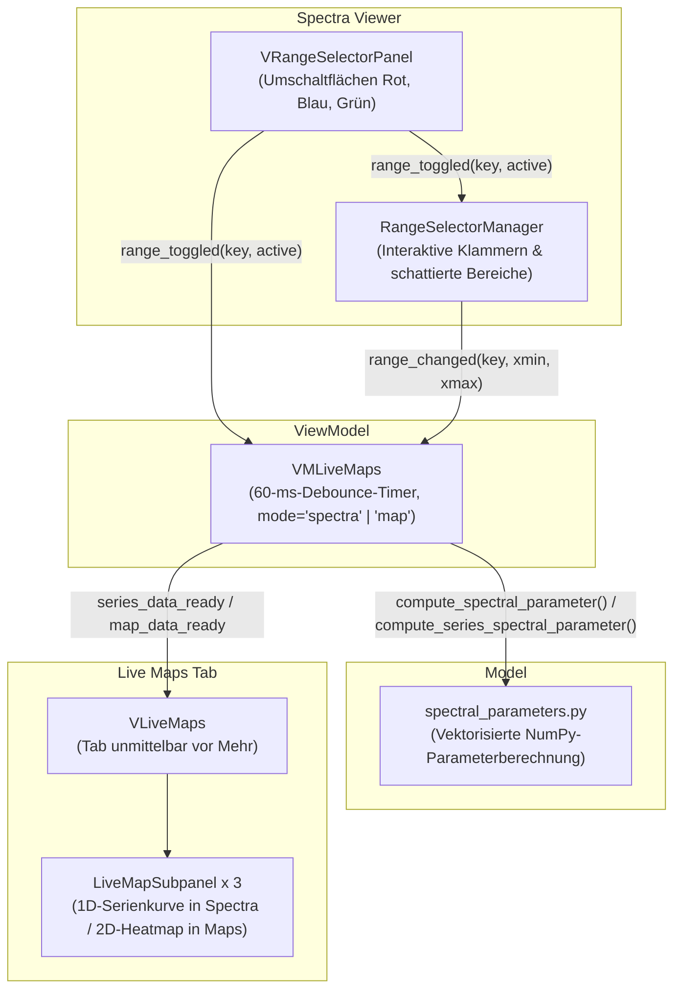

# **Arbeitsbereich: Spectra** { #workspace-spectra }

Der Arbeitsbereich `Spectra` ist die zentrale Analyseumgebung zur Verwaltung einzelner Spektren. Er übernimmt das Laden, die Vorverarbeitung, die Peak-Modellierung, das Fitting sowie den Export spektraler Daten. Darüber hinaus dient er als **Basisklasse**, die der [Arbeitsbereich Maps](maps.md) per Vererbung erweitert.

> [!NOTE]
> Diese Seite behandelt die Spectra-spezifischen Schichten View und ViewModel. Informationen zum gemeinsamen Datenmodell (`SpectraStore`, `MapData`, `MapInfo`, Proxys) finden Sie auf der zugehörigen Seite [Datenarchitektur: SpectraStore](spectra_store.md).

---

## Architekturübersicht { #architecture-overview }

Der Arbeitsbereich folgt einer strikten **MVVM**-Trennung (Model-View-ViewModel). Keine Schicht darf ihre Grenze in die falsche Richtung überschreiten.



### Zuständigkeiten der Komponenten { #component-responsibilities }

| Schicht | Klasse | Zuständigkeit |
|---------|--------|---------------|
| **View** | `VWorkspaceSpectra` | Stellt UI-Widgets zusammen, verbindet Signale/Slots und delegiert sämtliche Logik an das ViewModel |
| **View** | `VSpectraViewer` | Matplotlib-Canvas — rendert 1D-Spektren, Basislinien, Peaks, Best-Fit-Kurven, Residuen, 2D-Heatmaps, interaktive 3D-Ansichten und Bereichswähler |
| **View** | `VRangeSelectorPanel` | Vertikales rechtes Panel mit roten, blauen und grünen Umschaltflächen für Spektralintervalle |
| **View** | `RangeSelectorManager` | Canvas-Overlay zur Verwaltung ziehbarer Klammermarkierungen und schattierter Bereiche für aktive Wähler |
| **View** | `VLiveMaps` | Tab **Live-Karten** (Live Maps), der drei synchronisierte 2D-Heatmap-Unterpanels (Rot, Blau, Grün) bereitstellt |
| **View** | `SpectraLegendEditorDialog` | Transaktionaler Editor für Farbpalette, Legendenlimit, Beschriftungen und Farben der ausgewählten Spektren |
| **View** | `VFitModelBuilder` | Steuerungs-Panel für X-Korrektur, Spektralbereich, Basislinie und Fitting |
| **View** | `VPeakTable` | Editierbare Tabelle der Peak-Parameter mit Modellauswahl pro Zeile |
| **View** | `VSpectraList` | Kontrollkästchen-Liste mit Farbregeln, Drag-and-Drop-Sortierung und Mehrfachauswahl |
| **ViewModel** | `VMWorkspaceSpectra` | Geschäftslogik: orchestriert Laden, Vorverarbeitung, Fitting und Persistenz |
| **ViewModel** | `VMLiveMaps` | Berechnet 2D-Raumparameter-Arrays aus `MapData` bei Aktualisierungen von Intervallen oder Parametern |
| **Model** | `spectral_parameters` | Vektorisierte Berechnungen für integrierte/mittlere/maximale Intensität sowie Peak-Position, -Höhe und -Fläche |
| **Model** | `SpectraStore` | Tensorzentrierter In-Memory-Speicher — siehe [spectra_store.md](spectra_store.md) |
| **Model** | `VBFthread` | `QThread`, der die vektorisierte Batch-Fit-Engine außerhalb des Hauptthreads ausführt |

### Wie Spectra MapData verwendet { #how-spectra-uses-mapdata }

Im Arbeitsbereich Spectra wird jedes geladene Spektrum als eigenständiger `MapData`-Block mit **N=1** (eine Zeile) gespeichert. Jeder Block besitzt eine eigene X-Achse, sodass Spektren mit unterschiedlichen Wellenzahlbereichen koexistieren können. Den vollständigen Tensoraufbau finden Sie unter [Datenhierarchie](spectra_store.md#data-hierarchy).

---

## Arbeitsbereich-Komponenten { #workspace-components }

### `VWorkspaceSpectra` — Der View-Koordinator { #vworkspacespectra-the-view-coordinator }

**Datei**: [`v_workspace_spectra.py`](https://github.com/CEA-MetroCarac/SPECTROview/blob/main/spectroview/view/workspaces/v_workspace_spectra.py)

`VWorkspaceSpectra` ist eine reine UI-Assembler-Klasse. Sie:

1. Instanziiert alle untergeordneten Widgets sowie das ViewModel in `__init__`.
2. Verdrahtet sämtliche Signal-Slot-Verbindungen in `setup_connections()`.
3. Delegiert jede Benutzeraktion an das ViewModel (greift niemals direkt auf Daten zu).
4. Aktualisiert die Benutzeroberfläche als Reaktion auf ViewModel-Signale.

Das Layout besteht aus einem horizontalen Splitter: **links** (`VSpectraViewer` oben, Steuerungstabs unten) und **rechts** (Seitenleiste mit der Spektrenliste).

**Zentrales Muster — Strg-modifizierte Aktionen:**

```python
def _apply_with_ctrl(self, fn):
    apply_all = bool(QApplication.keyboardModifiers() & Qt.ControlModifier)
    fn(apply_all)

# Usage:
self.btn_reinit.clicked.connect(lambda: self._apply_with_ctrl(vm.reinit_spectra))
```

Alle Sammelaktionen (Basislinienabzug, Peak-Einfügen, Zurücksetzen, Fitting) folgen diesem Muster. Ein normaler Klick wirkt auf die ausgewählten Spektren; Strg+Klick wirkt auf alle Spektren im Speicher.

### `VSpectraViewer` — 2D-Heatmap-Modus { #vspectraviewer-2d-heatmap-mode }

**Paket**: [`spectra_viewer/`](https://github.com/CEA-MetroCarac/SPECTROview/blob/main/spectroview/view/components/spectra_viewer/__init__.py) (`v_plot_heatmap.py`)

`VSpectraViewer` ist das zentrale Spektren-Canvas-Widget. Neben der mehrlinigen 1D-Spektrendarstellung bietet es einen nativen **2D-Heatmap-Modus** (`btn_heatmap`, platziert neben `btn_3d` auf der rechten Seite der Symbolleiste unmittelbar links neben `btn_options` / `btn_copy`) zur Visualisierung von Messreihen (z. B. Temperaturvariationen, Kinetiken, Linienscans):

- **Datenausrichtung & Interpolation unregelmäßiger Matrizen**: Wenn ausgewählte Spektren unterschiedliche oder unregelmäßige Wellenzahlraster besitzen, richtet `_plot_heatmap()` alle Zeilen über `scipy.interpolate.interp1d` auf einen gemeinsamen Spektralbereich aus.
- **Y-Achsen-Token-Extraktion**: Liest numerische Parameter, die in Dateinamen eingebettet sind (z. B. `_100C_`, `_250K_`), automatisch per Regex-Tokenisierung aus oder fällt auf eine indexbasierte Sortierung (`0..N-1`) zurück.
- **Glatte vertikale Interpolation**: Unterstützt eine kubische/lineare 1D-Interpolation entlang der vertikalen Achse, wenn `spin_heatmap_interp > 0` gesetzt ist (Standard: 300 Punkte).
- **Dynamische Anpassung der Symbolleiste**: Das Aktivieren des Heatmap-Modus schaltet den Zustand der Symbolleiste um: Standard-1D-Werkzeuge (`btn_peak`, `btn_baseline`, `btn_eraser`, `btn_norm`, `btn_bestfit` und `shift_panel`) werden über `setVisible(False)` ausgeblendet, während die heatmap-spezifischen Steuerelemente (`cbb_heatmap_yaxis`, `le_heatmap_ylabel`, `spin_heatmap_interp`) sichtbar werden. Durch Deaktivieren des Modus werden die 1D-Werkzeuge sofort wiederhergestellt.

### `VSpectraViewer` — Interaktiver 3D-Ansichtsmodus { #vspectraviewer-interactive-3d-view-mode }

`VSpectraViewer` stellt eine interaktive **3D-Ansicht** (`btn_3d`, `_3d_mode`) bereit, die direkt auf Matplotlibs `mpl_toolkits.mplot3d.Axes3D` (`_plot_3d()`) aufbaut. Sie kommt ohne zusätzliche externe Abhängigkeiten aus und teilt sich das Styling `PLOT_POLICY_LIGHT`/`PLOT_POLICY_DARK`, den Zwischenablage-Export von Abbildungen sowie die Synchronisation der Arbeitsbereichsoptionen (`view_3d` in `get_options_state()`/`set_options_state()`):

- **Projektionswechsel & Callback-Bereinigung (`_ensure_axes_projection`)**: Schaltet `self.ax` nur beim Wechsel in den oder aus dem 3D-Modus zwischen geradlinigen 2D-Achsen und `Axes3D` um, trennt zuvor die Canvas-Callbacks von `Axes3D` und deaktiviert die 3D-Mausbindungen vor `figure.delaxes()`, um eine Anhäufung von Callbacks über mehrere Moduswechsel hinweg zu verhindern.
- **Vektorisiertes 3D-Rendering (`FastLine3DCollection`)**: Leitet von `Line3DCollection` ab, um alle 3D-Punkte über gleichförmige `(N, M, 3)`-Tensoren oder unregelmäßige `tensor_list`-Auswahlen hinweg in einem einzigen vektorisierten `proj3d._proj_trans_points()`-Durchlauf zu projizieren, und aktualisiert `Path._vertices` während der interaktiven Kameradrehung direkt an Ort und Stelle (in-place). Unterstützt die Plot-Typen `"line"` und `"dot"`, Normierung, Rohdaten-Überlagerungen, Best-Fit-Kurven, logarithmische Z-Skalierung sowie Legenden- und Farbskalenmodi.
- **Mausrotation & Modusexklusivität (`_sync_mode_toolbar_state`)**: `btn_3d` und `btn_heatmap` schließen sich gegenseitig aus. Das Aktivieren des 3D-Modus schaltet den 2D-Zoom `NoDoubleClickZoomToolbar` automatisch ab (`_set_zoom_tool_active(False)`), blendet inkompatible 1D-Werkzeuge (`btn_zoom`, `btn_peak`, `btn_baseline`, `btn_eraser`, `shift_panel`) aus und nutzt gemeinsam `cbb_heatmap_yaxis` / `le_heatmap_ylabel` für die Y-Achsen-Positionierung aus Dateinamen-Tokens. Ziehen mit der linken Maustaste dreht `(elev, azim)`, Ziehen mit der mittleren Maustaste verschiebt die Ansicht, Ziehen mit der rechten Maustaste oder Scrollen skaliert Z, und `Rescale` (`Ctrl+R`) setzt Kamerawinkel (`25°`, `-60°`) sowie Datengrenzen zurück.

### Interaktive Spektralkartierung & Live-Karten { #interactive-spectral-mapping-live-maps }

Das Subsystem für die interaktive Spektralkartierung ermöglicht es, bis zu drei unabhängige Spektralbereiche im 1D-Spektren-Viewer auszuwählen und live aktualisierte Parametervisualisierungen in Echtzeit zu betrachten:

- **Arbeitsbereich `Spectra` (`mode="spectra"`)**: Rendert bis zu drei farbcodierte (Rot, Blau, Grün) 1D-Verlaufskurven (**Spektrum Nr.** (Spectrum #) vs. Parameterwert) über die **aktuell ausgewählten Spektren** in `VSpectraList`.
- **Arbeitsbereich `Maps` (`mode="map"`)**: Passt sich automatisch an die Dimensionalität der ausgewählten Karte an: rendert räumliche 2D-Parameter-Heatmaps für 2D-Karten oder 1D-Linienplots entlang der räumlichen Koordinate (`X (mm)`, `Y (mm)` oder `Distance (mm)`) für 1D-Profilkarten (Linienscans).
- **Rot/Blau-Verhältnis** (**R/B-Verhältnis** (R/B ratio)): Im Unterpanel des grünen Kanals in beiden Arbeitsbereichen verfügbar; berechnet elementweise das Verhältnis der integrierten Intensitäten $I_{\mathrm{Red}} / I_{\mathrm{Blue}}$ mit `NaN`-Maskierung für Blau-Intensitäten nahe oder gleich null und aktualisiert sich automatisch beim Verschieben der roten oder blauen Klammern. Solange **R/B-Verhältnis** ausgewählt ist, wird die grüne Klammer in `VSpectraViewer` ausgeblendet, sodass nur die rote und die blaue Klammer sichtbar bleiben, die das Verhältnis bestimmen.



- **`VRangeSelectorPanel` & `SpectraRangeBracketMixin`** ([`rgb_live_maps/v_range_selector.py`](https://github.com/CEA-MetroCarac/SPECTROview/blob/main/spectroview/view/components/rgb_live_maps/v_range_selector.py), [`v_range_bracket_mixin.py`](https://github.com/CEA-MetroCarac/SPECTROview/blob/main/spectroview/view/components/rgb_live_maps/v_range_bracket_mixin.py)): `VRangeSelectorPanel` ist als dediziertes vertikales Panel am rechten Rand von `VSpectraViewer` mit Umschaltflächen in Rot (`#e74c3c`), Blau (`#3498db`) und Grün (`#2ecc71`) positioniert. `SpectraRangeBracketMixin` integriert das Panel, die Intervall-Initialisierung/-Begrenzung, das Hover-Cursor-Feedback sowie das Agg-Hintergrund-Blitting direkt in `VSpectraViewer`.
- **`RangeSelectorManager`**: Verwaltet interaktive vertikale Begrenzungslinien, nach innen gerichtete Klammer-Annotationen sowie transparente Bereiche für jeden Wähler, wobei vorhandene Artists über Ziehbewegungen hinweg direkt wiederverwendet werden und `set_animated(True)` / `active_artists()` unterstützt wird. Verfolgt die Parameterauswahl pro Kanal über `set_parameter()` / `is_bracket_visible()` und blendet die grüne Klammer inklusive Hit-Testing aus, sobald das zugehörige **Live-Karten**-Panel **R/B-Verhältnis** anzeigt (und stellt sie bei Auswahl eines anderen Spektralparameters sofort wieder her). Das Ziehen einer Begrenzungslinie oder des mittleren Bereichs verschiebt oder skaliert das Intervall mittels Agg-Hintergrund-Blitting (temporäres Aussetzen von `layout_engine`, Umgehen des Peak-Hovers während des Ziehens sowie X-Begrenzung außerhalb der vertikalen Achsenränder) und emittiert beim Loslassen der Maustaste `range_drag_finished`. Das Hit-Testing arbeitet mit einer Pixeltoleranz samt Koordinatenumrechnung aus Matplotlib-Transformationen.
- **`VMLiveMaps`**: Hält Wählerintervalle, Parameterauswahlen, Farbpaletten und `mode` (`"spectra"` oder `"map"`). Nutzt während des kontinuierlichen Ziehens einen adaptiven Debounce-Timer (Basiswert 60 ms, bei sehr großen Karten bis auf 250 ms skalierend), verarbeitet ausstehende Bereiche beim Loslassen sofort via `flush_pending()` und lagert Karten-Batches mit `>= 25,000` Spektren (`ASYNC_SPECTRUM_THRESHOLD`) automatisch auf ein `QRunnable` im `QThreadPool` (`_LiveMapWorker`) aus — abgesichert durch eine monoton steigende `_generation_id` zum Verwerfen veralteter Aufgaben und einen sauberen `shutdown()`. Im Modus `"spectra"` bewahrt `set_series_data(mds)` benutzerdefinierte Klammerpositionen über Wechsel der Spektrenauswahl hinweg, sofern sie innerhalb der Achsengrenzen liegen, emittiert `spatial_sites_changed(None)` und anschließend `series_data_ready`. Im Modus `"map"` erzwingt `set_map_datas(mds, primary_name)` Signatur-Deduplizierung sowie LRU-Ergebnis-Caching anhand von `MapData.data_version`, schließt inaktive Spektren (`~is_active`) aus, cached reguläre bzw. `Delaunay`-`MapGridder`-Geometrien, emittiert `spatial_sites_changed` mit den geordneten aktiven Koordinaten/Profilpositionen für die interaktive Auswahl und emittiert je nach Datentyp `map_data_ready`, `profile_data_ready`, `multi_profile_data_ready`, `map_2d_candidates_changed` oder `live_maps_cleared`. Beide Arbeitsbereiche überspringen die **Live-Karten**-Berechnung, solange der Tab **Live-Karten** ausgeblendet ist (`_live_maps_dirty`), und holen sie beim Öffnen des Tabs einmalig nach.
- **`spectral_parameters.py`**: Modellseitige vektorisierte Auswertung über Slice-before-Cast-Ansichten `MapData.y_matrix[:, mask]` mittels `compute_spectral_parameter()` (mit optionalem `active_mask`), über diskrete ausgewählte Spektren (`list[MapData]`) mittels `compute_series_spectral_parameter()`, Erkennung der Kartendimensionalität via `analyze_map_geometry()`, wiederverwendbares reguläres bzw. baryzentrisches `Delaunay`-Gridding via `build_map_gridder()` + `compute_map_grid()` sowie sichere elementweise Verhältnisberechnung mit relativer Epsilon-`NaN`-Maskierung via `compute_intensity_ratio()`. Berechnet:

  - *Direkt*: **Integrierte Intensität** (Integrated intensity), **Mittlere Intensität** (Mean intensity), **Maximale Intensität** (Maximum intensity), **Peak-Position** (Peak position), **Peak-Höhe** (Peak height) (basislinienkorrigiert).
  - *Abgeleitet (grüner Kanal)*: **R/B-Verhältnis** ($I_{\mathrm{Red}} / I_{\mathrm{Blue}}$).
  - *Gefittet*: **Peak-Position (Fit)** (Peak position (fit)), **Peak-Höhe (Fit)** (Peak height (fit)), **Peak-Fläche (Fit)** (Peak area (fit)) anhand gefitteter Peak-Parameter, sofern verfügbar.

- **`VLiveMaps` & `LiveMapSubpanel`** ([`rgb_live_maps/`](https://github.com/CEA-MetroCarac/SPECTROview/blob/main/spectroview/view/components/rgb_live_maps/__init__.py)): `QWidget`-Tab in `bottom_tabs` (zwischen **Fit-Ergebnisse** (Fit Results) und `MVA`, wobei **Mehr** (More) am Ende der Tab-Leiste platziert ist). Beherbergt eine obere Symbolleistenzeile, die links einen kontextbezogenen Bereich (`[◀ | ComboBox | ▶]`-2D-Kartenumschalter sowie Diagnosehinweise — bei Nichtgebrauch ausgeblendet) mit persistent rechts ausgerichteten Steuerelementen **Show Legend** und dem kompakten zweispaltigen Menü **Weitere Ansichtsoptionen** (More view options) (`btn_legend`, `btn_options`, Zeilenränder `(2, 2, 2, 2)` analog zu `VSpectraViewer`) kombiniert, sowie drei unabhängige Unterpanels (`LiveMapSubpanel` in `v_live_map_subpanel.py`, 96 DPI Basisauflösung). Diese bieten pro Panel die Schaltflächen **Rescale**, **Pan** und **Zoom** — synchronisiert mit `NoDoubleClickZoomToolbar` (wobei die Legendenbearbeitung per Doppelklick erhalten bleibt) —, größeninvariante Abbildungs-Zwischenablagekopie (`Copied figure size` standardmäßig `5.5 × 4.0` in & `Copied figure theme`) sowie TSV-Datenkopie per `Ctrl + Click` via `copy_data_requested(color_id)` / `copy_df_to_clb()` (kopiert Spektrumsindex/-beschriftungen + Parameterwerte im Modus `"spectra"`, 1D-/Multi-Profil-Tabellen oder 2D-`(X, Y, Value)`-Messpunktdaten über `VMLiveMaps.get_2d_copy_points()`). Im Modus `"map"` nutzt `LiveMapSubpanel` die gemeinsamen Hilfsfunktionen aus [`map_selection.py`](https://github.com/CEA-MetroCarac/SPECTROview/blob/main/spectroview/view/components/map_viewer/map_selection.py) (`MapCanvasSelector`, `resolve_xy_selection()`, `resolve_1d_profile_selection()`), um Spektrenauswahl per Klick, Strg+Klick und Auswahlrechteck auf den R/B/G-Plots bereitzustellen, solange Pan/Zoom und Legenden-Treffer inaktiv sind; dabei wird `VLiveMaps.spectra_selected` zurück an `VWorkspaceMaps` emittiert, während die interaktive XY-Auswahl im Modus `"spectra"` deaktiviert bleibt. Die Ansichtsoptionen sind standardmäßig auf `plot_theme="Light Mode"` (unabhängig vom Qt-UI-Theme über `apply_global_theme()`), `plot_style="line"`, `line_width=1.5`, `dot_size=1.5`, `show_figure_label=False` und `show_grid=False` gesetzt, werden sitzungsübergreifend in `MSettings` (`live_maps_view_options/*`, synchronisiert zwischen den Arbeitsbereichen Spectra und Maps) gespeichert und nutzen `apply_view_options_fast()`, mit `@lru_cache` zwischengespeicherte `mplstyle`-Dictionaries (`_get_cached_style_dict`), das Einfrieren stabilisierter Layouts (`_on_canvas_draw`) sowie am Eltern-Widget verankerte 35-ms-Redraw-Timer für ruckelfreie Aktualisierungen von X/Y/Z-Skala, Stil, Textgröße (`6–24 pt`), Abbildungstitel, Gitterlinien, geteilter Y-Achse, Heatmap-Glättung, Farbskala und des Legendeneditors (gestützt durch [`v_live_maps_legend_editor.py`](https://github.com/CEA-MetroCarac/SPECTROview/blob/main/spectroview/view/components/rgb_live_maps/v_live_maps_legend_editor.py)).
- **Koordination von Zoom & Bereichswählern**: Sobald ein Bereichswähler aktiviert wird, schaltet sich `btn_zoom` automatisch ab, sodass sich die Klammern ohne gleichzeitiges Auslösen von Zoom-Rechtecken anpassen lassen, und `VWorkspaceSpectra._on_range_selector_toggled()` wechselt `bottom_tabs` automatisch auf `self.v_live_maps` (wobei eine etwaige aufgeschobene `_live_maps_dirty`-Auswahl vor Berechnung des aktivierten Kanals nachgeholt wird; das Deaktivieren eines Wählers lässt den aktiven Tab unverändert). Die Zoom-Schaltfläche lässt sich auch durch erneutes Klicken deaktivieren; solange Zoom aktiv ist, bewirkt ein Klick innerhalb des schattierten Bereichs einen Zoomvorgang statt des Verschiebens des Bereichskörpers.

### `VMWorkspaceSpectra` — Das ViewModel { #vmworkspacespectra-the-viewmodel }

**Datei**: [`vm_workspace_spectra.py`](https://github.com/CEA-MetroCarac/SPECTROview/blob/main/spectroview/viewmodel/spectra/vm_workspace_spectra.py) (zusammengesetzt aus `vm_spectra_preprocessing.py`, `vm_spectra_fitting.py`, `vm_spectra_results.py` und `vm_spectra_persistence.py`)

Dies ist die größte und wichtigste Klasse der Anwendung. Sie besitzt den `SpectraStore` und orchestriert jede Operation.

#### Signale (ViewModel → View) { #signals-viewmodel-view }

```python
spectra_list_changed    = Signal(list)          # list[dict] — refresh the spectra list
spectra_selection_changed = Signal(object)      # dict payload for VSpectraViewer
count_changed           = Signal(int)           # total spectrum count label
show_xcorrection_value  = Signal(float)         # sync X-correction spinbox
spectral_range_changed  = Signal(float, float)  # sync range controls
fit_in_progress         = Signal(bool)          # enable/disable fit buttons
fit_progress_updated    = Signal(int, int, int, float, int)  # progress bar
fit_results_updated     = Signal(object)        # pd.DataFrame → results table
notify                  = Signal(str)           # floating notification message
send_df_to_graphs       = Signal(str, object)   # forward DataFrame to Graphs
```

#### Methodenreferenz { #method-reference }

| Kategorie | Methoden |
|-----------|----------|
| **Laden** | `load_files(paths)` |
| **Auswahl** | `set_selected_fnames()`, `set_selected_indices()`, `_get_selected_spectra()`, `_get_active_spectra()` |
| **Vorverarbeitung** | `apply_spectral_range()`, `apply_x_correction()`, `undo_x_correction()`, `apply_y_normalization()` |
| **Basislinie** | `set_baseline_settings()`, `preview_baseline()`, `add_baseline_point()`, `remove_baseline_point()`, `subtract_baseline()`, `delete_baseline()`, `copy_baseline()`, `paste_baseline()` |
| **Peaks** | `add_peak_at()`, `remove_peak_at()`, `update_peak_label()`, `update_peak_model()`, `update_peak_param()`, `delete_peak()`, `copy_peaks()`, `paste_peaks()`, `delete_peaks()` |
| **Fitting** | `fit()`, `stop_fit()`, `_run_fit_thread()`, `_on_fit_finished()` |
| **Ergebnisse** | `collect_fit_results()`, `save_fit_results()`, `split_filename()`, `add_column_from_filename()`, `compute_column_from_expression()` |
| **Fit-Modell** | `copy_fit_model()`, `paste_fit_model()`, `save_fit_model()`, `apply_fit_model()` |
| **Arbeitsbereich** | `reinit_spectra()`, `remove_selected_spectra()`, `reorder_spectra()`, `clear_workspace()` |
| **Persistenz** | `save_work()`, `load_work()`, `_load_legacy_spectra()` |
| **Anzeige** | `save_spectra_data()`, `copy_spectrum_data_to_clipboard()` |

#### Template-Method-Hooks { #template-method-hooks }

Das ViewModel verwendet das **Template-Method-Muster**, damit die [Maps-Unterklasse](maps.md#template-method-overrides) Sammeloperationen anpassen kann, ohne die Operationslogik zu duplizieren:

```python
def _get_target_mds(self, apply_all: bool) -> list[MapData]:
    """Which MapData blocks to operate on."""
    # Spectra workspace: selected spectra → their MapData objects
    # Maps workspace (override): the current map, or all maps

def _on_map_data_changed(self, md: MapData, action: str):
    """Hook after each individual MapData is modified."""
    # Spectra workspace: no-op
    # Maps workspace (override): clears heatmap cache, re-runs batch_preprocess

def _post_bulk_action(self, apply_all: bool, action: str):
    """Hook after all target MapData objects have been processed."""
    # Spectra workspace: re-emits list and selection
    # Maps workspace (override): also refreshes fit results and map view
```

### `VSpectraViewer` — Der Plot-Canvas { #vspectraviewer-the-plot-canvas }

**Paket**: [`spectra_viewer/`](https://github.com/CEA-MetroCarac/SPECTROview/blob/main/spectroview/view/components/spectra_viewer/__init__.py) (`v_spectra_viewer.py`, `v_spectra_options.py`, `v_plot_1d.py`, `v_plot_heatmap.py`, `v_plot_3d.py`, `v_interactions.py`, `v_spectra_legend_editor.py`, `common.py`)

`VSpectraViewer` setzt spezialisierte Mixins auf `QWidget` auf (`SpectraOptionsMenuMixin`, `SpectraPlot1DMixin`, `SpectraHeatmapMixin`, `SpectraPlot3DMixin`, `SpectraLegendMixin`, `SpectraInteractionMixin` und `SpectraRangeBracketMixin`) und trennt so das zweispaltige Optionsmenü samt Zustandssynchronisation, das 1D-/Heatmap-/3D-Rendering, Maus-/Peak-/Radierer-Interaktionen sowie die Legenden-/Farbskalenverwaltung, während gemeinsame Hilfsfunktionen in `common.py` verbleiben.

Der Matplotlib-Canvas zeichnet alles im Spektralplot Sichtbare. Er erhält ein Daten-Dictionary von `VMWorkspaceSpectra.spectra_selection_changed` und zeichnet entsprechend neu.

**Gerenderte Elemente:**

| Element | Quelldatenschlüssel |
|---------|----------------------|
| Spektrenlinien | `data["y"]` (verarbeitet) |
| Rohdaten-Überlagerung (optional) | `data["y0"]` (Rohdaten) |
| Basislinienkurve | `data["y_baseline"]` |
| Basislinien-Ankerpunkte | `data["baseline_config"]["points"]` |
| Einzelne Peak-Kurven | `data["y_peaks"]` (Liste von Arrays) |
| Best-Fit-Einhüllende | `data["y_bestfit"]` |
| Residuen | `data["y"] - data["y_bestfit"]` |
| R²-Annotation | `data["fit_r2"][0]` |

**Interaktionsmodi (gegenseitig exklusive Optionsschaltflächen):**

| Modus | Linksklick | Rechtsklick |
|-------|------------|-------------|
| **Zoom** | Standard-Matplotlib-Zoom/-Pan | — |
| **Basislinie** (Baseline) | Ankerpunkt bei x hinzufügen | Nächstgelegenen Anker entfernen |
| **Peak** | Peak bei x hinzufügen | Nächstgelegenen Peak entfernen |

Peaks lassen sich ebenfalls per Maus ziehen. Der Viewer emittiert während des Ziehens `peak_dragged(x, y)` und beim Loslassen `peak_drag_finished()`, was das ViewModel in Aufrufe von `update_dragged_peak()` + `finalize_peak_drag()` übersetzt.

#### Stapel-Legendenbearbeitung { #batch-legend-editing }

`VSpectraViewer` speichert nach dem Rendern die vollständige Bounding-Box der Legende im Cache. Ein Doppelklick an beliebiger Stelle innerhalb dieses Rahmens öffnet `SpectraLegendEditorDialog` aus `spectra_viewer/v_spectra_legend_editor.py`; einzelne Legendensymbole und Textobjekte öffnen keine separaten Editoren mehr.

Der Dialog arbeitet transaktional: Palettenauswahl, Drehfeld für das Legendenlimit, Beschriftungsfelder und Farb-Comboboxes halten temporäre Werte, bis der Benutzer bestätigt. **Abbrechen** (Cancel) führt daher zu keinerlei Änderung. Bei **OK** führt `VSpectraViewer._apply_legend_editor_values()` Folgendes aus:

1. Aktualisiert die gemeinsamen Ansichtsoptionen `color_palette` und `max_legend_items`.
2. Schreibt geänderte Beschriftungen und explizite Farben in die aktuelle Tensor-Nutzlast.
3. Schreibt dieselben Werte über jeden `SpectrumProxy` und aktualisiert die Quell-Arrays `MapData.labels` und `MapData.colors`.
4. Emittiert `spectrumCustomized`, wodurch das ViewModel die Auswahlnutzlast neu aufbaut und die Spektrenliste aktualisiert.

Ein Farbwert von `None` steht für **Automatisch** (Automatic) und wird beim Rendern aus der aktiven Palette aufgelöst. Explizite Farben pro Spektrum behalten bei einem Palettenwechsel weiterhin Vorrang. Kontinuierliche Paletten werden über die gesamte Auswahl abgetastet; der Editor bietet eine begrenzte Auswahl repräsentativer Farbfelder.

Beide Arbeitsbereiche erzwingen `LEGEND_EDITOR_MAX_ROWS = 100`. Es werden ausschließlich diese Editor-Zeilen instanziiert, damit große Karten- oder Spektrenauswahlen nicht Tausende von Qt-Widgets erzeugen. Der Dialog erhält die vollständige Anzahl ausgewählter Elemente, sodass automatische Farbverlaufsvorschauen weiterhin zu ihren geplotteten Spektrumspositionen passen. Werte außerhalb des aktuellen Stapels bleiben unberührt.

#### Synchronisation & Persistenz der Ansichtsoptionen { #view-options-synchronization-persistence }

Das Menü View Options und die untere Symbolleiste stellen benutzerkonfigurierbare Darstellungsoptionen in einem kompakten zweispaltigen `QWidgetAction`-Panel bereit (arbeitsbereichsübergreifend synchronisiert und sitzungsübergreifend gespeichert):

- **Plot Theme (`cbb_theme`)**: Konfiguriert das Theme des Matplotlib-Canvas (`"Dark Mode"` oder `"Light Mode"`), synchronisiert über den Arbeitsbereich Spectra, den Arbeitsbereich Maps sowie sekundäre 2D-Karten-Viewer-Dialoge. Standardmäßig ist das Plot-Theme immer auf `"Light Mode"` eingestellt, sofern der Benutzer nicht explizit auf `"Dark Mode"` umschaltet. Es ist vollständig unabhängig vom globalen UI-Theme der Anwendung, und die explizite Auswahl des Benutzers wird sitzungsübergreifend unter `view_options/theme` gespeichert.
- **Legendenpositionierung & Außenoption (`act_legend_outside`)**: Ist diese Option aktiviert, platziert `VSpectraViewer` die Legende außerhalb der Hauptachsen über `loc="center left"` und `bbox_to_anchor=(1.02, 0.5)`. Das `compressed`-Layout der Abbildung passt die Plotränder dynamisch an, sodass die Legende sauber Platz findet, ohne Spektrenkurven zu verdecken. Diese Einstellung wird zwischen den Arbeitsbereichen Spectra und Maps synchronisiert und sitzungsübergreifend unter `view_options/legend_outside` gespeichert. Die Erkennung des Doppelklickbereichs der Legende aktualisiert die Fenstergrenzen dynamisch direkt vom zugrunde liegenden Legenden-Artist, um unabhängig von der Layout-Komprimierung ein präzises Hit-Testing zu gewährleisten.
- **Farbskalen-Legendenmodus (`act_legend_colorbar`, `cbb_colorbar_param`, `le_colorbar_label`)**: Ist diese Option aktiviert (und `btn_legend` eingeschaltet), ersetzt `VSpectraViewer` das diskrete per-Spektrum-Legendenfeld durch eine rechtsseitige Matplotlib-Farbskala, die vom gemeinsamen Extraktor numerischer Dateinamen-Tokens (`_extract_filename_tokens()` / `_extract_series_parameter_values()`, gemeinsam genutzt mit dem 2D-Heatmap-Modus) oder vom Spektrum-`Index` gesteuert wird. Die Zeilen `row_colorbar_param` und `row_colorbar_label` im zweispaltigen Optionsmenü werden nur angezeigt, wenn `act_legend_colorbar` / `chk_legend_colorbar` aktiviert ist (`_update_colorbar_options_visibility()`). Parameterauswahlen werden sitzungsübergreifend anhand von Unterstrich-Token-Position und normalisiertem Einheitenmuster verfolgt (`_refresh_token_combobox()`), sodass der gewählte Parameter auch dann erhalten bleibt, wenn unterschiedliche Spektrenteilmengen ausgewählt werden, deren erster Dateiname einen anderen numerischen Wert trägt. Bei Verlaufs-Paletten wird die automatische Farbe jedes Spektrums über `_resolve_colorbar_cmap_and_norm()` direkt aus seinem extrahierten Parameterwert abgeleitet (benutzerdefinierte Einzelfarben pro Spektrum behalten weiterhin Vorrang). Die Einstellungen werden sitzungsübergreifend unter `view_options/legend_colorbar`, `view_options/colorbar_param` und `view_options/colorbar_label` gespeichert und zwischen den Arbeitsbereichen Spectra und Maps synchronisiert.

#### Optimierungen bei Heatmap & Signalverarbeitung { #heatmap-signal-processing-optimizations }

- **Vektorisierte Heatmap-Matrix-Interpolation**: Im 2D-Heatmap-Modus verarbeitet die kubische/lineare Y-Achsen-Interpolation die gesamte Intensitätsmatrix gleichzeitig (`scipy.interpolate.interp1d(..., axis=0)`), anstatt spaltenweise zu iterieren, wodurch sich die Heatmap-Renderzeiten bei großen Stapeln um mehr als das Vierfache verkürzen.
- **Schnelle Rauschschätzung für kosmische Spitzen / Radierer**: Ersetzt iterative gleitende Polynomfits durch den Median Absolute Deviation der ersten Differenzen ($MAD / (0.6745 \sqrt{2})$) und liefert eine robuste Basislinien-Rauschschätzung in vektorisierter NumPy-Zeit $O(N)$.
- **Vorfilterung beim Hover-Hit-Testing**: `_on_hover` nutzt eine Vorfilterung nach dem X-Bereich, um aufwendige `contains(event)`-Linienberechnungen für irrelevante Peak-Marker zu überspringen.

### `VFitModelBuilder` — Das Steuerungs-Panel { #vfitmodelbuilder-the-controls-panel }

**Datei**: [`v_fit_model_builder.py`](https://github.com/CEA-MetroCarac/SPECTROview/blob/main/spectroview/view/components/lower_tabs/v_fit_model_builder.py)

Ein Splitter-Panel, das die vollständige Oberfläche für Vorverarbeitung und Fit-Steuerung enthält:

- **Linker Bereich**: X-Korrektur, Spektralbereich, Modusauswahl für die Basislinie, Schaltflächen für Basislinienaktionen.
- **Rechter Bereich**: `VPeakTable` (editierbare Parameterzeilen) + Fit-Aktionsschaltflächen (**Anpassen** (Fit), Copy model, Paste model, Save model, Apply model).
- **Laden von Modellen per Drag-and-Drop**: Akzeptiert per Drag-and-Drop abgelegte `.json`-Fit-Modelldateien direkt auf dem Panel oder über den übergeordneten Arbeitsbereich. Beim Ablegen löst `fit_model_dropped(path)` die Methode `load_fit_model_file()` aus, die an `VMFitModelBuilder.load_model_file()` delegiert. Dies lädt das externe Modell in den Speicher, aktualisiert die Modell-Dropdown-Liste, wählt es aus, aktiviert den Tab **Fit-Modell-Editor** (Fit Model Builder) und zeigt eine schwebende Benachrichtigung an. Sowohl der Arbeitsbereich Spectra als auch Maps erben und unterstützen diese Funktionalität.

### `VPeakTable` — Die Parametertabelle { #vpeaktable-the-parameter-table }

**Datei**: [`v_peak_table.py`](https://github.com/CEA-MetroCarac/SPECTROview/blob/main/spectroview/view/components/lower_tabs/v_peak_table.py)

Eine interaktive Tabelle, in der jede Zeile einen Peak darstellt. Die Spalten zeigen Beschriftung, Modellprofil, Zentrum (x₀), FWHM, Amplitude und Grenzwert-Umschalter. Das Bearbeiten einer beliebigen Zelle emittiert ein Signal an `VMWorkspaceSpectra`, das `md.fit_model` aktualisiert und umgehend die Vorschau `Y_peaks` neu berechnet.

---

## Datenfluss { #data-flow }

### Laden von Spektren { #loading-spectra }

1. **Benutzeraktion**: Der Benutzer zieht Dateien per Drag-and-Drop in die UI von `VWorkspaceSpectra`.
2. **View → ViewModel**: Die View ruft `vm.load_files(paths)` auf.
3. **Datei-Parsing**: Für jede Datei delegiert das ViewModel an das Modul `m_io` (`load_spectrum_file`, `load_wdf_spectrum` usw.). Das IO-Modul gibt ein Dictionary mit Roh-Arrays (`x0`, `y0`) und Metadaten zurück.
4. **Datenspeicherung**: Das ViewModel registriert die Daten im `SpectraStore` über `add_map(name, x0, Y0, coords, fnames)`. Ein neuer `MapData`-Block wird erstellt, wobei `x` und `Y` auf `None` gesetzt sind (nur Rohdaten).
5. **UI-Aktualisierung**: Das ViewModel emittiert das Signal `spectra_list_changed`. Die View fängt es ab und aktualisiert die Seitenleiste `VSpectraList`.

Das Modul `m_io` erkennt das Format automatisch anhand der Dateierweiterung. Jeder Loader gibt ein einheitliches Dictionary zurück:

```python
{
    "type": "spectra",
    "items": [
        {"name": str, "x0": ndarray, "y0": ndarray, "metadata": dict},
        ...
    ]
}
```

WDF-Dateien können mehrere Elemente zurückgeben (Zeitreihen). Alle Elemente werden als separate `MapData`-Blöcke registriert.

### Auswählen von Spektren { #selecting-spectra }

1. **Benutzeraktion**: Der Benutzer klickt auf ein Spektrum in `VSpectraList`.
2. **View → ViewModel**: Das Listen-Widget emittiert ein Auswahlsignal, das `vm.set_selected_indices()` aufruft.
3. **Zustandsaktualisierung**: Das ViewModel löst die Indizes in eindeutige `fnames` auf und speichert die aktive Auswahl.
4. **Aufbau der Nutzlast**: Das ViewModel ruft `_emit_selected_spectra()` auf, was `SpectraStore` abfragt, um eine Nutzlast mit `"type": "tensor_list"` zu erstellen, die die Arrays aller ausgewählten Spektren enthält.
5. **UI-Aktualisierung**: Das ViewModel emittiert `spectra_selection_changed(data_dict)`. `VSpectraViewer` empfängt das Signal, ruft `set_plot_data()` auf und zeichnet den Matplotlib-Canvas neu.

Die Auswahlnutzlast (`data_dict`) enthält vorab extrahierte Arrays unter `"type": "tensor_list"` für den Arbeitsbereich Spectra (Liste unabhängiger Arrays, jeweils potenziell mit eigener X-Achse). Der Arbeitsbereich Maps [überschreibt dieses Verhalten](maps.md#_emit_selected_spectra-override), um `"type": "tensor"` (Matrix mit gemeinsamer X-Achse) zu emittieren.

### Fit-Workflow { #fitting-workflow }

1. **Benutzeraktion**: Der Benutzer klickt auf **Anpassen** in `VFitModelBuilder`.
2. **Aufgabenerstellung**: Das ViewModel erstellt eine Liste von Aufgaben (eine pro Karte/Spektrum) mit `indices` und dem Dictionary `fit_model`.
3. **Thread-Start**: Das ViewModel instanziiert `VBFthread(store, tasks)` und startet ihn. Die UI-Schaltflächen werden über das Signal `fit_in_progress(True)` deaktiviert.
4. **Engine-Ausführung (Hintergrund)**: Für jede Aufgabe ruft der Thread `VBFengine.fit_spectra(x, Y_sub, fit_model, weights)` auf.
5. **Ergebnisspeicherung (Hintergrund)**: Sobald Fits abgeschlossen sind, schreibt der Thread die Ergebnisse über `set_fit_results()` direkt in den `SpectraStore` und aktualisiert die Arrays `Y_bestfit` und `Y_peaks` am `MapData`-Objekt.
6. **Fortschrittsmeldungen**: Der Thread emittiert Fortschrittssignale, die das ViewModel an den Fortschrittsbalken der View weiterleitet.
7. **Abschluss**: Der Thread emittiert `finished()`. Das ViewModel fängt das Signal ab, ruft `_on_fit_finished()` auf, aktiviert die UI wieder und löst ein Neuzeichnen des Canvas aus.

> [!NOTE]
> `VBFthread` ruft `store.set_fit_results()` direkt aus dem Worker-Thread auf. Dies ist sicher, da PySide6 Schreibzugriffe auf reine Python-/NumPy-Objekte aus Nicht-GUI-Threads zulässt, solange keine Qt-Widget-Operationen stattfinden. Das Signal `finished()` löst anschließend die UI-Aktualisierungen im Hauptthread aus.

### Basislinien-Workflow { #baseline-workflow }

1. Der Benutzer wählt den Modus in `VFitModelBuilder` → `set_baseline_settings()` speichert die Konfiguration in `md.baseline_config`.
2. Der Benutzer klickt auf das Spektrum → `add_baseline_point(x)` fügt einen Ankerpunkt zu `md.baseline_config["points"]` hinzu.
3. `preview_baseline()` berechnet und speichert `md.Y_baseline` zur Darstellung (ohne Subtraktion).
4. `subtract_baseline()` führt `batch_preprocess()` auf der Karte aus — subtrahiert `Y_baseline` von `Y` und setzt `md.is_baseline_subtracted = True`.
5. `delete_baseline()` stellt `Y` wieder her, indem `batch_preprocess()` mit einer leeren Basislinienkonfiguration (nur Zuschnitt) ausgeführt wird, und setzt `is_baseline_subtracted` zurück.

### Peak-Bearbeitungs-Workflow { #peak-editing-workflow }

1. Der Benutzer klickt per Strg+Klick im Peak-Modus auf den Viewer → `VSpectraViewer.peak_add_requested(x)` → `add_peak_at(x)`.
2. Das ViewModel liest den Y-Wert bei x aus `md.Y[spec_idx, idx]` und initialisiert das `peak_model`-Dictionary mit automatisch geschätzten Werten für `x0`, `ampli`, `fwhm` und `bounds`.
3. Das Peak-Dictionary wird unter dem nächsten ganzzahligen Schlüssel an `md.fit_model["peak_models"]` angehängt.
4. `eval_peak_initial()` wertet die Modellkurve aus und hängt sie an `md.Y_peaks` an.
5. `_emit_selected_spectra()` löst ein Neuzeichnen des Viewers aus und zeigt die neue Peak-Kurve sofort an.

### Sammeln der Fit-Ergebnisse { #fit-results-collection }

```python
# VMWorkspaceSpectra.collect_fit_results()
#   → SpectraStore.build_fit_results_df()
#   → returns pd.DataFrame with columns:
#      Filename, [x0_Peak1, fwhm_Peak1, ampli_Peak1, area_Peak1, ...], R2
```

`build_fit_results_df()` ist vollständig vektorisiert — die Funktion liest `md.peak_params` direkt aus (keine Python-Schleife über Spektren), wendet benutzerdefinierte Peak-Beschriftungen an, berechnet Flächenspalten, hängt die spektrumspezifische Spalte **`R2`** (Bestimmtheitsmaß, direkt aus `md.fit_r2` gelesen — derselbe Wert, den der SpectraViewer für das ausgewählte Spektrum anzeigt) an und gibt ein `pd.DataFrame` zurück. `R2` ist ein einzelner Skalar pro Spektrum (nicht pro Peak), sodass die Spaltensortierung von `collect_fit_results()` sie am Ende des DataFrames belässt. Im Arbeitsbereich Spectra werden die Spalten `X` und `Y` vor dem Senden an die Ergebnistabelle entfernt.

Die **Dezimalgenauigkeit** wird über `build_fit_results_df(..., decimals=…)` festgelegt, was jede numerische Fit-Spalte (Parameter, Flächen, R²) rundet, während die Koordinaten `X`/`Y` in voller Genauigkeit verbleiben — es ist die einzige Rundungsinstanz, sodass `collect_fit_results()` nachträglich nicht mehr rundet. `VMWorkspaceSpectra.results_decimals` (Standard: 3) liefert diesen Wert; das Drehfeld *"Fit results decimals"* im Tab **Fit-Ergebnisse** (über der Schaltfläche Collect) setzt ihn über `set_results_decimals()` (wirksam beim nächsten Sammelvorgang). `compute_column_from_expression()` rundet seine berechnete Spalte auf dieselbe `results_decimals`-Stellenzahl. Die Methode `build_fit_results_df` der öffentlichen API behält ihren eigenen Standardwert von 4 bei.

---

## Persistenz { #persistence }

### Modernes Format (v2+, ZIP-basiert) { #modern-format-v2-zip-backed }

Arbeitsbereichsdateien (`.spectra`) nutzen das in [SpectraStore: Persistenz](spectra_store.md#persistence) beschriebene ZIP-basierte Format. `metadata.json` speichert die Konfiguration pro Spektrum, und `arrays.npz` speichert die umfangreichen numerischen Arrays.

### Legacy-Loader { #legacy-loader }

`_load_legacy_spectra()` verarbeitet `.spectra`-Dateien aus älteren SPECTROview-Versionen (rohes JSON mit Base64+zlib-komprimierten Arrays). Sie:

1. Dekodiert und dekomprimiert die Arrays `x0`/`y0`.
2. Rekonstruiert `baseline_config` und wertet `md.Y_baseline` aus.
3. Wertet Peak-Kurven erneut aus, um `md.Y_peaks` und `md.Y_bestfit` zu füllen.

Eine Migration ist nicht erforderlich — das Legacy-Format wird zur Laufzeit transparent geladen.

---

## Erweiterungsleitfaden { #extension-guide }

### Neues Vorverarbeitungswerkzeug hinzufügen { #adding-a-new-preprocessing-tool }

1. **ViewModel**: Fügen Sie eine Methode hinzu (z. B. `apply_smoothing(window, apply_all)`), die `_get_target_mds(apply_all)` aufruft, `md.Y` modifiziert und anschließend `_post_bulk_action()` aufruft.
2. **Model** (falls erforderlich): Fügen Sie eine Funktion für den Algorithmus in `fit_engine/baseline.py` oder in einer neuen Datei hinzu.
3. **View**: Fügen Sie eine Schaltfläche bzw. ein Steuerelement zu `VFitModelBuilder` hinzu. Emittieren Sie ein neues Signal und verbinden Sie es in `VWorkspaceSpectra.setup_connections()`.
4. **Persistenz**: Erzeugt das Werkzeug einen Zustand, der Speichern/Laden überdauern muss, ergänzen Sie ihn in `SpectraStore.to_metadata_dict()` und stellen Sie ihn in `load_map_from_npz()` wieder her.

### Neues Peak-Modell hinzufügen { #adding-a-new-peak-model }

Siehe den zugehörigen [Leitfaden zur VBF-Engine](vbf_engine.md). Kurz zusammengefasst:

1. Fügen Sie die Modellfunktion und die analytische Jacobi-Matrix in `fit_engine/models.py` hinzu.
2. Registrieren Sie den Modellnamen in `spectroview/__init__.py` → `PEAK_MODELS`.
3. Fügen Sie die Initialisierungslogik in `VMWorkspaceSpectra._initialize_peak_params()` hinzu.
4. `VPeakTable` und `VFitModelBuilder` übernehmen das neue Modell automatisch in ihre Dropdown-Listen.

### Neue Rendering-Funktion im Viewer hinzufügen { #adding-a-new-viewer-rendering-feature }

1. Fügen Sie die Rendering-Logik zu `VSpectraViewer.set_plot_data()` oder einer dedizierten privaten Methode hinzu.
2. Ergänzen Sie die benötigten Daten im von `VMWorkspaceSpectra._emit_selected_spectra()` emittierten Nutzlast-Dictionary.
3. Erfordert die Funktion einen UI-Umschalter, fügen Sie eine `QCheckBox` oder eine Menüaktion in `VSpectraViewer` hinzu und verbinden Sie diese mit einem Neuzeichnen-Aufruf.

---

## Fehlerbehebung { #troubleshooting }

**Spektrum erscheint nach dem Laden nicht**

- Prüfen Sie `md.is_active[0]` — das Laden setzt diesen Wert standardmäßig auf `True`, ein fehlgeschlagener Ladevorgang kann den Eintrag jedoch in einem inkonsistenten Zustand zurücklassen.
- Stellen Sie sicher, dass `_emit_list_update()` nach `store.add_map()` aufgerufen wird.

**Peak-Tabelle bleibt nach dem Fit leer**

- `_emit_selected_spectra()` muss nach `_on_fit_finished()` aufgerufen werden. Prüfen Sie, ob `store.set_fit_results()` das Feld `md.param_names` befüllt hat.

**R² zeigt trotz erfolgreichem Fit 0.0**

- Die Fit-Engine setzt `rsquared = 0`, wenn `fit_success` gleich `False` ist. Prüfen Sie `md.fit_success[idx]` für das betreffende Spektrum.

**`_emit_selected_spectra()` verursacht eine Qt-Signalschleife**

- Rufen Sie `_emit_selected_spectra()` niemals innerhalb eines Slots auf, der mit `spectra_selection_changed` verbunden ist. Nutzen Sie bei Bedarf `QTimer.singleShot(0, ...)`, um den Aufruf aufzuschieben.

Informationen zur Fehlerbehebung im Datenmodell (Vorverarbeitung nicht angewendet, Speicherprobleme) finden Sie unter [SpectraStore: Fehlerbehebung](spectra_store.md#troubleshooting).
