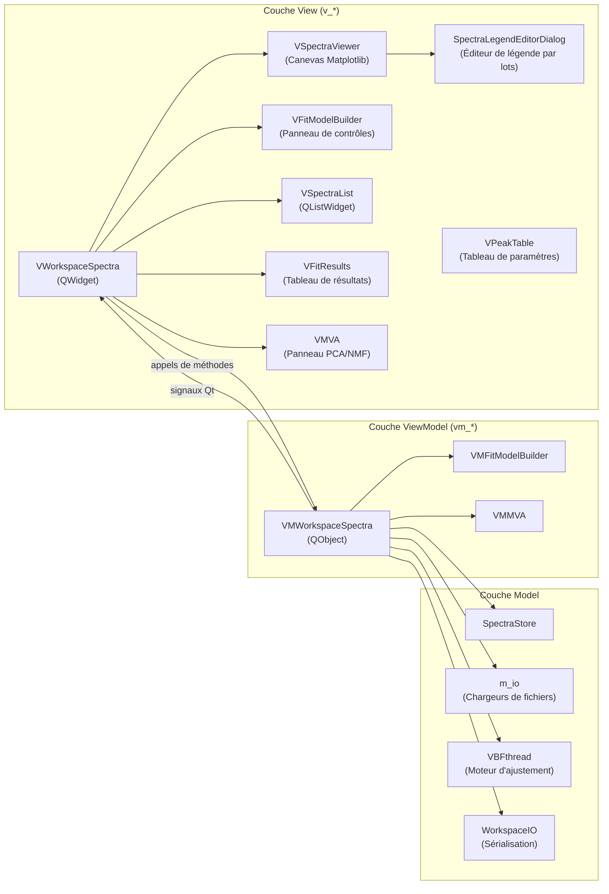
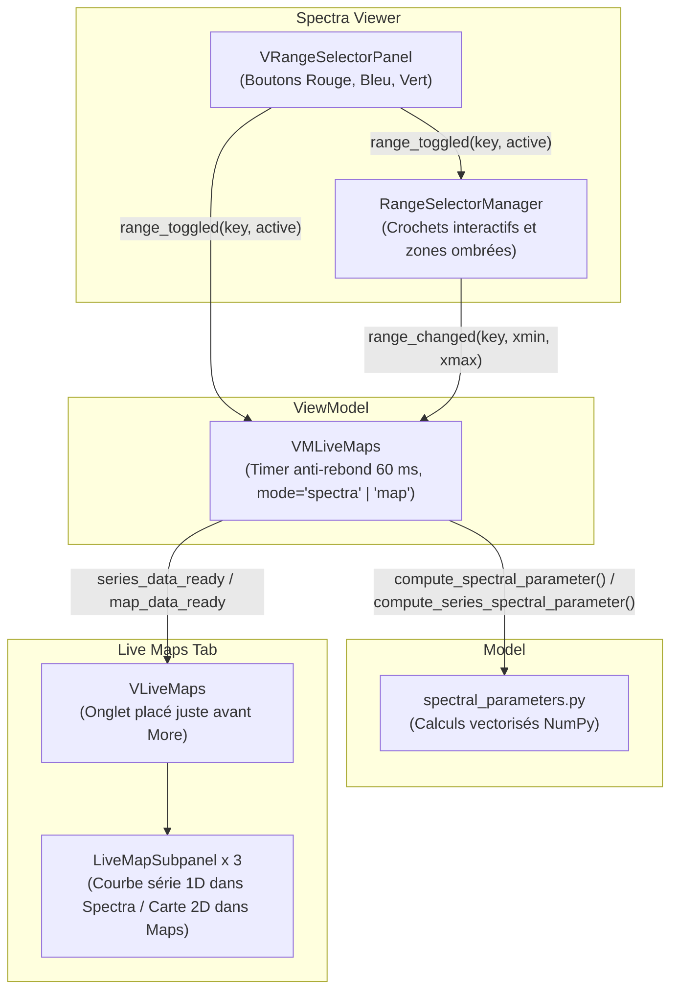

# **Espace de travail : Spectra**

L'espace **`Spectra`** est l'environnement analytique principal pour la gestion de spectres individuels. Il gère le chargement, le prétraitement, la modélisation des pics, l'ajustement et l'exportation des données spectrales. Il sert également de **classe de base** étendue par héritage par l'[espace Maps](maps.md).

> [!NOTE]
> Cette page couvre les couches View et ViewModel propres à `Spectra`. Pour le modèle de données partagé (`SpectraStore`, `MapData`, `MapInfo`, proxies), consultez la page dédiée [Architecture de données : SpectraStore](spectra_store.md).

---

## Vue d'ensemble de l'architecture

Cet espace respecte une séparation **MVVM** (Model-View-ViewModel) stricte. Aucune couche ne doit franchir sa frontière dans le mauvais sens.



### Responsabilités des composants

| Couche | Classe | Responsabilité |
|--------|--------|----------------|
| **View** | `VWorkspaceSpectra` | Assemble les widgets UI, connecte les signaux/slots, délègue toute logique au ViewModel |
| **View** | `VSpectraViewer` | Canevas Matplotlib — affiche spectres 1D, lignes de base, pics, meilleur ajustement, résidus, cartes thermiques 2D, vues 3D interactives et sélecteurs de plage |
| **View** | `VRangeSelectorPanel` | Panneau vertical à droite doté des boutons rouge, bleu et vert pour les intervalles spectraux |
| **View** | `RangeSelectorManager` | Surcouche sur canevas gérant les crochets déplaçables et bandes ombrées des sélecteurs actifs |
| **View** | `VLiveMaps` | Onglet Live Maps hébergeant trois sous-panneaux synchronisés (Red, Blue, Green) |
| **View** | `SpectraLegendEditorDialog` | Éditeur transactionnel de palette, limite de légende, libellés et couleurs pour les spectres sélectionnés |
| **View** | `VFitModelBuilder` | Panneau de correction X, plage spectrale, ligne de base, pics et contrôles d'ajustement |
| **View** | `VPeakTable` | Tableau éditable des paramètres de pics avec sélecteurs de profil par ligne |
| **View** | `VSpectraList` | Liste à cases à cocher avec codes couleur, réorganisation par glisser-déposer et sélection multiple |
| **ViewModel** | `VMWorkspaceSpectra` | Logique métier : orchestre chargement, prétraitement, ajustement et persistance |
| **ViewModel** | `VMLiveMaps` | Calcule les tableaux spatiaux 2D à partir de `MapData` lors des mises à jour d'intervalle ou de paramètre |
| **Model** | `spectral_parameters` | Calculs vectorisés pour intensités intégrée/moyenne/maximale, position, hauteur et aire de pic |
| **Model** | `SpectraStore` | Magasin tensoriel en mémoire — voir [spectra_store.md](spectra_store.md) |
| **Model** | `VBFthread` | `QThread` exécutant le moteur d'ajustement vectorisé par lots hors du thread principal |

### Comment Spectra utilise `MapData`

Dans l'espace Spectra, chaque spectre chargé est stocké comme un bloc `MapData` indépendant avec **N=1** (une seule ligne). Chaque bloc dispose de son propre axe X, autorisant la coexistence de spectres aux plages spectrales différentes. Voir [Hiérarchie des données](spectra_store.md#hierarchie-des-donnees) pour l'agencement tensoriel complet.

---

## Composants de l'espace de travail

### `VWorkspaceSpectra` — Le coordinateur View

**Fichier** : [`v_workspace_spectra.py`](https://github.com/CEA-MetroCarac/SPECTROview/blob/main/spectroview/view/workspaces/v_workspace_spectra.py)

`VWorkspaceSpectra` est une classe pure d'assemblage d'interface :

1. Instancie tous les widgets enfants et le ViewModel dans `__init__`.
2. Câble chaque connexion signal/slot dans `setup_connections()`.
3. Délègue toute action utilisateur au ViewModel (ne manipule jamais les données directement).
4. Met à jour l'interface en réponse aux signaux du ViewModel.

La mise en page repose sur un séparateur horizontal : **à gauche** (`SpectraViewer` en haut, onglets de contrôle en bas) et **à droite** (barre latérale de la liste des spectres).

**Patron clé — Actions modifiées par `Ctrl` :**

```python
def _apply_with_ctrl(self, fn):
    apply_all = bool(QApplication.keyboardModifiers() & Qt.ControlModifier)
    fn(apply_all)

# Utilisation :
self.btn_reinit.clicked.connect(lambda: self._apply_with_ctrl(vm.reinit_spectra))
```

Toutes les actions globales (soustraction de ligne de base, collage de pics, réinitialisation, ajustement) suivent ce patron. Un clic normal s'applique aux spectres sélectionnés ; un `Ctrl+Click` s'applique à tous les spectres du magasin.

### `VSpectraViewer` — Mode carte thermique 2D (`Heatmap`)

**Paquet** : [`spectra_viewer/`](https://github.com/CEA-MetroCarac/SPECTROview/blob/main/spectroview/view/components/spectra_viewer/__init__.py) (`v_plot_heatmap.py`)

`VSpectraViewer` est le widget central de tracé spectral. En plus de l'affichage multi-courbes 1D, il intègre un **mode carte thermique 2D** natif (`btn_heatmap`, placé avec `btn_3d` à droite de la barre d'outils juste à gauche de `btn_options` / `btn_copy`) destiné aux séries (profils en température, cinétiques, balayages linéaires) :

- **Alignement des données et interpolation sur grilles irrégulières** : Lorsque les spectres sélectionnés ont des grilles de nombres d'onde différentes, `_plot_heatmap()` aligne toutes les lignes sur une plage commune via `scipy.interpolate.interp1d`.
- **Extraction de jetons d'axe Y** : Analyse automatiquement les paramètres numériques encodés dans les noms de fichiers (par exemple `_100C_`, `_250K_`) par expressions régulières, ou se rabat sur l'indexation séquentielle (`0..N-1`).
- **Interpolation verticale lissée** : Prend en charge l'interpolation 1D cubique/linéaire selon l'axe vertical lorsque `spin_heatmap_interp > 0` (300 points par défaut).
- **Adaptation dynamique de la barre d'outils** : Activer le mode Heatmap bascule l'état de la barre : les outils 1D standard (`btn_peak`, `btn_baseline`, `btn_eraser`, `btn_norm`, `btn_bestfit` et `shift_panel`) sont masqués via `setVisible(False)`, tandis que les contrôles dédiés (`cbb_heatmap_yaxis`, `le_heatmap_ylabel`, `spin_heatmap_interp`) apparaissent. Décocher ce mode restaure immédiatement les outils 1D.

### `VSpectraViewer` — Mode vue 3D interactive (`3D View`)

`VSpectraViewer` propose une **vue 3D** interactive (`btn_3d`, `_3d_mode`) construite directement sur `mpl_toolkits.mplot3d.Axes3D` de Matplotlib (`_plot_3d()`), sans aucune dépendance externe supplémentaire et partageant le style `PLOT_POLICY_LIGHT`/`PLOT_POLICY_DARK`, l'export presse-papiers et la synchronisation des options (`view_3d` dans `get_options_state()`/`set_options_state()`) :

- **Bascule de projection et nettoyage des callbacks (`_ensure_axes_projection`)** : Ne bascule `self.ax` entre axes rectilignes 2D et `Axes3D` que lors de l'entrée ou de la sortie du mode 3D, en déconnectant les callbacks de canevas `Axes3D` et en désactivant les raccourcis souris 3D avant `figure.delaxes()` afin d'éviter toute accumulation de callbacks.
- **Rendu 3D vectorisé (`FastLine3DCollection`)** : Sous-classe `Line3DCollection` pour projeter en un seul passage vectorisé `proj3d._proj_trans_points()` l'ensemble des points 3D sur des tenseurs uniformes `(N, M, 3)` ou des sélections hétérogènes `tensor_list`, puis met à jour `Path._vertices` sur place lors de la rotation caméra interactive, en gérant les styles `"line"` et `"dot"`, la normalisation, les tracés bruts, les courbes d'ajustement, l'échelle logarithmique Z et les modes légende/barre de couleur.
- **Rotation souris et exclusivité de mode (`_sync_mode_toolbar_state`)** : `btn_3d` et `btn_heatmap` sont mutuellement exclusifs. Activer la vue 3D désactive automatiquement le zoom 2D `NoDoubleClickZoomToolbar` (`_set_zoom_tool_active(False)`), masque les outils 1D incompatibles (`btn_zoom`, `btn_peak`, `btn_baseline`, `btn_eraser`, `shift_panel`) et partage `cbb_heatmap_yaxis` / `le_heatmap_ylabel` pour positionner l'axe Y à partir des jetons de noms de fichiers : glisser-gauche pivote `(elev, azim)`, glisser-milieu déplace, glisser-droit ou molette met Z à l'échelle, et `Rescale` (`Ctrl+R`) rétablit l'angle par défaut (`25°`, `-60°`) et les bornes des données.

### Cartographie spectrale interactive et `Live Maps`

Le sous-système de cartographie spectrale interactive permet de sélectionner jusqu'à trois plages spectrales indépendantes sur le visualiseur 1D et de suivre en temps réel l'évolution des paramètres :

- **Espace `Spectra` (`mode="spectra"`)** : Affiche jusqu'à trois courbes d'évolution 1D codées par couleur (Rouge, Bleu, Vert) (`Spectrum #` en fonction de la valeur du paramètre) sur l'ensemble des **spectres actuellement sélectionnés** dans `VSpectraList`.
- **Espace `Maps` (`mode="map"`)** : S'adapte automatiquement à la dimensionnalité de la carte sélectionnée : affiche des cartes thermiques spatiales 2D pour les cartes 2D, ou des courbes 1D le long de la coordonnée spatiale (`X (mm)`, `Y (mm)` ou `Distance (mm)`) pour les cartes de profil 1D (balayages linéaires).
- **Rapport Rouge/Bleu (`R/B ratio`)** : Disponible dans le sous-panneau du canal Vert pour les deux espaces ; calcule élément par élément le rapport des intensités intégrées $I_{\mathrm{Red}} / I_{\mathrm{Blue}}$ avec masquage `NaN` pour les intensités Bleues nulles ou quasi nulles, et se met à jour dès le déplacement des bornes Rouge ou Bleu. Tant que `R/B ratio` est sélectionné, le crochet Vert est masqué dans `VSpectraViewer` afin de n'afficher que les bornes Rouge et Bleu pilotant ce rapport.



- **`VRangeSelectorPanel` & `SpectraRangeBracketMixin`** ([`rgb_live_maps/v_range_selector.py`](https://github.com/CEA-MetroCarac/SPECTROview/blob/main/spectroview/view/components/rgb_live_maps/v_range_selector.py), [`v_range_bracket_mixin.py`](https://github.com/CEA-MetroCarac/SPECTROview/blob/main/spectroview/view/components/rgb_live_maps/v_range_bracket_mixin.py)) : `VRangeSelectorPanel` est positionné comme panneau vertical sur le bord droit de `VSpectraViewer` avec des boutons à bascule Rouge (`#e74c3c`), Bleu (`#3498db`) et Vert (`#2ecc71`). `SpectraRangeBracketMixin` relie directement à `VSpectraViewer` le panneau, l'initialisation/bornage des intervalles, le retour visuel du curseur au survol et le *blitting* d'arrière-plan Agg.
- **`RangeSelectorManager`** : Gère les lignes de bornes verticales interactives, les annotations en crochet rentrant et les bandes transparentes de chaque sélecteur, en réutilisant les artistes Matplotlib existants lors du déplacement avec `set_animated(True)` / `active_artists()`. Suit le paramètre de chaque canal via `set_parameter()` / `is_bracket_visible()`, masquant et désactivant la détection souris du crochet Vert lorsque son panneau Live Maps affiche `R/B ratio` (et le rétablissant aussitôt pour tout autre paramètre). Le déplacement d'une ligne ou du corps central s'appuie sur le *blitting* Agg (suspension temporaire de `layout_engine`, contournement du survol des pics pendant le glisser et bornage horizontal dans les axes) et émet `range_drag_finished` au relâchement. La détection utilise une tolérance en pixels avec conversion par transformations Matplotlib.
- **`VMLiveMaps`** : Détient les intervalles des sélecteurs, les choix de paramètres, les palettes et le `mode` (`"spectra"` ou `"map"`). Utilise un temporisateur adaptatif anti-rebond (60 ms de base, montant jusqu'à 250 ms sur de très grandes cartes) durant le déplacement continu, vide les mises à jour en attente au relâchement via `flush_pending()`, et déporte automatiquement les lots de `>= 25 000` spectres (`ASYNC_SPECTRUM_THRESHOLD`) vers un `QRunnable` sur `QThreadPool` (`_LiveMapWorker`) protégé par un `_generation_id` monotone d'annulation des tâches périmées et une fermeture propre `shutdown()`. En mode `"spectra"`, `set_series_data(mds)` préserve les positions de crochets ajustées lors d'un changement de sélection tant qu'elles restent dans les bornes, émet `spatial_sites_changed(None)` puis `series_data_ready`. En mode `"map"`, `set_map_datas(mds, primary_name)` déduplique les signatures, maintient un cache LRU basé sur `MapData.data_version`, exclut les spectres inactifs (`~is_active`), met en cache la géométrie régulière ou `Delaunay` `MapGridder`, émet `spatial_sites_changed` avec les coordonnées actives ordonnées et émet selon le cas `map_data_ready`, `profile_data_ready`, `multi_profile_data_ready`, `map_2d_candidates_changed` ou `live_maps_cleared`. Les deux espaces suspendent le calcul tant que l'onglet Live Maps est masqué (`_live_maps_dirty`) et ne le déclenchent qu'à l'ouverture de l'onglet.
- **`spectral_parameters.py`** : Évaluation vectorisée au niveau modèle via `compute_spectral_parameter()` (découpage avant transtypage sur `MapData.y_matrix[:, mask]` avec `active_mask` optionnel), `compute_series_spectral_parameter()` sur une liste de `MapData`, détection de dimensionnalité via `analyze_map_geometry()`, maillage réutilisable régulier/barycentrique `Delaunay` via `build_map_gridder()` + `compute_map_grid()`, et rapport sécurisé élément par élément avec masquage `NaN` via `compute_intensity_ratio()`. Calcule :
  - *Directs* : `Integrated intensity`, `Mean intensity`, `Maximum intensity`, `Peak position`, `Peak height` (soustraite de la ligne de base locale).
  - *Dérivé (canal Vert)* : `R/B ratio` ($I_{\mathrm{Red}} / I_{\mathrm{Blue}}$).
  - *Ajustés* : `Peak position (fit)`, `Peak height (fit)`, `Peak area (fit)` à partir des paramètres de pics ajustés lorsque disponibles.
- **`VLiveMaps` & `LiveMapSubpanel`** ([`rgb_live_maps/`](https://github.com/CEA-MetroCarac/SPECTROview/blob/main/spectroview/view/components/rgb_live_maps/__init__.py)) : Onglet `QWidget` inséré dans `bottom_tabs` (entre `Fit Results` et `MVA`, `More` étant placé en fin de barre). Héberge une rangée supérieure combinant une zone contextuelle à gauche (`[◀ | ComboBox | ▶]` sélecteur de carte 2D et messages de diagnostic, masquée lorsqu'inutilisée) et à droite **Show Legend** ainsi que le menu compact à 2 colonnes **More view options** (`btn_legend`, `btn_options`, marges `(2, 2, 2, 2)` alignées sur `VSpectraViewer`), plus 3 sous-panneaux indépendants (`LiveMapSubpanel` dans `v_live_map_subpanel.py`, base 96 DPI) dotés de boutons **Rescale**, **Pan** et **Zoom** synchronisés à `NoDoubleClickZoomToolbar` (tout en conservant l'édition par double-clic de la légende), la copie presse-papiers à dimensions fixes (`Copied figure size` `5.5 × 4.0` in par défaut et `Copied figure theme`), et la copie TSV des données via `Ctrl + Click` (`copy_data_requested(color_id)` / `copy_df_to_clb()`). En `mode="map"`, `LiveMapSubpanel` réutilise les helpers partagés de [`map_selection.py`](https://github.com/CEA-MetroCarac/SPECTROview/blob/main/spectroview/view/components/map_viewer/map_selection.py) (`MapCanvasSelector`, `resolve_xy_selection()`, `resolve_1d_profile_selection()`) pour la sélection par clic, `Ctrl+Click` et rectangle sur les sous-panneaux R/V/B lorsque Pan/Zoom et légendes ne sont pas actifs (émettant `VLiveMaps.spectra_selected` vers `VWorkspaceMaps`), tout en gardant cette sélection désactivée en `mode="spectra"`. Les options par défaut (`plot_theme="Light Mode"`, `plot_style="line"`, `line_width=1.5`, `dot_size=1.5`, `show_figure_label=False`, `show_grid=False`) sont persistées dans `MSettings` (`live_maps_view_options/*`), synchronisées entre Spectra et Maps, et optimisées via `apply_view_options_fast()`, des styles `mplstyle` en cache `@lru_cache` (`_get_cached_style_dict`), un gel de mise en page stabilisée (`_on_canvas_draw`) et des timers de redessin coalescés de 35 ms parentés, avec éditeur de légende [`v_live_maps_legend_editor.py`](https://github.com/CEA-MetroCarac/SPECTROview/blob/main/spectroview/view/components/rgb_live_maps/v_live_maps_legend_editor.py).
- **Coordination Zoom et Plages** : Lorsqu'un sélecteur de plage est activé, `btn_zoom` est automatiquement désactivé afin de permettre le réglage des crochets sans déclencher de zoom, et `VWorkspaceSpectra._on_range_selector_toggled()` bascule automatiquement `bottom_tabs` sur `self.v_live_maps` (en vidant tout `_live_maps_dirty` en attente avant calcul ; désactiver un sélecteur laisse l'onglet actif inchangé). Tant que Zoom reste activé manuellement ensuite, cliquer dans la zone ombrée réalise un zoom plutôt qu'un déplacement d'intervalle.

### `VMWorkspaceSpectra` — Le ViewModel

**Fichier** : [`vm_workspace_spectra.py`](https://github.com/CEA-MetroCarac/SPECTROview/blob/main/spectroview/viewmodel/spectra/vm_workspace_spectra.py) (composé avec `vm_spectra_preprocessing.py`, `vm_spectra_fitting.py`, `vm_spectra_results.py` et `vm_spectra_persistence.py`)

Il s'agit de la classe la plus volumineuse et centrale de l'application. Elle possède le `SpectraStore` et orchestre chaque opération.

#### Signaux (ViewModel → View)

```python
spectra_list_changed      = Signal(list)          # list[dict] — rafraîchit la liste des spectres
spectra_selection_changed = Signal(object)        # dict pour VSpectraViewer
count_changed             = Signal(int)           # libellé du nombre total de spectres
show_xcorrection_value    = Signal(float)         # synchronise le champ de correction X
spectral_range_changed    = Signal(float, float)  # synchronise les bornes de plage
fit_in_progress           = Signal(bool)          # active/désactive les boutons d'ajustement
fit_progress_updated      = Signal(int, int, int, float, int)  # barre de progression
fit_results_updated       = Signal(object)        # pd.DataFrame → tableau de résultats
notify                    = Signal(str)           # message de notification flottante
send_df_to_graphs         = Signal(str, object)   # transmet un DataFrame à Graphs
```

#### Référence des méthodes

| Catégorie | Méthodes |
|-----------|----------|
| **Chargement** | `load_files(paths)` |
| **Sélection** | `set_selected_fnames()`, `set_selected_indices()`, `_get_selected_spectra()`, `_get_active_spectra()` |
| **Prétraitement** | `apply_spectral_range()`, `apply_x_correction()`, `undo_x_correction()`, `apply_y_normalization()` |
| **Ligne de base** | `set_baseline_settings()`, `preview_baseline()`, `add_baseline_point()`, `remove_baseline_point()`, `subtract_baseline()`, `delete_baseline()`, `copy_baseline()`, `paste_baseline()` |
| **Pics** | `add_peak_at()`, `remove_peak_at()`, `update_peak_label()`, `update_peak_model()`, `update_peak_param()`, `delete_peak()`, `copy_peaks()`, `paste_peaks()`, `delete_peaks()` |
| **Ajustement** | `fit()`, `stop_fit()`, `_run_fit_thread()`, `_on_fit_finished()` |
| **Résultats** | `collect_fit_results()`, `save_fit_results()`, `split_filename()`, `add_column_from_filename()`, `compute_column_from_expression()` |
| **Modèle d'ajustement** | `copy_fit_model()`, `paste_fit_model()`, `save_fit_model()`, `apply_fit_model()` |
| **Espace de travail** | `reinit_spectra()`, `remove_selected_spectra()`, `reorder_spectra()`, `clear_workspace()` |
| **Persistance** | `save_work()`, `load_work()`, `_load_legacy_spectra()` |
| **Affichage** | `save_spectra_data()`, `copy_spectrum_data_to_clipboard()` |

#### Méthodes modèles (Template Method)

Le ViewModel emploie le **patron Template Method** afin de permettre à la [sous-classe Maps](maps.md#surcharges-de-methodes-modeles) de personnaliser les opérations globales sans dupliquer la logique :

```python
def _get_target_mds(self, apply_all: bool) -> list[MapData]:
    """Quels blocs MapData cibler."""
    # Espace Spectra : spectres sélectionnés → leurs objets MapData
    # Espace Maps (surcharge) : carte active, ou toutes les cartes

def _on_map_data_changed(self, md: MapData, action: str):
    """Hook appelé après modification de chaque MapData individuel."""
    # Espace Spectra : sans effet
    # Espace Maps (surcharge) : vide le cache de carte thermique, relance batch_preprocess

def _post_bulk_action(self, apply_all: bool, action: str):
    """Hook appelé après traitement de tous les MapData ciblés."""
    # Espace Spectra : ré-émet liste et sélection
    # Espace Maps (surcharge) : rafraîchit aussi les résultats et la vue de carte
```

### `VSpectraViewer` — Le canevas de tracé

**Paquet** : [`spectra_viewer/`](https://github.com/CEA-MetroCarac/SPECTROview/blob/main/spectroview/view/components/spectra_viewer/__init__.py) (`v_spectra_viewer.py`, `v_spectra_options.py`, `v_plot_1d.py`, `v_plot_heatmap.py`, `v_plot_3d.py`, `v_interactions.py`, `v_spectra_legend_editor.py`, `common.py`)

`VSpectraViewer` compose des mixins spécialisés par-dessus `QWidget` (`SpectraOptionsMenuMixin`, `SpectraPlot1DMixin`, `SpectraHeatmapMixin`, `SpectraPlot3DMixin`, `SpectraLegendMixin`, `SpectraInteractionMixin` et `SpectraRangeBracketMixin`), séparant le menu d'options à 2 colonnes et sa synchronisation, le rendu 1D/heatmap/3D, les interactions souris/pics/gomme et la gestion des légendes/barres de couleur tout en factorisant les utilitaires dans `common.py`.

Le canevas Matplotlib dessine tout ce qui apparaît dans le graphique spectral à partir du dictionnaire émis par `VMWorkspaceSpectra.spectra_selection_changed`.

**Éléments affichés :**

| Élément | Clé de données source |
|---------|-----------------------|
| Courbes spectrales | `data["y"]` (traitées) |
| Superposition brute (optionnelle) | `data["y0"]` (brutes) |
| Courbe de ligne de base | `data["y_baseline"]` |
| Points d'ancrage de ligne de base | `data["baseline_config"]["points"]` |
| Courbes individuelles des pics | `data["y_peaks"]` (liste de tableaux) |
| Enveloppe du meilleur ajustement | `data["y_bestfit"]` |
| Résidus | `data["y"] - data["y_bestfit"]` |
| Annotation R² | `data["fit_r2"][0]` |

**Modes d'interaction (boutons radio exclusifs) :**

| Mode | Clic gauche | Clic droit |
|------|-------------|------------|
| **Zoom** | Zoom/pan Matplotlib standard | — |
| **Baseline** | Ajoute un point d'ancrage en x | Supprime le point d'ancrage le plus proche |
| **Peak** | Ajoute un pic en x | Supprime le pic le plus proche |

Les pics peuvent aussi être déplacés à la souris. Le visualiseur émet `peak_dragged(x, y)` pendant le déplacement puis `peak_drag_finished()` au relâchement, ce que le ViewModel traduit par `update_dragged_peak()` + `finalize_peak_drag()`.

#### Édition de légende par lots

`VSpectraViewer` met en cache l'emprise globale de la légende après chaque rendu. Un double-clic n'importe où dans cette zone ouvre `SpectraLegendEditorDialog` depuis `spectra_viewer/v_spectra_legend_editor.py` ; les poignées et libellés individuels n'ouvrent plus de dialogues séparés.

La fenêtre est transactionnelle : sélecteur de palette, limite d'entrées, champs de libellés et sélecteurs de couleur conservent des valeurs temporaires jusqu'à validation. **Cancel** ne provoque donc aucune mutation. Lors de **OK**, `VSpectraViewer._apply_legend_editor_values()` :

1. Met à jour les options partagées `color_palette` et `max_legend_items`.
2. Écrit les libellés modifiés et couleurs explicites dans la charge utile tensorielle courante.
3. Propage ces valeurs via chaque `SpectrumProxy` dans `MapData.labels` et `MapData.colors`.
4. Émet `spectrumCustomized`, amenant le ViewModel à reconstruire la charge de sélection et rafraîchir la liste des spectres.

La valeur `None` représente **Automatic** et est résolue depuis la palette active au rendu. Les couleurs explicites par spectre restent prioritaires lors des changements de palette. Les palettes continues sont échantillonnées sur l'ensemble de la sélection ; l'éditeur propose un sous-ensemble borné de nuances représentatives.

Les deux espaces imposent `LEGEND_EDITOR_MAX_ROWS = 100`. Seules ces 100 lignes sont instanciées afin d'éviter la création de milliers de widgets Qt sur de grandes sélections. La boîte reçoit le compte total afin que les aperçus de dégradés restent fidèles aux positions tracées, et les spectres hors du lot courant demeurent inchangés.

#### Synchronisation et persistance des options d'affichage

Le menu View Options et la barre inférieure exposent les réglages d'affichage dans un panneau compact à 2 colonnes (`QWidgetAction`), synchronisé entre espaces et persisté entre sessions :

- **Plot Theme (`cbb_theme`)** : Configure le thème du canevas Matplotlib (`"Dark Mode"` ou `"Light Mode"`), synchronisé entre l'espace Spectra, l'espace Maps et les fenêtres détachables de visualisation 2D. Par défaut toujours fixé à `"Light Mode"` tant que l'utilisateur ne bascule pas explicitement vers `"Dark Mode"`. Totalement indépendant du thème global de l'interface Qt, et persisté sous `view_options/theme`.
- **Placement et déport de la légende (`act_legend_outside`)** : Lorsqu'activé, `VSpectraViewer` place la légende à l'extérieur des axes principaux via `loc="center left"` et `bbox_to_anchor=(1.02, 0.5)`. La mise en page `compressed` ajuste dynamiquement les marges pour que la légende s'insère sans recouvrir les spectres. Synchronisé entre Spectra et Maps et persisté sous `view_options/legend_outside`. La zone de double-clic actualise dynamiquement les emprises depuis l'artiste légende.
- **Mode barre de couleur (`act_legend_colorbar`, `cbb_colorbar_param`, `le_colorbar_label`)** : Lorsqu'il est activé (avec `btn_legend` actif), remplace la légende discrète par une barre de couleur Matplotlib à droite pilotée par l'extracteur partagé de jetons numériques (`_extract_filename_tokens()` / `_extract_series_parameter_values()`, partagé avec le mode Heatmap) ou par `Index`. Les lignes `row_colorbar_param` et `row_colorbar_label` ne s'affichent que si la case est cochée (`_update_colorbar_options_visibility()`). La sélection de paramètre est suivie par position de jeton et motif d'unité normalisé (`_refresh_token_combobox()`), préservant le choix même lors d'un changement de sous-ensemble de spectres. Persisté sous `view_options/legend_colorbar`, `view_options/colorbar_param` et `view_options/colorbar_label`.

#### Optimisations de carte thermique et de traitement du signal

- **Interpolation matricielle vectorisée en carte thermique** : En mode Heatmap 2D, l'interpolation cubique/linéaire sur l'axe Y traite simultanément toute la matrice d'intensités (`scipy.interpolate.interp1d(..., axis=0)`) au lieu de boucler par colonne spectrale, réduisant les temps de rendu de plus de 4× sur les grands lots.
- **Estimation rapide du bruit pour gomme / rayons cosmiques** : Remplacement des régressions polynomiales par fenêtre glissante par l'écart médian absolu des différences premières ($MAD / (0.6745 \sqrt{2})$), offrant une estimation robuste en temps NumPy vectorisé $O(N)$.
- **Pré-filtrage de survol** : `_on_hover` filtre d'abord selon la plage en X afin d'ignorer les calculs `contains(event)` sur les marqueurs hors portée.

### `VFitModelBuilder` — Le panneau de contrôles

**Fichier** : [`v_fit_model_builder.py`](https://github.com/CEA-MetroCarac/SPECTROview/blob/main/spectroview/view/components/lower_tabs/v_fit_model_builder.py)

Panneau à séparateur regroupant toute la surface de prétraitement et de configuration de l'ajustement :

- **Volet gauche** : Correction X, plage spectrale, sélecteur de mode de ligne de base et boutons d'action associés.
- **Volet droit** : `VPeakTable` (lignes éditables de paramètres) + boutons d'ajustement (`Fit`, `Copy model`, `Paste model`, `Save model`, `Apply model`).
- **Chargement de modèles par glisser-déposer** : Accepte le dépôt de fichiers modèles `.json` directement sur le panneau ou l'espace parent. Lors d'un dépôt, `fit_model_dropped(path)` déclenche `load_fit_model_file()`, délégué à `VMFitModelBuilder.load_model_file()`. Le modèle externe est chargé en mémoire, ajouté au menu déroulant et sélectionné, l'onglet `Fit Model Builder` devient actif et une notification flottante s'affiche. Pris en charge dans Spectra comme dans Maps.

### `VPeakTable` — Le tableau des paramètres

**Fichier** : [`v_peak_table.py`](https://github.com/CEA-MetroCarac/SPECTROview/blob/main/spectroview/view/components/lower_tabs/v_peak_table.py)

Tableau interactif où chaque ligne représente un pic. Les colonnes affichent libellé, profil du modèle, centre (x₀), FWHM, amplitude et cases de contraintes. Éditer n'importe quelle cellule émet un signal vers `VMWorkspaceSpectra`, qui met à jour `md.fit_model` et reconstruit immédiatement l'aperçu `Y_peaks`.

---

## Flux de données

### Chargement des spectres

1. **Action utilisateur** : L'utilisateur glisse-dépose des fichiers dans l'interface `VWorkspaceSpectra`.
2. **View → ViewModel** : La View appelle `vm.load_files(paths)`.
3. **Analyse de fichier** : Pour chaque fichier, le ViewModel délègue à `m_io` (`load_spectrum_file`, `load_wdf_spectrum`, etc.), qui renvoie les tableaux bruts (`x0`, `y0`) et les métadonnées.
4. **Stockage** : Le ViewModel enregistre les données dans `SpectraStore` via `add_map(name, x0, Y0, coords, fnames)`. Un nouveau bloc `MapData` est créé avec `x` et `Y` à `None` (données brutes uniquement).
5. **Mise à jour UI** : Le ViewModel émet `spectra_list_changed`. La View l'intercepte et actualise la barre latérale `VSpectraList`.

Le module `m_io` détecte automatiquement le format à partir du fichier. Chaque chargeur retourne un dictionnaire uniforme :

```python
{
    "type": "spectra",
    "items": [
        {"name": str, "x0": ndarray, "y0": ndarray, "metadata": dict},
        ...
    ]
}
```

Les fichiers WDF peuvent retourner plusieurs éléments (séries temporelles) ; chacun est enregistré comme un bloc `MapData` distinct.

### Sélection des spectres

1. **Action utilisateur** : L'utilisateur clique sur un spectre dans `VSpectraList`.
2. **View → ViewModel** : Le widget émet un signal de sélection qui appelle `vm.set_selected_indices()`.
3. **Mise à jour d'état** : Le ViewModel résout les indices en `fnames` uniques et mémorise la sélection active.
4. **Construction de la charge utile** : Le ViewModel appelle `_emit_selected_spectra()`, qui interroge `SpectraStore` pour bâtir une charge `"type": "tensor_list"` contenant les tableaux de tous les spectres sélectionnés.
5. **Mise à jour UI** : Le ViewModel émet `spectra_selection_changed(data_dict)`. `VSpectraViewer` appelle `set_plot_data()` et redessine le canevas Matplotlib.

La charge utile (`data_dict`) contient des tableaux pré-extraits indexés par `"type": "tensor_list"` pour Spectra (liste de tableaux indépendants, chacun pouvant posséder un axe X propre). L'espace Maps [surcharge ce comportement](maps.md#surcharge-de-_emit_selected_spectra) pour émettre `"type": "tensor"` (matrice à axe X partagé).

### Flux d'ajustement

1. **Action utilisateur** : L'utilisateur clique sur « Fit » dans `VFitModelBuilder`.
2. **Construction des tâches** : Le ViewModel prépare une liste de tâches (une par carte/spectre) contenant `indices` et le dictionnaire `fit_model`.
3. **Lancement du thread** : Le ViewModel instancie `VBFthread(store, tasks)` et le démarre. Les boutons sont désactivés via `fit_in_progress(True)`.
4. **Exécution moteur (arrière-plan)** : Pour chaque tâche, le thread appelle `VBFengine.fit_spectra(x, Y_sub, fit_model, weights)`.
5. **Écriture des résultats (arrière-plan)** : Au fil de l'exécution, le thread écrit directement les résultats dans `SpectraStore` via `set_fit_results()` et renseigne `Y_bestfit` et `Y_peaks` sur `MapData`.
6. **Avancement** : Le thread émet les signaux d'avancement que le ViewModel relaie à la barre de progression.
7. **Achèvement** : Le thread émet `finished()`. Le ViewModel exécute `_on_fit_finished()`, réactive l'interface et déclenche un rafraîchissement du tracé.

> [!NOTE]
> `VBFthread` appelle `store.set_fit_results()` directement depuis le thread de travail. Cela est sûr car PySide6 autorise l'écriture vers des objets Python/NumPy purs hors du thread GUI tant qu'aucune opération sur widget Qt n'intervient. Le signal `finished()` déclenche ensuite les mises à jour d'interface sur le thread principal.

### Flux de ligne de base

1. L'utilisateur choisit le mode dans `VFitModelBuilder` → `set_baseline_settings()` enregistre la configuration dans `md.baseline_config`.
2. L'utilisateur clique sur le spectre → `add_baseline_point(x)` ajoute un point d'ancrage dans `md.baseline_config["points"]`.
3. `preview_baseline()` évalue et stocke `md.Y_baseline` pour l'affichage (sans soustraire).
4. `subtract_baseline()` exécute `batch_preprocess()` sur la carte — soustrait `Y_baseline` de `Y` et positionne `md.is_baseline_subtracted = True`.
5. `delete_baseline()` restaure `Y` en appelant `batch_preprocess()` avec une configuration vide (recadrage seul) et réinitialise `is_baseline_subtracted`.

### Flux d'édition des pics

1. L'utilisateur clique en mode pic sur le visualiseur → `VSpectraViewer.peak_add_requested(x)` → `add_peak_at(x)`.
2. Le ViewModel lit l'ordonnée en x dans `md.Y[spec_idx, idx]`, initialise le dictionnaire `peak_model` avec estimation automatique de `x0`, `ampli`, `fwhm` et `bounds`.
3. Le dictionnaire du pic est ajouté à `md.fit_model["peak_models"]` sous la prochaine clé entière.
4. `eval_peak_initial()` évalue la courbe du modèle et l'ajoute à `md.Y_peaks`.
5. `_emit_selected_spectra()` redessine le visualiseur, affichant instantanément la nouvelle courbe de pic.

### Collecte des résultats d'ajustement

```python
# VMWorkspaceSpectra.collect_fit_results()
#   → SpectraStore.build_fit_results_df()
#   → retourne un pd.DataFrame de colonnes :
#      Filename, [x0_Peak1, fwhm_Peak1, ampli_Peak1, area_Peak1, ...], R2
```

`build_fit_results_df()` est entièrement vectorisée — elle lit `md.peak_params` directement (sans boucle Python sur les spectres), applique les libellés personnalisés des pics, calcule les colonnes d'aire, ajoute la colonne **`R2`** par spectre (coefficient de détermination lu directement depuis `md.fit_r2` — la même valeur que celle affichée dans `SpectraViewer`), et renvoie un `pd.DataFrame`. `R2` étant un scalaire par spectre (non rattaché à un pic), le tri des colonnes dans `collect_fit_results()` le place en dernière position. Dans Spectra, les colonnes `X` et `Y` sont retirées avant l'envoi au tableau de résultats.

La **précision décimale** est fixée par `build_fit_results_df(..., decimals=…)`, qui arrondit chaque colonne numérique issue de l'ajustement (paramètres, aires, R²) tout en laissant `X`/`Y` à précision maximale — c'est l'unique point faisant autorité pour l'arrondi. `VMWorkspaceSpectra.results_decimals` (3 par défaut) fournit cette valeur ; le champ *"Fit results decimals"* en haut de l'onglet **Fit Results** la met à jour via `set_results_decimals()` (appliqué au prochain `Collect`). `compute_column_from_expression()` arrondit sa colonne calculée selon la même valeur `results_decimals`. L'API publique `build_fit_results_df` conserve sa valeur par défaut propre de 4.

---

## Persistance

### Format moderne (v2+, basé sur ZIP)

Les fichiers d'espace de travail (`.spectra`) reposent sur le format ZIP décrit dans [SpectraStore : Persistance](spectra_store.md#persistance). `metadata.json` stocke la configuration par spectre et `arrays.npz` les tableaux numériques lourds.

### Chargeur historique

`_load_legacy_spectra()` gère les anciens fichiers `.spectra` (JSON brut contenant des tableaux compressés en base64+zlib) :

1. Décode et décompresse les tableaux `x0`/`y0`.
2. Reconstruit `baseline_config` et évalue `md.Y_baseline`.
3. Ré-évalue les courbes de pics pour remplir `md.Y_peaks` et `md.Y_bestfit`.

Aucune migration manuelle n'est requise — le format historique est lu de façon transparente à l'ouverture.

---

## Guide d'extension

### Ajouter un nouvel outil de prétraitement

1. **ViewModel** : Ajoutez une méthode (ex. `apply_smoothing(window, apply_all)`) qui appelle `_get_target_mds(apply_all)`, modifie `md.Y`, puis appelle `_post_bulk_action()`.
2. **Model** (si nécessaire) : Ajoutez la fonction algorithmique dans `fit_engine/baseline.py` ou un nouveau module.
3. **View** : Ajoutez le bouton/contrôle dans `VFitModelBuilder`, émettez un nouveau signal et connectez-le dans `VWorkspaceSpectra.setup_connections()`.
4. **Persistance** : Si l'outil produit un état devant survivre à la sauvegarde, ajoutez-le dans `SpectraStore.to_metadata_dict()` et restaurez-le dans `load_map_from_npz()`.

### Ajouter un nouveau modèle de pic

Consultez le [guide dédié au moteur VBF](vbf_engine.md). En résumé :

1. Ajoutez la fonction du modèle et sa jacobienne analytique dans `fit_engine/models.py`.
2. Enregistrez le nom du modèle dans `spectroview/__init__.py` → `PEAK_MODELS`.
3. Ajoutez la logique d'initialisation dans `VMWorkspaceSpectra._initialize_peak_params()`.
4. `VPeakTable` et `VFitModelBuilder` proposeront automatiquement le nouveau modèle dans leurs listes déroulantes.

### Ajouter une nouvelle fonctionnalité d'affichage au visualiseur

1. Ajoutez la logique de rendu dans `VSpectraViewer.set_plot_data()` ou une méthode privée dédiée.
2. Ajoutez les données nécessaires au dictionnaire émis par `VMWorkspaceSpectra._emit_selected_spectra()`.
3. Si une option UI est nécessaire, ajoutez une `QCheckBox` ou une action de menu dans `VSpectraViewer` et connectez-la au rafraîchissement du tracé.

---

## Dépannage

**Le spectre n'apparaît pas après chargement**

- Vérifiez `md.is_active[0]` — le chargement l'initialise à `True`, mais un échec partiel peut laisser l'entrée incohérente.
- Vérifiez que `_emit_list_update()` est appelé après `store.add_map()`.

**Le tableau des pics reste vide après ajustement**

- `_emit_selected_spectra()` doit être appelé après `_on_fit_finished()`. Vérifiez que `store.set_fit_results()` a bien rempli `md.param_names`.

**R² affiche 0.0 malgré un ajustement réussi**

- Le moteur d'ajustement fixe `rsquared = 0` lorsque `fit_success` vaut `False`. Vérifiez `md.fit_success[idx]` pour le spectre concerné.

**`_emit_selected_spectra()` provoque une boucle de signaux Qt**

- N'appelez jamais `_emit_selected_spectra()` depuis un slot connecté à `spectra_selection_changed`. Utilisez `QTimer.singleShot(0, parent_qobject, ...)` pour différer si besoin.

Pour le dépannage lié au modèle de données (prétraitement non appliqué, gestion mémoire), consultez [SpectraStore : Dépannage](spectra_store.md#depannage).
