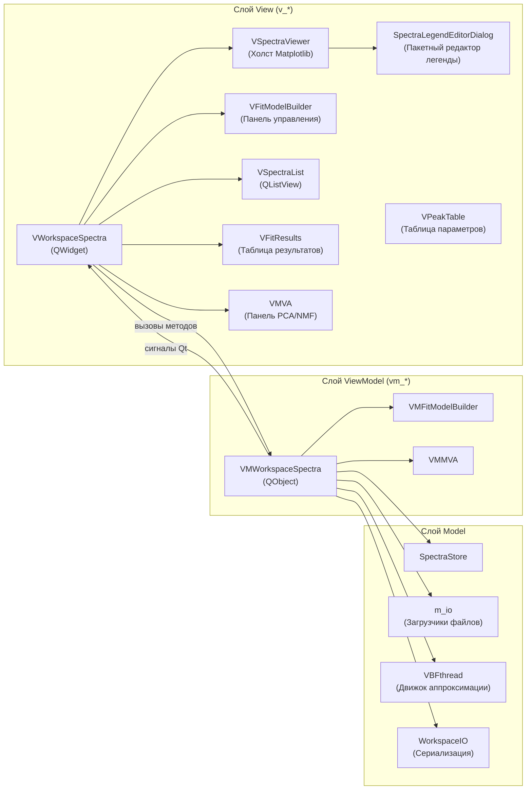
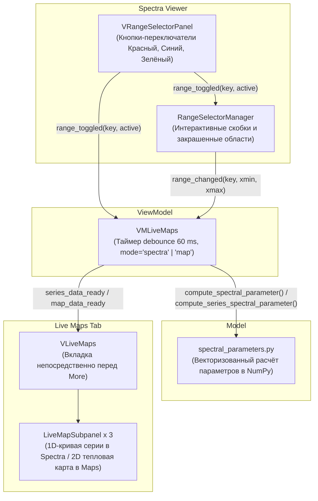

# **Рабочая область: Спектры** { #workspace-spectra }

Рабочая область `Spectra` — это основная аналитическая среда для управления отдельными спектрами. Она отвечает за загрузку, предобработку, моделирование пиков, аппроксимацию и экспорт спектральных данных. Кроме того, она служит **базовым классом**, который [рабочая область «Карты»](maps.md) расширяет посредством наследования.

> [!NOTE]
> На этой странице рассматриваются слои View и ViewModel, специфичные для рабочей области `Spectra`. Описание общей модели данных (`SpectraStore`, `MapData`, `MapInfo`, прокси-объектов) см. на отдельной странице [Архитектура данных: SpectraStore](spectra_store.md).

---

## Обзор архитектуры { #architecture-overview }

Рабочая область строится на строгом разделении **MVVM** (Model-View-ViewModel). Ни один из слоёв не должен пересекать свою границу в обратном направлении.



### Ответственность компонентов { #component-responsibilities }

| Слой | Класс | Назначение |
|------|-------|------------|
| **View** | `VWorkspaceSpectra` | Собирает виджеты пользовательского интерфейса, связывает сигналы/слоты, делегирует всю логику в ViewModel |
| **View** | `VSpectraViewer` | Холст Matplotlib — отрисовывает 1D-спектры, базовые линии, пики, лучшую аппроксимацию, невязки, 2D тепловые карты, интерактивные 3D-виды и селекторы диапазонов |
| **View** | `VRangeSelectorPanel` | Вертикальная правая панель с красной, синей и зелёной кнопками-переключателями для выбора спектральных интервалов |
| **View** | `RangeSelectorManager` | Наложение поверх холста, управляющее перетаскиваемыми скобками-маркерами и закрашенными областями активных селекторов |
| **View** | `VLiveMaps` | Вкладка **Live-карты** (Live Maps), содержащая три синхронизированные подпанели 2D тепловых карт (**Красный** (Red), **Синий** (Blue), **Зелёный** (Green)) |
| **View** | `SpectraLegendEditorDialog` | Транзакционный редактор палитры, ограничения элементов легенды, подписей и цветов для выбранных спектров |
| **View** | `VFitModelBuilder` | Панель управления X-коррекцией, спектральным диапазоном, базовой линией и параметрами аппроксимации |
| **View** | `VPeakTable` | Редактируемая таблица параметров пиков с селекторами модели для каждой строки |
| **View** | `VSpectraList` | Список с флажками, правилами цветового кодирования, перетаскиванием для изменения порядка и множественным выбором |
| **ViewModel** | `VMWorkspaceSpectra` | Бизнес-логика: оркестрирует загрузку, предобработку, аппроксимацию и сохранение состояния |
| **ViewModel** | `VMLiveMaps` | Вычисляет 2D-массивы пространственных параметров из `MapData` при обновлении интервалов селекторов или параметров |
| **Model** | `spectral_parameters` | Векторизованные вычисления интегральной, средней и максимальной интенсивности, а также положения, высоты и площади пиков |
| **Model** | `SpectraStore` | Тензорно-ориентированное хранилище в памяти — см. [spectra_store.md](spectra_store.md) |
| **Model** | `VBFthread` | Поток `QThread`, выполняющий движок векторизованной пакетной аппроксимации вне главного потока |

### Как Spectra использует MapData { #how-spectra-uses-mapdata }

В рабочей области Spectra каждый загруженный спектр хранится как независимый блок `MapData` с **N=1** (одна строка). Каждый блок имеет собственную ось X, что позволяет спектрам с разными диапазонами волновых чисел сосуществовать в одном хранилище. Полная структура тензоров описана в разделе [Иерархия данных](spectra_store.md#data-hierarchy).

---

## Компоненты рабочей области { #workspace-components }

### `VWorkspaceSpectra` — координатор слоя View { #vworkspacespectra-the-view-coordinator }

**Файл**: [`v_workspace_spectra.py`](https://github.com/CEA-MetroCarac/SPECTROview/blob/main/spectroview/view/workspaces/v_workspace_spectra.py)

`VWorkspaceSpectra` — это чистый класс компоновки пользовательского интерфейса. Он:

1. Создаёт экземпляры всех дочерних виджетов и ViewModel в методе `__init__`.
2. Настраивает все соединения сигналов и слотов в методе `setup_connections()`.
3. Делегирует каждое действие пользователя объекту ViewModel (никогда не изменяет данные напрямую).
4. Обновляет интерфейс в ответ на сигналы ViewModel.

Компоновка строится на горизонтальном разделителе: **слева** (`SpectraViewer` сверху, вкладки управления снизу) и **справа** (боковая панель со списком спектров).

**Ключевой паттерн — действия с модификатором `Ctrl`:**

```python
def _apply_with_ctrl(self, fn):
    apply_all = bool(QApplication.keyboardModifiers() & Qt.ControlModifier)
    fn(apply_all)

# Usage:
self.btn_reinit.clicked.connect(lambda: self._apply_with_ctrl(vm.reinit_spectra))
```

Все массовые операции (вычитание базовой линии, вставка пиков, сброс, аппроксимация) следуют этому паттерну. Обычный клик применяется к выбранным спектрам; `Ctrl+Click` применяется ко всем спектрам в хранилище.

### `VSpectraViewer` — режим 2D тепловой карты { #vspectraviewer-2d-heatmap-mode }

**Пакет**: [`spectra_viewer/`](https://github.com/CEA-MetroCarac/SPECTROview/blob/main/spectroview/view/components/spectra_viewer/__init__.py) (`v_plot_heatmap.py`)

`VSpectraViewer` — основной виджет спектрального холста. Помимо многолинейного 1D-отображения спектров, он предоставляет встроенный **режим 2D тепловой карты** (`btn_heatmap`, расположенный рядом с `btn_3d` в правой части панели инструментов непосредственно слева от `btn_options` / `btn_copy`) для визуализации серий данных (например, температурных зависимостей, кинетики, линейных сканов):

- **Выравнивание данных и интерполяция нерегулярных матриц**: когда выбранные спектры имеют отличающиеся или несовпадающие сетки волновых чисел, `_plot_heatmap()` выравнивает все строки на общий спектральный диапазон с помощью `scipy.interpolate.interp1d`.
- **Извлечение числовых токенов оси Y**: автоматически извлекает числовые параметры, закодированные в именах файлов (например, `_100C_`, `_250K_`), с помощью регулярных выражений, либо переходит к порядковой индексации (`0..N-1`).
- **Сглаженная вертикальная интерполяция**: поддерживает 1D кубическую или линейную интерполяцию вдоль вертикальной оси при `spin_heatmap_interp > 0` (по умолчанию 300 точек).
- **Динамическая адаптация панели инструментов**: включение режима тепловой карты переключает состояние панели: стандартные 1D-инструменты (`btn_peak`, `btn_baseline`, `btn_eraser`, `btn_norm`, `btn_bestfit` и `shift_panel`) скрываются через `setVisible(False)`, а элементы управления тепловой картой (`cbb_heatmap_yaxis`, `le_heatmap_ylabel`, `spin_heatmap_interp`) становятся видимыми. Выключение режима немедленно восстанавливает 1D-инструменты.

### `VSpectraViewer` — режим интерактивного 3D-просмотра { #vspectraviewer-interactive-3d-view-mode }

`VSpectraViewer` предоставляет интерактивный режим **3D View** (`btn_3d`, `_3d_mode`), построенный непосредственно на `mpl_toolkits.mplot3d.Axes3D` библиотеки Matplotlib (`_plot_3d()`), что позволяет обойтись без внешних зависимостей и использовать общее оформление `PLOT_POLICY_LIGHT`/`PLOT_POLICY_DARK`, экспорт рисунка в буфер обмена и синхронизацию параметров рабочей области (`view_3d` в `get_options_state()`/`set_options_state()`):

- **Переключение проекции и очистка колбэков (`_ensure_axes_projection`)**: переключает `self.ax` между прямолинейными 2D-осями и `Axes3D` только при входе в 3D-режим или выходе из него, предварительно отключая колбэки холста `Axes3D` и 3D-привязки мыши перед вызовом `figure.delaxes()`, чтобы исключить накопление обработчиков при многократных переключениях.
- **Векторизованная 3D-отрисовка (`FastLine3DCollection`)**: наследует `Line3DCollection` для проецирования всех 3D-точек в однородных тензорах `(N, M, 3)` или разнородных выборках `tensor_list` за один векторизованный проход `proj3d._proj_trans_points()` и обновления `Path._vertices` на месте при интерактивном вращении камеры; поддерживает стили графиков `"line"` и `"dot"`, нормировку, наложение исходных кривых, кривые аппроксимации, логарифмическую шкалу Z и режимы легенды / цветовой шкалы.
- **Вращение мышью и взаимоисключение режимов (`_sync_mode_toolbar_state`)**: кнопки `btn_3d` и `btn_heatmap` взаимно исключают друг друга. Активация 3D-режима автоматически отключает 2D-масштабирование `NoDoubleClickZoomToolbar` (`_set_zoom_tool_active(False)`), скрывает несовместимые 1D-инструменты (`btn_zoom`, `btn_peak`, `btn_baseline`, `btn_eraser`, `shift_panel`) и использует общие элементы `cbb_heatmap_yaxis` / `le_heatmap_ylabel` для позиционирования оси Y по токенам из имён файлов: перетаскивание левой кнопкой вращает камеру `(elev, azim)`, средней — панорамирует, правой или колесом мыши — масштабирует Z, а `Rescale` (`Ctrl+R`) сбрасывает углы камеры (`25°`, `-60°`) и пределы данных.

### Интерактивное спектральное картирование и Live-карты { #interactive-spectral-mapping-live-maps }

Подсистема интерактивного спектрального картирования позволяет выбрать до трёх независимых спектральных диапазонов в 1D-просмотрщике спектров и наблюдать обновляющуюся в реальном времени визуализацию параметров:

- **Рабочая область «Спектры» (`mode="spectra"`)**: строит до трёх 1D-кривых тренда с цветовой кодировкой (Красный, Синий, Зелёный) (`Spectrum #` против значения параметра) по **текущим выбранным спектрам** в `VSpectraList`.
- **Рабочая область «Карты» (`mode="map"`)**: автоматически подстраивается под размерность выбранной карты: для 2D-карт строит пространственные 2D тепловые карты параметров, а для 1D-профилей (линейных сканов) — 1D линейные графики вдоль пространственной координаты (`X (mm)`, `Y (mm)` или `Distance (mm)`).
- **Отношение Красный/Синий (`R/B ratio`)**: доступно в подпанели зелёного канала в обеих рабочих областях; поэлементно вычисляет отношение интегральных интенсивностей $I_{\mathrm{Red}} / I_{\mathrm{Blue}}$ с маскированием `NaN` при нулевых или околонулевых значениях в синем диапазоне и автоматически обновляется при перемещении красной или синей скобки. Пока выбран режим `R/B ratio`, зелёная скобка скрывается в `VSpectraViewer`, оставляя видимыми только красную и синюю скобки, определяющие это отношение.



- **`VRangeSelectorPanel` и `SpectraRangeBracketMixin`** ([`rgb_live_maps/v_range_selector.py`](https://github.com/CEA-MetroCarac/SPECTROview/blob/main/spectroview/view/components/rgb_live_maps/v_range_selector.py), [`v_range_bracket_mixin.py`](https://github.com/CEA-MetroCarac/SPECTROview/blob/main/spectroview/view/components/rgb_live_maps/v_range_bracket_mixin.py)): `VRangeSelectorPanel` размещается в виде отдельной вертикальной панели у правого края `VSpectraViewer` с кнопками-переключателями Красный (`#e74c3c`), Синий (`#3498db`) и Зелёный (`#2ecc71`). `SpectraRangeBracketMixin` напрямую подключает эту панель, инициализацию и ограничение диапазонов, смену курсора при наведении и Agg-блиттинг фона к `VSpectraViewer`.
- **`RangeSelectorManager`**: управляет интерактивными вертикальными граничными линиями, направленными внутрь скобками-аннотациями и полупрозрачными полосами для каждого селектора, повторно используя существующие графические примитивы Matplotlib на месте при перетаскивании и поддерживая `set_animated(True)` / `active_artists()`. Отслеживает выбор параметра для каждого канала через `set_parameter()` / `is_bracket_visible()`, скрывая зелёную скобку и отключая её проверку попадания (hit-testing), когда в её панели Live-карт отображается `R/B ratio` (и немедленно восстанавливая её при выборе любого другого спектрального параметра). Перетаскивание любой линии или центральной полосы сдвигает или изменяет ширину интервала с помощью Agg-блиттинга фона (с временной приостановкой `layout_engine`, пропуском проверки наведения на пики во время перетаскивания и ограничением по X за пределами вертикальных границ осей), а при отпускании кнопки мыши испускает `range_drag_finished`. Проверка попадания использует допуск в пикселях с преобразованием координат через трансформации Matplotlib.
- **`VMLiveMaps`**: хранит интервалы селекторов, выбранные параметры, цветовые палитры и `mode` (`"spectra"` или `"map"`). Использует адаптивный таймер устранения дребезга (базовая задержка 60 ms, масштабируемая до 250 ms на очень крупных картах) во время непрерывного перетаскивания, немедленно сбрасывает отложенные диапазоны при отпускании кнопки через `flush_pending()` и автоматически выносит обработку пакетов карт с `>= 25,000` спектрами (`ASYNC_SPECTRUM_THRESHOLD`) в `QRunnable` на `QThreadPool` (`_LiveMapWorker`), защищённый монотонным `_generation_id` для отмены устаревших задач и корректным завершением `shutdown()`. В режиме `"spectra"` метод `set_series_data(mds)` сохраняет настроенные пользователем позиции скобок при изменении выбора спектров, пока они находятся в пределах границ оси, испускает `spatial_sites_changed(None)` и `series_data_ready`. В режиме `"map"` метод `set_map_datas(mds, primary_name)` выполняет дедупликацию сигнатур и кэширование результатов LRU по `MapData.data_version`, исключает неактивные (`~is_active`) спектры, кэширует регулярную или `Delaunay`-геометрию `MapGridder`, испускает `spatial_sites_changed` с упорядоченными активными координатами / позициями профиля для интерактивного выбора, а также испускает `map_data_ready`, `profile_data_ready`, `multi_profile_data_ready`, `map_2d_candidates_changed` или `live_maps_cleared`. Обе рабочие области пропускают вычисления для Live-карт, пока вкладка Live-карт скрыта (`_live_maps_dirty`), выполняя однократный пересчёт при открытии вкладки пользователем.
- **`spectral_parameters.py`**: векторизованное вычисление на уровне модели по срезам представлений (`MapData.y_matrix[:, mask]`, срез до приведения типов) через `compute_spectral_parameter()` (с необязательным `active_mask`), по дискретным выбранным спектрам (`list[MapData]`) через `compute_series_spectral_parameter()`, определение размерности карты через `analyze_map_geometry()`, повторно используемую регулярную/барицентрическую сетку `Delaunay` через `build_map_gridder()` + `compute_map_grid()`, а также безопасное поэлементное вычисление отношения интенсивностей с маскированием `NaN` по относительному эпсилон через `compute_intensity_ratio()`. Вычисляет:
  - *Прямые*: `Integrated intensity`, `Mean intensity`, `Maximum intensity`, `Peak position`, `Peak height` (с вычетом базовой линии).
  - *Производный (зелёный канал)*: `R/B ratio` ($I_{\mathrm{Red}} / I_{\mathrm{Blue}}$).
  - *Аппроксимированные*: `Peak position (fit)`, `Peak height (fit)`, `Peak area (fit)` с использованием параметров аппроксимированных пиков при их наличии.
- **`VLiveMaps` и `LiveMapSubpanel`** ([`rgb_live_maps/`](https://github.com/CEA-MetroCarac/SPECTROview/blob/main/spectroview/view/components/rgb_live_maps/__init__.py)): вкладка `QWidget`, размещённая в `bottom_tabs` (между `Fit Results` и `MVA`, при этом `More` находится в конце списка вкладок). Содержит верхнюю панель инструментов, объединяющую контекстную левую область (`[◀ | ComboBox | ▶]` — переключатель 2D-карт и диагностические уведомления, скрытые при неиспользовании) с выровненными по правому краю постоянными элементами управления **Show Legend** и компактным двухколоночным меню **Дополнительные настройки вида** (More view options) (`btn_legend`, `btn_options`, поля строки `(2, 2, 2, 2)`, согласованные с `VSpectraViewer`), а также 3 независимые подпанели (`LiveMapSubpanel` в `v_live_map_subpanel.py`, базовое разрешение 96 DPI) с индивидуальными кнопками **Rescale**, **Pan** и **Масштаб** (Zoom), синхронизированными с `NoDoubleClickZoomToolbar` (с сохранением редактирования легенды по двойному клику), масштабно-независимым копированием рисунка в буфер обмена (`Copied figure size` по умолчанию `5.5 × 4.0` in и `Copied figure theme`), а также копированием данных в формате TSV по `Ctrl + Click` через `copy_data_requested(color_id)` / `copy_df_to_clb()` (копирует индекс/подписи спектров и значения параметров в режиме `"spectra"`, таблицы 1D/множественных профилей или данные точек 2D `(X, Y, Value)` через `VMLiveMaps.get_2d_copy_points()`). В режиме `mode="map"` `LiveMapSubpanel` повторно использует общие вспомогательные средства [`map_selection.py`](https://github.com/CEA-MetroCarac/SPECTROview/blob/main/spectroview/view/components/map_viewer/map_selection.py) (`MapCanvasSelector`, `resolve_xy_selection()`, `resolve_1d_profile_selection()`) для выделения спектров на графиках R/B/G одиночным кликом, `Ctrl+Click` и прямоугольником выделения, когда инструменты Pan/Zoom и попадания по легенде неактивны, передавая `VLiveMaps.spectra_selected` обратно в `VWorkspaceMaps` и оставляя интерактивный выбор XY отключённым в режиме `mode="spectra"`. Параметры вида по умолчанию заданы как `plot_theme="Light Mode"` (независимо от темы Qt UI через `apply_global_theme()`), `plot_style="line"`, `line_width=1.5`, `dot_size=1.5`, `show_figure_label=False` и `show_grid=False`; они сохраняются между сеансами в `MSettings` (`live_maps_view_options/*`, перекрёстно синхронизируясь между рабочими областями Spectra и Maps) и используют `apply_view_options_fast()`, словари `mplstyle` с `@lru_cache` (`_get_cached_style_dict`), заморозку установившейся компоновки (`_on_canvas_draw`) и привязанные к родителю 35 ms таймеры перерисовки для плавного обновления без задержек масштаба X/Y/Z, стиля, размера текста (`6–24 pt`), заголовка рисунка, линий сетки, общей оси Y, сглаживания тепловой карты, цветовой шкалы и редактора легенды на базе [`v_live_maps_legend_editor.py`](https://github.com/CEA-MetroCarac/SPECTROview/blob/main/spectroview/view/components/rgb_live_maps/v_live_maps_legend_editor.py).
- **Координация масштабирования и диапазонов**: при активации селектора диапазона кнопка `btn_zoom` автоматически отключается, чтобы можно было настраивать скобки без одновременного создания прямоугольников масштабирования, а `VWorkspaceSpectra._on_range_selector_toggled()` автоматически переключает `bottom_tabs` на `self.v_live_maps` (сбрасывая отложенный выбор `_live_maps_dirty` перед вычислением активированного канала; выключение селектора оставляет активную вкладку без изменений). Кнопку **Масштаб** можно также отключить нажатием, и пока режим **Масштаб** активен, клик внутри полосы диапазона выполняет масштабирование, а не перетаскивание области диапазона.

### `VMWorkspaceSpectra` — ViewModel { #vmworkspacespectra-the-viewmodel }

**Файл**: [`vm_workspace_spectra.py`](https://github.com/CEA-MetroCarac/SPECTROview/blob/main/spectroview/viewmodel/spectra/vm_workspace_spectra.py) (в составе с `vm_spectra_preprocessing.py`, `vm_spectra_fitting.py`, `vm_spectra_results.py` и `vm_spectra_persistence.py`)

Это самый крупный и критически важный класс приложения. Он владеет `SpectraStore` и оркестрирует каждую операцию.

#### Сигналы (ViewModel → View) { #signals-viewmodel-view }

```python
spectra_list_changed    = Signal(list)          # list[dict] — refresh the spectra list
spectra_selection_changed = Signal(object)      # dict payload for VSpectraViewer
count_changed           = Signal(int)           # total spectrum count label
show_xcorrection_value  = Signal(float)         # sync X-correction spinbox
spectral_range_changed  = Signal(float, float)  # sync range controls
fit_in_progress         = Signal(bool)          # enable/disable fit buttons
fit_progress_updated    = Signal(int, int, int, float, int)  # progress bar
fit_results_updated     = Signal(object)        # pd.DataFrame → results table
notify                  = Signal(str)           # floating notification message
send_df_to_graphs       = Signal(str, object)   # forward DataFrame to Graphs
```

#### Справочник методов { #method-reference }

| Категория | Методы |
|-----------|--------|
| **Загрузка** | `load_files(paths)` |
| **Выбор** | `set_selected_fnames()`, `set_selected_indices()`, `_get_selected_spectra()`, `_get_active_spectra()` |
| **Предобработка** | `apply_spectral_range()`, `apply_x_correction()`, `undo_x_correction()`, `apply_y_normalization()` |
| **Базовая линия** | `set_baseline_settings()`, `preview_baseline()`, `add_baseline_point()`, `remove_baseline_point()`, `subtract_baseline()`, `delete_baseline()`, `copy_baseline()`, `paste_baseline()` |
| **Пики** | `add_peak_at()`, `remove_peak_at()`, `update_peak_label()`, `update_peak_model()`, `update_peak_param()`, `delete_peak()`, `copy_peaks()`, `paste_peaks()`, `delete_peaks()` |
| **Аппроксимация** | `fit()`, `stop_fit()`, `_run_fit_thread()`, `_on_fit_finished()` |
| **Результаты** | `collect_fit_results()`, `save_fit_results()`, `split_filename()`, `add_column_from_filename()`, `compute_column_from_expression()` |
| **Модель аппроксимации** | `copy_fit_model()`, `paste_fit_model()`, `save_fit_model()`, `apply_fit_model()` |
| **Рабочая область** | `reinit_spectra()`, `remove_selected_spectra()`, `reorder_spectra()`, `clear_workspace()` |
| **Постоянное хранение** | `save_work()`, `load_work()`, `_load_legacy_spectra()` |
| **Отображение** | `save_spectra_data()`, `copy_spectrum_data_to_clipboard()` |

#### Хуки шаблонного метода (Template Method) { #template-method-hooks }

ViewModel использует **паттерн «Шаблонный метод» (Template Method)**, позволяя [подклассу Maps](maps.md#template-method-overrides) настраивать массовые операции без дублирования их алгоритмической логики:

```python
def _get_target_mds(self, apply_all: bool) -> list[MapData]:
    """Which MapData blocks to operate on."""
    # Spectra workspace: selected spectra → their MapData objects
    # Maps workspace (override): the current map, or all maps

def _on_map_data_changed(self, md: MapData, action: str):
    """Hook after each individual MapData is modified."""
    # Spectra workspace: no-op
    # Maps workspace (override): clears heatmap cache, re-runs batch_preprocess

def _post_bulk_action(self, apply_all: bool, action: str):
    """Hook after all target MapData objects have been processed."""
    # Spectra workspace: re-emits list and selection
    # Maps workspace (override): also refreshes fit results and map view
```

### `VSpectraViewer` — холст графика { #vspectraviewer-the-plot-canvas }

**Пакет**: [`spectra_viewer/`](https://github.com/CEA-MetroCarac/SPECTROview/blob/main/spectroview/view/components/spectra_viewer/__init__.py) (`v_spectra_viewer.py`, `v_spectra_options.py`, `v_plot_1d.py`, `v_plot_heatmap.py`, `v_plot_3d.py`, `v_interactions.py`, `v_spectra_legend_editor.py`, `common.py`)

`VSpectraViewer` объединяет специализированные миксины поверх `QWidget` (`SpectraOptionsMenuMixin`, `SpectraPlot1DMixin`, `SpectraHeatmapMixin`, `SpectraPlot3DMixin`, `SpectraLegendMixin`, `SpectraInteractionMixin` и `SpectraRangeBracketMixin`), разделяя двухколоночное меню параметров и синхронизацию его состояния, 1D/тепловую/3D-отрисовку, взаимодействия с мышью/пиками/ластиком и управление легендой/цветовой шкалой при вынесении общих вспомогательных функций в `common.py`.

Холст Matplotlib отрисовывает всё, что видно на графике спектра. Он получает словарь данных от `VMWorkspaceSpectra.spectra_selection_changed` и выполняет соответствующую перерисовку.

**Отрисовываемые элементы:**

| Элемент | Ключ исходных данных |
|---------|----------------------|
| Линии спектров | `data["y"]` (обработанные) |
| Наложение исходных спектров (опционально) | `data["y0"]` (исходные) |
| Кривая базовой линии | `data["y_baseline"]` |
| Опорные точки базовой линии | `data["baseline_config"]["points"]` |
| Кривые отдельных пиков | `data["y_peaks"]` (список массивов) |
| Огибающая лучшей аппроксимации | `data["y_bestfit"]` |
| Невязки | `data["y"] - data["y_bestfit"]` |
| Аннотация R² | `data["fit_r2"][0]` |

**Режимы взаимодействия (взаимоисключающие переключатели):**

| Режим | Левый клик | Правый клик |
|-------|------------|-------------|
| **Масштаб** | Стандартное масштабирование/панорамирование Matplotlib | — |
| **Базовая линия** (Baseline) | Добавить опорную точку в x | Удалить ближайшую опорную точку |
| **Пик** (Peak) | Добавить пик в x | Удалить ближайший пик |

Пики можно также перетаскивать. Просмотрщик испускает `peak_dragged(x, y)` во время перетаскивания и `peak_drag_finished()` при отпускании, что ViewModel преобразует в вызовы `update_dragged_peak()` + `finalize_peak_drag()`.

#### Пакетное редактирование легенды { #batch-legend-editing }

`VSpectraViewer` кэширует полную ограничивающую рамку легенды после отрисовки. Двойной клик в любой точке внутри этой рамки открывает `SpectraLegendEditorDialog` из `spectra_viewer/v_spectra_legend_editor.py`; отдельные маркеры и текстовые подписи легенды больше не открывают отдельные редакторы.

Диалог работает транзакционно: селектор палитры, счётчик ограничения числа элементов легенды, поля подписей и выпадающие списки цветов хранят временные значения до тех пор, пока пользователь не подтвердит изменения. Поэтому **Отмена** (Cancel) не вызывает никаких мутаций. При нажатии **OK** метод `VSpectraViewer._apply_legend_editor_values()`:

1. Обновляет общие параметры отображения `color_palette` и `max_legend_items`.
2. Записывает изменённые подписи и явно заданные цвета в текущую тензорную полезную нагрузку.
3. Записывает те же значения через каждый `SpectrumProxy`, обновляя исходные массивы `MapData.labels` и `MapData.colors`.
4. Испускает `spectrumCustomized`, в результате чего ViewModel пересобирает полезную нагрузку выбора и обновляет список спектров.

Значение цвета `None` означает **Автоматически** (Automatic) и определяется из активной палитры при отрисовке. Явные индивидуальные цвета спектров продолжают иметь приоритет при смене палитры. Непрерывные палитры дискретизируются по всей выборке; редактор предлагает ограниченный набор представительных образцов цвета.

Обе рабочие области ограничивают число строк значением `LEGEND_EDITOR_MAX_ROWS = 100`. Создаются только эти строки редактора, что предотвращает создание тысяч виджетов Qt при выборе крупных карт или большого числа спектров. Диалог получает полное количество выбранных элементов, чтобы предпросмотр автоматического градиента по-прежнему соответствовал позициям спектров на графике. Значения вне текущего пакета остаются нетронутыми.

#### Синхронизация и сохранение настроек вида { #view-options-synchronization-persistence }

Меню параметров вида (View Options) и нижняя панель инструментов предоставляют настраиваемые пользователем параметры отображения, размещённые в компактной двухколоночной панели `QWidgetAction` (синхронизируемой между рабочими областями и сохраняемой между сеансами):

- **Plot Theme (`cbb_theme`)**: задаёт тему холста Matplotlib (`"Dark Mode"` или `"Light Mode"`), синхронизированную между рабочей областью Spectra, рабочей областью Maps и вторичными диалоговыми окнами просмотра 2D-карт. По умолчанию тема графика всегда установлена в `"Light Mode"`, если пользователь явно не переключит её на `"Dark Mode"`. Она полностью независима от глобальной темы интерфейса приложения, а явный выбор пользователя сохраняется между сеансами в `view_options/theme`.
- **Размещение и вынос легенды за пределы графика (`act_legend_outside`)**: при включении `VSpectraViewer` размещает легенду снаружи основных осей через `loc="center left"` и `bbox_to_anchor=(1.02, 0.5)`. Компоновка фигуры `compressed` динамически корректирует поля графика, чтобы легенда помещалась аккуратно и не перекрывала спектральные кривые. Этот параметр синхронизируется между рабочими областями Spectra и Maps и сохраняется между сеансами в `view_options/legend_outside`. Определение границ для двойного клика по легенде динамически обновляет оконные границы по базовому графическому объекту легенды, гарантируя точную проверку попадания независимо от сжатия компоновки.
- **Режим цветовой шкалы вместо легенды (`act_legend_colorbar`, `cbb_colorbar_param`, `le_colorbar_label`)**: при включении (и активной кнопке `btn_legend`) `VSpectraViewer` заменяет дискретный блок легенды цветовой шкалой Matplotlib справа, управляемой общим экстрактором числовых токенов из имени файла (`_extract_filename_tokens()` / `_extract_series_parameter_values()`, разделяемым с режимом 2D тепловой карты) или индексом спектра `Index`. Строки `row_colorbar_param` и `row_colorbar_label` в двухколоночном меню параметров отображаются только тогда, когда установлен флажок `act_legend_colorbar` / `chk_legend_colorbar` (`_update_colorbar_options_visibility()`). Выбранный параметр отслеживается в течение сеанса по позиции токена с разделителем-подчёркиванием и нормализованному шаблону единицы измерения (`_refresh_token_combobox()`), сохраняя выбранный параметр даже при выборе других подмножеств спектров, у первого файла которых указано другое числовое значение. Для градиентных палитр автоматический цвет каждого спектра сопоставляется напрямую с извлечённым значением параметра через `_resolve_colorbar_cmap_and_norm()` (пользовательские переопределения цвета отдельных спектров сохраняют приоритет). Параметры сохраняются между сеансами в `view_options/legend_colorbar`, `view_options/colorbar_param` и `view_options/colorbar_label` и синхронизируются между рабочими областями Spectra и Maps.

#### Оптимизации тепловой карты и обработки сигналов { #heatmap-signal-processing-optimizations }

- **Векторизованная интерполяция матрицы тепловой карты**: когда активен режим 2D тепловой карты, кубическая/линейная интерполяция по оси Y обрабатывает всю матрицу интенсивностей одновременно (`scipy.interpolate.interp1d(..., axis=0)`) вместо цикла по столбцам спектра, ускоряя отрисовку тепловой карты более чем в 4 раза на крупных пакетах.
- **Быстрая оценка шума для ластика / удаления космических выбросов**: итеративная полиномиальная аппроксимация скользящим окном заменена медианным абсолютным отклонением первых разностей ($MAD / (0.6745 \sqrt{2})$), что обеспечивает робастную оценку базового шума за время $O(N)$ в векторизованном NumPy.
- **Предварительная фильтрация проверки наведения**: `_on_hover` использует предварительную фильтрацию по границам диапазона X, чтобы пропускать дорогостоящие вычисления `contains(event)` на нерелевантных маркерах пиков.

### `VFitModelBuilder` — панель управления { #vfitmodelbuilder-the-controls-panel }

**Файл**: [`v_fit_model_builder.py`](https://github.com/CEA-MetroCarac/SPECTROview/blob/main/spectroview/view/components/lower_tabs/v_fit_model_builder.py)

Панель с разделителем, содержащая всю поверхность управления предобработкой и аппроксимацией:

- **Левая панель**: X-коррекция, спектральный диапазон, селектор режима базовой линии и кнопки действий с базовой линией.
- **Правая панель**: `VPeakTable` (редактируемые строки параметров) + кнопки операций аппроксимации (**Подгонка** (Fit), Copy model, Paste model, Save model, Apply model).
- **Загрузка модели перетаскиванием**: принимает перетаскиваемые файлы моделей аппроксимации `.json` непосредственно на панель или через родительскую рабочую область. При сбросе файла `fit_model_dropped(path)` вызывает `load_fit_model_file()`, делегируя загрузку `VMFitModelBuilder.load_model_file()`. В результате внешняя модель загружается в память, обновляется выпадающий список моделей, модель выбирается, активируется вкладка `Fit Model Builder` и отображается всплывающее уведомление. Обе рабочие области — Spectra и Maps — наследуют и поддерживают эту функциональность.

### `VPeakTable` — таблица параметров { #vpeaktable-the-parameter-table }

**Файл**: [`v_peak_table.py`](https://github.com/CEA-MetroCarac/SPECTROview/blob/main/spectroview/view/components/lower_tabs/v_peak_table.py)

Интерактивная таблица, каждая строка которой представляет один пик. В столбцах отображаются подпись, форма профиля модели, центр (x₀), FWHM, амплитуда и переключатели ограничений. Редактирование любой ячейки испускает сигнал в `VMWorkspaceSpectra`, который обновляет `md.fit_model` и немедленно перестраивает предпросмотр `Y_peaks`.

---

## Потоки данных { #data-flow }

### Загрузка спектров { #loading-spectra }

1. **Действие пользователя**: пользователь перетаскивает файлы в интерфейс `VWorkspaceSpectra`.
2. **View → ViewModel**: View вызывает `vm.load_files(paths)`.
3. **Разбор файлов**: для каждого файла ViewModel делегирует загрузку модулю `m_io` (`load_spectrum_file`, `load_wdf_spectrum` и др.). Модуль ввода-вывода возвращает словарь, содержащий исходные массивы (`x0`, `y0`) и метаданные.
4. **Сохранение данных**: ViewModel регистрирует данные в `SpectraStore`, вызывая `add_map(name, x0, Y0, coords, fnames)`. Создаётся новый блок `MapData` со значениями `x` и `Y`, равными `None` (только исходные данные).
5. **Обновление UI**: ViewModel испускает сигнал `spectra_list_changed`. View перехватывает его и обновляет боковую панель `VSpectraList`.

Модуль `m_io` автоматически определяет формат по расширению файла. Каждый загрузчик возвращает унифицированный словарь:

```python
{
    "type": "spectra",
    "items": [
        {"name": str, "x0": ndarray, "y0": ndarray, "metadata": dict},
        ...
    ]
}
```

Файлы WDF могут возвращать несколько элементов (временные серии). Все элементы регистрируются как отдельные блоки `MapData`.

### Выбор спектров { #selecting-spectra }

1. **Действие пользователя**: пользователь кликает по спектру в `VSpectraList`.
2. **View → ViewModel**: виджет списка испускает сигнал выбора, который вызывает `vm.set_selected_indices()`.
3. **Обновление состояния**: ViewModel преобразует индексы в уникальные имена `fnames` и сохраняет активное выделение.
4. **Формирование полезной нагрузки**: ViewModel вызывает `_emit_selected_spectra()`, который обращается к `SpectraStore` для формирования полезной нагрузки `"type": "tensor_list"`, содержащей массивы для всех выбранных спектров.
5. **Обновление UI**: ViewModel испускает `spectra_selection_changed(data_dict)`. `VSpectraViewer` принимает его, вызывает `set_plot_data()` и перерисовывает холст Matplotlib.

Полезная нагрузка выбора (`data_dict`) содержит предварительно извлечённые массивы с ключом `"type": "tensor_list"` для рабочей области Spectra (список независимых массивов, каждый из которых может иметь собственную ось X). Рабочая область Maps [переопределяет это поведение](maps.md#_emit_selected_spectra-override), испуская `"type": "tensor"` (матрица с общей осью X).

### Рабочий процесс аппроксимации { #fitting-workflow }

1. **Действие пользователя**: пользователь нажимает **Подгонка** в `VFitModelBuilder`.
2. **Формирование задач**: ViewModel формирует список задач (по одной на карту/спектр), содержащий `indices` и словарь `fit_model`.
3. **Запуск потока**: ViewModel создаёт экземпляр `VBFthread(store, tasks)` и запускает его. Кнопки интерфейса блокируются с помощью сигнала `fit_in_progress(True)`.
4. **Выполнение в движке (в фоне)**: для каждой задачи поток вызывает `VBFengine.fit_spectra(x, Y_sub, fit_model, weights)`.
5. **Сохранение результатов (в фоне)**: по мере завершения аппроксимации поток напрямую записывает результаты в `SpectraStore` через `set_fit_results()` и обновляет массивы `Y_bestfit` и `Y_peaks` в объекте `MapData`.
6. **Обновление прогресса**: поток испускает сигналы прогресса, которые ViewModel передаёт на индикатор выполнения в View.
7. **Завершение**: поток испускает `finished()`. ViewModel перехватывает его, вызывает `_on_fit_finished()`, разблокирует интерфейс и запускает перерисовку холста.

> [!NOTE]
> `VBFthread` вызывает `store.set_fit_results()` непосредственно из рабочего потока. Это безопасно, поскольку PySide6 допускает запись в чистые объекты Python/NumPy из не-GUI потоков, пока не выполняются никакие операции с виджетами Qt. Сигнал `finished()` затем запускает обновления интерфейса в главном потоке.

### Рабочий процесс базовой линии { #baseline-workflow }

1. Пользователь выбирает режим в `VFitModelBuilder` → `set_baseline_settings()` сохраняет конфигурацию в `md.baseline_config`.
2. Пользователь кликает по спектру → `add_baseline_point(x)` добавляет опорную точку в `md.baseline_config["points"]`.
3. `preview_baseline()` вычисляет и сохраняет `md.Y_baseline` для отображения (без вычитания).
4. `subtract_baseline()` выполняет `batch_preprocess()` на карте — вычитает `Y_baseline` из `Y` и устанавливает `md.is_baseline_subtracted = True`.
5. `delete_baseline()` восстанавливает `Y`, вызывая `batch_preprocess()` с пустой конфигурацией базовой линии (только обрезка диапазона), и сбрасывает `is_baseline_subtracted`.

### Рабочий процесс редактирования пиков { #peak-editing-workflow }

1. Пользователь в режиме пика кликает с зажатым `Ctrl` по просмотрщику → `VSpectraViewer.peak_add_requested(x)` → `add_peak_at(x)`.
2. ViewModel считывает значение y в точке x из `md.Y[spec_idx, idx]`, инициализирует словарь `peak_model` с автоматически оценёнными `x0`, `ampli`, `fwhm` и `bounds`.
3. Словарь пика добавляется в `md.fit_model["peak_models"]` под следующим целочисленным ключом.
4. `eval_peak_initial()` вычисляет кривую модели и добавляет её в `md.Y_peaks`.
5. `_emit_selected_spectra()` запускает перерисовку просмотрщика, мгновенно отображая кривую нового пика.

### Сбор результатов аппроксимации { #fit-results-collection }

```python
# VMWorkspaceSpectra.collect_fit_results()
#   → SpectraStore.build_fit_results_df()
#   → returns pd.DataFrame with columns:
#      Filename, [x0_Peak1, fwhm_Peak1, ampli_Peak1, area_Peak1, ...], R2
```

`build_fit_results_df()` полностью векторизован — он читает `md.peak_params` напрямую (без цикла Python по спектрам), применяет пользовательские подписи пиков, вычисляет столбцы площадей, добавляет поспектрный столбец **`R2`** (коэффициент детерминации, считываемый непосредственно из `md.fit_r2` — то же значение, которое `SpectraViewer` отображает для выбранного спектра) и возвращает `pd.DataFrame`. Поскольку `R2` является единым скаляром на спектр (а не на пик), сортировка столбцов в `collect_fit_results()` оставляет его в конце таблицы. В рабочей области Spectra столбцы `X` и `Y` удаляются перед передачей в таблицу результатов.

**Точность округления** задаётся параметром `build_fit_results_df(..., decimals=…)`, который округляет каждый числовой столбец аппроксимации (параметры, площади, R²), оставляя координаты `X`/`Y` с полной точностью — это единственное место, задающее округление, поэтому `collect_fit_results()` больше не округляет значения повторно после него. Значение поступает из `VMWorkspaceSpectra.results_decimals` (по умолчанию 3); счётчик *"Fit results decimals"* на вкладке **Результаты аппроксимации** (Fit Results) (над кнопкой Collect) задаёт его через `set_results_decimals()` (применяется при следующем нажатии Collect). `compute_column_from_expression()` округляет вычисляемый столбец до того же значения `results_decimals`. Публичный API `build_fit_results_df` сохраняет собственное значение по умолчанию, равное 4.

---

## Постоянное хранение { #persistence }

### Современный формат (v2+, на основе ZIP) { #modern-format-v2-zip-backed }

Файлы рабочих областей (`.spectra`) используют формат на базе ZIP, описанный в разделе [SpectraStore: Постоянное хранение](spectra_store.md#persistence). В `metadata.json` хранится конфигурация для каждого спектра, а в `arrays.npz` — тяжёлые числовые массивы.

### Загрузчик устаревшего формата { #legacy-loader }

Метод `_load_legacy_spectra()` обрабатывает файлы `.spectra` от старых версий SPECTROview (чистый JSON с массивами, сжатыми через base64+zlib). Он:

1. Декодирует и распаковывает массивы `x0`/`y0`.
2. Восстанавливает `baseline_config` и вычисляет `md.Y_baseline`.
3. Повторно вычисляет кривые пиков для заполнения `md.Y_peaks` и `md.Y_bestfit`.

Никакая миграция не требуется — устаревший формат загружается прозрачно во время выполнения.

---

## Руководство по расширению { #extension-guide }

### Добавление нового инструмента предобработки { #adding-a-new-preprocessing-tool }

1. **ViewModel**: добавьте метод (например, `apply_smoothing(window, apply_all)`), который вызывает `_get_target_mds(apply_all)`, изменяет `md.Y`, а затем вызывает `_post_bulk_action()`.
2. **Model** (при необходимости): добавьте функцию алгоритма в `fit_engine/baseline.py` или в новый файл.
3. **View**: добавьте кнопку или элемент управления в `VFitModelBuilder`. Испустите новый сигнал и подключите его в `VWorkspaceSpectra.setup_connections()`.
4. **Постоянное хранение**: если инструмент формирует состояние, которое должно сохраняться при записи/загрузке проекта, добавьте его в `SpectraStore.to_metadata_dict()` и восстанавливайте в `load_map_from_npz()`.

### Добавление новой модели пика { #adding-a-new-peak-model }

См. отдельное [руководство по движку VBF](vbf_engine.md). Краткий порядок действий:

1. Добавьте функцию модели и аналитический якобиан в `fit_engine/models.py`.
2. Зарегистрируйте имя модели в `spectroview/__init__.py` → `PEAK_MODELS`.
3. Добавьте логику инициализации в `VMWorkspaceSpectra._initialize_peak_params()`.
4. `VPeakTable` и `VFitModelBuilder` автоматически добавят новую модель в свои выпадающие списки.

### Добавление новой функции отрисовки в просмотрщик { #adding-a-new-viewer-rendering-feature }

1. Добавьте логику отрисовки в `VSpectraViewer.set_plot_data()` или в отдельный приватный метод.
2. Добавьте необходимые данные в словарь полезной нагрузки, испускаемый `VMWorkspaceSpectra._emit_selected_spectra()`.
3. Если для функции требуется переключатель в интерфейсе, добавьте `QCheckBox` или действие меню в `VSpectraViewer` и подключите его к вызову перерисовки.

---

## Устранение неполадок { #troubleshooting }

**Спектр не отображается после загрузки**

- Проверьте `md.is_active[0]` — при загрузке оно устанавливается в `True` по умолчанию, однако неудачная загрузка может оставить запись в несогласованном состоянии.
- Убедитесь, что после `store.add_map()` вызывается `_emit_list_update()`.

**Таблица пиков пуста после аппроксимации**

- После `_on_fit_finished()` должен вызываться `_emit_selected_spectra()`. Проверьте, что `store.set_fit_results()` заполнил `md.param_names`.

**R² показывает 0.0, несмотря на успешную аппроксимацию**

- Движок аппроксимации устанавливает `rsquared = 0`, если `fit_success` равно False. Проверьте `md.fit_success[idx]` для соответствующего спектра.

**`_emit_selected_spectra()` вызывает цикл сигналов Qt**

- Никогда не вызывайте `_emit_selected_spectra()` из слота, подключённого к `spectra_selection_changed`. При необходимости отложите вызов с помощью `QTimer.singleShot(0, ...)`.

Решения проблем, связанных с моделью данных (неприменённая предобработка, проблемы с памятью), см. в разделе [SpectraStore: Устранение неполадок](spectra_store.md#troubleshooting).
