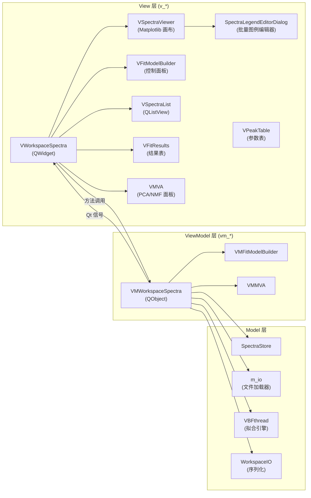
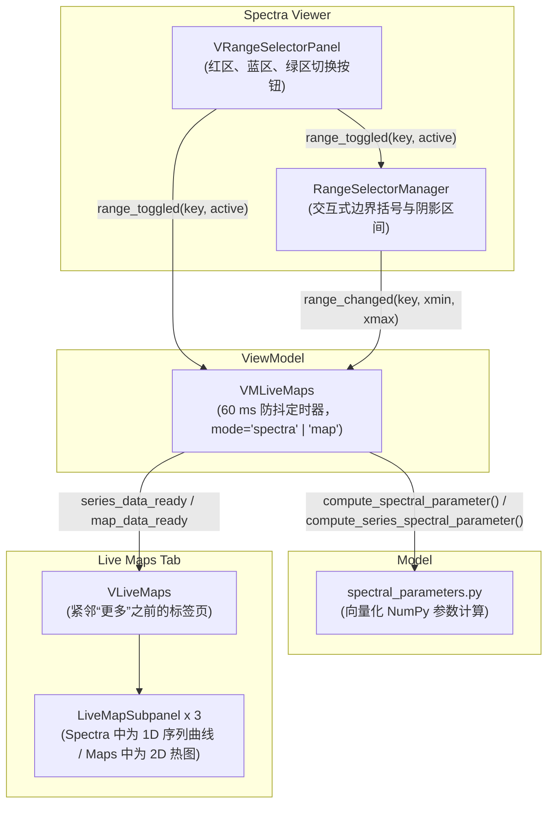

# **工作区：Spectra** { #workspace-spectra }

`Spectra` 工作区是用于管理单条光谱数据的核心分析环境，负责光谱数据的加载、预处理、峰建模、拟合与导出。同时，它也作为**基类**，由 [Maps 工作区](maps.md) 通过继承进行扩展。

> [!NOTE]
> 本页涵盖 `Spectra` 专有的 View 层与 ViewModel 层。关于共享数据模型（`SpectraStore`、`MapData`、`MapInfo` 及代理对象），请参阅专门的[数据架构：SpectraStore](spectra_store.md) 页面。

---

## 架构概览 { #architecture-overview }

该工作区遵循严格的 **MVVM**（Model-View-ViewModel）职责分离架构，任何层级都不得反向跨越边界。



### 组件职责 { #component-responsibilities }

| 层级 | 类 / 模块 | 职责 |
|---|---|---|
| **View** | `VWorkspaceSpectra` | 组装 UI 控件、连接信号与槽，并将所有业务逻辑委托给 ViewModel |
| **View** | `VSpectraViewer` | Matplotlib 画布——渲染一维光谱、基线、分峰曲线、最佳拟合曲线、残差、二维热图、交互式 3D 视图及波段选择器 |
| **View** | `VRangeSelectorPanel` | 位于右侧的垂直面板，提供红区、蓝区和绿区三个光谱波段切换按钮 |
| **View** | `RangeSelectorManager` | 画布覆盖层，管理激活波段选择器的可拖拽边界括号与阴影区间 |
| **View** | `VLiveMaps` | **实时图谱** (Live Maps) 标签页，容纳三个同步的二维热图子面板（红区、蓝区、绿区） |
| **View** | `SpectraLegendEditorDialog` | 面向所选光谱的事务式调色板、图例条目上限、标签及颜色编辑器 |
| **View** | `VFitModelBuilder` | X 轴校正、光谱范围、基线与拟合控制面板 |
| **View** | `VPeakTable` | 可编辑的峰参数表，每行配有峰型模型选择器 |
| **View** | `VSpectraList` | 带状态着色规则的复选框列表，支持拖拽排序与多选 |
| **ViewModel** | `VMWorkspaceSpectra` | 业务逻辑核心：编排数据加载、预处理、拟合与持久化 |
| **ViewModel** | `VMLiveMaps` | 当波段区间或计算参数更新时，基于 `MapData` 计算二维空间参数数组 |
| **Model** | `spectral_parameters` | 向量化计算积分强度、平均强度、最大强度、峰位、峰高与峰面积 |
| **Model** | `SpectraStore` | 以张量为核心的内存数据仓库——详见 [spectra_store.md](spectra_store.md) |
| **Model** | `VBFthread` | 在主线程之外运行向量化批量拟合引擎的 `QThread` |

### Spectra 如何使用 MapData { #how-spectra-uses-mapdata }

在 Spectra 工作区中，每条加载的光谱都作为一个独立的 `MapData` 数据块存储，且 **N=1**（仅含一行）。每个数据块拥有各自独立的 X 轴，从而允许具有不同波数范围的光谱同时共存。完整的张量布局请参阅[数据层级结构](spectra_store.md#data-hierarchy)。

---

## 工作区组件 { #workspace-components }

### `VWorkspaceSpectra` — 视图协调器 { #vworkspacespectra-the-view-coordinator }

**文件**：[`v_workspace_spectra.py`](https://github.com/CEA-MetroCarac/SPECTROview/blob/main/spectroview/view/workspaces/v_workspace_spectra.py)

`VWorkspaceSpectra` 是一个纯粹的 UI 组装类，负责：

1. 在 `__init__` 中实例化所有子控件以及 ViewModel。
2. 在 `setup_connections()` 中连接所有的信号与槽。
3. 将每一项用户操作委托给 ViewModel（从不直接操作数据）。
4. 响应 ViewModel 发射的信号以更新界面。

布局采用水平分割器：**左侧**（上方为 `SpectraViewer`，下方为带标签页的控制面板）与**右侧**（光谱列表侧边栏）。

**关键模式 — `Ctrl` 修饰的批量操作：**

```python
def _apply_with_ctrl(self, fn):
    apply_all = bool(QApplication.keyboardModifiers() & Qt.ControlModifier)
    fn(apply_all)

# Usage:
self.btn_reinit.clicked.connect(lambda: self._apply_with_ctrl(vm.reinit_spectra))
```

所有批量操作（扣除基线、粘贴峰、重置、拟合）均遵循这一模式：普通点击仅作用于当前选中的光谱；`Ctrl+Click` 则作用于数据仓库中的全部光谱。

### `VSpectraViewer` — 二维热图模式 { #vspectraviewer-2d-heatmap-mode }

**包路径**：[`spectra_viewer/`](https://github.com/CEA-MetroCarac/SPECTROview/blob/main/spectroview/view/components/spectra_viewer/__init__.py) (`v_plot_heatmap.py`)

`VSpectraViewer` 是核心的光谱绘图画布控件。除了多曲线一维光谱可视化外，它还提供了原生的**二维热图模式**（`btn_heatmap`，与 `btn_3d` 一同位于工具栏右侧、紧邻 `btn_options` / `btn_copy` 左侧），用于可视化系列光谱数据（例如变温实验、动力学过程、线扫描等）：

- **数据对齐与非规则网格插值**：当所选光谱拥有不同的或非对齐的波数网格时，`_plot_heatmap()` 会通过 `scipy.interpolate.interp1d` 将所有光谱行对齐到公共的光谱范围内。
- **Y 轴字段提取**：使用正则表达式自动解析文件名中嵌入的数值参数（例如 `_100C_`、`_250K_`），若未匹配到则默认回退为按索引顺序排列（`0..N-1`）。
- **平滑垂直插值**：当 `spin_heatmap_interp > 0`（默认 300 点）时，支持沿垂直轴执行一维三次或线性插值。
- **动态工具栏适配**：激活热图模式会切换工具栏控件的可见状态：标准一维工具（`btn_peak`、`btn_baseline`、`btn_yscale_log`、`btn_eraser`、`btn_norm`、`btn_bestfit` 以及 `shift_panel`）通过 `setVisible(False)` 隐藏，同时显示热图专属控件（`cbb_heatmap_yaxis`、`le_heatmap_ylabel`、`spin_heatmap_interp`）。取消勾选该模式后，一维工具会立即恢复显示。（`btn_yscale_log` 位于 `shift_panel` 顶部、`btn_eraser` 上方，并与选项菜单中的 `cbb_yscale` 保持双向同步。）

### `VSpectraViewer` — 交互式 3D 视图模式 { #vspectraviewer-interactive-3d-view-mode }

`VSpectraViewer` 提供了直接基于 Matplotlib `mpl_toolkits.mplot3d.Axes3D` 构建的交互式 **3D 视图**（`btn_3d`、`_3d_mode`，渲染逻辑位于 `_plot_3d()`），无需任何额外的外部依赖，并与二维视图共享 `PLOT_POLICY_LIGHT`/`PLOT_POLICY_DARK` 主题样式、剪贴板图像导出以及工作区选项同步（`get_options_state()`/`set_options_state()` 中的 `view_3d`）：

- **投影切换与回调清理 (`_ensure_axes_projection`)**：仅在进入或退出 3D 模式时才在二维直角坐标系与 `Axes3D` 之间切换 `self.ax`；在调用 `figure.delaxes()` 之前会先断开 `Axes3D` 画布回调并禁用 3D 鼠标事件绑定，从而避免在多次模式切换后出现回调函数累积的问题。
- **向量化 3D 渲染 (`FastLine3DCollection`)**：继承 `Line3DCollection`，通过单次向量化的 `proj3d._proj_trans_points()` 调用一次性投影统一 `(N, M, 3)` 张量或异构 `tensor_list` 选区中的所有三维点，并在交互式旋转相机视角时原地更新 `Path._vertices`；全面支持 `"line"` 和 `"dot"` 绘图样式、归一化、原始数据叠加、最佳拟合曲线、Z 轴对数刻度以及图例/色标模式。
- **鼠标旋转与模式互斥 (`_sync_mode_toolbar_state`)**：`btn_3d` 与 `btn_heatmap` 彼此互斥。激活 3D 模式会自动关闭 `NoDoubleClickZoomToolbar` 的二维缩放功能（`_set_zoom_tool_active(False)`），隐藏不兼容的一维工具（`btn_zoom`、`btn_peak`、`btn_baseline`、`btn_yscale_log`、`btn_eraser`、`shift_panel`），并共享 `cbb_heatmap_yaxis` / `le_heatmap_ylabel` 以利用文件名数值字段进行 Y 轴定位；此时左键拖拽可旋转视角 `(elev, azim)`，中键拖拽可平移视图，右键拖拽或滚轮可缩放 Z 轴，点击 `Rescale`（`Ctrl+R`）则可将相机视角（`25°`, `-60°`）与数据范围重置为默认状态。

### 交互式光谱映射与实时图谱 { #interactive-spectral-mapping-live-maps }

交互式光谱映射子系统允许用户在一维光谱查看器上最多选取三个相互独立的光谱波段，并实时查看随选区变化的参数可视化结果：

- **Spectra 工作区 (`mode="spectra"`)**：针对当前在 `VSpectraList` 中**选中的所有光谱**，绘制最多三条按颜色区分（红区、蓝区、绿区）的一维趋势曲线（`Spectrum #` 对比参数值）。
- **Maps 工作区 (`mode="map"`)**：根据当前所选图谱的维度自动适配：对于二维图谱渲染二维空间参数热图，对于一维剖面图谱（线扫描）则绘制沿空间坐标（`X (mm)`、`Y (mm)` 或 `Distance (mm)`）变化的一维折线图。
- **红/蓝强度比 (`R/B ratio`)**：在两个工作区的绿区通道子面板中均可用；逐元素计算积分强度比值 $I_{\mathrm{Red}} / I_{\mathrm{Blue}}$，对零值或接近零值的蓝区强度进行 `NaN` 掩膜处理，并在红区或蓝区边界括号移动时自动更新。当选中 `R/B ratio` 时，`VSpectraViewer` 会自动隐藏绿区边界括号，仅保留驱动该比值计算的红区与蓝区边界括号。



- **`VRangeSelectorPanel` 与 `SpectraRangeBracketMixin`**（[`rgb_live_maps/v_range_selector.py`](https://github.com/CEA-MetroCarac/SPECTROview/blob/main/spectroview/view/components/rgb_live_maps/v_range_selector.py)、[`v_range_bracket_mixin.py`](https://github.com/CEA-MetroCarac/SPECTROview/blob/main/spectroview/view/components/rgb_live_maps/v_range_bracket_mixin.py)）：`VRangeSelectorPanel` 作为独立垂直面板放置在 `VSpectraViewer` 右侧，配有红区（`#e74c3c`）、蓝区（`#3498db`）和绿区（`#2ecc71`）切换按钮。`SpectraRangeBracketMixin` 直接将该面板、区间初始化与边界钳位、悬停光标反馈以及 Agg 背景位图块传输（blitting）接入 `VSpectraViewer`。
- **`RangeSelectorManager`**：管理每个波段选择器的交互式垂直边界线、向内括号标注和透明阴影区间，在拖拽期间原地复用现有 Matplotlib 图形对象（artists），并支持 `set_animated(True)` / `active_artists()`。通过 `set_parameter()` / `is_bracket_visible()` 追踪各通道的参数选择——每当绿区实时图谱面板显示 `R/B ratio` 时，自动隐藏绿区边界括号并禁用其鼠标命中检测（切回其他光谱参数时立即恢复）。拖拽任意边界线或中间阴影区域时，借助 Agg 背景位图块传输（临时挂起 `layout_engine`、在拖拽期间跳过峰悬停检测，并将水平坐标钳位在垂直坐标轴边界内）对区间进行平移或缩放，并在鼠标释放时发射 `range_drag_finished` 信号。命中检测基于像素容差，并通过 Matplotlib 坐标变换进行坐标转换。
- **`VMLiveMaps`**：持有选择器区间、参数选项、色标选择及 `mode`（`"spectra"` 或 `"map"`）。在连续拖拽过程中采用自适应防抖定时器（基准 60 ms，超大图谱下可自动放大至 250 ms），鼠标释放时通过 `flush_pending()` 立即提交排队中的区间，并自动将包含 `>= 25,000` 条光谱（`ASYNC_SPECTRUM_THRESHOLD`）的图谱批次卸载至 `QThreadPool` 上的 `QRunnable`（`_LiveMapWorker`），同时使用单调递增的 `_generation_id` 取消过期任务并通过 `shutdown()` 实现安全关闭。在 `"spectra"` 模式下，当光谱选区改变时，只要用户手动调整过的边界括号位置仍在坐标轴边界内，`set_series_data(mds)` 便会保留该位置，随后发射 `spatial_sites_changed(None)` 和 `series_data_ready`。在 `"map"` 模式下，`set_map_datas(mds, primary_name)` 执行签名去重与基于 `MapData.data_version` 的 LRU 结果缓存，过滤未激活光谱（`~is_active`），缓存规则网格或 Delaunay `MapGridder` 几何结构，发射带有有序激活坐标/剖面位置的 `spatial_sites_changed` 以支持交互选点，并按情况发射 `map_data_ready`、`profile_data_ready`、`multi_profile_data_ready`、`map_2d_candidates_changed` 或 `live_maps_cleared`。当**实时图谱**标签页处于隐藏状态时，两个工作区都会跳过计算（标记 `_live_maps_dirty`），并在用户打开该标签页时一次性刷新。
- **`spectral_parameters.py`**：在 Model 层实现向量化计算，包括：通过 `compute_spectral_parameter()` 对先切片后转型的 `MapData.y_matrix[:, mask]` 视图求值（支持可选 `active_mask`）、通过 `compute_series_spectral_parameter()` 跨离散所选光谱列表（`list[MapData]`）求值、通过 `analyze_map_geometry()` 检测图谱维度、通过 `build_map_gridder()` + `compute_map_grid()` 构建可复用的规则网格/Delaunay 重心坐标插值网格，以及通过 `compute_intensity_ratio()` 计算带相对极小值 `NaN` 掩膜的安全逐元素强度比。支持计算：

    - *直接指标*：`Integrated intensity`（积分强度）、`Mean intensity`（平均强度）、`Maximum intensity`（最大强度）、`Peak position`（峰位）、`Peak height`（峰高，已扣除基线）。
    - *衍生指标（绿区通道）*：`R/B ratio`（$I_{\mathrm{Red}} / I_{\mathrm{Blue}}$）。
    - *拟合指标*：`Peak position (fit)`（拟合峰位）、`Peak height (fit)`（拟合峰高）、`Peak area (fit)`（拟合峰面积），在存在已拟合峰参数时使用。

- **`VLiveMaps` 与 `LiveMapSubpanel`**（[`rgb_live_maps/`](https://github.com/CEA-MetroCarac/SPECTROview/blob/main/spectroview/view/components/rgb_live_maps/__init__.py)）：安装在 `bottom_tabs`（位于 `Fit Results` 与 `MVA` 之间，`More` 位于标签页末端）的 `QWidget` 标签页。顶部工具栏行结合了左侧上下文区域（`[◀ | ComboBox | ▶]` 二维图谱切换器与诊断提示——未使用时隐藏）和右侧常驻的 **Show Legend** 以及紧凑双栏 **更多视图选项** (More view options) 控件（`btn_legend`、`btn_options`，行边距 `(2, 2, 2, 2)` 与 `VSpectraViewer` 对齐），下方容纳 3 个独立子面板（`v_live_map_subpanel.py` 中的 `LiveMapSubpanel`，基准为 96 DPI）。每个子面板均具备与 `NoDoubleClickZoomToolbar` 同步的 **Rescale**、**Pan** 和 **缩放** (Zoom) 按钮（同时保留双击图例编辑功能）、固定尺寸的图像剪贴板复制（`Copied figure size` 默认为 `5.5 × 4.0` in 及 `Copied figure theme`），以及通过 `Ctrl + Click` 触发的 TSV 数据复制（`copy_data_requested(color_id)` / `copy_df_to_clb()`：在 `"spectra"` 模式下复制光谱索引/标签与参数值，或复制一维/多剖面表，或在二维图谱模式下通过 `VMLiveMaps.get_2d_copy_points()` 复制 `(X, Y, Value)` 采样点数据）。在 `mode="map"` 下，当 Pan/缩放未激活且未命中图例时，`LiveMapSubpanel` 复用 [`map_selection.py`](https://github.com/CEA-MetroCarac/SPECTROview/blob/main/spectroview/view/components/map_viewer/map_selection.py) 中的共享辅助工具（`MapCanvasSelector`、`resolve_xy_selection()`、`resolve_1d_profile_selection()`），在红/蓝/绿（R/B/G）图谱上提供单击、`Ctrl+Click` 和框选拖拽光谱选择，并通过 `VLiveMaps.spectra_selected` 将选区传回 `VWorkspaceMaps`；在 `mode="spectra"` 下则保持交互式 XY 选择禁用。视图选项默认设置为 `plot_theme="Light Mode"`（通过 `apply_global_theme()` 独立于 Qt UI 主题）、`plot_style="line"`、`line_width=1.5`、`dot_size=1.5`、`show_figure_label=False` 和 `show_grid=False`，在 `MSettings` 中跨重启持久化（`live_maps_view_options/*`，并在 Spectra 与 Maps 工作区之间交叉同步）；借助 `apply_view_options_fast()`、`@lru_cache` 缓存的 `mplstyle` 字典（`_get_cached_style_dict`）、布局稳定后冻结（`_on_canvas_draw`）以及父对象托管的 35 ms 重绘定时器，确保 X/Y/Z 刻度、样式、字号（`6–24 pt`）、图像标题标签、网格线、共享 Y 轴、热图平滑、色标以及由 [`v_live_maps_legend_editor.py`](https://github.com/CEA-MetroCarac/SPECTROview/blob/main/spectroview/view/components/rgb_live_maps/v_live_maps_legend_editor.py) 支撑的图例编辑器能够流畅无卡顿地实时更新。
- **缩放与波段选择器协同**：当某个波段选择器被激活时，`btn_zoom` 会自动关闭，以便用户顺畅调节边界括号而不会同时触发框选放大，同时 `VWorkspaceSpectra._on_range_selector_toggled()` 会自动将 `bottom_tabs` 切换至 `self.v_live_maps`（在计算激活通道前先刷新延迟的 `_live_maps_dirty` 选区；取消激活波段选择器时则保持当前活动标签页不变）。用户仍可手动点击缩放按钮进行开启或关闭；当缩放处于激活状态时，在阴影区间内部点击将执行框选放大，而非移动波段主体。

### `VMWorkspaceSpectra` — 视图模型 { #vmworkspacespectra-the-viewmodel }

**文件**：[`vm_workspace_spectra.py`](https://github.com/CEA-MetroCarac/SPECTROview/blob/main/spectroview/viewmodel/spectra/vm_workspace_spectra.py)（由 `vm_spectra_preprocessing.py`、`vm_spectra_fitting.py`、`vm_spectra_results.py` 与 `vm_spectra_persistence.py` 组合构成）

这是整个应用程序中规模最大、最为核心的类。它拥有 `SpectraStore` 并负责编排每一项操作。

#### 信号（ViewModel → View） { #signals-viewmodel-view }

```python
spectra_list_changed    = Signal(list)          # list[dict] — refresh the spectra list
spectra_selection_changed = Signal(object)      # dict payload for VSpectraViewer
count_changed           = Signal(int)           # total spectrum count label
show_xcorrection_value  = Signal(float)         # sync X-correction spinbox
spectral_range_changed  = Signal(float, float)  # sync range controls
fit_in_progress         = Signal(bool)          # enable/disable fit buttons
fit_progress_updated    = Signal(int, int, int, float, int)  # progress bar
fit_results_updated     = Signal(object)        # pd.DataFrame → results table
notify                  = Signal(str)           # floating notification message
send_df_to_graphs       = Signal(str, object)   # forward DataFrame to Graphs
```

#### 方法参考 { #method-reference }

| 类别 | 方法 |
|---|---|
| **加载** | `load_files(paths)` |
| **选择** | `set_selected_fnames()`, `set_selected_indices()`, `_get_selected_spectra()`, `_get_active_spectra()` |
| **预处理** | `apply_spectral_range()`, `apply_x_correction()`, `undo_x_correction()`, `apply_y_normalization()` |
| **基线处理** | `set_baseline_settings()`, `preview_baseline()`, `add_baseline_point()`, `remove_baseline_point()`, `subtract_baseline()`, `delete_baseline()`, `copy_baseline()`, `paste_baseline()` |
| **峰编辑** | `add_peak_at()`, `remove_peak_at()`, `update_peak_label()`, `update_peak_model()`, `update_peak_param()`, `delete_peak()`, `copy_peaks()`, `paste_peaks()`, `delete_peaks()` |
| **拟合** | `fit()`, `stop_fit()`, `_run_fit_thread()`, `_on_fit_finished()` |
| **结果** | `collect_fit_results()`, `save_fit_results()`, `split_filename()`, `add_column_from_filename()`, `compute_column_from_expression()` |
| **拟合模型** | `copy_fit_model()`, `paste_fit_model()`, `save_fit_model()`, `apply_fit_model()` |
| **工作区管理** | `reinit_spectra()`, `remove_selected_spectra()`, `reorder_spectra()`, `clear_workspace()` |
| **持久化** | `save_work()`, `load_work()`, `_load_legacy_spectra()` |
| **显示与导出** | `save_spectra_data()`, `copy_spectrum_data_to_clipboard()` |

#### 模板方法钩子 { #template-method-hooks }

该 ViewModel 采用**模板方法模式（Template Method pattern）**，使 [Maps 子类](maps.md#template-method-overrides) 能够定制批量操作行为，而无需重复实现操作逻辑：

```python
def _get_target_mds(self, apply_all: bool) -> list[MapData]:
    """Which MapData blocks to operate on."""
    # Spectra workspace: selected spectra → their MapData objects
    # Maps workspace (override): the current map, or all maps

def _on_map_data_changed(self, md: MapData, action: str):
    """Hook after each individual MapData is modified."""
    # Spectra workspace: no-op
    # Maps workspace (override): clears heatmap cache, re-runs batch_preprocess

def _post_bulk_action(self, apply_all: bool, action: str):
    """Hook after all target MapData objects have been processed."""
    # Spectra workspace: re-emits list and selection
    # Maps workspace (override): also refreshes fit results and map view
```

### `VSpectraViewer` — 绘图画布 { #vspectraviewer-the-plot-canvas }

**包路径**：[`spectra_viewer/`](https://github.com/CEA-MetroCarac/SPECTROview/blob/main/spectroview/view/components/spectra_viewer/__init__.py) (`v_spectra_viewer.py`, `v_spectra_options.py`, `v_plot_1d.py`, `v_plot_heatmap.py`, `v_plot_3d.py`, `v_interactions.py`, `v_spectra_legend_editor.py`, `common.py`)

`VSpectraViewer` 在 `QWidget` 之上组合了多个专用 Mixin（`SpectraOptionsMenuMixin`、`SpectraPlot1DMixin`、`SpectraHeatmapMixin`、`SpectraPlot3DMixin`、`SpectraLegendMixin`、`SpectraInteractionMixin` 与 `SpectraRangeBracketMixin`），将双栏选项菜单与状态同步、一维/热图/3D 渲染、鼠标/峰/宇宙射线橡皮擦交互以及图例/色标管理清晰解耦，并将共用辅助函数沉淀在 `common.py` 中。

Matplotlib 画布负责绘制光谱图中的所有可见元素。它接收来自 `VMWorkspaceSpectra.spectra_selection_changed` 的数据字典并据此重绘。

**渲染元素：**

| 元素 | 数据源键值 |
|---|---|
| 光谱曲线 | `data["y"]`（已处理数据） |
| 原始曲线叠加（可选） | `data["y0"]`（原始数据） |
| 基线曲线 | `data["y_baseline"]` |
| 基线锚点 | `data["baseline_config"]["points"]` |
| 单峰拟合曲线 | `data["y_peaks"]`（数组列表） |
| 最佳拟合包络线 | `data["y_bestfit"]` |
| 残差 | `data["y"] - data["y_bestfit"]` |
| R² 决定系数标注 | `data["fit_r2"][0]` |

**交互模式（单选按钮互斥）：**

| 模式 | 左键点击 | 右键点击 |
|---|---|---|
| **缩放** | 标准 Matplotlib 缩放/平移 | — |
| **基线** (Baseline) | 在 x 处添加基线锚点 | 移除最近的锚点 |
| **峰** (Peak) | 在 x 处添加峰 | 移除最近的峰 |

峰也可以通过鼠标拖拽来调整位置。查看器会在拖拽过程中发射 `peak_dragged(x, y)`，并在释放鼠标时发射 `peak_drag_finished()`，ViewModel 会据此分别调用 `update_dragged_peak()` 与 `finalize_peak_drag()`。

#### 批量图例编辑 { #batch-legend-editing }

`VSpectraViewer` 会在每次渲染后缓存完整的图例包围盒。在该包围盒内的任意位置双击，即可打开来自 `spectra_viewer/v_spectra_legend_editor.py` 的 `SpectraLegendEditorDialog`；单个图例句柄和文本对象不再分别打开独立的编辑对话框。

该对话框采用事务式修改机制：在用户确认之前，其中的调色板选择器、图例条目上限微调框、标签输入框和颜色下拉框均只保存临时值。因此点击**取消** (Cancel) 不会产生任何数据更改。点击 **OK** 时，`VSpectraViewer._apply_legend_editor_values()` 会执行以下步骤：

1. 更新共享的 `color_palette` 与 `max_legend_items` 视图选项。
2. 将修改后的标签和显式指定的颜色写入当前张量负载（payload）中。
3. 通过各自的 `SpectrumProxy` 写入相同的值，从而同步更新源 `MapData.labels` 与 `MapData.colors` 数组。
4. 发射 `spectrumCustomized` 信号，触发 ViewModel 重新构建选区负载并刷新光谱列表。

颜色值为 `None` 代表**自动** (Automatic)，将在渲染时根据当前激活的调色板解析实际颜色。切换调色板时，为单条光谱显式指定的颜色仍保持更高优先级。连续调色板会在整个选区范围内均匀采样；编辑器则提供有限数量的代表性色块供选择。

两个工作区均强制限制 `LEGEND_EDITOR_MAX_ROWS = 100`。界面仅会实例化最多 100 个编辑行，从而避免在选中大量图谱或光谱时创建数千个 Qt 控件。对话框仍会接收完整的选区总数，以确保自动渐变色预览与实际绘制的光谱位置保持一致。超出当前批次范围的光谱值保持不变。

#### 视图选项同步与持久化 { #view-options-synchronization-persistence }

视图选项菜单与底部工具栏在紧凑的双栏 `QWidgetAction` 面板中提供了可由用户配置的显示设置（在工作区之间同步，并跨会话持久化保存）：

- **图表主题 (`cbb_theme`)**：配置 Matplotlib 画布主题（`"Dark Mode"` 或 `"Light Mode"`），在 Spectra 工作区、Maps 工作区以及独立的二维图谱查看器弹窗之间保持同步。默认情况下，除非用户显式切换为 `"Dark Mode"`，否则图表主题始终设为 `"Light Mode"`。它完全独立于应用程序全局界面主题，用户的显式选择会跨会话持久化保存在 `view_options/theme` 中。
- **图例位置与外置选项 (`act_legend_outside`)**：勾选后，`VSpectraViewer` 会通过 `loc="center left"` 与 `bbox_to_anchor=(1.02, 0.5)` 将图例置于主坐标系外部。画布的 `compressed` 布局会自动调整绘图边距，使图例整齐排布而不遮挡光谱曲线。该设置在 Spectra 与 Maps 工作区之间同步，并跨会话持久化保存在 `view_options/legend_outside` 中。图例双击包围盒检测会从底层图例艺术家对象动态刷新窗口坐标范围，确保无论布局如何压缩都能实现准确的命中检测。
- **色标图例模式 (`act_legend_colorbar`, `cbb_colorbar_param`, `le_colorbar_label`)**：勾选该项（且 `btn_legend` 处于开启状态）时，`VSpectraViewer` 会用右侧 Matplotlib 色标取代离散的逐条光谱图例框，色标数值由共享的文件名数值字段提取器（`_extract_filename_tokens()` / `_extract_series_parameter_values()`，与二维热图模式共用）或光谱 `Index` 驱动。双栏选项菜单中的 `row_colorbar_param` 与 `row_colorbar_label` 两行仅在勾选 `act_legend_colorbar` / `chk_legend_colorbar` 时显示（`_update_colorbar_options_visibility()`）。参数选择在整个会话期间按以下划线分隔的字段槽位及归一化单位模式进行跟踪（`_refresh_token_combobox()`），即使切换至首条文件名携带不同数值的光谱子集，仍能保留所选参数。对于渐变调色板，每条光谱的自动颜色会直接通过 `_resolve_colorbar_cmap_and_norm()` 根据其提取的参数值进行映射（逐条光谱自定义的覆盖颜色仍保持优先）。相关配置跨会话持久化保存在 `view_options/legend_colorbar`、`view_options/colorbar_param` 与 `view_options/colorbar_label` 中，并在 Spectra 与 Maps 工作区之间同步。

#### 热图与信号处理优化 { #heatmap-signal-processing-optimizations }

- **向量化热图矩阵插值**：启用二维热图模式时，Y 轴三次/线性插值会同时对整个强度矩阵进行运算（`scipy.interpolate.interp1d(..., axis=0)`），而非逐列执行 Python 循环，在大批量光谱渲染场景下可将耗时缩短 4 倍以上。
- **快速宇宙射线 / 橡皮擦噪声估计**：采用一阶差分的中位数绝对偏差（$MAD / (0.6745 \sqrt{2})$）取代传统的迭代滑动窗口多项式拟合，以 $O(N)$ 的向量化 NumPy 时间复杂度实现稳健的基线噪声估计。
- **悬停命中检测预筛选**：`_on_hover` 通过 X 轴范围包围盒预筛选，直接跳过位于作用域之外的无关峰标记的昂贵 `contains(event)` 线元计算。

### `VFitModelBuilder` — 控制面板 { #vfitmodelbuilder-the-controls-panel }

**文件**：[`v_fit_model_builder.py`](https://github.com/CEA-MetroCarac/SPECTROview/blob/main/spectroview/view/components/lower_tabs/v_fit_model_builder.py)

这是一个带分割器的控制面板，囊括了完整的预处理与拟合配置界面：

- **左侧面板**：X 轴校正、光谱范围、基线模式选择器以及基线操作按钮。
- **右侧面板**：`VPeakTable`（可编辑参数行）+ 拟合操作按钮（**拟合** (Fit)、Copy model、Paste model、Save model、Apply model）。
- **拖放加载模型**：支持将 `.json` 拟合模型文件直接拖放到面板或父工作区上。拖放后，`fit_model_dropped(path)` 会触发 `load_fit_model_file()`，并委托给 `VMFitModelBuilder.load_model_file()`。该操作会将外部模型加载到内存、更新模型下拉菜单并选中该模型、自动切换至 `Fit Model Builder` 标签页并弹出浮动提示通知。Spectra 与 Maps 工作区均继承并支持此功能。

### `VPeakTable` — 参数表 { #vpeaktable-the-parameter-table }

**文件**：[`v_peak_table.py`](https://github.com/CEA-MetroCarac/SPECTROview/blob/main/spectroview/view/components/lower_tabs/v_peak_table.py)

一个交互式表格，其中每一行代表一个峰。各列依次显示标签、峰型模型、中心位置（x₀）、半高全宽（FWHM）、振幅以及约束开关。编辑任意单元格都会向 `VMWorkspaceSpectra` 发射信号，由其更新 `md.fit_model` 并立即重绘 `Y_peaks` 预览曲线。

---

## 数据流 { #data-flow }

### 加载光谱 { #loading-spectra }

1. **用户操作**：用户将文件拖放至 `VWorkspaceSpectra` 界面中。
2. **View → ViewModel**：View 调用 `vm.load_files(paths)`。
3. **文件解析**：针对每个文件，ViewModel 委托给 `m_io` 模块（`load_spectrum_file`、`load_wdf_spectrum` 等）进行解析。I/O 模块返回包含原始数组（`x0`、`y0`）和元数据的字典。
4. **数据存储**：ViewModel 通过调用 `add_map(name, x0, Y0, coords, fnames)` 将数据注册到 `SpectraStore` 中。系统随即创建一个新的 `MapData` 数据块，此时其 `x` 和 `Y` 均设为 `None`（仅保留原始数据）。
5. **UI 更新**：ViewModel 发射 `spectra_list_changed` 信号。View 捕获该信号并刷新 `VSpectraList` 侧边栏。

`m_io` 模块会根据文件扩展名自动检测文件格式。所有加载器均返回统一格式的字典：

```python
{
    "type": "spectra",
    "items": [
        {"name": str, "x0": ndarray, "y0": ndarray, "metadata": dict},
        ...
    ]
}
```

WDF 文件可能会返回多个条目（时间序列）。所有条目都会分别注册为独立的 `MapData` 数据块。

### 选择光谱 { #selecting-spectra }

1. **用户操作**：用户在 `VSpectraList` 中点击一条光谱。
2. **View → ViewModel**：列表控件发射选区变化信号，进而调用 `vm.set_selected_indices()`。
3. **状态更新**：ViewModel 将行索引解析为唯一的 `fnames` 并保存当前激活选区。
4. **负载构建**：ViewModel 调用 `_emit_selected_spectra()`，查询 `SpectraStore` 构建类型为 `"type": "tensor_list"` 的负载字典，其中包含所有选中光谱的数据数组。
5. **UI 更新**：ViewModel 发射 `spectra_selection_changed(data_dict)`。`VSpectraViewer` 接收后调用 `set_plot_data()` 并重绘 Matplotlib 画布。

对于 Spectra 工作区，选区负载（`data_dict`）包含以 `"type": "tensor_list"` 为键的预提取数组（即由相互独立的数组构成的列表，每条光谱可拥有不同的 X 轴）。Maps 工作区[覆写了此行为](maps.md#_emit_selected_spectra-override)，改为发射 `"type": "tensor"`（共享 X 轴的二维矩阵）。

### 拟合工作流 { #fitting-workflow }

1. **用户操作**：用户在 `VFitModelBuilder` 中点击**拟合**按钮。
2. **任务构建**：ViewModel 构建任务列表（每张图谱/每条光谱对应一个任务），其中包含 `indices` 与 `fit_model` 字典。
3. **启动线程**：ViewModel 实例化 `VBFthread(store, tasks)` 并启动运行，同时通过 `fit_in_progress(True)` 信号禁用相关 UI 按钮。
4. **引擎执行（后台线程）**：针对每个任务，工作线程调用 `VBFengine.fit_spectra(x, Y_sub, fit_model, weights)`。
5. **结果存储（后台线程）**：随着拟合推进，线程直接通过 `set_fit_results()` 将结果写入 `SpectraStore`，并更新 `MapData` 对象上的 `Y_bestfit` 和 `Y_peaks` 数组。
6. **进度更新**：线程发射进度信号，ViewModel 将其中继给 View 的进度条。
7. **完成收尾**：线程发射 `finished()`。ViewModel 捕获后调用 `_on_fit_finished()`，重新启用界面控件并触发画布重绘。

> [!NOTE]
> `VBFthread` 会从工作线程中直接调用 `store.set_fit_results()`。这在 PySide6 中是线程安全的，因为只要不涉及任何 Qt 控件操作，就允许在非 GUI 线程中向纯 Python/NumPy 对象写入数据；随后的 UI 更新均由 `finished()` 信号调度回主线程执行。

### 基线工作流 { #baseline-workflow }

1. 用户在 `VFitModelBuilder` 中选择基线模式 → `set_baseline_settings()` 将配置写入 `md.baseline_config`。
2. 用户在光谱图上点击 → `add_baseline_point(x)` 向 `md.baseline_config["points"]` 添加锚点。
3. `preview_baseline()` 计算并存储 `md.Y_baseline` 用于实时预览绘制（不执行扣除）。
4. `subtract_baseline()` 在当前图谱块上运行 `batch_preprocess()`——从 `Y` 中减去 `Y_baseline`，并将 `md.is_baseline_subtracted` 设为 `True`。
5. `delete_baseline()` 通过在空基线配置下运行 `batch_preprocess()`（仅保留波段裁剪）恢复 `Y`，并重置 `is_baseline_subtracted`。

### 峰编辑工作流 { #peak-editing-workflow }

1. 用户在查看器处于峰模式时按住 Ctrl 点击（Ctrl+Click）→ `VSpectraViewer.peak_add_requested(x)` → `add_peak_at(x)`。
2. ViewModel 从 `md.Y[spec_idx, idx]` 读取 x 处的 Y 值，并用自动估算的 `x0`、`ampli`、`fwhm` 和 `bounds` 初始化 `peak_model` 字典。
3. 该峰字典以下一个整数键追加到 `md.fit_model["peak_models"]` 中。
4. `eval_peak_initial()` 计算该模型峰的初始曲线，并将其追加到 `md.Y_peaks`。
5. `_emit_selected_spectra()` 触发查看器重绘，立即显示新添加的峰曲线。

### 拟合结果汇总 { #fit-results-collection }

```python
# VMWorkspaceSpectra.collect_fit_results()
#   → SpectraStore.build_fit_results_df()
#   → returns pd.DataFrame with columns:
#      Filename, [x0_Peak1, fwhm_Peak1, ampli_Peak1, area_Peak1, ...], R2
```

`build_fit_results_df()` 完全向量化——它直接读取 `md.peak_params`（不遍历光谱执行 Python 循环），应用用户自定义的峰标签，计算各峰的面积列，并附加逐条光谱的 **`R2`** 列（决定系数，直接读取自 `md.fit_r2`，即 SpectraViewer 为所选光谱显示的同一数值），最终返回一个 `pd.DataFrame`。由于 `R2` 是每条光谱唯一的标量（而非逐峰属性），`collect_fit_results()` 的列排序逻辑会将其保留在表格末尾。在 Spectra 工作区中，发送到结果表之前会先移除 `X` 和 `Y` 列。

**小数精度**由 `build_fit_results_df(..., decimals=…)` 控制，它会对所有拟合数值列（参数、面积、R²）进行四舍五入，同时保持 `X`/`Y` 坐标的完整精度——它是唯一的舍入权威入口，因此 `collect_fit_results()` 后续不再二次舍入。`VMWorkspaceSpectra.results_decimals`（默认为 3）提供该数值；**拟合结果** (Fit Results) 标签页（Collect 按钮上方）中的 *"Fit results decimals"* 微调框可通过 `set_results_decimals()` 修改该值（在下次点击 Collect 时生效）。`compute_column_from_expression()` 也会使用相同的 `results_decimals` 对计算列进行舍入。公共 API 中的 `build_fit_results_df` 则保持其自身的默认值 4。

---

## 持久化 { #persistence }

### 现代格式（v2+，基于 ZIP） { #modern-format-v2-zip-backed }

工作区文件（`.spectra`）采用[SpectraStore：持久化](spectra_store.md#persistence)中描述的基于 ZIP 的存储格式。其中 `metadata.json` 保存每条光谱的配置信息，`arrays.npz` 则存放体积较大的数值数组。

### 旧版加载器 { #legacy-loader }

`_load_legacy_spectra()` 负责兼容读取来自旧版 SPECTROview 的 `.spectra` 文件（采用 base64+zlib 压缩数组的原始 JSON 格式）。它会执行以下操作：

1. 解码并解压缩 `x0`/`y0` 数组。
2. 重建 `baseline_config` 并计算 `md.Y_baseline`。
3. 重新计算分峰曲线以填充 `md.Y_peaks` 和 `md.Y_bestfit`。

无需手动迁移——旧版格式会在打开时于运行时透明加载。

---

## 扩展指南 { #extension-guide }

### 添加新的预处理工具 { #adding-a-new-preprocessing-tool }

1. **ViewModel 层**：添加一个方法（例如 `apply_smoothing(window, apply_all)`），调用 `_get_target_mds(apply_all)` 修改 `md.Y`，然后调用 `_post_bulk_action()`。
2. **Model 层**（如有需要）：在 `fit_engine/baseline.py` 或新文件中添加算法函数。
3. **View 层**：在 `VFitModelBuilder` 中添加按钮或控件，发射新信号并在 `VWorkspaceSpectra.setup_connections()` 中完成连接。
4. **持久化**：如果该工具产生了需要在保存/加载后保留的状态，请将其添加到 `SpectraStore.to_metadata_dict()` 并在 `load_map_from_npz()` 中恢复。

### 添加新的峰型模型 { #adding-a-new-peak-model }

完整细节请参阅专门的 [VBF 引擎指南](vbf_engine.md)。简而言之：

1. 在 `fit_engine/models.py` 中添加模型函数及其解析雅可比矩阵（analytical Jacobian）。
2. 在 `spectroview/__init__.py` → `PEAK_MODELS` 中注册该模型名称。
3. 在 `VMWorkspaceSpectra._initialize_peak_params()` 中添加参数初始化逻辑。
4. `VPeakTable` 与 `VFitModelBuilder` 会自动在其下拉列表中填充该新模型。

### 添加新的查看器渲染功能 { #adding-a-new-viewer-rendering-feature }

1. 将渲染逻辑添加到 `VSpectraViewer.set_plot_data()` 或专用的私有方法中。
2. 将所需数据添加到 `VMWorkspaceSpectra._emit_selected_spectra()` 发射的负载字典中。
3. 如果该功能需要界面开关，请在 `VSpectraViewer` 中添加 `QCheckBox` 或菜单动作，并将其连接到重绘调用。

---

## 故障排查 { #troubleshooting }

**加载后光谱未显示**

- 检查 `md.is_active[0]`——加载过程默认将其设为 `True`，但加载失败可能导致条目处于不一致状态。
- 确认在调用 `store.add_map()` 之后调用了 `_emit_list_update()`。

**拟合后峰表仍为空**

- 在 `_on_fit_finished()` 之后必须调用 `_emit_selected_spectra()`。请检查 `store.set_fit_results()` 是否已正确填充 `md.param_names`。

**拟合成功但 R² 显示为 0.0**

- 当 `fit_success` 为 `False` 时，拟合引擎会将 `rsquared` 设为 `0`。请检查对应光谱的 `md.fit_success[idx]`。

**`_emit_selected_spectra()` 引发 Qt 信号死循环**

- 切勿在与 `spectra_selection_changed` 相连的槽函数内部调用 `_emit_selected_spectra()`。如有必要，请使用 `QTimer.singleShot(0, ...)` 延迟执行。

有关数据模型相关的故障排查（例如预处理未生效、内存问题等），请参阅[SpectraStore：故障排查](spectra_store.md#troubleshooting)。
