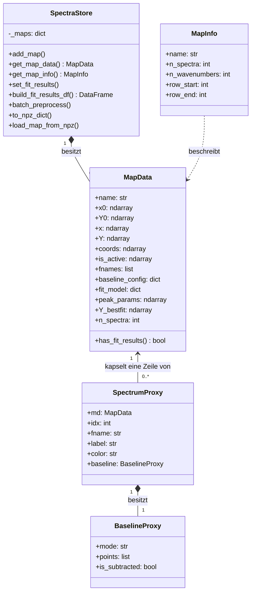

# **Datenarchitektur: SpectraStore** { #data-architecture-spectrastore }

`SpectraStore` ist die **zentrale Datenquelle** (*Single Source of Truth*) für sämtliche numerischen Spektraldaten in SPECTROview. Sowohl der Arbeitsbereich [Spektren](spectra.md) als auch der Arbeitsbereich [Karten](maps.md) lesen aus demselben Datenspeicher und schreiben in ihn. Das Verständnis dieses Moduls ist der wichtigste erste Schritt für alle neuen Mitwirkenden.

**Quelldatei**: [`spectra_store.py`](https://github.com/CEA-MetroCarac/SPECTROview/blob/main/spectroview/model/spectra/spectra_store.py)

---

## Designphilosophie { #design-philosophy }

Vor der Einführung von `SpectraStore` (in Versionen vor 26.24.1) speicherte SPECTROview jedes Spektrum als eigenständiges Python-Objekt. Bei großen hyperspektralen Karten mit tausenden Spektren führte dies zu Leistungsengpässen. Durch das tensorzentrierte Redesign werden alle Spektren einer logischen „Karte“ als zusammenhängende NumPy-Arrays abgelegt. Dies ermöglicht:

- **Vektorisierte Vorverarbeitung** — Bereichszuschnitt und Basislinien-Subtraktion werden in einem einzigen Schritt auf die gesamte N×M-Matrix angewendet.
- **Batch-Fitting** — die [VBF-Engine](vbf_engine.md) arbeitet direkt auf dem Tensor, ohne auf Python-Ebene zu iterieren.
- **Kartenzugriff in O(1)** — der Abruf der Daten einer Karte erfolgt unabhängig von der Speichergröße über einen einzigen Dictionary-Lookup.
- **Heterogene Datensätze** — jede Karte besitzt ihre eigene X-Achse, sodass Karten mit unterschiedlichen Wellenzahlbereichen sauber nebeneinander existieren können.

---

## Datenhierarchie { #data-hierarchy }

```
SpectraStore
└── dict: _maps { map_name → MapData }
    │
    ├── MapData ("spectrum_A")          ← Spectra workspace: single spectrum (N=1)
    │   ├── x0: float64[M]             raw wavenumber axis
    │   ├── Y0: float32[1, M]          raw intensity (1 spectrum)
    │   ├── x:  float64[M_proc]        processed axis (after crop)
    │   ├── Y:  float32[1, M_proc]     processed intensity (after crop + baseline)
    │   ├── coords: float64[1, 2]      always (0.0, 0.0) for point spectra
    │   ├── fnames: ["spectrum_A"]      unique identifier
    │   ├── fit_model: dict             peak model definition
    │   ├── peak_params: float64[1, K]  fitted parameters
    │   ├── fit_success: bool[1]
    │   └── ...
    │
    └── MapData ("wafer_300mm")         ← Maps workspace: hyperspectral map (N=2500)
        ├── x0: float64[M]
        ├── Y0: float32[2500, M]        raw intensity matrix
        ├── coords: float64[2500, 2]    (X, Y) stage positions
        ├── fnames: [str × 2500]        "wafer_300mm_(x, y)" per spectrum
        ├── peak_params: float64[2500, K]
        ├── fit_success: bool[2500]
        └── ...
```

> [!IMPORTANT]
> **Sowohl ein einzelnes Spektrum als auch eine vollständige hyperspektrale Karte verwenden dieselbe `MapData`-Struktur** — sie unterscheiden sich lediglich in N (der Anzahl der Zeilen). Dieses einheitliche Datenmodell ermöglicht es den Arbeitsbereichen Spektren und Karten, dieselbe ViewModel-Basisklasse (`VMWorkspaceSpectra`) zu teilen.

---

## `MapData` — Der Tensorblock { #mapdata-the-tensor-block }

```python
@dataclass
class MapData:
    """All numerical data for a single hyperspectral map."""
    name: str
```

`MapData` ist eine Dataclass, die alle großen Arrays eines logischen Datensatzes verwaltet. Ihre Felder sind in Funktionsgruppen gegliedert:

### Spektral-Arrays (unveränderliche Rohdaten + veränderliche verarbeitete Daten) { #spectral-arrays-immutable-raw-mutable-processed }

| Feld | Form | dtype | Zweck |
|------|------|-------|-------|
| `x0` | `[M]` | float64 | Ursprüngliche Wellenzahlachse — **wird niemals verändert** |
| `Y0` | `[N, M]` | float32 | Ursprüngliche Intensitäten — **werden niemals verändert** |
| `x` | `[M_proc]` | float64 | Arbeitsachse nach Zuschnitt / X-Korrektur (oder `None` → verwendet `x0`) |
| `Y` | `[N, M_proc]` | float32 | Arbeitsintensitäten nach vollständiger Vorverarbeitung (oder `None` → verwendet `Y0`) |
| `coords` | `[N, 2]` | float64 | Räumliche (X, Y)-Positionen — bei Punktspektren immer `(0, 0)` |

> [!IMPORTANT]
> Das **Dual-Array-Design** (`x0/Y0` vs. `x/Y`) ist der Schlüssel zur nicht-destruktiven Vorverarbeitung. `x0` und `Y0` werden beim Laden der Datei einmalig geschrieben und **danach nie wieder angefasst**. Jede Vorverarbeitung erzeugt `x` und `Y`. Ein Aufruf von `reinit_spectra()` setzt lediglich `md.x = None; md.Y = None`, sodass der Datenspeicher automatisch wieder auf die Roh-Arrays zurückfällt.

### Metadaten pro Spektrum { #per-spectrum-metadata }

| Feld | Länge | Zweck |
|------|-------|-------|
| `fnames` | N | Eindeutige Zeichenkettenkennung für jede Spektrumszeile |
| `is_active` | N | `bool` — gibt an, ob das Spektrum in der UI-Liste markiert ist |
| `colors` | N | Optionale Anzeigefarbe pro Spektrum |
| `labels` | N | Optionale benutzerdefinierte Beschriftung |

### Vorverarbeitungszustand (gemeinsam für alle N Spektren einer Karte) { #preprocessing-state-shared-across-all-n-spectra-in-a-map }

| Feld | Typ | Zweck |
|------|-----|-------|
| `baseline_config` | `dict` | Basislinien-Algorithmus und Parameter (`mode`, `points`, `coef`, ...) |
| `is_baseline_subtracted` | `bool` oder `bool[N]` | Gibt an, ob von `Y` bereits eine Basislinie subtrahiert wurde |
| `range_min` / `range_max` | `float` | Aktuelle Grenzen für den spektralen Zuschnitt |
| `xcorrection_value` | `float` | Angewendete X-Achsen-Verschiebung (cm⁻¹) |
| `intensity_norm_factor` | `float` | Multiplikativer Faktor zur Intensitätsnormierung |
| `map_metadata` | `dict` | Messmetadaten aus WDF-/SPC-Dateien |

### Fit-Ergebnisse (nach Ausführung der VBF-Engine befüllt) { #fit-results-filled-after-vbf-engine-runs }

| Feld | Form | dtype | Zweck |
|------|------|-------|-------|
| `peak_params` | `[N, K]` | float64 | Optimierte Parameterwerte |
| `fit_success` | `[N]` | bool | Konvergenz-Flag pro Spektrum |
| `fit_r2` | `[N]` | float64 | Bestimmtheitsmaß pro Spektrum |
| `param_names` | list[str] | — | Spaltennamen für `peak_params` (z. B. `m01_x0`, `m01_fwhm`) |
| `fit_model` | `dict` | — | Für den Fit verwendete Peak-Modelldefinition |

### Visualisierungskurven (abgeleitet, ausschließlich zur Darstellung) { #visualization-curves-derived-for-rendering-only }

| Feld | Form | Zweck |
|------|------|-------|
| `Y_bestfit` | `[N, M_proc]` | Zusammengesetzte Modellkurve (`float32`, Summe aller Peaks + Basislinie) |
| `Y_baseline` | `[N, M_proc]` | Ausgewertete Basislinienkurve (`float32` bei Batch-Auswertung) |
| `Y_peaks` | Liste von `[N, M_proc]` | Peakspezifische `LazyPeakArray`-Views, die bei Bedarf pro ausgewähltem Zeilen-Slice ausgewertet werden |

---

## `MapInfo` — Leichtgewichtiger Deskriptor { #mapinfo-lightweight-descriptor }

```python
@dataclass
class MapInfo:
    name: str
    row_start: int   # always 0 (kept for API compatibility)
    row_end: int
    n_spectra: int
    n_wavenumbers: int
```

`MapInfo` ist eine kompakte Zusammenfassung, die von `SpectraStore.get_map_info()` zurückgegeben wird. Sie dient der **API-Kompatibilität**: Älterer Code, der wissen musste, „an welcher Stelle diese Karte im globalen Array beginnt“, funktioniert weiterhin ohne Anpassung, obwohl das globale Array nicht mehr existiert. Für den direkten Zugriff sollte bevorzugt `get_map_data()` verwendet werden.

---

## `SpectraStore` — Der Container { #spectrastore-the-container }

```python
class SpectraStore:
    _maps: dict[str, MapData]   # per-map data blocks
```

`SpectraStore` ist ein schlanker, auf einem Dictionary basierender Container. Seine öffentliche API gliedert sich klar in folgende Bereiche:

### Kartenregistrierung { #map-registration }

```python
store.add_map(name, x0, Y0, coords, fnames, ...)   # register a new map
store.remove_map(name)                              # delete a map and free memory
store.reorder_maps(new_order)                       # reorder for list display
```

### Datenzugriff { #data-access }

```python
md   = store.get_map_data(name)                     # MapData — primary access
info = store.get_map_info(name)                     # MapInfo — lightweight summary
x, Y = store.get_xy_batch(name, indices)            # (processed) arrays for subset
```

### Fit-Ergebnisse { #fit-results }

```python
store.set_fit_results(name, indices, peak_params, success, r2, param_names, fit_model)
store.build_fit_results_df(name, map_type, peak_labels, only_converged, decimals)  # → pd.DataFrame
#   columns: Filename, X, Y, [Zone, Quadrant], <peak params>, R2
#   `decimals` (default 4) rounds every numeric fit column; X/Y stay full-precision.
```

### Vorverarbeitung { #preprocessing }

```python
store.batch_preprocess(name, baseline_config, range_min, range_max)   # vectorized
store.clear_preprocess(name)                                           # reset to x0/Y0
```

### Serialisierung { #serialization }

```python
store.to_npz_dict(name)              # heavy arrays → dict for NPZ
store.to_metadata_dict(name)         # lightweight metadata → dict for JSON
SpectraStore.load_map_from_npz(...)  # class method: restore from saved arrays
```

---

## `SpectrumProxy` und `BaselineProxy` — Brücke zur View { #spectrumproxy-and-baselineproxy-view-bridge }

`SpectrumProxy` und `BaselineProxy` sind **Lese-/Schreib-Proxy-Objekte**, die eine Schnittstelle für einzelne Spektren bereitstellen, ohne Tensordaten zu duplizieren.

```python
class SpectrumProxy:
    md: MapData       # reference to the parent tensor block
    idx: int          # row index within the tensor
    fname: str        # unique identifier

    @property
    def label(self): ...   # reads md.labels[idx]
    @label.setter          # writes md.labels[idx]
    
    @property
    def color(self): ...   # reads md.colors[idx]
    @color.setter          # writes md.colors[idx]
```

Die View hält niemals eigene Kopien der Roh-Arrays. Wenn `VMWorkspaceSpectra._emit_selected_spectra()` die Nutzdaten für `VSpectraViewer` zusammenstellt, fügt es neben den Array-Slices eine Liste von `SpectrumProxy`-Objekten hinzu. Dadurch kann die View einfach `proxy.label = "My Label"` aufrufen, und die Änderung landet ohne expliziten Callback direkt in `md.labels[idx]`.

---

## Klassenbeziehungen { #class-relationships }



---

## Datenverwaltungsstrategie { #data-management-strategy }

### Speicherung { #storage }

Jedes Spektrum und jede Karte wird als eigenständiger `MapData`-Block in `SpectraStore._maps` gespeichert. Es gibt weder ein globales Array noch einen gemeinsam genutzten Index. Dadurch entfällt jegliche Indexbereichs-Arithmetik, und das Löschen erfolgt in O(1) (`del _maps[name]`).

Für jedes `MapData`-Objekt hält der Datenspeicher **zwei Array-Paare** vor:

| Paar | Inhalt | Veränderbarkeit |
|------|--------|-----------------|
| `x0 / Y0` | Aus der Datei geladene Rohdaten | Nach der Registrierung **schreibgeschützt** |
| `x / Y` | Vorverarbeitete Arbeitsdaten | Durch `batch_preprocess()` überschrieben, durch `clear_preprocess()` gelöscht |

Ist `x` oder `Y` gleich `None`, greift der Datenspeicher in sämtlichen Zugriffsmethoden (`get_xy_batch`, `set_plot_data` usw.) transparent auf `x0` / `Y0` zurück.

### Datenabruf { #retrieval }

ViewModels rufen Daten grundsätzlich über `SpectraStore.get_map_data(name)` ab, wodurch eine **direkte Referenz** (keine Kopie) auf den `MapData`-Block zurückgegeben wird. Das bedeutet:

- **Lesezugriffe erfolgen ohne Kopie (*Zero-Copy*)** — es werden keine Daten dupliziert.
- **Schreibzugriffe wirken unmittelbar** — jede Änderung an `md.Y` ist überall sofort sichtbar, wo eine Referenz auf dasselbe `md`-Objekt gehalten wird.

Aus diesem Grund ruft das ViewModel zu Beginn jeder Operation `self.store.get_map_data(fname)` auf, statt `md` als Instanzvariable zwischenzuspeichern.

### Aktualisierungen und Synchronisation { #updates-and-synchronization }

Nach jeder Zustandsänderung folgt das ViewModel einem einheitlichen Aktualisierungsmuster:

```
mutate MapData  →  _emit_selected_spectra()  →  [optional] _emit_list_update()
```

`_emit_selected_spectra()` liest alle ausgewählten `MapData`-Blöcke erneut aus und sendet frische Nutzdaten per Signal an den Viewer. `_emit_list_update()` liest alle Kartennamen neu aus und gibt Status-Dictionaries für die farbliche Markierung in der Spektrenliste aus.

Dieses **Pull-on-Signal**-Muster stellt sicher, dass die View stets konsistent mit dem Model bleibt, ohne dass bei jeder einzelnen Feldänderung explizite Benachrichtigungen erforderlich sind.

### Speicherverwaltung { #memory-management }

- `Y0` wird als `float32` gespeichert, was den Speicherbedarf gegenüber `float64` ohne wahrnehmbaren Genauigkeitsverlust für die Spektroskopie halbiert.
- Die verarbeiteten Arrays `Y` werden erst nach der ersten Vorverarbeitungsoperation allokiert.
- `Y_bestfit`, `Y_baseline` und `Y_peaks` werden erst beim ersten Fit verzögert (*lazy*) allokiert.
- Das Löschen einer Karte mit `store.remove_map(name)` entfernt den Dictionary-Eintrag; die Garbage Collection von Python gibt die Arrays frei, sobald keine weiteren Referenzen mehr bestehen.
- Große Zwischenergebnisse der Basislinienberechnung werden nicht zwischengespeichert — sie werden bei Bedarf von `eval_baseline_batch()` neu berechnet.

---

## Vorverarbeitungs-Pipeline { #preprocessing-pipeline }

Die gesamte Vorverarbeitung arbeitet **nicht-destruktiv**. `x0` und `Y0` bleiben stets unverändert erhalten.

1. **Rohdaten**: `x0` und `Y0` (unveränderlich).
2. **Bereichszuschnitt**: Die Arrays werden zwischen `md.range_min` und `md.range_max` zugeschnitten.
3. **X-Korrektur**: `md.xcorrection_value` wird auf die Wellenzahlachse addiert.
4. **Basislinienauswertung**: `SpectraStore.batch_preprocess()` wertet das Basislinienmodell für den gesamten Tensor aus.
5. **Basislinien-Subtraktion**: Die berechnete Basislinie wird von den zugeschnittenen Intensitäten subtrahiert.
6. **Arbeits-Arrays**: Die Endergebnisse werden in `md.x` und `md.Y` abgelegt.
7. **Weiterverwendung**: Diese Arbeits-Arrays dienen als Grundlage für alle Visualisierungs- und Fit-Operationen.

`SpectraStore.batch_preprocess()` wendet Bereichszuschnitt und Basislinien-Subtraktion in einem einzigen vektorisierten Aufruf auf die gesamte N×M-Matrix an. Im Arbeitsbereich Spektren (N=1) wird dabei ein einzelnes Spektrum verarbeitet; im Arbeitsbereich Karten (N=2500) wird der gesamte Kartentensor in einem einzigen Aufruf verarbeitet.

---

## Persistenz { #persistence }

### Modernes Format (v2+, ZIP-basiert) { #modern-format-v2-zip-backed }

Arbeitsbereichsdateien (`.spectra` / `.maps`) sind ZIP-Archive:

| Eintrag | Inhalt |
|---------|--------|
| `metadata.json` | Schlankes JSON: `format_version`, `store_meta`-Dictionary (`fnames`, `colors`, `labels`, `baseline_config`, `fit_model`, Bereichsgrenzen, `xcorrection`) |
| `arrays.npz` | Komprimierte NumPy-Arrays: `store_{name}_x0`, `store_{name}_y0`, `store_{name}_coords`, `store_{name}_peak_params`, `store_{name}_Y_bestfit`, `store_{name}_Y_peak_{i}` |
| `dataframes.pkl` | Optional: serialisiertes `df_fit_results` (Pickle) |

Die Trennung von schlankem JSON und großen Binär-Arrays ermöglicht eine schnelle Inspektion der Metadaten, ohne Gigabyte an Spektraldaten laden zu müssen.

### Serialisierungs-API { #serialization-api }

```python
# Save path: ViewModel → SpectraStore → WorkspaceIO
metadata = store.to_metadata_dict(name)   # JSON-serializable dict
arrays   = store.to_npz_dict(name)        # heavy NumPy arrays

# Load path: WorkspaceIO → SpectraStore
SpectraStore.load_map_from_npz(store, name, arrays, metadata)
```

---

## Fehlerbehebung { #troubleshooting }

**Vorverarbeitung wird im Viewer nicht angewendet**

- Der Viewer erhält `md.x` / `md.Y` aus den Nutzdaten. Wurde `batch_preprocess()` nicht aufgerufen (z. B. ohne Basislinienkonfiguration und ohne Bereichszuschnitt), bleiben `md.x` und `md.Y` gleich `None`, und der Viewer greift auf `md.x0` / `md.Y0` zurück. Dies ist das erwartete nicht-destruktive Verhalten.

**Speicherverbrauch wächst bei großen Karten unbegrenzt an**

- `md.Y_bestfit`, `md.Y_baseline` und `md.Y_peaks` werden erst freigegeben, wenn die Karte gelöscht oder `reinit_spectra()` aufgerufen wird (was sie wieder auf `None` setzt). Rufen Sie bei sehr großen Karten `store.remove_map()` für Karten auf, die nicht mehr benötigt werden.

**`get_map_data()` gibt `None` zurück**

- Der Kartenname unterscheidet Groß- und Kleinschreibung und muss exakt dem bei `add_map()` verwendeten Schlüssel entsprechen. Prüfen Sie `store.map_names`, um die registrierten Schlüssel einzusehen.

**Zero-Copy-Semantik verursacht unerwünschte Nebeneffekte**

- Da `get_map_data()` eine direkte Referenz zurückgibt, wirkt sich jede Änderung an `md.Y` an beliebiger Stelle auf alle Konsumenten aus. Arbeiten Sie stets über die etablierte *Mutate-then-Signal*-Pipeline des ViewModels, um die Konsistenz der Benutzeroberfläche sicherzustellen.
