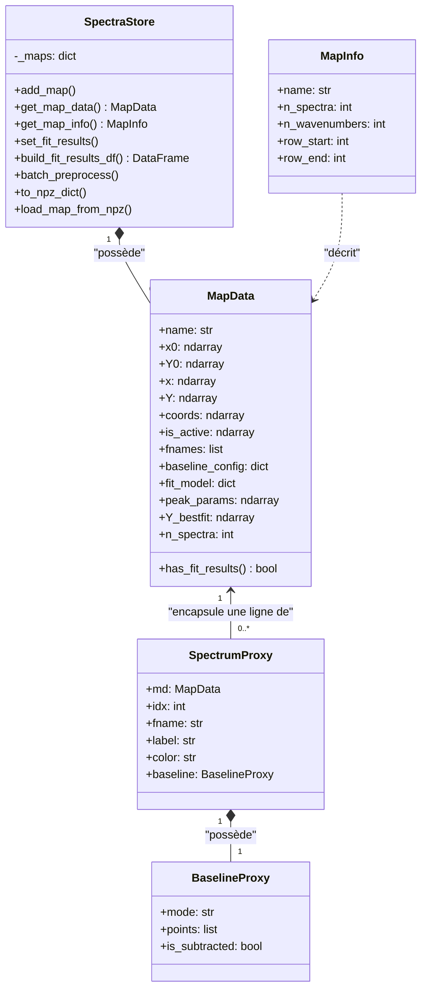

# **Architecture de données : SpectraStore**

`SpectraStore` est la **source unique de vérité** pour toutes les données spectrales numériques de SPECTROview. Les deux espaces [Spectra](spectra.md) et [Maps](maps.md) lisent et écrivent dans ce même magasin. Comprendre ce module est l'étape la plus importante pour tout nouveau contributeur.

**Fichier source** : [`spectra_store.py`](https://github.com/CEA-MetroCarac/SPECTROview/blob/main/spectroview/model/spectra/spectra_store.py)

---

## Philosophie de conception

Avant `SpectraStore` (versions antérieures à 26.24.1), SPECTROview stockait chaque spectre sous forme d'un objet Python indépendant. Cette approche créait des goulots d'étranglement sur les grandes cartes hyperspectrales comptant des milliers de spectres. La refonte centrée sur les tenseurs regroupe tous les spectres d'une « carte » logique sous forme de tableaux NumPy contigus, permettant :

- **Prétraitement vectorisé** — recadrage et soustraction de ligne de base appliqués à toute la matrice N×M en une seule opération.
- **Ajustement par lots** — le [moteur VBF](vbf_engine.md) opère directement sur le tenseur sans itération Python.
- **Accès aux cartes en O(1)** — récupérer les données d'une carte se résume à une seule recherche dans un dictionnaire, quelle que soit la taille du magasin.
- **Jeux de données hétérogènes** — chaque carte possède son propre axe X, permettant la coexistence de cartes aux plages de nombres d'onde différentes.

---

## Hiérarchie des données

```
SpectraStore
└── dict: _maps { map_name → MapData }
    │
    ├── MapData ("spectrum_A")          ← Espace Spectra : spectre unique (N=1)
    │   ├── x0: float64[M]             axe des nombres d'onde brut
    │   ├── Y0: float32[1, M]          intensités brutes (1 spectre)
    │   ├── x:  float64[M_proc]        axe traité (après recadrage)
    │   ├── Y:  float32[1, M_proc]     intensités traitées (après recadrage + ligne de base)
    │   ├── coords: float64[1, 2]      toujours (0.0, 0.0) pour un spectre ponctuel
    │   ├── fnames: ["spectrum_A"]      identifiant unique
    │   ├── fit_model: dict             définition du modèle de pics
    │   ├── peak_params: float64[1, K]  paramètres ajustés
    │   ├── fit_success: bool[1]
    │   └── ...
    │
    └── MapData ("wafer_300mm")         ← Espace Maps : carte hyperspectrale (N=2500)
        ├── x0: float64[M]
        ├── Y0: float32[2500, M]        matrice d'intensités brutes
        ├── coords: float64[2500, 2]    positions (X, Y) de platine
        ├── fnames: [str × 2500]        "wafer_300mm_(x, y)" par spectre
        ├── peak_params: float64[2500, K]
        ├── fit_success: bool[2500]
        └── ...
```

> [!IMPORTANT]
> **Un spectre isolé comme une carte hyperspectrale complète utilisent la même structure `MapData`** — ils ne diffèrent que par N (le nombre de lignes). Ce modèle unifié permet aux espaces Spectra et Maps de partager la même classe ViewModel de base (`VMWorkspaceSpectra`).

---

## `MapData` — Le bloc tensoriel

```python
@dataclass
class MapData:
    """All numerical data for a single hyperspectral map."""
    name: str
```

`MapData` est une dataclass qui détient tous les tableaux volumineux d'un jeu de données logique. Ses champs sont organisés par groupes fonctionnels :

### Tableaux spectraux (bruts immuables + traités mutables)

| Champ | Forme | dtype | Rôle |
|-------|-------|-------|------|
| `x0` | `[M]` | float64 | Axe des nombres d'onde original — **jamais modifié** |
| `Y0` | `[N, M]` | float32 | Intensités originales — **jamais modifiées** |
| `x` | `[M_proc]` | float64 | Axe de travail après recadrage/correction X (ou `None` → utilise `x0`) |
| `Y` | `[N, M_proc]` | float32 | Intensités de travail après tout prétraitement (ou `None` → utilise `Y0`) |
| `coords` | `[N, 2]` | float64 | Positions spatiales (X, Y) — toujours `(0, 0)` pour un spectre ponctuel |

> [!IMPORTANT]
> L'**architecture à double jeu de tableaux** (`x0/Y0` vs `x/Y`) est la clé du prétraitement non destructif. `x0` et `Y0` sont écrits une seule fois au chargement du fichier et **ne sont plus jamais modifiés**. Tout prétraitement produit `x` et `Y`. Appeler `reinit_spectra()` réinitialise simplement `md.x = None; md.Y = None`, faisant automatiquement revenir le magasin aux tableaux bruts.

### Métadonnées par spectre

| Champ | Longueur | Rôle |
|-------|----------|------|
| `fnames` | N | Identifiant textuel unique de chaque ligne spectrale |
| `is_active` | N | `bool` — indique si ce spectre est coché dans la liste de l'UI |
| `colors` | N | Couleur d'affichage optionnelle par spectre |
| `labels` | N | Libellé personnalisé optionnel par spectre |

### État de prétraitement (partagé par les N spectres d'une carte)

| Champ | Type | Rôle |
|-------|------|------|
| `baseline_config` | `dict` | Algorithme et paramètres de ligne de base (`mode`, `points`, `coef`, ...) |
| `is_baseline_subtracted` | `bool` ou `bool[N]` | Indique si la ligne de base a été soustraite de `Y` |
| `range_min` / `range_max` | `float` | Bornes actuelles de recadrage spectral |
| `xcorrection_value` | `float` | Décalage appliqué à l'axe X (cm⁻¹) |
| `intensity_norm_factor` | `float` | Facteur multiplicatif de normalisation d'intensité |
| `map_metadata` | `dict` | Métadonnées d'acquisition issues des fichiers WDF/SPC |

### Résultats d'ajustement (remplis après exécution du moteur VBF)

| Champ | Forme | dtype | Rôle |
|-------|-------|-------|------|
| `peak_params` | `[N, K]` | float64 | Valeurs optimisées des paramètres |
| `fit_success` | `[N]` | bool | Indicateur de convergence par spectre |
| `fit_r2` | `[N]` | float64 | Coefficient de détermination par spectre |
| `param_names` | list[str] | — | Noms des colonnes de `peak_params` (ex. `m01_x0`, `m01_fwhm`) |
| `fit_model` | `dict` | — | Définition du modèle de pics utilisé pour l'ajustement |

### Courbes de visualisation (dérivées, uniquement pour l'affichage)

| Champ | Forme | Rôle |
|-------|-------|------|
| `Y_bestfit` | `[N, M_proc]` | Courbe composite du modèle (`float32`, somme des pics + ligne de base) |
| `Y_baseline` | `[N, M_proc]` | Courbe de ligne de base évaluée (`float32` en traitement par lots) |
| `Y_peaks` | liste de `[N, M_proc]` | Vues `LazyPeakArray` évaluées à la demande par ligne sélectionnée |

---

## `MapInfo` — Descripteur léger

```python
@dataclass
class MapInfo:
    name: str
    row_start: int   # toujours 0 (conservé pour compatibilité API)
    row_end: int
    n_spectra: int
    n_wavenumbers: int
```

`MapInfo` est un résumé minimal renvoyé par `SpectraStore.get_map_info()`. Il existe pour assurer la **compatibilité API** — le code historique qui avait besoin de savoir où commençait une carte dans un tableau global continue de fonctionner sans modification, même si le tableau global n'existe plus. Privilégiez `get_map_data()` pour un accès direct.

---

## `SpectraStore` — Le conteneur

```python
class SpectraStore:
    _maps: dict[str, MapData]   # blocs de données par carte
```

`SpectraStore` est un conteneur léger adossé à un dictionnaire. Son API publique se découpe proprement en :

### Enregistrement de cartes

```python
store.add_map(name, x0, Y0, coords, fnames, ...)   # enregistre une nouvelle carte
store.remove_map(name)                              # supprime une carte et libère la mémoire
store.reorder_maps(new_order)                       # réordonne pour l'affichage dans la liste
```

### Accès aux données

```python
md   = store.get_map_data(name)                     # MapData — accès principal
info = store.get_map_info(name)                     # MapInfo — résumé léger
x, Y = store.get_xy_batch(name, indices)            # tableaux (traités) pour un sous-ensemble
```

### Résultats d'ajustement

```python
store.set_fit_results(name, indices, peak_params, success, r2, param_names, fit_model)
store.build_fit_results_df(name, map_type, peak_labels, only_converged, decimals)  # → pd.DataFrame
#   colonnes : Filename, X, Y, [Zone, Quadrant], <paramètres de pics>, R2
#   `decimals` (4 par défaut) arrondit chaque colonne numérique d'ajustement ; X/Y gardent toute leur précision.
```

### Prétraitement

```python
store.batch_preprocess(name, baseline_config, range_min, range_max)   # vectorisé
store.clear_preprocess(name)                                           # réinitialise vers x0/Y0
```

### Sérialisation

```python
store.to_npz_dict(name)              # tableaux lourds → dict pour NPZ
store.to_metadata_dict(name)         # métadonnées légères → dict pour JSON
SpectraStore.load_map_from_npz(...)  # méthode de classe : restaure depuis les tableaux sauvegardés
```

---

## `SpectrumProxy` et `BaselineProxy` — Passerelle vers la View

`SpectrumProxy` et `BaselineProxy` sont des **objets mandataires en lecture/écriture** offrant une interface par spectre sans dupliquer aucune donnée tensorielle.

```python
class SpectrumProxy:
    md: MapData       # référence vers le bloc tensoriel parent
    idx: int          # indice de ligne dans le tenseur
    fname: str        # identifiant unique

    @property
    def label(self): ...   # lit md.labels[idx]
    @label.setter          # écrit md.labels[idx]
    
    @property
    def color(self): ...   # lit md.colors[idx]
    @color.setter          # écrit md.colors[idx]
```

La View ne détient jamais de tableaux bruts. Lorsque `VMWorkspaceSpectra._emit_selected_spectra()` prépare les données destinées à `VSpectraViewer`, il emballe une liste d'objets `SpectrumProxy` aux côtés des tranches de tableaux. La View peut ainsi écrire `proxy.label = "My Label"` et la modification atterrit automatiquement dans `md.labels[idx]` sans aucun callback explicite.

---

## Relations entre classes



---

## Stratégie de gestion des données

### Stockage

Chaque spectre ou carte est stocké dans un bloc `MapData` indépendant au sein de `SpectraStore._maps`. Il n'existe ni tableau global ni index partagé, ce qui supprime l'arithmétique d'intervalles et rend la suppression en O(1) (`del _maps[name]`).

Pour chaque `MapData`, le magasin conserve **deux paires de tableaux** :

| Paire | Contenu | Mutabilité |
|-------|---------|------------|
| `x0 / Y0` | Données brutes issues du fichier | **Lecture seule** après enregistrement |
| `x / Y` | Données de travail prétraitées | Écrasées par `batch_preprocess()`, supprimées par `clear_preprocess()` |

Lorsque `x` ou `Y` vaut `None`, le magasin bascule de façon transparente sur `x0` / `Y0` dans toutes ses méthodes d'accès (`get_xy_batch`, `set_plot_data`, etc.).

### Accès

Les ViewModels récupèrent toujours les données via `SpectraStore.get_map_data(name)` qui renvoie une **référence directe** (et non une copie) vers le bloc `MapData`. Par conséquent :

- **Lectures sans copie (*zero-copy*)** — aucune donnée n'est dupliquée.
- **Écritures immédiates** — toute modification de `md.Y` est visible par tous les consommateurs pointant vers le même `md`.

C'est pourquoi le ViewModel appelle `self.store.get_map_data(fname)` au début de chaque opération au lieu de mettre `md` en cache comme attribut d'instance.

### Mises à jour et synchronisation

Le ViewModel suit un schéma de mise à jour constant après chaque modification d'état :

```
modifier MapData  →  _emit_selected_spectra()  →  [optionnel] _emit_list_update()
```

`_emit_selected_spectra()` relit tous les blocs `MapData` sélectionnés et émet une charge utile fraîche vers le visualiseur. `_emit_list_update()` relit tous les noms de cartes et émet les dictionnaires d'état servant à colorer la liste des spectres.

Ce modèle **pull-on-signal** garantit que la View reste toujours cohérente avec le modèle sans nécessiter de notifications explicites sur chaque mutation de champ.

### Gestion mémoire

- `Y0` est stocké en `float32` pour diviser par deux l'empreinte mémoire par rapport à `float64`, sans perte perceptible de précision en spectroscopie.
- Les tableaux traités `Y` ne sont alloués qu'après la première opération de prétraitement.
- `Y_bestfit`, `Y_baseline` et `Y_peaks` sont alloués paresseusement au premier ajustement.
- La suppression d'une carte via `store.remove_map(name)` retire l'entrée du dictionnaire ; le ramasse-miettes Python libère les tableaux dès qu'aucune référence ne subsiste.
- Les grands résultats intermédiaires de ligne de base ne sont pas conservés en cache — ils sont recalculés à la demande par `eval_baseline_batch()`.

---

## Pipeline de prétraitement

Tout prétraitement est **non destructif**. `x0` et `Y0` sont toujours préservés.

1. **Données brutes** : `x0` et `Y0` (immuables).
2. **Recadrage de plage** : Les tableaux sont découpés entre `md.range_min` et `md.range_max`.
3. **Correction en X** : `md.xcorrection_value` est ajouté à l'axe des nombres d'onde.
4. **Évaluation de la ligne de base** : `SpectraStore.batch_preprocess()` évalue le modèle de ligne de base pour tout le tenseur.
5. **Soustraction de ligne de base** : La ligne de base évaluée est soustraite des intensités recadrées.
6. **Tableaux de travail** : Les résultats finaux sont enregistrés dans `md.x` et `md.Y`.
7. **Utilisation aval** : Ces tableaux de travail alimentent toutes les opérations de visualisation et d'ajustement.

`SpectraStore.batch_preprocess()` applique le recadrage et la soustraction de ligne de base à la matrice N×M entière en un seul appel vectorisé. Pour l'espace Spectra (N=1), cela traite un spectre. Pour l'espace Maps (N=2500), cela traite l'ensemble du tenseur de la carte en un seul appel.

---

## Persistance

### Format moderne (v2+, basé sur ZIP)

Les fichiers d'espace de travail (`.spectra` / `.maps`) sont des archives ZIP :

| Entrée | Contenu |
|--------|---------|
| `metadata.json` | JSON léger : `format_version`, dictionnaire `store_meta` (fnames, colors, labels, baseline_config, fit_model, bornes de plage, xcorrection) |
| `arrays.npz` | Tableaux NumPy compressés : `store_{name}_x0`, `store_{name}_y0`, `store_{name}_coords`, `store_{name}_peak_params`, `store_{name}_Y_bestfit`, `store_{name}_Y_peak_{i}` |
| `dataframes.pkl` | Optionnel : `df_fit_results` sérialisé |

Cette séparation entre métadonnées JSON légères et tableaux binaires lourds permet d'inspecter rapidement les métadonnées sans charger des gigaoctets de données spectrales.

### API de sérialisation

```python
# Chemin de sauvegarde : ViewModel → SpectraStore → WorkspaceIO
metadata = store.to_metadata_dict(name)   # dictionnaire sérialisable en JSON
arrays   = store.to_npz_dict(name)        # tableaux NumPy volumineux

# Chemin de chargement : WorkspaceIO → SpectraStore
SpectraStore.load_map_from_npz(store, name, arrays, metadata)
```

---

## Dépannage

**Le prétraitement ne s'affiche pas dans le visualiseur**

- Le visualiseur reçoit `md.x` / `md.Y` depuis la charge utile. Si `batch_preprocess()` n'a pas été appelé (par exemple sans configuration de ligne de base ni recadrage), `md.x` et `md.Y` restent `None` et le visualiseur utilise `md.x0` / `md.Y0`. C'est le comportement non destructif attendu.

**La mémoire croît sans limite avec de grandes cartes**

- `md.Y_bestfit`, `md.Y_baseline` et `md.Y_peaks` ne sont libérés que lors de la suppression de la carte ou d'un appel à `reinit_spectra()` (qui les remet à `None`). Sur de très grandes cartes, appelez `store.remove_map()` sur les cartes qui ne sont plus utiles.

**`get_map_data()` renvoie `None`**

- Le nom de la carte est sensible à la casse et doit correspondre exactement à la clé passée à `add_map()`. Vérifiez `store.map_names` pour consulter les clés enregistrées.

**La sémantique *zero-copy* provoque des effets de bord inattendus**

- Comme `get_map_data()` renvoie une référence directe, modifier `md.Y` affecte tous les consommateurs. Passez toujours par le pipeline établi mutation-puis-signal du ViewModel pour garantir la cohérence de l'interface.
