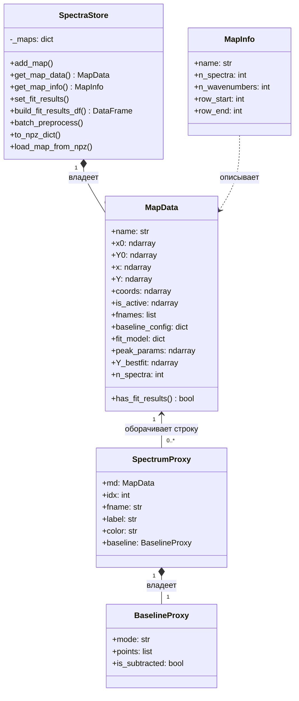

# **Архитектура данных: SpectraStore** { #data-architecture-spectrastore }

`SpectraStore` — это **единый источник истины** (*single source of truth*) для всех числовых спектральных данных в SPECTROview. Обе рабочие области — [**Спектры**](spectra.md) (Spectra) и [**Карты**](maps.md) (Maps) — читают данные из одного и того же хранилища и записывают их в него. Понимание устройства этого модуля — самый важный шаг для любого нового разработчика.

**Исходный файл**: [`spectra_store.py`](https://github.com/CEA-MetroCarac/SPECTROview/blob/main/spectroview/model/spectra/spectra_store.py)

---

## Философия проектирования { #design-philosophy }

До появления `SpectraStore` (в версиях до 26.24.1) SPECTROview хранил каждый спектр как независимый объект Python. Это создавало узкие места в производительности при работе с большими гиперспектральными картами, насчитывающими тысячи спектров. Тензорно-ориентированная архитектура объединяет все спектры логической «карты» в непрерывные массивы NumPy, что обеспечивает:

- **Векторизованную предобработку** — обрезка диапазона и вычитание базовой линии применяются ко всей матрице N×M за одну операцию.
- **Пакетную аппроксимацию** — [движок VBF](vbf_engine.md) работает непосредственно с тензором без итераций на уровне Python.
- **Доступ к картам за O(1)** — получение данных карты сводится к одному поиску в словаре независимо от размера хранилища.
- **Гетерогенные наборы данных** — у каждой карты собственная ось X, поэтому карты с разными диапазонами волновых чисел без проблем сосуществуют в одном хранилище.

---

## Иерархия данных { #data-hierarchy }

```
SpectraStore
└── dict: _maps { map_name → MapData }
    │
    ├── MapData ("spectrum_A")          ← Spectra workspace: single spectrum (N=1)
    │   ├── x0: float64[M]             raw wavenumber axis
    │   ├── Y0: float32[1, M]          raw intensity (1 spectrum)
    │   ├── x:  float64[M_proc]        processed axis (after crop)
    │   ├── Y:  float32[1, M_proc]     processed intensity (after crop + baseline)
    │   ├── coords: float64[1, 2]      always (0.0, 0.0) for point spectra
    │   ├── fnames: ["spectrum_A"]      unique identifier
    │   ├── fit_model: dict             peak model definition
    │   ├── peak_params: float64[1, K]  fitted parameters
    │   ├── fit_success: bool[1]
    │   └── ...
    │
    └── MapData ("wafer_300mm")         ← Maps workspace: hyperspectral map (N=2500)
        ├── x0: float64[M]
        ├── Y0: float32[2500, M]        raw intensity matrix
        ├── coords: float64[2500, 2]    (X, Y) stage positions
        ├── fnames: [str × 2500]        "wafer_300mm_(x, y)" per spectrum
        ├── peak_params: float64[2500, K]
        ├── fit_success: bool[2500]
        └── ...
```

> [!IMPORTANT]
> **И отдельный спектр, и целая гиперспектральная карта используют одну и ту же структуру `MapData`** — они различаются только значением N (числом строк). Такая унифицированная модель позволяет рабочим областям «Спектры» и «Карты» использовать общий базовый класс ViewModel (`VMWorkspaceSpectra`).

---

## `MapData` — тензорный блок { #mapdata-the-tensor-block }

```python
@dataclass
class MapData:
    """All numerical data for a single hyperspectral map."""
    name: str
```

`MapData` — это класс данных (`dataclass`), которому принадлежат все крупные массивы одного логического набора данных. Его поля объединены в функциональные группы:

### Спектральные массивы (неизменяемые исходные + изменяемые обработанные) { #spectral-arrays-immutable-raw-mutable-processed }

| Поле | Размерность | dtype | Назначение |
|------|-------------|-------|------------|
| `x0` | `[M]` | float64 | Исходная ось волновых чисел — **никогда не изменяется** |
| `Y0` | `[N, M]` | float32 | Исходные интенсивности — **никогда не изменяются** |
| `x` | `[M_proc]` | float64 | Рабочая ось после обрезки и X-коррекции (или `None` → используется `x0`) |
| `Y` | `[N, M_proc]` | float32 | Рабочие интенсивности после всей предобработки (или `None` → используется `Y0`) |
| `coords` | `[N, 2]` | float64 | Пространственные координаты (X, Y) — для точечных спектров всегда `(0, 0)` |

> [!IMPORTANT]
> **Архитектура с двумя парами массивов** (`x0/Y0` и `x/Y`) лежит в основе неразрушающей предобработки. Массивы `x0` и `Y0` записываются один раз при загрузке файла и **больше никогда не затрагиваются**. Вся предобработка формирует `x` и `Y`. Вызов `reinit_spectra()` просто устанавливает `md.x = None; md.Y = None`, возвращая хранилище к исходным массивам.

### Метаданные для каждого спектра { #per-spectrum-metadata }

| Поле | Длина | Назначение |
|------|-------|------------|
| `fnames` | N | Уникальный строковый идентификатор для каждой строки спектра |
| `is_active` | N | `bool` — отмечен ли этот спектр в списке пользовательского интерфейса |
| `colors` | N | Необязательный цвет отображения для каждого спектра |
| `labels` | N | Необязательная пользовательская подпись для отображения |

### Состояние предобработки (общее для всех N спектров карты) { #preprocessing-state-shared-across-all-n-spectra-in-a-map }

| Поле | Тип | Назначение |
|------|-----|------------|
| `baseline_config` | `dict` | Алгоритм и параметры базовой линии (`mode`, `points`, `coef`, ...) |
| `is_baseline_subtracted` | `bool` или `bool[N]` | Была ли из `Y` вычтена базовая линия |
| `range_min` / `range_max` | `float` | Текущие границы обрезки спектрального диапазона |
| `xcorrection_value` | `float` | Применённый сдвиг по оси X (cm⁻¹) |
| `intensity_norm_factor` | `float` | Мультипликативный коэффициент нормировки интенсивности |
| `map_metadata` | `dict` | Метаданные измерения из файлов WDF/SPC |

### Результаты аппроксимации (заполняются после запуска движка VBF) { #fit-results-filled-after-vbf-engine-runs }

| Поле | Размерность | dtype | Назначение |
|------|-------------|-------|------------|
| `peak_params` | `[N, K]` | float64 | Оптимизированные значения параметров |
| `fit_success` | `[N]` | bool | Флаг сходимости для каждого спектра |
| `fit_r2` | `[N]` | float64 | Коэффициент детерминации для каждого спектра |
| `param_names` | list[str] | — | Названия столбцов для `peak_params` (например, `m01_x0`, `m01_fwhm`) |
| `fit_model` | `dict` | — | Определение модели пиков, использованной при аппроксимации |

### Кривые визуализации (производные, только для отрисовки) { #visualization-curves-derived-for-rendering-only }

| Поле | Размерность | Назначение |
|------|-------------|------------|
| `Y_bestfit` | `[N, M_proc]` | Составная кривая модели (`float32`, сумма всех пиков + базовая линия) |
| `Y_baseline` | `[N, M_proc]` | Вычисленная кривая базовой линии (`float32` при пакетном вычислении) |
| `Y_peaks` | список из `[N, M_proc]` | Представления `LazyPeakArray` для отдельных пиков, вычисляемые по запросу для выбранного среза строк |

---

## `MapInfo` — лёгкий дескриптор { #mapinfo-lightweight-descriptor }

```python
@dataclass
class MapInfo:
    name: str
    row_start: int   # always 0 (kept for API compatibility)
    row_end: int
    n_spectra: int
    n_wavenumbers: int
```

`MapInfo` — это краткая сводка, возвращаемая методом `SpectraStore.get_map_info()`. Она сохранена для **совместимости API**: старый код, которому требовалось знать, «с какой строки эта карта начинается в глобальном массиве», продолжает работать без изменений, хотя самого глобального массива больше не существует. Для прямого доступа рекомендуется использовать `get_map_data()`.

---

## `SpectraStore` — контейнер { #spectrastore-the-container }

```python
class SpectraStore:
    _maps: dict[str, MapData]   # per-map data blocks
```

`SpectraStore` — это лёгкий контейнер на основе словаря. Его публичный API чётко разделён на следующие группы:

### Регистрация карт { #map-registration }

```python
store.add_map(name, x0, Y0, coords, fnames, ...)   # register a new map
store.remove_map(name)                              # delete a map and free memory
store.reorder_maps(new_order)                       # reorder for list display
```

### Доступ к данным { #data-access }

```python
md   = store.get_map_data(name)                     # MapData — primary access
info = store.get_map_info(name)                     # MapInfo — lightweight summary
x, Y = store.get_xy_batch(name, indices)            # (processed) arrays for subset
```

### Результаты аппроксимации { #fit-results }

```python
store.set_fit_results(name, indices, peak_params, success, r2, param_names, fit_model)
store.build_fit_results_df(name, map_type, peak_labels, only_converged, decimals)  # → pd.DataFrame
#   columns: Filename, X, Y, [Zone, Quadrant], <peak params>, R2
#   `decimals` (default 4) rounds every numeric fit column; X/Y stay full-precision.
```

### Предобработка { #preprocessing }

```python
store.batch_preprocess(name, baseline_config, range_min, range_max)   # vectorized
store.clear_preprocess(name)                                           # reset to x0/Y0
```

### Сериализация { #serialization }

```python
store.to_npz_dict(name)              # heavy arrays → dict for NPZ
store.to_metadata_dict(name)         # lightweight metadata → dict for JSON
SpectraStore.load_map_from_npz(...)  # class method: restore from saved arrays
```

---

## `SpectrumProxy` и `BaselineProxy` — мост к слою View { #spectrumproxy-and-baselineproxy-view-bridge }

`SpectrumProxy` и `BaselineProxy` — это **прокси-объекты для чтения и записи**, предоставляющие интерфейс для работы с отдельным спектром без дублирования тензорных данных.

```python
class SpectrumProxy:
    md: MapData       # reference to the parent tensor block
    idx: int          # row index within the tensor
    fname: str        # unique identifier

    @property
    def label(self): ...   # reads md.labels[idx]
    @label.setter          # writes md.labels[idx]
    
    @property
    def color(self): ...   # reads md.colors[idx]
    @color.setter          # writes md.colors[idx]
```

Слой View никогда не хранит исходные массивы. Когда метод `VMWorkspaceSpectra._emit_selected_spectra()` формирует полезную нагрузку для `VSpectraViewer`, он передаёт список объектов `SpectrumProxy` вместе со срезами массивов. Благодаря этому View может выполнить `proxy.label = "My Label"`, и изменение автоматически сохраняется в `md.labels[idx]` без какого-либо явного обратного вызова.

---

## Связи между классами { #class-relationships }



---

## Стратегия управления данными { #data-management-strategy }

### Хранение { #storage }

Каждый спектр или карта хранится как независимый блок `MapData` в `SpectraStore._maps`. Здесь нет ни глобального массива, ни общего индекса. Это избавляет от арифметики диапазонов и обеспечивает удаление за время O(1) (`del _maps[name]`).

Для каждого объекта `MapData` хранилище поддерживает **две пары массивов**:

| Пара | Содержимое | Изменяемость |
|------|------------|--------------|
| `x0 / Y0` | Исходные данные, загруженные из файла | **Только чтение** после регистрации |
| `x / Y` | Предобработанные рабочие данные | Перезаписываются методом `batch_preprocess()`, удаляются методом `clear_preprocess()` |

Когда `x` или `Y` равны `None`, хранилище во всех методах доступа (`get_xy_batch`, `set_plot_data` и др.) прозрачно переходит к `x0` / `Y0`.

### Получение данных { #retrieval }

Компоненты ViewModel всегда получают данные через `SpectraStore.get_map_data(name)`, который возвращает **прямую ссылку** (не копию) на блок `MapData`. Это означает:

- **Чтение без копирования (*zero-copy*)** — данные не дублируются.
- **Мгновенная запись** — любое изменение `md.Y` сразу же становится видимым во всех компонентах, ссылающихся на тот же объект `md`.

По этой причине ViewModel вызывает `self.store.get_map_data(fname)` в начале каждой операции, а не кэширует `md` в виде атрибута экземпляра.

### Обновления и синхронизация { #updates-and-synchronization }

После каждого изменения состояния ViewModel следует единой схеме обновления:

```
mutate MapData  →  _emit_selected_spectra()  →  [optional] _emit_list_update()
```

`_emit_selected_spectra()` повторно считывает все выбранные блоки `MapData` и отправляет в визуализатор свежую полезную нагрузку. `_emit_list_update()` перечитывает имена всех карт и отправляет словари состояний для цветовой индикации списка спектров.

Такой паттерн **запроса по сигналу (*pull-on-signal*)** гарантирует, что View всегда остаётся согласованным с моделью без необходимости явных уведомлений при изменении каждого отдельного поля.

### Управление памятью { #memory-management }

- Массив `Y0` хранится в формате `float32`, что вдвое уменьшает объём занимаемой памяти по сравнению с `float64` без ощутимой потери точности для спектроскопии.
- Обработанные массивы `Y` выделяются только после первой операции предобработки.
- `Y_bestfit`, `Y_baseline` и `Y_peaks` выделяются лениво при первой аппроксимации.
- Удаление карты с помощью `store.remove_map(name)` удаляет запись из словаря; сборщик мусора Python освобождает массивы, как только на них не остаётся других ссылок.
- Крупные промежуточные результаты вычисления базовой линии не кэшируются — они пересчитываются по требованию методом `eval_baseline_batch()`.

---

## Конвейер предобработки { #preprocessing-pipeline }

Любая предобработка выполняется **неразрушающим образом**. `x0` и `Y0` всегда сохраняются.

1. **Исходные данные**: `x0` и `Y0` (неизменяемые).
2. **Обрезка диапазона**: массивы обрезаются в границах между `md.range_min` и `md.range_max`.
3. **X-коррекция**: к оси волновых чисел прибавляется значение `md.xcorrection_value`.
4. **Вычисление базовой линии**: `SpectraStore.batch_preprocess()` вычисляет модель базовой линии для всего тензора.
5. **Вычитание базовой линии**: вычисленная базовая линия вычитается из обрезанных интенсивностей.
6. **Рабочие массивы**: итоговые результаты сохраняются в `md.x` и `md.Y`.
7. **Дальнейшее использование**: эти рабочие массивы применяются во всех операциях визуализации и аппроксимации.

`SpectraStore.batch_preprocess()` применяет обрезку диапазона и вычитание базовой линии ко всей матрице N×M за один векторизованный вызов. Для рабочей области «Спектры» (N=1) обрабатывается один спектр. Для рабочей области «Карты» (N=2500) за один вызов обрабатывается весь тензор карты.

---

## Постоянное хранение { #persistence }

### Современный формат (v2+, на основе ZIP) { #modern-format-v2-zip-backed }

Файлы рабочих областей (`.spectra` / `.maps`) представляют собой ZIP-архивы:

| Элемент | Содержимое |
|---------|------------|
| `metadata.json` | Лёгкий JSON: `format_version`, словарь `store_meta` (`fnames`, `colors`, `labels`, `baseline_config`, `fit_model`, границы диапазона, `xcorrection`) |
| `arrays.npz` | Сжатые массивы NumPy: `store_{name}_x0`, `store_{name}_y0`, `store_{name}_coords`, `store_{name}_peak_params`, `store_{name}_Y_bestfit`, `store_{name}_Y_peak_{i}` |
| `dataframes.pkl` | Необязательный элемент: сериализованный `df_fit_results` |

Разделение лёгких метаданных JSON и объёмных бинарных массивов позволяет быстро просматривать метаданные без загрузки гигабайтов спектральных данных.

### API сериализации { #serialization-api }

```python
# Save path: ViewModel → SpectraStore → WorkspaceIO
metadata = store.to_metadata_dict(name)   # JSON-serializable dict
arrays   = store.to_npz_dict(name)        # heavy NumPy arrays

# Load path: WorkspaceIO → SpectraStore
SpectraStore.load_map_from_npz(store, name, arrays, metadata)
```

---

## Устранение неполадок { #troubleshooting }

**Предобработка не отображается в визуализаторе**

- Визуализатор получает `md.x` / `md.Y` из полезной нагрузки. Если `batch_preprocess()` не вызывался (например, при отсутствии конфигурации базовой линии и обрезки диапазона), `md.x` и `md.Y` остаются равными `None`, и визуализатор обращается к `md.x0` / `md.Y0`. Это ожидаемое неразрушающее поведение.

**При больших картах память растёт неограниченно**

- `md.Y_bestfit`, `md.Y_baseline` и `md.Y_peaks` не освобождаются до удаления карты или вызова `reinit_spectra()` (который сбрасывает их в `None`). При работе с очень крупными картами вызывайте `store.remove_map()` для карт, которые больше не требуются.

**`get_map_data()` возвращает `None`**

- Имя карты чувствительно к регистру и должно точно совпадать с ключом, использованным в `add_map()`. Проверьте зарегистрированные ключи в `store.map_names`.

**Семантика zero-copy приводит к неожиданным побочным эффектам**

- Поскольку `get_map_data()` возвращает прямую ссылку, изменение `md.Y` в любом месте влияет на всех потребителей. Всегда работайте через принятый во ViewModel конвейер «изменение, затем сигнал» (*mutate-then-signal*), чтобы поддерживать согласованность интерфейса.
