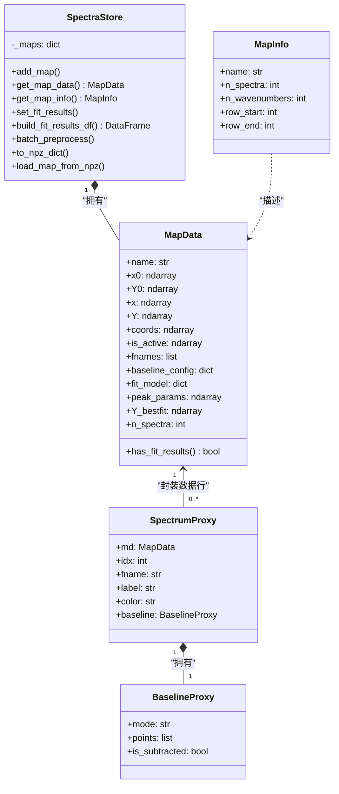

# **数据架构：SpectraStore** { #data-architecture-spectrastore }

`SpectraStore` 是 SPECTROview 中所有数值型光谱数据的**单一数据源**。[光谱 (Spectra)](spectra.md) 与 [二维图谱 (Maps)](maps.md) 两个工作区均从同一个存储中读写数据。理解该模块是每一位新贡献者入门的最重要一步。

**源文件**：[`spectra_store.py`](https://github.com/CEA-MetroCarac/SPECTROview/blob/main/spectroview/model/spectra/spectra_store.py)

---

## 设计理念 { #design-philosophy }

在引入 `SpectraStore` 之前（26.24.1 之前的版本），SPECTROview 将每条光谱存储为独立的 Python 对象。这在处理包含数千条光谱的大型高光谱二维图谱时会造成性能瓶颈。以张量为中心的重构将逻辑上属于同一“二维图谱”的所有光谱存储为连续的 NumPy 数组，从而实现：

- **向量化预处理** —— 在单次操作中对整个 N×M 矩阵应用范围裁剪与基线扣除。
- **批量拟合** —— [VBF 引擎](vbf_engine.md)直接对张量进行运算，无需 Python 层级的循环迭代。
- **O(1) 二维图谱访问** —— 无论存储规模大小，获取二维图谱数据只需一次字典查找。
- **异构数据集** —— 每个二维图谱各自拥有独立的 X 轴，因此不同波数范围的二维图谱可以顺畅共存。

---

## 数据层级结构 { #data-hierarchy }

```
SpectraStore
└── dict: _maps { map_name → MapData }
    │
    ├── MapData ("spectrum_A")          ← Spectra workspace: single spectrum (N=1)
    │   ├── x0: float64[M]             raw wavenumber axis
    │   ├── Y0: float32[1, M]          raw intensity (1 spectrum)
    │   ├── x:  float64[M_proc]        processed axis (after crop)
    │   ├── Y:  float32[1, M_proc]     processed intensity (after crop + baseline)
    │   ├── coords: float64[1, 2]      always (0.0, 0.0) for point spectra
    │   ├── fnames: ["spectrum_A"]      unique identifier
    │   ├── fit_model: dict             peak model definition
    │   ├── peak_params: float64[1, K]  fitted parameters
    │   ├── fit_success: bool[1]
    │   └── ...
    │
    └── MapData ("wafer_300mm")         ← Maps workspace: hyperspectral map (N=2500)
        ├── x0: float64[M]
        ├── Y0: float32[2500, M]        raw intensity matrix
        ├── coords: float64[2500, 2]    (X, Y) stage positions
        ├── fnames: [str × 2500]        "wafer_300mm_(x, y)" per spectrum
        ├── peak_params: float64[2500, K]
        ├── fit_success: bool[2500]
        └── ...
```

> [!IMPORTANT]
> **单条光谱与完整的高光谱二维图谱均使用相同的 `MapData` 结构** —— 二者仅在行数 N 上有所区别。正是这一统一模型使光谱工作区与二维图谱工作区能够共享同一个 ViewModel 基类（`VMWorkspaceSpectra`）。

---

## `MapData` —— 张量数据块 { #mapdata-the-tensor-block }

```python
@dataclass
class MapData:
    """All numerical data for a single hyperspectral map."""
    name: str
```

`MapData` 是一个 dataclass，用于持有单个逻辑数据集的所有大型数组。其字段按功能分组组织：

### 光谱数组（不可变原始数据 + 可变已处理数据） { #spectral-arrays-immutable-raw-mutable-processed }

| 字段 | 形状 | dtype | 用途 |
|------|------|-------|------|
| `x0` | `[M]` | float64 | 原始波数轴 —— **永不修改** |
| `Y0` | `[N, M]` | float32 | 原始强度数据 —— **永不修改** |
| `x` | `[M_proc]` | float64 | 裁剪或 X 轴校正后的工作波数轴（若为 `None` → 使用 `x0`） |
| `Y` | `[N, M_proc]` | float32 | 完成所有预处理后的工作强度矩阵（若为 `None` → 使用 `Y0`） |
| `coords` | `[N, 2]` | float64 | 空间 (X, Y) 坐标 —— 对于单点光谱始终为 `(0, 0)` |

> [!IMPORTANT]
> **双数组设计**（`x0/Y0` 与 `x/Y`）是实现非破坏性预处理的关键。`x0` 和 `Y0` 在加载文件时写入一次，此后**永不再改动**。所有预处理操作都会生成 `x` 和 `Y`。调用 `reinit_spectra()` 只需将 `md.x = None; md.Y = None`，即可让存储自动回退至原始数组。

### 单条光谱元数据 { #per-spectrum-metadata }

| 字段 | 长度 | 用途 |
|------|------|------|
| `fnames` | N | 每行光谱的唯一字符串标识符 |
| `is_active` | N | `bool` —— 指示该光谱在 UI 列表中是否处于勾选激活状态 |
| `colors` | N | 可选的每条光谱显示颜色 |
| `labels` | N | 可选的用户自定义显示标签 |

### 预处理状态（在二维图谱的所有 N 条光谱间共享） { #preprocessing-state-shared-across-all-n-spectra-in-a-map }

| 字段 | 类型 | 用途 |
|------|------|------|
| `baseline_config` | `dict` | 基线算法及其参数（`mode`、`points`、`coef` 等） |
| `is_baseline_subtracted` | `bool` 或 `bool[N]` | 指示 `Y` 是否已完成基线扣除 |
| `range_min` / `range_max` | `float` | 当前光谱裁剪范围边界 |
| `xcorrection_value` | `float` | 已施加的 X 轴平移校正值（cm⁻¹） |
| `intensity_norm_factor` | `float` | 强度乘法归一化因子 |
| `map_metadata` | `dict` | 来自 WDF/SPC 文件的采集元数据 |

### 拟合结果（VBF 引擎运行后填充） { #fit-results-filled-after-vbf-engine-runs }

| 字段 | 形状 | dtype | 用途 |
|------|------|-------|------|
| `peak_params` | `[N, K]` | float64 | 优化后的拟合参数值 |
| `fit_success` | `[N]` | bool | 每条光谱的收敛标志 |
| `fit_r2` | `[N]` | float64 | 每条光谱的决定系数 |
| `param_names` | list[str] | — | `peak_params` 的列标签（例如 `m01_x0`、`m01_fwhm`） |
| `fit_model` | `dict` | — | 用于拟合的峰模型定义 |

### 可视化曲线（派生数据，仅用于渲染） { #visualization-curves-derived-for-rendering-only }

| 字段 | 形状 | 用途 |
|------|------|------|
| `Y_bestfit` | `[N, M_proc]` | 拟合合成模型曲线（`float32`，所有峰与基线之和） |
| `Y_baseline` | `[N, M_proc]` | 计算得到的基线曲线（批量计算时为 `float32`） |
| `Y_peaks` | `[N, M_proc]` 组成的列表 | 按需针对所选切片行计算的逐峰 `LazyPeakArray` 视图 |

---

## `MapInfo` —— 轻量级描述符 { #mapinfo-lightweight-descriptor }

```python
@dataclass
class MapInfo:
    name: str
    row_start: int   # always 0 (kept for API compatibility)
    row_end: int
    n_spectra: int
    n_wavenumbers: int
```

`MapInfo` 是由 `SpectraStore.get_map_info()` 返回的精简摘要对象。它的存在是为了保障 **API 兼容性** —— 尽管全局数组已不复存在，原先需要知道“该二维图谱在全局数组中从何处开始”的旧代码仍可无需修改而继续运行。如需直接访问数据，建议优先使用 `get_map_data()`。

---

## `SpectraStore` —— 存储容器 { #spectrastore-the-container }

```python
class SpectraStore:
    _maps: dict[str, MapData]   # per-map data blocks
```

`SpectraStore` 是一个由字典支撑的轻量级容器，其公开 API 清晰地划分为以下几个部分：

### 二维图谱注册 { #map-registration }

```python
store.add_map(name, x0, Y0, coords, fnames, ...)   # register a new map
store.remove_map(name)                              # delete a map and free memory
store.reorder_maps(new_order)                       # reorder for list display
```

### 数据访问 { #data-access }

```python
md   = store.get_map_data(name)                     # MapData — primary access
info = store.get_map_info(name)                     # MapInfo — lightweight summary
x, Y = store.get_xy_batch(name, indices)            # (processed) arrays for subset
```

### 拟合结果 { #fit-results }

```python
store.set_fit_results(name, indices, peak_params, success, r2, param_names, fit_model)
store.build_fit_results_df(name, map_type, peak_labels, only_converged, decimals)  # → pd.DataFrame
#   columns: Filename, X, Y, [Zone, Quadrant], <peak params>, R2
#   `decimals` (default 4) rounds every numeric fit column; X/Y stay full-precision.
```

### 预处理 { #preprocessing }

```python
store.batch_preprocess(name, baseline_config, range_min, range_max)   # vectorized
store.clear_preprocess(name)                                           # reset to x0/Y0
```

### 序列化 { #serialization }

```python
store.to_npz_dict(name)              # heavy arrays → dict for NPZ
store.to_metadata_dict(name)         # lightweight metadata → dict for JSON
SpectraStore.load_map_from_npz(...)  # class method: restore from saved arrays
```

---

## `SpectrumProxy` 与 `BaselineProxy` —— View 层桥梁 { #spectrumproxy-and-baselineproxy-view-bridge }

`SpectrumProxy` 和 `BaselineProxy` 是**可读写代理对象**，它们在不复制任何张量数据的前提下提供了面向单条光谱的访问接口。

```python
class SpectrumProxy:
    md: MapData       # reference to the parent tensor block
    idx: int          # row index within the tensor
    fname: str        # unique identifier

    @property
    def label(self): ...   # reads md.labels[idx]
    @label.setter          # writes md.labels[idx]
    
    @property
    def color(self): ...   # reads md.colors[idx]
    @color.setter          # writes md.colors[idx]
```

View 层从不直接持有原始数组。当 `VMWorkspaceSpectra._emit_selected_spectra()` 为 `VSpectraViewer` 准备数据负载时，会将一组 `SpectrumProxy` 对象与数组切片打包在一起。这样 View 层只需调用 `proxy.label = "My Label"`，变更便会自动写入 `md.labels[idx]`，无需任何显式回调。

---

## 类关系图 { #class-relationships }



---

## 数据管理策略 { #data-management-strategy }

### 存储 { #storage }

每条光谱或二维图谱都作为独立的 `MapData` 数据块存储在 `SpectraStore._maps` 中，不存在全局数组或共享索引。这消除了区间偏移计算，并使删除操作达到 O(1) 复杂度（`del _maps[name]`）。

对于每个 `MapData`，存储中都维护着**两对数组**：

| 数组对 | 内容 | 可变性 |
|--------|------|--------|
| `x0 / Y0` | 从文件加载的原始数据 | 注册后**只读** |
| `x / Y` | 预处理后的工作数据 | 由 `batch_preprocess()` 覆写，由 `clear_preprocess()` 清除 |

当 `x` 或 `Y` 为 `None` 时，存储会在所有访问方法（`get_xy_batch`、`set_plot_data` 等）中透明地回退至 `x0` / `Y0`。

### 数据获取 { #retrieval }

ViewModel 始终通过 `SpectraStore.get_map_data(name)` 获取数据，该方法返回指向 `MapData` 数据块的**直接引用**（而非副本）。这意味着：

- **读取过程零拷贝** —— 不会复制任何数据。
- **写入即时生效** —— 对 `md.Y` 所做的任何修改，在持有同一 `md` 引用的所有位置均立即可见。

正因如此，ViewModel 会在每次操作开始时调用 `self.store.get_map_data(fname)`，而不是将 `md` 缓存为实例变量。

### 更新与同步 { #updates-and-synchronization }

每次状态变更后，ViewModel 都遵循一致的更新模式：

```
mutate MapData  →  _emit_selected_spectra()  →  [optional] _emit_list_update()
```

`_emit_selected_spectra()` 会重新读取所有选中的 `MapData` 数据块，并向光谱查看器发射一份新的数据负载。`_emit_list_update()` 则会重新读取所有二维图谱名称，并发射用于着色光谱列表的状态字典。

这种**基于信号的拉取 (pull-on-signal)** 模式确保 View 始终与 Model 保持一致，而无需在每次字段变更时发出显式通知。

### 内存管理 { #memory-management }

- `Y0` 以 `float32` 格式存储，相较于 `float64` 可减少一半内存占用，且在光谱分析中不会产生可察觉的精度损失。
- 已处理数组 `Y` 仅在首次执行预处理操作时才分配内存。
- `Y_bestfit`、`Y_baseline` 和 `Y_peaks` 均在首次拟合时延迟分配内存。
- 使用 `store.remove_map(name)` 删除二维图谱会移除对应的字典条目；当不再存在其他引用时，Python 垃圾回收机制会释放相应数组。
- 基线计算的大型中间结果不会被缓存 —— 它们由 `eval_baseline_batch()` 按需实时重新计算。

---

## 预处理流程 { #preprocessing-pipeline }

所有预处理均为**非破坏性**操作，`x0` 和 `Y0` 始终保持不变。

1. **原始数据**：`x0` 与 `Y0`（不可变）。
2. **范围裁剪**：在 `md.range_min` 与 `md.range_max` 之间对数组进行切片。
3. **X 轴校正**：将 `md.xcorrection_value` 累加到波数轴上。
4. **基线计算**：`SpectraStore.batch_preprocess()` 为整个张量计算基线模型。
5. **基线扣除**：从裁剪后的强度矩阵中减去计算得到的基线。
6. **工作数组**：最终结果保存在 `md.x` 与 `md.Y` 中。
7. **下游使用**：所有可视化与拟合操作均使用这组工作数组。

`SpectraStore.batch_preprocess()` 在单次向量化调用中即可对整个 N×M 矩阵完成范围裁剪与基线扣除。对于光谱工作区（N=1），该操作处理单条光谱；对于二维图谱工作区（N=2500），则在一次调用中处理整个二维图谱张量。

---

## 持久化 { #persistence }

### 现代格式（v2+，基于 ZIP 归档） { #modern-format-v2-zip-backed }

工作区文件（`.spectra` / `.maps`）本质上是 ZIP 压缩归档：

| 条目 | 内容 |
|------|------|
| `metadata.json` | 轻量级 JSON：`format_version`、`store_meta` 字典（fnames、colors、labels、baseline_config、fit_model、范围边界、xcorrection） |
| `arrays.npz` | NumPy 压缩数组：`store_{name}_x0`、`store_{name}_y0`、`store_{name}_coords`、`store_{name}_peak_params`、`store_{name}_Y_bestfit`、`store_{name}_Y_peak_{i}` |
| `dataframes.pkl` | 可选：pickle 序列化的 `df_fit_results` |

将轻量级 JSON 元数据与大型二进制数组分离，使得无需加载数 GB 的光谱数据即可快速检视元数据。

### 序列化 API { #serialization-api }

```python
# Save path: ViewModel → SpectraStore → WorkspaceIO
metadata = store.to_metadata_dict(name)   # JSON-serializable dict
arrays   = store.to_npz_dict(name)        # heavy NumPy arrays

# Load path: WorkspaceIO → SpectraStore
SpectraStore.load_map_from_npz(store, name, arrays, metadata)
```

---

## 故障排查 { #troubleshooting }

**预处理结果未应用到查看器**

- 查看器从数据负载中接收 `md.x` / `md.Y`。如果尚未调用 `batch_preprocess()`（例如未配置基线也未设置范围裁剪），`md.x` 和 `md.Y` 将保持为 `None`，此时查看器会回退使用 `md.x0` / `md.Y0`。这是预期的非破坏性行为。

**处理大型二维图谱时内存持续增长**

- `md.Y_bestfit`、`md.Y_baseline` 和 `md.Y_peaks` 在二维图谱被删除或调用 `reinit_spectra()`（将其重置为 `None`）之前不会被释放。对于超大型二维图谱，建议对不再需要的数据调用 `store.remove_map()` 进行清理。

**`get_map_data()` 返回 `None`**

- 二维图谱名称区分大小写，必须与传给 `add_map()` 的键名完全一致。可通过查看 `store.map_names` 来确认已注册的键名。

**零拷贝语义导致意外的副作用**

- 由于 `get_map_data()` 返回的是直接引用，在任何位置修改 `md.Y` 都会影响所有使用方。请始终通过 ViewModel 既定的“修改后发射信号（mutate-then-signal）”流程操作，以确保 UI 状态一致。
