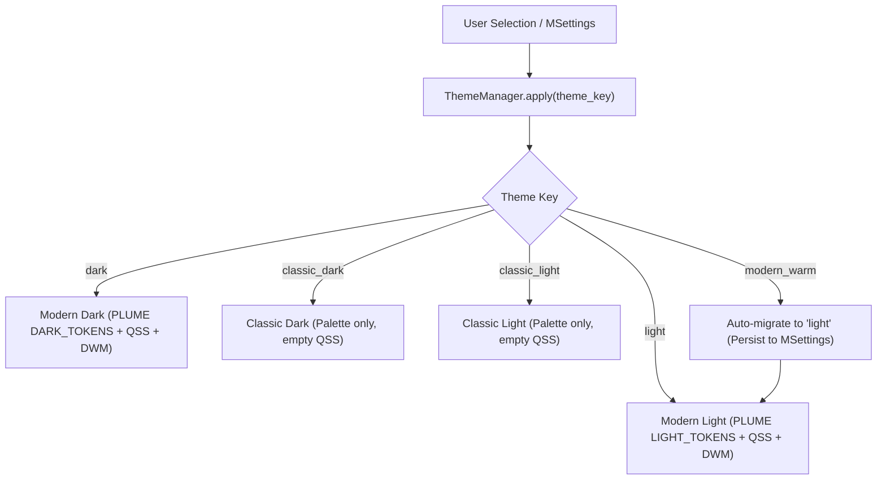

# **SPECTROview Theme & Design System Architecture**

This specification defines the design system, color tokens, typography, component geometry, native OS integration, and vector SVG icon engine for **SPECTROview**. The architecture is adapted directly from the production-proven design system in **PLUME** (`C:\Users\VL251876\Documents\Python\PLUME_perso`), specifically auditing commits `4af3dbb` and `8242faf`.

---

## 1. Overview & Design Philosophy

The SPECTROview UI/UX redesign upgrades the application from legacy rasterized icons, disconnected palettes, and ad-hoc QSS overrides into a unified, token-driven scientific design system.

### PLUME Architectural Reference Commits

1. **`4af3dbb` — Core Token Engine, Integer RGBA, Native DWM & Vector Icon Engine**:
   - **Central Token Bag (`ThemeTokens`)**: Frozen dataclass containing semantic color tokens rather than per-widget hardcoded colors.
   - **Synchronized `QPalette` (`_palette_for`)**: Maps design tokens directly to standard Qt palette roles (`Window`, `WindowText`, `Base`, `AlternateBase`, `Button`, `Highlight`, `Text`, etc.) ensuring native Qt widgets, item delegates, and file dialogs inherit consistent colors.
   - **Strict Integer RGBA Alpha**: Qt's QSS parser rejects floating-point alpha channels (e.g. `rgba(91, 140, 255, 0.25)`). PLUME enforces strict integer alpha values `0..255` across all translucent tokens (e.g. `rgba(91, 140, 255, 42)`).
   - **Native Windows 11 DWM Title Bar Integration**: Uses `dwmapi.dll` (`DwmSetWindowAttribute`) to theme native window caption, title text, and window border colors:
     - `DWMWA_USE_IMMERSIVE_DARK_MODE` (`20`)
     - `DWMWA_BORDER_COLOR` (`34`)
     - `DWMWA_CAPTION_COLOR` (`35`)
     - `DWMWA_TEXT_COLOR` (`36`)
   - **Qt Style Hints**: Automatically signals `Qt.ColorScheme.Dark` or `Qt.ColorScheme.Light` via `QApplication.styleHints().setColorScheme()`.
   - **Vector SVG Engine (`_SvgIconEngine(QIconEngine)`)**: Replaces pre-rasterized PNGs with real-time vector rendering at 1:1 physical device pixels, eliminating downscaling blur on standard displays (96 DPI) and upscaling blur on High-DPI monitors.

2. **`8242faf` — Refined Contrast, 3-Tier Hierarchy & Compact Control Geometry**:
   - **3-Tier Surface Depth**:
     - *Tier 0 (Rail / Root Navigation)*: `rail_bg` (`#0E0F14` Dark / `#E2E5EE` Light)
     - *Tier 1 (Sidebars / File Trees)*: `sidebar_bg` (`#13151B` Dark / `#EBEEF4` Light)
     - *Tier 2 (Main Workspace Canvas)*: `background` (`#181A20` Dark / `#F3F4F8` Light)
     - *Tier 3 (Cards / Floating Panels / Toolboxes)*: `surface` (`#20232C` Dark / `#FFFFFF` Light), `surface_elevated` (`#282C37` Dark / `#FFFFFF` Light)
     - *Sunken (Terminals / Data Tables / Logs)*: `surface_sunken` (`#12141A` Dark / `#E8EBF2` Light)
   - **Strengthened Input & Panel Borders**: Introduced dedicated `input_bg`, `input_border`, and `border_strong` tokens to guarantee readable contrast between active fields and surrounding containers.
   - **Compact Control Heights**: Standardized single-line inputs (`QLineEdit`, `QComboBox`, `QSpinBox`, `QDoubleSpinBox`) to `min-height: 18px; max-height: 22px; padding: 1px 8px; font-size: 12px` (outer bounding height ~25px), preserving valuable screen real estate for spectral plots and 2D wafer maps.
   - **18px Spinbox Controls**: Replaced native OS spinners with custom 18px subcontrols utilizing dedicated SVG vector chevrons (`chevron_up_{dark,light}.svg`, `chevron_down_{dark,light}.svg`).
   - **Visible Splitters**: Enhanced `QSplitter::handle` (`5px` width/height) with 1px border and centered vector grip pill SVGs (`splitter_grip_{v,h}_{dark,light}.svg`), resolving invisible boundary drag zones.

---

## 2. Theme Modes in SPECTROview

SPECTROview supports four persistent theme modes alongside automated migration for legacy settings:



### 1. Modern Dark (`"dark"`) — Default Flagship
- **Surfaces**: High-contrast layered slate/charcoal tones (`#181A20` canvas, `#13151B` sidebars, `#20232C` cards).
- **Accents**: Electric cobalt (`#5B8CFF`), subtle selection tint (`rgba(91, 140, 255, 68)`).
- **Styling**: Complete global QSS, 6px control radius, 8px container radius, visible 5px splitters with grip SVGs.
- **OS Integration**: Native Windows 11 immersive dark title bar (`DWMWA_USE_IMMERSIVE_DARK_MODE = True`).

### 2. Modern Light (`"light"`) — Flagship Daylight
- **Surfaces**: Crisp cool-grey and pure white surfaces (`#F3F4F8` canvas, `#EBEEF4` sidebars, `#FFFFFF` cards).
- **Accents**: Deep royal blue (`#2F62F0`), subtle selection tint (`rgba(47, 98, 240, 48)`).
- **Styling**: Complete global QSS mirroring Modern Dark geometry and typography.
- **OS Integration**: Native Windows 11 light title bar with light grey caption (`#EBEEF4`) and dark text (`#141519`).

### 3. Classic Dark (`"classic_dark"`) & Classic Light (`"classic_light"`) — Minimalist Legacy
- Preserves standard Qt Fusion palette styling without custom QSS stylesheets (`app.setStyleSheet("")`).
- Ideal for users on remote desktop connections, low-power hardware, or those preferring unstyled native OS controls.

### 4. Retired Theme: Modern Warm (`"modern_warm"`)
- The experimental `"modern_warm"` theme is deprecated and removed.
- **Automatic Migration**: When `MSettings.get_theme()` or `ThemeManager.apply()` encounters `"modern_warm"`, it automatically migrates the setting to `"light"`, updates persistent storage, and applies Modern Light.

### 5. Plot Theme vs. Application UI Theme Decoupling
- **Matplotlib Canvas Theme**: In addition to the application-wide Qt UI theme, the plot canvas theme (`"Dark Mode"` or `"Light Mode"`) can be independently configured via the **Plot theme** selector in `VSpectraViewer`.
- **Decoupled Startup Restoration**: On application startup, the user's persisted plot theme (`view_options/theme`) is restored and preserved independently of the active global application UI theme (`Main._propagate_theme(..., sync_plot_theme=False)`).
- **Explicit UI Theme Synchronization**: When the user explicitly changes the global application theme (e.g. via the Menubar theme toggle or Settings dialog), `Main.toggle_theme()` propagates the matching plot style to all workspaces and viewers (`sync_plot_theme=True`).

---

## 3. Design Tokens (`DARK_TOKENS` & `LIGHT_TOKENS`)

The core token system defines 36 semantic variables. All translucent colors use integer alpha `0..255`.

| Token Name | Modern Dark (`DARK_TOKENS`) | Modern Light (`LIGHT_TOKENS`) | Description / Semantic Usage |
|:---|:---:|:---:|:---|
| `background` | `#181A20` | `#F3F4F8` | Main window background and canvas base |
| `rail_bg` | `#0E0F14` | `#E2E5EE` | Deepest root activity rail / sidebar edge |
| `sidebar_bg` | `#13151B` | `#EBEEF4` | File list sidebar, tree views, and left navigation |
| `surface` | `#20232C` | `#FFFFFF` | Primary cards, group boxes, dialog containers |
| `surface_sunken` | `#12141A` | `#E8EBF2` | Sunken log viewers, data tables, console outputs |
| `surface_elevated` | `#282C37` | `#FFFFFF` | Dropdown menus, tooltips, hover popups |
| `surface_hover` | `#323746` | `#E4E8F0` | Hover state on list items, tabs, and buttons |
| `surface_pressed` | `#3B4152` | `#D8DDE8` | Pressed / active state on buttons and controls |
| `input_bg` | `#262A35` | `#F7F8FB` | Resting background for text inputs, combos, spinboxes |
| `input_border` | `#404659` | `#BEC5D4` | Resting border for text inputs, combos, spinboxes |
| `border` | `#353A4A` | `#CBD1DF` | Standard container, group box, and card borders |
| `border_subtle` | `#2C303D` | `#D8DDE8` | Internal dividers, inactive tab borders |
| `border_strong` | `#4D5468` | `#A6AEBF` | High-contrast borders, focused control borders |
| `card_user_bg` | `#1D283B` | `#EBF1FF` | Embedded AI chat user query message card background |
| `card_user_border` | `#3E5C94` | `#ADC4F5` | Embedded AI chat user query message card border |
| `card_assistant_bg` | `#232732` | `#FFFFFF` | Embedded AI chat assistant response card background |
| `card_assistant_border` | `#3C4254` | `#C7CEDE` | Embedded AI chat assistant response card border |
| `text_primary` | `#EDEDEF` | `#141519` | High-contrast primary headings, values, and labels |
| `text_secondary` | `#B0B4C0` | `#525663` | Subdued labels, axis units, descriptive text |
| `text_muted` | `#8A8F9E` | `#7B808F` | Disabled text, placeholders, footnote metadata |
| `solid` | `#EDEDEF` | `#141519` | Primary CTA button background (monochrome solid) |
| `solid_hover` | `#D8D8DE` | `#2A2C34` | Primary CTA button hover |
| `solid_pressed` | `#C4C4CC` | `#3A3D47` | Primary CTA button pressed |
| `on_solid` | `#0E0F14` | `#FFFFFF` | Text/icon color drawn over `solid` CTA background |
| `accent` | `#5B8CFF` | `#2F62F0` | Brand accent, radio/checkbox checked, link text |
| `accent_hover` | `#749DFF` | `#2452D6` | Hover state for accent-colored actions |
| `accent_pressed` | `#4476EB` | `#1B43B8` | Pressed state for accent-colored actions |
| `accent_tint` | `rgba(91, 140, 255, 42)` | `rgba(47, 98, 240, 32)` | Translucent hover background for splitters & chips |
| `selection` | `rgba(91, 140, 255, 68)` | `rgba(47, 98, 240, 48)` | Text selection and item selection background |
| `success` | `#3DD68C` | `#0E8A55` | Success indicators, converged fit status |
| `success_tint` | `rgba(61, 214, 140, 38)` | `rgba(14, 138, 85, 32)` | Background badge for successful operations |
| `warning` | `#F5C27A` | `#A15C00` | Warning alerts, near-boundary fit parameters |
| `warning_tint` | `rgba(245, 194, 122, 38)` | `rgba(161, 92, 0, 32)` | Background badge for warnings |
| `error` | `#EF4444` | `#DC2626` | Error alerts, fit failure, invalid input ranges |
| `error_tint` | `rgba(239, 68, 68, 38)` | `rgba(220, 38, 38, 28)` | Background badge for error notices |
| `scrollbar_thumb` | `rgba(255, 255, 255, 56)` | `rgba(0, 0, 0, 52)` | 6px slim scrollbar resting thumb |
| `scrollbar_thumb_hover` | `rgba(255, 255, 255, 96)` | `rgba(0, 0, 0, 92)` | 6px slim scrollbar hovered thumb |

---

## 4. Typography, Geometry & Component Styling

### Typography Stack
- **Standard UI Typography**:
  ```css
  font-family: "Inter", "Segoe UI Variable Text", "Segoe UI", sans-serif;
  ```
  Provides clean legibility across dense scientific property sheets and menus without requiring external bundled TTF/OTF dependencies.
- **Monospace Numerical & Code Stack**:
  ```css
  font-family: "JetBrains Mono", "Cascadia Code", "Consolas", monospace;
  ```
  Used in spectral coordinate readouts, VBF parameter tables, fit residual reports, and embedded AI code snippets.
- **Font Size Safety**: Application initialization guarantees positive point size (`setPointSizeF(9.0)`) to eliminate negative-size layout warnings during Qt Markdown rendering.

### Radii & Geometry Hierarchy

```text
Corner Radii:
  ├── 8px : Large cards, group boxes, dialog containers, tab panes, menus, tooltips
  ├── 6px : Interactive controls (QPushButton, QLineEdit, QComboBox, QSpinBox)
  ├── 4px : Checkbox indicators, table row action buttons
  └── height // 2 : Capsule buttons and status badges
```

### Compact Control Specifications
In high-density scientific analysis, oversized standard controls waste critical chart space. All single-line input controls are constrained to a compact vertical budget:

```css
QLineEdit, QComboBox, QSpinBox, QDoubleSpinBox {
    background-color: @input_bg;
    color: @text_primary;
    border: 1px solid @input_border;
    border-radius: 6px;
    padding: 1px 8px;
    min-height: 18px;
    max-height: 22px;
    font-size: 12px;
}
```

- **Spinbox Arrows**: Width `18px`, dedicated SVG vector chevrons positioned via subcontrols `::up-button`, `::down-button`, `::up-arrow`, `::down-arrow`.
- **Visible Splitter Grips**:
  ```css
  QSplitter::handle:horizontal {
      width: 5px;
      background-color: @sidebar_bg;
      border-left: 1px solid @border_strong;
      image: url("splitter_grip_v_dark.svg");
  }
  QSplitter::handle:vertical {
      height: 5px;
      background-color: @background;
      border-top: 1px solid @border_strong;
      image: url("splitter_grip_h_dark.svg");
  }
  QSplitter::handle:hover, QSplitter::handle:pressed {
      background-color: @accent_tint;
      border-color: @accent;
  }
  ```

---

## 5. Vector SVG Icon Architecture (`icons_svg.py` & `icons.py`)

### The Vector Engine (`_SvgIconEngine`)
Traditional rasterized PNG icons suffer from two major defects in desktop analytical software:
1. Resampling blur when scaled to fractional DPRs (e.g. 125%, 150%, 175% scaling on Windows 11).
2. Hardcoded colors that cannot adapt dynamically when toggling between Dark and Light modes.

SPECTROview resolves this via a native PySide6 `QIconEngine` subclass:

```mermaid
flowchart LR
    Caller["svg_icon('spectrum_1d', 16)"] --> Engine["_SvgIconEngine"]
    Engine --> Paint["paint(painter, rect, mode, state)"]
    Paint --> DPR["Query Device Pixel Ratio (dpr)"]
    DPR --> Phys["phys_dim = round(rect_size * dpr)"]
    Phys --> Color["Dynamic Color Resolution (text_primary vs text_muted)"]
    Color --> CacheCheck{"In _IMAGE_CACHE?"}
    CacheCheck -->|"Yes"| CachedImg["Return QImage"]
    CacheCheck -->|"No"| RenderSVG["QSvgRenderer.render(phys_dim)"]
    RenderSVG --> Boost["Edge Alpha Boost (<=22px: 1.12x)"]
    Boost --> StoreCache["Store in _IMAGE_CACHE"]
    StoreCache --> Draw["painter.drawImage(target_rect, img)"]
```



### Optical Stroke Compensation & Edge Alpha Boost
1. **Geometric Path ViewBox**: All icons are defined in a normalized `0 0 24 24` viewBox with stroke attributes:
   - `fill="none"`
   - `stroke-linecap="round"`
   - `stroke-linejoin="round"`
2. **Optical Stroke Width**:
   - `stroke-width="1.8"` when `phys_dim <= 20` (compensates for raster grid clipping at 16-20px).
   - `stroke-width="1.75"` when `phys_dim > 20`.
3. **Sub-Opaque Alpha Boost**:
   - On standard 96 DPI displays (`DPR = 1.0`), 16px diagonal stroke anti-aliasing can appear faint.
   - For `phys_dim <= 22`, each non-zero, non-opaque pixel (`0 < alpha < 255`) receives an optical `1.12x` contrast boost:
     $$\text{alpha}_{\text{boosted}} = \min(255, \operatorname{round}(\text{alpha} \times 1.12))$$

### Dynamic Paint-Time Color Resolution & Multi-Tier Caching
- **Theme-Adaptive**: When `svg_icon(name)` is instantiated without an explicit color override, the engine resolves the active color at paint time:
  - `QIcon.Mode.Normal` / `QIcon.Mode.Active` $\rightarrow$ `tokens().text_primary`
  - `QIcon.Mode.Disabled` $\rightarrow$ `tokens().text_muted`
- When toggling themes between Modern Dark and Modern Light, all toolbars, menus, and list items update their icon colors instantly without recreating widgets.
- **Zero-Allocation Caching**:
  - `_IMAGE_CACHE`: `(name, phys_dim, color) -> QImage`
  - `_PIXMAP_CACHE`: `(name, size, color, dpr) -> QPixmap`
  - `_ICON_CACHE`: `(name, color_override, mode_key) -> QIcon`

---

## 6. SPECTROview Icon Inventory & Catalog

The vector SVG catalog provides 100% vector coverage across application navigation, workspace toolbars, and scientific spectroscopy operations:

### 1. Common UI & Navigation
- `sidebar`: Toggle sidebar collapse / expand.
- `menu`: Hamburger menu / options dropdown.
- `settings`: Application configuration dialog.
- `sun` / `moon`: Theme toggle indicator (Light / Dark).
- `chevron_left`, `chevron_right`, `chevron_up`, `chevron_down`, `chevrons_up_down`: Directional indicators.
- `close`: Dismiss button / remove item.
- `plus`, `plus_circle`: Add curve, add dataset, add filter rule.
- `check`, `check_circle`: Confirmed state / active filter indicator.
- `more_horizontal`, `more_vertical`: Action overflow menus.
- `search`: Filter / find in spectra list.
- `external_link`: Open pop-out viewer or external manual.
- `minimize_windows`: Collapse all MDI plot windows in Graphs workspace.

### 2. File, Dataset & Clipboard Operations
- `folder` / `open`: Open folder / file loader.
- `save`, `save_all`, `save_as`: Save spectra, map tensors, or graph projects.
- `database`: Workspace DataFrame store / spectra tensor store.
- `file_text`, `file_spreadsheet`, `file_pdf`: Multi-format file indicators.
- `copy`, `cut`, `paste`, `duplicate`: Clipboard and item duplication.
- `trash`, `clear`, `eraser`: Delete spectra, remove fit peaks, or clear plot canvas.
- `refresh`, `undo`, `redo`: History traversal and dataset reload.
- `export`, `export_all`: Publication export to PDF/PNG/SVG/CSV.

### 3. Scientific Spectroscopy & Hyperspectral Operations
- `spectrum_1d`: 1D continuous spectral curve showing characteristic emission/absorption peaks.
- `map_2d`: 2D spatial hyperspectral raster / false-color intensity map.
- `wafer_map`: Circular semiconductor wafer map with notch orientation and spatial coordinate dies.
- `baseline`: Sub-spectral baseline subtraction (polynomial, rubberband, ALS).
- `peak`: Deconvoluted individual peak curve (Gaussian, Lorentzian, Voigt, Pseudo-Voigt).
- `bestfit`: Vectorized Batch Fit (VBF) composite model curve overlaid on raw data.
- `norm`: Intensity normalization ($[0, 1]$, standard normal variate, area normalization).
- `stats`: Statistical distribution summary curve, mean $\pm$ standard deviation envelope.
- `calc`: Spectral math operations (derivative, integration, ratio calculation).

### 4. Graphing & Publication Plotting
- `graph_line`: Multi-series continuous line plot.
- `graph_scatter`: Discrete experimental point scatter plot.
- `graph_bar`: Categorical bar plot.
- `graph_box`: Statistical box-and-whisker distribution.
- `graph_histogram`: Binned frequency histogram.
- `graph_trendline`: Linear or polynomial regression fit curve with confidence bounds.
- `styling` / `palette_color`: Colormap selector and plot theme editor.
- `legend`: Toggle floating graph legend.
- `zoom`: Box zoom region tool.
- `pan`: 2D drag navigation tool.
- `rescale`: Reset axes view to data bounding box.

### 5. Embedded AI Assistant & Status
- `sparkles`: AI chat assistant invocation / intelligent peak suggestion.
- `brain`: Model reasoning / semantic memory indexer.
- `send`: Submit AI chat prompt.
- `stop`: Abort ongoing VBF fitting iteration or AI response stream.
- `mic`: Voice input transcription.
- `paperclip`: Attach spectrum or dataset to AI context.
- `activity`: Background optimizer activity heartbeat.

---

## 7. Migration & Compatibility Plan

1. **`tokens.py` & `ThemeTokens`**:
   - Update `ThemeTokens` dataclass to match PLUME's 36-token specification.
   - Replace old token palettes with PLUME `DARK_TOKENS` and `LIGHT_TOKENS`.
   - Update `ThemeManager` to retire `"modern_warm"` and provide seamless migration to `"light"`.
2. **QSS Stylesheet Overhaul (`qss_template.py`)**:
   - Rebuild the global stylesheet referencing PLUME's compact geometry (`18-22px` inputs, `6px`/`8px` radii, `5px` visible splitters).
   - Ensure all `rgba(...)` declarations use integer alpha values (`0..255`).
3. **Vector SVG Infrastructure (`icons_svg.py` & `icons.py`)**:
   - Introduce `icons_svg.py` hosting `_SvgIconEngine`, `_SVG_TEMPLATES`, `svg_icon()`, and `svg_pixmap()`.
   - Wrap legacy calls (`get_tinted_icon(path, color)`) in `spectroview/viewmodel/utils.py` and workspace view classes so existing code works transparently without breakage.
4. **Native Windows DWM Synchronization (`winapi/` or `ThemeManager`)**:
   - Wire native caption/border theming for top-level windows on Windows 11.
