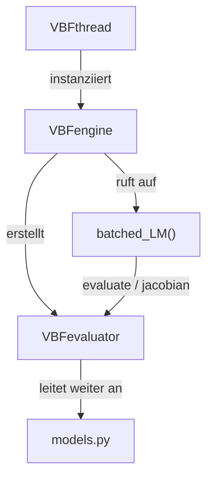
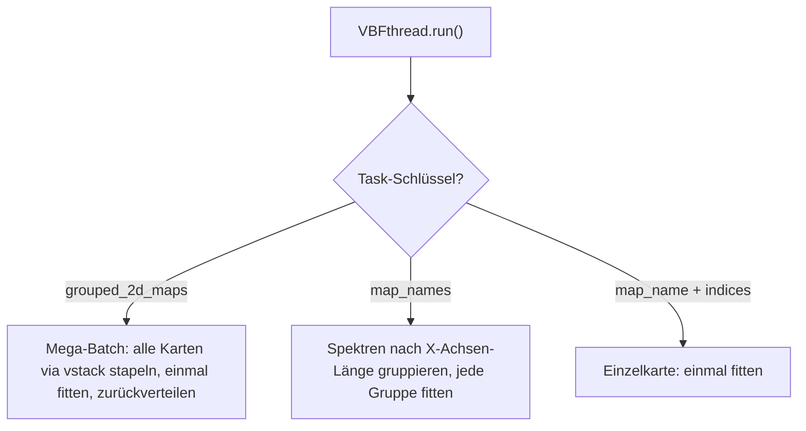

# **Entwicklerhandbuch: Vektorisierte Batch-Fit-Engine (VBF)** { #developer-guide-vectorized-batch-fit-engine-vbf }

Dieses Dokument bietet einen tiefgehenden Einblick in die innere Funktionsweise, die Architektur und die Leistungsmerkmale der vektorisierten Batch-Fit-Engine (`VBF`), die sich in `spectroview/fit_engine/` befindet.

---

## **1. Warum die `VBF Engine` deutlich schneller ist** { #1-why-the-vbf-engine-is-much-faster }

Herkömmliche Fit-Engines arbeiten **spektrumweise**. Bei einer hyperspektralen Karte mit Tausenden von Spektren verursacht dieser Ansatz erheblichen Overhead:

- **Overhead durch Python-Funktionsaufrufe**: Die Zielfunktion und der Schätzer für die Jacobi-Matrix werden pro Iteration tausendfach aufgerufen.
- **Jacobi-Matrizen mittels finiter Differenzen**: Die numerische Approximation der Jacobi-Matrix erfordert `2 * K` (wobei K die Anzahl der Parameter ist) zusätzliche Funktionsauswertungen pro Iteration und pro Spektrum.
- **Sequenzielle Ausführung**: Selbst bei Einsatz von Multiprocessing entstehen durch Serialisierung und Interprozesskommunikation Engpässe.

Die **vektorisierte Batch-Fit-Engine (`VBF Engine`)** erzielt durch folgende Kernprinzipien enorme Geschwindigkeitsvorteile:

1.  **Simultane Gesamtoptimierung**: Sie optimiert alle \(N\) Spektren gleichzeitig. Die Parametermatrizen, Datenarrays und Residuen werden als große 2D- oder 3D-Tensoren verarbeitet.
2.  **Vektorisierte Operationen (BLAS/LAPACK)**: Durch die Formulierung des Problems als Tensoren wird die rechenintensive Arbeit an hochoptimierte C-/Fortran-Bibliotheken ausgelagert.
    - Matrixmultiplikationen und Transpositionen für die Normalengleichungen (\(J^T J\) und \(J^T r\)) erfolgen mittels `np.matmul`, was einen gebatchten BLAS-`gemm`-Aufruf auslöst. (Eine frühere Version verwendete hierfür `np.einsum`; `einsum` delegiert bei diesem Kontraktionsmuster nicht an BLAS und war in Messungen 13–20× langsamer — siehe §2.)
    - Die linearen Gleichungssysteme aller Spektren werden direkt über ein **vektorisiertes `np.linalg.solve`** auf `(Na, K, K)` gelöst (`np.linalg.solve(A, b[..., None])[..., 0]`), wodurch alle unabhängigen Gleichungssysteme in einem einzigen gebatchten LAPACK-Aufruf statt einer Python-Schleife gelöst werden; eine Cholesky-Zerlegung pro Matrix / `np.linalg.solve` / `0.0` dient ausschließlich als Fallback bei einem singulären `LinAlgError`. Siehe `_batched_solve()` in §2.
3.  **Analytische Jacobi-Matrizen**: Statt Ableitungen numerisch zu schätzen, verwendet die Engine exakte analytische Formeln für jede registrierte Peak-Form (`Gaussian`, `Lorentzian`, `PseudoVoigt`, `GaussianAsym`, `LorentzianAsym`, `Fano`, `DecaySingleExp`, `DecayBiExp`). Dadurch entfallen die \(2K\) zusätzlichen Auswertungen vollständig.
4.  **Keine räumliche Propagierung**: Im Gegensatz zu älteren Karten-Fit-Verfahren, die Startwerte per Spiraldurchlauf von Nachbar zu Nachbar weitergaben (und damit eine sequenzielle Ausführung erzwangen), initialisiert die `VBF Engine` alle Pixel unabhängig mittels Amplitudenskalierung, was rein parallele Tensorberechnungen ermöglicht.
5.  **Unterstützung variabler Längen**: Wenn Spektren keine gemeinsame X-Achse teilen, wird `x` als `(N, M)`-Matrix statt `(M,)` übergeben, und jede vektorisierte Modell- bzw. Jacobi-Funktion verzweigt anhand von `x.ndim`, um zeilenweise statt spaltenweise zu broadcasten.
6.  **Unterstützung symbolischer Ausdrücke**: Unterstützt komplexe mathematische Beziehungen zwischen Parametern über den gesamten Batch, indem mathematische Nebenbedingungen symbolisch ausgewertet werden, bevor sie auf die freien Parameter abgebildet werden.

---


## **2. Leistungsoptimierungen** { #2-performance-optimizations }

Die folgenden Punkte betreffen speziell den numerischen Kern in `fit_engine/`. Optimierungen auf Vorverarbeitungsebene (Bereichszuschnitt, Auswertung der Basislinie über den gesamten Kartentensor) befinden sich in `SpectraStore.batch_preprocess()` und sind in [spectra_store.md](spectra_store.md) dokumentiert.

1. **Vektorisierte Assemblierung der Normalengleichungen über `np.matmul` statt `np.einsum`** (13–20× schneller für \(J^TJ\), 3–4× für \(J^Tr\), gemessen über realistische N/M/K-Größen): `np.einsum('nmk,nml->nkl', J, J)` delegiert für dieses Kontraktionsmuster nicht an BLAS und fällt auf eine generische Reduktionsschleife zurück. Das mathematisch identische `J.transpose(0, 2, 1) @ J` löst hingegen einen gebatchten BLAS-`gemm`-Aufruf aus.
2. **Überspringen redundanter Neuberechnungen von Jacobi-Matrix und Normalengleichungen bei verworfenen Schritten**: Ein verworfener LM-Versuchsschritt lässt die Parameter eines Spektrums unverändert, sodass dessen Jacobi-Matrix — und damit auch \(J^TJ\)/\(J^Tr\) — exakt gültig bleibt; vor dem nächsten Versuch muss lediglich der Dämpfungsterm angepasst werden. `optimizer.py` speichert \(J^TJ\)/\(J^Tr\) pro Spektrum zwischen (`JTJ_cache`, `JTr_cache`) und berechnet sie nur für jene Spektren neu, deren *letzter* Schritt akzeptiert wurde (verfolgt über ein boolesches Array `dirty`), anstatt für jedes aktive Spektrum in jeder Iteration. Dies ist exakt und keine Näherung — verifiziert mit null zusätzlicher numerischer Drift gegenüber vollständiger Neuberechnung. Bei einer langsam konvergierenden Karte (viele Spektren, die am selben Punkt mit steigender Dämpfung erneut testen) sind rund 30 % der Iterationen aktiver Spektren verworfene Schritte, sodass dies direkt ~30 % der beiden rechenintensivsten Operationen pro Iteration einspart.
3. **Abgesichertes `np.nan_to_num`**: `np.nan_to_num` führt drei separate Durchläufe über das gesamte Array durch (`isnan`/`isposinf`/`isneginf`) zuzüglich Zuweisung per Fancy-Indexing, selbst wenn gar nichts fehlerhaft ist — was in der überwältigenden Mehrheit der Iterationen zutrifft. `optimizer._finite_or_clean()` prüft zuerst `np.isfinite(arr).all()` (ein einziger fusionierter Durchlauf) und wendet die Bereinigung nur dann an, wenn tatsächlich etwas korrigiert werden muss — ~10× schneller auf dem regulären, sauberen Pfad.
4. **Temporärspeicherfreie In-Place-Modell- und Jacobi-Kerne**: Jede Funktion in `models.py` berechnet wiederkehrende Größen (`1/w²`, `1/w³`, `dx²`, …) nur einmal und verwendet sie wieder, ersetzt wiederholte Divisionen der Größe `(N,M)` durch einen einzigen `(N,1)`-Kehrwert samt gebroadcasteter Multiplikation (`inv_wl = 1.0 / wl`, `inv_wr = 1.0 / wr`) und schreibt ab der ersten arithmetischen Operation direkt in vorallokierte `out=`-Puffer (`np.subtract(..., out=out)`). Alle 8 analytischen Jacobi-Funktionen (`batched_*_jac`) schreiben partielle Ableitungen direkt In-Place in Slice-Views `J[:, :, k]` und nutzen die algebraische Identität \(\frac{\partial f}{\partial w} = \frac{x - x_0}{w} \frac{\partial f}{\partial x_0}\) (`J[:, :, 1] = dx * J[:, :, 2] * inv_w`), wodurch 3–6 temporäre `(N, M)`-Heap-Allokationen pro Peak und pro Iteration eingespart werden. Skalare Referenzmodelle in `scalar_models.py` verwenden dasselbe Clamping (`1e-15` für Breite und `1e-30` für Lebensdauer), um Maschinengenauigkeits-Parität (\(\le 10^{-13}\)) mit `BATCHED_MODELS` sicherzustellen.
5. **Gemeinsame Rauschpegel-Statistiken, 2D-Memoisierung & O(N)-Peak-Indexsuche**: `apply_noise_threshold()` läuft einmal vor dem Fit (um eine saubere Startschätzung bereitzustellen) und einmal danach (um Peaks zu bereinigen, die in eine Rauschregion abgedriftet sind — siehe §5.2 und §10). Beide Aufrufe nutzen die von `VBFevaluator.compute_noise_stats()` zwischengespeicherten Statistiken wieder, während `noise.py` einen mutationssicheren 2D-Fingerprint-Cache mit 1 Eintrag (`_array_2d_fingerprint`) vorhält, sodass direkt aufeinanderfolgende Aufrufe von `compute_fit_weights(Y, fit_params)` und `compute_noise_stats(Y, coef_noise)` `mad_noise(Y)` und `moving_average_5(Y)` nicht zweimal auf derselben Matrix berechnen. Die Zuordnung von Peak-Positionen zu Rasterindizes nutzt O(1)-Arithmetik für gleichmäßige Gitter, `np.searchsorted` in O(N log M) oder einen Chunk-256-Fallback, anstatt eine `(N, M)`-Distanzmatrix zu allokieren.
6. **Gebatchter Gleichungslöser** (`_batched_solve()`): Löst alle aktiven Normalengleichungssysteme `(Na, K, K)` unabhängig von Batch-Größe oder Parameteranzahl über einen einzigen gebatchten `np.linalg.solve(A, b[..., None])[..., 0]`-Aufruf und behält SciPy `cho_solve` / `np.linalg.solve` / `0.0` pro Matrix strikt als Fallback bei einem singulären `LinAlgError` bei.
7. **Mittelwertbasiertes Konvergenzkriterium nach Boundary-Clipping**: Die Konvergenzprüfung misst `mean(|dp_actual| / |p|) < xtol` anhand der tatsächlichen Verschiebung nach dem Beschneiden auf die Grenzen (`p_trial_active - p_improved_old`) statt anhand des unbeschränkten `dp` oder von `max()`, wodurch verhindert wird, dass langsam driftende Flanken oder an Grenzen fixierte Parameter Spektren bis `max_iter` blockieren.
8. **Vektorisiertes Zurückschreiben**: `build_results_batch()` wertet alle Best-Fit-Kurven aus und berechnet R² gleichzeitig über alle Spektren mithilfe eines einzigen wiederverwendbaren `(N, M)`-Residuenpuffers und überspringt redundante Multiplikationen, wenn `weights` gleichmäßig Eins sind — ganz ohne Python-Schleife pro Spektrum.
9. **Vorzeitiger Ausstieg bei Null-Gewichten & Fast-Path für gleichförmige Gewichte**: Spektren, die als reines Rauschen identifiziert werden (alle Gewichte null), werden sofort als konvergiert markiert, und bei `weights` gleich `None` oder gleichförmig `1.0` entfallen die `(N, M)`-Multiplikationen der gewichteten Residuen und Jacobi-Matrizen in jeder Iteration.
10. **Transponiertes `(K, N, M)`-Jacobi-Layout & Zero-Copy-Fast-Paths für volle Batches**: `batched_levenberg_marquardt()` allokiert `J_buf_base` mit dem physischen Speicherlayout `(K, N, M)` und stellt `J_r_buf = J_buf_base[:, :n_recompute, :].transpose(1, 2, 0)` mit logischer Form `(Nr, M, K)` bereit. Dadurch ist gewährleistet, dass jede Parameterscheibe `J[:, :, k]` während der Jacobi-Auswertung ein zu 100 % C-zusammenhängendes `(Nr, M)`-Array ist UND dass die Kontraktionsachse `M` bei den BLAS-`dgemm`-Aufrufen `JT_r @ J_r` und `JT_r @ scaled_r_r[:, :, None]` einen Stride von 8 Bytes besitzt. In frühen Iterationen, in denen alle Spektren aktiv sind (`n_active == N`, `n_recompute == N`), nutzt der Optimierer Zero-Copy-Views und schreibt die Normalengleichungen per `np.matmul(..., out=...)` direkt in `JTJ_cache` und `JTr_cache` ohne Fancy-Index-Gathers.
11. **Analytische Kettenregel über Vorwärts-Dualzahlen (`_DualVar`) für Ausdrücke**: `VBFevaluator` sortiert Parameterausdrücke in `from_fit_model()` einmalig topologisch, kompiliert sie in Bytecode und berechnet exakte analytische Kettenregel-Ableitungen `J_expr` in einem einzigen Durchlauf mittels vektorisierter Vorwärts-Differentiation (`_DualVar`) gekoppelt mit gebatchter BLAS-Matrixmultiplikation (`J_full @ J_expr`), was \(K_{\text{free}}\)-fache finite Differenzen und `np.einsum` ablöst (~3× schneller bei durch Ausdrücke verknüpften Modellen).
12. **Adaptives L3-Cache-Batch-Chunking**: Bei sehr großen hyperspektralen Karten (\(N \cdot M \cdot K > 2{,}097{,}152\) oder \(N \ge 2{,}048\) bei \(N \cdot M \cdot K > 1{,}048{,}576\)) unterteilt `batched_levenberg_marquardt()` den Batch automatisch in L3-cache-freundliche Teilbatches (`chunk_n` mit Zielgröße ~4 MB Arbeitsbedarf), was den Spitzenspeicherverbrauch um bis zu 79 % senkt und große Karten-Fits beschleunigt, indem eine Sättigung der DRAM-Bandbreite vermieden wird.
13. **Lineare Basislinien-Interpolation in reinem NumPy**: `eval_baseline()` und `eval_baseline_batch()` werten stückweise lineare Basislinien (mit linearer Extrapolation an den Bereichsrändern) über `_interp_linear_extrap()` in reinem NumPy aus und vermeiden so den Cold-Import-Overhead von `scipy.interpolate`.

## **3. Code-Logik und zentrale Implementierungsprinzipien** { #3-code-logic-and-core-implementation-principles }

Die Engine implementiert einen **Batched-Levenberg-Marquardt**-Algorithmus.

### **3.1. Die Mathematik des Batched-LM** { #31-the-mathematics-of-batched-lm }

Für \(N\) Spektren mit jeweils \(M\) Wellenlängenpunkten und \(K\) freien Parametern:

1.  **Modell auswerten**: \(\mathbf{Y}_{pred} = f(\mathbf{x}, \mathbf{p})\), liefert einen \((N, M)\)-Tensor.
2.  **Residuen berechnen**: \(\mathbf{r} = \mathbf{W} \circ (\mathbf{Y}_{pred} - \mathbf{Y}_{data})\), liefert einen \((N, M)\)-Tensor.
3.  **Jacobi-Matrix berechnen**: \(\mathbf{J} = \frac{\partial f}{\partial \mathbf{p}}\), liefert einen \((N, M, K)\)-Tensor.
4.  **Normalengleichungen**: Assemblierung von \(J^T J\) (Größe \(N \times K \times K\)) und \(J^T r\) (Größe \(N \times K\)) mittels `np.matmul` (§2).
5.  **Dämpfung (Marquardt-Schritt)**: Addition eines Dämpfungsfaktors \(\lambda_i\) zur Diagonale von \(J^T J\) für jedes Spektrum \(i\).
6.  **Lösen**: Gleichzeitiges Lösen von \((J^T J + \lambda \text{diag}(J^T J)) \delta \mathbf{p} = -J^T r\) für alle \(N\) Spektren.
7.  **Schritt bewerten**: Aktualisierung \(\mathbf{p} \leftarrow \mathbf{p} + \delta \mathbf{p}\) (mit Projektion auf die Grenzen) und Auswertung der neuen Kosten. Anpassung von \(\lambda\) pro Spektrum je nach Erfolg oder Misserfolg.

### **3.2. Unabhängige Konvergenz** { #32-independent-convergence }

Obwohl die Berechnungen im Batch erfolgen, konvergiert jedes Spektrum unabhängig. Der Optimierer nutzt eine boolesche Maske (`active = ~converged`), um Jacobi-Berechnungen und lineare Gleichungslösungen für bereits innerhalb der Toleranzgrenzen konvergierte Spektren zu überspringen, was spätere Iterationen zunehmend beschleunigt. Eine zweite boolesche Maske (`dirty`, siehe §2) überspringt zusätzlich die Neuberechnung von Jacobi-Matrix und Normalengleichungen — jedoch *nicht* die Auswertung des Versuchsschritts — für aktive Spektren, deren Parameter sich in der vorherigen Iteration nicht geändert haben (verworfener Schritt), da beim erneuten Versuch nur der Dämpfungsfaktor abweicht.

### **3.3. Robuste Verlustfunktionen (IRLS-ähnliche Skalierung)** { #33-robust-loss-functions-irls-style-scaling }

Um Ausreißer wie kosmische Strahlungs-Spikes und scharfe Detektorartefakte ohne manuelle Datenmaskierung abzufangen, unterstützt der Optimierer robuste M-Schätzer über Iteratively Reweighted Least Squares (IRLS):

- **`linear`** (Standard): Standard-Zielfunktion der kleinsten Quadrate $\rho(z) = z$, $\rho'(z) = 1$. Der Codepfad ist bitidentisch zum ursprünglichen ungewichteten LM.
- **`soft_l1`**: Glatte $L_1$-Approximation $\rho(z) = 2(\sqrt{1 + z} - 1)$ mit Ableitungs-Skalierungsfaktor $\sqrt{\rho'(z)} = (1 + z)^{-1/4}$, wobei $z = (r / f\_scale)^2$. Geht stufenlos von quadratischem Verhalten nahe null zu einer linearen Strafe für große Residuen über.
- **`huber`**: Huber-Verlust $\rho(z) = z$ für $z \le 1$, sonst $2\sqrt{z} - 1$, mit Ableitungs-Skalierungsfaktor $\sqrt{\rho'(z)} = 1$ für $z \le 1$, sonst $z^{-1/4}$.

**Mathematische Formulierung**:
Residuen und Zeilen der Jacobi-Matrix werden mit $w_{\text{robust}} = \sqrt{\rho'((r / f\_scale)^2)}$ skaliert. Die in jeder Iteration gelösten Normalengleichungen lauten:
$$(J^T W J + \lambda \text{diag}(J^T W J)) \delta \mathbf{p} = -J^T W \mathbf{r}$$
wobei $W = \text{diag}(w_{\text{hard}}^2 \cdot w_{\text{robust}}^2)$.

**Reihenfolge der Gewichtungskomposition**:

1. **Harte Ausschlüsse** (`fit_negative` und Rauschschwelle `coef_noise`) werden zuerst in `weights.py` ausgewertet, um ausgeschlossenen Punkten ein Gewicht von null ($w_{\text{hard}} = 0$) zuzuweisen.
2. **Robuste Gewichtung** ($w_{\text{robust}}$) wird danach in `optimizer.py` auf die aktiven Punkte angewendet, um große Ausreißer-Residuen gleichmäßig abzuschwächen. Punkte mit Gewicht null bleiben null.

---

## **4. Ordner- und Klassenstruktur** { #4-folder-and-class-structure }



| Modul | Klasse / Funktion | Zuständigkeit |
|--------|-----------------|----------------|
| `vbf_thread.py` | `VBFthread` | `QThread`-Wrapper. Gruppiert Aufgaben in die Modi Einzelkarte, Mega-Batch (`grouped_2d_maps`) oder Längengruppierung (`map_names`); erstellt die Gewichtematrix; ruft `VBFengine.fit_spectra()` auf; schreibt Ergebnisse in `SpectraStore` zurück. Sendet die Signale `progress_changed` und `timings_ready`. Setzt unter macOS eine Stack-Größe von 8 MB, um LAPACK-Segfaults zu verhindern. |
| `vbf_engine.py` | `VBFengine` | Öffentlicher API-Orchestrator für einen einzelnen Fit-Aufruf. Erstellt den Evaluator, baut `p0` auf + wendet die Rauschschwelle an, startet den Optimierer, wendet die Rauschschwelle erneut an und erstellt die Ergebnisarrays. Zeichnet Schritt-Laufzeiten in `self.timings` auf. |
| `evaluator.py` | `VBFevaluator` | Brücke zwischen dem Dictionary-basierten `fit_model` und der flachen Tensor-API. Parst Peak-Definitionen, verwaltet die Indizierung freier/fixierter Parameter, wertet Ausdrücke aus, routet an die passenden vektorisierten Modellfunktionen und erstellt die zurückgegebenen Ergebnisarrays (Parameter, R², Best-Fits, Einzelpeak-Kurven) — ohne Zwischenobjekte vom Typ `FitResult`. |
| `optimizer.py` | `batched_levenberg_marquardt()` | Reiner numerischer Optimierer. Löst N unabhängige Kleinste-Quadrate-Probleme gleichzeitig mittels gebatchtem `np.matmul` für die Normalengleichungen, mit `JᵀJ`/`Jᵀr`-Caching zum Überspringen von Neuberechnungen bei verworfenen Versuchsschritten (§2). Verwendet gebatchtes `np.linalg.solve` mit Singulär-Fallback pro Matrix, nutzt `eval_buf`/`J_buf` über `out=` wieder, überspringt gleichförmige Gewichte und prüft die `dp`-Konvergenz nach dem Clipping. GUI-agnostisch. |
| `models.py` | `batched_*()`-Funktionen | Vektorisierte Peak-Formfunktionen und ihre analytischen Jacobi-Matrizen. Enthält das `BATCHED_MODELS`-Register und den `numerical_jacobian()`-Fallback für Modelle ohne analytische Ableitung. |
| `scalar_models.py` | skalare Peak-Funktionen | Referenzimplementierungen für Einzelspektren sowie das Register `PEAK_MODEL_REGISTRY`, in dem sie registriert sind. Werden von `eval_peak_initial()` (UI-Vorschaukurven) sowie als skalarer Fallback genutzt, der in `evaluator.py` über `_make_batched_scalar()` gekapselt wird, wenn ein Modell in `PEAK_MODEL_REGISTRY` existiert, aber keine vektorisierte Implementierung in `BATCHED_MODELS` besitzt — aktuell besitzt jedes registrierte Modell beide Varianten, sodass dieser Fallback-Pfad eher ein Sicherheitsnetz für zukünftige Erweiterungen darstellt als einen heute aktiv genutzten Pfad. |

---

## **5. Verarbeitungspipeline / Ausführungsablauf** { #5-processing-pipeline-execution-flow }

Die Pipeline besteht aus zwei Ebenen: `VBFthread` orchestriert *Aufgaben* (welche Spektren zusammengehören, wie Gewichte erstellt werden, wohin Ergebnisse geschrieben werden), und `VBFengine.fit_spectra()` bildet den reinen numerischen Kern, der einmal pro Aufgabe aufgerufen wird.

```mermaid
sequenceDiagram
    participant VM as ViewModel
    participant TFT as VBFthread
    participant TE as VBFengine
    participant EV as VBFevaluator
    participant OPT as optimizer

    VM->>TFT: start()
    TFT->>TFT: _prepare_weights() — Maskierung negativer Werte & Rauschen
    TFT->>TE: fit_spectra(x, Y, fit_model, weights, fit_params)
    TE->>EV: from_fit_model()
    TE->>EV: build_p0_matrix() + apply_noise_threshold() (Pre-Fit)
    TE->>OPT: batched_levenberg_marquardt()
    TE->>EV: apply_noise_threshold() (Post-Fit-Bereinigung)
    TE->>EV: build_results_batch()
    TE-->>TFT: p_full, success, r², best_fits, Y_peaks
    TFT->>TFT: _write_results() → store.set_fit_results(), md.Y_bestfit / md.Y_peaks
    TFT-->>VM: progress_changed / timings_ready / finished
```

### **5.1. `VBFthread.run()` — Aufgaben-Orchestrierung** { #51-vbfthreadrun-task-orchestration }

Für jede Aufgabe wählt `VBFthread` innerhalb einer einzigen Schleife über `self.tasks` einen von drei Zweigen aus (es gibt keine separate `_run_batched()`- oder `_run_single()`-Methode):

| Vorhandener Task-Schlüssel | Wann verwendet | Was passiert |
|---|---|---|
| `grouped_2d_maps` | „Modell auf alle Karten anwenden“ mit einem gemeinsamen Modell | Stapelt die `Y`-Matrizen aller Karten via `np.vstack` zu einer einzigen Matrix, fittet sie als einen einzigen Mega-Batch und verteilt die Ergebnisse anschließend zeilenbereichsweise auf die jeweiligen `MapData`-Objekte zurück. |
| `map_names` | Batch-Fitting vieler Einzelspektren im Arbeitsbereich **Spektren** (Spectra), jeweils mit eigenem Modell | Gruppiert die Spektren nach Länge der X-Achse (Spektren müssen dieselbe Länge haben, um in einer Matrix gestapelt zu werden) und fittet jede Längengruppe als einen Batch. |
| `map_name` + `indices` | Fitting einer einzelnen Karte (der Regelfall) | Extrahiert `Y[indices]`, erstellt die Gewichte und ruft `fit_spectra()` einmal auf. |

Vor dem Aufruf der Engine erstellt `VBFthread._prepare_weights()` die Gewichtematrix aus `fit_negative` und `coef_noise` (siehe §9 und §10 — die rauschbasierte Maskierung nutzt hier dieselbe Formel wie `VBFevaluator.compute_noise_stats()`).

### **5.2. `VBFengine.fit_spectra()` — Der numerische Kern** { #52-vbfenginefit_spectra-the-numerical-core }

1. **Evaluator erstellen** — `VBFevaluator.from_fit_model(fit_model)` überführt `peak_models` in das flache Parameterlayout (§6). Wenn alle Parameter fixiert sind (`n_params_free == 0`), bricht die Engine kurzschlussartig ab und kehrt sofort zurück.
2. **`p0` aufbauen** — `build_p0_matrix()` kachelt die Startwerte des Modells über alle N Spektren und skaliert die Amplitude jedes Peaks anhand der beobachteten Daten am jeweiligen `x0` (das Verhältnis wird auf `[0.01, 100]` begrenzt, damit eine schlechte Startschätzung nicht explodieren kann). `apply_noise_threshold()` setzt anschließend Amplitude und FWHM von Peaks auf null, deren Zentrum in einem Bereich unterhalb der Rauschschwelle liegt, und verschafft dem Optimierer so einen sauberen Startpunkt.
3. **Optimierer ausführen** — `batched_levenberg_marquardt()` (§3) iteriert, bis jedes Spektrum konvergiert ist, als „feststeckend“ markiert wird (§9.2) oder `max_ite` erreicht ist.
4. **Post-Fit-Bereinigung** — `apply_noise_threshold()` wird erneut auf die optimierten Parameter angewendet, falls ein Peak während der LM-Iterationen in eine Rauschregion abgedriftet ist.
5. **Ergebnisse erstellen** — `build_results_batch()` wertet die Best-Fit-Kurven und Einzelpeak-Kurven einmalig für den gesamten Batch aus und berechnet R² vektorisiert über alle N Spektren. Gibt einfache Arrays (`p_full`, `success`, `rsquared`, `best_fits`, `Y_peaks`, `param_names`) zurück — keine Einzelobjekte pro Spektrum.

`VBFthread._write_results()` schreibt diese Arrays anschließend in den `SpectraStore` (`set_fit_results()`) sowie auf das `MapData`-Objekt (`Y_bestfit`, `Y_peaks`).

---

## **6. Der `VBFevaluator` im Detail** { #6-the-vbfevaluator-in-detail }

Der `VBFevaluator` ist die komplexeste Klasse der Engine. Er dient als **Brücke** zwischen der flexiblen, Dictionary-basierten Welt der GUI und der starren, flachen Tensorwelt des Optimierers.

### **6.1. Abbildung des Parameterraums** { #61-parameter-space-mapping }

```
fit_model dict                    VBFevaluator                  Optimizer
┌─────────────────┐     ┌────────────────────────────┐     ┌──────────────┐
│ peak_models:    │     │ _param_names:              │     │              │
│   "0":          │     │   ["m01_ampli",            │     │  p_free      │
│     Gaussian:   │ ──► │    "m01_fwhm",             │ ──► │  (N, K_free) │
│       ampli: .. │     │    "m01_x0",               │     │              │
│       fwhm:  .. │     │    "m02_ampli", ...]       │     │              │
│       x0:    .. │     │                            │     │              │
│   "1":          │     │ _free_idx:  [0, 1, 2, 3]   │     │              │
│     Lorentzian: │     │ _fixed_idx: [4]            │     │              │
│       ampli: .. │     │ _fixed_values: [0.5]       │     │              │
│       ...       │     │                            │     │              │
└─────────────────┘     └────────────────────────────┘     └──────────────┘
```

### **6.2. Unterstützung von Ausdrücken** { #62-expression-support }

Parameter können über mathematische Ausdrücke auf andere Parameter verweisen (z. B. `m01_fwhm = m02_fwhm` oder `m01_x0 + 10`). Der Evaluator verarbeitet dies in `_to_full()`:

1. Parameter mit Ausdrücken werden als **fixiert** markiert (nicht direkt optimiert).
2. Während `from_fit_model()` werden Ausdrücke topologisch nach Abhängigkeiten sortiert und in Python-Codeobjekte kompiliert (`_compile_exprs()`), was wiederholtes String-Parsing per `eval()` und Wiederholungsschleifen in jedem Optimiererschritt vermeidet.
3. Während `_to_full()` werden die kompilierten Ausdrücke in einem einzigen topologischen Durchlauf in einem eingeschränkten Namespace ausgewertet, der alle Parameternamen, `np` sowie gängige mathematische Funktionen (`sin`, `cos`, `tan`, `exp`, `log`, `log10`, `sqrt`, `abs`, `pi`, `e`, `minimum`, `maximum`, `clip`) enthält.
4. Die Jacobi-Matrix berücksichtigt Ausdrücke über die **analytische Kettenregel**: `_compute_j_expr()` initialisiert freie Parameter als vektorisierte Vorwärts-Dualzahlen (`_DualVar(value, d_free)`), führt die kompilierte Ausdruckskette einmal aus, um den exakten analytischen Sensitivitätstensor `J_expr` der Form `(N, K_total, K_free)` zu erhalten, und berechnet anschließend die eingeschränkte Jacobi-Matrix mittels gebatchter BLAS-Matrixmultiplikation `J_full @ J_expr`.

### **6.3. Modell-Routing** { #63-model-routing }

Die Methoden `evaluate()` und `jacobian()` des Evaluators iterieren über alle registrierten Peaks und schreiben oder summieren deren Beiträge sauber in `out`, sofern bereitgestellt:

```python
def evaluate(self, x, p_free, out=None):
    p_full = p_free if self._all_free_identity else self._to_full(p_free)  # (N, K_total)
    # Single-peak models write directly into `out`; multi-peak models reuse one scratch buffer
    ...
```

Besitzt ein Peak eine analytische Jacobi-Matrix (`has_jac=True`), wird diese direkt verwendet. Andernfalls wird `numerical_jacobian()` als Fallback mit zentralen Differenzen und relativer Perturbationsskalierung aufgerufen.

---

## **7. Vektorisierte Peak-Modelle und analytische Jacobi-Matrizen** { #7-batched-peak-models-and-analytical-jacobians }

### **7.1. Tensor-Konventionen** { #71-tensor-conventions }

Alle vektorisierten Funktionen folgen derselben Signatur:

```python
def batched_shape(x, params, out=None):
    """
    x:      (M,) shared axis  OR  (N, M) per-spectrum axis
    params: (N, n_p) parameter matrix
    out:    optional preallocated (N, M) output buffer
    Returns: (N, M) predicted values
    """

def batched_shape_jac(x, params, out=None):
    """Returns: (N, M, n_p) Jacobian tensor (written into `out` when provided)"""
```

Intern folgt jede Funktion demselben Effizienzmuster (§2.4): Jede wiederkehrende Größe einmal berechnen (typischerweise ein Kehrwert wie `1/w²`), sie per gebroadcasteter Multiplikation statt erneuter Division wiederverwenden und In-Place in vorallokierte Jacobi-Slices schreiben.

### **7.2. Registrierte Modelle (`BATCHED_MODELS`)** { #72-registered-models-batched_models }

Alle Peak-Modelle verfügen über vektorisierte Batch-Implementierungen mit **analytischen Jacobi-Matrizen**, was maximale Leistung für jeden Modelltyp gewährleistet:

| Modell | Parameter | Formel |
|-------|-----------|---------|
| `Gaussian` | `ampli`, `fwhm`, `x0` | <i>a</i> &middot; exp(-4 ln(2) &middot; (x-x<sub>0</sub>)<sup>2</sup> / w<sup>2</sup>) |
| `Lorentzian` | `ampli`, `fwhm`, `x0` | <i>a</i> / [1 + 4(x-x<sub>0</sub>)<sup>2</sup> / w<sup>2</sup>] |
| `PseudoVoigt` | `ampli`, `fwhm`, `x0`, `alpha` | &alpha; &middot; G + (1-&alpha;) &middot; L |
| `GaussianAsym` | `ampli`, `fwhm_l`, `fwhm_r`, `x0` | Stückweise Gauß-Funktion mit linker/rechter FWHM |
| `LorentzianAsym` | `ampli`, `fwhm_l`, `fwhm_r`, `x0` | Stückweise Lorentz-Funktion mit linker/rechter FWHM |
| `Fano` | `ampli`, `fwhm`, `x0`, `q` | <i>a</i> &middot; (q + &epsilon;)<sup>2</sup> / (1 + &epsilon;<sup>2</sup>), &epsilon; = 2(x-x<sub>0</sub>)/w |
| `DecaySingleExp` | `A`, `tau`, `B` | <i>A</i> &middot; e<sup>-x/&tau;</sup> + B |
| `DecayBiExp` | `A1`, `tau1`, `A2`, `tau2`, `B` | <i>A</i><sub>1</sub> &middot; e<sup>-x/&tau;<sub>1</sub></sup> + <i>A</i><sub>2</sub> &middot; e<sup>-x/&tau;<sub>2</sub></sup> + B |

### **7.3. Fallback über numerische Jacobi-Matrix** { #73-numerical-jacobian-fallback }

Für zukünftige benutzerdefinierte Modelle, die nur in `PEAK_MODEL_REGISTRY` registriert sind (ohne vektorisierte Batch-Implementierung), nutzt `numerical_jacobian()` **zentrale Differenzen** mit relativer Perturbation als Fallback:

```python
h = max(|param| * eps, eps)          # Scale step to parameter magnitude
J[:,:,k] = (f(p+h) - f(p-h)) / 2h  # Central difference
```

Dies ist pro Iteration etwa `2K`-mal langsamer als analytische Jacobi-Matrizen, stellt jedoch die Korrektheit für beliebige Modellformen sicher.

---

## **8. Der `VBFthread`** { #8-the-vbfthread }

### **8.1. Aufgabenverzweigungen** { #81-task-branches }



Alle drei Zweige befinden sich in derselben Schleife über `self.tasks` in `run()` — siehe §5.1 zu ihren jeweiligen Auslösern.

### **8.2. Stack-Größe unter macOS** { #82-macos-stack-size }

Der Thread setzt unter macOS eine Stack-Größe von 8 MB (`setStackSize(8 * 1024 * 1024)`), weil:

- macOS den Standard-Stack eines `QThread` auf 512 KB begrenzt.
- `np.linalg.solve` an LAPACK delegiert, welches Arbeitsarrays auf dem Stack allokiert.
- Bei großem K (vielen Parametern) die Stack-Allokation 512 KB überschreiten kann, was zu Segfaults führt.

### **8.3. Signale** { #83-signals }

| Signal | Nutzdaten (Payload) | Zweck |
|--------|---------|---------|
| `progress_changed` | `Signal(int, int, int, float, int)` → `(current, total, percent, elapsed_seconds, current)` | Aktualisiert den Fortschrittsbalken in der View. (Das 5. Argument dupliziert das 1.) |
| `timings_ready` | `Signal(str)` | Formatierte Laufzeitaufschlüsselung nach Schritten für Konsole/Debugging |

---

## **9. Optimierungsparameter und Anpassungen** { #9-optimization-parameters-and-adjustments }

Das Engine-Verhalten lässt sich über das an `fit_spectra()` übergebene Dictionary `fit_params` feinabstimmen.

### **9.1. Wichtige Parameter** { #91-key-parameters }

*   **`max_ite`** (Standard: 200): Die maximale Anzahl an Levenberg-Marquardt-Iterationen. Eine Erhöhung kann extrem schwierigen Spektren zur Konvergenz verhelfen, verlängert aber die Gesamtausführungszeit.
*   **`xtol`** (Standard: 1e-4): Die relative Toleranz für die Parameterschrittweite \(\delta p\). Konvergenz ist erreicht, wenn die **mittlere** relative Änderung nach Boundary-Clipping über alle aktiven Parameter (\(\operatorname{mean}(|\Delta p_{\text{actual}}| / |p|)\)) kleiner als `xtol` ist. Das Messen der Verschiebung nach dem Clipping stellt sicher, dass an Parametergrenzen fixierte Spektren sauber konvergieren statt bis `max_ite` zu hängen, und das mittelwertbasierte Kriterium verhindert, dass ein einzelner langsam oszillierender Parameter die Konvergenz des gesamten Spektrums verzögert.
*   **`ftol`** (Standard: 1e-4): Die relative Toleranz für die Kostenfunktion (Summe der quadrierten Residuen). Ist die relative Änderung der Kosten kleiner als `ftol`, gilt das Spektrum als konvergiert.
*   **`fit_negative`** (Standard: `False`): Legt fest, ob negative Intensitätswerte in den Fit einbezogen werden. Bei `False` erhalten negative Punkte das Gewicht null (`VBFthread._prepare_weights()`).
*   **`coef_noise`** (Standard: `0.0`): Rauschkoeffizienten-Multiplikator. Bei Werten > 0 werden die rauschbasierte Gewichtsmaskierung (`VBFthread._prepare_weights()`) und die Peak-Unterdrückung (`VBFevaluator.apply_noise_threshold()`) aktiviert. Siehe [Abschnitt 10](#10-noise-level-estimation-and-noise-threshold) für eine ausführliche Erklärung.
*   **`fit_outliers`** — **Veralteter Schlüssel (Legacy), wird von der aktuellen Engine nicht gelesen.** Ältere gespeicherte `fit_model`-JSON-Dateien können ihn noch enthalten, aber nichts in `fit_engine/` (oder an anderer Stelle in der Codebasis) wertet ihn mehr aus; er wird stillschweigend ignoriert. Er kann bedenkenlos in alten Dateien belassen werden.

### **9.2. Abstimmung zwischen Performance und Genauigkeit** { #92-tuning-for-performance-vs-accuracy }

- **Schnelle Kartierung**: Für schnelle Vorschauen können Sie `xtol` und `ftol` auf `1e-3` oder `1e-2` erhöhen. Der Optimierer bricht dann deutlich früher ab und liefert in einem Bruchteil der Zeit einen groben Fit.
- **Präzisions-Fitting**: Für Ergebnisse in Publikationsqualität senken Sie `xtol` und `ftol` auf `1e-5` oder `1e-6`.
- **Umgang mit „feststeckenden“ Spektren**: Der Optimierer verfolgt `consecutive_rejects`. Verbessern sich die Kosten eines Spektrums 15 aufeinanderfolgende Iterationen lang nicht (trotz Anpassung der Dämpfung), wird es als konvergiert (feststeckend) markiert, damit es den Rest des Batches nicht ausbremst. Dieser Schwellenwert (`MAX_REJECTS` in `optimizer.py`) kann bei Bedarf angepasst werden.

### **9.3. Dämpfungsschema** { #93-damping-schedule }

Der spektrumweise Dämpfungsfaktor \(\lambda\) wird mit `1e-2` initialisiert und nach jeder Iteration angepasst:

| Ergebnis | λ-Anpassung | Wirkung |
|---------|-------------|--------|
| Kosten verbessert | `λ /= 3.0` (Untergrenze `1e-10`) | Stärkeres Vertrauen in die Gauss-Newton-Richtung |
| Kosten verschlechtert | `λ *= 2.5` (Obergrenze `1e10`) | Verschiebung in Richtung Gradientenabstieg |

---

## **10. Rauschpegelschätzung und Rauschschwelle** { #10-noise-level-estimation-and-noise-threshold }

Der Parameter `coef_noise` steuert ein rauschbewusstes Filtersystem, das sowohl die **Performance** als auch die **Präzision** des Fits deutlich verbessern kann — insbesondere bei hyperspektralen Karten, bei denen viele Pixel schwache oder fehlende Peaks aufweisen.

### **10.1. Wie der Rauschpegel geschätzt wird** { #101-how-noise-level-is-estimated }

Sowohl der öffentliche Helfer `detect_noise_level()` (`fit_engine/noise.py`, von der UI zur Anzeige des Rauschpegels im Spektren-Viewer genutzt) als auch der interne vektorisierte Schätzer während des Fits (`VBFevaluator.compute_noise_stats()`, `VBFthread._prepare_weights()`) verwenden denselben robusten Schätzer: den Median des Absolutwerts der ersten Differenz, skaliert auf eine gaußäquivalente Standardabweichung σ.

```python
def detect_noise_level(y: np.ndarray) -> float:
    dy = np.diff(y)                                    # δ[i] = y[i+1] − y[i]
    return np.median(np.abs(dy)) / 0.6745 * np.sqrt(2)
```

**Warum das funktioniert:**

| Term | Zweck |
|------|--------|
| `np.diff(y)` | Punkt-zu-Punkt-Differenzen — vom Rauschen dominiert, da reale spektrale Strukturen breit sind und sich über einen einzelnen Abtastschritt nur langsam ändern |
| `np.median(np.abs(dy))` | Median der absoluten Differenzen — robust gegenüber gelegentlichen großen Sprüngen an einer steilen Peak-Flanke, im Gegensatz zu einer gewöhnlichen Standardabweichung |
| `/ 0.6745` | Rechnet die gaußsche mittlere absolute Abweichung (MAD) in eine äquivalente Standardabweichung um (0,6745 = MAD-zu-σ-Konstante einer Normalverteilung) |
| `* sqrt(2)` | Die erste Differenz zweier unabhängiger verrauschter Abtastwerte hat die Varianz \(2\sigma^2\); dies skaliert zurück auf das Rauschen σ pro Punkt |

`VBFevaluator.compute_noise_stats(Y, coef_noise)` wendet dieselbe `diff`/`median`-Logik entlang `axis=1` an, um für die gesamte Karte gleichzeitig einen Rauschpegel pro Spektrum zu schätzen, und berechnet zusätzlich einen gleitenden 5-Punkt-Mittelwert des Signals (`ymean`), mit dem punktweise entschieden wird, ob das *Signal selbst* — und nicht nur das Rauschen — über der Schwelle liegt:

```python
dy = np.diff(Y, axis=1)
ampli_noise = np.median(np.abs(dy), axis=1) / 0.6745 * np.sqrt(2)      # (N,)
Y_padded = np.pad(Y, ((0, 0), (2, 2)), mode='edge')
ymean = (Y_padded[:, 0:-4] + Y_padded[:, 1:-3] + Y_padded[:, 2:-2]
         + Y_padded[:, 3:-1] + Y_padded[:, 4:]) / 5.0                   # 5-point moving average
noise_level = coef_noise * ampli_noise                                   # (N,)
```

> `apply_noise_threshold()` wird zweimal pro Fit aufgerufen (vor und nach der Optimierung — siehe §5.2), und beide Aufrufe benötigen exakt dieselben `ymean`/`noise_level`. `VBFengine.fit_spectra()` berechnet sie einmalig über `compute_noise_stats()` und übergibt das Ergebnis (`noise_stats=`) an beide Aufrufe, anstatt den Median- und Glättungsdurchlauf zweimal auszuführen (§2).

### **10.2. Wie `coef_noise` die Rauschschwellen-Filterung aktiviert** { #102-how-coef_noise-activates-noise-thresholding }

Bei `coef_noise > 0` wird ein **Rauschschwellenwert** als `noise_level = coef_noise × ampli_noise` berechnet. Dieser Schwellenwert aktiviert **zwei komplementäre Mechanismen**:

#### **10.2.1. Mechanismus A — Gewichtsmaskierung (`VBFthread._prepare_weights`)** { #1021-mechanism-a-weight-masking-vbfthread_prepare_weights }

Vor Beginn des Fits wird für jeden Datenpunkt, an dem das geglättete Signal (`ymean`) unter den Rauschpegel fällt, das Gewicht auf null gesetzt:

```python
weights[ymean < noise_level[:, None]] = 0.0   # zero weight → ignored by optimizer
```

Die Residuenberechnung des Optimierers \(\mathbf{r} = \mathbf{W} \circ (\mathbf{Y}_{pred} - \mathbf{Y}_{data})\) ignoriert diese maskierten Punkte auf natürliche Weise, sodass sich der Fit ausschließlich auf Bereiche mit aussagekräftigem Signal konzentriert.

#### **10.2.2. Mechanismus B — Peak-Unterdrückung (`VBFevaluator.apply_noise_threshold`)** { #1022-mechanism-b-peak-suppression-vbfevaluatorapply_noise_threshold }

Bei jedem Peak, dessen **Zentrumsposition** (`x0`) in einen Bereich unterhalb der Schwelle fällt, werden Amplitude und FWHM auf null gezwungen; die übrigen Formparameter dieses Peaks werden auf ihre Pre-Fit-Startschätzung (`p0_matrix`) zurückgesetzt, damit zufällige Schwankungen nicht als reale Struktur kartiert werden. Dies läuft **zweimal** während der Pipeline (§5.2):

1. **Vor der Optimierung** — setzt eine saubere Startschätzung und verhindert, dass der Optimierer versucht, Rauschschwankungen als Peaks zu fitten.
2. **Nach der Optimierung** — bereinigt alle Peaks, die während der LM-Iterationen möglicherweise in Rauschbereiche abgedriftet sind.

### **10.3. Vorteile für Performance und Präzision** { #103-performance-and-precision-benefits }

#### **10.3.1. Performance** { #1031-performance }

| Aspekt | Nutzen |
|--------|-------------|
| Schnellere Konvergenz | Auf null gesetzte Peaks in Rauschbereichen starten bei null und bleiben dort, was die effektive Anzahl aktiver Parameter reduziert |
| Weniger verschwendete Iterationen | Ohne Rauschmaskierung verbringt der Optimierer viele Iterationen damit, zufälliges Rauschen mit winzigen Geisterpeaks zu fitten |
| Bessere Startschätzung | Das vorherige Nullsetzen von Peaks in Rauschbereichen bringt \(p_0\) näher an die wahre Lösung, sodass LM in weniger Iterationen konvergiert |

#### **10.3.2. Präzision** { #1032-precision }

| Aspekt | Nutzen |
|--------|-------------|
| Beseitigt Geisterpeaks | In Karten besitzen manche Pixel schwache oder fehlende Peaks. Ohne Schwellenwert werden Rauschschwankungen als winzige Fehlpeaks gefittet, was Artefakte in Parameterkarten erzeugt |
| Stabilisiert korrelierte Parameter | Nahe am Rauschboden werden Amplitude, Breite und Position stark korreliert — kleine Rauschstörungen verursachen große Parameterschwankungen. Die Unterdrückung verhindert diese Instabilität |
| Verhindert Übersprechen (Cross-Talk) | Ein Geisterpeak in einem Rauschbereich kann einem realen Nachbar-Peak Intensität „stehlen“ und dessen gefittete Amplitude verfälschen. Die Unterdrückung unterbindet dies |
| Aussagekräftigere R²-Werte | Maskierte Rauschbereiche fließen nicht in die R²-Berechnung ein, sodass das berichtete Bestimmtheitsmaß nur die relevanten Signalbereiche widerspiegelt |

### **10.4. Praktisches Beispiel** { #104-practical-example }

Betrachten wir eine Raman-Karte mit 3 definierten Peaks, bei der für einige Pixel Peak #2 in einem flachen Basislinienbereich liegt:

```
Without coef_noise (= 0):
  Peak #2 → ampli = 0.3 (noise artifact), fwhm = 2.1 (meaningless), x0 = 520.3 (drifted)
  Peak #1 → ampli = 18.2 (slightly biased — peak #2 stealing intensity)

With coef_noise = 1:
  Peak #2 → ampli = 0.0, fwhm = 0.0   (correctly suppressed)
  Peak #1 → ampli = 19.1              (accurate, no cross-talk)
```

### **10.5. Wahl des richtigen `coef_noise`-Wertes** { #105-choosing-the-right-coef_noise-value }

| Wert | Verhalten |
|-------|----------|
| `0` | **Deaktiviert** — alle Peaks werden überall gefittet, keine Rauschmaskierung |
| `0.5 – 1.0` | **Konservativ** — unterdrückt nur Peaks/Bereiche deutlich unterhalb des Rauschpegels |
| `1.0 – 2.0` | **Moderat** — guter Standardwert für die meisten Datensätze |
| `3.0 – 5.0` | **Aggressiv** — kann reale schwache Peaks unterdrücken; mit Vorsicht verwenden |
| `> 5.0` | **Sehr aggressiv** — nur starke, eindeutige Peaks bleiben erhalten |

Der Standardwert in `MSettings.load_fit_settings()` ist `0.0` (deaktiviert). Die `Settings`-Oberfläche stellt ihn als Drehfeld (Spin-Box) im Bereich `[0.0, 10.0]` mit Schrittweite `0.5` bereit.

---

## **11. Hinzufügen neuer Peak-Modelle** { #11-adding-new-peak-models }

### **11.1. Schneller Pfad: Analytische Jacobi-Matrix (empfohlen)** { #111-fast-path-analytical-jacobian-recommended }

Um eine neue Peak-Form mit maximaler Performance hinzuzufügen:

**Schritt 1** — Definieren Sie die vektorisierte Auswertungsfunktion in `models.py` (mit optionaler Pufferwiederverwendung über `out=None`):

```python
def batched_newshape(x, params, out=None):
    """
    x:      (M,) or (N, M)
    params: (N, n_p) where columns are [param1, param2, ...]
    out:    optional (N, M) preallocated array
    Returns: (N, M)
    """
    p1 = params[:, 0:1]    # (N, 1) — broadcasts over M
    p2 = params[:, 1:2]
    if x.ndim == 1:
        dx = x[None, :] - p2    # (N, M)
    else:
        dx = x - p2
    result = p1 * some_function(dx)
    if out is not None:
        out[...] = result
        return out
    return result
```

**Schritt 2** — Leiten Sie die analytische Jacobi-Matrix her und definieren Sie sie (mit `out=None` für In-Place-Auswertung in Slices):

```python
def batched_newshape_jac(x, params, out=None):
    """Returns: (N, M, n_p) — partial derivatives w.r.t. each parameter."""
    # ... compute intermediates ...
    N, M = result.shape
    J = np.empty((N, M, n_p), dtype=np.float64) if out is None else out
    J[:, :, 0] = d_result_d_p1
    J[:, :, 1] = d_result_d_p2
    return J
```

**Schritt 3** — Registrieren Sie das Modell im Dictionary `BATCHED_MODELS`:

```python
BATCHED_MODELS = {
    # ... existing ...
    "NewShape": (batched_newshape, batched_newshape_jac, ["param1", "param2", ...]),
}
```

Folgen Sie bei der Herleitung der Jacobi-Matrix dem durchgängig in `models.py` verwendeten Effizienzmuster (§2.4, §7.1): Berechnen Sie jeden wiederkehrenden Term vom Typ `1/w` einmalig als Kehrwert und verwenden Sie ihn wieder, und bevorzugen Sie In-Place-Operationen (`*=`, `+=`) für große `(N,M)`-Zwischenergebnisse. Validieren Sie die analytische Jacobi-Matrix anhand von `numerical_jacobian()` auf zufälligen Parametersätzen, bevor Sie sich auf sie verlassen.

### **11.2. Langsamer Pfad: Skalarer Fallback** { #112-slow-path-scalar-fallback }

Falls die Herleitung einer analytischen Jacobi-Matrix unpraktikabel ist:

**Schritt 1** — Definieren Sie eine skalare Funktion in `scalar_models.py`:

```python
def newshape(x, param1, param2):
    """x is a 1D array, params are scalars. Returns 1D array."""
    return param1 * some_function(x - param2)
```

**Schritt 2** — Registrieren Sie sie in `PEAK_MODEL_REGISTRY`:

```python
PEAK_MODEL_REGISTRY = {
    # ... existing ...
    "NewShape": (newshape, ["param1", "param2"]),
}
```

Der Evaluator kapselt sie automatisch über `_make_batched_scalar()` und nutzt `numerical_jacobian()`. Dies ist funktionsfähig, aber pro Peak und pro Iteration deutlich langsamer (~10–50×).

### **11.3. Registrierung in der Anwendung** { #113-registration-in-the-application }

Nachdem Sie das Modell zur Engine hinzugefügt haben, registrieren Sie es in `spectroview/__init__.py`:

```python
PEAK_MODELS = [
    "Gaussian", "Lorentzian", "PseudoVoigt",
    # ... existing ...
    "NewShape",  # Add here to appear in the UI dropdown
]
```

---

## **12. Zeitmessung und Diagnose** { #12-timing-and-diagnostics }

Die `VBFengine` zeichnet die Laufzeiten (Wall-Clock-Zeiten) für jeden Schritt in `self.timings` auf:

```
Step 3 - build p0:     0.003s
Step 4 - batch fit:   1.234s (0.6 ms/spectrum, 1950/2000 converged)
Step 5 - write_back:   0.089s
```

Nur diese drei Einträge werden von `VBFengine.fit_spectra()` selbst befüllt — die Nummerierung beginnt bei 3, weil sie an die (unabhängigen) vorgelagerten Phasen anknüpft, die noch vor dem Aufruf der Engine ablaufen: Anwendung des Modells auf `MapData` sowie `SpectraStore.batch_preprocess()` (Bereichszuschnitt + Basislinien-Subtraktion), die separat gemessen und in [spectra_store.md](spectra_store.md) dokumentiert werden.

Diese Zeiten werden über `VBFthread.timings_ready` gesendet und auf der Konsole ausgegeben (setzen Sie `print_benchmark=True` bei `fit_spectra()` für Live-Ausgaben während des Debuggings). Sie sind äußerst wertvoll zur Diagnose von Leistungsengpässen:

- Wenn **Step 4** dominiert → normal; dies ist die eigentliche Optimierung und bei jeder nicht-trivialen Karte mit Abstand der größte Kostenfaktor.
- Wenn **Step 4** eine geringe Konvergenz zeigt → prüfen Sie Startschätzungen, Grenzen oder die Modelleignung statt der Performance.
- Wenn **Step 3** oder **Step 5** im Verhältnis zu Step 4 unerwartet groß ausfallen → lohnt sich ein Profiling; bei typischen Karten sollten sie ein bis zwei Größenordnungen kleiner als Step 4 sein.

### **12.1. Berechnung von R²** { #121-r2-computation }

Das Bestimmtheitsmaß R² zur Bewertung der Anpassungsgüte wird während `build_results_batch()` berechnet:

$$
R^2 = 1 - \frac{\sum_i w_i (y_i - \hat{y}_i)^2}{\sum_i w_i (y_i - \bar{y}_w)^2}
$$

wobei \(\bar{y}_w\) der gewichtete Mittelwert ist. Wenn Gewichte vorhanden sind, tragen nur Punkte mit Gewicht ungleich null sowohl zum Zähler als auch zum Nenner bei, sodass maskierte Bereiche (negative Werte, Punkte unter der Rauschschwelle) die berichtete Anpassungsqualität nicht künstlich erhöhen oder verschlechtern.
