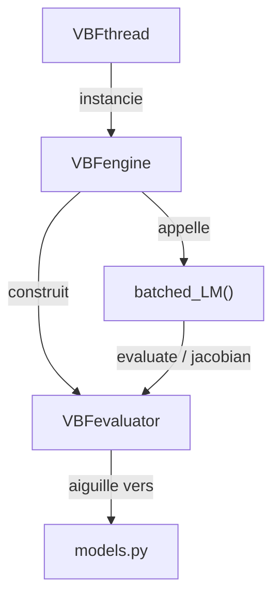
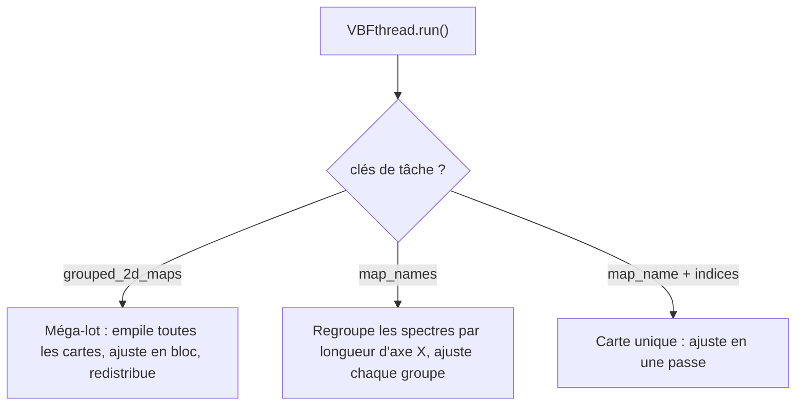

# **Guide développeur : Moteur d'ajustement vectorisé par lots (`VBF`)**

Ce document détaille le fonctionnement interne, l'architecture et les caractéristiques de performance du moteur Vectorized Batch Fit (`VBF`) situé dans `spectroview/fit_engine/`.

---

## **1. Pourquoi le moteur `VBF Engine` est nettement plus rapide**

Les moteurs d'ajustement historiques fonctionnent **spectre par spectre**. Sur une carte hyperspectrale comptant des milliers de spectres, cette approche engendre un surcoût majeur :

- **Surcoût d'appels de fonctions Python** : Appel de la fonction objectif et de l'estimateur de jacobienne des milliers de fois par itération.
- **Jacobiennes par différences finies** : L'approximation numérique de la jacobienne exige `2 * K` évaluations supplémentaires par itération et par spectre (où K est le nombre de paramètres).
- **Exécution séquentielle** : Même avec le multiprocessing, la sérialisation et la communication inter-processus créent des goulots d'étranglement.

Le **moteur Vectorized Batch Fit (`VBF Engine`)** obtient des accélérations massives grâce aux principes suivants :

1.  **Optimisation simultanée de tout le lot** : Il optimise les \(N\) spectres en parallèle. Les matrices de paramètres, tableaux de données et résidus sont manipulés comme de grands tenseurs 2D ou 3D.
2.  **Opérations vectorisées (BLAS/LAPACK)** : En formulant le problème sous forme tensorielle, le calcul lourd est confié à des bibliothèques C/Fortran hautement optimisées.
    - Les multiplications et transpositions matricielles pour les équations normales (\(J^T J\) et \(J^T r\)) utilisent `np.matmul`, qui appelle directement un `gemm` BLAS par lots. (Une ancienne version utilisait `np.einsum`, qui ne délègue pas au BLAS pour cette contraction et s'est révélée 13 à 20× plus lente — voir §2.)
    - Les systèmes linéaires de tous les spectres sont résolus via **`np.linalg.solve` vectorisé** directement sur `(Na, K, K)` (`np.linalg.solve(A, b[..., None])[..., 0]`), exécutant toutes les résolutions indépendantes en un seul appel LAPACK par lots sans boucle Python, avec repli Cholesky/`np.linalg.solve`/`0.0` uniquement sur `LinAlgError` singulier. Voir `_batched_solve()` au §2.
3.  **Jacobiennes analytiques** : Au lieu d'estimer les dérivées numériquement, le moteur utilise des formules analytiques exactes pour chaque profil de pic enregistré (`Gaussian`, `Lorentzian`, `PseudoVoigt`, `GaussianAsym`, `LorentzianAsym`, `Fano`, `DecaySingleExp`, `DecayBiExp`), supprimant entièrement les \(2K\) évaluations supplémentaires.
4.  **Aucune propagation spatiale** : Contrairement aux approches séquentielles propageant les estimations en spirale d'un voisin à l'autre, le moteur `VBF` initialise tous les pixels indépendamment par mise à l'échelle d'amplitude, autorisant un calcul tensoriel purement parallèle.
5.  **Prise en charge des longueurs variables** : Lorsque les spectres ne partagent pas un axe X commun, `x` est passé comme matrice `(N, M)` au lieu de `(M,)`, et chaque fonction de modèle/jacobienne vectorisée s'adapte sur `x.ndim`.
6.  **Support des expressions symboliques** : Prend en charge les contraintes mathématiques complexes entre paramètres sur tout le lot avant le passage aux paramètres libres.

---


## **2. Optimisations de performance**

Les points suivants concernent spécifiquement le cœur numérique dans `fit_engine/`. Les optimisations de prétraitement (recadrage, évaluation de ligne de base sur le tenseur complet) résident dans `SpectraStore.batch_preprocess()` et sont documentées dans [spectra_store.md](spectra_store.md).

1. **Assemblage vectorisé des équations normales via `np.matmul` plutôt que `np.einsum`** (13–20× plus rapide pour \(J^TJ\), 3–4× pour \(J^Tr\) sur des tailles N/M/K réalistes) : `np.einsum('nmk,nml->nkl', J, J)` ne délègue pas au BLAS et retombe sur une boucle générique de réduction. L'expression mathématiquement équivalente `J.transpose(0, 2, 1) @ J` déclenche un appel BLAS `gemm` par lots.
2. **Suppression des recalculs redondants de jacobienne / équations normales sur pas rejetés** : un essai LM rejeté laisse les paramètres du spectre inchangés ; sa jacobienne — et donc \(J^TJ\)/\(J^Tr\) — reste donc strictement exacte ; seul le facteur d'amortissement change avant de réessayer. `optimizer.py` met en cache \(J^TJ\)/\(J^Tr\) par spectre (`JTJ_cache`, `JTr_cache`) et ne les recalcule que pour les spectres dont le *dernier* pas a été accepté (suivis par un masque booléen `dirty`). C'est exact et sans dérive numérique, éliminant environ 30 % des deux opérations les plus coûteuses sur les cartes à convergence lente.
3. **Garde sur `np.nan_to_num`** : `np.nan_to_num` exécute trois parcours complets de tableau (`isnan`/`isposinf`/`isneginf`) plus une affectation par indexation avancée, même lorsque tout est fini. `optimizer._finite_or_clean()` vérifie d'abord `np.isfinite(arr).all()` (un seul parcours fusionné) et ne paie le coût du nettoyage que si nécessaire (~10× plus rapide dans le cas nominal).
4. **Noyaux de modèles et jacobiennes sans allocations temporaires et sur place** : chaque fonction de `models.py` calcule une seule fois chaque quantité répétée (`1/w²`, `1/w³`, `dx²`, …), remplace les divisions `(N,M)` répétées par un unique inverse `(N,1)` suivi d'une multiplication diffusée (`inv_wl = 1.0 / wl`, `inv_wr = 1.0 / wr`), et écrit directement dans des tampons préalloués `out=` dès la première opération (`np.subtract(..., out=out)`). Les 8 jacobiennes analytiques (`batched_*_jac`) écrivent directement dans les tranches `J[:, :, k]` et exploitent l'identité algébrique \(\frac{\partial f}{\partial w} = \frac{x - x_0}{w} \frac{\partial f}{\partial x_0}\) (`J[:, :, 1] = dx * J[:, :, 2] * inv_w`), supprimant 3 à 6 allocations temporaires `(N, M)` par pic et par itération. Les modèles scalaires de référence dans `scalar_models.py` utilisent les mêmes bornes de sécurité (`1e-15` en largeur, `1e-30` en durée de vie) pour garantir une parité machine (\(\le 10^{-13}\)) avec `BATCHED_MODELS`.
5. **Statistiques de bruit partagées, mémoïsation 2D et recherche d'indice de pic en O(N)** : `apply_noise_threshold()` s'exécute une fois avant l'ajustement (pour fournir une estimation initiale propre) et une fois après (pour nettoyer tout pic ayant dérivé dans une région bruitée — voir §5.2 et §10). Les deux appels réutilisent les statistiques mises en cache par `VBFevaluator.compute_noise_stats()`, tandis que `noise.py` met en cache des empreintes 2D sûres vis-à-vis des mutations (`_array_2d_fingerprint`) pour éviter de calculer `mad_noise(Y)` et `moving_average_5(Y)` deux fois de suite. La recherche d'indice de pic sur la grille utilise l'arithmétique uniforme en O(1), `np.searchsorted` en O(N log M) ou un repli par blocs de 256 au lieu d'allouer une matrice de distances `(N, M)`.
6. **Solveur linéaire par lots (`_batched_solve()`)** : résout tous les systèmes normaux actifs `(Na, K, K)` en un seul appel `np.linalg.solve(A, b[..., None])[..., 0]` quelles que soient la taille du lot et le nombre de paramètres, avec repli SciPy `cho_solve` / `np.linalg.solve` / `0.0` uniquement sur `LinAlgError`.
7. **Critère de convergence moyen après projection aux bornes** : le test de convergence mesure `mean(|dp_actual| / |p|) < xtol` sur le déplacement effectif après bornage (`p_trial_active - p_improved_old`) plutôt que sur `dp` non borné ou `max()`, évitant que des ailes dérivant lentement ou des paramètres bloqués sur une borne n'attendent `max_ite`.
8. **Rétro-écriture vectorisée** : `build_results_batch()` évalue toutes les courbes ajustées et calcule R² simultanément sur tout le lot via un unique tampon réutilisable `(N, M)` en contournant les multiplications superflues lorsque les poids valent uniformément `1`.
9. **Sortie anticipée à poids nul et chemin rapide poids uniformes** : les spectres identifiés comme bruit pur (tous poids nuls) convergent instantanément, et `weights` égal à `None` ou à `1.0` uniforme évite les multiplications `(N, M)` sur les résidus et jacobiennes à chaque itération.
10. **Disposition transposée `(K, N, M)` de la jacobienne et chemins sans copie** : `batched_levenberg_marquardt()` alloue `J_buf_base` selon l'agencement physique `(K, N, M)` et expose `J_r_buf = J_buf_base[:, :n_recompute, :].transpose(1, 2, 0)` de forme logique `(Nr, M, K)`. Chaque tranche de paramètre `J[:, :, k]` est ainsi 100 % C-contiguë de forme `(Nr, M)` lors de l'évaluation de la jacobienne, et l'axe de contraction `M` conserve un pas de 8 octets lors des appels BLAS `dgemm` `JT_r @ J_r` et `JT_r @ scaled_r_r[:, :, None]`. Aux premières itérations où tous les spectres sont actifs, l'optimiseur écrit directement dans `JTJ_cache` et `JTr_cache` via `np.matmul(..., out=...)` sans copie ni rassemblement indexé.
11. **Règle de dérivation en chaîne par nombres duaux (`_DualVar`) pour les expressions** : `VBFevaluator` trie topologiquement et compile en bytecode les expressions une seule fois dans `from_fit_model()`, et calcule les dérivées exactes `J_expr` en une passe par différentiation automatique en mode avant (`_DualVar`) couplée à `J_full @ J_expr` (~3× plus rapide sur les modèles contraints par expressions).
12. **Découpage adaptatif par lots pour cache L3** : lors de l'ajustement de très grandes cartes (\(N \cdot M \cdot K > 2\,097\,152\) ou \(N \ge 2\,048\) avec \(N \cdot M \cdot K > 1\,048\,576\)), `batched_levenberg_marquardt()` découpe automatiquement le lot en sous-lots tenant en cache L3 (`chunk_n` ciblant ~4 Mo d'empreinte active), réduisant la mémoire crête jusqu'à 79 % tout en accélérant les calculs.
13. **Interpolation linéaire de ligne de base en pur NumPy** : `eval_baseline()` et `eval_baseline_batch()` évaluent les lignes de base linéaires par morceaux (avec extrapolation linéaire aux bords) via `_interp_linear_extrap()` en pur NumPy, évitant le coût d'import à froid de `scipy.interpolate`.

## **3. Logique du code et principes d'implémentation**

Le moteur implémente un algorithme de **Levenberg-Marquardt par lots**.

### **3.1. Formulation mathématique du LM par lots**

Pour \(N\) spectres comptant chacun \(M\) points spectraux et \(K\) paramètres libres :

1.  **Évaluation du modèle** : \(\mathbf{Y}_{pred} = f(\mathbf{x}, \mathbf{p})\), renvoyant un tenseur \((N, M)\).
2.  **Calcul des résidus** : \(\mathbf{r} = \mathbf{W} \circ (\mathbf{Y}_{pred} - \mathbf{Y}_{data})\), renvoyant un tenseur \((N, M)\).
3.  **Calcul de la jacobienne** : \(\mathbf{J} = \frac{\partial f}{\partial \mathbf{p}}\), renvoyant un tenseur \((N, M, K)\).
4.  **Équations normales** : Assemblage de \(J^T J\) (taille \(N \times K \times K\)) et \(J^T r\) (taille \(N \times K\)) via `np.matmul` (§2).
5.  **Amortissement (pas de Marquardt)** : Ajout d'un facteur d'amortissement \(\lambda_i\) à la diagonale de \(J^T J\) pour chaque spectre \(i\).
6.  **Résolution** : Résolution simultanée de \((J^T J + \lambda \text{diag}(J^T J)) \delta \mathbf{p} = -J^T r\) pour les \(N\) spectres.
7.  **Évaluation du pas** : Mise à jour \(\mathbf{p} \leftarrow \mathbf{p} + \delta \mathbf{p}\) (avec projection sur les bornes) et évaluation du nouveau coût. Ajustement de \(\lambda\) par spectre selon le succès ou l'échec du pas.

### **3.2. Convergence indépendante**

Bien que le calcul soit groupé par lots, chaque spectre converge indépendamment. L'optimiseur emploie un masque booléen (`active = ~converged`) pour ignorer le calcul de jacobienne et la résolution linéaire des spectres déjà convergés, accélérant progressivement les dernières itérations. Un second masque (`dirty`, voir §2) saute en outre le recalcul de jacobienne et des équations normales — mais *pas* l'évaluation de l'essai — pour les spectres actifs dont le dernier pas a été rejeté.

### **3.3. Fonctions de perte robustes (mise à l'échelle de type IRLS)**

Pour résister aux points aberrants tels que les rayons cosmiques ou artefacts détecteurs sans masquage manuel, l'optimiseur prend en charge des M-estimateurs robustes via des moindres carrés itérativement repondérés (IRLS) :

- **`linear`** (par défaut) : Moindres carrés standard $\rho(z) = z$, $\rho'(z) = 1$. Strictement identique bit à bit au LM non pondéré initial.
- **`soft_l1`** : Approximation $L_1$ lisse $\rho(z) = 2(\sqrt{1 + z} - 1)$, avec facteur de mise à l'échelle dérivé $\sqrt{\rho'(z)} = (1 + z)^{-1/4}$ où $z = (r / f\_scale)^2$. Transition douce entre comportement quadratique près de zéro et pénalité linéaire sur les grands résidus.
- **`huber`** : Perte de Huber $\rho(z) = z$ si $z \le 1$ sinon $2\sqrt{z} - 1$, avec facteur $\sqrt{\rho'(z)} = 1$ si $z \le 1$ sinon $z^{-1/4}$.

**Formulation mathématique** :
Les résidus et lignes de la jacobienne sont pondérés par $w_{\text{robust}} = \sqrt{\rho'((r / f\_scale)^2)}$. Les équations normales résolues à chaque itération deviennent :
$$(J^T W J + \lambda \text{diag}(J^T W J)) \delta \mathbf{p} = -J^T W \mathbf{r}$$
où $W = \text{diag}(w_{\text{hard}}^2 \cdot w_{\text{robust}}^2)$.

**Ordre de composition des poids** :

1. **Exclusions strictes** (`fit_negative` et plancher de bruit `coef_noise`) évaluées d'abord dans `weights.py` pour affecter un poids nul ($w_{\text{hard}} = 0$) aux points exclus.
2. **Pondération robuste** ($w_{\text{robust}}$) appliquée ensuite dans `optimizer.py` sur les points actifs pour atténuer les grands résidus aberrants. Les points de poids nul restent nuls.

---

## **4. Structure des modules et classes**



| Module | Classe / Fonction | Responsabilité |
|--------|-------------------|----------------|
| `vbf_thread.py` | `VBFthread` | Enveloppe `QThread`. Regroupe les tâches en modes carte unique, méga-lot (`grouped_2d_maps`) ou groupement par longueur (`map_names`) ; construit la matrice des poids ; appelle `VBFengine.fit_spectra()` ; écrit les résultats dans `SpectraStore`. Émet `progress_changed` et `timings_ready`. Configure une pile de 8 Mo sous macOS pour éviter les plantages LAPACK. |
| `vbf_engine.py` | `VBFengine` | Orchestrateur d'API publique pour un appel d'ajustement. Construit l'évaluateur, initialise `p0` + seuil de bruit, lance l'optimiseur, réapplique le seuil de bruit puis construit les tableaux résultats. Enregistre les temps d'étape dans `self.timings`. |
| `evaluator.py` | `VBFevaluator` | Passerelle entre le dictionnaire `fit_model` et le format tensoriel plat. Analyse les définitions de pics, gère l'indexation libre/fixe, évalue les expressions, appelle les fonctions vectorisées de modèles et construit les tableaux retournés (paramètres, R², meilleures courbes, courbes par pic) sans objets intermédiaires `FitResult`. |
| `optimizer.py` | `batched_levenberg_marquardt()` | Optimiseur numérique pur. Résout simultanément N problèmes aux moindres carrés non linéaires via `np.matmul`, cache `JᵀJ`/`Jᵀr`, `np.linalg.solve` par lots avec repli singulier, réutilisation de tampons `out=` et critère de convergence post-bornage. Indépendant de toute UI. |
| `models.py` | fonctions `batched_*()` | Fonctions vectorisées des profils de pics et leurs jacobiennes analytiques. Contient le registre `BATCHED_MODELS` et le repli `numerical_jacobian()`. |
| `scalar_models.py` | fonctions scalaires | Implémentations de référence sur spectre unique et registre `PEAK_MODEL_REGISTRY`. Utilisées par `eval_peak_initial()` (aperçu UI) et comme repli scalaire encapsulé par `_make_batched_scalar()` dans `evaluator.py`. |

---

## **5. Pipeline de traitement et flux d'exécution**

Le pipeline comporte deux niveaux : `VBFthread` orchestre les *tâches* (regroupement des spectres, construction des poids, destination des résultats) et `VBFengine.fit_spectra()` constitue le cœur numérique pur appelé une fois par tâche.

```mermaid
sequenceDiagram
    participant VM as ViewModel
    participant TFT as VBFthread
    participant TE as VBFengine
    participant EV as VBFevaluator
    participant OPT as optimizer

    VM->>TFT: start()
    TFT->>TFT: _prepare_weights() — masquage valeurs négatives et bruit
    TFT->>TE: fit_spectra(x, Y, fit_model, weights, fit_params)
    TE->>EV: from_fit_model()
    TE->>EV: build_p0_matrix() + apply_noise_threshold() (pré-ajustement)
    TE->>OPT: batched_levenberg_marquardt()
    TE->>EV: apply_noise_threshold() (nettoyage post-ajustement)
    TE->>EV: build_results_batch()
    TE-->>TFT: p_full, success, r², best_fits, Y_peaks
    TFT->>TFT: _write_results() → store.set_fit_results(), md.Y_bestfit / md.Y_peaks
    TFT-->>VM: progress_changed / timings_ready / finished
```

### **5.1. `VBFthread.run()` — Orchestration des tâches**

Pour chaque tâche, `VBFthread` choisit l'une des trois branches au sein d'une unique boucle sur `self.tasks` :

| Clé présente dans la tâche | Quand utilisée | Comportement |
|---|---|---|
| `grouped_2d_maps` | « Appliquer le modèle à toutes les cartes » avec un modèle partagé | Empile via `np.vstack` les matrices `Y` de toutes les cartes, ajuste en un seul méga-lot puis redistribue les résultats par tranches de lignes dans chaque `MapData`. |
| `map_names` | Ajustement par lots dans Spectra de spectres isolés ayant chacun son propre modèle | Regroupe les spectres par longueur d'axe X et ajuste chaque groupe de même longueur en un lot. |
| `map_name` + `indices` | Ajustement d'une carte unique (cas courant) | Extrait `Y[indices]`, calcule les poids et appelle une fois `fit_spectra()`. |

Avant d'appeler le moteur, `VBFthread._prepare_weights()` construit la matrice de pondération d'après `fit_negative` et `coef_noise` (voir §9 et §10).

### **5.2. `VBFengine.fit_spectra()` — Le cœur numérique**

1. **Construction de l'évaluateur** — `VBFevaluator.from_fit_model(fit_model)` traduit `peak_models` vers l'agencement plat (§6). Si tous les paramètres sont fixés (`n_params_free == 0`), le moteur court-circuite et retourne aussitôt.
2. **Construction de `p0`** — `build_p0_matrix()` duplique les valeurs initiales sur les N spectres et met à l'échelle l'amplitude de chaque pic d'après l'intensité observée en `x0` (rapport borné à `[0.01, 100]` pour éviter toute divergence initiale). `apply_noise_threshold()` met ensuite à zéro l'amplitude/FWHM des pics centrés sous le plancher de bruit.
3. **Optimisation** — `batched_levenberg_marquardt()` (§3) itère jusqu'à ce que chaque spectre converge, soit déclaré bloqué (§9.2) ou atteigne `max_ite`.
4. **Nettoyage post-ajustement** — `apply_noise_threshold()` ré-examine les paramètres optimisés si un pic a dérivé vers une zone bruitée durant les itérations LM.
5. **Construction des résultats** — `build_results_batch()` évalue en une passe les courbes totales et individuelles des pics et calcule R² vectoriellement sur les N spectres, renvoyant des tableaux simples (`p_full`, `success`, `rsquared`, `best_fits`, `Y_peaks`, `param_names`).

`VBFthread._write_results()` écrit ensuite ces tableaux dans `SpectraStore` (`set_fit_results()`) et sur l'objet `MapData` (`Y_bestfit`, `Y_peaks`).

---

## **6. Détail de `VBFevaluator`**

`VBFevaluator` est la classe la plus complexe du moteur. Elle assure la **passerelle** entre l'univers dictionnaire flexible de l'interface graphique et l'univers tensoriel figé de l'optimiseur.

### **6.1. Correspondance de l'espace des paramètres**

```
fit_model dict                    VBFevaluator                  Optimiseur
┌─────────────────┐     ┌────────────────────────────┐     ┌──────────────┐
│ peak_models:    │     │ _param_names:              │     │              │
│   "0":          │     │   ["m01_ampli",            │     │  p_free      │
│     Gaussian:   │ ──► │    "m01_fwhm",             │ ──► │  (N, K_free) │
│       ampli: .. │     │    "m01_x0",               │     │              │
│       fwhm:  .. │     │    "m02_ampli", ...]       │     │              │
│       x0:    .. │     │                            │     │              │
│   "1":          │     │ _free_idx:  [0, 1, 2, 3]   │     │              │
│     Lorentzian: │     │ _fixed_idx: [4]            │     │              │
│       ampli: .. │     │ _fixed_values: [0.5]       │     │              │
│       ...       │     │                            │     │              │
└─────────────────┘     └────────────────────────────┘     └──────────────┘
```

### **6.2. Prise en charge des expressions**

Les paramètres peuvent référencer d'autres paramètres via des expressions mathématiques (ex. `m01_fwhm = m02_fwhm` ou `m01_x0 + 10`). L'évaluateur les traite dans `_to_full()` :

1. Les paramètres dotés d'expressions sont marqués comme **fixes** (non optimisés directement).
2. Lors de `from_fit_model()`, les expressions sont triées topologiquement par dépendances et compilées en bytecode Python (`_compile_exprs()`), évitant l'analyse répétée de chaînes via `eval()` à chaque itération.
3. Dans `_to_full()`, les expressions compilées sont évaluées en une passe topologique unique dans un espace de noms restreint contenant tous les noms de paramètres, `np` et les fonctions mathématiques usuelles (`sin`, `cos`, `tan`, `exp`, `log`, `log10`, `sqrt`, `abs`, `pi`, `e`, `minimum`, `maximum`, `clip`).
4. La jacobienne intègre les expressions par la **règle de dérivation en chaîne analytique** : `_compute_j_expr()` propage les paramètres libres sous forme de nombres duaux vectorisés (`_DualVar(value, d_free)`) sur les expressions compilées afin d'obtenir le tenseur de sensibilité exact `J_expr` de forme `(N, K_total, K_free)`, puis calcule la jacobienne contrainte par produit matriciel BLAS `J_full @ J_expr`.

### **6.3. Aiguillage vers les modèles**

Les méthodes `evaluate()` et `jacobian()` parcourent tous les pics enregistrés et écrivent ou somment proprement leurs contributions dans `out` lorsqu'il est fourni :

```python
def evaluate(self, x, p_free, out=None):
    p_full = p_free if self._all_free_identity else self._to_full(p_free)  # (N, K_total)
    # Les modèles à un seul pic écrivent directement dans `out` ; les multi-pics réutilisent un tampon de travail
    ...
```

Pour la jacobienne, si un pic possède une jacobienne analytique (`has_jac=True`), celle-ci est appelée directement ; sinon `numerical_jacobian()` sert de repli par différences finies centrées avec pas relatif.

---

## **7. Modèles de pics vectorisés et jacobiennes analytiques**

### **7.1. Conventions tensorielles**

Toutes les fonctions vectorisées suivent la même signature :

```python
def batched_shape(x, params, out=None):
    """
    x:      (M,) axe partagé  OU  (N, M) axe par spectre
    params: (N, n_p) matrice des paramètres
    out:    tampon de sortie préalloué optionnel (N, M)
    Returns: (N, M) valeurs prédites
    """

def batched_shape_jac(x, params, out=None):
    """Returns: (N, M, n_p) tenseur jacobien (écrit dans `out` si fourni)"""
```

En interne, chaque fonction suit le même schéma d'efficacité (§2.4) : calculer une seule fois chaque terme répété (typiquement un inverse tel que `1/w²`), le réutiliser par multiplication diffusée et écrire sur place dans les tranches de la jacobienne préallouée.

### **7.2. Modèles enregistrés (`BATCHED_MODELS`)**

Tous les profils de pics disposent d'implémentations vectorisées par lots dotées de **jacobiennes analytiques**, garantissant des performances maximales pour chaque profil :

| Modèle | Paramètres | Formule |
|--------|------------|---------|
| `Gaussian` | `ampli`, `fwhm`, `x0` | <i>a</i> &middot; exp(-4 ln(2) &middot; (x-x<sub>0</sub>)<sup>2</sup> / w<sup>2</sup>) |
| `Lorentzian` | `ampli`, `fwhm`, `x0` | <i>a</i> / [1 + 4(x-x<sub>0</sub>)<sup>2</sup> / w<sup>2</sup>] |
| `PseudoVoigt` | `ampli`, `fwhm`, `x0`, `alpha` | &alpha; &middot; G + (1-&alpha;) &middot; L |
| `GaussianAsym` | `ampli`, `fwhm_l`, `fwhm_r`, `x0` | Gaussienne par morceaux avec FWHM gauche/droite |
| `LorentzianAsym` | `ampli`, `fwhm_l`, `fwhm_r`, `x0` | Lorentzienne par morceaux avec FWHM gauche/droite |
| `Fano` | `ampli`, `fwhm`, `x0`, `q` | <i>a</i> &middot; (q + &epsilon;)<sup>2</sup> / (1 + &epsilon;<sup>2</sup>), &epsilon; = 2(x-x<sub>0</sub>)/w |
| `DecaySingleExp` | `A`, `tau`, `B` | <i>A</i> &middot; e<sup>-x/&tau;</sup> + B |
| `DecayBiExp` | `A1`, `tau1`, `A2`, `tau2`, `B` | <i>A</i><sub>1</sub> &middot; e<sup>-x/&tau;<sub>1</sub></sup> + <i>A</i><sub>2</sub> &middot; e<sup>-x/&tau;<sub>2</sub></sup> + B |

### **7.3. Repli par jacobienne numérique**

Pour de futurs modèles personnalisés enregistrés uniquement dans `PEAK_MODEL_REGISTRY` (sans implémentation vectorisée), `numerical_jacobian()` utilise les **différences finies centrées** à perturbation relative en secours :

```python
h = max(|param| * eps, eps)          # Adapte le pas à l'ordre de grandeur du paramètre
J[:,:,k] = (f(p+h) - f(p-h)) / 2h  # Différence centrée
```

Ce mode est ~`2K` fois plus lent par itération qu'une jacobienne analytique, mais assure l'exactitude pour toute nouvelle forme.

---

## **8. La classe `VBFthread`**

### **8.1. Branches de tâches**



Les trois branches résident dans une même boucle sur `self.tasks` dans `run()` — voir §5.1 pour leurs déclencheurs.

### **8.2. Taille de pile sous macOS**

Le thread force une pile de 8 Mo sous macOS (`setStackSize(8 * 1024 * 1024)`) car :

- macOS limite par défaut la pile des `QThread` à 512 Ko.
- `np.linalg.solve` délègue à LAPACK, qui alloue des tableaux de travail sur la pile.
- Pour un K élevé (beaucoup de paramètres), l'allocation pile peut dépasser 512 Ko et provoquer un plantage mémoire (segfault).

### **8.3. Signaux**

| Signal | Charge utile | Rôle |
|--------|--------------|------|
| `progress_changed` | `Signal(int, int, int, float, int)` → `(current, total, percent, elapsed_seconds, current)` | Met à jour la barre de progression dans la View. (Le 5e argument duplique le 1er.) |
| `timings_ready` | `Signal(str)` | Ventilation chronométrée par étape pour console/débogage |

---

## **9. Paramètres d'optimisation et réglages**

Le comportement du moteur s'ajuste via le dictionnaire `fit_params` passé à `fit_spectra()`.

### **9.1. Paramètres clés**

*   **`max_ite`** (défaut : 200) : Nombre maximal d'itérations de Levenberg-Marquardt. L'augmenter aide à faire converger des spectres très complexes au prix d'un temps d'exécution plus long.
*   **`xtol`** (défaut : 1e-4) : Tolérance relative sur le pas des paramètres \(\delta p\). La convergence est atteinte lorsque la **moyenne** des variations relatives après bornage sur tous les paramètres actifs (\(\operatorname{mean}(|\Delta p_{\text{actual}}| / |p|)\)) est inférieure à `xtol`.
*   **`ftol`** (défaut : 1e-4) : Tolérance relative sur la fonction de coût (somme des carrés des résidus). Si la variation relative du coût devient inférieure à `ftol`, le spectre est considéré convergé.
*   **`fit_negative`** (défaut : `False`) : Indique s'il faut inclure les intensités négatives dans l'ajustement. À `False`, les points négatifs reçoivent un poids nul (`VBFthread._prepare_weights()`).
*   **`coef_noise`** (défaut : `0.0`) : Facteur multiplicateur du niveau de bruit. Lorsqu'il est > 0, active le masquage par pondération (`VBFthread._prepare_weights()`) et la suppression des pics dans le bruit (`VBFevaluator.apply_noise_threshold()`). Voir [Section 10](#10-estimation-du-niveau-de-bruit-et-seuil-de-bruit) pour l'explication complète.
*   **`fit_outliers`** — **clé historique, non lue par le moteur actuel.** D'anciens fichiers `fit_model` JSON peuvent encore la contenir, mais rien dans `fit_engine/` ne la consulte ; elle est ignorée silencieusement.

### **9.2. Compromis vitesse / précision**

- **Cartographie rapide** : Pour des aperçus rapides, passez `xtol` et `ftol` à `1e-3` ou `1e-2`. L'optimiseur sortira bien plus tôt en produisant un premier ajustement rapide.
- **Ajustement de précision** : Pour des résultats de publication, abaissez `xtol` et `ftol` à `1e-5` ou `1e-6`.
- **Gestion des spectres bloqués (« Stuck »)** : L'optimiseur suit `consecutive_rejects`. Si le coût d'un spectre ne s'améliore pas durant 15 itérations consécutives malgré les ajustements d'amortissement, ce spectre est marqué convergé (bloqué) afin de ne pas ralentir tout le lot (`MAX_REJECTS` dans `optimizer.py`).

### **9.3. Loi d'amortissement**

Le facteur d'amortissement par spectre \(\lambda\) est initialisé à `1e-2` puis ajusté après chaque itération :

| Issue | Ajustement de λ | Effet |
|-------|-----------------|-------|
| Coût amélioré | `λ /= 3.0` (plancher `1e-10`) | Fait davantage confiance à la direction de Gauss-Newton |
| Coût dégradé | `λ *= 2.5` (plafond `1e10`) | Se rapproche de la descente de gradient |

---

## **10. Estimation du niveau de bruit et seuil de bruit**

Le paramètre `coef_noise` pilote un filtrage sensible au bruit qui améliore nettement à la fois les **performances** et la **précision** de l'ajustement, notamment sur les cartes hyperspectrales où de nombreux pixels présentent des pics faibles ou absents.

### **10.1. Comment le niveau de bruit est estimé**

L'utilitaire public `detect_noise_level()` (`fit_engine/noise.py`, utilisé par l'UI pour afficher le niveau de bruit dans `SpectraViewer`) et l'estimateur interne vectorisé (`VBFevaluator.compute_noise_stats()`, `VBFthread._prepare_weights()`) emploient tous deux le même estimateur robuste : la médiane des valeurs absolues des différences premières, ramenée à un écart-type gaussien équivalent σ.

```python
def detect_noise_level(y: np.ndarray) -> float:
    dy = np.diff(y)                                    # δ[i] = y[i+1] − y[i]
    return np.median(np.abs(dy)) / 0.6745 * np.sqrt(2)
```

**Pourquoi cela fonctionne :**

| Terme | Rôle |
|-------|------|
| `np.diff(y)` | Différences point à point — dominées par le bruit, car les bandes spectrales réelles varient lentement à l'échelle d'un pas |
| `np.median(np.abs(dy))` | Médiane des écarts absolus — insensible aux rares sauts brusques sur le flanc d'un pic étroit, contrairement à un écart-type classique |
| `/ 0.6745` | Convertit l'écart médian absolu (MAD) gaussien en écart-type équivalent (0,6745 = constante MAD-vers-σ d'une loi normale) |
| `* sqrt(2)` | La différence première de deux échantillons bruités indépendants a pour variance \(2\sigma^2\) ; ce facteur restaure le σ par point |

`VBFevaluator.compute_noise_stats(Y, coef_noise)` applique la même logique `diff`/`median` selon `axis=1` pour estimer un niveau de bruit par spectre sur toute la carte, et calcule en parallèle une moyenne glissante sur 5 points du signal (`ymean`) servant à décider point par point si le *signal lui-même* dépasse le seuil :

```python
dy = np.diff(Y, axis=1)
ampli_noise = np.median(np.abs(dy), axis=1) / 0.6745 * np.sqrt(2)      # (N,)
Y_padded = np.pad(Y, ((0, 0), (2, 2)), mode='edge')
ymean = (Y_padded[:, 0:-4] + Y_padded[:, 1:-3] + Y_padded[:, 2:-2]
         + Y_padded[:, 3:-1] + Y_padded[:, 4:]) / 5.0                   # moyenne glissante 5 points
noise_level = coef_noise * ampli_noise                                   # (N,)
```

> `apply_noise_threshold()` est appelée deux fois par ajustement (avant et après optimisation — voir §5.2), les deux appels ayant besoin des mêmes `ymean`/`noise_level`. `VBFengine.fit_spectra()` les calcule une seule fois via `compute_noise_stats()` et transmet le résultat (`noise_stats=`) aux deux appels au lieu de répéter le calcul (§2).

### **10.2. Comment `coef_noise` active le seuillage du bruit**

Lorsque `coef_noise > 0`, un **seuil de bruit** vaut `noise_level = coef_noise × ampli_noise`. Il déclenche **deux mécanismes complémentaires** :

#### **10.2.1. Mécanisme A — Masquage par poids (`VBFthread._prepare_weights`)**

Avant le début de l'ajustement, tout point où le signal lissé (`ymean`) tombe sous le seuil de bruit reçoit un poids nul :

```python
weights[ymean < noise_level[:, None]] = 0.0   # poids nul → ignoré par l'optimiseur
```

Le calcul des résidus \(\mathbf{r} = \mathbf{W} \circ (\mathbf{Y}_{pred} - \mathbf{Y}_{data})\) ignore naturellement ces points masqués, concentrant l'optimisation sur les zones contenant du signal utile.

#### **10.2.2. Mécanisme B — Suppression de pics (`VBFevaluator.apply_noise_threshold`)**

Tout pic dont le **centre** (`x0`) se trouve dans une région sous le seuil voit son amplitude et sa largeur FWHM forcées à zéro ; les autres paramètres de forme de ce pic retrouvent leur estimation initiale (`p0_matrix`) pour éviter que le bruit aléatoire ne soit cartographié comme une structure réelle. Ce mécanisme s'exécute **deux fois** (§5.2) :

1. **Avant optimisation** — prépare une estimation initiale propre, évitant que l'optimiseur n'ajuste des pics fictifs sur du bruit.
2. **Après optimisation** — nettoie tout pic ayant dérivé dans le bruit au fil des itérations LM.

### **10.3. Gains en performance et en précision**

#### **10.3.1. Performance**

| Aspect | Bénéfice |
|--------|----------|
| Convergence plus rapide | Les pics annulés en zone bruitée restent à zéro, réduisant de fait le nombre de paramètres actifs |
| Moins d'itérations inutiles | Sans masquage, l'optimiseur gaspille de nombreuses itérations à ajuster du bruit avec de minuscules pics fantômes |
| Meilleure estimation initiale | La mise à zéro préalable approche \(p_0\) de la vraie solution, diminuant le nombre d'itérations LM |

#### **10.3.2. Précision**

| Aspect | Bénéfice |
|--------|----------|
| Élimine les pics fantômes | Dans les cartes, certains pixels n'ont pas de pic ou un signal faible. Sans seuil, des pics fictifs polluent les cartes paramétriques |
| Stabilise les paramètres corrélés | Près du plancher de bruit, amplitude, largeur et position deviennent fortement corrélées ; la suppression évite ces dérives |
| Évite les interférences (*cross-talk*) | Un pic fantôme peut « voler » de l'intensité à un pic voisin réel et fausser son amplitude |
| R² plus représentatif | Les régions bruitées masquées ne pèsent plus dans le calcul de R², qui reflète alors uniquement les régions à signal réel |

### **10.4. Exemple pratique**

Considérons une carte Raman à 3 pics où, pour certains pixels, le pic n° 2 se situe dans une ligne de base plate :

```
Sans coef_noise (= 0) :
  Pic #2 → ampli = 0.3 (artefact de bruit), fwhm = 2.1 (sans signification), x0 = 520.3 (dérive)
  Pic #1 → ampli = 18.2 (légèrement biaisée — le pic #2 capte une partie de l'intensité)

Avec coef_noise = 1 :
  Pic #2 → ampli = 0.0, fwhm = 0.0   (correctement supprimé)
  Pic #1 → ampli = 19.1              (exact, sans interférence)
```

### **10.5. Choisir la bonne valeur de `coef_noise`**

| Valeur | Comportement |
|--------|--------------|
| `0` | **Désactivé** — tous les pics sont ajustés partout, sans masquage |
| `0.5 – 1.0` | **Conservateur** — ne supprime que les pics/zones nettement sous le niveau de bruit |
| `1.0 – 2.0` | **Modéré** — bon réglage par défaut pour la plupart des jeux de données |
| `3.0 – 5.0` | **Agressif** — risque d'écarter de vrais pics faibles ; à employer avec précaution |
| `> 5.0` | **Très agressif** — seuls les pics forts et indiscutables subsistent |

La valeur par défaut dans `MSettings.load_fit_settings()` est `0.0` (désactivé). L'interface `Settings` l'expose comme champ numérique sur `[0.0, 10.0]` par pas de `0.5`.

---

## **11. Ajouter de nouveaux modèles de pics**

### **11.1. Voie rapide : Jacobienne analytique (recommandée)**

Pour ajouter un nouveau profil de pic avec des performances maximales :

**Étape 1** — Définissez la fonction d'évaluation vectorisée dans `models.py` (avec réutilisation optionnelle de `out=None`) :

```python
def batched_newshape(x, params, out=None):
    """
    x:      (M,) ou (N, M)
    params: (N, n_p) où les colonnes sont [param1, param2, ...]
    out:    tableau préalloué optionnel (N, M)
    Returns: (N, M)
    """
    p1 = params[:, 0:1]    # (N, 1) — diffusé sur M
    p2 = params[:, 1:2]
    if x.ndim == 1:
        dx = x[None, :] - p2    # (N, M)
    else:
        dx = x - p2
    result = p1 * some_function(dx)
    if out is not None:
        out[...] = result
        return out
    return result
```

**Étape 2** — Dérivez et implémentez la jacobienne analytique (en acceptant `out=None` pour l'écriture directe par tranches) :

```python
def batched_newshape_jac(x, params, out=None):
    """Returns: (N, M, n_p) — dérivées partielles par rapport à chaque paramètre."""
    # ... calculer les intermédiaires ...
    N, M = result.shape
    J = np.empty((N, M, n_p), dtype=np.float64) if out is None else out
    J[:, :, 0] = d_result_d_p1
    J[:, :, 1] = d_result_d_p2
    return J
```

**Étape 3** — Enregistrez le modèle dans le dictionnaire `BATCHED_MODELS` :

```python
BATCHED_MODELS = {
    # ... existants ...
    "NewShape": (batched_newshape, batched_newshape_jac, ["param1", "param2", ...]),
}
```

Lors de la dérivation, appliquez les mêmes bonnes pratiques que le reste de `models.py` (§2.4, §7.1) : précalculez tout inverse de type `1/w`, privilégiez les opérations sur place (`*=`, `+=`) et validez votre jacobienne analytique face à `numerical_jacobian()` sur des jeux aléatoires.

### **11.2. Voie lente : Repli scalaire**

Si le calcul d'une jacobienne analytique est impraticable :

**Étape 1** — Définissez une fonction scalaire dans `scalar_models.py` :

```python
def newshape(x, param1, param2):
    """x est un tableau 1D, params sont des scalaires. Renvoie un tableau 1D."""
    return param1 * some_function(x - param2)
```

**Étape 2** — Enregistrez-la dans `PEAK_MODEL_REGISTRY` :

```python
PEAK_MODEL_REGISTRY = {
    # ... existants ...
    "NewShape": (newshape, ["param1", "param2"]),
}
```

L'évaluateur l'encapsulera automatiquement via `_make_batched_scalar()` et utilisera `numerical_jacobian()`. Ce mode est fonctionnel mais environ 10 à 50× plus lent par pic et par itération.

### **11.3. Enregistrement dans l'application**

Après ajout dans le moteur, enregistrez le profil dans `spectroview/__init__.py` :

```python
PEAK_MODELS = [
    "Gaussian", "Lorentzian", "PseudoVoigt",
    # ... existants ...
    "NewShape",  # Ajouter ici pour l'afficher dans les menus déroulants de l'UI
]
```

---

## **12. Chronométrage et diagnostics**

`VBFengine` enregistre les temps d'exécution horloge de chaque étape dans `self.timings` :

```
Step 3 - build p0:     0.003s
Step 4 - batch fit:   1.234s (0.6 ms/spectrum, 1950/2000 converged)
Step 5 - write_back:   0.089s
```

Seules ces trois entrées sont renseignées par `VBFengine.fit_spectra()` — la numérotation débute à 3 car elle prolonge les étapes amont précédant l'appel au moteur : application du modèle sur `MapData` et `SpectraStore.batch_preprocess()` (recadrage + soustraction de ligne de base), chronométrées séparément et documentées dans [spectra_store.md](spectra_store.md).

Ces temps sont émis via `VBFthread.timings_ready` et affichés en console (passez `print_benchmark=True` à `fit_spectra()` pour un affichage en direct durant le débogage) :

- Si **Step 4** domine → comportement normal ; c'est l'optimisation proprement dite.
- Si **Step 4** affiche une faible convergence → vérifiez les valeurs initiales, les bornes ou le choix du modèle plutôt que les performances.
- Si **Step 3** ou **Step 5** paraît anormalement élevé devant Step 4 → profilez ces étapes, qui doivent normalement rester un à deux ordres de grandeur en dessous de Step 4.

### **12.1. Calcul du coefficient R²**

L'indicateur de qualité d'ajustement R² est calculé lors de `build_results_batch()` :

$$
R^2 = 1 - \frac{\sum_i w_i (y_i - \hat{y}_i)^2}{\sum_i w_i (y_i - \bar{y}_w)^2}
$$

où \(\bar{y}_w\) désigne la moyenne pondérée. En présence de poids, seuls les points de poids non nul contribuent au numérateur et au dénominateur, empêchant les zones masquées (valeurs négatives, bruit sous le seuil) de biaiser artificiellement la qualité rapportée.
