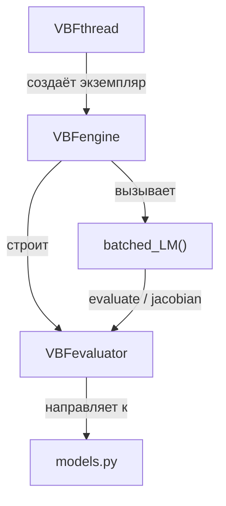
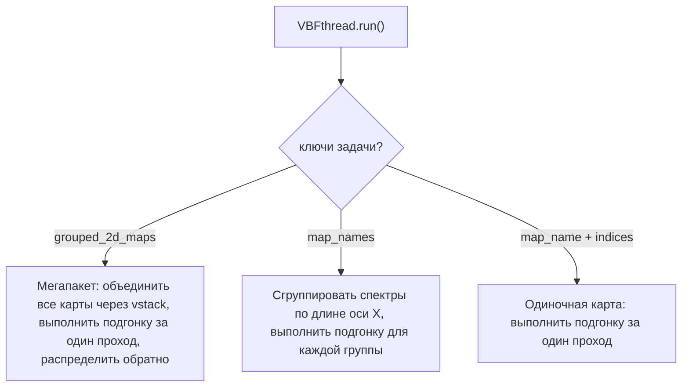

# **Руководство разработчика: векторизованный движок пакетной аппроксимации (VBF)** { #developer-guide-vectorized-batch-fit-engine-vbf }

В этом документе подробно рассматриваются внутреннее устройство, архитектура и характеристики производительности векторизованного движка пакетной аппроксимации (`VBF`), расположенного в `spectroview/fit_engine/`.

---

## **1. Почему движок `VBF Engine` работает значительно быстрее** { #1-why-the-vbf-engine-is-much-faster }

Классические движки аппроксимации работают **поспектрно** (по одному спектру за раз). Для гиперспектральной карты, содержащей тысячи спектров, такой подход создаёт значительные накладные расходы:

- **Накладные расходы на вызовы функций Python**: многократный (тысячи раз за итерацию) вызов целевой функции и оценщика матрицы Якоби (якобиана).
- **Конечно-разностные якобианы**: численная аппроксимация якобиана требует `2 * K` дополнительных вычислений функции на каждой итерации для каждого спектра (где K — число параметров).
- **Последовательное выполнение**: даже при использовании многопроцессорности сериализация и межпроцессное взаимодействие создают узкие места.

**Векторизованный движок пакетной аппроксимации (`VBF Engine`)** обеспечивает многократное ускорение благодаря следующим основным принципам:

1.  **Одновременная оптимизация всего пакета**: все \(N\) спектров оптимизируются одновременно. Матрицы параметров, массивы данных и невязки обрабатываются как единые 2D- или 3D-тензоры.
2.  **Векторизованные операции (BLAS/LAPACK)**: представление задачи в тензорной форме позволяет перенести основную вычислительную нагрузку в высокооптимизированные библиотеки на C и Fortran.
    - Матричные умножения и транспонирования для нормальных уравнений (\(J^T J\) и \(J^T r\)) выполняются с помощью `np.matmul`, который делегирует вычисления пакетному вызову BLAS `gemm`. (В более ранней версии использовалась функция `np.einsum`; для данной схемы свёртки `einsum` не обращается к BLAS и по измерениям оказалась в 13–20× медленнее — см. §2.)
    - Системы линейных уравнений для всех спектров решаются через **пакетный вызов `np.linalg.solve`** непосредственно по размерности `(Na, K, K)` (`np.linalg.solve(A, b[..., None])[..., 0]`), выполняя все независимые решения за один пакетный вызов LAPACK вместо цикла Python; поматричный откат к разложению Холецкого/`np.linalg.solve`/`0.0` используется исключительно при `LinAlgError` для вырожденных матриц. Подробнее см. `_batched_solve()` в §2.
3.  **Аналитические якобианы**: вместо численной оценки производных движок применяет точные аналитические формулы для каждого зарегистрированного профиля пика (`Gaussian`, `Lorentzian`, `PseudoVoigt`, `GaussianAsym`, `LorentzianAsym`, `Fano`, `DecaySingleExp`, `DecayBiExp`). Это полностью устраняет \(2K\) дополнительных вычислений функции.
4.  **Отсутствие пространственного распространения оценок**: в отличие от старых подходов к аппроксимации карт со спиральным обходом для передачи начальных приближений от соседа к соседу (что вынуждало последовательное выполнение), `VBF Engine` инициализирует все пиксели независимо с помощью масштабирования амплитуды, обеспечивая полностью параллельные тензорные вычисления.
5.  **Поддержка спектров с различной сеткой X**: когда спектры не разделяют общую ось X, `x` передаётся в виде матрицы `(N, M)` вместо вектора `(M,)`, и каждая пакетная функция модели или якобиана ветвится по `x.ndim`, выполняя транслирование (broadcasting) построчно вместо постолбцового.
6.  **Поддержка выражений**: движок поддерживает сложные математические связи между параметрами по всему пакету, символьно вычисляя ограничения перед отображением на свободные параметры.

---


## **2. Оптимизации производительности** { #2-performance-optimizations }

Ниже перечислены оптимизации, относящиеся непосредственно к вычислительному ядру в `fit_engine/`. Оптимизации этапа предобработки (обрезка диапазона, вычисление базовой линии сразу по всему тензору карты) реализованы в `SpectraStore.batch_preprocess()` и описаны в [spectra_store.md](spectra_store.md).

1. **Сборка нормальных уравнений в пакетном режиме через `np.matmul` вместо `np.einsum`** (в 13–20× быстрее для \(J^TJ\) и в 3–4× быстрее для \(J^Tr\) по измерениям на реальных размерах N/M/K): `np.einsum('nmk,nml->nkl', J, J)` не передаёт эту схему свёртки в BLAS и откатывается на общий цикл редукции. Математически эквивалентное выражение `J.transpose(0, 2, 1) @ J` вызывает пакетную операцию BLAS `gemm`.
2. **Пропуск избыточного пересчёта якобиана и нормальных уравнений при отклонённых шагах**: отклонённый пробный шаг LM оставляет параметры спектра неизменными, поэтому его якобиан — а значит, и \(J^TJ\)/\(J^Tr\) — остаются абсолютно точными; перед повторной попыткой нужно изменить только коэффициент демпфирования. Модуль `optimizer.py` кэширует \(J^TJ\)/\(J^Tr\) для каждого спектра (`JTJ_cache`, `JTr_cache`) и пересчитывает их только для тех спектров, чей *последний* шаг был принят (отслеживается булевым массивом `dirty`), а не для каждого активного спектра на каждой итерации. Это точный приём, а не приближение — проверено, что он не вносит никакого дополнительного численного дрейфа по сравнению с полным пересчётом. На медленно сходящихся картах (где многие спектры повторяют попытки в той же точке при увеличении демпфирования) примерно 30 % итераций активных спектров приходится на отклонённые шаги, поэтому данная оптимизация напрямую устраняет ~30 % двух самых затратных операций на каждой итерации.
3. **Защищённый вызов `np.nan_to_num`**: функция `np.nan_to_num` выполняет три отдельных прохода по всему массиву (`isnan`/`isposinf`/`isneginf`) плюс присваивание с расширенной индексацией, даже когда никаких некорректных значений нет — что выполняется в подавляющем большинстве итераций. Метод `optimizer._finite_or_clean()` сначала проверяет `np.isfinite(arr).all()` (единый объединённый проход) и запускает очистку лишь тогда, когда действительно требуется исправление — это примерно в ~10× быстрее на основном чистом пути.
4. **Вычислительные ядра моделей и якобианов без временных выделений памяти (in-place)**: каждая функция в `models.py` вычисляет повторяющиеся величины (`1/w²`, `1/w³`, `dx²`, …) один раз и использует их повторно, заменяя многократные деления массивов размера `(N,M)` одним вычислением обратного значения размера `(N,1)` и последующим поэлементным умножением с транслированием (`inv_wl = 1.0 / wl`, `inv_wr = 1.0 / wr`), а также записывает результат непосредственно в предварительно выделенные буферы `out=` начиная с первой арифметической операции (`np.subtract(..., out=out)`). Все 8 функций аналитических якобианов (`batched_*_jac`) записывают частные производные прямо в срезы-представления `J[:, :, k]` на месте и используют алгебраическое тождество \(\frac{\partial f}{\partial w} = \frac{x - x_0}{w} \frac{\partial f}{\partial x_0}\) (`J[:, :, 1] = dx * J[:, :, 2] * inv_w`), устраняя от 3 до 6 временных выделений памяти размера `(N, M)` в куче для каждого пика на каждой итерации. Эталонные скалярные модели в `scalar_models.py` используют те же ограничения `1e-15` для ширины и `1e-30` для времени жизни, что гарантирует совпадение с `BATCHED_MODELS` с точностью машинной арифметики (\(\le 10^{-13}\)).
5. **Общие статистики уровня шума, 2D-мемоизация и поиск индекса пика за O(N)**: функция `apply_noise_threshold()` выполняется один раз перед аппроксимацией (чтобы сформировать чистое начальное приближение) и один раз после неё (чтобы очистить пики, сместившиеся в зашумлённую область — см. §5.2 и §10). Оба вызова повторно используют статистики, кэшированные в `VBFevaluator.compute_noise_stats()`, тогда как `noise.py` кэширует 1-элементную защищённую от мутаций 2D-сигнатуру (`_array_2d_fingerprint`), чтобы последовательные вызовы `compute_fit_weights(Y, fit_params)` и `compute_noise_stats(Y, coef_noise)` не пересчитывали `mad_noise(Y)` и `moving_average_5(Y)` дважды для одной и той же матрицы. Поиск индекса пика на сетке использует арифметику равномерной сетки за O(1), `np.searchsorted` за O(N log M) или резервный блочный проход с размером блока 256 вместо выделения матрицы расстояний `(N, M)`.
6. **Пакетный решатель линейных систем (`_batched_solve()`)**: передаёт все активные системы нормальных уравнений размерности `(Na, K, K)` в единый пакетный вызов NumPy `np.linalg.solve(A, b[..., None])[..., 0]` независимо от размера пакета и числа параметров, сохраняя поматричный откат на SciPy `cho_solve` / `np.linalg.solve` / `0.0` исключительно для случая вырожденной матрицы (`LinAlgError`).
7. **Критерий сходимости по среднему после отсечения по границам**: проверка сходимости оценивает условие `mean(|dp_actual| / |p|) < xtol` по фактическому смещению после отсечения (`p_trial_active - p_improved_old`), а не по неограниченному `dp` или `max()`, предотвращая задержку сходимости до `max_iter` как из-за медленно дрейфующих крыльев, так и из-за параметров, упёршихся в границы.
8. **Векторизованная запись результатов**: `build_results_batch()` вычисляет все итоговые кривые аппроксимации и коэффициенты R² одновременно по всем спектрам с использованием единственного переиспользуемого буфера невязок `(N, M)`, пропуская избыточные умножения при однородных единичных весах `weights` — без каких-либо циклов Python по спектрам.
9. **Мгновенный выход при нулевых весах и быстрый путь для однородных весов**: спектры, распознанные как чистый шум (все веса равны нулю), мгновенно помечаются как сошедшиеся, а значения `weights`, равные `None` или однородному `1.0`, позволяют пропускать умножения `(N, M)` для взвешенных невязок и якобианов на каждой итерации.
10. **Транспонированная схема `(K, N, M)` для якобиана и быстрые пути без копирования для полного пакета**: `batched_levenberg_marquardt()` выделяет `J_buf_base` с физическим размещением в памяти `(K, N, M)` и формирует представление `J_r_buf = J_buf_base[:, :n_recompute, :].transpose(1, 2, 0)` логической формы `(Nr, M, K)`. Это гарантирует, что каждый срез параметра `J[:, :, k]` является на 100 % C-непрерывным массивом `(Nr, M)` при вычислении якобиана, а ось свёртки `M` сохраняет шаг (stride) в 8 байт при вызовах BLAS `dgemm` для `JT_r @ J_r` и `JT_r @ scaled_r_r[:, :, None]`. На первых итерациях, когда все спектры активны (`n_active == N`, `n_recompute == N`), оптимизатор использует представления без копирования и записывает нормальные уравнения непосредственно в `JTJ_cache` и `JTr_cache` через `np.matmul(..., out=...)` без выборок по сложным индексам (fancy indexing).
11. **Прямое цепное дифференцирование на дуальных числах (`_DualVar`) для выражений**: `VBFevaluator` один раз выполняет топологическую сортировку и компиляцию в байт-код выражений для параметров в `from_fit_model()`, после чего вычисляет точные аналитические производные по цепному правилу `J_expr` за один проход методом прямого автоматического дифференцирования (`_DualVar`) совместно с пакетным матричным умножением BLAS (`J_full @ J_expr`), заменяя \(K_{\text{free}}\)-проходные конечные разности и `np.einsum` (ускорение ~3× на моделях с ограничениями через выражения).
12. **Адаптивное разбиение на пакеты под кэш L3**: при аппроксимации очень больших гиперспектральных карт (\(N \cdot M \cdot K > 2{,}097{,}152\) или \(N \ge 2{,}048\) при \(N \cdot M \cdot K > 1{,}048{,}576\)) функция `batched_levenberg_marquardt()` автоматически разбивает пакет на подпакеты, оптимальные для кэша L3 (`chunk_n` нацелен на рабочий объём ~4 МБ), снижая пиковое потребление памяти до 79 % и ускоряя расчёт крупных карт за счёт предотвращения насыщения пропускной способности ОЗУ (DRAM).
13. **Линейная интерполяция базовой линии на чистом NumPy**: `eval_baseline()` и `eval_baseline_batch()` вычисляют кусочно-линейные базовые линии (с линейной экстраполяцией за пределами диапазона) через `_interp_linear_extrap()` на чистом NumPy, исключая накладные расходы холодного импорта `scipy.interpolate`.

## **3. Логика кода и основные принципы реализации** { #3-code-logic-and-core-implementation-principles }

Движок реализует **пакетный алгоритм Левенберга — Марквардта** (Batched Levenberg-Marquardt).

### **3.1. Математическая формулировка пакетного метода LM** { #31-the-mathematics-of-batched-lm }
Для \(N\) спектров, каждый из которых содержит \(M\) точек по длине волны/волновому числу и \(K\) свободных параметров:

1.  **Вычисление модели**: \(\mathbf{Y}_{pred} = f(\mathbf{x}, \mathbf{p})\) — возвращает тензор размерности \((N, M)\).
2.  **Вычисление невязок**: \(\mathbf{r} = \mathbf{W} \circ (\mathbf{Y}_{pred} - \mathbf{Y}_{data})\) — возвращает тензор размерности \((N, M)\).
3.  **Вычисление якобиана**: \(\mathbf{J} = \frac{\partial f}{\partial \mathbf{p}}\) — возвращает тензор размерности \((N, M, K)\).
4.  **Нормальные уравнения**: формирование \(J^T J\) (размер \(N \times K \times K\)) и \(J^T r\) (размер \(N \times K\)) через `np.matmul` (§2).
5.  **Демпфирование (шаг Марквардта)**: добавление коэффициента демпфирования \(\lambda_i\) к диагонали \(J^T J\) для каждого спектра \(i\).
6.  **Решение системы**: одновременное решение \((J^T J + \lambda \text{diag}(J^T J)) \delta \mathbf{p} = -J^T r\) для всех \(N\) спектров.
7.  **Оценка шага**: обновление \(\mathbf{p} \leftarrow \mathbf{p} + \delta \mathbf{p}\) (с проекцией на допустимые границы) и вычисление нового значения функции стоимости. Корректировка \(\lambda\) индивидуально для каждого спектра в зависимости от успешности шага.

### **3.2. Независимая сходимость** { #32-independent-convergence }
Несмотря на пакетный характер вычислений, каждый спектр сходится независимо. Оптимизатор использует булеву маску (`active = ~converged`), чтобы пропускать вычисление якобиана и решение линейных систем для спектров, уже достигших пределов допуска, что постепенно ускоряет поздние итерации. Вторая булева маска (`dirty`, см. §2) дополнительно пропускает пересчёт якобиана и нормальных уравнений — но *не* оценку пробного шага — для активных спектров, чьи параметры не изменились на предыдущей итерации (отклонённый шаг), поскольку при повторной попытке меняется только коэффициент демпфирования.

### **3.3. Робастные функции потерь (масштабирование в стиле IRLS)** { #33-robust-loss-functions-irls-style-scaling }
Чтобы справляться с выбросами, такими как пики от космических лучей и резкие артефакты детектора, без ручной маскировки данных, оптимизатор поддерживает робастные M-оценки с помощью итеративно перевзвешиваемого метода наименьших квадратов (IRLS):

- **`linear`** (по умолчанию): стандартная целевая функция наименьших квадратов $\rho(z) = z$, $\rho'(z) = 1$. Путь выполнения побитово идентичен исходному невзвешенному LM.
- **`soft_l1`**: гладкая $L_1$-аппроксимация $\rho(z) = 2(\sqrt{1 + z} - 1)$ с масштабирующим множителем производной $\sqrt{\rho'(z)} = (1 + z)^{-1/4}$, где $z = (r / f\_scale)^2$. Плавно переходит от квадратичного поведения вблизи нуля к линейному штрафу при больших невязках.
- **`huber`**: функция потерь Хьюбера $\rho(z) = z$ при $z \le 1$ и $2\sqrt{z} - 1$ иначе, с масштабирующим множителем производной $\sqrt{\rho'(z)} = 1$ при $z \le 1$ и $z^{-1/4}$ иначе.

**Математическая формулировка**:
Невязки и строки якобиана масштабируются коэффициентом $w_{\text{robust}} = \sqrt{\rho'((r / f\_scale)^2)}$. На каждой итерации решаются нормальные уравнения:
$$(J^T W J + \lambda \text{diag}(J^T W J)) \delta \mathbf{p} = -J^T W \mathbf{r}$$
где $W = \text{diag}(w_{\text{hard}}^2 \cdot w_{\text{robust}}^2)$.

**Порядок композиции весов**:

1. **Жёсткие исключения** (`fit_negative` и шумовой порог `coef_noise`) вычисляются первыми в `weights.py`, назначая нулевой вес ($w_{\text{hard}} = 0$) исключённым точкам.
2. **Робастное взвешивание** ($w_{\text{robust}}$) применяется вторым этапом внутри `optimizer.py` к активным точкам, плавно снижая вес крупных выбросов невязок. Точки с нулевым весом остаются нулевыми.

---

## **4. Структура каталога и классов** { #4-folder-and-class-structure }



| Модуль | Класс / Функция | Зона ответственности |
|--------|-----------------|----------------------|
| `vbf_thread.py` | `VBFthread` | Обёртка над `QThread`. Группирует задачи в режимах одиночной карты, мегапакета (`grouped_2d_maps`) или группировки по длине (`map_names`); формирует матрицу весов; вызывает `VBFengine.fit_spectra()`; записывает результаты обратно в `SpectraStore`. Испускает сигналы `progress_changed` и `timings_ready`. Устанавливает стек размером 8 МБ в macOS для предотвращения аварийных сбоев (segfault) в LAPACK. |
| `vbf_engine.py` | `VBFengine` | Оркестратор публичного API для одного вызова аппроксимации. Создаёт вычислитель, формирует `p0` и применяет шумовой порог, запускает оптимизатор, повторно применяет шумовой порог и формирует массивы результатов. Записывает пошаговое время выполнения в `self.timings`. |
| `evaluator.py` | `VBFevaluator` | Связующее звено между основанным на словарях описанием `fit_model` и плоским тензорным API. Разбирает определения пиков, управляет индексацией свободных/фиксированных параметров, вычисляет выражения, направляет вызовы к нужным пакетным функциям моделей и формирует возвращаемые массивы результатов (параметры, R², кривые наилучшей аппроксимации, кривые отдельных пиков) — без промежуточных объектов `FitResult`. |
| `optimizer.py` | `batched_levenberg_marquardt()` | Чистый численный оптимизатор. Одновременно решает N независимых задач метода наименьших квадратов с использованием пакетного `np.matmul` для нормальных уравнений и кэширования `JᵀJ`/`Jᵀr` для пропуска пересчёта на отклонённых пробных шагах (§2). Использует пакетный `np.linalg.solve` с поматричным откатом для вырожденных матриц, переиспользует буферы `eval_buf`/`J_buf` через `out=`, пропускает однородные веса и проверяет сходимость по `dp` после отсечения по границам. Не зависит от GUI. |
| `models.py` | функции `batched_*()` | Векторизованные функции профилей пиков и их аналитические якобианы. Содержит реестр `BATCHED_MODELS` и резервную функцию `numerical_jacobian()` для моделей без аналитического якобиана. |
| `scalar_models.py` | скалярные функции пиков | Эталонные реализации для одиночного спектра и реестр `PEAK_MODEL_REGISTRY`, в котором они зарегистрированы. Используются функцией `eval_peak_initial()` (кривые предпросмотра в UI) и как скалярный резервный вариант, оборачиваемый `_make_batched_scalar()` в `evaluator.py`, когда модель присутствует в `PEAK_MODEL_REGISTRY`, но не имеет пакетной реализации в `BATCHED_MODELS` — в настоящее время каждая зарегистрированная модель имеет обе версии, поэтому данный резервный путь служит страховкой для будущих расширений, а не активно используемым сегодня механизмом. |

---

## **5. Конвейер обработки и поток выполнения** { #5-processing-pipeline-execution-flow }

Конвейер имеет два уровня: `VBFthread` оркестрирует *задачи* (какие спектры обрабатываются вместе, как строятся веса и куда записываются результаты), а `VBFengine.fit_spectra()` представляет собой чистое вычислительное ядро, вызываемое один раз на задачу.

```mermaid
sequenceDiagram
    participant VM as ViewModel
    participant TFT as VBFthread
    participant TE as VBFengine
    participant EV as VBFevaluator
    participant OPT as optimizer

    VM->>TFT: start()
    TFT->>TFT: _prepare_weights() — маскировка отрицательных значений и шума
    TFT->>TE: fit_spectra(x, Y, fit_model, weights, fit_params)
    TE->>EV: from_fit_model()
    TE->>EV: build_p0_matrix() + apply_noise_threshold() (до аппроксимации)
    TE->>OPT: batched_levenberg_marquardt()
    TE->>EV: apply_noise_threshold() (очистка после аппроксимации)
    TE->>EV: build_results_batch()
    TE-->>TFT: p_full, success, r², best_fits, Y_peaks
    TFT->>TFT: _write_results() → store.set_fit_results(), md.Y_bestfit / md.Y_peaks
    TFT-->>VM: progress_changed / timings_ready / finished
```

### **5.1. `VBFthread.run()` — оркестрация задач** { #51-vbfthreadrun-task-orchestration }

Для каждой задачи `VBFthread` выбирает одну из трёх веток в едином цикле по `self.tasks` (отдельных методов `_run_batched()`/`_run_single()` нет):

| Ключ в задаче | Когда используется | Что происходит |
|---|---|---|
| `grouped_2d_maps` | «Применить модель ко всем картам» с общей моделью | Объединяет матрицы `Y` всех карт через `np.vstack` в единую матрицу, выполняет аппроксимацию за один мегапакет, затем распределяет результаты обратно по диапазонам строк в каждый объект `MapData`. |
| `map_names` | Пакетная аппроксимация в рабочей области **Спектры** (Spectra) множества одиночных спектров, каждый со своей моделью | Группирует спектры по длине оси X (спектры должны иметь одинаковую длину для объединения в одну матрицу) и аппроксимирует каждую группу одинаковой длины как один пакет. |
| `map_name` + `indices` | Аппроксимация одной карты (основной сценарий) | Извлекает `Y[indices]`, формирует веса и однократно вызывает `fit_spectra()`. |

Перед вызовом движка метод `VBFthread._prepare_weights()` формирует матрицу весов на основе `fit_negative` и `coef_noise` (см. §9 и §10 — шумовая маскировка здесь использует ту же формулу, что и `VBFevaluator.compute_noise_stats()`).

### **5.2. `VBFengine.fit_spectra()` — вычислительное ядро** { #52-vbfenginefit_spectra-the-numerical-core }

1. **Создание вычислителя** — `VBFevaluator.from_fit_model(fit_model)` разбирает `peak_models` в плоскую схему параметров (§6). Если все параметры фиксированы (`n_params_free == 0`), движок завершается досрочно и сразу возвращает результат.
2. **Построение `p0`** — `build_p0_matrix()` тиражирует начальные значения модели по всем N спектрам и масштабирует амплитуду каждого пика к наблюдаемым данным в точке `x0` этого пика (коэффициент ограничивается диапазоном `[0.01, 100]`, чтобы неудачное начальное приближение не привело к расходимости). Затем `apply_noise_threshold()` обнуляет амплитуду/FWHM у пиков, центры которых попадают в область ниже порога шума, обеспечивая оптимизатору чистую отправную точку.
3. **Запуск оптимизатора** — `batched_levenberg_marquardt()` (§3) выполняет итерации до тех пор, пока каждый спектр не сойдётся, не будет помечен как «застрявший» (§9.2) или пока не будет достигнуто `max_ite`.
4. **Очистка после аппроксимации** — `apply_noise_threshold()` запускается повторно на оптимизированных параметрах на случай, если какой-либо пик сместился в область шума в ходе итераций LM.
5. **Формирование результатов** — `build_results_batch()` за один проход вычисляет кривые наилучшей аппроксимации и кривые отдельных пиков для всего пакета и векторизованно рассчитывает R² для всех N спектров. Возвращает простые массивы (`p_full`, `success`, `rsquared`, `best_fits`, `Y_peaks`, `param_names`) — без поспектрных объектов.

Затем `VBFthread._write_results()` записывает эти массивы в `SpectraStore` (`set_fit_results()`) и в объект `MapData` (`Y_bestfit`, `Y_peaks`).

---

## **6. Подробное описание `VBFevaluator`** { #6-the-vbfevaluator-in-detail }

`VBFevaluator` — самый сложный класс в движке. Он служит **мостом** между гибким миром словарей графического интерфейса (GUI) и жёстким миром плоских тензоров оптимизатора.

### **6.1. Отображение пространства параметров** { #61-parameter-space-mapping }

```
fit_model dict                    VBFevaluator                  Optimizer
┌─────────────────┐     ┌────────────────────────────┐     ┌──────────────┐
│ peak_models:    │     │ _param_names:              │     │              │
│   "0":          │     │   ["m01_ampli",            │     │  p_free      │
│     Gaussian:   │ ──► │    "m01_fwhm",             │ ──► │  (N, K_free) │
│       ampli: .. │     │    "m01_x0",               │     │              │
│       fwhm:  .. │     │    "m02_ampli", ...]       │     │              │
│       x0:    .. │     │                            │     │              │
│   "1":          │     │ _free_idx:  [0, 1, 2, 3]   │     │              │
│     Lorentzian: │     │ _fixed_idx: [4]            │     │              │
│       ampli: .. │     │ _fixed_values: [0.5]       │     │              │
│       ...       │     │                            │     │              │
└─────────────────┘     └────────────────────────────┘     └──────────────┘
```

### **6.2. Поддержка выражений** { #62-expression-support }

Параметры могут ссылаться на другие параметры через математические выражения (например, `m01_fwhm = m02_fwhm` или `m01_x0 + 10`). Вычислитель обрабатывает их в `_to_full()`:

1. Параметры, заданные выражениями, помечаются как **фиксированные** (не оптимизируются напрямую).
2. Во время выполнения `from_fit_model()` выражения топологически сортируются по зависимостям и компилируются в объекты байт-кода Python (`_compile_exprs()`), что исключает многократный разбор строк через `eval()` и циклы повторных попыток на каждом шаге оптимизатора.
3. В методе `_to_full()` скомпилированные выражения вычисляются за один топологический проход в ограниченном пространстве имён, содержащем все имена параметров, `np` и базовые математические функции (`sin`, `cos`, `tan`, `exp`, `log`, `log10`, `sqrt`, `abs`, `pi`, `e`, `minimum`, `maximum`, `clip`).
4. Якобиан учитывает выражения по **аналитическому цепному правилу**: метод `_compute_j_expr()` инициализирует свободные параметры как векторизованные дуальные числа в прямом режиме (`_DualVar(value, d_free)`) и однократно выполняет скомпилированную цепочку выражений, получая точный аналитический тензор чувствительности `J_expr` формы `(N, K_total, K_free)`, после чего вычисляет якобиан с учётом ограничений посредством пакетного матричного умножения BLAS `J_full @ J_expr`.

### **6.3. Маршрутизация моделей** { #63-model-routing }

Методы вычислителя `evaluate()` и `jacobian()` обходят все зарегистрированные пики и аккуратно записывают или суммируют их вклады в буфер `out`, если он передан:

```python
def evaluate(self, x, p_free, out=None):
    p_full = p_free if self._all_free_identity else self._to_full(p_free)  # (N, K_total)
    # Single-peak models write directly into `out`; multi-peak models reuse one scratch buffer
    ...
```

Для якобиана, если у пика есть аналитический якобиан (`has_jac=True`), используется непосредственно он. В противном случае в качестве резервного варианта вызывается `numerical_jacobian()` с центральными разностями и относительным масштабированием шага возмущения.

---

## **7. Пакетные модели пиков и аналитические якобианы** { #7-batched-peak-models-and-analytical-jacobians }

### **7.1. Тензорные соглашения** { #71-tensor-conventions }

Все пакетные функции имеют единую сигнатуру:

```python
def batched_shape(x, params, out=None):
    """
    x:      (M,) shared axis  OR  (N, M) per-spectrum axis
    params: (N, n_p) parameter matrix
    out:    optional preallocated (N, M) output buffer
    Returns: (N, M) predicted values
    """

def batched_shape_jac(x, params, out=None):
    """Returns: (N, M, n_p) Jacobian tensor (written into `out` when provided)"""
```

Внутри каждая функция следует единому шаблону эффективности (§2.4): каждая повторяющаяся величина (обычно обратная величина вроде `1/w²`) вычисляется однократно, переиспользуется через транслируемое умножение вместо повторного деления и записывается на месте в предварительно выделенные срезы якобиана.

### **7.2. Зарегистрированные модели (`BATCHED_MODELS`)** { #72-registered-models-batched_models }

Все модели пиков имеют векторизованные пакетные реализации с **аналитическими якобианами**, что гарантирует максимальную производительность для каждого типа профиля:

| Модель | Параметры | Формула |
|--------|-----------|---------|
| `Gaussian` | `ampli`, `fwhm`, `x0` | <i>a</i> &middot; exp(-4 ln(2) &middot; (x-x<sub>0</sub>)<sup>2</sup> / w<sup>2</sup>) |
| `Lorentzian` | `ampli`, `fwhm`, `x0` | <i>a</i> / [1 + 4(x-x<sub>0</sub>)<sup>2</sup> / w<sup>2</sup>] |
| `PseudoVoigt` | `ampli`, `fwhm`, `x0`, `alpha` | &alpha; &middot; G + (1-&alpha;) &middot; L |
| `GaussianAsym` | `ampli`, `fwhm_l`, `fwhm_r`, `x0` | Кусочно-заданная гауссиана с левой/правой шириной FWHM |
| `LorentzianAsym` | `ampli`, `fwhm_l`, `fwhm_r`, `x0` | Кусочно-заданная лоренциана с левой/правой шириной FWHM |
| `Fano` | `ampli`, `fwhm`, `x0`, `q` | <i>a</i> &middot; (q + &epsilon;)<sup>2</sup> / (1 + &epsilon;<sup>2</sup>), &epsilon; = 2(x-x<sub>0</sub>)/w |
| `DecaySingleExp` | `A`, `tau`, `B` | <i>A</i> &middot; e<sup>-x/&tau;</sup> + B |
| `DecayBiExp` | `A1`, `tau1`, `A2`, `tau2`, `B` | <i>A</i><sub>1</sub> &middot; e<sup>-x/&tau;<sub>1</sub></sup> + <i>A</i><sub>2</sub> &middot; e<sup>-x/&tau;<sub>2</sub></sup> + B |

### **7.3. Резервный численный расчёт якобиана** { #73-numerical-jacobian-fallback }

Для будущих пользовательских моделей, зарегистрированных только в `PEAK_MODEL_REGISTRY` (без пакетной реализации), `numerical_jacobian()` использует **центральные разности** с относительным возмущением в качестве резервного механизма:

```python
h = max(|param| * eps, eps)          # Scale step to parameter magnitude
J[:,:,k] = (f(p+h) - f(p-h)) / 2h  # Central difference
```

Этот способ примерно в ~`2K` раз медленнее аналитических якобианов на каждой итерации, но обеспечивает корректность для любой формы модели.

---

## **8. Класс `VBFthread`** { #8-the-vbfthread }

### **8.1. Ветки обработки задач** { #81-task-branches }



Все три ветки находятся в одном цикле по `self.tasks` внутри `run()` — подробнее о том, когда срабатывает каждая из них, см. в §5.1.

### **8.2. Размер стека в macOS** { #82-macos-stack-size }

Поток задаёт размер стека 8 МБ на macOS (`setStackSize(8 * 1024 * 1024)`), поскольку:

- В macOS размер стека `QThread` по умолчанию составляет 512 КБ.
- `np.linalg.solve` делегирует вычисления в LAPACK, который выделяет рабочие массивы на стеке.
- При большом K (большом числе параметров) выделение памяти на стеке может превысить 512 КБ и вызвать ошибку сегментации (segfault).

### **8.3. Сигналы** { #83-signals }

| Сигнал | Полезная нагрузка | Назначение |
|--------|-------------------|------------|
| `progress_changed` | `Signal(int, int, int, float, int)` → `(current, total, percent, elapsed_seconds, current)` | Обновляет индикатор прогресса в слое View. (5-й аргумент дублирует 1-й.) |
| `timings_ready` | `Signal(str)` | Форматированная пошаговая разбивка времени выполнения для консоли/отладки |

---

## **9. Параметры оптимизации и их настройка** { #9-optimization-parameters-and-adjustments }

Поведение движка можно настраивать через словарь `fit_params`, передаваемый в `fit_spectra()`.

### **9.1. Основные параметры** { #91-key-parameters }

*   **`max_ite`** (по умолчанию: 200): максимальное число итераций алгоритма Левенберга — Марквардта. Увеличение этого значения может помочь сойтись крайне сложным спектрам, но увеличит общее время выполнения.
*   **`xtol`** (по умолчанию: 1e-4): относительный допуск по размеру шага параметров \(\delta p\). Сходимость считается достигнутой, когда **среднее** относительное изменение после отсечения по границам по всем активным параметрам (\(\operatorname{mean}(|\Delta p_{\text{actual}}| / |p|)\)) становится меньше `xtol`. Измерение смещения после отсечения гарантирует, что спектры, упёршиеся в границы параметров, сходятся корректно, а не застревают до `max_ite`, а критерий по среднему не позволяет одному медленно осциллирующему параметру задерживать сходимость всего спектра.
*   **`ftol`** (по умолчанию: 1e-4): относительный допуск по функции стоимости (сумме квадратов невязок). Если относительное изменение стоимости становится меньше `ftol`, спектр считается сошедшимся.
*   **`fit_negative`** (по умолчанию: `False`): следует ли включать отрицательные значения интенсивности в аппроксимацию. При `False` отрицательные точки получают нулевой вес (`VBFthread._prepare_weights()`).
*   **`coef_noise`** (по умолчанию: `0.0`): множитель уровня шума. При значении > 0 активирует маскировку весов по шуму (`VBFthread._prepare_weights()`) и подавление пиков (`VBFevaluator.apply_noise_threshold()`). Подробное объяснение см. в [разделе 10](#10-noise-level-estimation-and-noise-threshold).
*   **`fit_outliers`** — **устаревший ключ, не читаемый текущим движком.** Старые сохранённые JSON-файлы `fit_model` всё ещё могут его содержать, но ничего в `fit_engine/` (и в остальной кодовой базе) его больше не проверяет; ключ молча игнорируется. Его можно безопасно оставлять в старых файлах.

### **9.2. Баланс между скоростью и точностью** { #92-tuning-for-performance-vs-accuracy }

- **Быстрое картирование**: для экспресс-предпросмотра можно увеличить `xtol` и `ftol` до `1e-3` или `1e-2`. Оптимизатор завершит работу гораздо раньше, обеспечив грубую аппроксимацию за долю обычного времени.
- **Точная аппроксимация**: для результатов публикационного качества уменьшите `xtol` и `ftol` до `1e-5` или `1e-6`.
- **Обработка «застрявших» спектров**: оптимизатор отслеживает счётчик `consecutive_rejects`. Если стоимость спектра не улучшается в течение 15 последовательных итераций (несмотря на корректировку демпфирования), спектр помечается как сошедшийся (застрявший), чтобы не задерживать остальной пакет. Этот порог (`MAX_REJECTS` в `optimizer.py`) при необходимости можно изменить.

### **9.3. Схема изменения коэффициента демпфирования** { #93-damping-schedule }

Коэффициент демпфирования для каждого спектра \(\lambda\) инициализируется значением `1e-2` и корректируется после каждой итерации:

| Результат итерации | Корректировка λ | Эффект |
|--------------------|-----------------|--------|
| Стоимость уменьшилась | `λ /= 3.0` (минимум `1e-10`) | Больше доверия направлению Гаусса — Ньютона |
| Стоимость выросла | `λ *= 2.5` (максимум `1e10`) | Сдвиг в сторону градиентного спуска |

---

## **10. Оценка уровня шума и порог шума** { #10-noise-level-estimation-and-noise-threshold }

Параметр `coef_noise` управляет системой шумочувствительной фильтрации, которая способна существенно повысить как **производительность**, так и **точность** аппроксимации — особенно на гиперспектральных картах, где во многих пикселях пики слабые или отсутствуют.

### **10.1. Как оценивается уровень шума** { #101-how-noise-level-is-estimated }

И публичная вспомогательная функция `detect_noise_level()` (`fit_engine/noise.py`, используемая интерфейсом для отображения уровня шума в просмотрщике спектров), и внутренний пакетный оценщик, применяемый при аппроксимации (`VBFevaluator.compute_noise_stats()`, `VBFthread._prepare_weights()`), используют одну и ту же робастную оценку: медиану модуля первых разностей, перемасштабированную к эквивалентному гауссовскому стандартному отклонению σ.

```python
def detect_noise_level(y: np.ndarray) -> float:
    dy = np.diff(y)                                    # δ[i] = y[i+1] − y[i]
    return np.median(np.abs(dy)) / 0.6745 * np.sqrt(2)
```

**Почему это работает:**

| Слагаемое | Назначение |
|-----------|------------|
| `np.diff(y)` | Поточечные разности — в них доминирует шум, так как реальные спектральные полосы уширены и меняются медленно на масштабе одного шага дискретизации |
| `np.median(np.abs(dy))` | Медиана абсолютных разностей — устойчива к редким резким скачкам на краю узкого пика, в отличие от обычного стандартного отклонения |
| `/ 0.6745` | Переводит гауссовское медианное абсолютное отклонение (MAD) в эквивалентное стандартное отклонение (0,6745 — константа пересчёта MAD в σ для нормального распределения) |
| `* sqrt(2)` | Первая разность двух независимых зашумлённых отсчётов имеет дисперсию \(2\sigma^2\); этот множитель возвращает оценку поточечного шума σ |

`VBFevaluator.compute_noise_stats(Y, coef_noise)` применяет ту же логику `diff`/`median` вдоль оси `axis=1`, чтобы одновременно оценить уровень шума для каждого спектра по всей карте, и дополнительно вычисляет 5-точечное скользящее среднее сигнала (`ymean`), которое позволяет поточечно решить, превышает ли порог *сам сигнал*, а не только шум:

```python
dy = np.diff(Y, axis=1)
ampli_noise = np.median(np.abs(dy), axis=1) / 0.6745 * np.sqrt(2)      # (N,)
Y_padded = np.pad(Y, ((0, 0), (2, 2)), mode='edge')
ymean = (Y_padded[:, 0:-4] + Y_padded[:, 1:-3] + Y_padded[:, 2:-2]
         + Y_padded[:, 3:-1] + Y_padded[:, 4:]) / 5.0                   # 5-point moving average
noise_level = coef_noise * ampli_noise                                   # (N,)
```

> `apply_noise_threshold()` вызывается дважды за один запуск аппроксимации (до и после оптимизации — см. §5.2), причём обоим вызовам требуются одни и те же `ymean`/`noise_level`. Метод `VBFengine.fit_spectra()` вычисляет их однократно через `compute_noise_stats()` и передаёт результат (`noise_stats=`) в оба вызова вместо повторного прохода медианы и сглаживания (§2).

### **10.2. Как `coef_noise` активирует пороговую фильтрацию шума** { #102-how-coef_noise-activates-noise-thresholding }

Когда `coef_noise > 0`, **пороговый уровень шума** вычисляется как `noise_level = coef_noise × ampli_noise`. Этот порог активирует **два взаимодополняющих механизма**:

#### **10.2.1. Механизм A — маскировка весов (`VBFthread._prepare_weights`)** { #1021-mechanism-a-weight-masking-vbfthread_prepare_weights }

Перед началом аппроксимации любой точке данных, где сглаженный сигнал (`ymean`) падает ниже уровня шума, присваивается нулевой вес:

```python
weights[ymean < noise_level[:, None]] = 0.0   # zero weight → ignored by optimizer
```

Расчёт невязок оптимизатора \(\mathbf{r} = \mathbf{W} \circ (\mathbf{Y}_{pred} - \mathbf{Y}_{data})\) естественным образом игнорирует эти замаскированные точки, поэтому аппроксимация фокусируется только на областях со значимым сигналом.

#### **10.2.2. Механизм B — подавление пиков (`VBFevaluator.apply_noise_threshold`)** { #1022-mechanism-b-peak-suppression-vbfevaluatorapply_noise_threshold }

Для любого пика, **положение центра** (`x0`) которого попадает в область ниже порога, амплитуда и ширина FWHM принудительно обнуляются; остальные параметры формы этого пика восстанавливаются из исходного начального приближения (`p0_matrix`), чтобы случайные флуктуации не отображались на картах как реальная структура. Этот шаг выполняется **дважды** в ходе конвейера (§5.2):

1. **До оптимизации** — задаёт чистое начальное приближение, не позволяя оптимизатору подгонять шумовые флуктуации под видом пиков.
2. **После оптимизации** — очищает любые пики, которые могли сместиться в область шума во время итераций LM.

### **10.3. Преимущества для производительности и точности** { #103-performance-and-precision-benefits }

#### **10.3.1. Производительность** { #1031-performance }

| Аспект | Польза |
|--------|--------|
| Более быстрая сходимость | Обнулённые пики в областях шума стартуют с нуля и остаются нулевыми, фактически уменьшая число активных параметров |
| Меньше лишних итераций | Без шумовой маскировки оптимизатор тратит множество итераций на подгонку случайного шума крошечными ложными пиками |
| Более точное начальное приближение | Предварительное обнуление пиков в зоне шума приближает \(p_0\) к истинному решению, благодаря чему LM сходится за меньшее число итераций |

#### **10.3.2. Точность** { #1032-precision }

| Аспект | Польза |
|--------|--------|
| Устраняет ложные («призрачные») пики | На картах в некоторых пикселях пики слабые или вовсе отсутствуют. Без пороговой фильтрации флуктуации шума аппроксимируются как мелкие фиктивные пики, создавая артефакты на картах параметров |
| Стабилизирует коррелированные параметры | Вблизи уровня шума амплитуда, ширина и положение становятся сильно коррелированными — малые возмущения шума вызывают сильные скачки параметров. Подавление устраняет эту нестабильность |
| Предотвращает перекрёстное влияние | Ложный пик в шумовой области может «перетягивать» интенсивность у реального соседнего пика, искажая его оцениваемую амплитуду. Подавление исключает этот эффект |
| Более корректные значения R² | Замаскированные шумовые области не участвуют в расчёте R², поэтому итоговый показатель качества аппроксимации отражает только области с реальным сигналом |

### **10.4. Практический пример** { #104-practical-example }

Рассмотрим рамановскую карту с 3 заданными пиками, где для некоторых пикселей пик № 2 попадает в область плоской базовой линии:

```
Without coef_noise (= 0):
  Peak #2 → ampli = 0.3 (noise artifact), fwhm = 2.1 (meaningless), x0 = 520.3 (drifted)
  Peak #1 → ampli = 18.2 (slightly biased — peak #2 stealing intensity)

With coef_noise = 1:
  Peak #2 → ampli = 0.0, fwhm = 0.0   (correctly suppressed)
  Peak #1 → ampli = 19.1              (accurate, no cross-talk)
```

### **10.5. Выбор подходящего значения `coef_noise`** { #105-choosing-the-right-coef_noise-value }

| Значение | Поведение |
|----------|-----------|
| `0` | **Отключено** — все пики аппроксимируются везде без шумовой маскировки |
| `0.5 – 1.0` | **Консервативное** — подавляет только пики и области заметно ниже уровня шума |
| `1.0 – 2.0` | **Умеренное** — хороший выбор по умолчанию для большинства наборов данных |
| `3.0 – 5.0` | **Агрессивное** — может подавить реальные слабые пики; применяйте с осторожностью |
| `> 5.0` | **Очень агрессивное** — сохраняются только сильные, однозначно выраженные пики |

Значение по умолчанию в `MSettings.load_fit_settings()` равно `0.0` (отключено). В интерфейсе `Settings` оно представлено в виде числового поля (spin box) с диапазоном `[0.0, 10.0]` и шагом `0.5`.

---

## **11. Добавление новых моделей пиков** { #11-adding-new-peak-models }

### **11.1. Быстрый путь: аналитический якобиан (рекомендуется)** { #111-fast-path-analytical-jacobian-recommended }

Чтобы добавить новый профиль пика с максимальной производительностью:

**Шаг 1** — Определите пакетную функцию вычисления в `models.py` (с опциональным переиспользованием буфера `out=None`):

```python
def batched_newshape(x, params, out=None):
    """
    x:      (M,) or (N, M)
    params: (N, n_p) where columns are [param1, param2, ...]
    out:    optional (N, M) preallocated array
    Returns: (N, M)
    """
    p1 = params[:, 0:1]    # (N, 1) — broadcasts over M
    p2 = params[:, 1:2]
    if x.ndim == 1:
        dx = x[None, :] - p2    # (N, M)
    else:
        dx = x - p2
    result = p1 * some_function(dx)
    if out is not None:
        out[...] = result
        return out
    return result
```

**Шаг 2** — Выведите и реализуйте аналитический якобиан (поддерживающий `out=None` для записи непосредственно в срезы буфера):

```python
def batched_newshape_jac(x, params, out=None):
    """Returns: (N, M, n_p) — partial derivatives w.r.t. each parameter."""
    # ... compute intermediates ...
    N, M = result.shape
    J = np.empty((N, M, n_p), dtype=np.float64) if out is None else out
    J[:, :, 0] = d_result_d_p1
    J[:, :, 1] = d_result_d_p2
    return J
```

**Шаг 3** — Зарегистрируйте модель в словаре `BATCHED_MODELS`:

```python
BATCHED_MODELS = {
    # ... existing ...
    "NewShape": (batched_newshape, batched_newshape_jac, ["param1", "param2", ...]),
}
```

При выводе якобиана следуйте тому же шаблону эффективности, что и во всём модуле `models.py` (§2.4, §7.1): вычисляйте любую повторяющуюся величину вида `1/w` один раз в виде обратного значения и переиспользуйте её, а для крупных промежуточных массивов `(N,M)` предпочитайте операции на месте (`*=`, `+=`). Перед использованием обязательно сверьте аналитический якобиан с `numerical_jacobian()` на случайных наборах параметров.

### **11.2. Медленный путь: скалярный резервный вариант** { #112-slow-path-scalar-fallback }

Если вывести аналитический якобиан затруднительно:

**Шаг 1** — Определите скалярную функцию в `scalar_models.py`:

```python
def newshape(x, param1, param2):
    """x is a 1D array, params are scalars. Returns 1D array."""
    return param1 * some_function(x - param2)
```

**Шаг 2** — Зарегистрируйте её в `PEAK_MODEL_REGISTRY`:

```python
PEAK_MODEL_REGISTRY = {
    # ... existing ...
    "NewShape": (newshape, ["param1", "param2"]),
}
```

Вычислитель автоматически обернёт её с помощью `_make_batched_scalar()` и будет использовать `numerical_jacobian()`. Этот вариант полностью работоспособен, но значительно медленнее (~10–50× на пик на каждой итерации).

### **11.3. Регистрация в приложении** { #113-registration-in-the-application }

После добавления модели в движок зарегистрируйте её в `spectroview/__init__.py`:

```python
PEAK_MODELS = [
    "Gaussian", "Lorentzian", "PseudoVoigt",
    # ... existing ...
    "NewShape",  # Add here to appear in the UI dropdown
]
```

---

## **12. Замеры времени и диагностика** { #12-timing-and-diagnostics }

`VBFengine` записывает реальное время выполнения (wall-clock time) каждого этапа в `self.timings`:

```
Step 3 - build p0:     0.003s
Step 4 - batch fit:   1.234s (0.6 ms/spectrum, 1950/2000 converged)
Step 5 - write_back:   0.089s
```

Непосредственно метод `VBFengine.fit_spectra()` заполняет только эти три записи — нумерация начинается с 3, поскольку она продолжает (независимые) предшествующие этапы, выполняемые ещё до вызова движка: применение модели к `MapData` и `SpectraStore.batch_preprocess()` (обрезка диапазона + вычитание базовой линии), время которых замеряется отдельно и описано в [spectra_store.md](spectra_store.md).

Эти замеры передаются через сигнал `VBFthread.timings_ready` и выводятся в консоль (установите `print_benchmark=True` при вызове `fit_spectra()` для вывода в реальном времени при отладке). Они крайне полезны для диагностики узких мест производительности:

- Если доминирует **Step 4** → это нормально; это сама оптимизация, которая для любой нетривиальной карты составляет основную долю затрат времени.
- Если **Step 4** показывает низкую долю сходимости → проверьте начальные приближения, границы параметров или адекватность модели, а не производительность.
- Если **Step 3** или **Step 5** оказываются неожиданно большими относительно Step 4 → стоит выполнить профилирование; для типичных карт они должны быть на один-два порядка меньше, чем Step 4.

### **12.1. Вычисление коэффициента R²** { #121-r2-computation }

Метрика качества аппроксимации R² вычисляется в `build_results_batch()`:

$$
R^2 = 1 - \frac{\sum_i w_i (y_i - \hat{y}_i)^2}{\sum_i w_i (y_i - \bar{y}_w)^2}
$$

Где \(\bar{y}_w\) — взвешенное среднее. При наличии весов только точки с ненулевым весом вносят вклад и в числитель, и в знаменатель, благодаря чему замаскированные области (отрицательные значения, точки ниже порога шума) не завышают и не занижают искусственно итоговую оценку качества.
