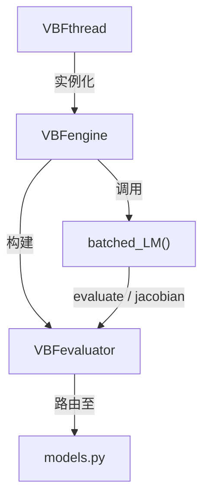
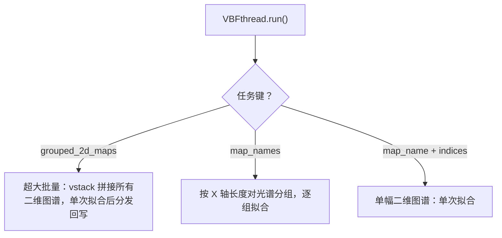

# **开发者指南：向量化批量拟合引擎 (VBF)** { #developer-guide-vectorized-batch-fit-engine-vbf }

本文档深入介绍位于 `spectroview/fit_engine/` 中的向量化批量拟合引擎（`VBF`）的内部机制、软件架构与性能特征。

---

## **1. 为什么 `VBF Engine` 的速度快得多** { #1-why-the-vbf-engine-is-much-faster }

传统的拟合引擎以**逐条光谱（per-spectrum）**的方式运行。对于包含数千条光谱的高光谱二维图谱，这种方式会引入显著开销：

- **Python 函数调用开销**：每次迭代都需要调用目标函数与雅可比矩阵估计器数千次。
- **有限差分雅可比矩阵**：数值近似求解雅可比矩阵时，每条光谱每次迭代都需要额外执行 `2 * K` 次函数求值（其中 K 为参数数量）。
- **顺序执行瓶颈**：即使采用多进程并行，数据序列化与进程间通信开销依然会成为性能瓶颈。

**向量化批量拟合引擎（`VBF Engine`）**通过以下核心设计原则实现了数量级的加速：

1.  **整体同步优化**：同时对全部 \(N\) 条光谱执行联合优化。参数矩阵、数据数组和残差均作为大型二维或三维张量进行统一运算。
2.  **向量化运算（BLAS/LAPACK）**：通过将拟合问题张量化，核心计算被下沉至高度优化的 C/Fortran 底层数值库：
    - 法方程（\(J^T J\) 与 \(J^T r\)）的矩阵乘法与转置均通过 `np.matmul` 完成，并调度至批量 BLAS `gemm` 调用。（早期版本曾使用 `np.einsum`，但 `einsum` 对该缩并模式无法调度至 BLAS，实测慢 13–20× —— 参见 §2。）
    - 所有光谱的线性方程组直接针对 `(Na, K, K)` 张量通过**批量 `np.linalg.solve`**（`np.linalg.solve(A, b[..., None])[..., 0]`）求解，在单次 LAPACK 批量调用中完成全部独立方程组求解而无需 Python 循环；仅在触发奇异矩阵 `LinAlgError` 时回退至逐矩阵 Cholesky/`np.linalg.solve`/`0.0` 处理。参见 §2 中的 `_batched_solve()`。
3.  **解析雅可比矩阵**：引擎不采用数值微分估算导数，而是为每一种已注册的峰型（`Gaussian`、`Lorentzian`、`PseudoVoigt`、`GaussianAsym`、`LorentzianAsym`、`Fano`、`DecaySingleExp`、`DecayBiExp`）提供精确的解析导数公式，从而彻底消除了 \(2K\) 次额外函数求值。
4.  **无空间传播依赖**：与早期采用螺旋遍历、按邻域顺序依次传递初值猜测的二维图谱拟合策略（强制顺序执行）不同，`VBF Engine` 通过幅值缩放对所有像素进行独立初始化，从而实现纯粹并行的张量数学计算。
5.  **可变长度 X 轴支持**：当各条光谱不共享统一的 X 轴时，`x` 会作为 `(N, M)` 矩阵而非 `(M,)` 向量传入，所有批量模型函数与雅可比函数均依据 `x.ndim` 自动分支，实现按行而非按列的广播计算。
6.  **参数表达式支持**：在将参数映射为自由参数之前，先对批处理中的数学约束表达式进行符号化求值，从而支持参数之间复杂的数学关系约束。

---


## **2. 性能优化** { #2-performance-optimizations }

以下优化项专门针对 `fit_engine/` 中的数值计算核心。预处理层面的优化（范围裁剪、针对整幅二维图谱张量的基线评估）位于 `SpectraStore.batch_preprocess()` 中，详见 [spectra_store.md](spectra_store.md)。

1. **使用 `np.matmul` 替代 `np.einsum` 组装批量法方程**（在典型 N/M/K 规模下实测，计算 \(J^TJ\) 快 13–20×，计算 \(J^Tr\) 快 3–4×）：`np.einsum('nmk,nml->nkl', J, J)` 针对此类缩并模式不会分派至 BLAS，而是回退至通用归约循环；数学上完全等价的 `J.transpose(0, 2, 1) @ J` 则会直接调度至批量 BLAS `gemm` 调用。
2. **跳过被拒绝步长的冗余雅可比与法方程重算**：当一次 LM 试探步被拒绝时，对应光谱的参数保持不变，因此其雅可比矩阵以及 \(J^TJ\)/\(J^Tr\) 依然完全有效，重试前仅需调整阻尼因子。`optimizer.py` 会按光谱缓存 \(J^TJ\)/\(J^Tr\)（`JTJ_cache`、`JTr_cache`），并仅对*上一步*被接受的光谱（通过布尔数组 `dirty` 追踪）重新计算，而非在每次迭代中对所有活跃光谱全部重算。这是数学上完全精确的优化而非近似——经验证相比全量重算引入的额外数值漂移为零。在收敛较慢的二维图谱上（许多光谱需要在递增阻尼下于同一点反复试探），约 30% 的活跃光谱迭代属于被拒绝的试探步，因此该机制可直接省去两项最耗时操作约 30% 的计算量。
3. **受保护的 `np.nan_to_num` 调用**：`np.nan_to_num` 即使在数组完全正常时也会执行三次完整的全数组扫描（`isnan`/`isposinf`/`isneginf`）以及花式索引赋值——而绝大多数迭代中数组都是正常的。`optimizer._finite_or_clean()` 先通过单次融合遍历检查 `np.isfinite(arr).all()`，仅当确实存在非有限值时才执行清理操作，在常见正常路径上提速约 10×。
4. **无临时分配的原位模型与雅可比计算核**：`models.py` 中的每个函数均只计算一次重复出现的量（`1/w²`、`1/w³`、`dx²` 等）并加以复用，用单次 `(N,1)` 倒数计算配合广播乘法（`inv_wl = 1.0 / wl`、`inv_wr = 1.0 / wr`）替代重复的 `(N,M)` 规模除法运算，并从第一步算术运算起就直接写入预分配的 `out=` 缓冲区（`np.subtract(..., out=out)`）。全部 8 个解析雅可比函数（`batched_*_jac`）均将偏导数直接原位写入 `J[:, :, k]` 切片视图，并利用代数恒等式 \(\frac{\partial f}{\partial w} = \frac{x - x_0}{w} \frac{\partial f}{\partial x_0}\)（`J[:, :, 1] = dx * J[:, :, 2] * inv_w`），每次迭代每个峰可消除 3–6 次 `(N, M)` 堆内存临时分配。`scalar_models.py` 中的标量参考模型采用完全一致的 `1e-15` 宽度下限与 `1e-30` 寿命钳位，以确保与 `BATCHED_MODELS` 之间达到机器精度级一致（\(\le 10^{-13}\)）。
5. **共享噪声基底统计量、二维记忆化缓存与 O(N) 峰位索引查找**：`apply_noise_threshold()` 在拟合前（用于生成干净的初始猜测）和拟合后（用于清理漂移进噪声区的峰——参见 §5.2 与 §10）各运行一次。两次调用均复用 `VBFevaluator.compute_noise_stats()` 缓存的统计信息；同时 `noise.py` 会缓存 1 条防篡改的二维数组指纹（`_array_2d_fingerprint`），使紧邻调用的 `compute_fit_weights(Y, fit_params)` 与 `compute_noise_stats(Y, coef_noise)` 无需对同一矩阵重复计算两次 `mad_noise(Y)` 和 `moving_average_5(Y)`。峰位到网格的索引查找采用 O(1) 等距算术计算、O(N log M) `np.searchsorted` 或 256 分块回退策略，避免分配 `(N, M)` 规模的距离矩阵。
6. **批量线性求解器（`_batched_solve()`）**：无论批量大小或参数个数如何，均通过单次 NumPy 批量调用 `np.linalg.solve(A, b[..., None])[..., 0]` 求解所有活跃的 `(Na, K, K)` 法方程组；仅在遇到奇异矩阵 `LinAlgError` 时，才对单矩阵回退使用 SciPy `cho_solve` / `np.linalg.solve` / `0.0`。
7. **基于边界裁剪后平均位移的收敛判据**：收敛检查基于边界裁剪后的实际参数位移（`p_trial_active - p_improved_old`）计算 `mean(|dp_actual| / |p|) < xtol`，而非使用未受约束的 `dp` 或 `max()`，从而避免缓慢漂移的峰翼或卡在边界上的参数拖延整条光谱直至达到 `max_iter`。
8. **向量化结果回写**：`build_results_batch()` 复用单个 `(N, M)` 残差缓冲区同时计算所有光谱的最优拟合曲线与 R²，并在 `weights` 为全 1 均匀权重时跳过冗余乘法——全程无任何逐光谱 Python 循环。
9. **零权重早退与均匀权重快速路径**：被判定为纯噪声的光谱（所有权重均为零）会被立即标记为已收敛；而当 `weights` 为 `None` 或均匀 `1.0` 时，系统会直接绕过每次迭代中对残差和雅可比矩阵的 `(N, M)` 权重乘法。
10. **转置 `(K, N, M)` 雅可比内存布局与零拷贝全批次快速路径**：`batched_levenberg_marquardt()` 按 `(K, N, M)` 物理内存布局分配 `J_buf_base`，并将其暴露为逻辑形状 `(Nr, M, K)` 的视图 `J_r_buf = J_buf_base[:, :n_recompute, :].transpose(1, 2, 0)`。这样既能保证雅可比求值期间每个参数切片 `J[:, :, k]` 都是 100% C 连续的 `(Nr, M)` 数组，又能确保在 BLAS `dgemm` 调用 `JT_r @ J_r` 和 `JT_r @ scaled_r_r[:, :, None]` 时缩并轴 `M` 的步长为 8 字节。在所有光谱均处于活跃状态的早期迭代中（`n_active == N`、`n_recompute == N`），优化器采用零拷贝视图并通过 `np.matmul(..., out=...)` 将法方程结果直接写入 `JTJ_cache` 与 `JTr_cache`，无需花式索引聚集拷贝。
11. **面向表达式约束的前向模式对偶数（`_DualVar`）解析链式求导**：`VBFevaluator` 在 `from_fit_model()` 中对参数表达式仅执行一次拓扑排序与字节码编译，随后利用向量化前向模式自动微分（`_DualVar`）结合批量 BLAS 矩阵乘法（`J_full @ J_expr`）在单次遍历内计算精确的解析链式导数 `J_expr`，替代原有的 \(K_{\text{free}}\) 遍有限差分与 `np.einsum`（在含表达式约束的模型上提速约 3×）。
12. **自适应 L3 缓存分块批处理**：当拟合超大规模高光谱二维图谱时（\(N \cdot M \cdot K > 2{,}097{,}152\)，或 \(N \ge 2{,}048\) 且 \(N \cdot M \cdot K > 1{,}048{,}576\)），`batched_levenberg_marquardt()` 会自动将批次划分为契合 L3 缓存的子批次（`chunk_n` 目标工作集约为 ~4 MB），避免 DRAM 带宽饱和，使峰值内存占用降低高达 79% 并加速大图谱拟合。
13. **纯 NumPy 分段线性基线插值**：`eval_baseline()` 和 `eval_baseline_batch()` 通过纯 NumPy 实现的 `_interp_linear_extrap()` 计算分段线性基线（含边界线性外推），彻底消除了冷启动时导入 `scipy.interpolate` 的开销。

## **3. 代码逻辑与核心实现原则** { #3-code-logic-and-core-implementation-principles }

该引擎实现了**批量 Levenberg-Marquardt** 算法。

### **3.1. 批量 LM 的数学原理** { #31-the-mathematics-of-batched-lm }

对于包含 \(M\) 个波长点与 \(K\) 个自由参数的 \(N\) 条光谱：

1.  **模型求值**：\(\mathbf{Y}_{pred} = f(\mathbf{x}, \mathbf{p})\)，返回一个 \((N, M)\) 张量。
2.  **计算残差**：\(\mathbf{r} = \mathbf{W} \circ (\mathbf{Y}_{pred} - \mathbf{Y}_{data})\)，返回一个 \((N, M)\) 张量。
3.  **计算雅可比矩阵**：\(\mathbf{J} = \frac{\partial f}{\partial \mathbf{p}}\)，返回一个 \((N, M, K)\) 张量。
4.  **法方程组装**：通过 `np.matmul`（§2）组装 \(J^T J\)（形状为 \(N \times K \times K\)）与 \(J^T r\)（形状为 \(N \times K\)）。
5.  **阻尼项（Marquardt 步）**：为每条光谱 \(i\) 的 \(J^T J\) 对角线添加阻尼因子 \(\lambda_i\)。
6.  **线性求解**：同时为全部 \(N\) 条光谱求解 \((J^T J + \lambda \text{diag}(J^T J)) \delta \mathbf{p} = -J^T r\)。
7.  **试探步评估**：更新 \(\mathbf{p} \leftarrow \mathbf{p} + \delta \mathbf{p}\)（投影回参数边界内）并评估新的代价函数值，根据试探成功或失败按光谱独立调整 \(\lambda\)。

### **3.2. 独立收敛机制** { #32-independent-convergence }

尽管计算按批次联合执行，但每条光谱各自独立收敛。优化器通过布尔掩膜（`active = ~converged`）跳过已达到容差条件的光谱的雅可比计算与线性求解，从而在后续迭代中持续加速。第二个布尔掩膜（`dirty`，参见 §2）还会进一步跳过上一次迭代参数未发生变化（试探步被拒绝）的活跃光谱的雅可比与法方程重算——但*仍会*执行试探步评估，因为重试时仅阻尼因子发生了变化。

### **3.3. 鲁棒损失函数（IRLS 风格加权）** { #33-robust-loss-functions-irls-style-scaling }

为在无需人工掩蔽数据的情况下抵御宇宙射线尖峰和尖锐探测器伪影等异常值，优化器通过迭代重加权最小二乘法（IRLS）支持鲁棒 M-估计量：

- **`linear`**（默认）：标准最小二乘目标函数 $\rho(z) = z$，$\rho'(z) = 1$。其执行路径与原始无加权 LM 在比特级上完全一致。
- **`soft_l1`**：平滑 $L_1$ 近似 $\rho(z) = 2(\sqrt{1 + z} - 1)$，其导数缩放因子为 $\sqrt{\rho'(z)} = (1 + z)^{-1/4}$，其中 $z = (r / f\_scale)^2$。在零点附近呈二次特性，对大残差则平滑过渡为线性惩罚。
- **`huber`**：Huber 损失函数——当 $z \le 1$ 时 $\rho(z) = z$，否则为 $2\sqrt{z} - 1$；导数缩放因子在 $z \le 1$ 时 $\sqrt{\rho'(z)} = 1$，否则为 $z^{-1/4}$。

**数学表达式**：
残差与雅可比矩阵各行均按 $w_{\text{robust}} = \sqrt{\rho'((r / f\_scale)^2)}$ 进行缩放。每次迭代求解的法方程为：
$$(J^T W J + \lambda \text{diag}(J^T W J)) \delta \mathbf{p} = -J^T W \mathbf{r}$$
其中 $W = \text{diag}(w_{\text{hard}}^2 \cdot w_{\text{robust}}^2)$。

**权重组合顺序**：

1. **硬排除**（`fit_negative` 与 `coef_noise` 噪声阈值）首先在 `weights.py` 中求值，为被排除的数据点赋予零权重（$w_{\text{hard}} = 0$）。
2. **鲁棒加权**（$w_{\text{robust}}$）随后在 `optimizer.py` 中作用于活跃数据点，平滑降低大异常残差的权重。零权重数据点始终保持为零。

---

## **4. 目录与类结构** { #4-folder-and-class-structure }



| 模块 | 类 / 函数 | 职责 |
|--------|-----------------|----------------|
| `vbf_thread.py` | `VBFthread` | `QThread` 封装类。将任务分组为单图谱、超大批量（`grouped_2d_maps`）或按长度分组（`map_names`）三种模式；构建权重矩阵；调用 `VBFengine.fit_spectra()`；将结果回写至 `SpectraStore`。发射 `progress_changed` 与 `timings_ready` 信号。在 macOS 上设置 8 MB 线程栈空间以防止 LAPACK 段错误。 |
| `vbf_engine.py` | `VBFengine` | 单次拟合调用的公共 API 编排器。负责构建求值器、构建 `p0` 并应用噪声阈值、运行优化器、再次应用噪声阈值，以及构建结果数组。在 `self.timings` 中记录各阶段耗时。 |
| `evaluator.py` | `VBFevaluator` | 连接字典格式的 `fit_model` 与扁平张量 API 的桥梁。解析峰定义、管理自由/固定参数索引、计算约束表达式、路由至对应的批量模型函数，并生成返回的结果数组（参数、R²、最优拟合曲线、各峰分曲线）——不生成中间 `FitResult` 对象。 |
| `optimizer.py` | `batched_levenberg_marquardt()` | 纯数值优化器。使用批量 `np.matmul` 组装法方程以同时求解 N 个独立最小二乘问题，并通过 `JᵀJ`/`Jᵀr` 缓存跳过被拒绝试探步的重复计算（§2）。采用带单矩阵奇异回退的批量 `np.linalg.solve`，通过 `out=` 复用 `eval_buf`/`J_buf`，跳过均匀权重乘法，并检查边界裁剪后的 `dp` 收敛性。与 GUI 完全解耦。 |
| `models.py` | `batched_*()` 函数 | 向量化峰型函数及其解析雅可比矩阵。包含 `BATCHED_MODELS` 注册表，以及面向未提供解析导数模型的 `numerical_jacobian()` 回退函数。 |
| `scalar_models.py` | 标量峰函数 | 单光谱参考实现及其注册表 `PEAK_MODEL_REGISTRY`。供 `eval_peak_initial()`（UI 预览曲线）使用，同时当某个模型仅存在于 `PEAK_MODEL_REGISTRY` 而尚未在 `BATCHED_MODELS` 中实现批量版本时，由 `evaluator.py` 中的 `_make_batched_scalar()` 封装作为标量回退路径——目前所有已注册模型均同时具备两种实现，因此该回退路径主要作为面向未来扩展的安全保障，而非当前常规执行路径。 |

---

## **5. 处理流水线 / 执行流程** { #5-processing-pipeline-execution-flow }

处理流水线分为两个层级：`VBFthread` 负责编排**任务**（哪些光谱组合在一起、如何构建权重、结果写回何处），而 `VBFengine.fit_spectra()` 则是每个任务调用一次的纯数值核心。

```mermaid
sequenceDiagram
    participant VM as ViewModel
    participant TFT as VBFthread
    participant TE as VBFengine
    participant EV as VBFevaluator
    participant OPT as optimizer

    VM->>TFT: start()
    TFT->>TFT: _prepare_weights() — 负值与噪声掩蔽
    TFT->>TE: fit_spectra(x, Y, fit_model, weights, fit_params)
    TE->>EV: from_fit_model()
    TE->>EV: build_p0_matrix() + apply_noise_threshold() (拟合前)
    TE->>OPT: batched_levenberg_marquardt()
    TE->>EV: apply_noise_threshold() (拟合后清理)
    TE->>EV: build_results_batch()
    TE-->>TFT: p_full, success, r², best_fits, Y_peaks
    TFT->>TFT: _write_results() → store.set_fit_results(), md.Y_bestfit / md.Y_peaks
    TFT-->>VM: progress_changed / timings_ready / finished
```

### **5.1. `VBFthread.run()` — 任务编排** { #51-vbfthreadrun-task-orchestration }

对于每个任务，`VBFthread` 在遍历 `self.tasks` 的单个循环内从以下三个分支中选择其一（不存在独立的 `_run_batched()` / `_run_single()` 方法）：

| 存在的任务键 | 使用场景 | 执行行为 |
|---|---|---|
| `grouped_2d_maps` | 使用共享模型执行“将模型应用到所有二维图谱” | 通过 `np.vstack` 将每幅二维图谱的 `Y` 拼接为单个矩阵，作为单一超大批次执行拟合，然后按行区间将结果分发回写至各个 `MapData`。 |
| `map_names` | 在**光谱** (Spectra) 工作区中批量拟合多条独立光谱（各自拥有独立模型） | 按 X 轴长度对光谱分组（光谱必须具有相同长度才能堆叠为同一矩阵），并将每个等长分组作为一个批次进行拟合。 |
| `map_name` + `indices` | 拟合单幅二维图谱（最常见场景） | 提取 `Y[indices]`，构建权重矩阵，并调用一次 `fit_spectra()`。 |

在调用引擎之前，`VBFthread._prepare_weights()` 会依据 `fit_negative` 与 `coef_noise` 构建权重矩阵（参见 §9 与 §10 —— 此处的基于噪声掩蔽与 `VBFevaluator.compute_noise_stats()` 采用完全相同的公式）。

### **5.2. `VBFengine.fit_spectra()` — 数值核心** { #52-vbfenginefit_spectra-the-numerical-core }

1. **构建求值器** — `VBFevaluator.from_fit_model(fit_model)` 将 `peak_models` 解析为扁平参数布局（§6）。若所有参数均已固定（`n_params_free == 0`），引擎将直接短路并立即返回。
2. **构建 `p0`** — `build_p0_matrix()` 将模型初始参数平铺复制到全部 N 条光谱上，并根据各峰位 `x0` 处的观测数据对峰幅值进行缩放（缩放比值钳位在 `[0.01, 100]` 区间内，以防不良初始猜测导致数值发散）。随后 `apply_noise_threshold()` 将中心位于噪声阈值以下区域的峰的幅值与半高宽（FWHM）置零，为优化器提供干净的起点。
3. **运行优化器** — `batched_levenberg_marquardt()`（§3）持续迭代，直至所有光谱均已收敛、被标记为“停滞（stuck）”（§9.2）或达到最大迭代次数 `max_ite`。
4. **拟合后清理** — 对优化后的参数再次运行 `apply_noise_threshold()`，以清除在 LM 迭代过程中可能漂移至噪声区域内的峰。
5. **构建结果** — `build_results_batch()` 为整个批次一次性求值最优拟合曲线与各峰分曲线，并向量化计算全部 N 条光谱的 R²。返回纯数组结果（`p_full`、`success`、`rsquared`、`best_fits`、`Y_peaks`、`param_names`）——而非逐光谱对象。

随后 `VBFthread._write_results()` 将这些数组写入 `SpectraStore`（`set_fit_results()`）以及 `MapData` 对象（`Y_bestfit`、`Y_peaks`）。

---

## **6. `VBFevaluator` 详解** { #6-the-vbfevaluator-in-detail }

`VBFevaluator` 是引擎中最复杂的类。它充当灵活的字典式 GUI 世界与严谨的扁平张量式优化器世界之间的**桥梁**。

### **6.1. 参数空间映射** { #61-parameter-space-mapping }

```
fit_model dict                    VBFevaluator                  Optimizer
┌─────────────────┐     ┌────────────────────────────┐     ┌──────────────┐
│ peak_models:    │     │ _param_names:              │     │              │
│   "0":          │     │   ["m01_ampli",            │     │  p_free      │
│     Gaussian:   │ ──► │    "m01_fwhm",             │ ──► │  (N, K_free) │
│       ampli: .. │     │    "m01_x0",               │     │              │
│       fwhm:  .. │     │    "m02_ampli", ...]       │     │              │
│       x0:    .. │     │                            │     │              │
│   "1":          │     │ _free_idx:  [0, 1, 2, 3]   │     │              │
│     Lorentzian: │     │ _fixed_idx: [4]            │     │              │
│       ampli: .. │     │ _fixed_values: [0.5]       │     │              │
│       ...       │     │                            │     │              │
└─────────────────┘     └────────────────────────────┘     └──────────────┘
```

### **6.2. 表达式支持** { #62-expression-support }

参数可以通过数学表达式引用其他参数（例如 `m01_fwhm = m02_fwhm` 或 `m01_x0 + 10`）。求值器在 `_to_full()` 中按如下流程处理约束表达式：

1. 带有表达式的参数会被标记为**固定**（不直接参与优化）。
2. 在 `from_fit_model()` 期间，表达式按依赖关系进行拓扑排序并编译为 Python 代码对象（`_compile_exprs()`），从而避免在每次优化迭代中重复解析 `eval()` 字符串并反复重试。
3. 在 `_to_full()` 期间，已编译的表达式会在受限命名空间内通过单次拓扑遍历求值，该命名空间仅包含所有参数名称、`np` 以及常用数学函数（`sin`、`cos`、`tan`、`exp`、`log`、`log10`、`sqrt`、`abs`、`pi`、`e`、`minimum`、`maximum`、`clip`）。
4. 雅可比矩阵通过**解析链式法则**计入表达式约束：`_compute_j_expr()` 将自由参数初始化为向量化前向模式对偶数（`_DualVar(value, d_free)`）并执行一次已编译表达式链，得到形状为 `(N, K_total, K_free)` 的精确解析灵敏度张量 `J_expr`，然后通过批量 BLAS 矩阵乘法 `J_full @ J_expr` 计算受约束的雅可比矩阵。

### **6.3. 模型路由** { #63-model-routing }

求值器的 `evaluate()` 与 `jacobian()` 方法会遍历所有已注册的峰，并在提供 `out` 时将其贡献干净地写入或累加到 `out` 中：

```python
def evaluate(self, x, p_free, out=None):
    p_full = p_free if self._all_free_identity else self._to_full(p_free)  # (N, K_total)
    # Single-peak models write directly into `out`; multi-peak models reuse one scratch buffer
    ...
```

在计算雅可比矩阵时，若峰具备解析雅可比实现（`has_jac=True`），则直接调用；否则回退调用采用中心差分与相对扰动步长的 `numerical_jacobian()`。

---

## **7. 批量峰型模型与解析雅可比矩阵** { #7-batched-peak-models-and-analytical-jacobians }

### **7.1. 张量约定** { #71-tensor-conventions }

所有批量函数均遵循相同的调用签名：

```python
def batched_shape(x, params, out=None):
    """
    x:      (M,) shared axis  OR  (N, M) per-spectrum axis
    params: (N, n_p) parameter matrix
    out:    optional preallocated (N, M) output buffer
    Returns: (N, M) predicted values
    """

def batched_shape_jac(x, params, out=None):
    """Returns: (N, M, n_p) Jacobian tensor (written into `out` when provided)"""
```

在内部实现上，每个函数均遵循统一的效率模式（§2.4）：对重复出现的量（通常是诸如 `1/w²` 的倒数）仅计算一次，通过广播乘法加以复用而不再重复做除法，并将结果直接原位写入预分配的雅可比切片中。

### **7.2. 已注册模型（`BATCHED_MODELS`）** { #72-registered-models-batched_models }

所有峰型模型均提供带**解析雅可比矩阵**的向量化批量实现，从而确保各类模型都能获得最高性能：

| 模型 | 参数 | 公式 |
|-------|-----------|---------|
| `Gaussian` | `ampli`、`fwhm`、`x0` | <i>a</i> &middot; exp(-4 ln(2) &middot; (x-x<sub>0</sub>)<sup>2</sup> / w<sup>2</sup>) |
| `Lorentzian` | `ampli`、`fwhm`、`x0` | <i>a</i> / [1 + 4(x-x<sub>0</sub>)<sup>2</sup> / w<sup>2</sup>] |
| `PseudoVoigt` | `ampli`、`fwhm`、`x0`、`alpha` | &alpha; &middot; G + (1-&alpha;) &middot; L |
| `GaussianAsym` | `ampli`、`fwhm_l`、`fwhm_r`、`x0` | 分段高斯函数（左/右半高宽独立） |
| `LorentzianAsym` | `ampli`、`fwhm_l`、`fwhm_r`、`x0` | 分段洛伦兹函数（左/右半高宽独立） |
| `Fano` | `ampli`、`fwhm`、`x0`、`q` | <i>a</i> &middot; (q + &epsilon;)<sup>2</sup> / (1 + &epsilon;<sup>2</sup>), &epsilon; = 2(x-x<sub>0</sub>)/w |
| `DecaySingleExp` | `A`、`tau`、`B` | <i>A</i> &middot; e<sup>-x/&tau;</sup> + B |
| `DecayBiExp` | `A1`、`tau1`、`A2`、`tau2`、`B` | <i>A</i><sub>1</sub> &middot; e<sup>-x/&tau;<sub>1</sub></sup> + <i>A</i><sub>2</sub> &middot; e<sup>-x/&tau;<sub>2</sub></sup> + B |

### **7.3. 数值雅可比矩阵回退** { #73-numerical-jacobian-fallback }

对于未来仅在 `PEAK_MODEL_REGISTRY` 中注册（尚未提供批量实现）的自定义模型，`numerical_jacobian()` 会使用带相对扰动的**中心差分**作为回退方案：

```python
h = max(|param| * eps, eps)          # Scale step to parameter magnitude
J[:,:,k] = (f(p+h) - f(p-h)) / 2h  # Central difference
```

每次迭代的耗时比解析雅可比约慢 `2K` 倍，但可确保任意新峰型函数的计算正确性。

---

## **8. `VBFthread` 线程类** { #8-the-vbfthread }

### **8.1. 任务分支** { #81-task-branches }



上述三个分支均位于 `run()` 中遍历 `self.tasks` 的同一个循环内部——各分支的触发条件参见 §5.1。

### **8.2. macOS 栈空间大小** { #82-macos-stack-size }

该线程在 macOS 上显式设置了 8 MB 的栈空间（`setStackSize(8 * 1024 * 1024)`），原因如下：

- macOS 默认将 `QThread` 的栈大小限制为 512 KB。
- `np.linalg.solve` 会调度至 LAPACK，而 LAPACK 会在栈上分配工作区数组。
- 当 K 较大（自由参数较多）时，栈分配可能超过 512 KB 上限，从而导致段错误（segfault）。

### **8.3. 信号** { #83-signals }

| 信号 | 载荷 | 用途 |
|--------|---------|---------|
| `progress_changed` | `Signal(int, int, int, float, int)` → `(current, total, percent, elapsed_seconds, current)` | 更新 View 中的进度条。（第 5 个参数与第 1 个参数相同。） |
| `timings_ready` | `Signal(str)` | 面向控制台/调试输出的分步骤格式化耗时明细 |

---

## **9. 优化参数与调优** { #9-optimization-parameters-and-adjustments }

可通过传入 `fit_params` 字典至 `fit_spectra()` 来调节引擎行为。

### **9.1. 关键参数** { #91-key-parameters }

*   **`max_ite`**（默认值：200）：Levenberg-Marquardt 的最大迭代次数。增大该值有助于极其困难的光谱收敛，但会增加总执行时间。
*   **`xtol`**（默认值：1e-4）：参数步长 \(\delta p\) 的相对容差。当所有活跃参数在边界裁剪后的相对变化量**均值**（\(\operatorname{mean}(|\Delta p_{\text{actual}}| / |p|)\)）小于 `xtol` 时，即判定为收敛。以边界裁剪后的实际位移作为判据可确保受限于边界的参数能够干净利落地收敛而不会拖延至 `max_ite`；采用均值判据则可避免单个缓慢振荡的参数拖累整条光谱的收敛判定。
*   **`ftol`**（默认值：1e-4）：代价函数（残差平方和）的相对容差。若代价函数的相对变化小于 `ftol`，则认为该光谱已收敛。
*   **`fit_negative`**（默认值：`False`）：是否在拟合中包含负强度值。为 `False` 时，负值数据点将被赋予零权重（`VBFthread._prepare_weights()`）。
*   **`coef_noise`**（默认值：`0.0`）：噪声系数乘子。当 > 0 时，将激活基于噪声的权重掩蔽（`VBFthread._prepare_weights()`）与峰抑制（`VBFevaluator.apply_noise_threshold()`）。详细说明请参阅[第 10 节](#10-noise-level-estimation-and-noise-threshold)。
*   **`fit_outliers`** — **历史遗留键，当前引擎已不再读取。** 早期保存的 `fit_model` JSON 文件中可能仍包含该键，但 `fit_engine/`（乃至整个代码库）已不再检查它，会被静默忽略；保留在旧文件中不会产生任何影响。

### **9.2. 性能与精度的权衡调优** { #92-tuning-for-performance-vs-accuracy }

- **快速图谱拟合**：用于快速预览时，可将 `xtol` 与 `ftol` 提高至 `1e-3` 或 `1e-2`。优化器将更早退出，以极短的时间给出粗略拟合结果。
- **高精度拟合**：用于发表级别的结果时，可将 `xtol` 与 `ftol` 降低至 `1e-5` 或 `1e-6`。
- **处理“停滞（Stuck）”光谱**：优化器会追踪 `consecutive_rejects`。如果某条光谱的代价函数在连续 15 次迭代中（尽管已调整阻尼）仍未能改善，则将其标记为已收敛（停滞），以防其拖慢整个批次的进度。该阈值（`optimizer.py` 中的 `MAX_REJECTS`）可根据需要调整。

### **9.3. 阻尼调节策略** { #93-damping-schedule }

每条光谱的阻尼因子 \(\lambda\) 初始化为 `1e-2`，并在每次迭代后按如下规则更新：

| 结果 | λ 调整方式 | 效果 |
|---------|-------------|--------|
| 代价改善 | `λ /= 3.0`（下限 `1e-10`） | 更信任 Gauss-Newton 步方向 |
| 代价恶化 | `λ *= 2.5`（上限 `1e10`） | 向梯度下降方向靠拢 |

---

## **10. 噪声水平估计与噪声阈值** { #10-noise-level-estimation-and-noise-threshold }

`coef_noise` 参数控制着一套噪声感知过滤系统，可显著提升拟合的**性能**与**精度**，尤其适用于大量像素仅包含弱峰甚至无峰的高光谱二维图谱。

### **10.1. 如何估计噪声水平** { #101-how-noise-level-is-estimated }

公共辅助函数 `detect_noise_level()`（位于 `fit_engine/noise.py`，供 UI 在光谱查看器上显示/报告噪声水平）与拟合期间使用的内部批量估计器（`VBFevaluator.compute_noise_stats()`、`VBFthread._prepare_weights()`）采用完全相同的鲁棒估计方法：一阶差分绝对值的中位数，并换算为高斯分布等效标准差 σ。

```python
def detect_noise_level(y: np.ndarray) -> float:
    dy = np.diff(y)                                    # δ[i] = y[i+1] − y[i]
    return np.median(np.abs(dy)) / 0.6745 * np.sqrt(2)
```

**原理解析：**

| 项 | 作用 |
|------|--------|
| `np.diff(y)` | 相邻点一阶差分——由于真实光谱特征相对较宽、在单个采样步长内变化缓慢，差分结果主要由噪声主导 |
| `np.median(np.abs(dy))` | 绝对差值的中位数——与普通标准差不同，对尖锐峰边缘偶尔出现的大跳变具有很强的鲁棒性 |
| `/ 0.6745` | 将高斯分布的中位绝对偏差（MAD）转换为等效标准差（0.6745 为正态分布下 MAD 到 σ 的换算常数） |
| `* sqrt(2)` | 两个独立含噪样本的一阶差分方差为 \(2\sigma^2\)；该因子用于将其还原为单点噪声标准差 σ |

`VBFevaluator.compute_noise_stats(Y, coef_noise)` 沿 `axis=1` 应用相同的 `diff`/`median` 逻辑，从而在整幅二维图谱上同时为每条光谱估计各自的噪声水平；同时还计算信号的 5 点移动平均值（`ymean`），用于逐点判断*信号本身*（而不仅仅是噪声）是否高于基底阈值：

```python
dy = np.diff(Y, axis=1)
ampli_noise = np.median(np.abs(dy), axis=1) / 0.6745 * np.sqrt(2)      # (N,)
Y_padded = np.pad(Y, ((0, 0), (2, 2)), mode='edge')
ymean = (Y_padded[:, 0:-4] + Y_padded[:, 1:-3] + Y_padded[:, 2:-2]
         + Y_padded[:, 3:-1] + Y_padded[:, 4:]) / 5.0                   # 5-point moving average
noise_level = coef_noise * ampli_noise                                   # (N,)
```

> `apply_noise_threshold()` 每次拟合会被调用两次（优化前与优化后各一次——参见 §5.2），而两次调用所需的 `ymean`/`noise_level` 完全相同。`VBFengine.fit_spectra()` 通过 `compute_noise_stats()` 仅计算一次并将结果（`noise_stats=`）传给两次调用，避免重复执行两遍中位数与平滑计算（§2）。

### **10.2. `coef_noise` 如何激活噪声阈值过滤** { #102-how-coef_noise-activates-noise-thresholding }

当 `coef_noise > 0` 时，系统按 `noise_level = coef_noise × ampli_noise` 计算**噪声水平阈值**。该阈值会同时激活**两项互补机制**：

#### **10.2.1. 机制 A —— 权重掩蔽（`VBFthread._prepare_weights`）** { #1021-mechanism-a-weight-masking-vbfthread_prepare_weights }

在拟合开始前，任何平滑后信号（`ymean`）低于噪声水平的数据点都会被设为零权重：

```python
weights[ymean < noise_level[:, None]] = 0.0   # zero weight → ignored by optimizer
```

优化器的残差计算 \(\mathbf{r} = \mathbf{W} \circ (\mathbf{Y}_{pred} - \mathbf{Y}_{data})\) 会自然忽略这些被掩蔽的点，使拟合过程只聚焦于包含有效信号的区域。

#### **10.2.2. 机制 B —— 峰抑制（`VBFevaluator.apply_noise_threshold`）** { #1022-mechanism-b-peak-suppression-vbfevaluatorapply_noise_threshold }

对于**中心位置**（`x0`）落在阈值以下区域的任意峰，系统会将其幅值与半高宽（FWHM）强制置零，并将该峰的其他形状参数恢复为拟合前的初始猜测（`p0_matrix`），以防止将随机噪声波动映射为真实结构。该机制在流水线中运行**两次**（§5.2）：

1. **优化前** — 设定干净的初始猜测，防止优化器尝试将噪声波动当作峰来拟合。
2. **优化后** — 清理在 LM 迭代过程中可能漂移至噪声区域内的峰。

### **10.3. 性能与精度收益** { #103-performance-and-precision-benefits }

#### **10.3.1. 性能** { #1031-performance }

| 方面 | 作用原理 |
|--------|-------------|
| 更快的收敛速度 | 在噪声区被置零的峰从一开始就保持为零，从而有效减少了活跃参数的数量 |
| 更少的无效迭代 | 若不进行噪声掩蔽，优化器会消耗大量迭代次数用微小的幽灵峰去拟合随机噪声 |
| 更优的初始猜测 | 预先将噪声区内的峰置零使 \(p_0\) 更接近真实解，因此 LM 算法仅需更少迭代即可收敛 |

#### **10.3.2. 精度** { #1032-precision }

| 方面 | 作用原理 |
|--------|-------------|
| 消除幽灵峰 | 在二维图谱中，部分像素可能峰很弱甚至没有峰。若无阈值过滤，噪声波动会被拟合成微小的虚假峰，导致参数图谱中出现伪影 |
| 稳定强相关参数 | 在接近噪声基底处，幅值、峰宽与峰位会高度相关——微小的噪声扰动就会引发参数大幅剧烈波动。峰抑制可消除这种不稳定性 |
| 防止串扰 | 位于噪声区的幽灵峰可能会从邻近真实峰“抢走”部分强度，使其拟合幅值产生偏差。峰抑制可杜绝这一问题 |
| 更纯净的 R² 值 | 被掩蔽的噪声区不参与 R² 计算，因此报告的拟合优度仅反映真实有效信号区域的质量 |

### **10.4. 实际示例** { #104-practical-example }

考虑一幅定义了 3 个峰的拉曼二维图谱，其中在部分像素处，2 号峰位于平坦基线区域：

```
Without coef_noise (= 0):
  Peak #2 → ampli = 0.3 (noise artifact), fwhm = 2.1 (meaningless), x0 = 520.3 (drifted)
  Peak #1 → ampli = 18.2 (slightly biased — peak #2 stealing intensity)

With coef_noise = 1:
  Peak #2 → ampli = 0.0, fwhm = 0.0   (correctly suppressed)
  Peak #1 → ampli = 19.1              (accurate, no cross-talk)
```

### **10.5. 如何选择合适的 `coef_noise` 值** { #105-choosing-the-right-coef_noise-value }

| 取值 | 行为效果 |
|-------|----------|
| `0` | **禁用** — 所有峰在全区域均参与拟合，不进行噪声掩蔽 |
| `0.5 – 1.0` | **保守** — 仅抑制明显处于噪声基底以下的峰或区域 |
| `1.0 – 2.0` | **适中** — 适用于大多数数据集的良好默认范围 |
| `3.0 – 5.0` | **激进** — 可能会抑制真实的弱峰；请谨慎使用 |
| `> 5.0` | **非常激进** — 仅保留强且明确存在的峰 |

`MSettings.load_fit_settings()` 中的默认值为 `0.0`（禁用）。在 **设置** (Settings) 界面中，它以数值微调框形式提供，取值范围为 `[0.0, 10.0]`，步长为 `0.5`。

---

## **11. 添加新峰型模型** { #11-adding-new-peak-models }

### **11.1. 快速路径：解析雅可比矩阵（推荐）** { #111-fast-path-analytical-jacobian-recommended }

要以最高性能添加新的峰型：

**步骤 1** — 在 `models.py` 中定义批量求值函数（支持可选的 `out=None` 缓冲区复用）：

```python
def batched_newshape(x, params, out=None):
    """
    x:      (M,) or (N, M)
    params: (N, n_p) where columns are [param1, param2, ...]
    out:    optional (N, M) preallocated array
    Returns: (N, M)
    """
    p1 = params[:, 0:1]    # (N, 1) — broadcasts over M
    p2 = params[:, 1:2]
    if x.ndim == 1:
        dx = x[None, :] - p2    # (N, M)
    else:
        dx = x - p2
    result = p1 * some_function(dx)
    if out is not None:
        out[...] = result
        return out
    return result
```

**步骤 2** — 推导并定义解析雅可比矩阵函数（接受 `out=None` 以实现切片原位求值）：

```python
def batched_newshape_jac(x, params, out=None):
    """Returns: (N, M, n_p) — partial derivatives w.r.t. each parameter."""
    # ... compute intermediates ...
    N, M = result.shape
    J = np.empty((N, M, n_p), dtype=np.float64) if out is None else out
    J[:, :, 0] = d_result_d_p1
    J[:, :, 1] = d_result_d_p2
    return J
```

**步骤 3** — 在 `BATCHED_MODELS` 字典中注册：

```python
BATCHED_MODELS = {
    # ... existing ...
    "NewShape": (batched_newshape, batched_newshape_jac, ["param1", "param2", ...]),
}
```

推导雅可比矩阵时，请遵循 `models.py` 全模块通用的高效编码模式（§2.4、§7.1）：将重复出现的 `1/w` 类项作为倒数预先计算一次并复用，并对大型 `(N,M)` 中间数组优先采用原位运算（`*=`、`+=`）。在正式启用前，务必在随机参数组上对照 `numerical_jacobian()` 验证解析雅可比矩阵的正确性。

### **11.2. 慢速路径：标量回退** { #112-slow-path-scalar-fallback }

如果推导解析雅可比矩阵不切实际：

**步骤 1** — 在 `scalar_models.py` 中定义标量函数：

```python
def newshape(x, param1, param2):
    """x is a 1D array, params are scalars. Returns 1D array."""
    return param1 * some_function(x - param2)
```

**步骤 2** — 在 `PEAK_MODEL_REGISTRY` 中注册：

```python
PEAK_MODEL_REGISTRY = {
    # ... existing ...
    "NewShape": (newshape, ["param1", "param2"]),
}
```

求值器会自动通过 `_make_batched_scalar()` 对其进行封装并调用 `numerical_jacobian()`。该方式功能完整，但每个峰每次迭代的速度显著更慢（约慢 10–50×）。

### **11.3. 在应用程序中注册** { #113-registration-in-the-application }

将模型添加到引擎后，还需在 `spectroview/__init__.py` 中注册它：

```python
PEAK_MODELS = [
    "Gaussian", "Lorentzian", "PseudoVoigt",
    # ... existing ...
    "NewShape",  # Add here to appear in the UI dropdown
]
```

---

## **12. 计时与诊断** { #12-timing-and-diagnostics }

`VBFengine` 会在 `self.timings` 中记录各步骤的挂钟运行耗时：

```
Step 3 - build p0:     0.003s
Step 4 - batch fit:   1.234s (0.6 ms/spectrum, 1950/2000 converged)
Step 5 - write_back:   0.089s
```

`VBFengine.fit_spectra()` 本身仅填充这三项计时——编号之所以从 3 开始，是为了承接在调用引擎之前就已经完成的前置（独立）阶段：向 `MapData` 应用拟合模型，以及 `SpectraStore.batch_preprocess()`（范围裁剪 + 基线扣除），这些前置步骤单独计时并记录在 [spectra_store.md](spectra_store.md) 中。

这些计时结果通过 `VBFthread.timings_ready` 发射并打印到控制台（调试时可在 `fit_spectra()` 中设置 `print_benchmark=True` 实时输出）。它们对于排查性能瓶颈极为重要：

- 若 **Step 4** 耗时占主导 → 属于正常现象；这是实际的数值优化阶段，对于任何非平凡的二维图谱而言均是最大开销所在。
- 若 **Step 4** 显示收敛率偏低 → 应优先检查初始猜测、参数边界或模型适用性，而非性能问题。
- 若 **Step 3** 或 **Step 5** 相对于 Step 4 异常偏大 → 值得进行性能剖析；对于典型二维图谱，这两步通常应比 Step 4 小一到两个数量级。

### **12.1. R² 计算** { #121-r2-computation }

拟合优度指标 R² 在 `build_results_batch()` 中计算：

$$
R^2 = 1 - \frac{\sum_i w_i (y_i - \hat{y}_i)^2}{\sum_i w_i (y_i - \bar{y}_w)^2}
$$

其中 \(\bar{y}_w\) 为加权平均值。当存在权重时，仅非零权重数据点会同时参与分子与分母的求和计算，从而确保被掩蔽的区域（负值点、噪声基底以下的数据点）不会人为拉高或拉低所报告的拟合质量。
