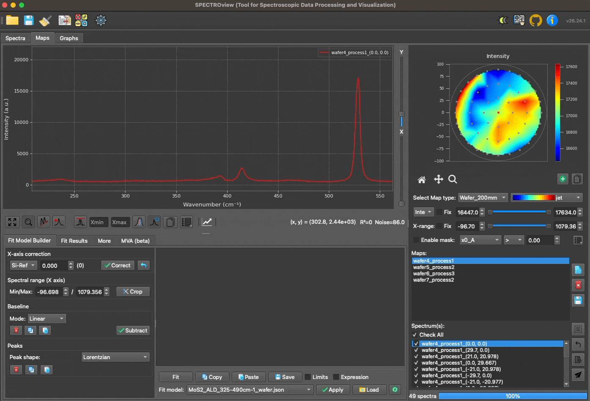
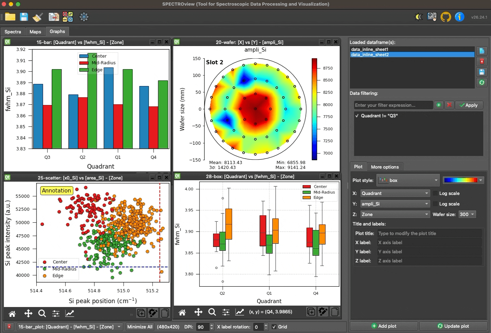

---
hide:
  - navigation
  - toc
  - title
---

<p align="center" class="hero-badges">
    <a href="https://pypi.org/project/spectroview/"></a>
    <a href="https://pypi.org/project/spectroview/"></a>
    <a href="https://pypi.org/project/spectroview/"></a>
    <a href="https://github.com/CEA-MetroCarac/SPECTROview/blob/main/LICENSE"></a>
    <a href="https://github.com/CEA-MetroCarac/SPECTROview/stargazers"></a>
    <a href="https://doi.org/10.1016/j.softx.2026.102862"></a>
    <a href="https://doi.org/10.1016/j.softx.2026.102862"></a>
</p>

<p align="center">
    <b>SPECTROview</b> ist eine Open-Source-Anwendung zur interaktiven Verarbeitung, Anpassung und Visualisierung spektroskopischer Daten.<br>
    Sie unterstützt sowohl diskrete Spektren als auch hyperspektrale Datensätze wie 2D-Karten und Wafer-Karten,<br>
    ergänzt durch integrierte Visualisierungswerkzeuge, die Ihren Analyse-Workflow effizienter gestalten.
</p>

---

### :material-star-shooting: **Hauptfunktionen** { #key-features }

<div class="grid cards cards-2col" markdown>

-   :material-speedometer: __Leistungsstarke vektorisierte Batch-Fit-Engine (`VBF Engine`)__

    ---

    Erreicht durch Batch-Matrixoperationen sehr hohe Fit-Geschwindigkeiten und kann mehrere Spektren oder große 2D-Karten gleichzeitig anpassen.

-   :material-chart-multiline: __Benutzerdefinierte Fit-Modelle__

    ---

    Erstellen Sie maßgeschneiderte Fit-Modelle für spezifische spektroskopische Profile und verwenden Sie diese wieder, um neue Datensätze rasch zu analysieren.

-   :material-chart-bell-curve-cumulative: __Vielseitige Datenverarbeitung__

    ---

    Verarbeiten Sie nahtlos 1D-Spektraldaten, In-situ-Messreihen (interaktive 2D-Heatmaps in SpectraViewer) sowie hyperspektrale 2D-Daten.

-   :material-table-large-plus: __Vereinheitlichte Ergebnisse__

    ---

    Erfassen und bündeln Sie alle optimalen Fit-Ergebnisse mit einem einzigen Klick.

-   :material-chart-scatter-plot: __Erweiterte Visualisierung__

    ---

    Dedizierter Arbeitsbereich für die schnelle Erstellung publikationsreifer Datenvisualisierungen sowie 2D-Heatmap-Plots für Spektrenserien.

-   :material-robot-happy-outline: __KI-Chat-Agent__

    ---

    Kommunizieren Sie mit SPECTROview in natürlicher Sprache, um Daten zu filtern, Analysen durchzuführen sowie mehrere Plots zu erstellen oder anzupassen — unterstützt durch Ihr eigenes lokales LLM (Ollama) oder ein Cloud-LLM.

</div>

---

### :material-play-circle-outline: **Demonstrationen** { #demonstrations }

=== ":material-view-dashboard: Überblick über die Arbeitsbereiche"

    <p align="center">Dedizierte Arbeitsbereiche für diskrete Spektren, hyperspektrale Daten und erweiterte Visualisierung.</p>

    <div align="center" markdown>
    { loading=lazy width="90%" }
    </div>

=== ":material-chart-bell-curve: Fit-Engine"

    <p align="center">Entwickeln Sie benutzerdefinierte Fit-Modelle und verarbeiten Sie mehrere Spektren gleichzeitig mit der VBF-Engine.</p>

    <div align="center" markdown>
    { loading=lazy width="90%" }
    </div>

=== ":material-chart-bar: Publikationsreife Diagramme"

    <p align="center">Erstellen Sie schnell publikationsreife Datenvisualisierungen mit dem integrierten Arbeitsbereich Diagramme (Graphs).</p>

    <div align="center" markdown>
    { loading=lazy width="90%" }
    </div>

=== ":material-robot-happy-outline: KI-Chat-Agent"

    <p align="center">Kommunizieren Sie mit SPECTROview in natürlicher Sprache, um Daten zu filtern sowie Plots zu erstellen oder anzupassen.</p>

    <div align="center" markdown>
    { loading=lazy width="90%" }
    </div>

---

### :material-book-open-page-variant: **Dokumentation** { #documentation }

<div class="grid cards" markdown>

-   [:material-download-circle: **Installation**](user_manual/installation.md)
    <br> Laden Sie die Desktop-App für Windows, macOS oder Linux herunter (kein Python erforderlich) oder installieren Sie SPECTROview über PyPI (`pip`).

-   [:material-account-hard-hat: **Benutzerhandbuch**](user_manual/index.md)
    <br> Schritt-für-Schritt-Anleitungen zu allen Funktionen – vom Laden der Daten bis zur fortgeschrittenen Kurvenanpassung und Visualisierung.

-   [:material-code-tags: **Entwicklerhandbuch**](developer/index.md)
    <br> Architekturübersicht, interne Funktionsweise der Datenpipeline und Beitragsrichtlinien für Entwickler.

-   [:material-api: **API-Referenz**](api/index.md)
    <br> Detaillierte Referenz aller Module: Spektrenverarbeitung, 2D-Karten, Diagramme und Rechner.

-   [:material-format-list-bulleted: **Änderungsprotokoll**](changelog.md)
    <br> Aktuelle Updates, Versionshinweise, Fehlerbehebungen und Ankündigungen neuer Funktionen.

</div>

---

### :material-hand-heart-outline: **Danksagung** { #acknowledgements }

Diese Arbeit wurde am CEA — Plattform für Nanocharakterisierung (PFNC) durchgeführt und durch das Programm „Recherche Technologique de Base“ der französischen Nationalen Forschungsagentur (ANR) gefördert.

---

### :material-format-quote-open: **Zitation** { #citation }

Wenn Sie **SPECTROview** in Ihren Arbeiten verwenden, zitieren Sie bitte:

> Le, Van Hoan. "SPECTROview: An Open-Source Application for Interactive Spectroscopic Data Processing, Fitting, and Visualization." *SoftwareX* 35 (September 2026): 102862. [https://doi.org/10.1016/j.softx.2026.102862](https://doi.org/10.1016/j.softx.2026.102862).

??? note "BibTeX"

    ```bibtex
    @article{le2026spectroview,
        title     = {SPECTROview: An Open-Source Application for Interactive
                     Spectroscopic Data Processing, Fitting, and Visualization},
        author    = {Le, Van Hoan},
        journal   = {SoftwareX},
        volume    = {35},
        pages     = {102862},
        year      = {2026},
        month     = sep,
        publisher = {Elsevier},
        doi       = {10.1016/j.softx.2026.102862}
    }
    ```
