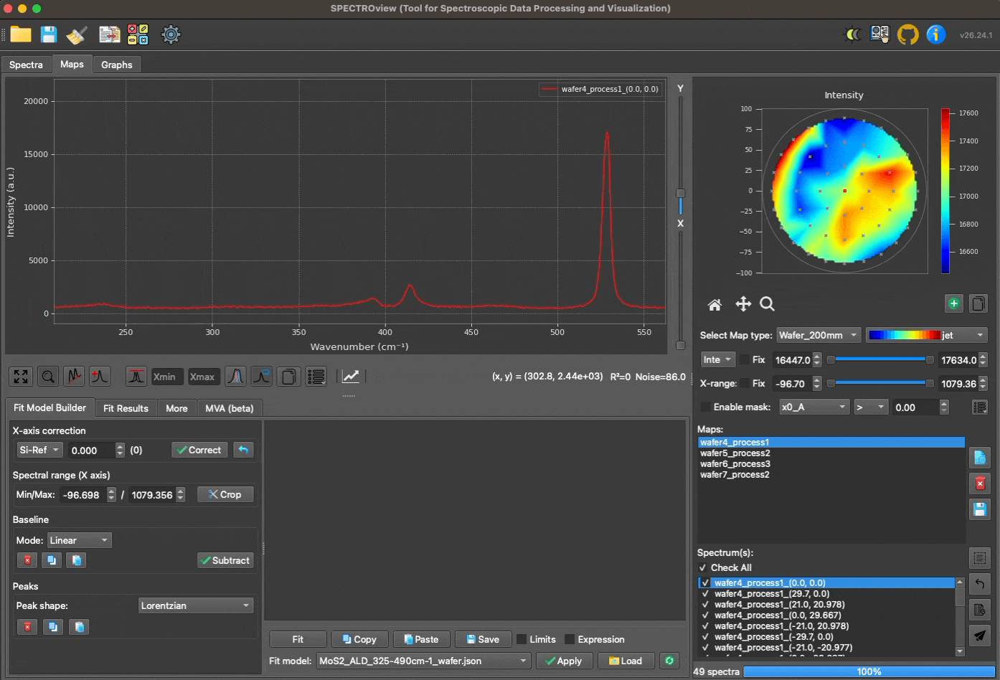
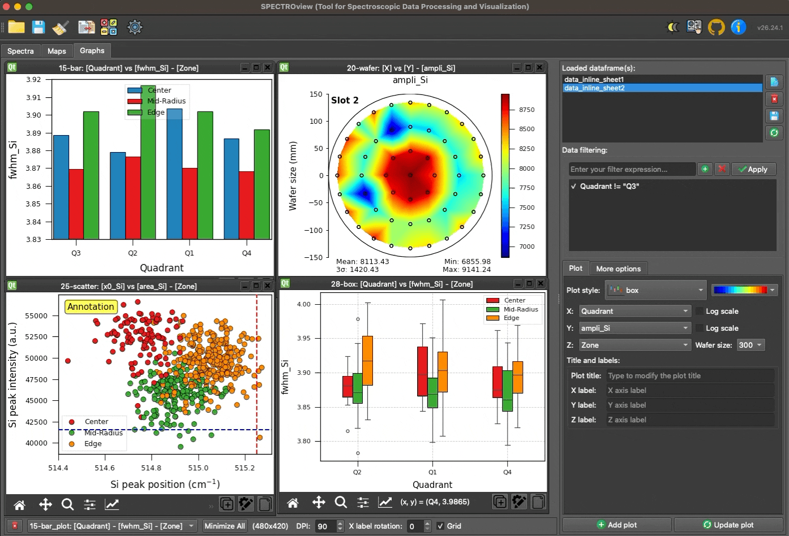

---
hide:
  - navigation
  - toc
  - title
---

<p align="center" class="hero-badges">
    <a href="https://pypi.org/project/spectroview/"></a>
    <a href="https://pypi.org/project/spectroview/"></a>
    <a href="https://pypi.org/project/spectroview/"></a>
    <a href="https://github.com/CEA-MetroCarac/SPECTROview/blob/main/LICENSE"></a>
    <a href="https://github.com/CEA-MetroCarac/SPECTROview/stargazers"></a>
    <a href="https://doi.org/10.1016/j.softx.2026.102862"></a>
    <a href="https://doi.org/10.1016/j.softx.2026.102862"></a>
</p>

<p align="center">
    <b>SPECTROview</b> est une application open source pour le traitement, l'ajustement et la visualisation interactifs de données spectroscopiques.<br>
    Elle prend en charge aussi bien les spectres discrets que les jeux de données hyperspectraux tels que les cartes 2D et les cartographies de plaquettes (<i>wafers</i>),<br>
    avec des outils de visualisation intégrés qui fluidifient votre flux d'analyse.
</p>

---

### :material-star-shooting: **Fonctionnalités clés**

<div class="grid cards cards-2col" markdown>

-   :material-speedometer: __Moteur d'ajustement vectorisé par lots haute performance (`VBF Engine`)__

    ---

    Atteint des vitesses d'ajustement très élevées grâce aux opérations matricielles par lots, permettant d'ajuster simultanément de nombreux spectres ou de grandes cartes 2D.

-   :material-chart-multiline: __Modèles d'ajustement personnalisés__

    ---

    Construisez des modèles d'ajustement adaptés à des profils spectroscopiques spécifiques et réutilisez-les pour analyser rapidement de nouveaux jeux de données.

-   :material-chart-bell-curve-cumulative: __Traitement polyvalent des données__

    ---

    Traitez sans effort des données spectrales 1D, des séries in situ (cartes thermiques 2D interactives dans `SpectraViewer`) et des données hyperspectrales 2D.

-   :material-table-large-plus: __Résultats unifiés__

    ---

    Collectez et compilez l'ensemble des résultats d'ajustement optimal en un seul clic.

-   :material-chart-scatter-plot: __Visualisation avancée__

    ---

    Espace dédié pour générer rapidement des graphiques prêts pour la publication, ainsi que des cartes thermiques 2D pour les séries spectrales.

-   :material-robot-happy-outline: __Agent conversationnel IA__

    ---

    Dialoguez avec SPECTROview en langage naturel pour filtrer vos données, lancer des analyses et créer ou personnaliser plusieurs graphiques — propulsé par votre propre LLM local (Ollama) ou cloud.

</div>

---

### :material-play-circle-outline: **Démonstrations**

=== ":material-view-dashboard: Aperçu des espaces de travail"

    <p align="center">Des espaces dédiés aux spectres discrets, aux données hyperspectrales et à la visualisation avancée.</p>

    <div align="center" markdown>
    { loading=lazy width="90%" }
    </div>

=== ":material-chart-bell-curve: Moteur d'ajustement"

    <p align="center">Concevez des modèles d'ajustement personnalisés et traitez simultanément plusieurs spectres avec le moteur VBF.</p>

    <div align="center" markdown>
    { loading=lazy width="90%" }
    </div>

=== ":material-chart-bar: Graphiques prêts pour la publication"

    <p align="center">Générez rapidement des visualisations prêtes pour la publication grâce à l'espace intégré Graphs.</p>

    <div align="center" markdown>
    { loading=lazy width="90%" }
    </div>

=== ":material-robot-happy-outline: Agent conversationnel IA"

    <p align="center">Dialoguez avec SPECTROview en langage naturel pour filtrer les données et créer ou personnaliser des graphiques.</p>

    <div align="center" markdown>
    { loading=lazy width="90%" }
    </div>

---

### :material-book-open-page-variant: **Documentation**

<div class="grid cards" markdown>

-   [:material-download-circle: **Installation**](user_manual/installation.md)
    <br> Téléchargez l'application de bureau pour Windows, macOS ou Linux (sans Python requis), ou installez-la via PyPI (`pip`).

-   [:material-account-hard-hat: **Manuel utilisateur**](user_manual/index.md)
    <br> Guides étape par étape couvrant toutes les fonctionnalités, du chargement des données jusqu'à l'ajustement et la visualisation avancés.

-   [:material-code-tags: **Guide développeur**](developer/index.md)
    <br> Vue d'ensemble de l'architecture, fonctionnement interne du pipeline de données et recommandations pour les contributeurs.

-   [:material-api: **Référence API**](api/index.md)
    <br> Référence détaillée de tous les modules : traitement des spectres, cartes 2D, graphiques et calculateurs.

-   [:material-format-list-bulleted: **Historique des versions**](changelog.md)
    <br> Dernières mises à jour, notes de version, corrections de bugs et nouvelles fonctionnalités.

</div>

---

### :material-hand-heart-outline: **Remerciements**

Ce travail a été réalisé au CEA — Plateforme de Nanocaractérisation (PFNC) et soutenu par le programme « Recherche Technologique de Base » de l'Agence Nationale de la Recherche (ANR).

---

### :material-format-quote-open: **Citation**

Si vous utilisez **SPECTROview** dans vos travaux, merci de citer :

> Le, Van Hoan. "SPECTROview: An Open-Source Application for Interactive Spectroscopic Data Processing, Fitting, and Visualization." *SoftwareX* 35 (September 2026): 102862. [https://doi.org/10.1016/j.softx.2026.102862](https://doi.org/10.1016/j.softx.2026.102862).

??? note "BibTeX"

    ```bibtex
    @article{le2026spectroview,
        title     = {SPECTROview: An Open-Source Application for Interactive
                     Spectroscopic Data Processing, Fitting, and Visualization},
        author    = {Le, Van Hoan},
        journal   = {SoftwareX},
        volume    = {35},
        pages     = {102862},
        year      = {2026},
        month     = sep,
        publisher = {Elsevier},
        doi       = {10.1016/j.softx.2026.102862}
    }
    ```
