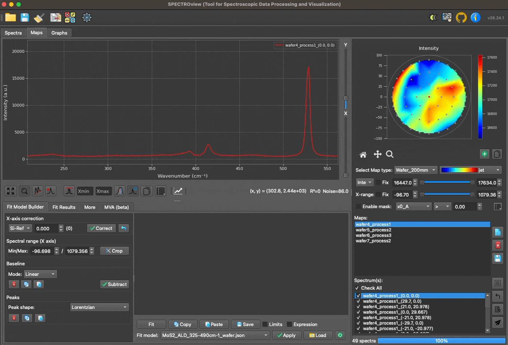
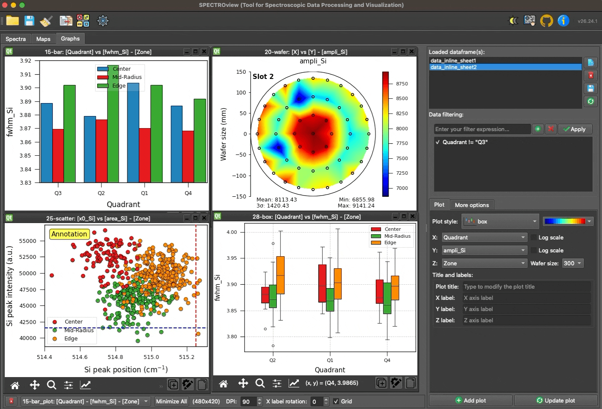

---
hide:
  - navigation
  - toc
  - title
---

<p align="center" class="hero-badges">
    <a href="https://pypi.org/project/spectroview/"></a>
    <a href="https://pypi.org/project/spectroview/"></a>
    <a href="https://pypi.org/project/spectroview/"></a>
    <a href="https://github.com/CEA-MetroCarac/SPECTROview/blob/main/LICENSE"></a>
    <a href="https://github.com/CEA-MetroCarac/SPECTROview/stargazers"></a>
    <a href="https://doi.org/10.1016/j.softx.2026.102862"></a>
    <a href="https://doi.org/10.1016/j.softx.2026.102862"></a>
</p>

<p align="center">
    <b>SPECTROview</b> — приложение с открытым исходным кодом для интерактивной обработки, аппроксимации и визуализации спектроскопических данных.<br>
    Оно поддерживает дискретные спектры и гиперспектральные наборы данных, такие как 2D-карты и карты пластин,<br>
    а встроенные средства визуализации упрощают и ускоряют ваш рабочий процесс анализа.
</p>

---

### :material-star-shooting: **Ключевые возможности** { #key-features }

<div class="grid cards cards-2col" markdown>

-   :material-speedometer: __Высокопроизводительный векторизованный движок пакетной аппроксимации (`VBF Engine`)__

    ---

    Обеспечивает очень высокую скорость аппроксимации за счёт пакетных матричных операций, позволяя одновременно аппроксимировать множество спектров или крупные 2D-карты.

-   :material-chart-multiline: __Пользовательские модели аппроксимации__

    ---

    Создавайте настраиваемые модели аппроксимации для конкретных спектральных профилей и используйте их повторно для быстрого анализа новых наборов данных.

-   :material-chart-bell-curve-cumulative: __Универсальная обработка данных__

    ---

    Легко обрабатывайте спектральные данные 1D, серии in-situ (интерактивные тепловые 2D-карты в SpectraViewer) и гиперспектральные 2D-данные.

-   :material-table-large-plus: __Объединённые результаты__

    ---

    Собирайте и сводите все результаты наилучшей аппроксимации одним нажатием.

-   :material-chart-scatter-plot: __Расширенная визуализация__

    ---

    Специализированная рабочая область для быстрого создания графиков, готовых к публикации, а также тепловых 2D-карт для спектральных серий.

-   :material-robot-happy-outline: __Диалоговый ИИ-агент__

    ---

    Общайтесь со SPECTROview на естественном языке, чтобы фильтровать данные, запускать анализ и создавать или настраивать сразу несколько графиков — на базе вашей локальной (Ollama) или облачной LLM.

</div>

---

### :material-play-circle-outline: **Демонстрации** { #demonstrations }

=== ":material-view-dashboard: Обзор рабочих областей"

    <p align="center">Специализированные рабочие области для дискретных спектров, гиперспектральных данных и расширенной визуализации.</p>

    <div align="center" markdown>
    { loading=lazy width="90%" }
    </div>

=== ":material-chart-bell-curve: Движок аппроксимации"

    <p align="center">Создавайте пользовательские модели аппроксимации и обрабатывайте множество спектров одновременно с помощью движка VBF.</p>

    <div align="center" markdown>
    { loading=lazy width="90%" }
    </div>

=== ":material-chart-bar: Графики, готовые к публикации"

    <p align="center">Быстро создавайте графики, готовые к публикации, во встроенной рабочей области «Графики» (Graphs).</p>

    <div align="center" markdown>
    { loading=lazy width="90%" }
    </div>

=== ":material-robot-happy-outline: Диалоговый ИИ-агент"

    <p align="center">Общайтесь со SPECTROview на естественном языке, чтобы фильтровать данные, а также создавать и настраивать графики.</p>

    <div align="center" markdown>
    { loading=lazy width="90%" }
    </div>

---

### :material-book-open-page-variant: **Документация** { #documentation }

<div class="grid cards" markdown>

-   [:material-download-circle: **Установка**](user_manual/installation.md)
    <br> Скачайте настольное приложение для Windows, macOS или Linux (Python не требуется) или установите пакет через PyPI (`pip`).

-   [:material-account-hard-hat: **Руководство пользователя**](user_manual/index.md)
    <br> Пошаговые руководства по всем возможностям — от загрузки данных до расширенной аппроксимации и визуализации.

-   [:material-code-tags: **Руководство разработчика**](developer/index.md)
    <br> Обзор архитектуры, внутреннее устройство конвейера обработки данных и рекомендации для разработчиков.

-   [:material-api: **Справочник API**](api/index.md)
    <br> Подробный справочник по всем модулям: обработка спектров, 2D-карты, графики и калькуляторы.

-   [:material-format-list-bulleted: **История изменений**](changelog.md)
    <br> Последние обновления, примечания к релизам, исправления ошибок и анонсы новых возможностей.

</div>

---

### :material-hand-heart-outline: **Благодарности** { #acknowledgements }

Эта работа выполнена в CEA — на Платформе нанохарактеризации (PFNC) — при поддержке программы «Recherche Technologique de Base» Национального исследовательского агентства Франции (ANR).

---

### :material-format-quote-open: **Цитирование** { #citation }

Если вы используете **SPECTROview** в своей работе, пожалуйста, цитируйте:

> Le, Van Hoan. "SPECTROview: An Open-Source Application for Interactive Spectroscopic Data Processing, Fitting, and Visualization." *SoftwareX* 35 (September 2026): 102862. [https://doi.org/10.1016/j.softx.2026.102862](https://doi.org/10.1016/j.softx.2026.102862).

??? note "BibTeX"

    ```bibtex
    @article{le2026spectroview,
        title     = {SPECTROview: An Open-Source Application for Interactive
                     Spectroscopic Data Processing, Fitting, and Visualization},
        author    = {Le, Van Hoan},
        journal   = {SoftwareX},
        volume    = {35},
        pages     = {102862},
        year      = {2026},
        month     = sep,
        publisher = {Elsevier},
        doi       = {10.1016/j.softx.2026.102862}
    }
    ```
