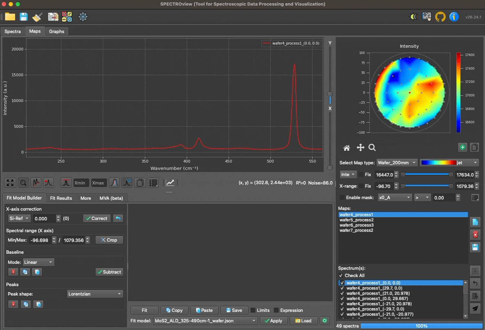
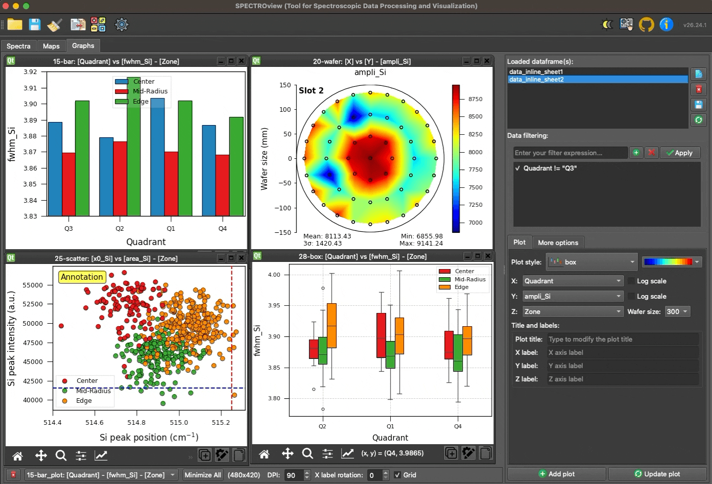

---
hide:
  - navigation
  - toc
  - title
---

<p align="center" class="hero-badges">
    <a href="https://pypi.org/project/spectroview/"></a>
    <a href="https://pypi.org/project/spectroview/"></a>
    <a href="https://pypi.org/project/spectroview/"></a>
    <a href="https://github.com/CEA-MetroCarac/SPECTROview/blob/main/LICENSE"></a>
    <a href="https://github.com/CEA-MetroCarac/SPECTROview/stargazers"></a>
    <a href="https://doi.org/10.1016/j.softx.2026.102862"></a>
    <a href="https://doi.org/10.1016/j.softx.2026.102862"></a>
</p>

<p align="center">
    <b>SPECTROview</b> 是一款用于交互式光谱数据处理、拟合与可视化的开源应用程序。<br>
    它支持离散光谱以及二维图谱、晶圆图等高光谱数据集，<br>
    并集成了可视化工具，简化您的分析工作流程。
</p>

---

### :material-star-shooting: **核心功能** { #key-features }

<div class="grid cards cards-2col" markdown>

-   :material-speedometer: __高性能向量化批量拟合引擎 (`VBF Engine`)__

    ---

    通过批量矩阵运算实现极快的拟合速度，能够同时拟合多条光谱或大型二维图谱。

-   :material-chart-multiline: __自定义拟合模型__

    ---

    针对特定光谱轮廓构建自定义拟合模型，并可将其复用于新数据集的快速分析。

-   :material-chart-bell-curve-cumulative: __多功能数据处理__

    ---

    无缝处理一维光谱数据、原位 (in-situ) 序列（SpectraViewer 中的交互式二维热图）以及二维高光谱数据。

-   :material-table-large-plus: __统一结果汇总__

    ---

    一键收集并汇总所有最优拟合结果。

-   :material-chart-scatter-plot: __高级可视化__

    ---

    提供专用工作区，快速生成可用于论文发表的数据可视化图表，同时支持为光谱序列绘制二维热图。

-   :material-robot-happy-outline: __AI 对话智能体__

    ---

    使用自然语言与 SPECTROview 对话，即可筛选数据、运行分析，以及创建或自定义多幅图表——由您自己的本地 (Ollama) 或云端大语言模型 (LLM) 驱动。

</div>

---

### :material-play-circle-outline: **功能演示** { #demonstrations }

=== ":material-view-dashboard: 工作区概览"

    <p align="center">面向离散光谱、高光谱数据与高级可视化的专用工作区。</p>

    <div align="center" markdown>
    { loading=lazy width="90%" }
    </div>

=== ":material-chart-bell-curve: 拟合引擎"

    <p align="center">设计自定义拟合模型，并使用 VBF 引擎同时处理多条光谱。</p>

    <div align="center" markdown>
    { loading=lazy width="90%" }
    </div>

=== ":material-chart-bar: 发表级图表"

    <p align="center">借助内置的 <b>图表</b> (Graphs) 工作区，快速生成可用于论文发表的数据可视化图表。</p>

    <div align="center" markdown>
    { loading=lazy width="90%" }
    </div>

=== ":material-robot-happy-outline: AI 对话智能体"

    <p align="center">使用自然语言与 SPECTROview 对话，实现数据筛选以及图表的创建与自定义。</p>

    <div align="center" markdown>
    { loading=lazy width="90%" }
    </div>

---

### :material-book-open-page-variant: **文档** { #documentation }

<div class="grid cards" markdown>

-   [:material-download-circle: **安装**](user_manual/installation.md)
    <br> 下载适用于 Windows、macOS 或 Linux 的桌面应用（无需安装 Python），或通过 PyPI (`pip`) 安装。

-   [:material-account-hard-hat: **用户手册**](user_manual/index.md)
    <br> 涵盖所有功能的分步指南，从数据加载到高级拟合与可视化。

-   [:material-code-tags: **开发者指南**](developer/index.md)
    <br> 架构概览、数据流水线内部原理及开发者贡献指南。

-   [:material-api: **API 参考**](api/index.md)
    <br> 全部模块的详细参考：光谱处理、二维图谱、图表与计算器。

-   [:material-format-list-bulleted: **更新日志**](changelog.md)
    <br> 最新更新、发行说明、错误修复与新功能发布公告。

</div>

---

### :material-hand-heart-outline: **致谢** { #acknowledgements }

本工作于 CEA — 纳米表征平台 (PFNC) 完成，并获得法国国家研究署 (ANR)“基础技术研究（Recherche Technologique de Base）”计划的资助。

---

### :material-format-quote-open: **引用信息** { #citation }

如果您在工作中使用了 **SPECTROview**，请引用：

> Le, Van Hoan. "SPECTROview: An Open-Source Application for Interactive Spectroscopic Data Processing, Fitting, and Visualization." *SoftwareX* 35 (September 2026): 102862. [https://doi.org/10.1016/j.softx.2026.102862](https://doi.org/10.1016/j.softx.2026.102862).

??? note "BibTeX"

    ```bibtex
    @article{le2026spectroview,
        title     = {SPECTROview: An Open-Source Application for Interactive
                     Spectroscopic Data Processing, Fitting, and Visualization},
        author    = {Le, Van Hoan},
        journal   = {SoftwareX},
        volume    = {35},
        pages     = {102862},
        year      = {2026},
        month     = sep,
        publisher = {Elsevier},
        doi       = {10.1016/j.softx.2026.102862}
    }
    ```
