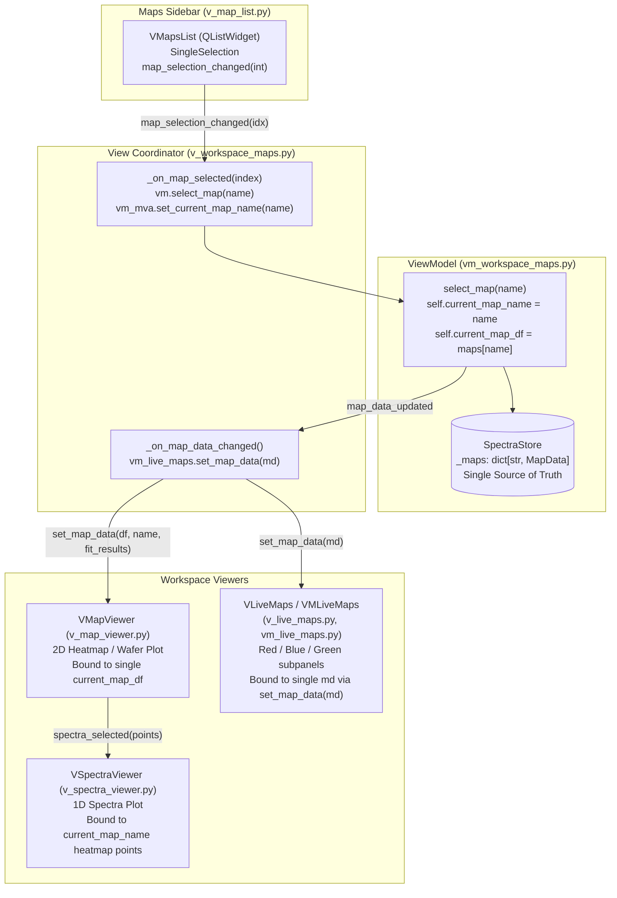
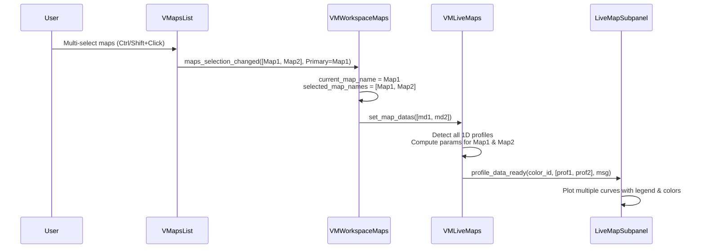

# Investigation & Implementation Roadmap: Multi-Map Selection & Simultaneous Live Maps Visualization

**Document Status**: Proposal & Investigation (Ready for Implementation)  
**Target Module**: `spectroview/view/components/v_map_list.py`, `spectroview/view/v_workspace_maps.py`, `spectroview/viewmodel/vm_workspace_maps.py`, `spectroview/viewmodel/vm_live_maps.py`, `spectroview/view/components/v_live_maps.py`  
**Related Features**: Live Maps (RGB Spectral Range Selectors), Hyperspectral 1D Profiles, 2D Wafer Maps

---

## 1. Executive Summary & Core Architectural Finding

Currently, the Maps workspace only allows selecting a single map at a time in `VMapsList` (`SingleSelection`), which restricts the **Live Maps** tab to displaying one dataset at a time. In contrast, the Spectra workspace already supports multi-selection (`ExtendedSelection`) through `VSpectraList`, allowing simultaneous inspection and bulk operations.

The objective of this proposal is to extend the Maps workspace to support **multiple map selection**, with the primary goal of enabling users to **compare several maps or profiles simultaneously in the Live Maps tab** (e.g., displaying Red, Green, and Blue Live Maps signals from multiple 1D profiles as multiple curves in the same plot).

### Key Architectural Principle: Two-Tier Selection Model
To maintain 100% backward compatibility and prevent breaking existing single-map viewers (`VMapViewer`, `VSpectraViewer`, `VFitModelBuilder`, `VMVA`, `VMoreTab`), the Maps workspace will adopt a **Two-Tier Selection Model**:
1. **Primary (Active) Map (`current_map_name`)**: The map currently focused in the list (`currentItem()`). It continues to drive all single-map visualization components (`VMapViewer`, `VSpectraViewer`, `VMoreTab`, `VMVA`, and interactive peak/baseline tools).
2. **Selected Maps Group (`selected_map_names`)**: The list of all highlighted maps (`selectedItems()`). It feeds multi-dataset comparison tools, specifically the **Live Maps** subsystem.

---

## 2. Current Architecture & Data Flow Audit



### Detailed Component Touchpoints
- **`v_map_list.py`**:
  - `self.maps_list.setSelectionMode(QAbstractItemView.SingleSelection)` (line 73).
  - Emits `map_selection_changed = Signal(int)` (line 23) when selection changes.
  - Action strip buttons (`btn_view`, `btn_delete`, `btn_save`) operate on `get_selected_map_index()`.
- **`vm_workspace_maps.py`**:
  - Stores `self.current_map_name: str | None = None` and `self.current_map_df = None` (lines 41–42).
  - `select_map(map_name)` updates state, extracts active spectra, auto-selects the first point, and emits `spectra_selection_changed` and `map_data_updated`.
  - Bulk operations (`_get_target_mds(apply_all)`) operate on `current_map_name` (or all maps if Ctrl is pressed).
- **`v_workspace_maps.py`**:
  - Connects `map_selection_changed` to `_on_map_selected(index)` (lines 188, 421).
  - Feeds the single `current_map_name` to `v_map_viewer`, `v_more_tab`, and `vm_live_maps`.
- **`vm_live_maps.py` & `v_live_maps.py`**:
  - `VMLiveMaps.set_map_data(md)` (line 169) stores a single `_current_md: Optional[MapData]`.
  - Analyzes geometry via `analyze_map_geometry(md.coords)`:
    - 2D maps (`ndim=2`): emits `map_data_ready(color_id, grid, extent, vmin, vmax, msg)`.
    - 1D profiles (`ndim=1`): emits `profile_data_ready(color_id, positions, values, axis_label, msg)`.
  - `LiveMapSubpanel` (line 100) maintains a single line artist `self.line` updated in-place during bracket dragging.

---

## 3. Technical Feasibility & Component Impact Matrix

| Component | Current State | Supports Multi-Selection? | Required Modifications |
| :--- | :--- | :---: | :--- |
| **`v_map_list.py`** | `SingleSelection`, emits `Signal(int)` | **No** | Enable `ExtendedSelection`; add `maps_selection_changed = Signal(list, str)` emitting `(selected_names, primary_name)`; maintain selection across list updates. |
| **`vm_workspace_maps.py`** | Tracks only `current_map_name` | **Partial** | Retain `current_map_name` as Primary Map; add `selected_map_names: list[str]`; add `select_maps(names, primary_name)`. |
| **`v_workspace_maps.py`** | Wires single index to single VM | **No** | Handle `maps_selection_changed(names, primary)`; route all selected `MapData` blocks to `vm_live_maps`; route primary map to `VMapViewer`. |
| **`v_map_viewer.py`** | Single 2D heatmap with sliders & coordinates | **Yes (as Primary Viewer)** | **No modifications required**. Displays the Primary Map. Multi-viewing is already supported through `VMapViewerDialog` (`+` button). |
| **`v_spectra_viewer.py`** | Visualizes spectra for points clicked on heatmap | **Yes (as Primary Viewer)** | **No modifications required**. Continues displaying spectra from the Primary Map. |
| **`vm_live_maps.py`** | Holds single `_current_md` in `map` mode | **No** | Support `_current_mds: list[MapData]`; evaluate parameter arrays across all selected maps; package multi-profile datasets. |
| **`v_live_maps.py`** | Holds single line `self.line` per subpanel | **No** | Extend `LiveMapSubpanel` to manage a list of lines `self.lines: list[Line2D]` with distinct styles/colors and a legend for 1D profiles; provide carousel/switcher for 2D maps. |
| **`spectral_parameters.py`** | Vectorized parameter engine | **Yes** | Functions are already functional and vectorized across arbitrary arrays. |

---

## 4. Potential Conflicts, Ambiguities & UX Challenges

### A. Primary vs. Comparison Maps Semantics
- **Conflict**: Multiple maps cannot be merged into `VMapViewer` or `VSpectraViewer` without breaking coordinate mapping, spatial bounds, and peak modeling.
- **Resolution**:
  - The focused item is the **Primary Active Map** (`current_map_name`).
  - All single-map tools (`VMapViewer`, `VSpectraViewer`, `VMoreTab`, `VFitModelBuilder`, `VMVA`, `btn_view`, `btn_save`) operate exclusively on the Primary Active Map.
  - The **Selected Maps Group** (`selected_map_names`) is routed to the **Live Maps** tab for simultaneous comparison.

### B. Multi-Profile Visualization (1D Profiles)
- **Coordinate Differences**: Matplotlib's `Axes.plot(x, y)` naturally handles independent X coordinates, lengths, and sampling densities on the same continuous axis. Autoscale spans the bounding union $[\min(X_i), \max(X_i)]$.
- **Axis Labeling**: If all profiles are along $X$, label as `X (mm)`. If along $Y$, `Y (mm)`. If mixed/diagonal, label as `Position / Distance (mm)`.
- **Visual Distinction**:
  - In each subpanel (Red, Blue, Green), curves use distinct categorical colors from SPECTROview's `DEFAULT_COLORS` palette with distinguishable markers and a compact legend `MapName`.
  - The subpanel header badge clarifies which spectral parameter interval is being visualized.

### C. 2D Map Comparison in Live Maps
- **Screen Budget**: With 3 subpanels (Red, Blue, Green) inside the bottom tab, each subpanel is ~250–300 px wide. Rendering side-by-side heatmaps would shrink each map to ~80 px, rendering ticks, colorbars, and pixels unreadable.
- **Recommended 2D Strategy**:
  - For 2D maps, display the **Primary Map**'s heatmap as the primary visual.
  - Provide a compact **Map Switcher combo** in the subpanel header allowing instant 1-click toggling between selected 2D maps without leaving Live Maps.
  - Extracted 1D profiles from 2D maps can be compared simultaneously using the multi-profile line plot.

### D. Mixed-Dimensionality Selection (1D Profile + 2D Map)
- **Selection Homogeneity Policy**:
  - If the Primary Map is a 1D profile, Live Maps plots all selected 1D profiles (ignoring 2D maps with a status badge: *"Comparing 2 profile(s); 1 2D map excluded"*).
  - If the Primary Map is a 2D map, Live Maps renders the 2D heatmap for the Primary Map.

### E. Performance & Debouncing
- Calculating parameters across multiple large maps (e.g., three $3{,}721$-point maps = $11{,}163$ spectra) during live bracket dragging is kept fluid (< 15 ms total) through:
  - Vectorized NumPy parameter calculation (`trapz` / `argmax`).
  - The existing 60 ms debouncing timer (`QTimer` in `VMLiveMaps`).
  - In-place artist updates (`line.set_data(...)`) during active drag gestures.

---

## 5. Architectural Design & Signal Flow



---

## 6. Step-by-Step Implementation Roadmap

### Phase 1: View Selection Model (`spectroview/view/components/v_map_list.py`)
1. Set `self.maps_list.setSelectionMode(QAbstractItemView.ExtendedSelection)`.
2. Add signal:
   ```python
   maps_selection_changed = Signal(list, str)  # (selected_map_names, primary_map_name)
   ```
3. Update `_on_map_selected()` to emit both `map_selection_changed(primary_idx)` (backward compatibility) and `maps_selection_changed(selected_names, primary_name)`.
4. Update `set_maps_names(names)` to preserve multi-selection state across list re-population.

### Phase 2: Workspace ViewModel & View Coordinator (`vm_workspace_maps.py` & `v_workspace_maps.py`)
1. In `VMWorkspaceMaps`:
   - Add `self.selected_map_names: list[str] = []`.
   - Add `select_maps(self, map_names: list[str], primary_name: str | None = None)`.
   - Update `_get_target_mds(apply_all)` to target `selected_map_names` when multiple are selected.
2. In `VWorkspaceMaps`:
   - Connect `v_maps_list.maps_selection_changed` to `_on_maps_selection_changed(selected_names, primary_name)`.
   - Forward all selected `MapData` instances to `vm_live_maps.set_map_datas(mds)`.
   - Route primary map metadata to `v_more_tab` and `vm_mva`.

### Phase 3: Live Maps Engine (`spectroview/viewmodel/vm_live_maps.py`)
1. Add `set_map_datas(self, mds: list[MapData])` (and extend `set_map_data(md)` to accept either).
2. Update calculation flow:
   - If all selected maps are 1D profiles (`all(analyze_map_geometry(md.coords).is_profile for md in mds)`):
     Compute parameter arrays for each profile and emit via `profile_data_ready` with a multi-profile dataset list.
   - If 2D maps: prioritize primary map for 2D heatmap rendering and annotate status.
3. Update `_compute_rb_ratio()` to compute the ratio across each selected map in the list.

### Phase 4: Live Maps Subpanel Visualization (`spectroview/view/components/v_live_maps.py`)
1. In `LiveMapSubpanel`:
   - Replace single `self.line` with `self.lines: list[Line2D]`.
   - In `update_profile_data`:
     - If single profile: draw single line in selector color (`color_hex`), no legend needed (current visual).
     - If multiple profiles: draw distinct colored lines from `DEFAULT_COLORS` palette with markers and call `self.ax.legend()`.
   - Support fast in-place dragging update across multiple lines without clearing axes.
2. In `VLiveMaps`:
   - Accept multi-profile payload in `update_profile_data`.

---

## 7. Testing Strategy

1. **Selection & State Unit Tests (`tests/unit/viewmodel/test_vm_workspace_maps.py`)**:
   - `test_maps_list_multi_selection_emits_selected_and_primary`: Verify `ExtendedSelection` correctly reports all selected names and current focused item.
   - `test_select_maps_updates_selected_and_primary_names`: Verify `VMWorkspaceMaps` state consistency.
   - `test_single_map_backward_compatibility`: Verify clicking a single map maintains previous single-selection behavior.
   - `test_delete_selected_maps`: Verify deleting when multiple maps are selected removes all selected maps cleanly.
2. **Live Maps Multi-Profile Engine Tests (`tests/unit/viewmodel/test_vm_live_maps.py`)**:
   - `test_vm_live_maps_multi_profile_calculation`: Load two synthetic 1D profiles; verify both are evaluated correctly across the Red range.
   - `test_vm_live_maps_multi_profile_different_lengths_and_coords`: Profile 1 (10 pts, $X \in [0, 9]$) and Profile 2 (20 pts, $X \in [-5, 15]$); verify arrays and positions are returned intact.
   - `test_vm_live_maps_multi_profile_rb_ratio`: Verify point-wise R/B ratio calculation across multiple profiles simultaneously.
   - `test_vm_live_maps_mixed_1d_and_2d_graceful_handling`: Multi-selection of one 1D profile and one 2D map; verify primary map takes precedence with clear status message.
3. **Visual & View Tests (`tests/unit/view/test_live_maps.py`)**:
   - `test_subpanel_renders_multiple_lines_with_legend`: Verify `len(panel.lines) == 2` and legend is present when multi-profile data is provided.
   - `test_subpanel_fast_drag_updates_all_lines_in_place`: Verify dragging a range bracket updates both line data arrays without re-creating artists.
   - `test_subpanel_single_profile_preserves_single_line_appearance`: Verify single profile retains exact single-line appearance without unnecessary legend clutter.
   - `test_subpanel_theme_switch_preserves_multiple_lines`: Verify switching Dark/Light mode redraws all lines cleanly with proper contrasting theme colors.

