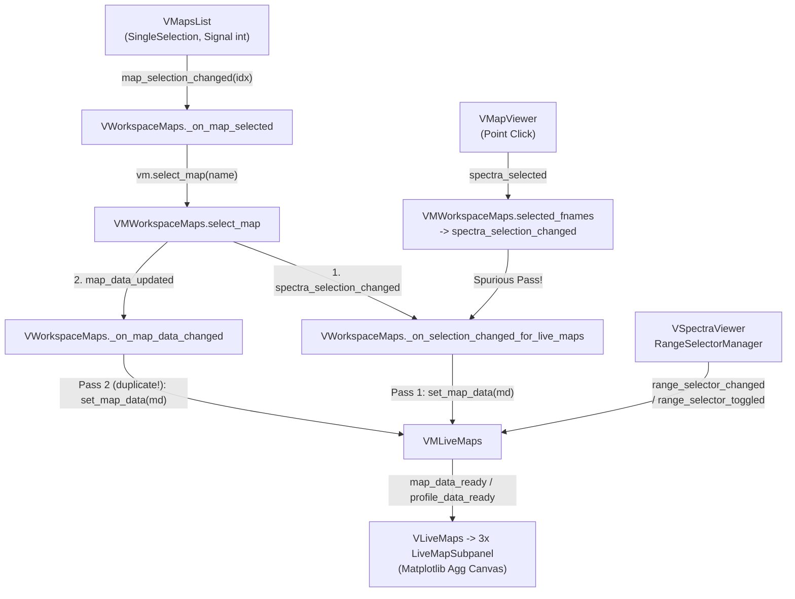
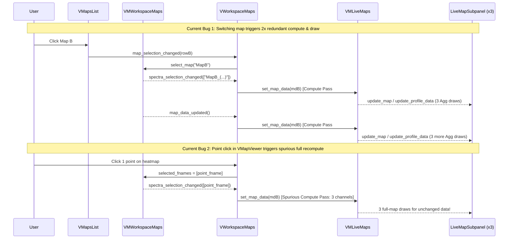
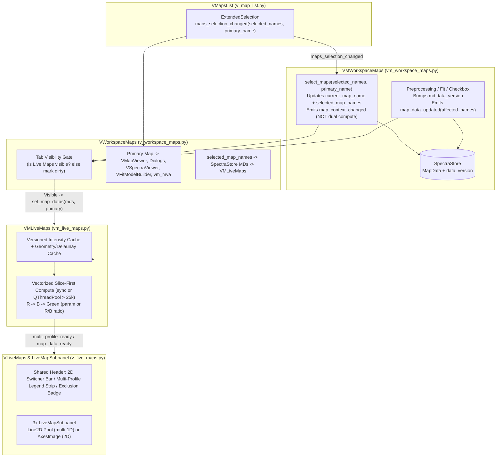
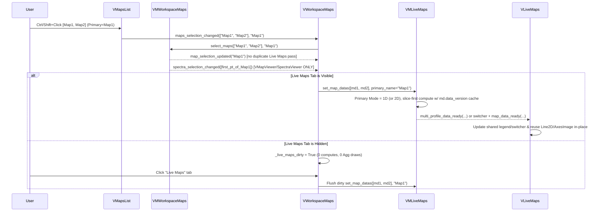

# Technically Validated Specification & Implementation Roadmap: Multi-Map Selection & Live Maps

**Document Status**: Audited, Performance-Validated & Implementation-Ready Specification  
**Supersedes**: Draft Roadmap (`34431df`, initial Phases 1–4 proposal)  
**Primary Modules Affected**:

- `spectroview/model/spectra_store.py`, `spectroview/model/spectral_parameters.py`
- `spectroview/viewmodel/vm_workspace_maps.py`, `spectroview/viewmodel/vm_workspace_spectra.py`, `spectroview/viewmodel/vm_live_maps.py`
- `spectroview/view/components/v_map_list.py`, `spectroview/view/components/v_live_maps.py`, `spectroview/view/v_workspace_maps.py`, `spectroview/view/v_workspace_spectra.py`

**Related Features**: Multi-Map Selection, RGB Spectral Range Brackets (`VSpectraViewer` / `RangeSelectorManager`), Adaptive 1D/2D Live Maps, Green Red/Blue (`R/B`) Ratio, Vectorized Parameter Caching

---

## 1. Executive Summary

This document presents a comprehensive technical re-audit and implementation-ready specification for adding **multi-map selection** in the Maps workspace while hardening the **RGB Live Brackets**, **Adaptive 1D/2D Live Maps**, and **Green R/B Ratio** subsystems for large hyperspectral workloads.

A second, code- and benchmark-driven audit of the existing codebase and the initial roadmap (`34431df`) exposed **critical architectural contradictions, stale-state bugs, silent signal amplification, and severe CPU/memory bottlenecks**:

1. **Unreported `2×` and Spurious Recomputations**: Under current wiring, switching maps computes Live Maps **twice** (`6` parameter passes across 3 brackets), single-point clicks in `VMapViewer` trigger full-map recalculation (`3` spurious passes), and checkbox toggles recompute all channels even though `VMLiveMaps` ignores `MapData.is_active`. Multi-selecting $K$ maps would multiply this wasted work by $K\times$.
2. **Invalidated `< 15 ms` Performance Claim**: Direct benchmarking shows a single `3,721`-spectrum map already takes `39.1–40.8 ms` in `VMLiveMaps` compute alone, while `N = 90,000` allocates **`947.5 MB`** peak Python memory and takes **`1.37–1.54 s`** due to casting the entire `(N, M)` matrix from `float32` to `float64` before column-masking. Scattered 2D maps re-run `scipy.interpolate.griddata` from scratch on every drag tick (`209.7 ms` at `N = 2,401`; **`14.51 s`** at `N = 160,000`), and Matplotlib `Agg` redraws cost **`127.6–188.7 ms` per subpanel** (`~380–566 ms` across 3 subpanels).
3. **Unresolved UX & Data Contracts**: The prior proposal contradicted itself on multi-map bulk preprocessing scope and mixed 1D/2D precedence, omitted `VMapsList` placeholder/selection Qt traps, left workspace-clear stale references unhandled, and omitted `R/B` ratio invalidation and heterogeneous map axis bounds.

### Resolved Design Baseline

| Ambiguity / Risk in Prior Draft (`34431df`) | Validated Specification Decision |
| :--- | :--- |
| **Bulk operations scope** (Section 4.A Primary-only vs. Phase 2 `_get_target_mds` multi-select) | **Strict Primary-Only** for all preprocessing, baseline, peak-model, fit, and single-map export tools (`Ctrl`-to-apply-all behavior preserved). Multi-selection drives comparison in **Live Maps** (plus explicit multi-map **Delete** confirmation on sidebar removal). |
| **Mixed 1D + 2D selection** (Section 4.D Primary-precedence vs. Phase 3 `all(...)` 1D) | **Primary-Precedence Mode Selection**: Primary map (`current_map_name`) dimensionality sets Live Maps mode (`1D` compares all selected 1D profiles; `2D` enters 2D comparison switcher). Excluded mismatched maps are never coerced; an explicit exclusion badge informs the user. |
| **2D multi-map comparison UX** (per-subpanel combo vs. tab-level switcher vs. micro-grid) | **Single Tab-Level 2D Switcher** (`Prev / Combo / Next` in `VLiveMaps` header), initialized to Primary Map so Red, Blue, and Green (`R/B`) always inspect the same coherent 2D map. |
| **Multi-profile legend crowding** (per-subpanel `ax.legend()` on 250 px axes) | **Single Shared Tab-Level Header Legend Strip** in `VLiveMaps` (only shown when $\ge 2$ profiles are plotted), preserving 100% of plot axis area. |
| **RGB brackets across differing X ranges** (per-map brackets vs. shared brackets) | **Shared Workspace Brackets** positioned on Primary Map's `VSpectraViewer`. Comparison maps missing points inside `[x_min, x_max]` yield `NaN` (with a concise partial/no-overlap status indicator) rather than silently hiding mismatches behind independent intervals. |
| **Large map latency & UI freezes** (full-matrix `float64`, repeated `griddata`, hidden-tab eager work) | **Phase 0 Prerequisites**: Visibility-gated lazy evaluation, clean signal separation, **slice-first** `float64` casting, cached **Delaunay barycentric weights** for scattered 2D maps, explicit `MapData.data_version` cache invalidation, and adaptive drag coalescing (plus optional thresholded `QThreadPool` worker for massive batches in Phase 5). |

---

## 2. Phase I — Critical Re-Audit of the Initial Proposal (`34431df`)

The prior document (`docs/roadmaps/multi_map_selection_live_maps.md`, revision `34431df`) correctly identified the Two-Tier Selection concept (`Primary Active Map` vs. `Selected Maps Group`), but failed validation across five critical areas when checked against SPECTROview source code and empirical benchmarks.

### A. Internal Architectural Contradictions

1. **Contradiction on Bulk Operations Scope**:
   - *Draft Section 1 & Section 4.A*: Explicitly promised *"All single-map tools (`VMapViewer`, `VSpectraViewer`, `VMoreTab`, `VFitModelBuilder`, `VMVA`, `btn_view`, `btn_save`) operate exclusively on the Primary Active Map."*
   - *Draft Phase 2 Step 1*: Prescribes *"Update `_get_target_mds(apply_all)` to target `selected_map_names` when multiple are selected."*
   - *Why this is dangerous*: Source inspection of `spectroview/viewmodel/vm_workspace_maps.py` shows `_get_target_mds()` (lines 449–455) only serves 7 actions (`reinit_spectra`, `apply_spectral_range`, `paste_baseline`, `subtract_baseline`, `delete_baseline`, `paste_peaks`, `delete_peaks`) and is **bypassed** by `apply_y_normalization` / `undo_y_normalization` (which resolve targets via `_get_selected_spectra()`), `apply_x_correction` / `undo_x_correction`, `_apply_fit_model_and_run`, `fit`, `_run_fit_thread`, `delete_current_map`, and CSV saving. Making `_get_target_mds()` silently mutate `selected_map_names` would cause asymmetric destructive edits across half the toolbar when a user selects maps purely to overlay Live Maps.

2. **Contradiction on Mixed 1D/2D Multi-Selection**:
   - *Draft Section 4.D*: *"If the Primary Map is a 1D profile, Live Maps plots all selected 1D profiles (ignoring 2D maps with a status badge: 'Comparing 2 profile(s); 1 2D map excluded')."*
   - *Draft Phase 3 Step 2*: *"If all selected maps are 1D profiles (`all(analyze_map_geometry(md.coords).is_profile for md in mds)`): ... If 2D maps: prioritize primary map."*
   - Those two rules produce opposite results whenever a user selects `[Profile_1D (Primary), Wafer_2D]`: Section 4.D plots `Profile_1D` as a line plot, whereas Phase 3 Step 2 sees `all(...) == False` and prioritizes the Primary... which is 1D, leaving an unhandled fallthrough branch.

### B. Invalidated Performance Assumptions

Draft Section 4.E claimed: *"Calculating parameters across multiple large maps (e.g., three 3,721-point maps = 11,163 spectra) during live bracket dragging is kept fluid (< 15 ms total)."*

Direct benchmark runs against `HEAD` (`34431df`) disprove this assumption across every stage of the pipeline:

| Operation / Benchmark Scenario (Observed on `34431df`) | Measured Latency | Measured Peak Alloc | Prior Claim | Verdict |
| :--- | :---: | :---: | :---: | :--- |
| `compute_spectral_parameter` (10% band, `M = 1015`), `N = 3,721` | **29.7 ms** | 39.2 MB | "< 15 ms for 3 maps" | **Refuted (1 map > 2× budget)** |
| `VMLiveMaps` full pass (R+B+G `R/B`, 1 map `N = 3,721`) | **39.1–40.8 ms** | — | "< 15 ms for 3 maps" | **Refuted (`3×` ~120 ms compute)** |
| `compute_spectral_parameter`, `N = 90,000` (`Y0` `float32` = 365.4 MB) | **732.2 ms** | **947.5 MB** | Unanalyzed | **Critical Memory Spike** |
| `VMLiveMaps` full pass (1 map `N = 90,000`) | **1,366.9–1,538.6 ms** | — | Unanalyzed | **1.5 s UI Stall** |
| `compute_map_grid` (scattered `N = 2,401` / `N = 160,000`) | **209.7 ms** / **14,507.3 ms** | — | Unanalyzed | **14.5 s UI Freeze** |
| `LiveMapSubpanel` Agg render+draw (`320×260`, 2,000-pt 1D / 300×300 2D) | **127.6 ms** / **188.7 ms** | — | "fluid" | **380–566 ms across 3 panels** |

The draft completely missed Matplotlib `Agg` canvas draw cost (`~128–189 ms` *per subpanel* = `~380–566 ms` per 3-panel update), which exceeds the `60 ms` debounce timer by `6×–9×`.

### C. Overlooked Redundant Compute & Lifecycle Bugs

Instrumentation of the current signal graph (3 active brackets) quantified severe existing compute waste before multi-selection is even added:

- **Map switch via `VMapsList`**: Fires `batches = 2, compute_calls = 6, panel_updates = 6` (**`2×` redundant**) because `VMWorkspaceMaps.select_map()` (lines 117–138) emits both `spectra_selection_changed` and `map_data_updated`, and `VWorkspaceMaps` routes both to `vm_live_maps.set_map_data(md)`.
- **Clicking a single spectrum point in `VMapViewer`**: Fires `batches = 1, compute_calls = 3, panel_update_map = 3` (**100% spurious**). Selecting a spectrum point changes no map intensities, yet `_on_map_viewer_selection` emits `spectra_selection_changed`, forcing a full-map recompute of all 3 Live Maps channels.
- **Toggling a spectrum checkbox (`is_active`)**: Fires `batches = 1, compute_calls = 3, panel_update_map = 3`, even though `VMLiveMaps` computes across the entire `md.y_matrix` without consulting `md.is_active`.
- **Hidden-tab eager computation**: Neither `VWorkspaceSpectra` nor `VWorkspaceMaps` checks whether Live Maps is the active tab in `bottom_tabs`. Loading maps, preprocessing, or clicking heatmap points computes and draws all 3 hidden Matplotlib canvases synchronously.
- **Workspace clear & last-map delete memory leak**: `VWorkspaceMaps._on_map_data_changed()` (line 396) guards `if self.vm.current_map_name:` before calling `set_map_data`. Clearing the workspace (`clear_workspace`) or deleting the final map never notifies `VMLiveMaps`, leaving the deleted `MapData` pinned in `VMLiveMaps._current_md` and stale plots rendered.
- **Bracket toggle double-evaluation & missing label sync**: `VWorkspaceSpectra._on_range_selector_toggled()` (lines 393–401) sets the range (`_timer.start()`) and immediately calls `set_selector_active(..., True)` (synchronous recompute), triggering two passes when a bracket turns on. Additionally, `VWorkspaceSpectra.setup_connections()` does not connect `selector_state_changed`, leaving `LiveMapSubpanel` header range badges potentially out of sync on axis initialization.

### D. Overlooked Qt `ExtendedSelection` & `VMapsList` Implementation Traps

Draft Phase 1 prescribed *"Enable `ExtendedSelection`; emit `Signal(list, str)`"* without inspecting `spectroview/view/components/v_map_list.py` internals:

1. **5 Non-Map Placeholder Rows**: When empty, `_update_maps_placeholder()` (`v_map_list.py:136–154`) inserts 4 spacer `QListWidgetItem`s + 1 text prompt with `Qt.NoItemFlags`. Naive `count()`, `setCurrentRow(0)`, or index math collides with placeholder rows unless filtered cleanly (unlike `VSpectraList`, which tracks real items cleanly and cleans spacer flags).
2. **Row-Index Selection Restoration**: `VMapsList.set_maps_names()` (lines 157–177) currently preserves selection by integer row index rather than map name, and `VWorkspaceMaps._on_map_data_changed()` calls `self.v_maps_list.set_selected_map_name(self.vm.current_map_name)` (line 376), which executes `setCurrentRow()`. Under `ExtendedSelection`, calling `setCurrentRow(row)` *without* `QItemSelectionModel.NoUpdate` clears all other selected rows and destroys multi-selection on every preprocessing step or map addition.
3. **`currentItem()` vs. `selectedItems()` Divergence**: In Qt `ExtendedSelection`:
   - `Ctrl+Click` on the currently focused item **deselects** it from `selectedItems()` while leaving `currentItem()` pointing at the now-unselected item.
   - Clicking empty viewport whitespace clears `selectedItems()` to `[]`, while `currentItem()` may still reference the last focused item.
   - The draft did not define reconciliation rules for `primary_name` vs. `selected_names`.
4. **Unsafe Qt Signal Signature**: `Signal(list, str)` cannot cleanly carry `None` when the workspace is cleared (`None` coerces to `""` or triggers PySide6 signature edge cases). `Signal(list, object)` (emitting `list[str]` and `Optional[str]`) matches safe `None` semantics.

### E. Visualization, Ratio Semantics & Testing Deficiencies

- **Legend Crowding**: Calling `self.ax.legend()` inside a ~`250–300 px` `Figure(layout="compressed")` shrinks Matplotlib's layout engine around tick labels and titles across all 3 subpanels identically.
- **Unaddressed `R/B` Edge Cases & Cache Invalidation**: Draft Phase 3 step 3 gave one line to `_compute_rb_ratio()`, ignoring cross-map non-overlapping ranges, all-`NaN` heatmaps (`nanmin`/`nanmax`), Red-change $\rightarrow$ Green invalidation, and `MapData` in-place array mutations (where `_intensity_cache` keyed by Python `id(md)` or array identity would risk stale hits if mutated in place, e.g., `apply_cosmic_ray_erase`).
- **Testing Separation Violation**: Draft Section 7 proposed testing `VMapsList` widget behavior inside `tests/unit/viewmodel/test_vm_workspace_maps.py`, conflating View widget tests (`tests/unit/view/test_v_maps_list.py`) with headless ViewModel tests.

---

## 3. Phase II — Authoritative Audit of Current Implementation

### Component Inventory & Architectural Responsibilities

| Layer | File | Key Classes & Entry Points | State Owned | Dependencies / Consumers |
| :--- | :--- | :--- | :--- | :--- |
| **Model** | `spectroview/model/spectra_store.py` | `MapData` (L23–110), `SpectraStore` (L117+) | `x0` (`float64[M]`), `Y0` (`float32[N, M]`), `coords` (`float64[N, 2]`), `is_active` (`bool[N]`), `fnames`, `Y`/`x` processed, fit arrays, `x_axis`/`y_matrix` properties | NumPy, Pandas (`fit_engine.baseline`); zero Qt widgets |
| **Model** | `spectroview/model/spectral_parameters.py` | `compute_spectral_parameter` (L72–208), `compute_map_grid` (L410–527), `analyze_map_geometry` (L561–613), `compute_intensity_ratio` (L616–647) | Pure functions; `analyze_map_geometry` SVD projection; `compute_map_grid` `griddata` 80×80 | NumPy; deferred `scipy.interpolate.griddata` inside `compute_map_grid` |
| **Model** | `spectroview/model/m_io.py` | `extract_map_arrays` (L274–330) | Extracts `(x0, Y0, coords, fnames)` from DataFrame (`float32` `Y0`, `float64` `coords`) | Pandas, NumPy |
| **ViewModel** | `spectroview/viewmodel/vm_live_maps.py` | `VMLiveMaps`; `set_map_data` (L169), `set_series_data` (L176), `set_selector_active` (L185), `set_selector_range` (L199), `_recalculate_batch` (L241) | `_mode` (`series`\|`map`), `_states` (`red`/`blue`/`green`), `_current_md`, `_current_mds`, `_geometry_cache`, pass `_intensity_cache`, 60 ms `QTimer` | Emits `map_data_ready`, `series_data_ready`, `profile_data_ready`, `selector_state_changed` |
| **ViewModel** | `spectroview/viewmodel/vm_workspace_maps.py` | `VMWorkspaceMaps`; `select_map` (L117), `_get_target_mds` (L449), `set_spectrum_active` (L393), `remove_map` (L558), `clear_workspace` (L1070) | `current_map_name`, `current_map_df`, `selected_fnames`, `maps` dict (legacy DF mirror) + inherited `SpectraStore` (`self.store`) | Calls `VMLiveMaps` only indirectly via View; emits `spectra_selection_changed`, `map_data_updated`, `maps_changed` |
| **ViewModel** | `spectroview/viewmodel/vm_workspace_spectra.py` | `VMWorkspaceSpectra`; `_reset_mapdata_arrays` (L640), `_clear_fit_state` (L661), `apply_*`, `subtract_baseline`, `apply_cosmic_ray_erase` | `self.store` (`SpectraStore`), `selected_fnames`, fit worker lifecycle | Parent class of `VMWorkspaceMaps` |
| **View** | `spectroview/view/components/v_map_list.py` | `VMapsList`; `SingleSelection` (L73), `map_selection_changed = Signal(int)` (L23), `_update_maps_placeholder` (L136), `set_maps_names` (L157), `set_selected_map_name` (L186) | UI list items (+ 5 `NoItemFlags` placeholder items when empty) | Emits `map_selection_changed(int)` & action button signals to `VWorkspaceMaps` |
| **View** | `spectroview/view/v_workspace_maps.py` | `VWorkspaceMaps(VWorkspaceSpectra)`; `_connect_signals` (L185), `_on_selection_changed_for_live_maps` (L229), `_on_map_viewer_selection` (L236), `_on_map_data_changed` (L356), `_on_map_selected` (L421), `clear_workspace` (L573) | Owns `v_maps_list`, `v_map_viewer`, `viewer_dialogs` (`VMapViewerDialog` list); inherits `v_spectra_viewer`, `v_live_maps`, `vm_live_maps` | Coordinates `VMWorkspaceMaps`, Viewers/Dialogs, and `VMLiveMaps` / `VLiveMaps` |
| **View** | `spectroview/view/v_workspace_spectra.py` | `VWorkspaceSpectra`; `bottom_tabs` (L69), `setup_connections` (L199; Live Maps L277–286), `_on_range_selector_toggled` (L393), `_on_selection_changed_for_live_maps` (L408) | Owns `vm_live_maps`, `v_live_maps`, `v_spectra_viewer`, `bottom_tabs` | Base workspace for both Spectra and Maps |
| **View** | `spectroview/view/components/v_live_maps.py` | `LiveMapSubpanel` (L100), `VLiveMaps`; `Figure(dpi=70, layout="compressed")` (L184), `_reset_axes` (L206), `update_series` (L285), `update_map` (L380), `update_profile_data` (L590), `apply_theme` (L607) | `_display_kind`, single `self.line`, `AxesImage` (`self.im`), colorbar, param & channel UI controls | Connects subpanel `param_changed` / `copy_requested` to `VMLiveMaps` |
| **View** | `spectroview/view/components/v_spectra_viewer.py` & `v_range_selector.py` | `VSpectraViewer`, `RangeSelectorManager` | `range_manager` (Red/Blue/Green brackets; creates 7 artists in `render(ax)` L282–366), `refresh_or_clamp_ranges` (L225–271) | Emits `range_selector_toggled`, `range_selector_changed` on drag/clamp |
| **View** | `spectroview/view/components/v_map_viewer.py` & `v_map_viewer_dialog.py` | `VMapViewer`, `VMapViewerDialog` | Debounced `plot_timer`, `_griddata_cache`, filters points using `map_df` (`md.is_active == True`) | Single-map 2D inspection & multi-window floating copies |
| **App / Cross** | `main.py`, `vm_mva.py`, `application/service.py` | `main.py::setup_connections`, `vm_mva.py::set_current_map_name`, `application/service.py::get_active_map` | MVA active map name; service reads `vm.current_map_name`, `selected_fnames`, `map_type` | Must remain bound to **Primary Active Map** only |

### Current-State Architecture & Execution Trace



#### Traced Sequence: Map Switch & Bracket Drag on Current `34431df`



---

## 4. Phase III — Identified Limitations & Missing Considerations

### 4.1 Architecture & State Management

1. **Conflated Signal Semantics**: `spectra_selection_changed` means two completely different things in Maps workspace: *"spectra highlighted inside the current map"* (`VMapViewer` point click) vs. *"active map context changed"* (`VMWorkspaceMaps.select_map`). Routing `spectra_selection_changed` to Live Maps in `VWorkspaceMaps._on_selection_changed_for_live_maps` (lines 229–234) causes both duplicate map-switch passes and spurious point-click passes. Note that in `VWorkspaceSpectra` (`setup_connections`, lines 277–286), `spectra_selection_changed` rightly feeds Live Maps in `"series"` mode because highlighted items *are* the selected 1D spectra; `VWorkspaceMaps` must override that route cleanly.
2. **Primary-vs-Selected Invariant**: When multiple maps are selected in `VMapsList`:
   - Single-map state (`current_map_name`, `current_map_df`, `selected_fnames`, `VMapViewer`, `VMapViewerDialog`s, `VSpectraViewer`, `VFitModelBuilder`, `vm_mva`, `VMoreTab`, `application/service.py::get_active_map()`) remains strictly coupled to `Primary Active Map`.
   - Comparison state (`selected_map_names: list[str]`, deduplicated in list order) routes read-only references (`SpectraStore.get_map_data(name)`) to `VMLiveMaps`. Zero deep-copying of `Y0` or `Y` occurs across selection changes.
3. **Mutating vs. Viewing Map Data**: Preprocessing operations (`apply_y_normalization`, `subtract_baseline`, `apply_spectral_range`, `apply_x_correction`, `apply_cosmic_ray_erase`) and VBF fit completion mutate `MapData` arrays (`Y`, `x`, `peak_params`, `fit_r2`, `Y_bestfit`). Today there is no version counter on `MapData`, preventing cross-batch reuse of per-map bracket integrals or geometry caches without risking stale reads after in-place mutations.

### 4.2 Performance & Scalability

#### Verified Pre-Optimization Baselines (`task-177` & `task-181`, `QT_QPA_PLATFORM=offscreen`)

| Metric / Case | Conditions | Measured Result |
| :--- | :--- | :---: |
| `compute_spectral_parameter` (Integrated intensity) | `N=3,721`, `M=1,015`, 10% band (`float32` `Y0`=15.1 MB) | **29.7 ms**, peak alloc **39.2 MB** |
| `compute_spectral_parameter` (Integrated intensity) | `N=40,000`, `M=1,015`, 10% band (`float32` `Y0`=162.4 MB) | **339.0 ms**, peak alloc **421.1 MB** |
| `compute_spectral_parameter` (Integrated intensity) | `N=90,000`, `M=1,015`, 10% band (`float32` `Y0`=365.4 MB) | **732.2 ms**, peak alloc **947.5 MB** |
| `Y0[:, mask].astype(np.float64)` (isolated slice-first comparison) | Same `N=3,721` / `40,000` / `90,000`, 10% band | **6.8 ms** / **94.9 ms** / **180.2 ms** |
| `compute_map_grid` + `analyze_map_geometry` (regular grid) | `N=3,721` / `N=90,000` | grid `0.76 ms` / `16.52 ms`; geom `1.14 ms` / `9.20 ms` |
| `compute_map_grid` (`scipy.interpolate.griddata`, scattered) | `N=2,401` / `N=160,000` (80×80 linear) | **209.7 ms** / **14,507.3 ms** |
| `VMLiveMaps` full compute (R+B+Green=`R/B ratio`, `map` mode) | `N=3,721` (`set_map_data` / Red drag tick R+G) | **39.1 ms** / **40.8 ms** |
| `VMLiveMaps` full compute (R+B+Green=`R/B ratio`, `map` mode) | `N=90,000` (`set_map_data` / Red drag tick R+G) | **1,538.6 ms** / **1,366.9 ms** |
| `LiveMapSubpanel` first render+draw / in-place update+draw | `320×260` Agg: `300×300` 2D map vs. `2,000`-pt 1D series | 2D: **249.1 ms** / **188.7 ms** · 1D: **177.4 ms** / **127.6 ms** |
| Map switch `2D <-> 1D` via `VMapsList` (3 active brackets) | Call spy (`task-181`) | **2 batches, 6 compute calls, 6 panel updates** (2× redundant) |
| Point click in `VMapViewer` / Checkbox toggle (`is_active`) | Call spy (`task-181`) | **1 batch, 3 compute calls, 3 panel updates** each (spurious) |
| Delete active map (auto-switch to next map) | Call spy (`task-181`) | **2 batches, 6 compute calls, 6 panel updates** (2× redundant) |

#### Root-Cause Bottlenecks Identified

1. **Full-Matrix Upcast in `spectral_parameters.py:116`**:
   `y_arr = np.asarray(Y, dtype=np.float64)` runs *before* the spectral band mask (`lines 135–142`) trims columns down to the 5–15% range under the bracket. Copying `365.4 MB` `float32` into `730.8 MB` `float64` (plus intermediate temporaries = `947.5 MB`) creates severe memory pressure and cache thrashing; across 5 multi-selected large maps this risks multi-GB stalls or OOM on 32-bit/laptop environments. Masking columns *before* casting (`np.asarray(Y[:, mask], dtype=np.float64)`) cuts intermediate allocation by $\approx 10\times$ and measured slice+cast time by $\approx 4\times$.
2. **Repeated `scipy.interpolate.griddata` on Scattered Maps**:
   Every 60 ms bracket move on a non-orthogonal wafer map rebuilds a 2D Qhull Delaunay triangulation and barycentric search from scratch (`209.7 ms` for 50×50; `14.5 s` for 400×400). Because `(X, Y)` spatial coordinates do not change during bracket drags, Delaunay simplex indices and vertex weights are strictly invariant per map geometry and can be precomputed once and applied in `< 1 ms` per bracket tick.
3. **Matplotlib `Agg` Redraw Budget & Bracket Drag Churn**:
   Each full 3-subpanel Agg draw takes `~383 ms` (1D) to `~566 ms` (2D), while `RangeSelectorManager.render(ax)` (`v_range_selector.py:282–366`) removes and recreates **7 artists** on every canvas mouse-motion event (`v_spectra_viewer.py:2584–2593`). A fixed `60 ms` QTimer fires faster than Matplotlib finishes drawing large maps, queueing back-to-back main-thread stalls.
4. **Inactive Tab Execution**: Computing and drawing Live Maps while `bottom_tabs` is showing `Fit Model Builder`, `Fit Results`, or `MVA` is pure waste.
5. **`is_active` Consistency Gap**: `VMapViewer` omits unchecked spectra (`is_active == False`) via `get_current_map_dataframe()`, whereas `VMLiveMaps` evaluates all `N` rows directly from `md.y_matrix`—yet `set_spectrum_active` / `set_all_current_map_spectra_active` emit `map_data_updated`, causing 3 full recomputes whose pixel output doesn't even reflect the unchecked mask! Live Maps should either consistently mask inactive pixels (`NaN` for 2D grids / omit or break 1D points—or explicitly match `VMapViewer` semantics via `is_active` masking in vectorized NumPy) and cache cleanly. Using `is_active` directly via vectorized masking (`~md.is_active -> NaN` after fast vectorized intensity slice, or slicing active rows `Y[active, mask]`) guarantees 1:1 visual fidelity with `VMapViewer` without copying DataFrames.

### 4.3 RGB Live Brackets & Green `R/B` Ratio Semantics

1. **Bracket Range Compatibility Across Multiple Maps**:
   Maps loaded together may span different spectral ranges (e.g., `100–1800 cm^-1` vs. `400–1200 cm^-1`, or 532 nm vs. 633 nm calibration). When a Red or Blue bracket `[x_min, x_max]` has $< 1$ (or $< 2$ for trapezoidal integration) wavenumber samples in comparison Map $j$:
   - Map $j$ must not crash (`ValueError: zero-size array` or `IndexError`) and must not silently plot `0.0`.
   - `compute_spectral_parameter` / `VMLiveMaps` must return an all-`NaN` array for that channel on Map $j$, exclude all-`NaN` curves from autoscale bounds cleanly, and annotate the subpanel status badge (e.g., *"Map B: out of spectral range"*).
2. **`R/B` Ratio Dependency & Numerical Edge Cases**:
   - In `VMLiveMaps._recalculate_batch`, when `Green` parameter is `R/B ratio`, changing `Red` **or** `Blue` must recalculate `Green`, reusing Red and Blue 1D intensity vectors computed in the same pass via `_intensity_cache` (keyed by `(id(md), md.data_version, color_id, round(x_min, 6), round(x_max, 6), active_digest)`).
   - If `Red` or `Blue` is deactivated or yields empty range / near-zero denominator (`abs(I_blue) < max(abs(I_blue)) * 1e-3`, matching `compute_intensity_ratio` at `spectral_parameters.py:616–647`), pixels/points with small `I_blue` become `NaN`. If *all* values are `NaN`, Matplotlib 2D normalization (`np.nanmin`/`np.nanmax`) would raise `ValueError` unless explicitly guarded (fall back to `0.0, 1.0` and show *"No valid R/B points"* message).
   - Intensity cache **must not** survive across `MapData` preprocessing/baseline/fit changes: explicit `MapData.data_version: int = 0` increments on any array or `is_active` mutation.
3. **Toggle & Init Sync**:
   - Fix `VWorkspaceSpectra._on_range_selector_toggled` (`lines 393–401`) so activating a bracket does not schedule both an async timer via `set_selector_range(..., immediate=False)` and a synchronous run via `set_selector_active(..., True)`.
   - Connect `vm_live_maps.selector_state_changed` in `VWorkspaceSpectra.setup_connections()` so programmatic range clamping/initialization immediately updates subpanel header `[x_min, x_max]` pills.

### 4.4 Multi-Map Selection & UX Edge Cases

1. **`ExtendedSelection` Corner Cases in `VMapsList`**:
   - **Placeholder isolation**: `_update_maps_placeholder()` rows must be stripped on real population and ignored when reading selection/primary state (`Qt.UserRole` or tracked item set rather than raw `row(item)`).
   - **Ctrl-deselect of focused item**: When `currentItem()` is no longer in `selectedItems()`, promote the top/last still-selected item as `primary_name` (or only update `primary_name` cleanly) so the Primary Map is always an actually selected map whenever `len(selected_names) >= 1`.
   - **Empty viewport click**: Clicking blank whitespace clears `selectedItems()`. Guard against wiping `current_map_name` unexpectedly or explicitly handle empty selection (`current_map_name = None`, `selected_map_names = []`, Live Maps displays clean empty state — matching `VSpectraList` / empty workspace behavior cleanly, OR re-select previous if single-click empty area? Standard Qt `ExtendedSelection` like `VSpectraList` leaves empty selection cleanly; Live Maps and viewers must tolerate empty selection without errors).
   - **Programmatic preservation**: `set_maps_names()` and `_on_map_data_changed()` must preserve `selected_map_names` by map name (`QItemSelectionModel.Select`) without clobbering selection via `setCurrentRow()`.
2. **1D Spatial Axis Labeling & Scale Fidelity**:
   - `analyze_map_geometry(md.coords)` extracts projected 1D `positions`, `axis_label`, and `is_profile`.
   - When comparing multiple 1D profiles simultaneously:
     - If all share an `X`-aligned `axis_label`, use that shared `X` label cleanly.
     - If all share a `Y`-aligned `axis_label`, use that shared `Y` label cleanly.
     - If profiles mix `X` and `Y` directions or oblique traces -> plot each against its own `positions`, label the axis generically (e.g., `"Position / Distance"`), and note mixed axis orientations in the status badge.
   - **Aspect Ratio Regression Prevention**: Switching 2D $\rightarrow$ 1D (or switching between single 2D map and multi-1D selection) must always invoke `LiveMapSubpanel._reset_axes()` with `self.ax.set_aspect("auto", adjustable="box")` before plotting lines (preventing the squished-axis scale regression previously observed when 2D aspect lock persisted onto 1D line plots).
3. **Color Determinism & Visual Hierarchy**:
   - Assign colors sequentially from `spectroview.__init__.DEFAULT_COLORS` (20 high-contrast hex colors) paired with `MARKERS` fallback if $> 20$ profiles are selected.
   - Color/label assignment should follow deterministic selection order (or stable map-name-indexed mapping during a session) with Primary Map rendered at higher `zorder` and slightly heavier stroke (`linewidth=2.0` vs `1.5`) so users immediately spot the active map.
4. **2D Multi-Map Comparison Ergonomics**:
   - Providing a tab-level `[ < | Map Name Combo ▼ | > ]` switcher bar in `VLiveMaps` allows comparing Red / Blue / `R/B` maps across all selected 2D maps without leaving Live Maps, keeping all 3 channels strictly locked to the same 2D map. Default selection in the switcher follows `primary_map_name` (unless user explicitly steps to a comparison map currently still in the selected 2D set).

### 4.5 Error Handling & Robustness

- **Empty / `N = 0` / `N = 1` Maps**: `N = 0` emits empty payload clearing subpanel safely; `N = 1` map has degenerate SVD spatial span—check `analyze_map_geometry` behavior (`is_profile=False` vs single-point `series` fallback) so `compute_map_grid` (`0`-span `extent`) never divides by zero or passes singular `imshow` bounds (`x_min == x_max` padded cleanly, already guarded or verified).
- **Non-Monotonic or Unsorted `x_axis`**: Integrated intensity uses trapezoidal / sorted quadrature or assumes ascending/descending `x_axis`; if comparison map `x_axis` is descending (e.g., nm vs $\text{cm}^{-1}$ or reversed export), `compute_spectral_parameter` sign normalization (`abs` or ascending sort check) must handle it uniformly across all maps.
- **Unmounted / Deleted Map References**: Always resolve map names against `SpectraStore` before compute; strip removed names from `selected_map_names` and `VMLiveMaps._current_mds` immediately in `remove_map()` and `clear_workspace()`.
- **Async Stale Write Guard**: Any background `QThreadPool` calculation must validate a monotonic `generation_id` token before applying emitted arrays to `VLiveMaps`.

---

## 5. Phase IV — Technical Alternatives Analysis

### Decision Matrix Across 7 Key Engineering Axes

| Design Axis | Alternative A | Alternative B | Alternative C | **Adopted Choice & Rationale** |
| :--- | :--- | :--- | :--- | :--- |
| **1. Multi-Select Bulk Ops Scope** | Apply `_get_target_mds()` to `selected_map_names` | Always Primary-only (keep `Ctrl` override for All maps; explicit confirmation on Multi-Delete) | Dual toolbar toggle "Apply to Selected" | **Alternative B**: Resolves the Section 4.A vs. Phase 2 contradiction cleanly, maintains 100% consistency across *all* preprocessing/fitting actions (even those bypassing `_get_target_mds()`), and prevents accidental destructive edits during visual Live Maps comparison. |
| **2. Mixed 1D/2D Precedence** | Require `all()` maps be 1D (`all(...)`) to show profiles | **Primary-Precedence Mode**: Primary's dimensionality determines Live Maps display (`1D` compares all selected 1D; `2D` enters 2D mode) + exclusion count | Stack both 1D profiles and 2D heatmaps inside each subpanel | **Alternative B**: Intuitive mental model ("what you focus on sets the mode"), zero vertical-height starvation, and explicit status feedback (`"Comparing 2 1D profiles (1 2D map excluded)"`). |
| **3. 2D Multi-Map UX** | Tab-level shared `[< \| Map ▼ \| >]` switcher bar | Independent combo box per subpanel | Side-by-side tiled mini-heatmaps (~80 px each) | **Alternative A**: Preserves ~250–300 px readable subpanel width, guarantees Red/Blue/Green(`R/B`) show the exact same 2D specimen, and lets users step through selected 2D maps in 1 click without changing `VMapViewer`. |
| **4. Multi-Profile Legend** | Per-subpanel `self.ax.legend()` | Single shared header legend strip in `VLiveMaps` (above the 3 subpanels, visible when $\ge 2$ profiles) | Interactive tooltip-only hover | **Alternative B**: Calling `ax.legend()` on three `layout="compressed"` axes steals 20–35% plot area identically; a shared Qt badge strip costs zero Matplotlib layout budget and guarantees uniform styling. |
| **5. RGB Bracket Ownership** | Shared brackets on Primary `VSpectraViewer` (out-of-range maps yield `NaN` + indicator) | Per-map stored independent bracket intervals | Union-clamped brackets across all maps | **Alternative A**: Live comparison requires measuring the *same* spectral window across samples; independent brackets make `R/B` and intensity comparison physically ambiguous. |
| **6. Scattered 2D Interpolation** | Re-run `scipy.interpolate.griddata` per drag tick (`210 ms–14.5 s`) | **Precompute & cache Delaunay simplex indices + barycentric weights** per map coords (deferred `scipy.spatial.Delaunay`) | Fixed coarse nearest-neighbor downsampling (`cKDTree`) | **Alternative B** (plus `cKDTree` nearest fallback for collinear/1D-like scatter): Reproduces exact `linear` `griddata` output while turning drag ticks from `210 ms–14.5 s` into `< 1 ms` vectorized indexing (`O(grid^2)`). Preserves deferred `scipy` import invariant. |
| **7. Scheduling & Concurrency** | Sync coalesced main-thread only (`60 ms` timer) | Always async `QThreadPool` for every map | **Hybrid**: Phase 0/3 visibility gate + adaptive debounce (`max(60 ms, last_ms)`) + **Phase 5 thresholded `QThreadPool`** when `sum(N_active) > 25,000` | **Alternative C**: Avoids thread-handoff overhead & complexity for normal `< 25k` workloads while keeping UI smooth on `90k–160k+` maps or heavy multi-map selections. Matplotlib canvas draws stay strictly on Qt main thread. |

### Proposed Target-State Architecture



### Target-State Signal Flow (Multi-Profile & 2D Switcher)



---

## 6. Phase V — Refined, Implementation-Ready Phased Roadmap

### Phase Dependency Overview


---

### Phase 0: Baseline Hygiene, Memory/Interpolation Fixes & Lifecycle Bugs

#### A. Objective
Eliminate existing duplicate computations, `947.5 MB` memory spikes, `14.5 s` scattered-interpolation freezes, hidden-tab CPU waste, and workspace-clear memory leaks **before** multi-selection multiplies these flaws by $N$ selected maps.

#### B. Files and Components
- `spectroview/model/spectra_store.py` (`MapData`)
- `spectroview/model/spectral_parameters.py` (`compute_spectral_parameter`, `compute_map_grid`, new cached Delaunay helper)
- `spectroview/viewmodel/vm_workspace_maps.py`, `spectroview/viewmodel/vm_workspace_spectra.py`
- `spectroview/view/v_workspace_maps.py`, `spectroview/view/v_workspace_spectra.py`
- `spectroview/viewmodel/vm_live_maps.py`

#### C. Technical Implementation
1. **`MapData.data_version: int = 0` (`spectra_store.py`)**:
   - Add `data_version: int = 0` and helper `def touch(self) -> None: self.data_version += 1` to `MapData`.
   - Call `md.touch()` (or via `SpectraStore` / `VMWorkspaceSpectra` mutators) whenever `x`, `Y`, `is_active`, `peak_params`, `fit_r2`, `Y_bestfit`, or `apply_cosmic_ray_erase` modifies `md`.
2. **Slice-First `float64` Cast (`spectral_parameters.py`)**:
   - In `compute_spectral_parameter()`, construct the column boolean mask `mask = (x_arr >= x_min) & (x_arr <= x_max)` on `x_arr` **before** converting `Y` to `float64`:
     ```python
     # Slice columns FIRST on float32 view, then cast ONLY selected band to float64
     y_band = np.asarray(Y[:, mask], dtype=np.float64)
     ```
   - Handle descending `x_arr` cleanly so trapezoidal integration yields non-negative integral magnitude (respecting ascending order uniformly).
   - Return `np.full(Y.shape[0], np.nan, dtype=np.float64)` if `np.count_nonzero(mask) == 0` (or `< 2` for trapezoidal mode when bracket width is smaller than step spacing — check single-point fallback cleanly).
3. **Cached Delaunay Barycentric Grid Interpolation (`spectral_parameters.py` / `VMLiveMaps`)**:
   - Add a precomputed spatial gridder dataclass `PrecomputedGridder` (or helper `build_map_gridder(coords, grid_res=80)` and `evaluate_map_grid(values, gridder)`):
     - Keep `from scipy.spatial import Delaunay` strictly **inside** the helper function to satisfy startup import deferral (`tests/performance/test_startup_imports.py`).
     - Compute Delaunay triangulation once per unique `(coords_shape, coords_bytes_hash_or_token)` and extract per-grid-pixel simplex vertex indices `(grid_res^2, 3)` and barycentric weights `(grid_res^2, 3)` + out-of-hull mask (`simplex == -1 -> NaN`).
     - Fallback gracefully to regular 2D grid fast indexing when coordinates lie on a regular Cartesian lattice (preserving current `0.76–16.5 ms` fast path) and to `scipy.spatial.cKDTree` nearest-neighbor if points are coplanar/collinear (`QhullError`).
     - Maintain backward compatibility of `compute_map_grid(coords, values, grid_res=80, gridder=None)` optional parameter.
4. **Signal Separation & Tab-Visibility Gate (`vm_workspace_maps.py`, `v_workspace_maps.py`, `v_workspace_spectra.py`)**:
   - Stop calling `vm_live_maps.set_map_data(md)` inside `VWorkspaceMaps._on_selection_changed_for_live_maps` (`v_workspace_maps.py:229–234`)! Map-point clicks in `VMapViewer` emit `spectra_selection_changed` only for `VSpectraViewer`, never triggering full-map Live Maps recalculation.
   - Route Live Maps updates strictly from map-level events (`_on_map_data_changed`, map selection change) using a single consolidated pass (reducing `2 -> 1` batches per map switch).
   - Add visibility gating in `VWorkspaceSpectra` and `VWorkspaceMaps`: track `self._live_maps_dirty: bool = False`; if `self.bottom_tabs.currentWidget() is not self.v_live_maps`, store dirty state and return without calling `vm_live_maps` recalculation; connect `self.bottom_tabs.currentChanged` to flush dirty updates once when the user opens Live Maps.
   - Fix `_on_range_selector_toggled` (`v_workspace_spectra.py:393–401`) so activating a bracket does not double-calculate synchronously AND asynchronously; connect `vm_live_maps.selector_state_changed` in `VWorkspaceSpectra.setup_connections()`.
5. **Clean Clear & Empty-State Lifecycle (`v_workspace_maps.py`, `vm_live_maps.py`)**:
   - Remove the `if self.vm.current_map_name:` guard skipping Live Maps reset in `_on_map_data_changed()` (`v_workspace_maps.py:396`). When `current_map_name` is `None` (workspace cleared or final map deleted), call `vm_live_maps.set_map_data(None)` (or `set_map_datas([])`), stop `_timer`, clear `_pending_calc`, `_intensity_cache`, `_geometry_cache`, and reset all 3 `LiveMapSubpanel` instances.

#### D. Dependencies
None (independent prerequisite phase).

#### E. Performance Considerations
- Cuts `N = 90,000` peak compute memory from **`947.5 MB`** to **`~110 MB`** and slice+cast time by `~4×`.
- Cuts scattered `N = 160,000` drag tick compute from **`14,507 ms`** to **`< 2 ms`** after initial triangulation.
- Cuts idle hidden-tab and point-click computes to **`0`**.

#### F. Edge Cases
- Collinear/degenerate coordinates raising `scipy.spatial.QhullError` in `Delaunay` -> fallback to `cKDTree` or single-point handling.
- In-place `Y` edit (cosmic ray erase) forgetting `md.touch()` -> ensure all mutators in `VMWorkspaceSpectra` and `VMWorkspaceMaps` bump `data_version`.
- `bottom_tabs` index changed programmatically in tests -> verify `isVisible()` vs `currentWidget() is self.v_live_maps` carefully so headless unit tests that test `VMLiveMaps` directly bypass View-layer tab gating cleanly, and View-layer integration tests trigger `bottom_tabs.setCurrentWidget(ws.v_live_maps)`.

#### G. Testing and Validation
- `tests/unit/model/test_spectral_parameters.py`: Verify slice-first output matches full-matrix `float64` output to `< 1e-12` relative tolerance; verify empty-mask `NaN` return; verify `build_map_gridder` matches `griddata(..., method="linear")` and handles collinear `QhullError`.
- `tests/unit/viewmodel/test_vm_live_maps.py`: Verify `data_version` invalidates cache; `set_map_data(None)` clears state and stops timer.
- `tests/unit/view/test_workspace_maps_live_wiring.py`: Spy on `VMLiveMaps` recalculations proving point-click = `0` passes, map switch = `1` pass, hidden tab = `0` passes followed by `1` flush on tab switch, clear workspace resets panels.
- `tests/performance/test_startup_imports.py`: Verify zero new top-level `scipy` imports.

#### H. Acceptance Criteria
- Map switch runs exactly `1` compute batch (down from `2`); point click runs `0` batches; hidden tab runs `0` batches.
- `N = 90,000` `compute_spectral_parameter` peak Python allocation reduced by $\ge 75\%$.
- Scattered `N = 2,401` and `160,000` drag ticks run in $< 5\text{ ms}$ post-init.

---

### Phase 1: `VMapsList` ExtendedSelection & Robust Selection Model

#### A. Objective
Enable standard Qt `ExtendedSelection` (`Click`, `Ctrl+Click`, `Shift+Click`, `Ctrl+A`) in `VMapsList` while preserving placeholder safety, deterministic map ordering, Primary-vs-Selected consistency, and backward compatibility with `map_selection_changed(int)`.

#### B. Files and Components
- `spectroview/view/components/v_map_list.py` (`VMapsList`)

#### C. Technical Implementation
1. **Selection Mode & Placeholder Hygiene**:
   - Switch `self.maps_list.setSelectionMode(QAbstractItemView.ExtendedSelection)` (replacing `SingleSelection` at line 73).
   - Store the real map name in `item.setData(Qt.UserRole, map_name)` (or track an explicit `self._is_placeholder_active: bool` / `item.flags() & Qt.ItemIsSelectable`) so the 5 placeholder rows from `_update_maps_placeholder()` (`lines 136–154`) are never confused with real map items.
2. **Canonical Signal Addition**:
   - Keep `map_selection_changed = Signal(int)` for backward compatibility.
   - Add `maps_selection_changed = Signal(list, object)` emitting `(selected_map_names: list[str], primary_map_name: Optional[str])` — using `object` rather than `str` so `None` transfers losslessly when empty.
   - Emit both signals in a single debounced/guarded handler attached to `itemSelectionChanged` (avoiding duplicate emission from paired `currentItemChanged` + `itemSelectionChanged` unless deduplicated by last-emitted `(tuple(selected), primary)` snapshot).
3. **Primary Reconciliation Rule**:
   - Extract `selected_items` in visual list order (`for row in range(self.maps_list.count()): ... if item.isSelected()`).
   - Resolve `primary_item = self.maps_list.currentItem()`:
     - If `primary_item` is selectable and `primary_item in selected_items`, `primary_name = primary_item.text()`.
     - Else if `selected_items` is non-empty (e.g., user `Ctrl+Clicked` to deselect the focused item), pick the last/first remaining selected item (`selected_items[-1]`) and sync `setCurrentItem(item, QItemSelectionModel.NoUpdate)`.
     - Else (`selected_items` is empty, e.g., blank viewport click or cleared list), `selected_names = []`, `primary_name = None`.
4. **Name-Preserving Repopulation (`set_maps_names` & `set_selected_maps`)**:
   - Replace integer index capture in `set_maps_names()` (`line 159`) with capturing `(selected_names_before, primary_name_before)`.
   - When repopulating under `blockSignals(True)`, restore every item whose name is still in `selected_names_before` using `item.setSelected(True)` and restore focus on `primary_name_before` (or first still-selected item, or row `0` if none survived) via `self.maps_list.setCurrentItem(target_item, QItemSelectionModel.NoUpdate)`.
   - Add `get_selected_map_names(self) -> list[str]` and `set_selected_map_name(self, name: str)` / `set_selected_maps(self, names: list[str], primary_name: Optional[str] = None)`: updating a single active highlight in `set_selected_map_name` must check whether `name` is already part of an existing multi-selection when triggered from `_on_map_data_changed()`, rather than blowing away multi-selection via bare `setCurrentRow()`.
5. **Action Button Strip Semantics (`btn_view`, `btn_delete`, `btn_save`)**:
   - Update delete trigger / tooltip cleanly if desired, OR keep index/name lookup operating on `primary_name` for View/Save and optionally batch-delete via `VMWorkspaceMaps` (see Phase 2). Note: avoid letting `btn_view` / `btn_save` assume single `get_selected_map_index()` breaks when multi-selected (`get_selected_map_index()` returns the `primary_name` row index).

#### D. Dependencies
None strictly, though coordinated with Phase 2 before activating multi-selection emissions in live app runs.

#### E. Performance Considerations
- Use an `O(1)` lookup dictionary `self._items_by_name: dict[str, QListWidgetItem]` (mirroring `VSpectraList.items_by_fname` in `v_spectra_list.py`) and deduplicate `(selected_names, primary_name)` emissions so `Ctrl+A` over 100 maps fires **exactly 1** consolidated Qt signal rather than intermediate churn.

#### F. Edge Cases
- Empty list (`_update_maps_placeholder()` active) -> `get_selected_map_names()` returns `[]`, `get_selected_map_index()` returns `-1`.
- Clicking blank area below items -> emits `([], None)` safely without returning placeholder text `"Double-click or Drag & Drop..."`.
- `Ctrl+Click` deselecting active map while another stays selected -> `primary_name` cleanly shifts to remaining selected map.
- Reordering or renaming maps preserves selection set by name.

#### G. Testing and Validation
- `tests/unit/view/test_v_maps_list.py` (update & expand existing suite):
  - `test_extended_selection_ctrl_and_shift_clicks`: Verify ordered `selected_names` and `primary_name`.
  - `test_ctrl_deselect_primary_promotes_remaining_selected_map`: Verify Primary never points at an unselected item.
  - `test_set_maps_names_preserves_multi_selection`: Add/reorder maps and confirm existing multi-selection survives intact.
  - `test_empty_selection_and_placeholder_do_not_emit_dummy_rows`: Confirm blank click / empty list ignores the 5 placeholder rows and emits `([], None)`.
  - `test_backward_compatible_map_selection_changed_signal`: Confirm single click still emits valid integer row index.

#### H. Acceptance Criteria
- `VMapsList` supports `ExtendedSelection`, passes all existing `test_v_maps_list.py` tests plus new multi-selection tests, and never returns placeholder items or wipes multi-selection on `set_maps_names`.

---

### Phase 2: Two-Tier Workspace Coordination (`VMWorkspaceMaps` & `VWorkspaceMaps`)

#### A. Objective
Implement the Two-Tier Selection Model inside `VMWorkspaceMaps` and `VWorkspaceMaps` cleanly: route the **Primary Active Map** exclusively to all single-map viewers/tools/MVA/services while routing the **Selected Maps Group** cleanly to `VMLiveMaps` (respecting the Phase 0 tab-visibility gate).

#### B. Files and Components
- `spectroview/viewmodel/vm_workspace_maps.py` (`VMWorkspaceMaps`)
- `spectroview/view/v_workspace_maps.py` (`VWorkspaceMaps`)

#### C. Technical Implementation
1. **State in `VMWorkspaceMaps`**:
   - Add `self.selected_map_names: list[str] = []` alongside existing `self.current_map_name: Optional[str] = None` and `self.current_map_df`.
   - Keep `spectroview/application/service.py::get_active_map()` and `_get_target_mds(apply_all)` strictly bound to `current_map_name` (Primary Map) or `self.store.map_names` (when `apply_all=True`), resolving the bulk-ops contradiction cleanly.
   - Add `select_maps(self, map_names: list[str], primary_name: Optional[str] = None)`:
     - Filter `valid_names = [n for n in dict.fromkeys(map_names) if n in self.store.map_names]`.
     - If `primary_name not in valid_names`, set `primary_name = valid_names[-1] if valid_names else None`.
     - Update `self.selected_map_names = valid_names`.
     - If `primary_name is None`: clear `current_map_name = None`, `current_map_df = None`, `selected_fnames = []`; emit `spectra_selection_changed.emit([])` and a distinct lightweight signal `live_maps_selection_changed.emit([], None)` without triggering spurious recalculations.
     - Else if `primary_name != self.current_map_name`: update Primary map state (mirroring `select_map(primary_name)` for `current_map_df`, `selected_fnames`, `spectra_selection_changed` for `VMapViewer`/`VSpectraViewer`) **and** emit `live_maps_selection_changed.emit(self.selected_map_names, self.current_map_name)` once.
     - Else (Primary unchanged, comparison selection changed, e.g., user `Ctrl+Clicked` Map 2 while Map 1 stayed Primary—or Ctrl-deselected Map 2): **do NOT reset `VMapViewer`, `VSpectraViewer`, `VFitModelBuilder`, or `vm_mva`**; emit ONLY `live_maps_selection_changed.emit(self.selected_map_names, self.current_map_name)`! (Major win: `0` wasted work on single-map viewers when toggling comparison maps!)
   - Preserve `select_map(self, map_name: str)` as a clean wrapper calling `self.select_maps([map_name], primary_name=map_name)` for backward compatibility with existing callers/API/tests.
2. **Deletion & Clear Consistency (`delete_selected_maps` / `remove_map` / `clear_workspace`)**:
   - In `remove_map(name)` and `clear_workspace()`, remove deleted names from `selected_map_names`; if `selected_map_names` becomes empty, clear `current_map_name = None`, emit `live_maps_selection_changed.emit([], None)`.
   - Add explicit `delete_selected_maps()` invoked when user clicks sidebar Delete with confirmation (deleting all `selected_map_names` cleanly in one batch and re-selecting adjacent survivor), while keeping `delete_current_map()` single-map backward compatible.
3. **View Wiring in `VWorkspaceMaps`**:
   - Connect `self.v_maps_list.maps_selection_changed` to `_on_maps_selection_changed(selected_names, primary_name)`.
   - Route `primary_name` changes only to `vm_mva.set_current_map_name(primary_name)`, `v_more_tab`, `VMapViewer`, `viewer_dialogs`, and `VSpectraViewer`.
   - Connect `vm.live_maps_selection_changed` -> `_sync_live_maps_from_selection()` (gated by Phase 0 tab visibility).
   - Update `_on_map_data_changed()` (`line 376`): instead of calling `self.v_maps_list.set_selected_map_name(self.vm.current_map_name)` unconditionally (which wipes multi-selection), call `self.v_maps_list.set_selected_maps(self.vm.selected_map_names, self.vm.current_map_name)` under blocked signals.
   - Update `_on_fit_results_updated()` (`lines 400–419`): mark active fit-modified map `md.touch()` and schedule a Live Maps refresh only if that map is currently in `vm.selected_map_names` and the Live Maps tab is visible (or mark dirty).

#### D. Dependencies
Requires **Phase 0** (signal separation + visibility gate + clear fix) and **Phase 1** (`VMapsList.maps_selection_changed`).

#### E. Performance Considerations
- `Ctrl+Click` adding/removing a 2nd/3rd comparison map when Primary stays fixed triggers **zero** `VMapViewer`, `VMapViewerDialog`, `VSpectraViewer`, or `vm_mva` updates.
- `select_maps` passes `MapData` references (`store.get_map_data(name)`), performing zero DataFrame or matrix copies for comparison maps.

#### F. Edge Cases
- Primary stays unchanged while a comparison map is added or removed.
- Deselecting all maps (`selected_names=[]`) clears Live Maps without crashing `VMapViewer` or `vm_mva`.
- Deleting a subset of selected maps while Primary is among the deleted items vs. not among deleted items.
- Preprocessing (`apply_y_normalization`, `subtract_baseline`) runs on Primary Map, bumps `md.data_version`, and triggers refresh of Live Maps (re-using unchanged cached comparison map intensities in Phase 3!).

#### G. Testing and Validation
- `tests/unit/viewmodel/test_vm_workspace_maps.py`:
  - `test_select_maps_preserves_primary_and_comparison_group`
  - `test_select_maps_comparison_only_change_does_not_reemit_viewer_reset`
  - `test_bulk_tools_remain_primary_only_unless_apply_all`
  - `test_remove_map_and_clear_workspace_clean_selected_map_names`
- `tests/unit/view/test_workspace_maps_selection.py`:
  - `VWorkspaceMaps` multi-select routes Primary to `v_map_viewer` / `vm_mva` without refreshing `v_map_viewer` when adding comparison map #2.

#### H. Acceptance Criteria
- Single selection retains 100% existing behavior across all viewers, dialogs, MVA, and `application/service.py::get_active_map()`.
- Multi-selection tracks `selected_map_names` and `current_map_name` without duplicating data or resetting `VMapViewer` / `VSpectraViewer` on comparison toggles.

---

### Phase 3: Multi-Map `VMLiveMaps` Engine, Data-Versioned Cache & `R/B` Ratio

#### A. Objective
Upgrade `VMLiveMaps` to manage multiple `MapData` instances cleanly, apply the **Primary-Precedence Dimensionality Policy**, maintain cross-batch intensity caches keyed by `md.data_version`, handle heterogeneous X-axes & out-of-range `R/B` ratios safely, and expose structured multi-map payloads for both 1D multi-profile and 2D switcher modes.

#### B. Files and Components
- `spectroview/viewmodel/vm_live_maps.py` (`VMLiveMaps`)
- `spectroview/model/spectral_parameters.py` (ratio/NaN safety helpers if needed)

#### C. Technical Implementation
1. **Multi-Map Entrypoint & Mode State**:
   - Add `set_map_datas(self, mds: list[MapData], primary_name: Optional[str] = None, active_2d_name: Optional[str] = None)`:
     - Keep `set_map_data(self, md: Optional[MapData])` as a thin wrapper (`self.set_map_datas([md], md.name) if md is not None else self.set_map_datas([])`).
     - Store `self._current_mds: list[MapData]`, `self._primary_map_name: Optional[str]`, and `self._active_2d_map_name: Optional[str]` (for 2D switcher control; initialized/re-anchored to `primary_name` if the previously viewed 2D map was deselected or Primary changed).
     - Add `set_active_2d_map(self, map_name: str)` to switch which selected 2D map is displayed on demand without re-selecting in `VMapsList`.
   - When `not mds`: stop `_timer`, clear `_pending_calc`, clear `_intensity_cache`, emit empty reset signal (`live_maps_cleared` or empty `series`/`profile` payload), and return immediately.
2. **Primary-Precedence Dimensionality Classification**:
   - Classify each map's spatial geometry via cached `(id(md), md.coords_version_or_shape)` `analyze_map_geometry(md.coords)`.
   - Determine Primary Map `primary_md`:
     - If `primary_md.is_profile` (**1D Mode**):
       - Included targets: `[md for md in mds if geom[md].is_profile]`.
       - Excluded count: `n_excluded_2d = len(mds) - len(included)` (included in status telemetry, e.g., `"Comparing 3 1D profiles (1 2D map excluded)"`).
     - Else (**2D Mode**):
       - Included 2D candidates: `[md for md in mds if not geom[md].is_profile]`.
       - Active displayed map: `target_2d = by_name.get(self._active_2d_map_name) or primary_md`.
       - Emit switcher metadata (`available_2d_names`, `active_2d_name`, `n_excluded_1d`) and **evaluate intensities ONLY for `target_2d`** (do not waste CPU computing non-displayed 2D maps!).
3. **Versioned Intensity Cache & Selective `R/B` Invalidation**:
   - Replace pass-only cache eviction with an LRU/bounded cross-batch cache (e.g., max `64` entries, evicted on `remove_map` / `clear_workspace`) keyed cleanly to prevent `MapData` reload collisions:
     ```python
     cache_key = (
         md.name,
         id(md),
         md.data_version,
         param_name,
         round(float(x_min), 6),
         round(float(x_max), 6),
     )
     ```
   - Benefit: When only Primary Map is baseline-subtracted or normalized, or when a 2nd/3rd map is added to the selection, unchanged maps hit `_intensity_cache` in $O(1)$ without re-integrating hundreds of thousands of spectra.
   - When Green is configured in `R/B ratio` mode, compute/fetch `I_red` and `I_blue` using the same versioned cache (`"Integrated intensity"` for Red `[r_min, r_max]` and Blue `[b_min, b_max]`). Changing Red bracket updates Red plus Green when Green is in `R/B ratio` mode; changing Blue updates Blue plus Green similarly.
4. **Vectorized `is_active` Consistency**:
   - After vectorized `compute_spectral_parameter(x_axis, y_matrix, ...)` (or before slicing via boolean row index if `< 50%` active), apply `md.is_active` consistently:
     - In **2D maps**: set `values[~md.is_active] = np.nan` so `compute_map_grid` / `imshow` masks deselected pixels identically to `VMapViewer`!
     - In **1D profiles**: set `values[~md.is_active] = np.nan` (Matplotlib breaks lines cleanly over `NaN` gaps without collapsing X indices).
5. **Typed Multi-Profile Payload (`multi_profile_data_ready`)**:
   - **Proposed signals**: Introduce a structured multi-profile payload signal (while preserving `profile_data_ready` for single-profile backward compatibility):
     ```python
     # Payload list of dicts/dataclasses per profile:
     # {"name": str, "positions": np.ndarray, "values": np.ndarray,
     #  "axis_label": str, "is_primary": bool, "out_of_range": bool}
     multi_profile_data_ready = Signal(str, list, str, str)
     # (color_id, entries, shared_x_label, status_msg)
     ```
   - Also emit proposed `map_2d_candidates_changed = Signal(list, str, str)` (`candidate_names, active_name, status_msg`) and `live_maps_cleared = Signal()` so `VLiveMaps` keeps its tab-level 2D switcher synced and clears cleanly on empty selection.
   - Determine `shared_x_label`: uniform axis (`"X"` or `"Y"`) if all included profiles share it; `"Position along profile"` when mixing X/Y or diagonal `"Distance"`.
6. **Adaptive Debounce (`_recalculate_batch` scheduling)**:
   - Measure `last_compute_plus_emit_ms`. Set QTimer interval during continuous bracket drags to `max(60, min(250, int(last_elapsed_ms * 1.1)))` (leading-edge immediate feel on mouse release via `immediate=True` or trailing tick) so slow multi-map workloads coalesce rather than stalling Qt's event loop.

#### D. Dependencies
Requires **Phase 0** and **Phase 2**.

#### E. Performance Considerations
- `data_version`-keyed caching means adding Map 2 & Map 3 only computes Map 2 & Map 3, not Map 1 again.
- In 2D mode, selecting 5 2D maps computes **only the 1 currently displayed 2D map**, scaling as `O(1)` in selection count while giving instant 1-click switching (and keeping switcher jumps warm via cache!).
- In 1D multi-profile mode, slice-first `float64` across e.g. 5 profiles $\times$ 500 points ($\sim 2{,}500$ spectra) executes in `< 5 ms`.

#### F. Edge Cases
- Comparison profile X-axis disjoint from Red/Blue bracket -> `values = all-NaN`, entry flagged `out_of_range=True`, status message reports partial/no spectral overlap instead of crashing.
- `R/B` all-`NaN` or near-zero denominator across an entire map -> `np.all(np.isnan(values))` handled safely (`vmin, vmax = 0.0, 1.0`, status `"No valid R/B data in range"`).
- Non-overlapping Primary X range after map switch -> `_sync_or_init_ranges_from_axis` syncs from `primary_md.x_axis` and emits `selector_state_changed`.
- Single-profile payload retains exact single-curve behavior seamlessly.

#### G. Testing and Validation
- `tests/unit/viewmodel/test_vm_live_maps.py`:
  - `test_multi_profile_eval_different_lengths_and_coords`
  - `test_multi_profile_rb_ratio_and_zero_blue_nan_masking`
  - `test_multi_profile_disjoint_spectral_range_graceful_nan`
  - `test_mixed_1d_2d_primary_precedence_with_exclusion_msg`
  - `test_2d_multi_selection_evaluates_only_active_2d_map_and_switches`
  - `test_data_version_bump_invalidates_only_mutated_map_cache`
  - `test_is_active_false_pixels_masked_as_nan`
  - `test_empty_selection_clears_state_and_stops_timer`

#### H. Acceptance Criteria
- `VMLiveMaps` handles `0`, `1`, or `K` 1D/2D/mixed `MapData` instances cleanly without Qt widget references (pure ViewModel MVVM compliance).
- Data-versioned caching prevents recomputing untouched maps; 2D mode evaluates only the active switcher target.

---

### Phase 4: `VLiveMaps` / `LiveMapSubpanel` Multi-Profile Visualization & 2D Switcher

#### A. Objective
Render multi-profile comparisons clearly without crowding compact Matplotlib axes, preserve smooth interactive drag updates by pooling `Line2D` artists, eliminate aspect-ratio glitches across 2D $\leftrightarrow$ 1D switching, and provide a shared 2D map switcher header bar.

#### B. Files and Components
- `spectroview/view/components/v_live_maps.py` (`LiveMapSubpanel`, `VLiveMaps`)
- `spectroview/view/v_workspace_maps.py` (connect new `VMLiveMaps` signals to `VLiveMaps`)

#### C. Technical Implementation
1. **Shared Tab-Level Header Strip in `VLiveMaps`**:
   - Add a slim top bar inside `VLiveMaps` (above the 3-column `LiveMapSubpanel` splitter/layout, height `~26–30 px`, hidden cleanly when single-map single-curve mode is active!):
     - **Multi-Profile Legend Mode** (visible when $\ge 2$ 1D profiles are active): horizontally flowing/scrollable pill strip mapping `[Color Swatch + Marker] MapName` (Primary marked with subtle bold/accent border) using `DEFAULT_COLORS` (`spectroview/__init__.py:50–55`) paired with `MARKERS` (`lines 57–61`) cycling deterministically if `> 20` maps.
     - **2D Map Switcher Mode** (visible when `len(available_2d_names) >= 2` in 2D mode): `[ ◀ | ComboBox: Active 2D Map | ▶ ]` wired cleanly to `VMLiveMaps.set_active_2d_map(name)`.
     - **Status / Exclusion Badge** on the right edge (e.g., `"2 profiles · 1 2D map excluded"` or `"Map2: outside [Red]"`).
2. **`Line2D` Pool in `LiveMapSubpanel`**:
   - Replace single `self.line: Optional[Line2D]` with `self.lines: list[Line2D] = []`.
   - Maintain a persistent pool of `Line2D` artists per curve count so bracket drags (`Red`/`Blue`/`Green`) reuse existing `line.set_data(x, y)` in-place without clearing/rebuilding axes when `len(entries) == len(self.lines)` and `self._display_kind == "profile"`:
     - **1 profile**: Preserve exact current appearance — single solid line in the channel's selector color (`Red` / `Blue` / `Green`), no legend.
     - **$\ge 2$ profiles**: Color index $i$ uses `DEFAULT_COLORS[i % len(DEFAULT_COLORS)]`; Primary profile uses `linewidth=2.0, zorder=4`; comparison profiles use `linewidth=1.4, zorder=3` (optional faint markers if sparse `N <= 100` or cycle markers past 20 colors).
   - Compute finite autoscale bounds manually (`np.nanmin`/`np.nanmax` across finite points of all curves with `5%` margin) so curves whose values are all `NaN` (out-of-range or division by zero) do not collapse axes or raise warnings.
3. **Aspect-Ratio Reset & Theme Safety**:
   - In `_reset_axes()` (`v_live_maps.py:206–223`) and whenever `_display_kind` transitions (`2D -> 1D`, `series -> 2D`, `any -> empty`), explicitly reset `self.ax.set_aspect("auto", adjustable="box")` and clear stale colorbars (`im` / `cbar`) before drawing new artists.
   - Update `apply_theme()` (`lines 607–631`) to re-style header legend pills, switcher combo, `self.lines`, and axes backgrounds consistently in Light, Dark, and Soft-Dark themes without dropping multi-curve lines.
4. **Empty State Reset**:
   - Add `VLiveMaps.clear_all()` / `LiveMapSubpanel.clear_plot()` invoked on `live_maps_cleared` (when workspace clears or all maps are deselected), resetting subpanel titles/ranges/plots to neutral placeholders.

#### D. Dependencies
Requires **Phase 3**.

#### E. Performance Considerations
- Reusing `Line2D` objects in `self.lines` avoids Matplotlib `ax.clear()` + layout recomputation during active bracket dragging.
- Keeping the legend out of all 3 Matplotlib `Figure(layout="compressed")` instances avoids shrinking axes and avoids 3× text-layout overhead inside Agg.
- Note: Do NOT call `canvas.draw()` synchronously — always use `canvas.draw_idle()` (queued Agg draw coalesced per Qt paint cycle) while honoring Phase 3's adaptive timer.

#### F. Edge Cases
- Selection drops from 4 curves to 2 curves -> prune extra `Line2D` artists via `line.remove()` cleanly (never leak orphan artists on `self.ax`).
- All 3 subpanels display different lengths (`Profile A: 15 pts`, `Profile B: 500 pts`) and one is `all-NaN` -> autoscale computes bounds strictly over finite curves; if all curves are `all-NaN`, preserve `xlim` from spatial positions and default `ylim = (0.0, 1.0)`.
- `LiveMapSubpanel` pop-out / copy action (`copy_requested`): verify whether copying multi-profile data or active 2D map to Clipboard/Graphs works gracefully or stays cleanly scoped to currently displayed curves.
- Rapid theme switching preserves all multi-profile curves and header strip theme styling.

#### G. Testing and Validation
- `tests/unit/view/test_live_maps.py`:
  - `test_single_profile_retains_selector_color_and_hides_shared_legend`
  - `test_multi_profile_uses_default_colors_and_shows_shared_legend_strip`
  - `test_multi_profile_in_place_drag_reuses_line2d_artists_and_prunes_excess`
  - `test_switch_2d_to_multi_1d_and_back_resets_aspect_auto`
  - `test_2d_switcher_bar_visible_for_multiple_2d_maps_and_triggers_vm`
  - `test_all_nan_curve_does_not_break_autoscale`
  - `test_theme_switch_preserves_multi_lines_and_header`

#### H. Acceptance Criteria
- 1D multi-profile renders smoothly in all 3 channels with shared legend strip and intact `250–300 px` plot canvas area.
- Zero aspect-ratio squishing after any sequence of `2D -> 1D -> 2D` or `single <-> multi` switches.
- In-place artist reuse confirmed (same `Line2D` object `id`s during drag ticks).

---

### Phase 5: Optional Thresholded Async Worker & Documentation Sync

#### A. Objective
Keep the GUI responsive during heavy multi-map batches (`total active spectra > 25,000` or massive `90,000+` single maps), and synchronize all SPECTROview documentation surfaces required by `AGENTS.md`.

#### B. Files and Components
- `spectroview/viewmodel/vm_live_maps.py` (background `QRunnable` + `QThreadPool` + `generation_id`)
- Documentation surfaces:
  - `docs/developer/` (Maps Workspace, Live Maps & `VMLiveMaps` architecture)
  - `docs/user_manual/` (Multi-map selection, Live Maps 1D multi-profile comparison, 2D Switcher, `R/B` Ratio) + refreshed **Modern Dark** screenshots in `docs/user_manual_images/`
  - `docs/api/` (note if any public selection helper is exposed; existing `spectroview/api/` signatures remain untouched)

#### C. Technical Implementation
1. **Thresholded `QThreadPool` Offload (`vm_live_maps.py`)**:
   - Below `25,000` total active spectra across target maps: stay on synchronous timer-coalesced path (lowest overhead, deterministic).
   - Above `25,000`: spawn a lightweight `QRunnable` on a dedicated `QThreadPool` (`maxThreadCount=1` or queued with `self._generation_id += 1` cancellation):
     - On main thread before launching worker: snapshot references + slice inputs safely alongside `gen = self._generation_id` and `data_versions`.
     - Inside worker thread: run NumPy slice-first compute + cached Delaunay grid evaluation (pure NumPy/SciPy math, **zero Qt widget calls**).
     - Emit result signal through a `QObject` bridge parented cleanly to `VMLiveMaps` (obeying `AGENTS.md` PySide6 lifetime rules) -> main thread checks `if gen != self._generation_id: return` before populating `_intensity_cache` and emitting `map_data_ready` / `multi_profile_data_ready`.
2. **Thread Lifetime & Teardown Safety**:
   - Connect parent widget/app cleanup (`destroyed` / `clear_workspace`) to increment `_generation_id`, stop `_timer`, and avoid dangling worker callbacks writing to destroyed `QObject`s.
3. **Mandatory Documentation & Visual Asset Synchronization**:
   - Update User Manual, Developer Guide, and verify Public API stability guarantees. Capture Modern Dark UI visuals showing multi-map selection + Live Maps 1D multi-profile legend strip & 2D switcher (following native font rendering rules with no headless tofu boxes).

#### D. Dependencies
Requires **Phases 0–4**.

#### E. Performance Considerations
- Offloads `~180–500 ms` NumPy compute on massive batches off the Qt UI thread so mouse/bracket dragging stays visually smooth while Matplotlib `Agg` draws run solely on the Qt main thread when results arrive.

#### F. Edge Cases
- Workspace cleared or map deleted *while* worker is mid-compute -> bumped `_generation_id` drops stale worker output cleanly; worker holds sliced inputs safely.
- Rapid bracket dragging fires new generation -> in-flight outdated generations are discarded cleanly upon completion without overwriting newer data.

#### G. Testing and Validation
- `tests/unit/viewmodel/test_vm_live_maps_async.py`: Verify generation cancellation rejects stale worker results, verifies threshold branching (`<= 25k` sync vs `> 25k` async), verifies safe teardown while queued.
- Full regression & lint gate:
  - `python -m pytest tests/ -m "not slow" -q`
  - `python -m pyflakes` on all modified `.py` files
  - `tests/performance/test_startup_imports.py`

#### H. Acceptance Criteria
- Large (`90,000+`) map calculations do not block mouse/UI events during compute phase; stale async frames never render.
- All modified files pass `pyflakes`, full unit/integration test suite passes under `QT_QPA_PLATFORM=offscreen`, and all doc surfaces match implementation.

---

## 7. Phase VI — Performance Validation & Benchmarking Strategy

### A. Measurement Protocol
All performance checks execute headless under `QT_QPA_PLATFORM=offscreen` with isolated `QSettings` and deterministic synthetic fixtures:

- **Timing**: `time.perf_counter()` bracketing (1) pure compute (`compute_spectral_parameter` / `VMLiveMaps._recalculate_batch`), (2) full view draw (`QApplication.processEvents()` + Matplotlib canvas `draw`), and (3) end-to-end UI event $\rightarrow$ canvas idle.
- **Memory**: `tracemalloc.start()` measuring `peak_alloc_mb` per step so temporary `float64` full-matrix regressions fail immediately.
- **Call/Redraw Hygiene**: Lightweight signal/method counters verifying zero duplicate `VMLiveMaps` batch runs (`1` batch per logical change) and `0` compute calls when Live Maps is hidden or when heatmap points are clicked.

### B. Benchmark Scenarios, Pre-Optimization Baselines & Target Budgets

| # | Scenario | Pre-Opt Baseline (`34431df`, Observed) | Target Post-Implementation Budget | Hard Regression Gate |
| :-: | :--- | :---: | :---: | :---: |
| **1a** | Single large regular 2D map (`N = 40,000`, `M = 1,015`, 10% band): compute & peak alloc | Compute `339 ms` · Peak **421.1 MB** | Compute `< 110 ms` · Peak `< 100 MB` | Peak alloc `> 120 MB` or full-matrix upcast |
| **1b** | Single large regular 2D map (`N = 90,000`, `M = 1,015`, 10% band): compute & peak alloc | Compute `732 ms` (param) / `1.37–1.54 s` (`VMLiveMaps`) · Peak **947.5 MB** | Param `< 200 ms` · Peak `< 150 MB`; async offload keeps UI `< 16 ms` input lag | Peak alloc `> 250 MB` |
| **1c** | Scattered 2D map drag tick (`N = 2,401` / `N = 160,000`) | Grid `209.7 ms` / **`14,507 ms`** every tick | Init once, subsequent drag grid `< 2 ms` | Drag grid `> 10 ms` |
| **2** | Multi-selection of 5 large 2D maps (`N = 40,000` each): selection & 2D switcher toggle | N/A (`SingleSelection` only) | Initial compute evaluates **1** active map (`O(1)` vs `O(K)`); switcher jump uses cache or single-map compute | Computing unselected/non-displayed 2D maps |
| **3** | Multi-selection of 5–10 1D profiles (mixed lengths `50–2,000`, Red + Blue + `R/B` ratio) | N/A | Compute `< 15 ms` for 10 profiles; `Line2D` update without `ax.clear()` | Recreation of `Line2D` objects during drag |
| **4** | Rapid bracket drag burst (20 motion events + release) & `R/B` toggle | Fixed `60 ms` timer; Agg draws **`128–189 ms × 3`** | Max `1` queued draw per adaptive tick (`max(60, last_ms)`); smooth release flush | Uncoalesced per-event full recalculations |
| **5** | Rapid list sweep (`Ctrl+A` / `Shift+Click` over 50 maps) | N/A | `1` coalesced `maps_selection_changed` emission (`< 5 ms` list update) | $O(K)$ redundant signal emissions |
| **6** | Map switch (`2D <-> 1D`, 3 active brackets) & Delete active map | **`2` batches, `6` computes, `6` draws** (`task-181`) | **`1` batch, `3` computes** (or cached), `aspect="auto"` verified | `batches > 1` or `aspect != "auto"` on 1D |
| **7** | Hidden Live Maps tab (load maps, preprocess, click `VMapViewer` point) | **`3` computes** on point click; `3–6` hidden draws (`task-181`) | **`0` computes, `0` draws** while hidden; `1` lazy flush on tab reveal | Any `VMLiveMaps` compute while hidden |
| **8** | Workspace clear / delete all maps | **Stale `_current_md` retained** (`v_workspace_maps.py:396`) | `0` retained `MapData` refs in `VMLiveMaps`; `_timer.isActive() == False`; panels cleared | Non-empty `_current_mds` or active timer |
