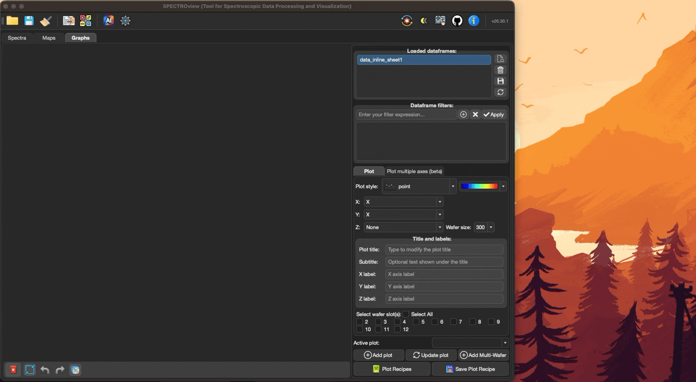

## **KI-Chat-Agent** { #ai-chat-agent }

Der **SPECTROview KI-Assistent** (SPECTROview AI Agent) ist ein integrierter Assistent, mit dem Sie Ihre Daten mithilfe natürlicher Sprache abfragen, filtern, visualisieren und anpassen können — ganz ohne Programmierung.

> Der KI-Chat-Agent ist **optional**. SPECTROview ist auch ohne ihn uneingeschränkt nutzbar. Sie müssen ihn nur dann einrichten, wenn Sie die KI-gestützten Funktionen verwenden möchten.

<div align="center">
  <br>
  <em>Kommunizieren Sie in natürlicher Sprache mit SPECTROview, um Daten zu filtern sowie Diagramme zu erstellen oder anzupassen.</em>
</div>

---

### **1. KI-Chat-Agenten öffnen** { #1-opening-the-ai-chat-agent }

Sie können das integrierte KI-Chat-Panel auf zwei Arten ein- und ausblenden:

- Klicken Sie rechts in der oberen Menüleiste auf die Schaltfläche **AI Chat Agent** (direkt vor **Nach Updates suchen** (Check for updates)).
- Verwenden Sie das Tastenkürzel **`Ctrl + Shift + A`**.

Das Panel ist direkt am rechten Rand der Hauptoberfläche neben den Arbeitsbereich-Tabs **Spektren** (Spectra), **Karten** (Maps) und **Diagramme** (Graphs) eingebettet. Über den Trennbalken können Sie die Breite frei anpassen oder das Panel über die Schließen-Schaltfläche (`✕`) in der Kopfzeile ausblenden, um wieder die volle Breite für die Arbeitsbereiche zu nutzen.

---

### **2. Unterstützte Anbieter** { #2-supported-providers }

Der KI-Agent unterstützt von Haus aus mehrere LLM-Backends — es müssen keine zusätzlichen Pakete installiert werden:

| Anbieter | Beschreibung | Voraussetzung |
|----------|--------------|---------------|
| **Ollama (lokal)** (Ollama (local)) | Vollständig lokal, ohne Internet und ohne API-Schlüssel | Installiertes und laufendes [Ollama](https://ollama.com) |
| **OpenAI** | GPT-4o, GPT-4o-mini usw. | API-Schlüssel |
| **DeepSeek** | Kosteneffizientes, hochwertiges Reasoning | DeepSeek-API-Schlüssel |
| **Gemini** | Google-Gemini-Modelle | Gemini-API-Schlüssel |
| **Mistral** | Mistral-AI-Modelle | Mistral-API-Schlüssel |
| **Anthropic** | Claude-Modelle | Anthropic-API-Schlüssel |
| **Benutzerdefiniert** (Custom) | Jeder OpenAI-kompatible Endpunkt (z. B. ein interner/institutioneller Server) | Basis-URL + API-Schlüssel |

> **Hinweis:** DeepSeek, Gemini und andere OpenAI-kompatible Anbieter nutzen allesamt das Python-Paket `openai` als generischen Netzwerk-Client. Dabei werden **keine** Daten an OpenAI gesendet — lediglich das Paket wird als universelle API-Schnittstelle wiederverwendet.

---

### **3. Anbieter und Modell konfigurieren** { #3-configuring-a-provider-and-model }

1. Wählen Sie unten im Panel im **Chat Composer** einen **AI Provider** aus dem Dropdown-Menü (`Ollama (local)`, `OpenAI`, `Anthropic`, `Mistral`, `Gemini`, `DeepSeek` oder `Custom`).
2. Konfigurieren Sie für Cloud-Anbieter Ihren **API-Schlüssel** im Dialog **Einstellungen** (Settings) (`Ctrl + Shift + S` → Tab **KI-Einstellungen** (AI Settings)):
    - Die Felder **Benutzerdefinierter API-Schlüssel** (Custom API Key), **Basis-URL** (Base URL) und **Modellname(n)** (Model Name(s)) des Anbieters **Benutzerdefiniert** werden standardmäßig angezeigt.
    - Die Schlüssel weiterer Cloud-Anbieter befinden sich im eingeklappten Abschnitt **▸ Weitere Cloud-Anbieter** (Other cloud providers).
    - Nutzen Sie die Schaltfläche **Verbindung testen** (Test Connection) direkt im Tab **KI-Einstellungen**, um Authentifizierung, Host-Erreichbarkeit und Modellverfügbarkeit mit sofortiger visueller Rückmeldung (`✓ Connection successful` oder detaillierte Fehlermeldungen) zu prüfen.
3. Wählen Sie ein **Modell** (Model) aus dem editierbaren Modell-Dropdown direkt neben dem Anbieter in der Eingabe-Symbolleiste. Falls Ihr Modell nicht aufgeführt ist, können Sie dessen Kennung auch direkt eintippen.
4. Klicken Sie auf die Schaltfläche **⟳ refresh** neben dem Modell-Dropdown, um die Liste verfügbarer Modelle zu aktualisieren.

> **Modellname & Anzeigename:** Einige Endpunkte (insbesondere benutzerdefinierte Server) stellen keine API zum Auflisten der Modelle bereit. Geben Sie die verwendeten Modellnamen unter **Einstellungen** → Tab **KI-Einstellungen** → **Modellname(n)** als kommagetrennte Liste ein (z. B. `model-a, model-b`). Über das Feld **Anzeigename** (Display Label) können Sie außerdem eine eigene Bezeichnung festlegen (z. B. `ABC` oder `Lab Model`), sodass Ihr Endpunkt im Anbieter-Dropdown des Composers unter diesem Namen statt des allgemeinen Eintrags `Custom` erscheint. Einstellungsänderungen werden sofort auf jedes geöffnete Chat-Panel angewendet.

---

### **4. Automatische Optimierung für kleine Modelle** { #4-automatic-small-model-optimization }

Kleine lokale Modelle (etwa unter ~10 Milliarden Parametern — wie `qwen2.5:7b`, `gemma2:2b`, `phi3:mini`) reagieren deutlich empfindlicher auf lange System-Prompts. SPECTROview prüft automatisch die Parametergröße lokaler Ollama-Modelle und aktiviert bei Bedarf eine kompakte Prompt-Stufe, ein gezielt begrenztes Gesprächsfenster sowie angepasste Generierungsparameter.

---

### **5. Moderner Chat Composer & Übersicht der Oberfläche** { #5-modern-chat-composer-interface-overview }

Die Chat-Oberfläche bietet ein intuitives, einheitliches Layout:

- **Obere Kopfleiste**: Eine übersichtliche, einzeilige Kopfleiste mit dem editierbaren **Unterhaltungstitel** links (nimmt die verfügbare Breite ein) und Schnellaktions-Schaltflächen rechts: **Chatverlauf** (Chat History), **Neuer Chat** (New Chat), **Chat leeren** (Clear Chat) und **Close Panel (`✕`)**.
- **Nachrichtenverlauf**: Zeigt farblich codierte Nachrichtenkarten an (Benutzer, KI-Antworten mit formatiertem Markdown, Tabellen und Gleichungen sowie Fehlermeldungen).
- **Eingebettetes Eingabefeld**: Ein abgerundetes Eingabemodul am unteren Rand mit:
    - Einem automatisch mitwachsenden mehrzeiligen Textfeld (`Enter` zum Senden, `Shift + Enter` für Zeilenumbrüche).
    - Einer integrierten unteren Symbolleiste mit dem Auswahlfeld **AI Provider**, dem Auswahlfeld **Modell**, der Schaltfläche **Refresh**, dem **Mikrofon für Sprachdiktat (`🎤`)** sowie der Schaltfläche **Senden** (Send) ▶ / **Stopp** (Stop) ■.

#### **Dialog „Unterhaltungsverlauf“ (Conversation History)** { #conversation-history-dialog }

Ein Klick auf die Symbol-Schaltfläche **Chatverlauf** öffnet einen von PLUME inspirierten Verwaltungsdialog:

- **Suchfilter**: Echtzeit-Textsuche über alle Unterhaltungstitel hinweg.
- **Gliederung nach Abschnitten**: Angeheftete Unterhaltungen erscheinen ganz oben im Abschnitt **Angeheftet** (PINNED); alle übrigen werden chronologisch gruppiert (**Heute** (TODAY), **Gestern** (YESTERDAY), **Diese Woche** (THIS WEEK), **Älter** (OLDER)).
- **Exakte Zeitstempel & Nachrichtenanzahl**: Jede Unterhaltungskarte zeigt den genauen Zeitstempel (`YYYY-MM-DD HH:MM:SS`) sowie die Anzahl der Nachrichten.
- **Aktionen**: Unterhaltungen über die jeweiligen Aktionsschaltflächen in der Zeile oder das Rechtsklick-Kontextmenü anheften/lösen, umbenennen, duplizieren und löschen.
- **Sicheres „Alle löschen“**: Die Schaltfläche **Alle löschen** (Delete All) entfernt alle nicht angehefteten Unterhaltungen, während angeheftete Einträge sicher erhalten bleiben.

Das Chat-Panel zeigt Nachrichten in chronologischer Reihenfolge als eindeutig farbcodierte Sprechblasen an:

- 🔵 **Blaue Sprechblase** — Ihre Nachrichten (Benutzer)
- 🟢 **Grüne Sprechblase** — Antworten des KI-Agenten
- 🔴 **Rote Sprechblase** — Fehlermeldungen

Jede Sprechblase zeigt den **Zeitstempel** (`YY-MM-DD HH:MM`) sowie Aktionsschaltflächen:

- **📋 Kopieren** (Copy) — Kopiert den Nachrichtentext in die Zwischenablage
- **↩ Antworten** (Reply) (nur bei KI-Nachrichten) — Antwortet gezielt auf diese KI-Nachricht

#### 🎤 Sprachdiktat (optional) { #voice-dictation-optional }

Über die Mikrofon-Schaltfläche in der Eingabeleiste können Sie Ihre Anfragen einsprechen, statt sie einzutippen. Diese Funktion erfordert optionale Abhängigkeiten:

```bash
pip install SpeechRecognition pyaudio
```

Sind diese Pakete nicht installiert, wird die Mikrofon-Schaltfläche dennoch angezeigt, gibt beim Anklicken jedoch eine Fehlermeldung mit dem Hinweis zur Installation aus.

---

### **6. Funktionsumfang des KI-Agenten** { #6-what-the-ai-agent-can-do }

Der KI-Agent kennt alle geladenen DataFrames sowie alle geöffneten Diagramme. Er kann:

- **Daten filtern**: Zeilen anzeigen, die beliebige Bedingungen erfüllen
- **Statistiken berechnen**: Mittelwert, Standardabweichung, Minimum, Maximum, Perzentile
- **Plots erstellen**: Jeden der 9 unterstützten Plot-Typen erzeugen
- **Diagramme anpassen**: Achsenbereiche, Titel, Farben und Filter aktualisieren
- **Diagramme löschen**: Einzelne oder alle geöffneten Diagramme entfernen
- **Fragen beantworten**: Spalteninhalte erläutern und Analyseschritte vorschlagen

Der Agent kennt jederzeit die Namen Ihrer DataFrames sowie alle Spaltennamen und Datentypen. Weitere Details — etwa Beispielwerte einer Spalte oder die genauen aktuellen Einstellungen eines Diagramms — ruft er nur dann ab, wenn eine Anfrage dies erfordert, sodass alltägliche Anfragen schnell bleiben.

---

### **7. Beispiel-Prompts** { #7-prompt-examples }

#### 🚀 Komplexe / kombinierte Prompts { #complex-combined-prompts }

Die wahre Stärke des Agenten liegt in der Bearbeitung umfangreicher, mehrstufiger Aufgaben in einer **einzigen Nachricht** — Daten auswerten, mehrere Diagramme erstellen und deren Darstellung in einem Schritt verfeinern.

**Analysieren, dann plotten:**

```
Compute the mean and std of center_Si per Zone, then create a bar plot of the
per-Zone mean with error bars from the std, sorted from highest to lowest.
```
```
Find the wafer with the highest average FWHM_Si, filter to just that wafer, and
plot a wafer map of its FWHM_Si.
```

**Mehrere Diagramme in einem Prompt:**

```
Create three graphs: a scatter of Slot vs center_Si colored by Zone, a box plot
of center_Si grouped by Zone, and a histogram of center_Si with 40 bins.
```
```
For each of FWHM_Si, center_Si and intensity_Si, plot a point plot vs Slot
colored by wafer.
```

**Plotten und anpassen in derselben Anfrage:**

```
Make a scatter plot of Slot vs center_Si colored by Zone, set the title to
"Si peak position", label the Y-axis "Raman shift (cm⁻¹)", set the Y range to
[520, 522], use the viridis palette, and turn on the grid.
```
```
Plot FWHM_Si vs temperature as a trendline, filter to Zone == "center", move the
legend to the upper right, and use a log scale on the X-axis.
```

**Alles zusammen:**

```
Filter the data to R_squared > 0.95, then create a scatter plot and a box plot
of center_Si vs Zone side by side, colored by wafer, both with the title
"High-quality fits only" and the grid enabled.
```

---

#### 🧩 Einfache Prompts (einzelne Aktion) { #simple-single-action-prompts }

Gute Ausgangspunkte für einzelne Aufgaben — filtern, zusammenfassen, plotten, anpassen oder nachfragen. Kombinieren Sie diese Bausteine beliebig zu den komplexen Prompts oben.

```
Show rows where FWHM_Si > 5 and R_squared > 0.95
```
```
Give me statistics for center_Si and FWHM_Si by Zone
```
```
Create a scatter plot of Slot vs center_Si colored by Zone
```
```
Plot a wafer map of fwhm_Si for Slot 11
```
*(Hinweis: Für `wafer`- und `2Dmap`-Plots muss Ihr Datensatz räumliche X- und Y-Koordinatenspalten enthalten.)*
```
Set the Y-axis range of graph 3 to [3.5, 4.2] and use the viridis palette
```
```
Delete graph 3
```
```
What columns are available in my data?
```

---

### **8. Unterhaltungsverlauf** { #8-conversation-history }

Der KI-Agent **merkt sich den Gesprächsverlauf** über mehrere Nachrichten hinweg:

```
User: Show rows where FWHM > 5
AI:   Found 42 rows...

User: Now create a scatter plot of Slot vs center_Si for those rows
AI:   (creates scatter plot with FWHM > 5 filter applied)
```

- Der Chatverlauf bleibt **erhalten**, wenn Sie neue Dateien laden oder den Datensatz wechseln — er wird erst zurückgesetzt, wenn Sie auf **➕ Neuer Chat** klicken.
- Frühere Unterhaltungen werden automatisch gespeichert und lassen sich über das **History**-Panel (Schaltfläche 📋) wieder öffnen.
- Verwenden Sie **↩ Antworten** bei jeder beliebigen KI-Nachricht, um gezielt auf genau diese Nachricht zu reagieren.

---

### **9. Tipps & Best Practices** { #9-tips-best-practices }

- **Spaltennamen genau angeben** — die KI kennt zwar Ihre Spaltennamen, doch die exakte Schreibweise vermeidet Verwechslungen.
- **Diagramm-IDs angeben** — prüfen Sie beim Ändern oder Löschen von Diagrammen die in der Titelleiste angezeigte Diagramm-ID.
- **Einfach beginnen** — fragen Sie zunächst nach einem Basisdiagramm und verfeinern Sie es in weiteren Nachrichten.
- **Mehrere Plots auf einmal** — fordern Sie mehrere Typen in einem einzigen Prompt an: *„Create a box and scatter plot of X vs Y“*.
- **Statusleiste prüfen** — ein roter Punkt 🔴 signalisiert, dass die Verbindung nicht funktioniert. Überprüfen Sie Ihren API-Schlüssel in den Einstellungen oder stellen Sie sicher, dass Ollama läuft.
- **Ein lokales Modell hat Schwierigkeiten?** — lesen Sie [Abschnitt 4](#4-automatic-small-model-optimization), beschränken Sie Anfragen auf ein bis zwei Diagramme pro Nachricht und bevorzugen Sie Modelle, die ausdrücklich Tool-/Function-Calling unterstützen.

---

### **10. Fehlerbehebung bei „Connection error.“** { #10-troubleshooting-a-connection-error }

Wenn ein Cloud- oder benutzerdefinierter Anbieter mit **„Connection error.“** antwortet, konnte die Anwendung überhaupt keine Netzwerkverbindung herstellen (dies bedeutet *nicht*, dass der Modellname falsch oder der Schlüssel abgelaufen ist — solche Fälle liefern andere Meldungen). Häufige Ursachen:

- **Falsche Basis-URL** — prüfen Sie bei einem Anbieter vom Typ **Benutzerdefiniert** die **Basis-URL** in den Einstellungen. Dort muss das OpenAI-kompatible Stammverzeichnis des Endpunkts stehen (z. B. `https://host/v1` oder `https://host/openai/`), und **nicht** der vollständige Pfad `.../chat/completions`.
- **Interner / Firmen-Endpunkt mit privatem Zertifikat** — ein interner Endpunkt (z. B. `https://…intra.company…/`) ist häufig durch eine unternehmenseigene Zertifizierungsstelle abgesichert, der Python standardmäßig nicht vertraut, was einen verdeckten Fehler *certificate verify failed* verursacht. SPECTROview löst dies automatisch, indem es dem **Zertifikatsspeicher Ihres Betriebssystems** vertraut (über das standardmäßig installierte Paket `truststore`). Sollte es dennoch fehlschlagen, verweisen Sie vor dem Start über die Umgebungsvariable **`SSL_CERT_FILE`** auf das Zertifikatsbündel Ihrer Organisation im `.pem`-Format (z. B. `chain_bundle.pem`).
- **Außerhalb des Netzwerks / ohne VPN** — ein interner Endpunkt ist nur aus dem Unternehmensnetzwerk oder über ein VPN erreichbar.

Die Fehlerkarte zeigt nun unterhalb der Zusammenfassung die zugrunde liegende Ursache (z. B. `CERTIFICATE_VERIFY_FAILED`, `getaddrinfo failed`) an, sodass Sie direkt erkennen können, welcher der obigen Punkte zutrifft.

---

### **11. Tastenkürzel** { #11-keyboard-shortcuts }

| Tastenkürzel | Aktion |
|--------------|--------|
| `Ctrl + Shift + A` | KI-Chat-Agenten öffnen |
| `Enter` | Nachricht senden |
| `Shift + Enter` | Neue Zeile im Eingabefeld einfügen |
