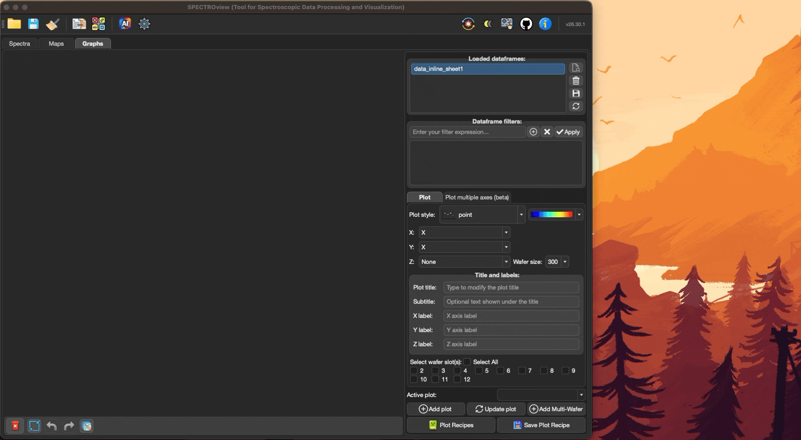

## **Agent conversationnel IA**

L'**agent IA de SPECTROview** est un assistant intégré qui vous permet d'interroger, filtrer, visualiser et modifier vos données en langage naturel — sans écrire une ligne de code.

> L'agent conversationnel IA est **facultatif**. SPECTROview fonctionne intégralement sans lui ; vous n'avez besoin de le configurer que si vous souhaitez utiliser les fonctionnalités d'assistance IA.

<div align="center">
  <br>
  <em>Dialoguez avec SPECTROview en langage naturel pour filtrer vos données et créer ou personnaliser des graphiques.</em>
</div>

---

### **1. Ouvrir l'agent conversationnel IA**

Vous pouvez afficher ou masquer le panneau de discussion IA intégré de deux manières :

- Cliquez sur le bouton **AI Chat Agent** sur le côté droit de la barre de menus supérieure (juste avant **Check for updates**).
- Utilisez le raccourci clavier **`Ctrl + Shift + A`**.

Le panneau est intégré directement tout à droite de l'interface principale, à côté des onglets d'espaces de travail (`Spectra`, `Maps`, `Graphs`). Vous pouvez faire glisser le séparateur pour ajuster librement sa largeur, ou cliquer sur le bouton de fermeture (`✕`) dans l'en-tête du panneau pour le masquer et redonner toute la largeur aux espaces de travail.

---

### **2. Fournisseurs pris en charge**

L'agent IA prend en charge nativement plusieurs moteurs LLM — aucun paquet supplémentaire à installer :

| Fournisseur | Description | Prérequis |
|-------------|-------------|-----------|
| **Ollama (local)** | Totalement local, sans Internet ni clé API | [Ollama](https://ollama.com) installé et démarré |
| **OpenAI** | GPT-4o, GPT-4o-mini, etc. | Clé API |
| **DeepSeek** | Raisonnement performant à coût réduit | Clé API DeepSeek |
| **Gemini** | Modèles Google Gemini | Clé API Gemini |
| **Mistral** | Modèles Mistral AI | Clé API Mistral |
| **Anthropic** | Modèles Claude | Clé API Anthropic |
| **Custom** | Tout point d'accès compatible OpenAI (par exemple un serveur interne/institutionnel) | Base URL + clé API |

> **Remarque :** DeepSeek, Gemini et les autres fournisseurs compatibles OpenAI s'appuient tous sur le paquet Python `openai` en tant que client réseau générique. Vous n'envoyez **pas** vos données à OpenAI — seul le client logiciel est réutilisé comme interface API universelle.

---

### **3. Configurer un fournisseur et un modèle**

1. Dans l'**éditeur de message** en bas du panneau, sélectionnez un **AI Provider** dans la liste déroulante (`Ollama (local)`, `OpenAI`, `Anthropic`, `Mistral`, `Gemini`, `DeepSeek` ou `Custom`).
2. Pour les fournisseurs cloud, configurez votre **clé API** dans la fenêtre **Settings** (`Ctrl + Shift + S` → onglet **AI Settings**) :
   - Les champs **Custom API Key**, **Base URL** et **Model Name(s)** du fournisseur **Custom** sont affichés par défaut.
   - Les clés des autres fournisseurs cloud sont regroupées sous la section repliée **▸ Other cloud providers**.
   - Utilisez le bouton **Test Connection** directement dans l'onglet **AI Settings** pour vérifier l'authentification, la connectivité réseau et la disponibilité du modèle avec un retour visuel immédiat (`✓ Connection successful` ou message d'erreur détaillé).
3. Choisissez un **Model** dans la liste déroulante éditable juste à côté du fournisseur dans la barre de saisie. Si votre modèle n'apparaît pas, vous pouvez saisir son identifiant directement.
4. Cliquez sur le bouton **⟳ refresh** à côté du sélecteur de modèle pour actualiser la liste des modèles disponibles.

> **Nom du modèle et libellé :** Certains points d'accès (en particulier les serveurs personnalisés) ne proposent pas d'API de listage des modèles. Saisissez les noms des modèles utilisés dans **Settings** → onglet **AI Settings** → **Model Name(s)** sous forme de liste séparée par des virgules (par exemple `model-a, model-b`). Vous pouvez aussi définir un **Display Label** personnalisé (par exemple `ABC` ou `Lab Model`) afin que votre serveur apparaisse sous ce nom dans la liste déroulante du panneau de chat au lieu du libellé générique `Custom`. Les changements de paramètres s'appliquent immédiatement à tout panneau de chat ouvert.

---

### **4. Optimisation automatique pour les petits modèles**

Les petits modèles locaux (environ moins de 10 milliards de paramètres — tels que `qwen2.5:7b`, `gemma2:2b`, `phi3:mini`) sont nettement plus sensibles aux prompts système très longs. SPECTROview inspecte automatiquement le nombre de paramètres des modèles locaux Ollama et active un profil de prompt compact, une fenêtre de conversation ciblée ainsi que des paramètres de génération adaptés.

---

### **5. Interface moderne de discussion et éditeur de messages**

L'interface de discussion offre une présentation claire et unifiée :

- **Barre d'en-tête supérieure** : Une barre compacte sur une seule ligne contenant le **titre éditable de la conversation** à gauche (occupant l'espace disponible) et les boutons d'action rapide à droite : **Chat History**, **New Chat**, **Clear Chat** et **Close Panel (`✕`)**.
- **Fil de discussion** : Affiche des cartes de messages colorées (utilisateur, réponses IA avec mise en forme Markdown/tableaux/équations et alertes d'erreur).
- **Carte de saisie intégrée** : Un bloc arrondi en bas du panneau regroupant :
  - Une zone de saisie multi-lignes à hauteur adaptative (appuyez sur `Enter` pour envoyer, `Shift + Enter` pour un saut de ligne).
  - Une barre d'outils inférieure intégrée accueillant le **sélecteur AI Provider**, le **sélecteur Model**, le **bouton Refresh**, le **micro de dictée vocale (`🎤`)** et le **bouton Send ▶ / Stop ■**.

#### **Fenêtre d'historique des conversations**

Cliquer sur le bouton **Chat History** ouvre une fenêtre de gestion inspirée de PLUME :

- **Filtre de recherche** : Recherche textuelle en temps réel parmi les titres de conversations.
- **Organisation par sections** : Les conversations épinglées figurent tout en haut sous une section **PINNED** ; les autres sont regroupées chronologiquement (**TODAY**, **YESTERDAY**, **THIS WEEK**, **OLDER**).
- **Horodatages exacts et nombre de messages** : Chaque carte affiche l'horodatage précis (`YYYY-MM-DD HH:MM:SS`) et le nombre de messages.
- **Actions** : Épingler/désépingler, renommer, dupliquer et supprimer des conversations via les boutons dédiés sur chaque ligne ou le menu contextuel par clic droit.
- **Suppression groupée sécurisée** : Le bouton **Delete All** nettoie les conversations non épinglées tout en préservant les conversations épinglées.

Le panneau de chat affiche les messages dans l'ordre chronologique avec des bulles clairement différenciées par couleur :

- 🔵 **Bulle bleue** — Vos messages (utilisateur)
- 🟢 **Bulle verte** — Réponses de l'agent IA
- 🔴 **Bulle rouge** — Messages d'erreur

Chaque bulle affiche l'**horodatage** (`YY-MM-DD HH:MM`) et des boutons d'action :

- **📋 Copy** — Copie le texte du message dans le presse-papiers
- **↩ Reply** (messages IA uniquement) — Répond spécifiquement à ce message de l'IA

#### 🎤 Dictée vocale (optionnelle)

Vous pouvez utiliser le bouton microphone de la barre de saisie pour dicter vos requêtes au lieu de les saisir au clavier. Cette fonctionnalité nécessite des dépendances optionnelles :
```bash
pip install SpeechRecognition pyaudio
```
Si ces paquets ne sont pas installés, le bouton microphone reste visible mais affiche un message vous invitant à les installer lorsque vous cliquez dessus.

---

### **6. Ce que l'agent IA sait faire**

L'agent IA a une connaissance complète de vos DataFrames chargés et des graphiques ouverts. Il peut :

- **Filtrer les données** : Afficher les lignes vérifiant n'importe quelle condition
- **Calculer des statistiques** : Moyenne, écart-type, min, max, percentiles
- **Créer des graphiques** : Générer l'un quelconque des 9 styles de tracé pris en charge
- **Modifier des graphiques** : Mettre à jour les plages d'axes, titres, couleurs ou filtres
- **Supprimer des graphiques** : Retirer un graphique précis ou tous les graphiques ouverts
- **Répondre aux questions** : Expliquer le contenu des colonnes et suggérer des étapes d'analyse

L'agent connaît en permanence les noms de vos DataFrames ainsi que le nom et le type de chaque colonne. Il ne consulte le reste — exemples de valeurs d'une colonne ou configuration exacte d'un graphique — que lorsque la question l'exige, afin que les requêtes courantes restent rapides.

---

### **7. Exemples de requêtes**

#### 🚀 Requêtes complexes / combinées

La véritable force de l'agent réside dans sa capacité à traiter des demandes complètes en plusieurs étapes dans un **seul message** — analyser les données, créer plusieurs graphiques et peaufiner leur présentation d'un seul coup.

**Analyser, puis tracer :**
```
Compute the mean and std of center_Si per Zone, then create a bar plot of the
per-Zone mean with error bars from the std, sorted from highest to lowest.
```
```
Find the wafer with the highest average FWHM_Si, filter to just that wafer, and
plot a wafer map of its FWHM_Si.
```

**Plusieurs graphiques en une seule demande :**
```
Create three graphs: a scatter of Slot vs center_Si colored by Zone, a box plot
of center_Si grouped by Zone, and a histogram of center_Si with 40 bins.
```
```
For each of FWHM_Si, center_Si and intensity_Si, plot a point plot vs Slot
colored by wafer.
```

**Tracer et personnaliser dans la même requête :**
```
Make a scatter plot of Slot vs center_Si colored by Zone, set the title to
"Si peak position", label the Y-axis "Raman shift (cm⁻¹)", set the Y range to
[520, 522], use the viridis palette, and turn on the grid.
```
```
Plot FWHM_Si vs temperature as a trendline, filter to Zone == "center", move the
legend to the upper right, and use a log scale on the X-axis.
```

**Tout en même temps :**
```
Filter the data to R_squared > 0.95, then create a scatter plot and a box plot
of center_Si vs Zone side by side, colored by wafer, both with the title
"High-quality fits only" and the grid enabled.
```

---

#### 🧩 Requêtes simples / à action unique

De bons points de départ accomplissant chacun une tâche ciblée — filtrer, résumer, tracer, ajuster ou interroger. Combinez-les librement dans les requêtes complexes ci-dessus.

```
Show rows where FWHM_Si > 5 and R_squared > 0.95
```
```
Give me statistics for center_Si and FWHM_Si by Zone
```
```
Create a scatter plot of Slot vs center_Si colored by Zone
```
```
Plot a wafer map of fwhm_Si for Slot 11
```
*(Remarque : Les tracés `wafer` et `2Dmap` exigent que votre jeu de données comporte des colonnes de coordonnées spatiales X et Y).*
```
Set the Y-axis range of graph 3 to [3.5, 4.2] and use the viridis palette
```
```
Delete graph 3
```
```
What columns are available in my data?
```

---

### **8. Historique des conversations**

L'agent IA **mémorise la conversation** sur plusieurs échanges successifs :

```
User: Show rows where FWHM > 5
AI:   Found 42 rows...

User: Now create a scatter plot of Slot vs center_Si for those rows
AI:   (creates scatter plot with FWHM > 5 filter applied)
```

- L'historique de discussion est **conservé** lorsque vous chargez de nouveaux fichiers ou changez de jeu de données — il n'est réinitialisé que lorsque vous cliquez sur **➕ New Chat**.
- Les conversations passées sont enregistrées automatiquement et peuvent être rouvertes depuis le panneau **History** (bouton 📋).
- Utilisez **↩ Reply** sur n'importe quel message de l'IA pour répondre spécifiquement à cet échange.

---

### **9. Conseils et bonnes pratiques**

- **Soyez précis sur les noms de colonnes** — l'IA connaît les noms de vos colonnes, mais employer le nom exact évite toute ambiguïté.
- **Indiquez les identifiants de graphiques** — pour modifier ou supprimer un graphique, vérifiez son numéro ID dans sa barre de titre.
- **Procédez par étapes simples** — demandez d'abord un tracé de base, puis affinez-le dans les messages suivants.
- **Plusieurs graphiques à la fois** — demandez plusieurs styles en une seule phrase : *« Create a box and scatter plot of X vs Y »*.
- **Surveillez la barre d'état** — un voyant rouge 🔴 signale l'absence de connexion. Vérifiez votre clé API dans Settings ou assurez-vous qu'Ollama est démarré.
- **Un modèle local peine à suivre ?** — consultez la [section 4](#4-optimisation-automatique-pour-les-petits-modeles), limitez vos requêtes à un ou deux graphiques par message et privilégiez les modèles explicitement annoncés comme compatibles avec l'appel d'outils (*tool/function calling*).

---

### **10. Dépanner une erreur « Connection error. »**

Si un fournisseur cloud ou personnalisé répond par **« Connection error. »**, l'application n'a pas pu établir la connexion réseau du tout (il ne s'agit *ni* d'un mauvais nom de modèle *ni* d'une clé expirée — ces cas produisent des messages distincts). Causes courantes :

- **Mauvaise Base URL** — pour un fournisseur **Custom**, vérifiez la **Base URL** dans Settings. Il doit s'agir de la racine compatible OpenAI du serveur (par exemple `https://host/v1` ou `https://host/openai/`), et **non** du chemin complet `.../chat/completions`.
- **Serveur interne / d'entreprise avec certificat privé** — un point d'accès sur intranet (par exemple `https://…intra.company…/`) est souvent protégé par une autorité de certification d'entreprise que Python ne reconnaît pas par défaut, ce qui déclenche une erreur sous-jacente *certificate verify failed*. SPECTROview gère cela automatiquement en faisant confiance au **magasin de certificats de votre système d'exploitation** (via le paquet `truststore`, installé par défaut). Si le problème persiste, indiquez votre certificat d'organisation en définissant la variable d'environnement **`SSL_CERT_FILE`** vers votre fichier `.pem` (par exemple `chain_bundle.pem`) avant de lancer l'application.
- **Hors réseau / VPN** — un point d'accès interne n'est joignable que depuis le réseau de l'entreprise ou via VPN.

La carte d'erreur affiche désormais la cause racine (par exemple `CERTIFICATE_VERIFY_FAILED`, `getaddrinfo failed`) sous le résumé, ce qui permet d'identifier immédiatement lequel des cas ci-dessus s'applique.

---

### **11. Raccourcis clavier**

| Raccourci | Action |
|----------|--------|
| `Ctrl + Shift + A` | Ouvrir l'agent conversationnel IA |
| `Enter` | Envoyer le message |
| `Shift + Enter` | Insérer un saut de ligne dans la zone de saisie |
