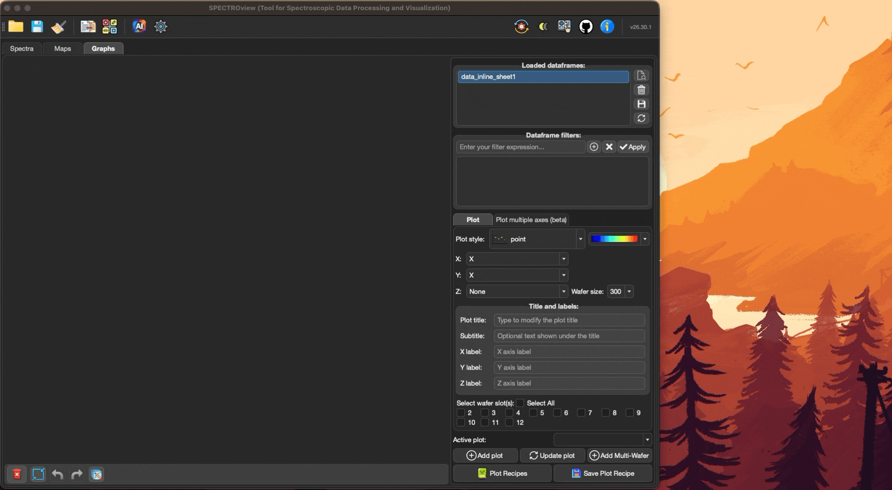

## **ИИ-чат-агент** { #ai-chat-agent }

**ИИ-ассистент SPECTROview** (SPECTROview AI Agent) — это встроенный интеллектуальный помощник, который позволяет выполнять запросы, фильтровать, визуализировать и изменять данные на обычном естественном языке без программирования.

> ИИ-чат-агент является **дополнительной функцией**. SPECTROview полноценно работает и без него — настраивать его нужно только в том случае, если вы планируете использовать возможности ИИ.

<div align="center">
  <br>
  <em>Общайтесь со SPECTROview на естественном языке, чтобы фильтровать данные, а также создавать или настраивать графики.</em>
</div>

---

### **1. Открытие ИИ-чат-агента** { #1-opening-the-ai-chat-agent }

Переключать отображение встроенной панели ИИ-чата можно двумя способами:

- Нажмите кнопку **AI Chat Agent** в правой части верхней строки меню (непосредственно перед кнопкой **Проверить обновления** (Check for updates)).
- Используйте сочетание клавиш **`Ctrl + Shift + A`**.

Панель встроена непосредственно в правую часть главного графического интерфейса, рядом с вкладками рабочих областей (**Спектры** (Spectra), **Карты** (Maps), **Графики** (Graphs)). Вы можете свободно изменять её ширину с помощью разделителя или нажать кнопку закрытия (`✕`) в заголовке панели, чтобы скрыть её и вернуть рабочим областям всю ширину окна.

---

### **2. Поддерживаемые провайдеры** { #2-supported-providers }

ИИ-агент «из коробки» поддерживает несколько LLM-бэкендов — устанавливать дополнительные пакеты не требуется:

| Провайдер | Описание | Требования |
|-----------|----------|------------|
| **Ollama (локально)** (Ollama (local)) | Полностью локальная работа, без интернета и API-ключа | Установленный и запущенный [Ollama](https://ollama.com) |
| **OpenAI** | GPT-4o, GPT-4o-mini и др. | API-ключ |
| **DeepSeek** | Экономичные модели с высоким качеством логического вывода | API-ключ DeepSeek |
| **Gemini** | Модели Google Gemini | API-ключ Gemini |
| **Mistral** | Модели Mistral AI | API-ключ Mistral |
| **Anthropic** | Модели Claude | API-ключ Anthropic |
| **Пользовательский** (Custom) | Любой OpenAI-совместимый сервер (например, внутренний или корпоративный) | Базовый URL + API-ключ |

> **Примечание:** DeepSeek, Gemini и другие OpenAI-совместимые провайдеры используют Python-пакет `openai` исключительно как универсальный сетевой клиент. Вы **не** отправляете свои данные в OpenAI — сам пакет лишь переиспользуется как стандартный клиентский инструмент для работы с API.

---

### **3. Настройка провайдера и модели** { #3-configuring-a-provider-and-model }

1. В нижней части панели, в области **Chat Composer**, выберите **AI Provider** из выпадающего списка (`Ollama (local)`, `OpenAI`, `Anthropic`, `Mistral`, `Gemini`, `DeepSeek` или `Custom`).
2. Для облачных провайдеров укажите ваш **API-ключ** в диалоговом окне **Настройки** (Settings) (`Ctrl + Shift + S` → вкладка **Настройки ИИ** (AI Settings)):

    - Поля **Пользовательский API-ключ** (Custom API Key), **Базовый URL** (Base URL) и **Название модели** (Model Name(s)) для провайдера **Пользовательский** отображаются по умолчанию.
    - Ключи других облачных провайдеров сгруппированы в свёрнутом разделе **▸ Другие облачные провайдеры** (Other cloud providers).
    - Нажмите кнопку **Проверить подключение** (Test Connection) прямо во вкладке **Настройки ИИ**, чтобы проверить аутентификацию, доступность сервера и наличие модели с мгновенной визуальной индикацией (`✓ Connection successful` или подробным сообщением об ошибке).

3. Выберите **Модель** (Model) из редактируемого выпадающего списка моделей рядом с выбором провайдера на панели ввода. Если нужной модели нет в списке, вы можете ввести её идентификатор вручную.
4. Нажмите кнопку **⟳ refresh** рядом со списком моделей, чтобы обновить перечень доступных моделей.

> **Название модели и отображаемое имя:** Некоторые серверы (особенно пользовательские) не предоставляют API для получения списка моделей. Укажите названия используемых моделей в окне **Настройки** → вкладка **Настройки ИИ** → **Название модели** через запятую (например, `model-a, model-b`). Вы также можете задать собственное **Отображаемое имя** (Display Label) (например, `ABC` или `Lab Model`), чтобы ваш сервер отображался в выпадающем списке провайдеров под этим именем вместо стандартного `Custom`. Изменения настроек сразу применяются ко всем открытым панелям чата.

---

### **4. Автоматическая оптимизация для небольших моделей** { #4-automatic-small-model-optimization }

Небольшие локальные модели (примерно до ~10 млрд параметров — такие как `qwen2.5:7b`, `gemma2:2b`, `phi3:mini`) заметно чувствительнее к длинным системным промптам. SPECTROview автоматически определяет число параметров локальных моделей Ollama и включает компактный уровень системного промпта, сфокусированное окно контекста диалога и адаптированные параметры генерации.

---

### **5. Современный редактор сообщений и обзор интерфейса** { #5-modern-chat-composer-interface-overview }

Интерфейс чата имеет продуманную и единую компоновку:

- **Верхняя панель заголовка**: компактная однострочная панель с редактируемым **названием диалога** слева (занимает всю доступную ширину) и кнопками быстрых действий справа: **История диалогов** (Chat History), **Новый чат** (New Chat), **Очистить чат** (Clear Chat) и **Close Panel (`✕`)**.
- **Лента диалога**: отображает карточки сообщений с цветовым кодированием (сообщения пользователя, ответы ИИ с форматированием Markdown, таблицами и формулами, а также уведомления об ошибках).
- **Встроенный блок ввода**: скруглённая область в нижней части панели, включающая:

    - Многострочное текстовое поле с автоматическим изменением высоты (`Enter` — отправка сообщения, `Shift + Enter` — перенос строки).
    - Встроенную нижнюю панель инструментов с селектором **AI Provider**, селектором **Модель**, кнопкой **Refresh**, **микрофоном голосового ввода (`🎤`)** и кнопкой **Отправить** (Send) ▶ / **Стоп** (Stop) ■.

#### **Окно истории диалогов** { #conversation-history-dialog }

При нажатии на кнопку **История диалогов** открывается окно управления диалогами в стиле PLUME:

- **Фильтр поиска**: мгновенный текстовый поиск по названиям диалогов в реальном времени.
- **Группировка по разделам**: закреплённые диалоги отображаются вверху в разделе **Закреплённые** (PINNED); остальные группируются хронологически (**Сегодня** (TODAY), **Вчера** (YESTERDAY), **На этой неделе** (THIS WEEK), **Ранее** (OLDER)).
- **Точные метки времени и число сообщений**: каждая карточка диалога показывает точное время (`YYYY-MM-DD HH:MM:SS`) и количество сообщений.
- **Действия**: закрепление/открепление, переименование, дублирование и удаление диалогов с помощью кнопок на строке диалога или через контекстное меню по правому щелчку мыши.
- **Безопасное удаление всех диалогов**: кнопка **Удалить все** (Delete All) очищает незакреплённые диалоги, надёжно сохраняя закреплённые.

Сообщения в панели чата выводятся в хронологическом порядке в виде наглядных блоков с цветовым кодированием:

- 🔵 **Синий блок** — ваши сообщения (пользователь)
- 🟢 **Зелёный блок** — ответы ИИ-агента
- 🔴 **Красный блок** — сообщения об ошибках

Для каждого сообщения отображается **метка времени** (`YY-MM-DD HH:MM`) и кнопки действий:

- **📋 Копировать** (Copy) — скопировать текст сообщения в буфер обмена
- **↩ Ответить** (Reply) (только для сообщений ИИ) — ответить конкретно на это сообщение ИИ

#### 🎤 Голосовой ввод (опционально) { #voice-dictation-optional }

Вы можете использовать кнопку микрофона на панели ввода, чтобы диктовать запросы голосом вместо набора текста. Для этой функции требуются дополнительные зависимости:

```bash
pip install SpeechRecognition pyaudio
```

Если эти пакеты не установлены, кнопка микрофона всё равно будет отображаться, но при нажатии на неё появится сообщение с инструкцией по их установке.

---

### **6. Возможности ИИ-агента** { #6-what-the-ai-agent-can-do }

ИИ-агент имеет полное представление о загруженных вами DataFrame и открытых графиках. Он умеет:

- **Фильтровать данные**: выводить строки, удовлетворяющие любым условиям
- **Вычислять статистику**: среднее, стандартное отклонение, минимум, максимум, процентили
- **Строить графики**: создавать графики в любом из 9 поддерживаемых стилей
- **Изменять графики**: обновлять пределы осей, заголовки, цвета и фильтры
- **Удалять графики**: удалять отдельные или все открытые графики
- **Отвечать на вопросы**: пояснять содержимое столбцов, предлагать дальнейшие шаги анализа

Агент всегда знает названия всех ваших DataFrame, а также имена и типы каждого столбца. Остальные сведения — например, примеры значений в столбце или точные текущие настройки конкретного графика — он запрашивает только тогда, когда это необходимо для ответа, благодаря чему обычные запросы выполняются максимально быстро.

---

### **7. Примеры запросов (промптов)** { #7-prompt-examples }

#### 🚀 Сложные / комбинированные запросы { #complex-combined-prompts }

Главная сила агента заключается в выполнении сложных многошаговых задач за **одно сообщение** — он может проанализировать данные, построить несколько графиков и сразу настроить их оформление.

**Анализ с последующим построением:**

```
Compute the mean and std of center_Si per Zone, then create a bar plot of the
per-Zone mean with error bars from the std, sorted from highest to lowest.
```
```
Find the wafer with the highest average FWHM_Si, filter to just that wafer, and
plot a wafer map of its FWHM_Si.
```

**Несколько графиков в одном запросе:**

```
Create three graphs: a scatter of Slot vs center_Si colored by Zone, a box plot
of center_Si grouped by Zone, and a histogram of center_Si with 40 bins.
```
```
For each of FWHM_Si, center_Si and intensity_Si, plot a point plot vs Slot
colored by wafer.
```

**Построение и настройка оформления в одном запросе:**

```
Make a scatter plot of Slot vs center_Si colored by Zone, set the title to
"Si peak position", label the Y-axis "Raman shift (cm⁻¹)", set the Y range to
[520, 522], use the viridis palette, and turn on the grid.
```
```
Plot FWHM_Si vs temperature as a trendline, filter to Zone == "center", move the
legend to the upper right, and use a log scale on the X-axis.
```

**Всё вместе:**

```
Filter the data to R_squared > 0.95, then create a scatter plot and a box plot
of center_Si vs Zone side by side, colored by wafer, both with the title
"High-quality fits only" and the grid enabled.
```

---

#### 🧩 Простые одношаговые запросы { #simple-single-action-prompts }

Удобные базовые примеры, каждый из которых выполняет одну операцию — фильтрацию, сводку, построение графика, правку параметров или ответ на вопрос. Их можно свободно объединять в сложные запросы, показанные выше.

```
Show rows where FWHM_Si > 5 and R_squared > 0.95
```
```
Give me statistics for center_Si and FWHM_Si by Zone
```
```
Create a scatter plot of Slot vs center_Si colored by Zone
```
```
Plot a wafer map of fwhm_Si for Slot 11
```

*(Примечание: для графиков `wafer` (карта пластины) и `2Dmap` (2D-карта) в вашем наборе данных должны присутствовать столбцы пространственных координат X и Y.)*

```
Set the Y-axis range of graph 3 to [3.5, 4.2] and use the viridis palette
```
```
Delete graph 3
```
```
What columns are available in my data?
```

---

### **8. История диалогов** { #8-conversation-history }

ИИ-агент **помнит контекст беседы** на протяжении нескольких реплик:

```
User: Show rows where FWHM > 5
AI:   Found 42 rows...

User: Now create a scatter plot of Slot vs center_Si for those rows
AI:   (creates scatter plot with FWHM > 5 filter applied)
```

- История чата **сохраняется** при загрузке новых файлов или переключении наборов данных — она сбрасывается только при нажатии кнопки **➕ Новый чат**.
- Предыдущие диалоги автоматически сохраняются, и их можно повторно открыть через панель **History** (кнопка 📋).
- Используйте кнопку **↩ Ответить** под любым сообщением ИИ, чтобы ответить именно на эту реплику.

---

### **9. Советы и рекомендации** { #9-tips-best-practices }

- **Указывайте точные названия столбцов** — ИИ знает имена всех столбцов, но точное написание исключает неоднозначность.
- **Указывайте ID графиков** — при изменении или удалении графика сверьтесь с его номером (ID) в строке заголовка окна.
- **Начинайте с простого** — сначала запросите базовый график, а затем уточняйте оформление в последующих сообщениях.
- **Несколько графиков сразу** — запрашивайте разные типы визуализации в одном сообщении: *«Create a box and scatter plot of X vs Y»*.
- **Следите за строкой состояния** — красный индикатор 🔴 означает отсутствие подключения. Проверьте API-ключ в окне **Настройки** или убедитесь, что Ollama запущен.
- **Локальная модель не справляется?** — см. [раздел 4](#4-automatic-small-model-optimization), ограничивайте запрос одним-двумя графиками за сообщение и отдавайте предпочтение моделям с официально заявленной поддержкой вызова инструментов (*tool/function calling*).

---

### **10. Устранение ошибки «Connection error.»** { #10-troubleshooting-a-connection-error }

Если облачный или пользовательский провайдер возвращает ошибку **«Connection error.»**, приложению вообще не удалось установить сетевое соединение (это *не* ошибка неверного названия модели и *не* истёкший API-ключ — для них выводятся другие сообщения). Основные причины:

- **Неверный базовый URL** — для провайдера **Пользовательский** проверьте поле **Базовый URL** в окне **Настройки**. Там должен быть указан корневой OpenAI-совместимый адрес сервиса (например, `https://host/v1` или `https://host/openai/`), а **не** полный путь `.../chat/completions`.
- **Корпоративный или внутренний сервер с частным сертификатом** — локальный сервер в интрасети (например, `https://…intra.company…/`) часто защищён корпоративным центром сертификации, которому Python по умолчанию не доверяет, из-за чего возникает скрытая ошибка *certificate verify failed*. SPECTROview решает эту проблему автоматически, доверяя **системному хранилищу сертификатов вашей ОС** (через пакет `truststore`, предустановленный по умолчанию). Если ошибка всё же сохраняется, перед запуском программы укажите путь к цепочке сертификатов вашей организации в формате `.pem` (например, `chain_bundle.pem`) через переменную окружения **`SSL_CERT_FILE`**.
- **Отсутствие доступа к сети / VPN** — внутренний сервер может быть доступен только из корпоративной сети или при подключённом VPN.

Теперь карточка ошибки отображает под основным сообщением первопричину сбоя (например, `CERTIFICATE_VERIFY_FAILED`, `getaddrinfo failed`), что позволяет сразу определить, какой из перечисленных случаев имеет место.

---

### **11. Горячие клавиши** { #11-keyboard-shortcuts }

| Сочетание клавиш | Действие |
|------------------|----------|
| `Ctrl + Shift + A` | Открыть ИИ-чат-агент |
| `Enter` | Отправить сообщение |
| `Shift + Enter` | Перенос строки в поле ввода |
