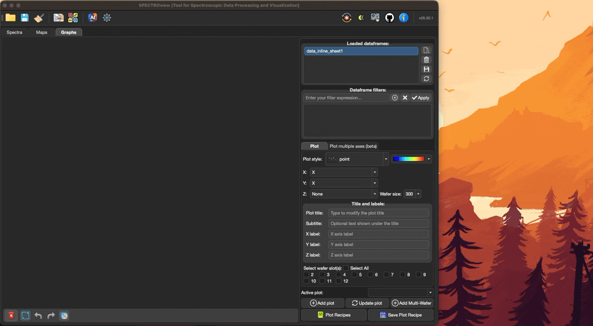

## **AI 对话助手** { #ai-chat-agent }

**SPECTROview AI 助手** (SPECTROview AI Agent) 是一款内置的 AI 助手，让您无需编写代码，即可使用自然语言查询、筛选、可视化和修改数据。

> AI 对话助手为**可选**功能。即使不配置它，SPECTROview 的所有核心功能仍可完整使用；仅当您希望使用 AI 辅助功能时才需要进行配置。

<div align="center">
  <br>
  <em>使用自然语言与 SPECTROview 对话，即可筛选数据并创建或自定义图表。</em>
</div>

---

### **1. 打开 AI 对话助手** { #1-opening-the-ai-chat-agent }

您可以通过以下两种方式打开或关闭嵌入式 AI 对话面板：

- 点击顶部菜单栏右侧的 **AI Chat Agent** 按钮（位于 **检查更新** (Check for updates) 之前）。
- 使用键盘快捷键 **`Ctrl + Shift + A`**。

该面板直接嵌入主界面最右侧，紧邻工作区标签栏（**光谱** (Spectra)、**二维图谱** (Maps)、**图表** (Graphs)）。您可以自由拖动分隔条调整面板宽度，或点击面板标题栏中的关闭按钮（`✕`）将其隐藏，从而为工作区恢复完整显示宽度。

---

### **2. 支持的服务商** { #2-supported-providers }

AI 助手开箱即支持多种大语言模型（LLM）后端，无需额外安装其他软件包：

| 服务商 | 说明 | 所需条件 |
|--------|------|----------|
| **Ollama（本地）** (Ollama (local)) | 完全本地运行，无需联网，无需 API 密钥 | 已安装并运行 [Ollama](https://ollama.com) |
| **OpenAI** | GPT-4o、GPT-4o-mini 等 | API 密钥 |
| **DeepSeek** | 高性价比、高质量推理模型 | DeepSeek API 密钥 |
| **Gemini** | Google Gemini 系列模型 | Gemini API 密钥 |
| **Mistral** | Mistral AI 系列模型 | Mistral API 密钥 |
| **Anthropic** | Claude 系列模型 | Anthropic API 密钥 |
| **自定义** (Custom) | 任何兼容 OpenAI 接口的服务端点（例如内部或机构服务器） | Base URL + API 密钥 |

> **注意：** DeepSeek、Gemini 及其他兼容 OpenAI 的服务商均使用 `openai` Python 包作为通用网络客户端。您并**不会**将数据发送至 OpenAI——该软件包仅作为通用 API 通信工具被复用。

---

### **3. 配置服务商与模型** { #3-configuring-a-provider-and-model }

1. 在面板底部的 **Chat Composer** 中，从 **AI Provider** 下拉菜单中选择服务商（`Ollama (local)`、`OpenAI`、`Anthropic`、`Mistral`、`Gemini`、`DeepSeek` 或 `Custom`）。
2. 对于云端服务商，请在 **设置** (Settings) 对话框（`Ctrl + Shift + S` → **AI 设置** (AI Settings) 标签页）中配置您的 **API 密钥**：
   - 默认会直接显示 **自定义** 服务商的 **Custom API Key**、**Base URL** 和 **Model Name(s)** 字段。
   - 其他云端服务商的密钥均收纳在折叠区域 **▸ Other cloud providers** 下。
   - 您可以直接在 **AI 设置** 标签页中点击 **测试连接** (Test Connection) 按钮来验证身份认证、主机连通性与模型可用性，并获得即时视觉反馈（`✓ Connection successful` 或详细错误信息）。
3. 在输入栏工具条中服务商右侧的可编辑 **模型** (Model) 下拉框中选择一个模型。如果列表中未显示所需模型，可以直接输入其模型标识符。
4. 点击模型下拉框旁的 **⟳ refresh** 按钮，以刷新可用模型列表。

> **模型名称与显示标签：** 某些服务端点（尤其是自定义服务）不提供模型列表查询 API。您可以在 **设置** → **AI 设置** 标签页 → **Model Name(s)** 中以逗号分隔的形式输入所用模型名称（例如 `model-a, model-b`）。您还可以指定自定义的 **Display Label**（例如 `ABC` 或 `Lab Model`），这样在输入区的服务商下拉菜单中就会显示该自定义名称，而非通用的 `Custom`。所有设置更改都会立即生效于当前打开的对话面板。

---

### **4. 自动小模型优化** { #4-automatic-small-model-optimization }

参数量较小的本地模型（通常约 100 亿参数以下，如 `qwen2.5:7b`、`gemma2:2b`、`phi3:mini`）对过长的系统提示词会明显更敏感。SPECTROview 会自动检测本地 Ollama 模型的参数规模，并自动启用精简提示词层级、聚焦的对话上下文窗口以及经过调优的生成参数。

---

### **5. 现代化对话输入器与界面概览** { #5-modern-chat-composer-interface-overview }

对话界面采用直观统一的布局设计：

- **顶部标题栏**：简洁的单行标题栏，左侧为可编辑的**对话标题**（占据可用宽度），右侧为快捷操作图标按钮：**对话历史** (Chat History)、**新建对话** (New Chat)、**清空对话** (Clear Chat) 和 **Close Panel (`✕`)**。
- **对话消息流**：显示按颜色区分的消息卡片（用户消息、支持 Markdown/表格/公式排版的 AI 回复，以及错误提示）。
- **嵌入式输入卡片**：位于底部的圆角输入区，包含：
  - 可自动扩展高度的多行文本输入框（按 `Enter` 发送，按 `Shift + Enter` 换行）。
  - 嵌入式底部工具条，包含 **AI Provider** 选择器、**模型**选择器、**Refresh** 按钮、**语音听写麦克风 (`🎤`)** 以及 **发送 (Send) ▶ / 停止 (Stop) ■** 按钮。

#### **对话历史对话框** { #conversation-history-dialog }

点击 **对话历史** 图标按钮即可打开受 PLUME 启发的对话管理窗口：

- **搜索筛选**：在对话标题中进行实时文本搜索。
- **分组管理**：置顶对话会固定显示在顶部的 **PINNED** 分组下；其余对话按时间顺序分组（**TODAY**、**YESTERDAY**、**THIS WEEK**、**OLDER**）。
- **精确时间戳与消息计数**：每张对话卡片均会显示精确时间戳（`YYYY-MM-DD HH:MM:SS`）及消息数量。
- **快捷操作**：可通过每行专用的操作按钮或右键上下文菜单对对话进行置顶/取消置顶、重命名、创建副本及删除操作。
- **安全全部删除**：点击 **全部删除** (Delete All) 按钮可清理所有未置顶对话，同时安全保留已置顶条目。

对话面板按时间顺序显示消息，并使用颜色鲜明的气泡进行区分：

- 🔵 **蓝色气泡** — 您的消息（用户）
- 🟢 **绿色气泡** — AI 助手回复
- 🔴 **红色气泡** — 错误信息

每个气泡均包含**时间戳**（`YY-MM-DD HH:MM`）及操作按钮：

- **📋 复制** (Copy) — 将消息文本复制到剪贴板
- **↩ 回复** (Reply)（仅限 AI 消息）— 针对该条 AI 消息进行专门回复

#### 🎤 语音听写（可选） { #voice-dictation-optional }

您可以使用输入栏中的麦克风按钮直接语音听写提问，而无需手动输入。该功能需要安装可选依赖项：

```bash
pip install SpeechRecognition pyaudio
```

如果尚未安装这些依赖项，麦克风按钮仍会显示，但点击时会弹出错误提示，指导您完成安装。

---

### **6. AI 助手的功能** { #6-what-the-ai-agent-can-do }

AI 助手能够全面感知您已加载的 DataFrame 和已打开的图表，可执行以下操作：

- **筛选数据**：显示满足任意条件的数据行
- **计算统计量**：均值、标准差、最小值、最大值、百分位数
- **创建图表**：生成任意一种受支持的 9 类图表样式
- **修改图表**：更新坐标轴范围、标题、颜色、筛选条件
- **删除图表**：移除指定图表或全部已打开的图表
- **解答问题**：解释各列数据含义并提供分析步骤建议

助手始终掌握所有 DataFrame 的名称以及每一列的名称和数据类型；仅当具体问题需要时，才会进一步读取列的示例值或某张图表的当前详细配置，从而确保日常请求始终保持快速响应。

---

### **7. 提示词示例** { #7-prompt-examples }

#### 🚀 复杂 / 组合提示词 { #complex-combined-prompts }

AI 助手真正的优势在于能够在**单条消息**中处理复杂的跨步骤请求——一次性完成数据分析、创建多张图表并精细调整图表外观。

**先分析，再绘图：**

```
Compute the mean and std of center_Si per Zone, then create a bar plot of the
per-Zone mean with error bars from the std, sorted from highest to lowest.
```

```
Find the wafer with the highest average FWHM_Si, filter to just that wafer, and
plot a wafer map of its FWHM_Si.
```

**一条指令生成多张图表：**

```
Create three graphs: a scatter of Slot vs center_Si colored by Zone, a box plot
of center_Si grouped by Zone, and a histogram of center_Si with 40 bins.
```

```
For each of FWHM_Si, center_Si and intensity_Si, plot a point plot vs Slot
colored by wafer.
```

**在同一请求中完成绘图与样式自定义：**

```
Make a scatter plot of Slot vs center_Si colored by Zone, set the title to
"Si peak position", label the Y-axis "Raman shift (cm⁻¹)", set the Y range to
[520, 522], use the viridis palette, and turn on the grid.
```

```
Plot FWHM_Si vs temperature as a trendline, filter to Zone == "center", move the
legend to the upper right, and use a log scale on the X-axis.
```

**一站式组合操作：**

```
Filter the data to R_squared > 0.95, then create a scatter plot and a box plot
of center_Si vs Zone side by side, colored by wafer, both with the title
"High-quality fits only" and the grid enabled.
```

---

#### 🧩 简单 / 单一操作提示词 { #simple-single-action-prompts }

这些指令每次只完成一项任务（筛选、汇总、绘图、微调或查询），非常适合作为入门起点，也可以自由组合成上述复杂提示词。

```
Show rows where FWHM_Si > 5 and R_squared > 0.95
```

```
Give me statistics for center_Si and FWHM_Si by Zone
```

```
Create a scatter plot of Slot vs center_Si colored by Zone
```

```
Plot a wafer map of fwhm_Si for Slot 11
```

*(注：**晶圆图** (wafer) 与**二维图谱** (2Dmap) 图表要求您的数据集中包含空间 X、Y 坐标列。)*

```
Set the Y-axis range of graph 3 to [3.5, 4.2] and use the viridis palette
```

```
Delete graph 3
```

```
What columns are available in my data?
```

---

### **8. 对话历史** { #8-conversation-history }

AI 助手会在多轮交互中**持续记住您的上下文对话**：

```
User: Show rows where FWHM > 5
AI:   Found 42 rows...

User: Now create a scatter plot of Slot vs center_Si for those rows
AI:   (creates scatter plot with FWHM > 5 filter applied)
```

- 当您加载新文件或切换数据集时，当前对话历史会被**保留**；仅当点击 **➕ 新建对话** 时才会开启全新会话。
- 历史对话会自动保存，您可随时从 **History** 面板（📋 按钮）中重新打开。
- 点击任意 AI 消息上的 **↩ 回复**，即可针对该轮回答进行专门回复。

---

### **9. 实用技巧与最佳实践** { #9-tips-best-practices }

- **明确指定列名** — AI 助手已知晓所有列名，但在提问中使用精确的列名可有效避免歧义。
- **指明图表 ID** — 修改或删除图表时，请先查看图表标题栏中显示的图表 ID 编号。
- **由简入繁** — 可以先要求生成基础图表，再在后续追问中逐步细化样式。
- **一次生成多种图表** — 可在一条提示词中同时请求多种图表样式：*"Create a box and scatter plot of X vs Y"*。
- **留意状态指示灯** — 若出现 🔴 红色指示灯，表示连接异常。请检查**设置**中的 API 密钥，或确认 Ollama 是否正在运行。
- **本地模型表现不佳？** — 请参阅[第 4 节](#4-automatic-small-model-optimization)，建议每条消息只请求绘制一到两张图表，并优先选用明确标注支持工具/函数调用（tool/function calling）的模型。

---

### **10. 排查“Connection error.”连接错误** { #10-troubleshooting-a-connection-error }

如果云端或自定义服务商返回 **"Connection error."**，则表明应用程序根本未能建立网络连接（这*并非*模型名称错误或密钥过期——此类错误会有不同的提示信息）。常见原因如下：

- **Base URL 填写错误** — 对于**自定义**服务商，请仔细核对**设置**中的 **Base URL**。该地址必须是服务端点兼容 OpenAI 的根路径（例如 `https://host/v1` 或 `https://host/openai/`），而**不是**完整的 `.../chat/completions` 路径。
- **使用私有证书的企业/内网服务端点** — 本地部署的内网端点（例如 `https://…intra.company…/`）通常采用企业私有证书颁发机构签发的证书，而 Python 默认不信任该证书，从而引发底层的 *certificate verify failed* 错误。SPECTROview 已通过默认安装的 `truststore` 软件包自动信任**操作系统的证书存储**来处理此问题。如果仍然失败，请在启动软件前将环境变量 **`SSL_CERT_FILE`** 指向贵机构的 `.pem` 证书链文件（例如 `chain_bundle.pem`）。
- **未接入内网或 VPN** — 内部服务端点通常仅能通过企业内网或 VPN 访问。

错误提示卡片现在会在摘要下方显示底层具体原因（例如 `CERTIFICATE_VERIFY_FAILED`、`getaddrinfo failed`），方便您快速判断属于上述哪种情况。

---

### **11. 键盘快捷键** { #11-keyboard-shortcuts }

| 快捷键 | 操作 |
|--------|------|
| `Ctrl + Shift + A` | 打开 AI 对话助手 |
| `Enter` | 发送消息 |
| `Shift + Enter` | 在输入框中换行 |
