## **Arbeitsbereich: Diagramme** { #workspace-graphs }

Der Arbeitsbereich **Diagramme** (Graphs) ist ausschließlich der Datenvisualisierung gewidmet und wurde mit besonderem Fokus auf Einfachheit, Geschwindigkeit und flexible Anpassungsmöglichkeiten entwickelt.

  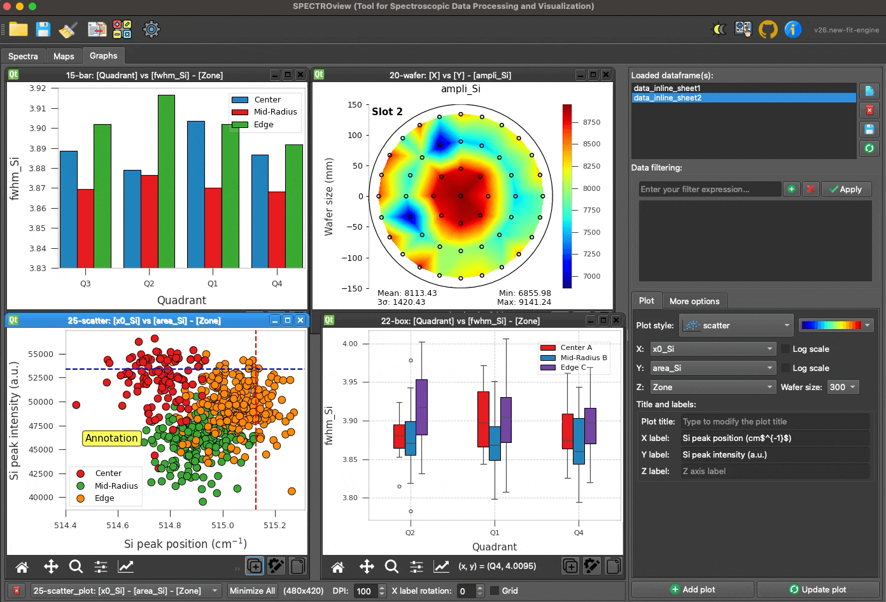 
  <i>Überblick über die Benutzeroberfläche des Arbeitsbereichs Diagramme.</i>

 

_______

### **1. Daten laden** { #1-loading-data }

Datensätze können nahtlos aus den Arbeitsbereichen **Spektren** (Spectra) und **Karten** (Maps) übergeben oder direkt aus externen Excel-/CSV-Dateien importiert werden. Alle verfügbaren Datensätze werden dynamisch erfasst und im Datensatzlisten-Widget angezeigt.

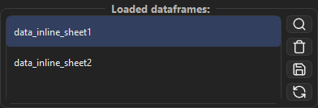 
Die vier verfügbaren Funktionsschaltflächen ermöglichen es Ihnen:

- **View**: Die Datentabelle direkt in der Anwendung einzusehen.
- **Löschen** (Delete): Den Datensatz aus dem Arbeitsbereich zu entfernen.
- **Speichern** (Save): Den Datensatz als Excel- oder CSV-Datei zu exportieren.
- **Refresh**: Die CSV-/Excel-Datei dynamisch neu zu laden, falls sie extern geändert wurde.

________

### **2. Plot hinzufügen oder aktualisieren** { #2-add-or-update-a-plot }

1. Wählen Sie Ihren Zieldatensatz aus der Liste aus.
2. Wählen Sie über die bereitgestellten Dropdown-Menüs die passenden Spalten für die X-, Y- und Z-Achse aus.
3. Wählen Sie den gewünschten Plot-Typ (verfügbare Typen: **Streudiagramm** (scatter), **Punkte** (point), **Balken** (bar), **Boxplot** (box), **Linie** (line), **Trendlinie** (trendline), **Histogramm** (histogram), **2D-Karte** (2Dmap), **Wafer** (wafer)).
4. Definieren Sie Ihre Achsenbeschriftungen, Achsengrenzen sowie gegebenenfalls die Wafer-Durchmesserabmessungen.
5. Klicken Sie auf **Plot hinzufügen** (Add plot), um die Visualisierung zu erzeugen.

  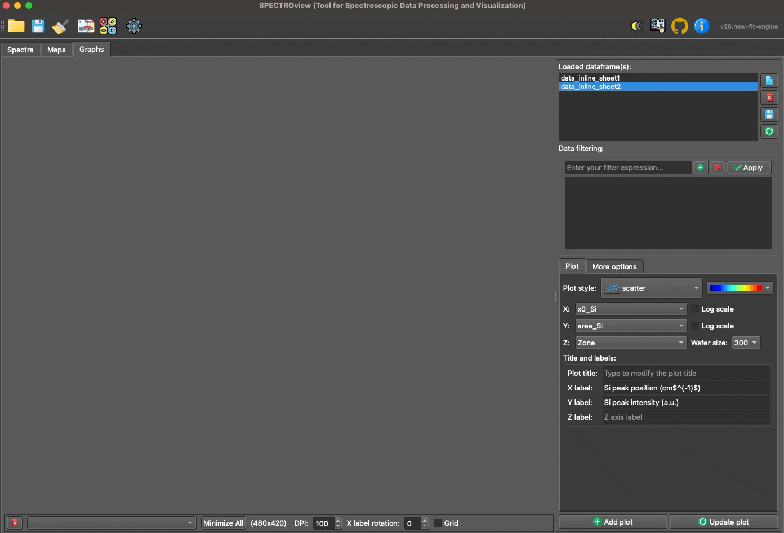 
  <i>Demonstration zum Hinzufügen eines neuen Plots oder zum Aktualisieren eines bestehenden Plots.</i>

______

### **3. Die gemeinsame Diagramm-Symbolleiste** { #3-the-shared-graph-toolbar }

Die untere Leiste des Arbeitsbereichs enthält alle globalen Bedienelemente sowie eine gemeinsame Diagramm-Symbolleiste, die stets auf das aktuell aktive Plot-Fenster wirkt. Um einen Plot zu aktivieren, klicken Sie ihn an oder wählen Sie ihn im Dropdown-Menü **Active plot** im Seitenpanel aus (direkt über **Plot hinzufügen** / **Plot aktualisieren** (Update plot)).

| Bedienelement | Beschreibung |
|---|---|
| **Delete all** | Entfernt alle Plots aus dem Arbeitsbereich. |
| **Minimize all** | Minimiert alle Plot-Fenster. |
| **Undo / Redo** | Geht schrittweise im Bearbeitungsverlauf des Arbeitsbereichs zurück bzw. vor (`Ctrl+Z` / `Ctrl+Shift+Z`). |
| **Compose Figure** | Kombiniert mehrere geöffnete Plots zu einer mehrteiligen Exportabbildung. |
| **Home / Pan / Zoom / Subplots** | Standard-Navigation von Matplotlib: Ansicht zurücksetzen, verschieben, auf ein Rechteck zoomen oder Subplot-Ränder anpassen. |

> **Tipp:** Wenn Sie ein Plot-Fenster durch Ziehen an seinem Rand oder seiner Titelleiste vergrößern, verkleinern oder verschieben, sehen Sie zunächst einen Umriss. Der Plot wird erst beim Loslassen der Maustaste einmalig in seiner neuen Größe neu gezeichnet. So bleibt die Größenänderung auch bei großen Plots flüssig. Ebenso bleiben beim Verschieben (*Pan*) die Ränder um die Achsen fixiert und werden erst beim Loslassen der Maustaste neu berechnet.

Eine vertikale Trennlinie markiert den Beginn der eigenen Bedienelemente des jeweiligen Plots — stets am rechten Fensterrand ausgerichtet:

| Bedienelement | Beschreibung |
|---|---|
| **Replicate** | Erzeugt ein Duplikat des aktiven Plots. |
| **Customize** | Öffnet den **Customize Graph Dialog** für den aktiven Plot (`Ctrl+E`, siehe unten). |
| **Kopieren** (Copy) | Kopiert die Abbildung des aktiven Plots als Bild in die Zwischenablage (`Ctrl+C`). |
| **Export** | Klicken, um den aktiven Plot in eine Datei zu exportieren. **Strg gedrückt halten + Klick**, um stattdessen alle geöffneten Plots auf einmal zu exportieren. |
| **Style menu (🎨)** | Stil speichern/anwenden, Stil kopieren/einfügen (`Ctrl+V` zum Einfügen), auf Standard zurücksetzen oder den aktuellen Stil als Standard für neue Plots festlegen. |

> **Hinweis**: Die oben genannten Tastenkürzel `Ctrl+Z`, `Ctrl+Shift+Z`, `Ctrl+C`, `Ctrl+V` und `Ctrl+E` funktionieren nur, solange der Tab **Diagramme** aktiv ist — sie beeinträchtigen dieselben Tastenkürzel an anderer Stelle in der Anwendung nicht (z. B. bei der Eingabe in ein Textfeld).

______

### **4. Einen Plot anpassen** { #4-customizing-a-plot }

Sie können die **Beschriftungen** der Achsen und den **Titel** des Plots schnell über das `Right Panel` ändern. Klicken Sie auf die Schaltfläche **Plot aktualisieren**, um die Änderungen sofort anzuwenden:

  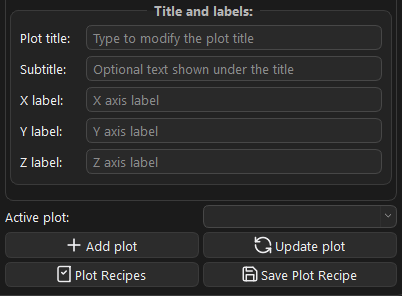 
  <i>Passen Sie den ausgewählten Plot über das Right Panel an. Klicken Sie auf Plot aktualisieren, um Änderungen anzuwenden.</i>

 

Für erweiterte Anpassungen klicken Sie auf die Schaltfläche **Customize** (⚙), um den **Customize Graph Dialog** (`Ctrl + E`) zu öffnen. Der Dialog bietet eine moderne, einstellungsähnliche Zwei-Spalten-Oberfläche mit globaler Echtzeitsuche über alle Optionen hinweg, einer reaktionsschnellen Kategorienavigation auf der linken Seite sowie direkter Optionshervorhebung mit automatischem Scrollen über sieben modulare Kategorien:

- **Allgemein & Typografie** (General & Typography): Abbildungs-Theme (Hell/Dunkel), Gitterlinien, Drehung der X-Achsenbeschriftung, Schriftgrößen (Titel, Achsenbeschriftung, Teilstrichbeschriftung, Farbskala) und intelligente Datensortierung.
- **Achsen & Grenzen** (Axes & Limits): Achsengrenzen mit interaktiven Bereichsschiebereglern (oben), primäre X-/Y-/Z-Skalen (Linear, Logarithmisch, Symlog, Zentriert), numerische/kategorische Datentypen, Achseninvertierung und unterbrochene Achsenbereiche.
- **Ticks & Spines**: Ausrichtung der Teilstriche, Voreinstellungen für die Formatierung der Teilstrichbeschriftungen, Nebenteilstriche (Oben, Unten, Links, Rechts) sowie Sichtbarkeit der Rahmenlinien (Spines).
- **Legend & Series**: Platzierung des Legendenfelds (innen/außen), Rahmen, Spaltenanzahl, Titel, Schriftgröße, Alpha-Transparenz, Position, globales Marker-Styling sowie linksbündige Anpassungstabelle für einzelne Datenserien.
- **Plot-Stil & Fitting** (Plot Style & Fitting): Spezialisierte Plot-Optionen (Punkte verbinden, überlappende Punkte versetzen, Wafer-Statistiken), vereinheitlichte Fehlerbalken-Steuerung (Anzeige, Statistiktyp, Endkappenbreite), polynomiale Trendlinien-Anpassung mit Ankerpunkten und Live-Gleichungstabellen sowie Histogramm-Klassen und KDE-Kurven.
- **Annotations**: Visuelle Plot-Anmerkungen (V-Linie, H-Linie, Text, Pfeil, V-Bereich, H-Bereich, Rechteck, Hinweisbox) mit interaktivem Ziehen auf der Zeichenfläche und modaler Bearbeitung.
- **Neben- & Einsatzachsen** (Secondary & Inset Axes): Sekundäre Doppelachsen (Y2, Y3, X2 mit eigenen Beschriftungen, Grenzen, logarithmischen Skalen, Farben und Markern) sowie gezoomte Einsatzachsen (Inset) mit Verbindungslinien.

Alle Änderungen über die verschiedenen Tabs hinweg werden gemeinsam über die einheitliche Schaltfläche **Anwenden** (Apply) am unteren Rand des Dialogs übernommen oder über **Abbrechen** (Cancel) verworfen.

---

#### 4.1 Achsen & Grenzen, Ticks & Spines und Neben- & Einsatzachsen { #41-axes-limits-ticks-spines-and-secondary-inset-axes }

  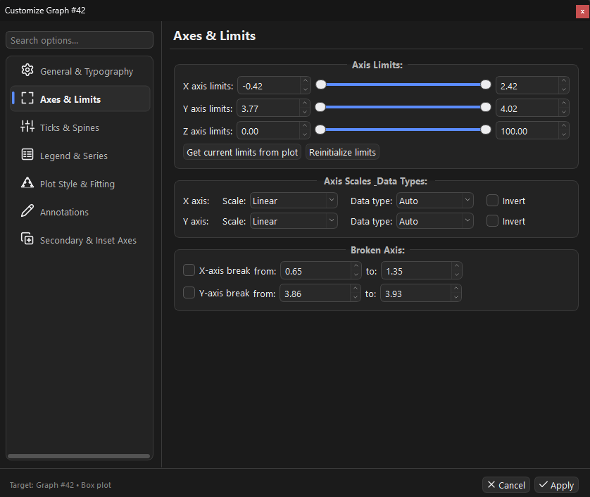 
  <i>Achsenkonfiguration im Customize Graph Dialog.</i>

Die Kategorien **Achsen & Grenzen**, **Ticks & Spines** und **Neben- & Einsatzachsen** steuern Achsenskalierung, Datentypen, Grenzen, Darstellung von Teilstrichen und Rahmenlinien, Achsenbrüche, Einsatzachsen (Zoom) sowie sekundäre Doppelachsen. Die Schriftgrößen für Titel, Beschriftungen und Teilstriche befinden sich in der Kategorie **Allgemein & Typografie**.

##### Achseneigenschaften (`Achsen & Grenzen`) { #axis-properties-axes-limits }

Konfigurieren Sie **Skalierung** und **Datentyp** für jede Achse unabhängig über Dropdown-Menüs:

| Einstellung | Optionen | Beschreibung |
|---|---|---|
| **X / Y axis Scale** | **Linear**, **Logarithmisch** (Logarithmic), **Symlog** | Schaltet die Achse zwischen linearer, logarithmischer und symmetrisch logarithmischer Skala um. Eine logarithmische Skala wird nur angewendet, wenn die zugrunde liegenden Daten numerisch sind. |
| **X / Y axis Data type** | **Auto**, **Kategorie** (Category), **Numerisch** (Numerical) | Steuert, wie Achsenwerte interpretiert werden. **Auto** (Standard): Die Anwendung erkennt automatisch den besten Typ — numerisch, wenn 100 % der Daten numerisch sind, andernfalls kategorisch. **Kategorie**: Erzwingt eine kategorische Indizierung. **Numerisch**: Erzwingt eine kontinuierliche numerische Skala. |
| **Z axis Scale** *(nur **Wafer** / **2D-Karte**)* | **Linear**, **Logarithmisch**, **Zentriert** (Centered) | Legt die Normalisierung der **Farbskala** der Heatmap fest. **Logarithmisch** komprimiert einen großen Wertebereich (fällt auf linear zurück, falls die Daten nicht strikt positiv sind). **Zentriert** fixiert den Mittelpunkt der Farbskala auf dem von Ihnen eingegebenen **Center value** — ideal für divergierende Daten wie mechanische Spannungen/Dehnungen um 0. |

> **Hinweis**: Bei Verwendung des Datentyps **Numerisch** übernimmt die Achse eine echte mathematische Skala, bei der die Abstände den tatsächlichen Datenwerten entsprechen. Bei **Kategorie** erhält jeder eindeutige Wert unabhängig von seiner numerischen Größe denselben Abstand.

##### Achsengrenzen festlegen (`Achsen & Grenzen`) { #set-axis-limits-axes-limits }

Schränken Sie den sichtbaren Bereich jeder Achse (X, Y, Z) manuell ein, indem Sie **Min**- und **Max**-Werte angeben:

| Bedienelement | Beschreibung |
|---|---|
| **X / Y / Z axis limits** | Geben Sie Min- und Max-Werte ein, um den sichtbaren Bereich einzugrenzen. Lassen Sie ein Eingabefeld leer (es zeigt den realen aktuellen Wert des Plots ausgegraut an), um diese Seite automatisch zu belassen. |
| **Aktuelle Grenzen aus Plot übernehmen** (Get current limits from plot) | Übernimmt die aktuell sichtbaren Grenzen aus dem Plot in die Eingabefelder. Praktisch als Ausgangspunkt vor der Feinabstimmung. |
| **Clear limits** | Setzt alle Achsengrenzen auf automatisch (unbeschränkt) zurück. |

  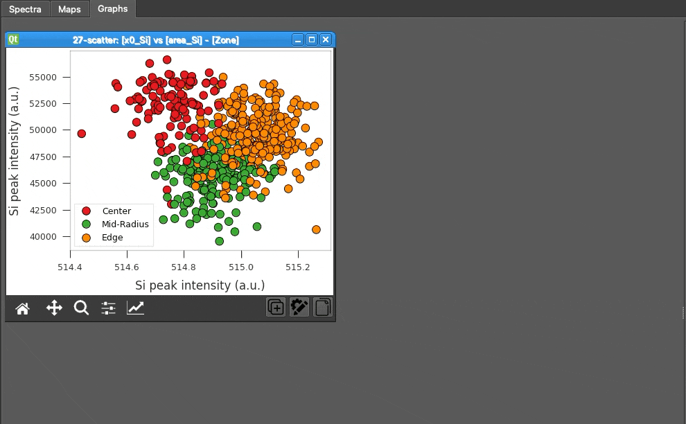 
  <i>Anpassen der Achsengrenzen des ausgewählten Plots.</i>

##### Achsendarstellung (`Ticks & Spines`) { #axis-appearance-ticks-spines }

| Bedienelement | Beschreibung |
|---|---|
| **Minor ticks** (X Unten/Oben, Y Links/Rechts) | Aktiviert Nebenteilstriche unabhängig für jeden Rand des Plots. Standardmäßig sind Nebenteilstriche automatisch nur für Achsen mit numerischen Werten aktiviert (z. B. sowohl X als auch Y bei **Streudiagramm**-, **Linie**- und **Histogramm**-Plots; Y bei **Balken**-, **Boxplot**- und **Punkte**-Plots) und bei kategorialen Achsen oder Karten-Plots ausgeblendet. Sie können Nebenteilstriche für jede Achse unabhängig ein- oder ausschalten. |
| **Show spines** (Oben/Rechts/Unten/Links) | Schaltet die Sichtbarkeit jeder der vier Rahmenlinien des Plots unabhängig um. |
| **Tick direction** | **Standard** (Default), **Innen** (In), **Außen** (Out) oder **Innen & Außen** (In & Out). |
| **Tick label format** | **Auto**, `Integer`, `1-decimal`, `2-decimal` oder `Scientific`. |

##### Unterbrochene Achse (`Achsen & Grenzen` — Beta) { #broken-axis-axes-limits-beta }

Erzeugen Sie eine visuelle Unterbrechung auf einer Achse, um einen uninteressanten Wertebereich auszulassen und relevante Datenbereiche hervorzuheben:

| Bedienelement | Beschreibung |
|---|---|
| **X-Achsenbruch** (X-axis break) | Aktiviert den Achsenbruch und legt den Bereich `from` / `to` fest, der auf der X-Achse ausgelassen werden soll. |
| **Y-Achsenbruch** (Y-axis break) | Aktiviert den Achsenbruch und legt den Bereich `from` / `to` fest, der auf der Y-Achse ausgelassen werden soll. |

> **Hinweis**: Diese Funktion befindet sich im Beta-Status. Achsenbrüche funktionieren am besten mit linearen Skalen.

##### Einsatzachsen (Zoom) (`Neben- & Einsatzachsen`) { #inset-zoom-axes-secondary-inset-axes }

Zeichnen Sie innerhalb des Hauptplotbereichs eine kleine gezoomte Ansicht eines Teilbereichs des Plots:

| Bedienelement | Beschreibung |
|---|---|
| **Enable inset axes** | Schaltet die Einsatzansicht ein oder aus. |
| **Position (x0, y0) / Size (w, h)** | Platzierung und Größe des Einsatzfensters als Bruchteil der Plotfläche (0–1). |
| **X / Y limits** | Der Datenbereich, in den die Einsatzachse hineinzoomt. Belassen Sie die ausgegraute Vorgabe für eine automatische Anpassung. |
| **Show zoom indicator** | Zeichnet Verbindungslinien vom Einsatzfenster zurück zu dem Bereich im Hauptplot, den es vergrößert darstellt. |

> **Hinweis**: Einsatzachsen und ein Achsenbruch schließen sich gegenseitig aus — das Aktivieren der einen Option deaktiviert die andere.

##### Nebenachsen (`Neben- & Einsatzachsen`) { #secondary-axes-secondary-inset-axes }

Zeichnen Sie zusätzliche Y-Spalten (oder eine zweite X-Spalte) gegen unabhängige Skalen, jeweils eine Zeile pro Achse (**Y2**, **Y3**, **X2**). Jede Zeile wird aktiviert, sobald dieser Achse eine Spalte zugewiesen ist, und ermöglicht das Festlegen von **Beschriftung** (Label), **Min/Max**-Grenzen, einem Schalter für **Log-Skala** (Log scale), **Farbe** (Color) und **Marker**.

---

#### 4.2 Legend & Series { #42-legend-series }

  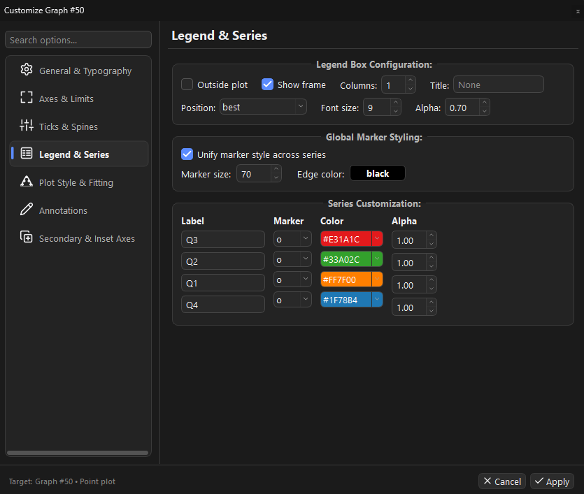 
  <i>Die Kategorie Legend & Series des Customize Graph Dialog.</i>

In der Kategorie **Legend & Series** können Sie Erscheinungsbild und Platzierung der Plot-Legende sowie Farben, Marker, Deckkraft (Alpha) und Linienstärken pro Serie anpassen.

##### Legendenfeld & Serien-Styling { #legend-box-series-styling }

| Bedienelement | Beschreibung |
|---|---|
| **Put legend box outside** | Verschiebt das Legendenfeld rechts neben den Plotbereich, sodass es Ihre Daten nicht verdeckt. Deaktivieren Sie die Option, um es innerhalb des Plots zu platzieren. |
| **Unify marker size / edge color** | Standardmäßig aktiviert: Eine einzige Einstellung für Markergröße und Randfarbe oben gilt für jede Serie. Deaktivieren Sie die Option, um darunter Spalten für Markergröße und Randfarbe pro Serie einzublenden (bei den Typen **Streudiagramm**, **Punkte** und **Trendlinie**), sodass jede Serie individuell skaliert und umrandet werden kann. |
| **Beschriftung** | Bearbeitet den Anzeigenamen jeder Datenserie in der Legende. |
| **Marker** | Wählt ein Markersymbol für jede Serie (verfügbar für **Punkte**- und **Streudiagramm**-Plots). |
| **Farbe** | Wählt eine Farbe für jede Serie aus der vordefinierten Palette. |
| **Alpha / Linienstärke** (Line width) | Deckkraft pro Serie sowie Linienstärke für Typen, die eine Linie zeichnen (**Linie**, **Trendlinie** oder **Punkte** mit aktiviertem Join). |

> **Tipp**: Das Legendenfeld lässt sich mit der Maus direkt auf der Zeichenfläche des Plots an jede beliebige Position **ziehen**.

  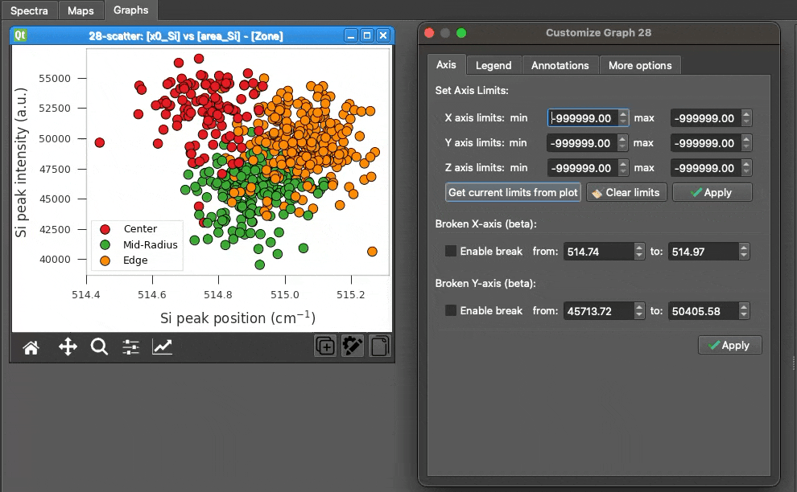 
  <i>Anpassen der Legenden und Farben des ausgewählten Plots.</i>

##### Legendenstil { #legend-style }

| Bedienelement | Beschreibung |
|---|---|
| **Columns / Frame / Title / Font size / Alpha / Position** | Layout und Erscheinungsbild des Legendenfelds selbst. |

---

#### 4.3 Annotations { #43-annotations }

  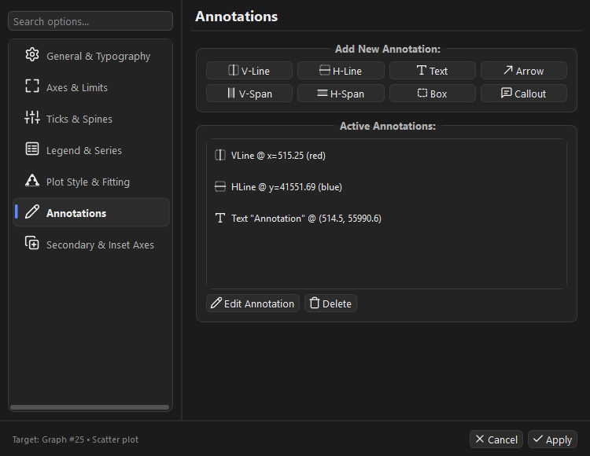 
  <i>Die Kategorie Annotations des Customize Graph Dialog.</i>

In der Kategorie **Annotations** können Sie Referenzlinien, Formen und Textbeschriftungen über Ihren Plot legen.

##### Anmerkungen hinzufügen { #adding-annotations }

Klicken Sie oben auf eine der Schaltflächen, um eine Anmerkung in der Mitte der aktuellen Plot-Ansicht hinzuzufügen:

| Schaltfläche | Beschreibung |
|---|---|
| **V-Linie** (V-Line) / **H-Linie** (H-Line) | Fügt eine vertikale bzw. horizontale Referenzlinie hinzu (Standard: rot bzw. blau, gestrichelt). |
| **Text** | Fügt eine Textbeschriftung mit abgerundetem Hintergrundfeld hinzu (Standard: gelber Hintergrund). |
| **Pfeil** (Arrow) | Fügt einen Punkt-zu-Punkt-Pfeil hinzu. |
| **V-Bereich** (V-Span) / **H-Bereich** (H-Span) | Fügt ein schattiertes vertikales bzw. horizontales Band zwischen zwei Werten hinzu. |
| **Rechteck** (Box) | Fügt ein gefülltes oder lediglich umrandetes Rechteck hinzu. |
| **Hinweisbox** (Callout) | Fügt eine Textbeschriftung mit einem Zeigepfeil auf einen bestimmten Datenpunkt hinzu. |

##### Anmerkungen verwalten { #managing-annotations }

Alle aktuellen Anmerkungen werden unterhalb der Schaltflächen aufgelistet. Wählen Sie eine Anmerkung aus, um sie über **Edit** zu bearbeiten oder mit **Löschen** zu entfernen. Der Bearbeitungsdialog jedes Anmerkungstyps stellt die jeweils relevanten Eigenschaften bereit — Farbe, Stil und Stärke von Linie/Bereich/Rechteck; Textinhalt, Schriftgröße, Farbe und Hintergrund; Endpunkt und Zeigeposition von Pfeil bzw. Hinweisbox.

> **Tipp**: Anmerkungen lassen sich direkt auf der Zeichenfläche des Plots **verschieben**. Ihre Positionen bleiben beim Speichern des Arbeitsbereichs erhalten. Ein Doppelklick auf eine Anmerkung auf der Zeichenfläche öffnet ebenfalls ihren Bearbeitungsdialog.

  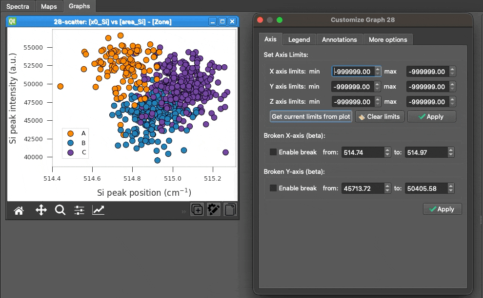 
  <i>Anpassen von Position und Erscheinungsbild der Anmerkungen im ausgewählten Plot.</i>

---

#### 4.4 Allgemein & Typografie und Plot-Stil & Fitting { #44-general-typography-and-plot-style-fitting }

  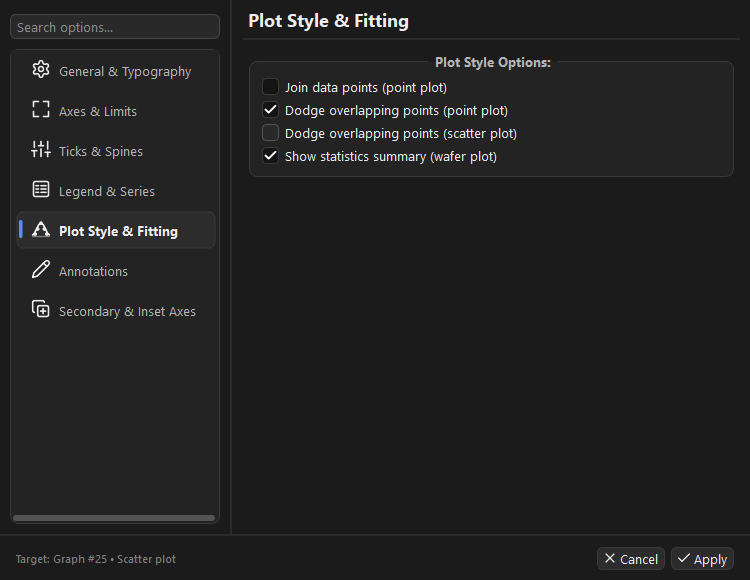 
  <i>Typografie, Sortierung und stilspezifische Optionen im Customize Graph Dialog.</i>

Die Kategorien **Allgemein & Typografie** und **Plot-Stil & Fitting** fassen globale Typografie-, Theme- und Sortiereinstellungen neben stilspezifischen Steuerelementen (Fehlerbalken, Trendlinien und Histogramme) zusammen.

##### Plot-Stil-Optionen & Fehlerbalken (`Plot-Stil & Fitting`) { #plot-style-options-error-bars-plot-style-fitting }

Diese Steuerelemente passen sich an den aktiven Plot-Typ an:

| Option | Anwendbarer Typ | Beschreibung |
|---|---|---|
| **Join data points** | **Punkte** | Verbindet die Mittelwerte zwischen Kategorien mit Linien. |
| **Dodge overlapping points** | **Punkte** | Versetzt sich überlappende Farbgruppen horizontal, um Überdeckungen zu vermeiden. |
| **Dodge overlapping points** | **Streudiagramm** | Versetzt sich überlappende Farbgruppen bei Streudiagrammen horizontal. |
| **Show statistics summary** | **Wafer** | Blendet eine statistische Zusammenfassung (Mittelwert, Standardabweichung, Min, Max, Homogenität) auf der Wafer-Karte ein. |
| **Show error bars** | **Balken** | Zeigt Fehlerbalken am oberen Ende jedes Balkens an. |
| **Error bar type** | **Punkte**, **Linie**, **Balken** | **Std.-Abw.** (Std. Dev.), **Std.-Fehler** (Std. Error), **95-%-KI** (95% CI) oder **Keine** (None) (verfügbare Optionen hängen vom Plot-Typ ab). |
| **Cap size** | **Punkte**, **Linie**, **Balken** | Breite der horizontalen Endkappen der Fehlerbalken. |

##### Anzeige, Gitter & Schriftgrößen (`Allgemein & Typografie`) { #display-grid-font-sizes-general-typography }

| Option | Anwendbarer Typ | Beschreibung |
|---|---|---|
| **Figure theme** | alle Typen | Farbschema der Abbildung: **Hell** (Light) oder **Dunkel** (Dark). |
| **X label rotation** | alle Typen | Dreht die Teilstrichbeschriftungen der X-Achse (0–90°). |
| **Gitterlinien anzeigen** (Show grid lines) | alle Typen | Schaltet die Hintergrund-Gitterlinien des Plots ein oder aus. |

Stellen Sie die Punktgröße von **Title**, **Axis label**, **Tick label** und **Colorbar** unabhängig ein (Standardwerte: 12/12/9/10). Die Größe für **Colorbar** steuert den Text der Teilstrichbeschriftungen auf Farbskalen von **Wafer**-/**2D-Karte**-Plots. Der Untertitel hat keine eigene Größensteuerung — er wird stets 2 pt kleiner als der Titel dargestellt; sein *Text* wird im Seitenpanel und nicht hier bearbeitet.

##### Datensortierung (`Allgemein & Typografie`) { #data-sorting-general-typography }

Steuert die Reihenfolge von Kategorien und Legendeneinträgen:

| Option | Beschreibung |
|---|---|
| **Intelligente Datensortierung aktivieren** (Enable intelligent data sorting) | Wenn aktiviert, wird der zugrunde liegende Datensatz vor dem Plotten deterministisch sortiert (empfohlen). Wenn deaktiviert, behält der Plot exakt die ursprüngliche Zeilenreihenfolge des Datensatzes bei. |
| **Sort by** | Wenn die Sortierung aktiviert ist, wählen Sie die Zielachse für die Sortierung: - **Z (Farbwerte)** (Z (hue values)): Sortiert Kategorien primär nach Legendengruppe (Standard). - **X-Werte** (X values): Sortiert die Kategorien der X-Achse. - **Y-Werte** (Y values): Sortiert die Daten aufsteigend nach der Y-Metrik. |

> **Hinweis**: Das Deaktivieren der intelligenten Datensortierung ist nützlich, wenn Ihr Datensatz bereits vorsortiert ist und Sie diese Reihenfolge ausdrücklich beibehalten möchten. Wenn Sie die Sortiereinstellungen ändern, werden die Legendenfarben automatisch auf die Standard-Palettenreihenfolge zurückgesetzt, um ein sauberes, positionsgebundenes Farbschema sicherzustellen.

##### Trendlinien-Einstellungen (`Plot-Stil & Fitting`) { #trendline-settings-plot-style-fitting }

Nur sichtbar, wenn der Plot-Typ **Trendlinie** gewählt ist:

| Option | Beschreibung |
|---|---|
| **Polynomgrad** (Polynomial order) | Legt den Grad der Polynomanpassung fest (1 = linear, 2 = quadratisch, …, bis zu 10). |
| **Ankerpunkt** (Anchor point) | Erzwingt, dass die Anpassungskurve durch einen bestimmten Punkt verläuft. Wählen Sie **Origin (0, 0)** oder geben Sie einen benutzerdefinierten Punkt **custom (X₀, Y₀)** ein. |
| **Fit equation(s)** | Zeigt die berechnete Gleichung und den R²-Wert für jede Farbgruppe in einer Tabelle an. Klicken Sie auf **Kopieren**, um sie als tabulatorgetrennten Text zu exportieren (direkt in Excel einfügbar). |

##### Histogramm-Einstellungen (`Plot-Stil & Fitting`) { #histogram-settings-plot-style-fitting }

Nur sichtbar, wenn der Plot-Typ **Histogramm** gewählt ist:

| Option | Beschreibung |
|---|---|
| **Bins** | Anzahl der Histogramm-Klassen (2–500, Standard: 20). |
| **Overlay KDE curve** | Überlagert das Histogramm mit einer geglätteten Kerndichteschätzung (KDE-Kurve). |
| **Fill style** | Wählen Sie **Gefüllt** (Filled) für ausgefüllte Balken (Standard) oder **Step** (nur Umrisslinie). |

> **Farbskalierung (Wafer / 2D-Karte)**: Die Normalisierung der Farbskala (**Linear** / **Logarithmisch** / **Zentriert**) befindet sich unter **Achsen & Grenzen** als **Z axis Scale**.

 

_____

### **5. Datenfilterung** { #5-data-filtering }

Sie können die dargestellten Daten dynamisch filtern, indem Sie im Feld **Filter** boolesche Logikausdrücke im Format `(column_name) (operator) (value)` anwenden.

> **Hinweis**: Zeichenkettenwerte müssen in doppelte Anführungszeichen (`"text"`) eingeschlossen werden. Spaltenüberschriften mit Leerzeichen müssen in Backticks (`` `column name` ``) stehen.

  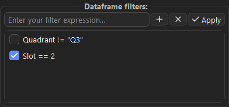 
  <i>Ein Beispiel zur dynamischen Anwendung von Filtern auf einen Datensatz.</i>

 

| Filterausdruck | Resultierendes Verhalten |
|---|---|
| `Confocal != "high"` | Schließt alle Datenpunkte aus, bei denen die Spalte „Confocal“ den Wert „high“ hat. |
| `Thickness == "1ML" or Thickness == "3ML"` | Schließt nur die Datenpunkte ein, bei denen die Spalte „Thickness“ exakt „1ML“ oder „3ML“ entspricht. |
| `` `Laser Power` <= 5 `` | Schließt Datenpunkte ein, bei denen die Spalte „Laser Power“ kleiner oder gleich 5 ist. |

_____

### **6. Statistische Berechnungen & Fit-Details** { #6-statistical-calculations-fitting-details }

Für statistische Plot-Typen (**Punkte**, **Balken**, **Boxplot** und **Trendlinie**) berechnet **SPECTROview** automatisch wichtige Kennzahlen und visualisiert die Verteilung Ihrer Daten.

#### 6.1 **Punkt- und Balkendiagramme** { #61-point-and-bar-plots }

- **Zentralwert (Mittelwert):** Der primäre Datenpunkt (der Kreismarker in einem **Punkte**-Plot oder die Oberkante des Balkens in einem **Balken**-Plot) stellt das **arithmetische Mittel** aller Y-Werte für eine gegebene X-Kategorie dar.
- **Fehlerbalken (95-%-KI):** Die vom Mittelwert ausgehenden Fehlerbalken repräsentieren das **95-%-Konfidenzintervall** des Mittelwerts. Dieses wird mithilfe des Standardfehlers des Mittelwerts (SEM) berechnet:
  `Error Bar = ± (1.96 × SEM)`
  wobei `SEM = Standard Deviation / sqrt(N)`.

#### 6.2 **Boxplot** { #62-box-plot }

Der **Boxplot** stellt nativ die statistische Verteilung des Datensatzes auf Basis der klassischen Fünf-Punkte-Zusammenfassung dar:

- **Box-Grenzen (Q1 bis Q3):** Der Hauptkörper der Box erstreckt sich vom ersten Quartil (25. Perzentil) bis zum dritten Quartil (75. Perzentil), bekannt als Interquartilsabstand (IQR).
- **Medianlinie:** Die horizontale Linie innerhalb der Box markiert den **Median** (50. Perzentil).
- **Whisker:** Die Whisker erstrecken sich bis zu den äußersten Datenpunkten, die noch innerhalb von `1.5 × IQR` der Box-Kanten liegen.
- **Ausreißer (Fliers):** Alle Datenpunkte außerhalb der Whisker werden explizit als einzelne Ausreißerpunkte eingezeichnet.

#### 6.3 **Schätzung von Trendlinien** { #63-trendline-estimation }

- **Standard-Fit (ohne Anker):** Die Trendlinie wird mithilfe einer gewöhnlichen linearen Regression nach der Methode der kleinsten Quadrate (OLS) berechnet, um ein Polynom des angegebenen Grades anzupassen:
  `y = p₀·xᵈ + p₁·xᵈ⁻¹ + ... + p_d`
  wobei `d` der Polynomgrad ist.

- **Verankerter Fit (durch einen Punkt (x₀, y₀) erzwungen):** Das Koordinatensystem wird so verschoben, dass der Ankerpunkt zum Ursprung wird (`x' = x - x₀`, `y' = y - y₀`). Anschließend wird ein Polynom ohne konstantes Glied (Nulldurchgang) an die verschobenen Variablen angepasst:
  - **Für linearen Grad (1):** Die Steigung `m` wird direkt berechnet als:
    `m = sum(x'_i * y'_i) / sum((x'_i)²)`
  - **Für höhere Grade (>1):** Die verschobenen Daten werden mithilfe eines linearen Kleinste-Quadrate-Lösers ohne Achsenabschnitt angepasst.
  Die angepasste Kurve wird anschließend wieder in den ursprünglichen Koordinatenraum zurückübertragen.

#### 6.4 **Konfidenzintervalle von Trendlinien** { #64-trendline-confidence-intervals }

- **Konfidenzniveau:** Das schattierte Band um Standard-Trendlinien repräsentiert ein **95-%-Konfidenzintervall** für die angepasste mittlere Zielgröße.
- **Schätzmethode:** Das Intervall wird **analytisch** aus den Regressionsresiduen berechnet: Der Standardfehler der Schätzung `SE = sqrt(Σ(yᵢ − ŷᵢ)² / (N − 2))` wird mit der Standardformel für die mittlere Vorhersage `± 1.96 · SE · sqrt(1/N + (x − x̄)² / Σ(xᵢ − x̄)²)` kombiniert, sodass sich das Band zu den Rändern der Daten hin aufweitet. (Dies ersetzt eine frühere Bootstrap-Schätzung über Seaborn; der Arbeitsbereich **Diagramme** verwendet kein Seaborn mehr.)
- **Verankerte Fits:** Konfidenzintervalle werden ausschließlich für standardmäßige, unbeschränkte Fits berechnet und angezeigt. Ist ein Ankerpunkt aktiviert, entfällt das Konfidenzintervallband.
