## **Espace de travail : Graphs**

L'espace **`Graphs`** est entièrement dédié à la visualisation de données, conçu en mettant l'accent sur la simplicité, la rapidité et la personnalisation.

  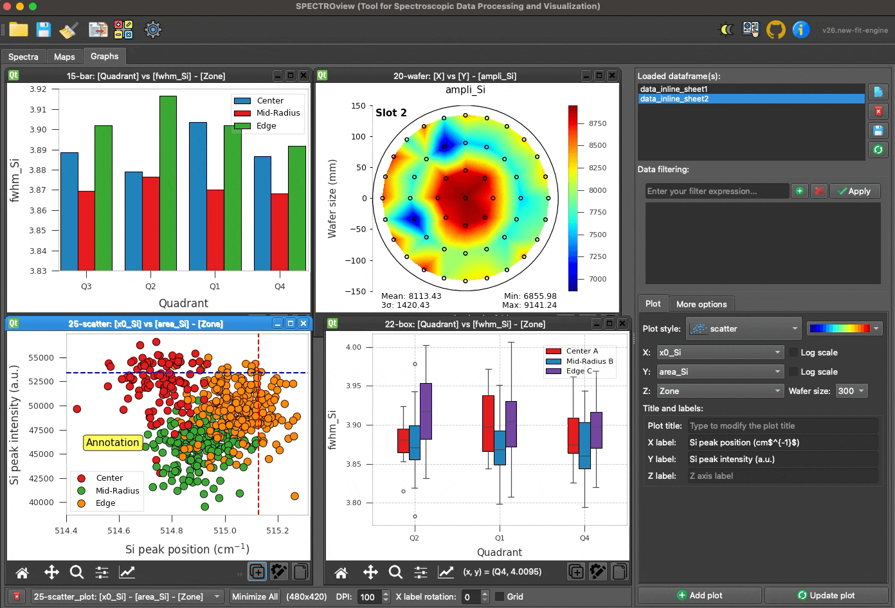 
  <i>Vue d'ensemble de l'interface de l'espace Graphs.</i>

 

_______

### **1. Chargement des données**

Les jeux de données peuvent être transférés directement depuis les espaces `Spectra` et `Maps`, ou importés depuis des fichiers Excel/CSV externes. Tous les jeux disponibles sont suivis dynamiquement et affichés dans la liste des jeux de données.

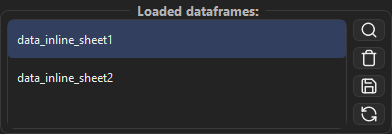 
Les quatre boutons utilitaires disponibles vous permettent de :

- **View** : Inspecter le tableau de données dans une fenêtre dédiée.
- **Delete** : Retirer le jeu de données de l'espace de travail.
- **Save** : Exporter le jeu de données au format Excel ou CSV.
- **Refresh** : Recharger dynamiquement le fichier CSV/Excel s'il a été modifié à l'extérieur.

________

### **2. Ajouter ou mettre à jour un graphique**

1. Sélectionnez votre jeu de données cible dans la liste.
2. Choisissez les colonnes appropriées pour les axes X, Y et Z à l'aide des menus déroulants.
3. Sélectionnez le style de tracé souhaité (styles disponibles : `scatter`, `point`, `bar`, `box`, `line`, `trendline`, `histogram`, `2Dmap`, `wafer`).
4. Définissez les libellés des axes, les limites et le diamètre de plaquette (*wafer*), le cas échéant.
5. Cliquez sur **Add Plot** pour générer la visualisation.

  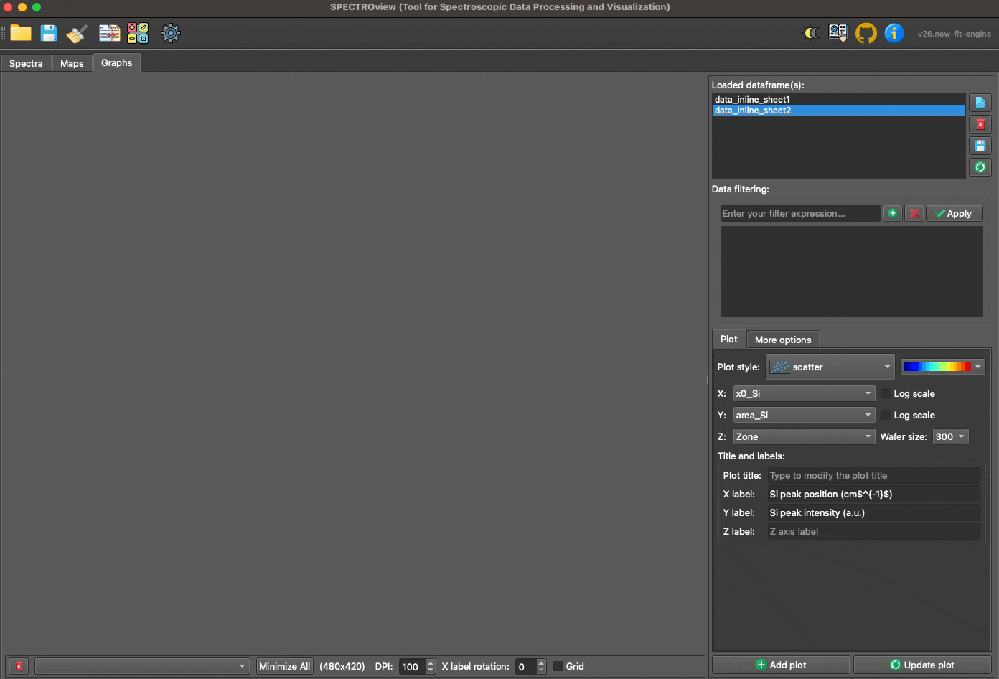 
  <i>Démonstration de l'ajout d'un nouveau graphique ou de la mise à jour d'un graphique existant.</i>

______

### **3. La barre d'outils partagée**

La barre inférieure de l'espace regroupe l'ensemble des commandes globales ainsi qu'une barre d'outils graphique partagée qui agit toujours sur la fenêtre de graphique actuellement active. Pour rendre un graphique actif : cliquez dessus ou choisissez-le dans le menu déroulant **Active plot** du panneau latéral (juste au-dessus de **Add plot** / **Update plot**).

| Commande | Description |
|---|---|
| **Delete all** | Supprime tous les graphiques de l'espace de travail. |
| **Minimize all** | Réduit toutes les fenêtres de graphique. |
| **Undo / Redo** | Annule ou rétablit les modifications dans l'historique de l'espace de travail (`Ctrl+Z` / `Ctrl+Shift+Z`). |
| **Compose Figure** | Assemble plusieurs graphiques ouverts en une seule figure multi-panneaux exportable. |
| **Home / Pan / Zoom / Subplots** | Navigation Matplotlib standard : réinitialiser la vue, déplacer, zoomer par rectangle ou ajuster les marges des sous-graphiques. |

> **Astuce :** Lorsque vous redimensionnez ou déplacez une fenêtre graphique en faisant glisser son bord ou sa barre de titre, un contour s'affiche d'abord. Le graphique n'est retracé qu'une seule fois, à sa nouvelle taille, lorsque vous relâchez la souris, ce qui assure un redimensionnement fluide même pour les graphiques denses. De même, pendant un déplacement (*pan*), les marges autour des axes restent fixes et sont recalculées au relâchement.

Un séparateur vertical marque le début des commandes propres au graphique actif — toujours alignées sur le bord droit de la fenêtre :

| Commande | Description |
|---|---|
| **Replicate** | Crée une copie du graphique actif. |
| **Customize** | Ouvre la fenêtre Customize Graph Dialog pour le graphique actif (`Ctrl+E`, voir ci-dessous). |
| **Copy** | Copie la figure du graphique actif dans le presse-papiers sous forme d'image (`Ctrl+C`). |
| **Export** | Cliquez pour exporter le graphique actif vers un fichier. **Maintenez Ctrl + Clic** pour exporter simultanément tous les graphiques ouverts. |
| **Style menu (🎨)** | Enregistrer/appliquer un style, copier/coller un style (`Ctrl+V` pour coller), réinitialiser par défaut ou définir le style courant comme style par défaut pour les nouveaux graphiques. |

> **Remarque** : Les raccourcis `Ctrl+Z`, `Ctrl+Shift+Z`, `Ctrl+C`, `Ctrl+V` et `Ctrl+E` ci-dessus ne sont actifs que lorsque l'onglet **Graphs** est sélectionné — ils n'interfèrent donc pas avec les mêmes raccourcis ailleurs dans l'application (par exemple lors de la saisie dans un champ texte).

______

### **4. Personnaliser un graphique**

Vous pouvez modifier rapidement les **libellés** des axes et le **titre** du graphique via le panneau latéral droit (`Right Panel`). Cliquez sur le bouton **Update Plot** pour appliquer immédiatement les changements :

  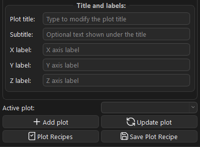 
  <i>Personnalisez le graphique sélectionné via le panneau droit. Cliquez sur Update Plot pour appliquer les modifications.</i>

 

Pour une personnalisation avancée, cliquez sur le bouton **Customize** (⚙) afin d'ouvrir la boîte de dialogue **Customize Graph Dialog** (`Ctrl + E`). La fenêtre propose une interface moderne à deux volets similaire aux Paramètres, dotée d'une recherche globale instantanée sur toutes les options, d'une navigation par catégories à gauche et d'une mise en évidence automatique avec défilement vers l'option recherchée à travers sept catégories modulaires :

- **General & Typography** : Thème de figure (Light/Dark), quadrillage, rotation des étiquettes de l'axe X, tailles de police (Title, Axis label, Tick label, Colorbar) et tri intelligent des données.
- **Axes & Limits** : Limites des axes avec curseurs de plage interactifs (en haut), échelles principales X/Y/Z (Linear, Logarithmic, Symlog, Centered), types de données numérique/catégoriel, inversion des axes et plages d'axes interrompus (*broken axis*).
- **Ticks & Spines** : Orientation des graduations, formats prédéfinis des étiquettes de graduation, graduations secondaires (Top, Bottom, Left, Right) et visibilité des bordures du cadre.
- **Legend & Series** : Emplacement de la légende (à l'intérieur/extérieur), bordure, nombre de colonnes, titre, taille de police, transparence alpha, position, style global des marqueurs et tableau de personnalisation par série.
- **Plot Style & Fitting** : Options spécifiques aux styles (relier les points, décaler les points qui se chevauchent, statistiques *wafer*), contrôles unifiés des barres d'erreur (affichage, type statistique, taille des extrémités), ajustement polynomial de courbe de tendance avec points d'ancrage et tableau des équations, et réglages d'histogramme (classes / courbe KDE).
- **Annotations** : Annotations visuelles sur le graphique (V-Line, H-Line, Text, Arrow, V-Span, H-Span, Box, Callout) avec déplacement interactif sur le canevas et édition modale.
- **Secondary & Inset Axes** : Axes jumeaux secondaires (Y2, Y3, X2 avec libellés, limites, échelle logarithmique, couleurs et marqueurs dédiés) et sous-axes zoomés en incrustation (*Inset*) avec lignes de connexion.

Toutes les modifications effectuées dans les différents onglets sont appliquées ensemble via le bouton unifié **Apply** en bas de la fenêtre, ou annulées via **Cancel**.

---

#### 4.1 Axes & Limits, Ticks & Spines et Secondary & Inset Axes

  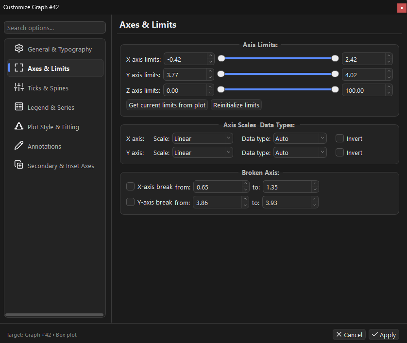 
  <i>Configuration des axes dans Customize Graph Dialog.</i>

Les catégories **Axes & Limits**, **Ticks & Spines** et **Secondary & Inset Axes** contrôlent la mise à l'échelle des axes, les types de données, les limites, l'apparence des graduations et bordures, les coupures d'axes, les vues zoomées incrustées (*inset*) et les axes jumeaux secondaires. Les tailles de police des titres, libellés et graduations se trouvent dans **General & Typography**.

##### Propriétés des axes (`Axes & Limits`)

Configurez indépendamment l'**échelle** et le **type de données** de chaque axe à l'aide des listes déroulantes :

| Paramètre | Options | Description |
|---|---|---|
| **X / Y axis Scale** | `Linear`, `Logarithmic`, `Symlog` | Bascule l'axe entre échelle linéaire, logarithmique et logarithmique symétrique. L'échelle logarithmique n'est appliquée que lorsque les données sous-jacentes sont numériques. |
| **X / Y axis Data type** | `Auto`, `Category`, `Numerical` | Contrôle l'interprétation des valeurs de l'axe. **Auto** (par défaut) : détecte automatiquement le meilleur type — numérique si 100 % des valeurs sont numériques, sinon catégoriel. **Category** : force un indexage catégoriel. **Numerical** : force une échelle numérique continue. |
| **Z axis Scale** *(wafer / 2Dmap uniquement)* | `Linear`, `Logarithmic`, `Centered` | Définit la normalisation de l'**échelle de couleur** de la carte thermique. **Logarithmic** compresse une large dynamique de valeurs (revient en linéaire si les données ne sont pas strictement positives). **Centered** fixe le point médian de la palette sur la valeur **Center value** saisie — idéal pour les données divergentes comme la contrainte/déformation autour de 0. |

> **Remarque** : Avec le type `Numerical`, l'axe adopte une véritable échelle mathématique où l'espacement reflète la valeur numérique réelle. Avec `Category`, chaque valeur unique est espacée régulièrement indépendamment de son ordre de grandeur.

##### Définir les limites des axes (`Axes & Limits`)

Limitez manuellement la plage visible de chaque axe (X, Y, Z) en indiquant les valeurs **min** et **max** :

| Commande | Description |
|---|---|
| **X / Y / Z axis limits** | Saisissez des bornes min et max pour restreindre la plage visible. Laissez un champ non défini (il affiche alors en grisé la valeur actuelle réelle du graphique) pour garder cette borne automatique. |
| **Get current limits from plot** | Capture les limites actuellement visibles sur le graphique et remplit les champs. Pratique comme point de départ avant un réglage fin. |
| **Clear limits** | Réinitialise toutes les limites d'axes en mode automatique. |

  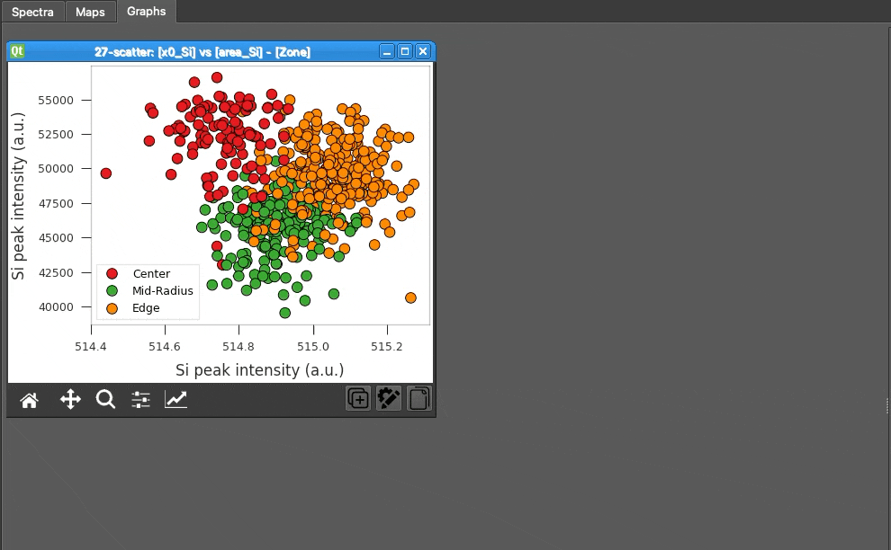 
  <i>Ajustement des limites des axes du graphique sélectionné.</i>

##### Apparence des axes (`Ticks & Spines`)

| Commande | Description |
|---|---|
| **Minor ticks** (X Bottom/Top, Y Left/Right) | Active ou désactive les graduations secondaires indépendamment sur chaque bord du graphique. Par défaut, elles sont activées automatiquement uniquement pour les axes numériques (par exemple X et Y sur les nuages de points, courbes ou histogrammes, et Y sur les barres/boîtes à moustaches/points) et masquées sur les axes catégoriels ou cartes. |
| **Show spines** (Top/Right/Bottom/Left) | Affiche ou masque indépendamment chacune des quatre bordures du cadre. |
| **Tick direction** | `Default`, `In`, `Out` ou `In & Out`. |
| **Tick label format** | `Auto`, `Integer`, `1-decimal`, `2-decimal` ou `Scientific`. |

##### Axe interrompu (`Axes & Limits` — Bêta)

Créez une coupure visuelle sur un axe afin d'omettre une plage sans intérêt et mettre en valeur les zones pertinentes :

| Commande | Description |
|---|---|
| **X-axis break** | Active et spécifie l'intervalle `from` / `to` à couper sur l'axe X. |
| **Y-axis break** | Active et spécifie l'intervalle `from` / `to` à couper sur l'axe Y. |

> **Remarque** : Cette fonctionnalité est en version bêta. Les coupures d'axes fonctionnent de façon optimale avec des échelles linéaires.

##### Axes en incrustation / zoom (`Secondary & Inset Axes`)

Dessinez une petite vue zoomée d'une région du graphique à l'intérieur de la zone principale :

| Commande | Description |
|---|---|
| **Enable inset axes** | Active ou désactive la vue en incrustation. |
| **Position (x0, y0) / Size (w, h)** | Position et taille du cadre d'incrustation, exprimées en fraction de la zone de tracé (0–1). |
| **X / Y limits** | Plage de données zoomée par l'incrustation. Laissez la valeur grisée par défaut pour un ajustement automatique. |
| **Show zoom indicator** | Trace des lignes de connexion entre le cadre d'incrustation et la zone zoomée sur le graphique principal. |

> **Remarque** : Les axes en incrustation et un axe interrompu sont mutuellement exclusifs — activer l'un désactive l'autre.

##### Axes secondaires (`Secondary & Inset Axes`)

Tracez des colonnes Y supplémentaires (ou une seconde colonne X) sur des échelles indépendantes, à raison d'une ligne par axe (**Y2**, **Y3**, **X2**). Chaque ligne s'active dès qu'une colonne est attribuée à cet axe et permet de régler **Label**, les limites **Min/Max**, l'option **Log scale**, **Color** et **Marker**.

---

#### 4.2 Legend & Series

  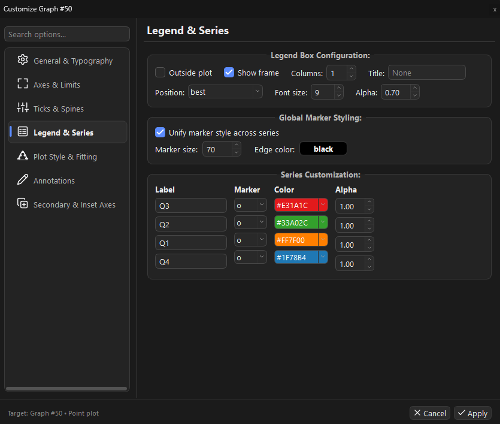 
  <i>La catégorie Legend & Series de Customize Graph Dialog.</i>

La catégorie **Legend & Series** permet de personnaliser l'apparence et l'emplacement de la légende ainsi que les couleurs, marqueurs, transparences et épaisseurs de trait par série.

##### Boîte de légende et style des séries

| Commande | Description |
|---|---|
| **Put legend box outside** | Déplace la boîte de légende à droite de la zone de tracé afin de ne pas recouvrir les données. Décochez pour la placer à l'intérieur du graphique. |
| **Unify marker size / edge color** | Coché par défaut : un seul réglage de taille de marqueur et de couleur de contour en haut s'applique à toutes les séries. Décochez pour afficher les colonnes par série ci-dessous (pour les styles `scatter`/`point`/`trendline`), afin d'ajuster chaque série séparément. |
| **Label** | Modifie le nom affiché dans la légende pour chaque série de données. |
| **Marker** | Choisit un symbole de marqueur pour chaque série (disponible pour les graphiques `point`/`scatter`). |
| **Color** | Sélectionne une couleur pour chaque série dans la palette prédéfinie. |
| **Alpha / Line width** | Transparence par série, et épaisseur de trait pour les styles traçant une ligne (`line`, `trendline`, ou `point` avec l'option Join activée). |

> **Astuce** : La boîte de légende peut être **déplacée à la souris** n'importe où directement sur le canevas du graphique.

  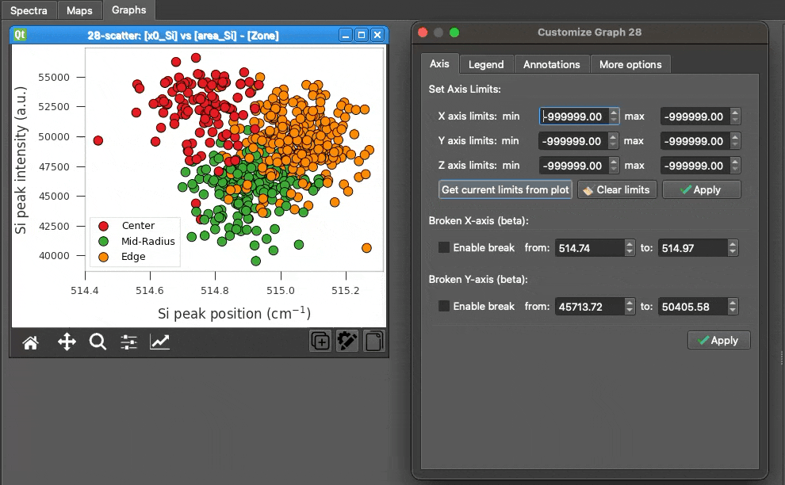 
  <i>Ajustement des légendes et couleurs du graphique sélectionné.</i>

##### Style de la légende

| Commande | Description |
|---|---|
| **Columns / Frame / Title / Font size / Alpha / Position** | Disposition et apparence de la boîte de légende elle-même. |

---

#### 4.3 Annotations

  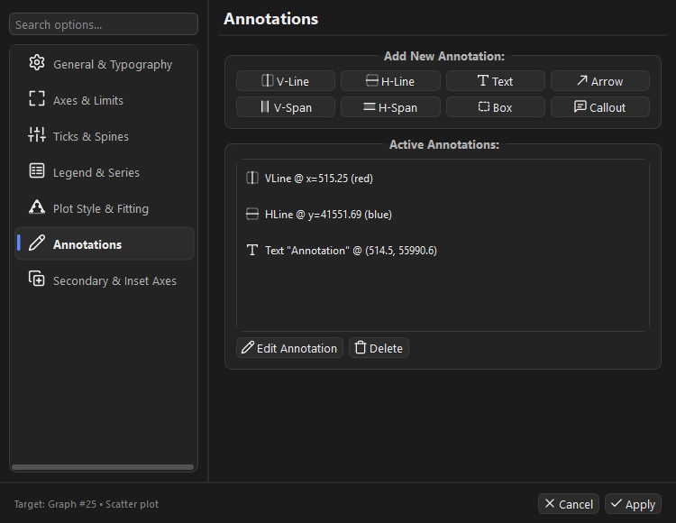 
  <i>La catégorie Annotations de Customize Graph Dialog.</i>

La catégorie **Annotations** vous permet de superposer des lignes de référence, des formes géométriques et des étiquettes textuelles sur votre graphique.

##### Ajouter des annotations

Cliquez sur l'un des boutons en haut pour ajouter une annotation au centre de la vue courante :

| Bouton | Description |
|---|---|
| **V-Line** / **H-Line** | Ajoute une ligne de référence verticale/horizontale (par défaut : rouge/bleu, pointillée). |
| **Text** | Ajoute une étiquette de texte avec fond arrondi (par défaut : fond jaune). |
| **Arrow** | Ajoute une flèche reliant deux points. |
| **V-Span** / **H-Span** | Ajoute une bande ombrée verticale/horizontale entre deux valeurs. |
| **Box** | Ajoute un rectangle plein ou uniquement contouré. |
| **Callout** | Ajoute une étiquette texte munie d'une flèche pointant vers un point précis des données. |

##### Gérer les annotations

Toutes les annotations existantes sont listées sous les boutons. Sélectionnez une annotation pour utiliser **Edit** ou **Delete**. Chaque fenêtre d'édition expose les propriétés propres au type choisi — couleur, style et épaisseur de ligne/bande/cadre ; contenu texte, taille de police, couleur et arrière-plan ; extrémités de flèche et point d'attache.

> **Astuce** : Les annotations peuvent être **déplacées à la souris** directement sur le canevas du graphique. Leur position est conservée lors de la sauvegarde de l'espace de travail. Un double-clic sur une annotation du canevas ouvre également sa boîte d'édition.

  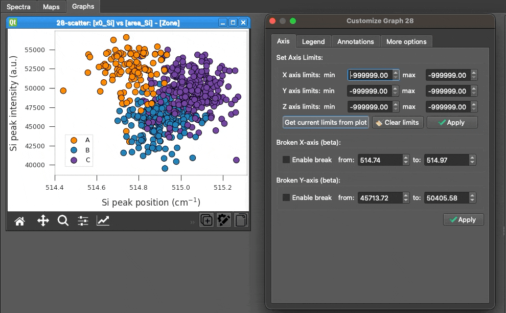 
  <i>Ajustement de la position et de l'apparence des annotations sur le graphique sélectionné.</i>

---

#### 4.4 General & Typography et Plot Style & Fitting

  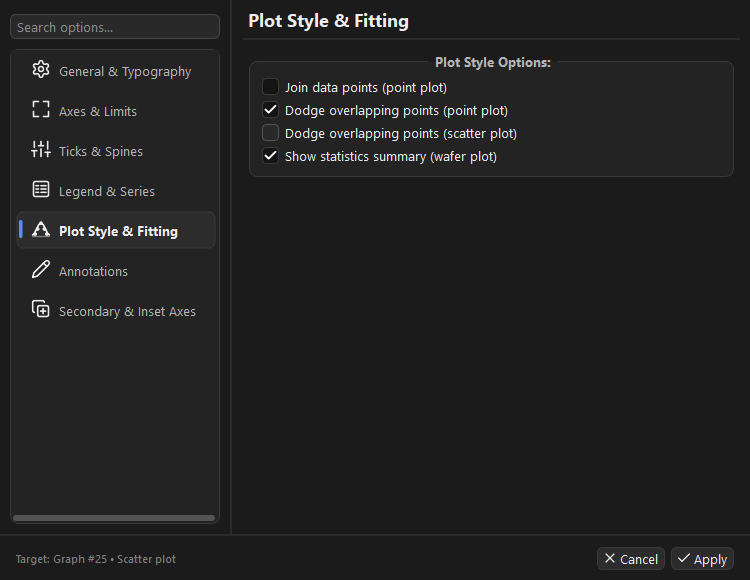 
  <i>Typographie, tri et options spécifiques au style dans Customize Graph Dialog.</i>

Les catégories **General & Typography** et **Plot Style & Fitting** regroupent la typographie globale, le thème et les paramètres de tri ainsi que les commandes propres à chaque style (barres d'erreur, courbes de tendance et histogrammes).

##### Options de style de tracé et barres d'erreur (`Plot Style & Fitting`)

Ces commandes s'adaptent au style de graphique actif :

| Option | Style applicable | Description |
|---|---|---|
| **Join data points** | `point` | Relie les moyennes entre catégories par des segments. |
| **Dodge overlapping points** | `point` | Décale horizontalement les groupes de couleur (`hue`) qui se superposent pour éviter les chevauchements. |
| **Dodge overlapping points** | `scatter` | Décale horizontalement les groupes de couleur qui se superposent sur les nuages de points. |
| **Show statistics summary** | `wafer` | Superpose un résumé statistique (moyenne, écart-type, min, max, uniformité) sur la carte *wafer*. |
| **Show error bars** | `bar` | Affiche des barres d'erreur au sommet de chaque barre. |
| **Error bar type** | `point`, `line`, `bar` | `Std. Dev.`, `Std. Error`, `95% CI` ou `None` (les options dépendent du style de tracé). |
| **Cap size** | `point`, `line`, `bar` | Largeur des embouts horizontaux des barres d'erreur. |

##### Affichage, grille et tailles de police (`General & Typography`)

| Option | Style applicable | Description |
|---|---|---|
| **Figure theme** | tous les styles | Jeu de couleurs de la figure : `Light` ou `Dark`. |
| **X label rotation** | tous les styles | Fait pivoter les étiquettes des graduations de l'axe X (0–90°). |
| **Show grid lines** | tous les styles | Active ou désactive les lignes de grille en arrière-plan du graphique. |

Réglez indépendamment la taille en points de **Title**, **Axis label**, **Tick label** et **Colorbar** (valeurs par défaut : 12/12/9/10). Le réglage **Colorbar** contrôle la taille du texte des graduations sur les barres de couleur des graphiques `wafer`/`2Dmap`. Le sous-titre n'a pas de contrôle de taille propre — il s'affiche toujours 2 pt plus petit que le titre ; son *texte* se modifie dans le panneau latéral et non ici.

##### Tri des données (`General & Typography`)

Contrôle l'ordre d'affichage des catégories et des éléments de légende :

| Option | Description |
|---|---|
| **Enable intelligent data sorting** | Lorsqu'elle est cochée, trie de façon déterministe le jeu de données sous-jacent avant le tracé (recommandé). Si décochée, le graphique respecte strictement l'ordre initial des lignes du jeu de données. |
| **Sort by** | Lorsque le tri est activé, choisissez l'axe cible du tri : - **Z (hue values)** : Trie principalement par groupe de légende (par défaut). - **X values** : Trie selon les catégories de l'axe X. - **Y values** : Trie les données par ordre croissant selon la métrique Y. |

> **Remarque** : Désactiver le tri intelligent est utile si votre jeu de données est déjà pré-trié et que vous souhaitez conserver exactement cette séquence. Lorsque vous modifiez les réglages de tri, les couleurs de la légende sont automatiquement réinitialisées selon l'ordre de la palette par défaut afin de préserver une association chromatique cohérente.

##### Paramètres de courbe de tendance (`Plot Style & Fitting`)

Visibles uniquement lorsque le style de tracé est `trendline` :

| Option | Description |
|---|---|
| **Polynomial order** | Degré de l'ajustement polynomial (1 = linéaire, 2 = quadratique, …, jusqu'à 10). |
| **Anchor point** | Force la courbe à passer par un point donné. Choisissez **Origin (0, 0)** ou saisissez un point **personnalisé (X₀, Y₀)**. |
| **Fit equation(s)** | Affiche l'équation calculée et le coefficient R² pour chaque groupe dans un tableau. Cliquez sur **Copy** pour copier au format texte tabulé (collable directement dans Excel). |

##### Paramètres d'histogramme (`Plot Style & Fitting`)

Visibles uniquement lorsque le style de tracé est `histogram` :

| Option | Description |
|---|---|
| **Bins** | Nombre de classes de l'histogramme (2–500, 20 par défaut). |
| **Overlay KDE curve** | Superpose une courbe lissée d'estimation de densité par noyau (KDE) sur l'histogramme. |
| **Fill style** | Choisissez des barres **Filled** (pleines, par défaut) ou **Step** (contour uniquement). |

> **Échelle de couleur (wafer / 2Dmap)** : la normalisation de l'échelle de couleur (`Linear` / `Logarithmic` / `Centered`) se trouve dans **Axes & Limits** sous le nom **Z axis Scale**.

 

_____

### **5. Filtrage des données**

Vous pouvez filtrer dynamiquement les données tracées à l'aide d'expressions logiques booléennes dans le champ **Filter** selon la syntaxe : `(nom_colonne) (opérateur) (valeur)`.
> **Remarque** : Les chaînes de caractères doivent être encadrées par des guillemets doubles (`"text"`). Les noms de colonnes contenant des espaces doivent être encadrés par des accents graves (`` `column name` ``).

  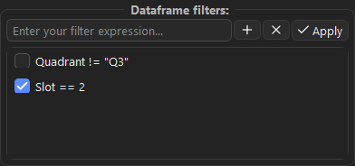 
  <i>Exemple illustrant l'application dynamique de filtres à un jeu de données.</i>

 

| Expression de filtre | Résultat obtenu |
|-------------------|---------|
| `Confocal != "high"` | Exclut tous les points pour lesquels la colonne « Confocal » vaut « high ». |
| `Thickness == "1ML" or Thickness == "3ML"` | Conserve uniquement les points pour lesquels la colonne « Thickness » vaut exactement « 1ML » ou « 3ML ». |
| `` `Laser Power` <= 5 `` | Conserve les points pour lesquels la colonne « Laser Power » est inférieure ou égale à 5. |

_____

### **6. Détails des calculs statistiques et d'ajustement**

Pour les styles de tracé statistiques (`point`, `bar`, `box` et `trendline`), SPECTROview calcule automatiquement les indicateurs clés et représente la distribution de vos données.

#### 6.1 **Graphiques en points et en barres (`point` et `bar`)**

- **Valeur centrale (Moyenne)** : Le point principal (marqueur circulaire d'un tracé `point` ou sommet de la barre d'un tracé `bar`) représente la **moyenne arithmétique** de toutes les valeurs Y pour une catégorie X donnée.
- **Barres d'erreur (IC 95 %)** : Les barres d'erreur de part et d'autre de la moyenne représentent l'**intervalle de confiance à 95 %** de la moyenne, calculé à partir de l'erreur type sur la moyenne (SEM) :
  `Error Bar = ± (1.96 × SEM)`
  où `SEM = Standard Deviation / sqrt(N)`.

#### 6.2 **Boîte à moustaches (`box`)**

Le tracé `box` représente nativement la distribution statistique du jeu de données selon le résumé standard en cinq nombres :

- **Limites de la boîte (Q1 à Q3)** : Le corps de la boîte s'étend du premier quartile (25e percentile) au troisième quartile (75e percentile), soit l'écart interquartile (IQR).
- **Ligne médiane** : Le trait horizontal à l'intérieur de la boîte indique la **médiane** (50e percentile).
- **Moustaches** : Les moustaches s'étendent jusqu'aux points les plus éloignés situés à moins de `1.5 × IQR` des bords de la boîte.
- **Valeurs aberrantes (Fliers)** : Tous les points situés au-delà des moustaches sont représentés individuellement comme points aberrants.

#### 6.3 **Estimation des courbes de tendance (`trendline`)**

- **Ajustement standard (sans ancrage)** : La courbe de tendance est calculée par régression linéaire aux moindres carrés ordinaires (OLS) sur un polynôme du degré spécifié :
  `y = p₀·xᵈ + p₁·xᵈ⁻¹ + ... + p_d`
  où `d` est l'ordre du polynôme.

- **Ajustement ancré (contraint à passer par un point (x₀, y₀))** : Le repère est translaté pour placer le point d'ancrage à l'origine (`x' = x - x₀`, `y' = y - y₀`). Un polynôme sans terme constant (ordonnée à l'origine nulle) est alors ajusté sur les variables translatées :
  - **Pour un ordre linéaire (1)** : La pente `m` est directement calculée par :
    `m = sum(x'_i * y'_i) / sum((x'_i)²)`
  - **Pour des ordres supérieurs (>1)** : Les données translatées sont ajustées sans terme constant par un solveur linéaire aux moindres carrés.
  La courbe ajustée est ensuite ramenée dans l'espace de coordonnées d'origine.

#### 6.4 **Intervalles de confiance des courbes de tendance**

- **Niveau de confiance** : La bande ombrée autour des courbes de tendance standard représente l'**intervalle de confiance à 95 %** de la réponse moyenne ajustée.
- **Méthode d'estimation** : L'intervalle est calculé **analytiquement** à partir des résidus de régression : l'erreur type de l'estimation `SE = sqrt(Σ(yᵢ − ŷᵢ)² / (N − 2))` est combinée à la formule standard de réponse moyenne `± 1.96 · SE · sqrt(1/N + (x − x̄)² / Σ(xᵢ − x̄)²)`, ce qui explique l'élargissement de la bande aux extrémités des données (remplaçant une ancienne estimation par bootstrap sous Seaborn ; l'espace Graphs n'utilise plus Seaborn).
- **Ajustements ancrés** : Les intervalles de confiance ne sont calculés et affichés que pour les ajustements libres. Lorsqu'un point d'ancrage est activé, la bande de confiance est omise.
